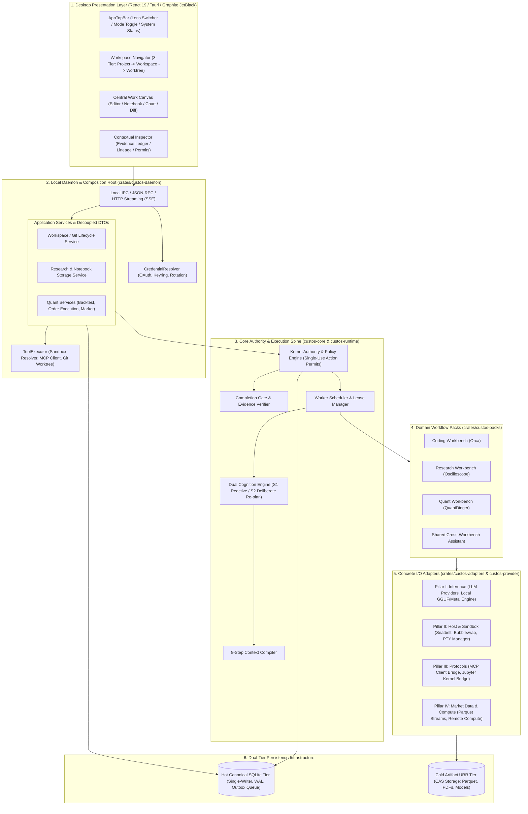
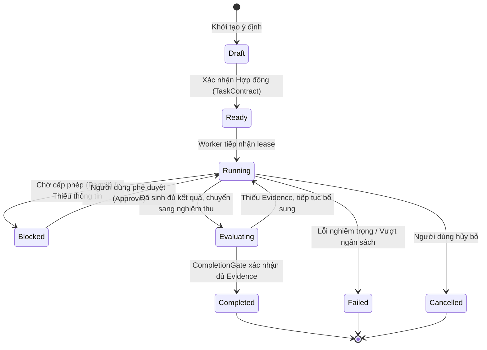

# CUSTOS — MASTER ARCHITECTURAL SPECIFICATION
## Supervised Agent Development Environment (SADE) & Local-First Agentic Infrastructure

> **Single Source of Truth (SSOT)** cho toàn bộ kiến trúc, ranh giới mô-đun, luồng dữ liệu và hợp đồng thực thi của hệ thống Custos.
> Mọi thành viên nhóm phát triển và AI Coding Agents (Cursor, Claude Code, Antigravity, Copilot, Windsurf) bắt buộc phải tuân thủ tài liệu này.

---



---

## 1. Định Vị Sản Phẩm & Hệ Thống 10 Bất Biến (System Invariants)

### 1.1 Bản Chất Cốt Lõi
Custos là một **Supervised Agent Development Environment (SADE) Local-First**: môi trường máy trạm để con người và các AI Agents cùng lập trình, nghiên cứu khoa học, mô hình hóa tài chính và tự động hóa công việc dưới sự giám sát chặt chẽ.
- **Con người sở hữu hệ thống**: AI Agent chỉ đóng vai trò trợ lý đề xuất (`ActionIntent`). Mọi hành động gây đột biến dữ liệu hoặc tác động thế giới thực đều phải qua thẩm quyền phê duyệt (`Permit`).
- **Tối ưu hóa kinh tế thực tế**: Tối ưu hóa trên chi phí thực tế cho mỗi tác vụ được nghiệm thu thành công ($\text{CostPerAcceptedTask}$), không chạy theo các benchmark giả lập.

### 1.2 Hệ Thống 10 Bất Biến Bất Khả Xâm Phạm (Inviolable Invariants)
Mọi dòng mã nguồn trong Custos phải tuân thủ nghiêm ngặt 10 bất biến sau:

| Mã Bất Biến | Tên Bất Biến | Ràng Buộc Kỹ Thuật Bắt Buộc |
|---|---|---|
| **INV-01** | **Actor Attribution** | Mọi biến động trạng thái (state transition), cập nhật schema hoặc sửa đổi dữ liệu đều phải gắn định danh Actor (`User`, `DaemonKernel`, `S2Planner`, `WorkerRun`). Cấm tuyệt đối hành động nặc danh. |
| **INV-02** | **Boundary Invariance** | Mô hình ngôn ngữ (LLM) không bao giờ có thể tự nới rộng `Scope`, tự gỡ cờ `LocalOnly`, tự đổi `ModelPin` hoặc tự tăng `BudgetLimit` của tác vụ. |
| **INV-03** | **Permit Requirement** | Mọi hiệu ứng ngoại vi có rủi ro (ghi đĩa, chạy shell, gửi network, giao dịch) bắt buộc phải có một `ExecutionPermit` hợp lệ được ký bởi Kernel trước khi dispatch. |
| **INV-04** | **No Untrusted Policy** | Dữ liệu đến từ nguồn không tin cậy (repo ngoài, web, email, MCP tool output) mang cờ `Taint::Untrusted` và tuyệt đối không được tự động chuyển hóa thành chỉ thị điều hành hệ thống. |
| **INV-05** | **Evidence-Backed Completion** | Tiêu chí nghiệm thu (`Criterion`) chỉ được chuyển sang `Pass` khi có đối tượng `Evidence` hợp lệ, còn hạn và trỏ đúng nguồn lưu trữ hoặc log kiểm thử thực tế. |
| **INV-06** | **Explicit Uncertainty** | Các giá trị `Unknown`, `Stale`, `Uncertain` là kết quả báo cáo hợp lệ và trung thực. Cấm việc tự suy đoán thành công khi thiếu dữ liệu kiểm chứng. |
| **INV-07** | **No Phantom Distributed Atomicity** | Hiệu ứng bên ngoài hệ quản trị SQLite không được tuyên bố là atomic. Mọi hiệu ứng phải đi qua Outbox Pattern: `Pending -> Approved -> Dispatching -> Receipted`. |
| **INV-08** | **No Implicit Delegation** | Việc chuyển giao công việc giữa các agent hoặc phân rã sub-task không tự động kế thừa toàn bộ quyền của tác vụ cha (Delegation Diminishment). |
| **INV-09** | **Audited Transports** | Mọi lượt gọi mô hình đều phải ghi nhận rõ cơ chế vận chuyển (`LocalInference`, `DirectVendorSdk`, `McpSamplingCallback`) kèm chi phí thực hoặc cờ `CostUnknown`. |
| **INV-10** | **Single Model First-Class** | Một model mạnh hoặc native harness là đường cơ sở; phối hợp multi-worker chỉ được kích hoạt khi chứng minh được lợi ích vượt trội về chất lượng và chi phí. |

### 1.3 Năm Nguyên Tắc Vàng (The Five Golden Rules)
1. **S1 Fast Fabric không bao giờ tự ký Permit**: Tầng phản xạ nhanh chỉ phát hiện pattern và cảnh báo, không có quyền phê duyệt.
2. **S2 Planner không bao giờ tự đánh dấu Completion**: Tầng lập kế hoạch chỉ trình bằng chứng; chỉ có `CompletionGate` mới có quyền chốt hoàn thành.
3. **Người dùng không bao giờ viết lại quá khứ**: Nhật ký sự kiện (`Event Ledger`) là append-only bất biến; chỉ có thể bù đắp bằng compensating transaction mới.
4. **Meta Engine không tự áp đặt Policy**: Mọi đề xuất tối ưu hóa điều phối ngoại tuyến phải qua con người xác nhận trước khi nạp vào Runtime.
5. **Orchestration Intelligence (OI) không tự nới quyền**: Bộ định tuyến không được chọn công cụ hoặc cấu hình vượt quá hạn mức ngân sách và phạm vi của `TaskContract`.

---

## 2. Ranh Giới Kiến Trúc 11 Canonical Crates

Mã nguồn Custos được tổ chức thành đúng 11 product crates theo 5 tầng trách nhiệm nghiêm ngặt. Ranh giới này là bất biến:

```text
crates/
├── custos-domain/        # [Layer 0] Pure values, identities, financial & statistical math (Zero-I/O)
├── custos-core/          # [Layer 1] Capability ports, kernel authority, budget gates, task state machine
├── custos-provider/      # [Layer 1] Model adapter port, token streaming, provider compatibility
├── custos-persistence/   # [Layer 2] Single-writer SQLite, migrations (0001–0045+), Outbox, URR index
├── custos-runtime/       # [Layer 2] Supervised execution, worker leases, cognition loop, context compiler
├── custos-adapters/      # [Layer 2] 4 Concrete I/O Pillars (Inference, Host, Protocols, Resources)
├── custos-packs/         # [Layer 3] Domain packs (assistant, coding/orca, research/oscilloscope, quant)
├── custos-daemon/        # [Layer 3] Application composition, Local API, atomic admission (Composition Root)
├── custos-sdk/           # [Layer 4] Typed Local API client, envelope serialization, UniFFI
├── custos-bridge/        # [Layer 4] Session/Task promotion, IPC routing (Zero execution runtime)
└── custos-cli/           # [Layer 4] Terminal TUI operator interface (ratatui, clap)
```

### Bảng Ma Trận Phân Tầng

| Tầng | Crate | RACI | Trách Nhiệm Cốt Lõi | Ràng Buộc Nghiêm Ngặt |
|---|---|:---:|---|---|
| **Layer 0** | [`custos-domain`](crates/custos-domain) | Vĩ | Thực thể `Task`, `Session`, `OrderTicket`, `Evidence`. Thuật toán PBO, CSCV, Sharpe, DSR, Risk Gate. | **Zero-I/O:** Không std::fs, không network, không tokio, không sqlite. Phụ thuộc duy nhất `std`, `serde`, `chrono`. |
| **Layer 1** | [`custos-core`](crates/custos-core) | Vĩ | `AuthorityEngine`, `CompletionGate`, `StoragePort`, `OutboxPort`, `DecisionPort`. | Chỉ phụ thuộc `custos-domain`. Không gọi SQLite trực tiếp. |
| | [`custos-provider`](crates/custos-provider) | Vĩ | `ProviderPort`, stream tokens, transformer request/response. | Không hardcode SDK vendor bên thứ ba; dùng HTTP clients chuẩn. |
| **Layer 2** | [`custos-persistence`](crates/custos-persistence) | Trường | SQLite WAL mode, schema migrations (0001–0045+), bảng `tasks`, `sessions`, `outbox`, `ledger`. | **Single-Writer:** Một writer connection duy nhất chống lock; thực hiện Outbox Pattern. |
| | [`custos-runtime`](crates/custos-runtime) | Vinh + Vĩ | Supervised Agent Loop, Cognition S1/S2, Context Compiler 8-step, quản lý worker leases. | Phụ thuộc `custos-core`, `domain`, `provider`. |
| | [`custos-adapters`](crates/custos-adapters) | Trường + Vinh | 4 Trụ cột I/O: Sandbox (Seatbelt/Bubblewrap), PTY Terminal, MCP Client, Jupyter Kernel Client, Market Feeds. | Cách ly toàn bộ I/O nhạy cảm với hệ điều hành và mạng. |
| **Layer 3** | [`custos-packs`](crates/custos-packs) | Vĩ | Kịch bản chuyên biệt: Orca (Coding), Oscilloscope (Research), QuantDinger (Quant), Assistant. | Điều phối các workflow dựa trên `runtime` và `core`. |
| | [`custos-daemon`](crates/custos-daemon) | Vĩ | **Composition Root duy nhất**: Khởi động IPC/HTTP server, Dependency Injection, DTOs & Services. | Nơi duy nhất được phép liên kết concrete adapters với storage. |
| **Layer 4** | [`custos-sdk`](crates/custos-sdk) | Vinh | Typed API client, serialization, UniFFI bindings cho Python/Kotlin. | Không liên kết database hay runtime daemon. |
| | [`custos-bridge`](crates/custos-bridge) | Vinh | Quản lý thăng cấp Session thành Task (`Promotion`). | Không có quyền truy cập trực tiếp `custos-persistence`. |
| | [`custos-cli`](crates/custos-cli) | Vinh | Giao diện dòng lệnh Terminal TUI (`ratatui`, `clap`). | Giao tiếp độc quyền với daemon qua socket/IPC. |

---

## 3. Ba Vùng Tin Cậy (Trust Zones & Security Boundaries)

Hệ thống phân lập an ninh thành 3 vùng tin cậy với cơ chế kiểm soát biên giới nghiêm ngặt:

```
┌────────────────────────────────────────────────────────────────────────┐
│ ZONE A: ZERO-TRUST OUTER PERIMETER                                     │
│ - Phản hồi từ LLM bên ngoài (Unvalidated Completion Text)              │
│ - Dữ liệu thô từ Web/Network, File bên ngoài, Thị trường chưa lọc       │
│ - Các máy chủ MCP bên thứ ba (Untrusted MCP Servers)                   │
├────────────────────────────────────────────────────────────────────────┤
│ ▼ Biên giới: Validation, DTO Deserialization, Lookahead Bias Filter    │
├────────────────────────────────────────────────────────────────────────┤
│ ZONE B: SUPERVISED EXECUTION ZONE                                      │
│ - Sandboxed Workers (OS Bubblewrap / macOS Seatbelt)                   │
│ - Isolated Git Worktrees (Chống làm bẩn working directory của user)    │
│ - Virtual Jupyter Kernels & Bounded PTY Terminals                      │
├────────────────────────────────────────────────────────────────────────┤
│ ▼ Biên giới: Kernel Authority, Action Permits, Hash Matching           │
├────────────────────────────────────────────────────────────────────────┤
│ ZONE C: TRUSTED COMPUTING CORE                                         │
│ - Kernel Authority Engine & Completion Gate                            │
│ - Single-Writer SQLite Transactional Ledger & Outbox Queue             │
│ - Master Keyring & Secret Vault (Zero-Leak Memory Scrubbing)           │
└────────────────────────────────────────────────────────────────────────┘
```

---

## 4. Quản Lý Trạng Thái: Task, Session & FSM

### 4.1 Phân Định Bản Chất
- **Session (Phiên làm việc)**: Thực thể giao tiếp tạm thời giữa người dùng và Agent. Có thể mở ra, đóng lại, xóa đi mà không làm mất tiến trình công việc bên dưới.
- **Task (Tác vụ độc lập)**: Thực thể nghiệp vụ bền vững (`durable entity`). Tồn tại độc lập trong Local Daemon với mục tiêu (`Goal`), tiêu chí nghiệm thu (`Criteria`), ngân sách (`Budget`), và phạm vi (`Scope`).
- **Run (Lượt thực thi)**: Một chu kỳ chạy cụ thể của một Task, sinh ra các biến cố và bằng chứng nghiệm thu.

### 4.2 Máy Trạng Thái Task (Task FSM)


### 4.3 Quy Tắc Thẩm Quyền & Phê Duyệt Tác Vụ
- Mỗi tác vụ nguy hiểm cần một `PermitId` độc nhất, sử dụng một lần (single-use), gắn liền với mã băm SHA-256 của payload tham số.
- Khi daemon khởi động lại sau crash, mọi tác vụ đang dở dang (`InFlight`) tự động chuyển về trạng thái an toàn `Uncertain`. Cấm tuyệt đối việc tự động chạy lại (blind retry) khi chưa đối soát.

---

## 5. Hạ Tầng Dữ Liệu 2 Lớp (Dual-Tier Persistence)

Để giải quyết bài toán hiệu năng và ngăn chặn Database Bloat khi Agent thu thập dữ liệu khổng lồ:

1. **Hot Canonical Tier (Single-Writer SQLite `custos.db` - WAL Mode)**:
   - Quản lý trạng thái tức thời: Task, Session, Conversation Journal, Permission Grants, Audit Ledger, Outbox Queue.
   - Cơ chế Single-Writer: Một luồng ghi duy nhất qua mutex bảo đảm tính toàn vẹn (ACID), triệt tiêu race conditions và chống nghẽn WAL.
2. **Cold Universal Resource Registry Tier (URR - Content-Addressable Storage / Filesystem)**:
   - Lưu trữ các artifact dung lượng lớn: File Parquet thị trường, tài liệu nghiên cứu (PDF, LaTeX), checkpoint mô hình.
   - SQLite chỉ lưu định danh chỉ mục (`urr://<sha256_hash>`). Dữ liệu đọc/ghi trực tiếp từ ổ đĩa theo đường dẫn chuẩn hóa.

### Giao Thức Outbox Pattern Bất Khả Thoái Thác
```text
[Yêu cầu hành động ngoại vi] 
   → Ghi vào Outbox: Status = Pending (Atomic trong SQLite Transaction)
   → Người dùng hoặc Kernel phê duyệt: Status = Approved
   → Worker lấy ra thực thi: Status = Dispatching (Atomic CAS Update)
   → Thực thi xong và ghi nhận biên nhận: Status = Receipted
```
Nếu xảy ra crash giữa chừng, trạng thái chuyển thành `Uncertain` để người dùng kiểm tra đối soát, bảo đảm không bao giờ bị nhân đôi lệnh giao dịch hay thao tác đĩa.

---

## 6. Bốn Không Gian Chuyên Môn (Domain Workbenches)

### 6.1 Coding Workbench (Orca)
- **Worktree Isolation**: Mọi tác vụ sửa mã nguồn của Agent chạy trên một git worktree riêng biệt (`.custos/worktrees/<task_id>`), không làm bẩn branch chính.
- **Sandboxed Execution**: Chạy lệnh build/test qua Sandbox (Bubblewrap trên Linux, Seatbelt trên macOS) ngăn chặn path traversal (`/tmp`, `~/.ssh`).
- **Integration Test Harness**: Tự động so sánh diff, bắt mã thoát (exit code), thu thập stdout/stderr và đối chiếu tiêu chí nghiệm thu.

### 6.2 Research Workbench (Oscilloscope)
- **Interactive Jupyter Bridge**: Kết nối trực tiếp tới Jupyter Kernel qua ZeroMQ/WebSocket, hỗ trợ chạy từng cell, stream kết quả Rich Display (MIME types, bảng dữ liệu, hình ảnh).
- **Lineage & Citation Graph**: Mỗi khẳng định (claim) khoa học được liên kết bằng tọa độ byte chính xác với tài liệu nguồn (PDF/LaTeX).
- **Synthesis Handoff**: Chuyển giao tri thức tổng hợp thành các kịch bản thực nghiệm hoặc đề xuất mã nguồn có kiểm chứng.

### 6.3 Quant Workbench (QuantDinger)
Được cấu trúc hoàn chỉnh theo **Clean Architecture 3-Tier**:
- **DTO Layer (`dto.rs`)**: Các struct có định kiểu mạnh, validate chặt chẽ (`SubmitBacktestRequest`, `CreateOrdersRequest`, `ApproveOrderRequest`, `EvaluateGateRequest`, `ComputeReviewRequest`).
- **Application Service Layer (`services/`)**:
  - `BacktestService`: Quản lý nộp backtest, tính tearsheet, quét lưới grid, chỉ báo kỹ thuật, tính PBO/CSCV.
  - `OrderExecutionService`: Quản lý sinh vé lệnh, duyệt lệnh qua permit, kích hoạt kill-switch khẩn cấp, lấy sổ lệnh.
  - `MarketService`: Quản lý khám phá factor, nạp/lấy nến thị trường, thẩm định Pre-Trade Risk Decision Gate, phân tích hậu giao dịch.
  - *Đặc điểm*: Độc lập 100% với giao thức mạng, không dính dáng `ApiResponse` hay JSON-RPC.
- **Transport Controller Layer (`backtest.rs`, `orders.rs`, `market.rs`)**: Các controller cực mỏng, chỉ parse DTO và gọi Service.
- **Zero-I/O Domain Math**: Thuật toán PBO (Probability of Backtest Overfitting qua CSCV), Deflated Sharpe Ratio (DSR), phát hiện Lookahead Bias chạy 100% in-memory.

### 6.4 Shared Assistant Workbench
- Không gian trao đổi tự nhiên, tiếp nhận ý định ban đầu của người dùng.
- Nhận diện ý định ngầm (Implicit Intent Detection) và thực hiện thăng cấp từ cuộc trò chuyện thông thường thành Task có quản trị (`Promotion`).

---

## 7. Động Cơ Thực Thi & Trình Biên Dịch Ngữ Cảnh 8 Bước

### 7.1 Mô Hình Nhận Thức Kép (Dual-Cognition)
- **Cognition S1 (System 1 - Fast Reactive Loop)**: Thực hiện phản hồi nhanh, gọi công cụ thông thường, phát hiện mẫu bề mặt.
- **Cognition S2 (System 2 - Deliberate Re-planning)**: Kích hoạt khi phát hiện lỗi, mâu thuẫn dữ liệu hoặc ranh giới quyền bị chặn; thực hiện tính toán DAG và lập lại kế hoạch (Replan Engine).

### 7.2 Chu Trình Biên Dịch Ngữ Cảnh 8 Bước (Context Compiler)
Trước khi gửi yêu cầu tới Model Provider, payload ngữ cảnh được biên dịch qua 8 bước:
1. **System Core Prompt**: Nạp các quy tắc bất biến, danh tính Agent và ràng buộc hệ thống.
2. **User Intent & Goal**: Trích xuất mục tiêu tối thượng từ người dùng.
3. **Session State & History**: Lấy lịch sử hội thoại gần nhất có sliding window.
4. **Knowledge Retrieval**: Trích xuất kiến thức liên quan từ URR và local documents.
5. **Inventory & Tool Capabilities**: Khám phá danh mục công cụ khả dụng phù hợp ngữ cảnh.
6. **Governance & Permits**: Chèn các ràng buộc cấp phép và ngân sách token tối đa.
7. **Token Budget Pruning**: Cắt tỉa thông minh theo chi phí để không vượt quá context window.
8. **Final Assembly & Streaming**: Đóng gói payload gửi tới `custos-provider`.

---

## 8. Giao Diện Người Dùng (Desktop UI Architecture)

Nằm tại [`apps/desktop`](apps/desktop) dựa trên React 19, TypeScript và Vite:
- **Graphite JetBlack Token System**: Giao diện tối chuyên nghiệp (OLED JetBlack background, viền Graphite tinh tế, typography Inter/JetBrains Mono).
- **Hệ Thống Phân Cấp 3 Bậc (3-Tier Hierarchy)**:
  `Project → Workspace → Worktree`. Không có cửa sổ trôi nổi vô thừa nhận.
- **Chính Sách Zero-Mock Tuyệt Đối**: Tuyệt đối không sinh dữ liệu sóng sin giả, không fake số liệu. Khi chưa có dữ liệu, hiển thị `WorkbenchEmptyState` kèm hành động nạp nguồn thật.
- **Canvas Smoke Invariant Engine**: 43 bài test bất biến tự động (`tools/canvas-smoke.mjs`) bảo toàn định danh tab, không rò rỉ layout giữa các màn hình làm việc.

---

## 9. Bốn Cổng Kiểm Soát Chất Lượng Bắt Buộc (`xtask gate`)

Mọi thay đổi mã nguồn trước khi merge bắt buộc phải vượt qua toàn bộ 4 cổng kiểm tra tự động:
```bash
cargo run -p xtask -- gate
```
1. **Gate 1 - Desktop Production Build**: Kiểm tra TypeScript types và bundle toàn bộ frontend Vite (`npm run build`).
2. **Gate 2 - Canvas Smoke Invariants**: Chạy 43 bài kiểm thử bất biến giao diện Node.js test runner (`tools/canvas-smoke.mjs`).
3. **Gate 3 - Architecture & Zero-I/O Contracts**: Kiểm tra AST và dependencies của crate `custos-domain` đảm bảo tuyệt đối không có I/O (`tests/architecture_invariants.rs`), kiểm tra Vertical Slice và Contract Schemas.
4. **Gate 4 - Workspace Cargo Check**: Kiểm tra toàn diện kiểu dữ liệu và liên kết trên toàn bộ workspace (`cargo check --workspace --all-targets --offline`).

---
*Tài liệu này là đặc tả chuẩn mực vĩnh cửu (evergreen specification) của Custos. Mọi sửa đổi kiến trúc phải phản ánh đúng hiện trạng mã nguồn thực tế và được bảo vệ bởi các bài test tự động.*
