<div align="center">

<picture>
  <source media="(prefers-color-scheme: dark)" srcset="docs/assets/banner-dark.png">
  <source media="(prefers-color-scheme: light)" srcset="docs/assets/banner.png">
  
</picture>

[ EN ](README.md) · [ VI ](docs/i18n/README.vi.md) · [ DE ](docs/i18n/README.de.md) · [ ZH ](docs/i18n/README.zh.md) · [ JA ](docs/i18n/README.ja.md) · [ KO ](docs/i18n/README.ko.md) · [ ES ](docs/i18n/README.es.md)

</div>

# Custos SADE

> **Supervised Agent Development Environment (SADE) — Local-First, Evidence-Bound, Human-Governed.**

Custos is a local-first development and execution environment for autonomous agents across coding, scientific research, and personal workflow assistance. Unlike simple LLM wrappers or opaque multi-agent orchestrators, Custos enforces strong human supervision, deterministic state persistence, cryptographically audited capability gates, and empirical proof before any task is recognized as complete.

---

## Three Non-Negotiable Pillars

| Pillar | Principle | Architectural Guarantee |
|---|---|---|
| **P1 — Task First-Class** | Tasks live independently of sessions and connections | Durable SQLite WAL persistence, deterministic crash recovery, and idempotent command ledger. |
| **P2 — Proposal ≠ Decision ≠ Effect** | AI proposes; Kernel permits; Gateway executes | Untrusted models emit `ActionIntent`; Kernel signs a single-use `ExecutionPermit`; Sandbox enforces capability gating. |
| **P3 — Evidence-Backed Completion** | No completion without empirical proof | Tasks only pass when backed by objective artifacts (diffs, test execution traces, citation audits); zero phantom completions. |

---

## 10 Inviolable System Invariants

1. **INV-01 (Local-First Sovereignty):** All state, contracts, tasks, and telemetry reside on local storage.
2. **INV-02 (Zero Phantom Atomicity):** State changes commit to SQLite before external actions dispatch.
3. **INV-03 (Permit Before Effect):** No mutation executes without a cryptographically bound `ExecutionPermit`.
4. **INV-04 (Actor Identity Binding):** Actor identity is bound from authenticated transports, never payload claims.
5. **INV-05 (Evidence Over Assertions):** Acceptance criteria require verified empirical artifacts, never model affirmations.
6. **INV-06 (Explicit Capability Truth):** UI surfaces fail closed (`unavailable`/`degraded`) when backend capability is missing.
7. **INV-07 (Worktree Lease Isolation):** Concurrent writes to the same working tree are fenced to prevent data loss.
8. **INV-08 (Resource Headroom Bounding):** All process execution, line buffering, and token pruning respect strict byte limits.
9. **INV-09 (Audited Transports):** Every mutation passes through the idempotent Command Ledger with digest verification.
10. **INV-10 (Human Supremacy):** The human operator retains unconstrained power to pause, steer, or abort tasks at any lifecycle stage.

---

## Operational Mechanics

```mermaid
flowchart LR
    Human[Human Operator] --> Session[Session / Workbench]
    Session --> Task[Durable Task]
    Task --> Context[Context Compilation]
    Context --> Worker[Model / Harness Worker]
    Worker --> Intent[Action Intent]
    Intent --> Gate[Authority Gate & Permit]
    Gate --> Effect[Sandboxed Effect]
    Effect --> Evidence[Objective Evidence]
    Evidence --> Outcome[Verified Completion]
```



---

## System Architecture: The 11 Canonical Rust Crates

Custos strictly separates pure logic from side effects across 11 layered Rust crates:

| Layer | Crate | Core Responsibility |
|---|---|---|
| **Layer 0 (Domain)** | `custos-domain` | Pure domain identities, entity models, state machines, and zero-I/O invariants. |
| **Layer 1 (Core)** | `custos-core` | Task orchestration service, authority engine, and completion verifiers. |
| | `custos-persistence` | SQLite WAL storage, outbox pattern, CAS state transitions, and crash recovery. |
| | `custos-provider` | Provider-neutral model contracts, streaming SSE parsers, and tokenizers. |
| **Layer 2 (Runtime & Bridge)** | `custos-bridge` | Session-to-Task promotion, RPC routing, and local API dispatching. |
| | `custos-runtime` | Agent cognitive loop, context compression (RTK), memory tiers, and execution planners. |
| | `custos-adapters` | OS sandboxes, MCP client adapters, local inference sidecars, and wire translators. |
| **Layer 3 (Domain Packs)** | `custos-packs` | Specialized domain workflows: Engineering, Research, and Assistant packs. |
| **Layer 4 (Entry & Distribution)** | `custos-daemon` | Sole composition root, background daemon server, and local HTTP/JSON-RPC. |
| | `custos-sdk` | Client data transfer objects (DTOs), UniFFI bindings, and transport clients. |
| | `custos-cli` | Terminal operator interface built with `ratatui`. |

---

## Desktop User Interface

The Custos Desktop UI is built with **Vite, React 19, and Tauri 2**:

- **3-Tier Hierarchy:** Navigates seamlessly through `Project -> Workspace -> Worktree`.
- **Graphite JetBlack Token System:** Sleek, high-contrast dark theme optimized for long cognitive sessions.
- **Dedicated Workbenches:**
  - **Engineering:** Files & Changes, Evidence, and Worktree Manager.
  - **Research:** Synthesis Studio, Findings, and Runs Ledger.
  - **Assistant & Shared:** Browser, Terminal, Remote Fleet, and Notes.
- **Zero-Mock Policy:** All UI metrics reflect actual daemon telemetry and fail closed when degraded.

---

## Protocol Hubs & Harness Integration

The Custos daemon serves as a central interoperability gateway through six specialized hubs:

- **Model Hub:** Routes requests across local engines (GGUF, llama.cpp) and cloud providers (Anthropic, OpenAI, Gemini, Bedrock) with automatic fallback.
- **Tool Hub:** Governs Model Context Protocol (MCP) clients and sandboxed system tools.
- **Agent Hub:** Coordinates Agent-to-Agent (A2A) protocols and Agent Communication Protocol (ACP) workflows.
- **Storage Hub:** Coordinates SQLite persistence, blob storage, and structured indexes.
- **Event Hub:** Distributes high-throughput audit telemetry and lifecycle events.
- **Operator Hub:** Provides authenticated local endpoints for CLI and Desktop frontends.

### Native Harness Adapters
Custos wraps and supervises external coding harnesses without altering their internal mechanics:
- **Claude Code:** Stdio subprocess isolation and command wrapping.
- **Codex:** Sandboxed code completion and test execution.
- **Cursor:** Editor buffer synchronization and diff application.
- **Antigravity:** Agentic coding runtime coordination and task synchronization.

---

## Domain Workflow Packs

- **Engineering Pack:** Autonomous software engineering workflows featuring atomic patch bundles, multi-worker fault localization, and three-path execution workspaces (canonical repo, staging fork, and verification sandbox).
- **Research Pack:** Scientific and technical investigation workflows emphasizing reproducibility bundles, iterative claim verification, citation oracles, and experiment tracking.
- **Assistant Pack:** Personal workflow management with multi-tier autonomy, calendar and communication governance, and stable payload scheduling.

---

## Verification & Quality Gates

All contributions must pass the mandatory quality gates:

```bash
# 1. Zero-diagnostic Clippy hard gate (Rust)
cargo clippy --workspace --all-targets -- -D warnings

# 2. Comprehensive test suite (>1,670 tests, 100% pass)
cargo test --workspace --all-targets

# 3. Desktop UI type checking and bundle build
cd ui/desktop && npm run build
```

---

## Documentation & References

- **Architectural Specification:** [Custos.md](Custos.md)
- **Agent & Contributor Rules:** [AGENTS.md](AGENTS.md)
- **Desktop UI Standards:** [.agents/rules/desktop_ui_architecture_standards.md](.agents/rules/desktop_ui_architecture_standards.md)
- **Git PR Delivery Flow:** [.agents/rules/git_pr_workflow.md](.agents/rules/git_pr_workflow.md)
- **Documentation Directory:** [docs/README.md](docs/README.md)
- **Internationalization:** [docs/i18n/README.md](docs/i18n/README.md)

---

## License

Custos is distributed under the **GNU AGPL-3.0-or-later**. It includes a strict Trademark Notice protecting the Custos identity and prohibiting closed-source commercial SaaS wrapping. See [LICENSE](LICENSE) for details.
