<div align="center">

<picture>
  <source media="(prefers-color-scheme: dark)" srcset="docs/assets/banner-dark.png">
  <source media="(prefers-color-scheme: light)" srcset="docs/assets/banner.png">
  
</picture>

[ EN ](README.md) · [ VI ](docs/i18n/README.vi.md) · [ DE ](docs/i18n/README.de.md) · [ ZH ](docs/i18n/README.zh.md) · [ JA ](docs/i18n/README.ja.md) · [ KO ](docs/i18n/README.ko.md) · [ ES ](docs/i18n/README.es.md)

</div>

> **Supervised Agent Development Environment (SADE) — Local-First, Evidence-Bound, Human-Governed.**

Custos is a local-first development and execution environment for autonomous agents across software engineering, scientific research, and personal workflow assistance. Rather than acting as a simple LLM wrapper or opaque multi-agent orchestrator, Custos enforces deterministic state persistence, cryptographically audited capability gates, source-aware context compilation, and empirical proof before any task is recognized as complete.

---

## Core Motivation

Contemporary agentic systems offer significant generation capabilities but suffer from fundamental architectural flaws:

- **Ephemeral Context Loss:** Context is trapped within isolated vendor silos and discarded across tool transitions or session restarts.
- **Unverified Assertions:** Model declarations of completion are trusted without objective verification or reproducible proof.
- **Uncontrolled Side Effects:** External mutations (filesystem edits, network requests, system commands) execute without strict capability gating or audit trails.
- **Fragile State:** System crashes, rate limits, and context overflows abort in-flight work with no deterministic recovery mechanism.
- **Erosion of Human Agency:** Opaque multi-agent loops diminish human supervision and eliminate consequential decision points.

Custos resolves these failures by introducing an evidence-bound operating model where human sovereignty is paramount and every external effect is strictly governed.

---

## Three Non-Negotiable Pillars

| Pillar | Principle | Architectural Guarantee |
|---|---|---|
| **P1 — Task First-Class** | Tasks live independently of sessions and connections | Durable SQLite WAL persistence, deterministic crash recovery, and idempotent Command Ledger. |
| **P2 — Proposal ≠ Decision ≠ Effect** | AI proposes; Kernel permits; Gateway executes | Untrusted models emit `ActionIntent`; Kernel signs a single-use `ExecutionPermit`; Sandbox enforces capability gating via Outbox. |
| **P3 — Evidence-Backed Completion** | No completion without empirical proof | Acceptance criteria only pass when backed by objective, verifiable artifacts (diffs, test execution traces, citation audits); zero phantom completions. |

---

## Operational Mechanics

```mermaid
flowchart LR
    Human[Human Operator] --> Session[Session / Workbench]
    Session --> Task[Durable Task]
    Task --> Context[Context Compilation]
    Context --> Worker[Model / Harness Worker]
    Worker --> Intent[Action Intent]
    Intent --> Gate[Authority Gate & Permit]
    Gate --> Effect[Sandboxed Effect]
    Effect --> Evidence[Objective Evidence]
    Evidence --> Outcome[Verified Completion]
```



---

## Four Specialized Domain Lenses (Vertical Workbenches)

Custos provides tailored interaction models, domain schemas, and verification engines for four distinct cognitive domains:

### 1. Coding Workbench (`workbenches/coding`)
- **3-Path Execution Workspaces:** Isolates work across canonical repository, staging fork, and verification sandbox.
- **Atomic Patch Bundles:** Enforces structured diffs with automated syntax and lint validation prior to staging.
- **Worktree Lease Isolation:** Fences concurrent writes to the same working tree to prevent race conditions and data loss (`ENV-02`).

### 2. Research Workbench (`workbenches/research`)
- **Claim Grounding Hierarchy:** Enforces epistemic rigor across four tiers: `L0 Ungrounded`, `L1 Citation-Backed`, `L2 Peer-Reviewed`, and `L3 Empirically Reproduced`.
- **Citation Coverage Oracle:** Verifies DOI/literature grounding against published papers and rejects self-asserted completion.
- **Synthesis Studio & Notebook Kernels:** Transforms multi-source literature reviews into verifiable hypotheses and reproducible experiment batches anchored to cryptographic `EnvSnapshot` pins (`ENV-04`).

### 3. Assistant Workbench (`workbenches/assistant`)
- **Outbox Approval Queue:** Isolates outgoing communications and critical mutations behind a durable pending approval state.
- **Standing Grants:** Enables policy-based delegation for routine tasks while preserving human escalation for high-risk actions.
- **Logical Scope Anchoring:** Operates over logical project scopes without fabricating artificial Git checkouts.

### 4. Quant Workbench (`workbenches/quant`)
- **Market Data Partitioning:** Anchors strategies to deterministic historical market partitions for zero look-ahead bias.
- **Air-Gapped Backtest Isolation:** Enforces strict network denial (`network_restricted = true`) during strategy backtests to prevent data exfiltration and live order leakage (`ENV-05`).
- **Alpha Signal Verification:** Validates backtest tearsheets, Sharpe/Sortino ratios, and drawdown bounds before signal promotion.

---

## 10 Inviolable System Invariants

1. **INV-01 (Local-First Sovereignty):** All state, contracts, tasks, and telemetry reside on local storage.
2. **INV-02 (Zero Phantom Atomicity):** State changes commit to SQLite before external actions dispatch.
3. **INV-03 (Permit Before Effect):** No mutation executes without a cryptographically bound `ExecutionPermit`.
4. **INV-04 (Actor Identity Binding):** Actor identity is bound from authenticated transports, never payload claims.
5. **INV-05 (Evidence Over Assertions):** Acceptance criteria require verified empirical artifacts, never model affirmations.
6. **INV-06 (Explicit Capability Truth):** UI surfaces fail closed (`unavailable`/`degraded`) when backend capability is missing.
7. **INV-07 (Worktree Lease Isolation):** Concurrent writes to the same working tree are fenced to prevent data loss.
8. **INV-08 (Resource Headroom Bounding):** All process execution, line buffering, and token pruning respect strict byte limits.
9. **INV-09 (Audited Transports):** Every mutation passes through the idempotent Command Ledger with digest verification.
10. **INV-10 (Human Supremacy):** The human operator retains unconstrained power to pause, steer, or abort tasks at any lifecycle stage.

---

## Agent Execution Environment (AEE) & 7 Invariant Gates

An autonomous agent must never execute in a null, unanchored, or speculative environment (`sade-foundations.md`). Custos formalizes the **Agent Execution Environment (AEE)** aggregate across pure domain types (`EnvironmentSpec`, `EnvironmentProfile`, `EnvironmentState`, `EnvSnapshot`, `EnvironmentAssurance`), core ports (`EnvironmentPort`), and runtime coordinators.

Before any agent task mutates state, the system evaluates 7 deterministic invariant gates:

| Invariant | Guarantee | Fail-Closed Policy |
|---|---|---|
| **ENV-01 (Ready State)** | Environment must be in `Ready` (or verified degraded fallback) state. | Rejects mutation if initializing, failed, or torn down. |
| **ENV-02 (Coding Worktree)** | Coding lens strictly requires an isolated Git worktree and non-empty branch. | Refuses execution on dirty shared trees without human waiver. |
| **ENV-03 (Honest Assurance)** | Target assurance must not exceed measured host capabilities (Gate 4). | Host with `ObserveOnly` cannot claim `CustosMediated`; degrades fail-closed. |
| **ENV-04 (Research Corpus)** | Research lens requires validated document corpus and reproducible snapshot pin. | Refuses notebook cell execution if corpus path is unanchored. |
| **ENV-05 (Quant Air-Gap)** | Backtest execution requires complete air-gap isolation (`network_restricted = true`). | Blocks execution if live external sockets are open. |
| **ENV-06 (Idempotent Teardown)** | Teardown is safe to repeat; daemon startup reconciles orphan worktrees and PTYs. | Cleans up zombie processes and stale worktrees on reboot. |
| **ENV-07 (Explicit Degradation)** | Any `Degraded` state transition must specify an auditable reason string. | Refuses anonymous or unrecorded capability degradation. |

---

## Workspace Packages & Architectural Topology

Custos strictly isolates pure domain logic from concrete side effects across layered Cargo workspace packages conforming to Hexagonal Architecture:

| Subsystem | Directory Path | Core Responsibility |
|---|---|---|
| **Domain Layer** | `platform/domain` | Pure aggregate identities, zero-I/O domain models, AEE specifications, and state machines. |
| **Core Contracts & Authority** | `platform/core` | Task orchestration service, authority engine, `EnvironmentPort`, and completion verifiers. |
| **Storage & Persistence** | `platform/storage` | SQLite WAL storage, outbox pattern, CAS `state_version` transitions, and crash recovery. |
| **AI & Model Routing** | `platform/ai` | Provider-neutral `ModelPort` contracts, model catalog, and streaming SSE parsers. |
| **Cognitive Runtime** | `platform/runtime` | Cognitive S1/S2 loop, `EnvironmentCoordinator`, workspace lifecycle, and terminal session routing. |
| **Host Adapters & Sandbox** | `platform/adapters` | OS sandboxes (Seatbelt/Bubblewrap), MCP client, Git worktree driver, and PTY terminals. |
| **Components & Packs** | `platform/components` | Dynamic pack registry, foundation skills, capability descriptors, and tool disclosure compiler. |
| **Assistant Workbench** | `workbenches/assistant` | Personal workflow assistance, calendar/contacts, drafts, and outbox approval. |
| **Coding Workbench** | `workbenches/coding` | Software engineering, 3-path workspaces, atomic diffs, and worktree leases. |
| **Research Workbench** | `workbenches/research` | Literature synthesis, 4-tier claim grounding, ALCE verifier, and notebook executions. |
| **Quant Workbench** | `workbenches/quant` | Quantitative strategies, air-gapped backtests, alpha evaluation, and market data partitions. |
| **Daemon (Composition Root)** | `apps/daemon` | Sole composition root, background server, and Local JSON-RPC/HTTP API dispatcher. |
| **Client SDK & Wire Protocol** | `sdk/` | Rust Local API client SDK (`sdk/client-rust`) and wire protocol DTOs (`sdk/protocol`). |
| **Desktop UI** | `ui/desktop` (`apps/desktop/native`) | Native Tauri 2 + Vite + React 19 desktop frontend and thin native host. |
| **Terminal CLI** | `apps/cli` & `ui/cli/bin` | Headless Rust CLI (`apps/cli`) and interactive Node CLI shell (`ui/cli/bin/custos-cli.js`). |

---

## Desktop User Interface

The Custos Desktop UI is built with **Vite, React 19, and Tauri 2**:

- **3-Tier Hierarchy:** Navigates seamlessly through `Project -> Workspace -> Worktree`.
- **Graphite JetBlack Token System:** Sleek, high-contrast dark theme optimized for long cognitive sessions.
- **Dedicated Workbenches:**
  - **Coding:** Files & Changes, Evidence, and Worktree Manager.
  - **Research:** Synthesis Studio, Findings, and Runs Ledger.
  - **Assistant:** Browser, Terminal, Remote Fleet, and Notes.
  - **Quant:** Tearsheets, Backtest Simulator, and Alpha Strategy Studio.
- **Zero-Mock Policy:** All UI metrics reflect actual daemon telemetry and fail closed when degraded.

---

## Protocol Hubs & Native Harness Integration

The Custos daemon serves as a central interoperability gateway through six specialized hubs:

- **Model Hub:** Routes requests across local engines (GGUF, llama.cpp) and cloud providers (Anthropic, OpenAI, Gemini, Bedrock) with automatic fallback.
- **Tool Hub:** Governs Model Context Protocol (MCP) clients and sandboxed system tools.
- **Agent Hub:** Coordinates Agent-to-Agent (A2A) protocols and Agent Communication Protocol (ACP) workflows.
- **Storage Hub:** Coordinates SQLite persistence, blob storage, and structured indexes.
- **Event Hub:** Distributes high-throughput audit telemetry and lifecycle events.
- **Operator Hub:** Provides authenticated local endpoints for CLI and Desktop frontends.

### Native Harness Supervision
Custos wraps and supervises external coding harnesses without altering their internal mechanics:
- **Claude Code:** Stdio subprocess isolation and command wrapping.
- **Codex:** Sandboxed code completion and test execution.
- **Cursor:** Editor buffer synchronization and diff application.
- **Antigravity:** Agentic coding runtime coordination and task synchronization.

---

## Verification & Quality Gates

Custos enforces five automated, non-negotiable quality gates via `xtask`:

```bash
# Run all 5 canonical quality gates (Packs Invariants, Desktop UI, Canvas Smoke, Architecture Invariants, Cargo Check)
cargo run -p xtask -- gate

# Verify architectural boundaries and zero kernel-workbench leaks
cargo run -p xtask -- check-boundaries

# Run clippy across all targets with zero warnings tolerated
cargo clippy --workspace --all-targets -- -D warnings
```

---

## Documentation & References

- **Architectural Specification:** [Custos.md](Custos.md)
- **Agent & Contributor Rules:** [AGENTS.md](AGENTS.md)
- **Desktop UI Standards:** [.agents/rules/desktop_ui_architecture_standards.md](.agents/rules/desktop_ui_architecture_standards.md)
- **Git PR Delivery Flow:** [.agents/rules/git_pr_workflow.md](.agents/rules/git_pr_workflow.md)
- **Documentation Directory:** [docs/README.md](docs/README.md)
- **Internationalization Index:** [docs/i18n/README.md](docs/i18n/README.md)

---

## License

Custos is distributed under the **GNU AGPL-3.0-or-later**. It includes a strict Trademark Notice protecting the Custos identity and prohibiting closed-source commercial SaaS wrapping. See [LICENSE](LICENSE) for details.
