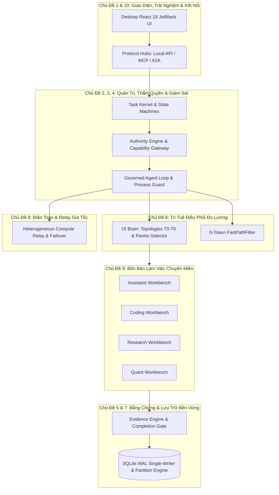

# HỆ ĐIỀU HÀNH TÁC TỬ CUSTOS (SADE) — TRUNG TÂM KIẾN TRÚC THEO CHỦ ĐỀ

> **Định danh hệ thống:** Supervised Agent Development Environment (SADE)  
> **Tài liệu gốc tham chiếu (SSOT):** [`../Custos.md`](../Custos.md)  
> **Chỉ mục tài liệu kỹ thuật chi tiết:** [`architecture/README.md`](architecture/README.md)  
> **Danh mục mã nguồn vật lý:** [`development/codebase-architecture.md`](development/codebase-architecture.md)  
> **Bản diễn giải kiến trúc tiếng Việt:** [`i18n/CUSTOS_RESEARCH_BACKED_ARCHITECTURE_VI.md`](i18n/CUSTOS_RESEARCH_BACKED_ARCHITECTURE_VI.md)

---

## 1. Tầm Quan Trọng Sâu Sắc Toàn Bộ: Tại Sao Custos Tồn Tại?

Các framework đa tác tử (multi-agent) và công cụ lập trình AI thế hệ đầu mắc phải 6 sai lầm kiến trúc mang tính cốt tử:
1. **Mất Ngữ Cảnh Tạm Thời (Ephemeral Amnesia):** Ngữ cảnh bị giam cầm trong từng phiên chat của nhà cung cấp LLM; chuyển tab, đổi mô hình hoặc khởi động lại sẽ làm mất sạch toàn bộ trạng thái.
2. **Ảo Tưởng Hoàn Thành (Hallucinated Completion):** Mô hình tự tuyên bố đã hoàn thành tác vụ nhưng thực tế không có bằng chứng khách quan (test chưa chạy, file chưa ghi, trích dẫn bịa đặt).
3. **Đột Biến Ngoại Vi Không Kiểm Soát (Unchecked Side-Effect Pollution):** Agent tự do gọi tool, sửa file trên đĩa hoặc gửi network request mà không có cổng thẩm quyền phân tầng, dẫn đến ghi đè dữ liệu hoặc phá hoại repo.
4. **Trạng Thái Dễ Đứt Gãy Khi Sự Cố (Brittle Crash State):** Khi tiến trình crash hoặc model rate-limit, công việc dở dang bị hủy hoại, không thể đối soát phục hồi tất định mà thường dẫn đến retry mù nhân đôi tác dụng phụ.
5. **Tiến Trình Ma Chiếm Dụng Tài Nguyên (Zombie Process Leaks):** Subprocess chạy nền (dev servers, agent loops, background compilers) bị bỏ rơi khi run bị hủy, âm thầm chiếm dụng CPU/RAM và khóa file.
6. **Lãng Phí Kinh Tế & Ảo Tưởng Tối Ưu (Economic Waste):** Quảng bá các đồ thị multi-agent phức tạp là "tiết kiệm chi phí" trong khi trên thực tế tỷ lệ lỗi cao làm phát sinh thời gian can thiệp của con người, gây lỗ kinh tế nặng nề.

**Custos giải quyết triệt để toàn bộ 6 sai lầm trên.** Custos là **Durable Control Plane (Mặt phẳng Điều khiển Bền vững)** cho công việc tác tử tự trị. Custos giữ một **Task** sống xuyên suốt nhiều Session, nhiều Model và nhiều Worker; kiểm soát mọi hiệu ứng ngoại vi qua mô hình 2 pha; ghi nhận nguồn gốc xuất xứ (provenance) bằng băm mật mã CAS; tự động đối soát phục hồi sau sự cố; và chỉ công nhận kết quả khi có bằng chứng thực nghiệm độc lập.

---

## 2. Bản Đồ 10 Chủ Đề Kiến Trúc Trọng Tâm (The 10 Thematic Pillars)

Toàn bộ tài liệu kỹ thuật của Custos được tổ chức thành 10 chủ đề kiến trúc chuyên sâu. Mỗi chủ đề giải quyết trọn vẹn một lát cắt trách nhiệm hệ thống:

---

### Chủ Đề 1: Bản Sắc Sản Phẩm SADE, Hệ Sinh Thái Ao Hồ Tác Tử & Đa Thấu Kính
- **Tầm quan trọng cốt tử:** Định vị Custos là môi trường phát triển tác tử có giám sát (SADE), không phải chatbot thông thường. Xây dựng không gian làm việc đa thấu kính (Multi-Lens) và hệ sinh thái "Ao Hồ Tác Tử" (Agent Lake / Living Commons) nơi các agent trao đổi tài nguyên định danh thống nhất (URR).
- **Cơ chế kiến trúc & Bất biến:** Phân tách hoàn toàn giữa trình bày (Screens/Work Areas) và quyền thực thi; chuyển đổi thấu kính không cấp quyền tác động đĩa.
- **Tài liệu chuyên đề:**
  - [`architecture/sade-agent-system-design.md`](architecture/sade-agent-system-design.md): Bản thiết kế tổng thể hệ thống SADE và hợp đồng tương tác workbench.
  - [`architecture/sade-design-and-supervision.md`](architecture/sade-design-and-supervision.md): Cơ chế phối hợp ba thực thể: S1 Heuristics, S2 Deliberation, và Con người.
  - [`architecture/sade-foundations.md`](architecture/sade-foundations.md): Trích xuất hạt nhân điều phối giám sát từ thực nghiệm OrCa.
  - [`architecture/sade-agent-lake-ecosystem.md`](architecture/sade-agent-lake-ecosystem.md): Hệ sinh thái Living Commons, bus sự kiện URR.
  - [`architecture/sade-platform-deep-research-and-refactor.md`](architecture/sade-platform-deep-research-and-refactor.md): Cấu trúc Hexagonal/OOP của platform.
  - [`architecture/workbench-lenses.md`](architecture/workbench-lenses.md): Thiết kế 4 lăng kính giao diện chuyên biệt.

---

### Chủ Đề 2: Hạt Nhân Tác Vụ, Máy Trạng Thái Bền Vững & Tính Liên Tục
- **Tầm quan trọng cốt tử:** Task là thực thể hạng nhất (First-Class Entity) tồn tại độc lập với phiên làm việc (Session) và vượt qua sự cố crash hệ thống.
- **Cơ chế kiến trúc & Bất biến:** 4 máy trạng thái hữu hạn độc lập (Session FSM, Task FSM, Run FSM, Outbox FSM). Bất biến kiểm soát phiên bản `state_version` (CAS) và hàng rào fencing writer cũ.
- **Tài liệu chuyên đề:**
  - [`architecture/kernel-and-task-lifecycle.md`](architecture/kernel-and-task-lifecycle.md): Vòng đời Task, TaskContract, Revision và ContinuationPacket.
  - [`architecture/run-lifecycle.md`](architecture/run-lifecycle.md): Quản trị vòng đời thực thi Run/WorkerRun và chuyển đổi trạng thái `Uncertain`.
  - [`architecture/domain-ownership.md`](architecture/domain-ownership.md): Phân định ranh giới sở hữu kiểu dữ liệu miền, Zero-Kernel Leakage.
  - [`architecture/workspace-binding-rules.md`](architecture/workspace-binding-rules.md): Ranh giới không gian làm việc và worktree Git.

---

### Chủ Đề 3: Động Cơ Thẩm Quyền, Phòng Vệ Bảo Mật & Cổng Năng Lực
- **Tầm quan trọng cốt tử:** Mô hình AI chỉ có quyền đề xuất (`ActionIntent`); chỉ có Kernel được cấp phép (`ExecutionPermit`). Triệt tiêu hoàn toàn các cuộc tấn công Confused Deputy và rò rỉ dữ liệu ngoài sandbox.
- **Cơ chế kiến trúc & Bất biến:** Quy trình hòa giải 2 pha (Two-Phase Mediation: `authorize()` $\rightarrow$ `execute()`). Token năng lực gắn liền lời gọi (IBCT) và nguyên lý suy giảm ủy quyền (`Delegation Diminishment`). Lan truyền vết nhơ dữ liệu `Tainted<T>`.
- **Tài liệu chuyên đề:**
  - [`architecture/authority-and-capability-gateway.md`](architecture/authority-and-capability-gateway.md): Scope, Grant, Permit, Outbox, và đối soát hiệu ứng ngoại vi.
  - [`architecture/security-and-threat-defense.md`](architecture/security-and-threat-defense.md): Mô hình đe dọa, cô lập sandbox (Seatbelt / Bubblewrap) và bộ fixture phản chứng.
  - [`architecture/capability-catalog-and-skills.md`](architecture/capability-catalog-and-skills.md): Danh mục năng lực chuẩn hóa và nạp kỹ năng động.

---

### Chủ Đề 4: Vòng Lặp Agent Có Giám Sát, CLI Agent & Quản Trị Tiến Trình
- **Tầm quan trọng cốt tử:** Bao bọc và giám sát minh bạch các CLI agent bên ngoài (Claude Code, Codex, Aider). Loại bỏ triệt để tiến trình con mồ côi (zombie processes) và chống lặp vô hạn.
- **Cơ chế kiến trúc & Bất biến:** Mẫu Decorator `SupervisedAgentRunner` bọc lấy `AgentDriver` thu thập `StepSpan`. Bộ bảo vệ `ProcessDropGuard` khởi tạo tiến trình với `process_group(0)` và gửi `SIGKILL` đến toàn bộ nhóm tiến trình (`-pid`) khi drop.
- **Tài liệu chuyên đề:**
  - [`architecture/governed-agent-loop.md`](architecture/governed-agent-loop.md): Vòng lặp agent có ngân sách, hủy an toàn, SupervisedAgentRunner và chống zombie.
  - [`architecture/agent-environment.md`](architecture/agent-environment.md): Mô hình môi trường AEE, nhãn đảm bảo honest assurance và 7 cổng bất biến ENV-01..ENV-07.
  - [`architecture/notebook-kernel-binding.md`](architecture/notebook-kernel-binding.md): Ràng buộc kernel Jupyter Python có phạm vi, phân định Document vs Binding, cell versioning.

---

### Chủ Đề 5: Động Cơ Bằng Chứng, Cổng Hoàn Thành & Cô Lập Thẩm Định
- **Tầm quan trọng cốt tử:** "Hoàn thành mà không có bằng chứng chỉ là ảo tưởng" (INV-05). Tác vụ chỉ hoàn thành khi mọi tiêu chí nghiệm thu đều được hậu thuẫn bởi bằng chứng thực nghiệm độc lập.
- **Cơ chế kiến trúc & Bất biến:** Phân cấp bằng chứng 3 tầng (Fact $\rightarrow$ Extraction $\rightarrow$ Semantic). Cô lập bộ thẩm định (Verifier Isolation). Gắn mã băm bất biến CAS hash.
- **Tài liệu chuyên đề:**
  - [`architecture/evidence-and-completion-gate.md`](architecture/evidence-and-completion-gate.md): Cổng hoàn thành, kiểm chứng tiêu chí, và xử lý trạng thái Stale/Unknown/Waiver.
  - [`architecture/three-vertical-acceptance.md`](architecture/three-vertical-acceptance.md): Kiểm thử nghiệm thu chéo đa bàn làm việc (Cross-Pack Acceptance).
  - [`architecture/supervised-experiment-execution-and-recovery.md`](architecture/supervised-experiment-execution-and-recovery.md): Giám sát thực thi thí nghiệm và khôi phục checkpoint.

---

### Chủ Đề 6: Trí Tuệ Điều Phối Đo Lường (OI) & Kinh Tế Học Thực Nghiệm
- **Tầm quan trọng cốt tử:** Từ chối tuyên bố tối ưu chi phí nếu chưa kiểm chứng thực nghiệm. Đưa chi phí can thiệp của con người (\$60/h) và chi phí phục hồi lỗi vào tổng chi phí kinh tế.
- **Cơ chế kiến trúc & Bất biến:** Bộ chọn Pareto đa mục tiêu ($U = w_q Q - w_c C - w_t T$). Bảng giá mô hình thực tế và chiết khấu Prompt Cache Affinity (0.1x). Chuỗi 7 tô pô thực thi T0–T6 (T5 Lead-Worker DAG với thuật toán Kahn và cổng tổng hợp Coverage Threshold $\ge 0.8$). Bộ lọc 0-Token FastPathFilter (< 1ms, \$0.00).
- **Tài liệu chuyên đề:**
  - [`architecture/measured-orchestration-intelligence.md`](architecture/measured-orchestration-intelligence.md): Đặc tả toán học OI, Pareto Selector, Bảng giá model, T5 DAG và FastPath.
  - [`architecture/cognitive-fabric-and-orchestration.md`](architecture/cognitive-fabric-and-orchestration.md): Phối hợp S1 Heuristic, S2 Planner và bất biến Replanner.

---

### Chủ Đề 7: Kiến Trúc Lưu Trữ Bền Vững, SQLite WAL & Partition Engine
- **Tầm quan trọng cốt tử:** Lưu trữ trạng thái cục bộ đáng tin cậy tuyệt đối, không rò rỉ bộ nhớ, chống nghẽn WAL (WAL starvation) và hỗ trợ mở rộng quy mô đa cơ sở dữ liệu.
- **Cơ chế kiến trúc & Bất biến:** Kết nối ghi đơn luồng (Single-Writer SQLite Connection) với WAL mode. Sổ cái lệnh (Command Ledger) chỉ ghi nối tiếp. Cơ chế SQLite Partition Engine (`attach_partition` & `detach_partition`) có regex guard chống SQL injection.
- **Tài liệu chuyên đề:**
  - [`architecture/command-ledger.md`](architecture/command-ledger.md): Sổ cái lệnh bất biến, giao thức đối soát và bảo toàn lịch sử.
  - [`architecture/data-context-and-memory.md`](architecture/data-context-and-memory.md): Phân tầng bộ nhớ, biên dịch ngữ cảnh, quản trị ngân sách token và lưu trữ CAS.

---

### Chủ Đề 8: Điện Toán Dị Thể, Relay Gia Tốc & Tính Liên Tục Huấn Luyện
- **Tầm quan trọng cốt tử:** Hỗ trợ huấn luyện mô hình và suy luận cục bộ song song, chuyển tiếp tác vụ điện toán sang đám mây mà không mất mát checkpoint hay rò rỉ GPU VRAM.
- **Cơ chế kiến trúc & Bất biến:** Khởi tạo lười (lazy initialization) LlamaCppBackend giải phóng VRAM lúc khởi động. Điều phối relay điện toán sang Google Colab, Kaggle, Rented GPU/SSH. Tính liên tục checkpoint 4 cấp độ với kiểm chứng SHA-256 độc lập.
- **Tài liệu chuyên đề:**
  - [`architecture/compute-relay-and-heterogeneous-failover.md`](architecture/compute-relay-and-heterogeneous-failover.md): Chuyển tiếp điện toán và cơ chế failover dị thể.
  - [`architecture/gpu-training-and-inference-coexistence.md`](architecture/gpu-training-and-inference-coexistence.md): Cơ chế cùng tồn tại giữa suy luận cục bộ và huấn luyện GPU.
  - [`architecture/gpu-workload-admission-and-coordination.md`](architecture/gpu-workload-admission-and-coordination.md): Điều phối và cấp phát hạn ngạch GPU/VRAM.
  - [`architecture/remote-compute-colab-kaggle.md`](architecture/remote-compute-colab-kaggle.md): Bộ chuyển đổi điện toán từ xa cho Colab và Kaggle.
  - [`architecture/remote-compute-external-gpu.md`](architecture/remote-compute-external-gpu.md): Quản trị vòng đời node GPU thuê ngoài qua SSH.
  - [`architecture/training-studio-checkpoint-continuity.md`](architecture/training-studio-checkpoint-continuity.md): Tính bền vững của checkpoint huấn luyện 4 tầng.

---

### Chủ Đề 9: Bốn Bàn Làm Việc Chuyên Biệt (Vertical Workbenches)
- **Tầm quan trọng cốt tử:** Đóng gói trọn vẹn nghiệp vụ miền sâu sắc vào từng workbench riêng biệt mà không làm ô nhiễm platform kernel hoặc daemon composition root.
- **Cơ chế kiến trúc & Bất biến:** 4 bàn làm việc chuyên biệt:
  - **Assistant:** Bản thảo trả lời (Drafts), outbox gửi ngoài, lịch trình cá nhân và danh bạ.
  - **Coding:** Kỹ năng code (UI, AST, Test, Git), công thức lập trình (Recipes) trong worktree cô lập.
  - **Research:** Tuyên bố khoa học (Claims), trích dẫn tài liệu, quy trình thẩm định ALCE 4 bước, và saga rollback bù trừ trong `create_task_batch`.
  - **Quant:** Mô hình tài chính, backtest engine, sổ lệnh, bộ thẩm định `DeflatedSharpeVerifier` và `LookaheadBiasChecker`. Daemon chỉ đóng vai trò thin transport adapter.
- **Tài liệu chuyên đề:**
  - [`architecture/domain-packs-and-workflows.md`](architecture/domain-packs-and-workflows.md): Kiến trúc phân hệ miền, jobs, artifacts và verifier obligations.
  - [`architecture/research-workbench-blueprint.md`](architecture/research-workbench-blueprint.md): Bản thiết kế chi tiết bàn làm việc Nghiên cứu Khoa học.
  - [`architecture/quant-workbench.md`](architecture/quant-workbench.md): Bản thiết kế bàn làm việc Tài chính Định lượng.
  - [`architecture/quant-domain-models.md`](architecture/quant-domain-models.md): Mô hình miền tài chính thuần túy.
  - [`architecture/quant-pack.md`](architecture/quant-pack.md): Đóng gói Quant pack và các verifier chống sai lệch dữ liệu.
  - [`architecture/on-demand-packs.md`](architecture/on-demand-packs.md): Cơ chế kích hoạt và phân phối pack theo yêu cầu.

---

### Chủ Đề 10: Giao Thức Kết Nối, Giao Diện Desktop & 5 Cổng Chất Lượng
- **Tầm quan trọng cốt tử:** Trải nghiệm người dùng mượt mà, nhất quán, kết nối mở rộng (MCP, A2A) và bảo đảm chất lượng tự động tuyệt đối trước mỗi lần phát hành.
- **Cơ chế kiến trúc & Bất biến:** Local API đa giao thức (HTTP / IPC). Giao diện Desktop React 19 theo phong cách Graphite JetBlack, phân tầng 3 cấp (Project $\rightarrow$ Workspace $\rightarrow$ Worktree). Quy trình kiểm thử 5 Cổng Chất Lượng (`cargo xtask gate`) vượt qua 100%.
- **Tài liệu chuyên đề:**
  - [`architecture/protocol-and-connectivity-hubs.md`](architecture/protocol-and-connectivity-hubs.md): Trung tâm kết nối Local API, MCP, ACP, A2A.
  - [`architecture/provider-and-adapter-boundaries.md`](architecture/provider-and-adapter-boundaries.md): Ranh giới chuyển đổi giữa Model Provider và External Adapter.
  - [`architecture/desktop-core-interaction-map.md`](architecture/desktop-core-interaction-map.md): Bản đồ tương tác giữa UI Desktop và Backend Daemon.
  - [`architecture/agent-workspace-and-ui.md`](architecture/agent-workspace-and-ui.md): Thiết kế màn hình FilesChangesPane, ScreenSwitcherBar, ActivityRail.
  - [`architecture/upstream-parity-and-release-operations.md`](architecture/upstream-parity-and-release-operations.md): Quy trình đối soát mã nguồn thượng nguồn và phát hành.
  - [`reference/system-invariants.md`](reference/system-invariants.md): 14 Bất biến hệ thống và ma trận thẩm định tĩnh/động.

---

## 3. Lộ Trình Đọc Tài Liệu Theo Vai Trò Kỹ Thuật

| Vai trò Kỹ sư | Mục tiêu chính | Thứ tự đọc khuyến nghị |
|---|---|---|
| **Core & Systems Architect** | Nắm vững Kernel, State Machines, SQLite WAL, Process Guards | 1. [`Custos.md`](../Custos.md) 2. Chủ Đề 2 ([Kernel & Task](architecture/kernel-and-task-lifecycle.md)) 3. Chủ Đề 3 ([Authority & Security](architecture/authority-and-capability-gateway.md)) 4. Chủ Đề 7 ([Storage & Partition Engine](architecture/command-ledger.md)) |
| **AI & Cognition Engineer** | Làm chủ thuật toán OI, Pareto Selector, T0–T6 Topologies, FastPath | 1. Chủ Đề 6 ([Measured OI](architecture/measured-orchestration-intelligence.md)) 2. Chủ Đề 4 ([Governed Agent Loop](architecture/governed-agent-loop.md)) 3. Chủ Đề 5 ([Evidence & Completion](architecture/evidence-and-completion-gate.md)) |
| **Domain Workbench Developer** | Phát triển tính năng cho Assistant, Coding, Research, Quant | 1. Chủ Đề 9 ([Domain Packs & Workbenches](architecture/domain-packs-and-workflows.md)) 2. Chi tiết từng Workbench ([Research](architecture/research-workbench-blueprint.md), [Quant](architecture/quant-workbench.md)) 3. Chủ Đề 1 ([SADE Foundations](architecture/sade-foundations.md)) |
| **Desktop UI / Frontend Engineer** | Xây dựng giao diện React 19, JetBlack Design Tokens, Canvas Smoke | 1. Chủ Đề 10 ([Desktop Interaction Map](architecture/desktop-core-interaction-map.md)) 2. [`development/codebase-architecture.md`](development/codebase-architecture.md) (Mục 3.16 UI Desktop) 3. Chủ Đề 1 ([Workbench Lenses](architecture/workbench-lenses.md)) |
| **AI Coding Agent (Cursor, Claude, etc.)** | Định vị đúng thư mục, số dòng $\le 600$, bảo đảm ranh giới | 1. [`development/codebase-architecture.md`](development/codebase-architecture.md) (Quy trình 5 bước) 2. [`reference/system-invariants.md`](reference/system-invariants.md) (14 bất biến) 3. Cổng kiểm tra `cargo xtask check-boundaries` |
