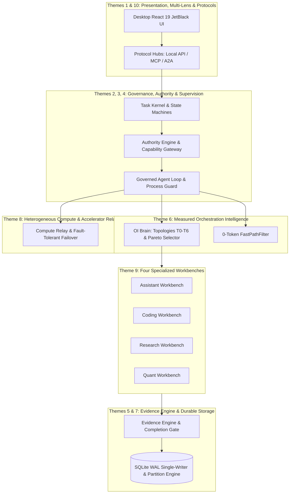

# CUSTOS AGENTIC OPERATING SYSTEM (SADE) — MASTER TOPICAL SPECIFICATIONS

> **System Classification:** Supervised Agent Development Environment (SADE)  
> **Root Single Source of Truth (SSOT):** [`../Custos.md`](../Custos.md)  
> **Thematic Architecture Suite:** [`architecture/README.md`](architecture/README.md)  
> **Physical Codebase Catalog:** [`development/codebase-architecture.md`](development/codebase-architecture.md)  
> **Vietnamese Translation Mirror:** [`i18n/README.vi.md`](i18n/README.vi.md)

---

## 1. Core Purpose: Why Custos Exists

First-generation multi-agent frameworks and naive AI coding assistants suffer from six critical structural flaws:
1. **Ephemeral Amnesia:** Context is imprisoned within individual LLM provider chat sessions; switching tabs, changing models, or restarting the daemon drops all conversational and environmental state.
2. **Hallucinated Completion:** Models self-report task success without objective empirical proof (unexecuted tests, phantom files, fabricated citations).
3. **Unchecked Side-Effect Pollution:** Autonomous agents execute tool calls, mutate filesystem files, or issue network requests without structured multi-tier authority, resulting in data loss and repository corruption.
4. **Brittle Crash State:** Process crashes, network drops, or API rate limits destroy partially completed runs; blind automated retries multiply damaging side effects without deterministic reconciliation.
5. **Zombie Process Leaks:** Subprocesses spawned by agents (dev servers, agent loops, background compilers) become orphaned when runs terminate or abort, leaking CPU/RAM and locking files.
6. **Economic Waste & Pseudo-Optimization:** Monolithic multi-agent graphs are advertised as cost-effective, but in practice high error rates demand expensive human interventions that eliminate paper gains.

**Custos resolves all six failure modes.** Custos functions as a **Durable Control Plane** for autonomous and supervised agent workflows. Tasks persist indefinitely across sessions, models, and workers; all external mutations require two-phase authority mediation; execution artifacts are hashed into content-addressed storage (CAS); crashes reconcile automatically via WAL transactions; and outcomes are admitted strictly upon independent empirical evidence.

---

## 2. Top-Level Thematic Architecture Matrix

The technical documentation is partitioned across 10 master architectural themes:

---

### Theme 1: SADE Product Identity, Agent Lake Ecosystem & Multi-Lens Paradigm
- **Core Responsibility:** Defines Custos as a formal Supervised Agent Development Environment (SADE). Provides an interconnected "Agent Lake" (Living Commons) where heterogeneous agents collaborate via Unified Resource References (URR).
- **Invariants:** Clean presentation decoupling (Screens/Work Areas vs. Execution Authority). Lens switching never grants execution permits.
- **Topical Documents:**
  - [`architecture/sade-agent-system-design.md`](architecture/sade-agent-system-design.md): SADE master system contract and workbench interfaces.
  - [`architecture/sade-design-and-supervision.md`](architecture/sade-design-and-supervision.md): Trilateral coordination: S1 heuristics, S2 deliberative planning, and sovereign human oversight.
  - [`architecture/sade-foundations.md`](architecture/sade-foundations.md): Extraction of the supervised execution kernel.
  - [`architecture/sade-agent-lake-ecosystem.md`](architecture/sade-agent-lake-ecosystem.md): Living Commons event bus and URR descriptors.
  - [`architecture/sade-platform-deep-research-and-refactor.md`](architecture/sade-platform-deep-research-and-refactor.md): Platform modular architecture and ports-and-adapters layering.
  - [`architecture/workbench-lenses.md`](architecture/workbench-lenses.md): Presentation separation across specialist UI lenses.

---

### Theme 2: Task Kernel, Finite State Machines & Durable Continuity
- **Core Responsibility:** Elevates the Task to a first-class citizen persisting indefinitely across sessions and node restarts.
- **Invariants:** 4 isolated finite state machines (Session FSM, Task FSM, Run FSM, Outbox FSM). Optimistic concurrency via `state_version` (CAS) and writer fencing.
- **Topical Documents:**
  - [`architecture/kernel-and-task-lifecycle.md`](architecture/kernel-and-task-lifecycle.md): Task state transitions, TaskContract, Revision, and ContinuationPacket.
  - [`architecture/run-lifecycle.md`](architecture/run-lifecycle.md): Lifecycle of Run/WorkerRun and `Uncertain` state recovery.
  - [`architecture/domain-ownership.md`](architecture/domain-ownership.md): Domain type boundaries and Zero-Kernel Leakage.
  - [`architecture/workspace-binding-rules.md`](architecture/workspace-binding-rules.md): Workspace directory isolation and Git worktree rules.

---

### Theme 3: Authority Engine, Security Defense & Capability Gateway
- **Core Responsibility:** Treat models as untrusted intent proposers (`ActionIntent`). Physical mutations require signed `ExecutionPermit` tokens issued by the kernel.
- **Invariants:** Two-phase mediation (`authorize()` -> `execute()`). Intent-Bound Capability Tokens (IBCT) and Delegation Diminishment. Taint tracking via `Tainted<T>`.
- **Topical Documents:**
  - [`architecture/authority-and-capability-gateway.md`](architecture/authority-and-capability-gateway.md): Scope, Grant, Permit, Outbox, and external effect reconciliation.
  - [`architecture/security-and-threat-defense.md`](architecture/security-and-threat-defense.md): Threat modeling, OS sandboxing (Seatbelt / Bubblewrap), and falsification test fixtures.
  - [`architecture/capability-catalog-and-skills.md`](architecture/capability-catalog-and-skills.md): Typed capability manifests and dynamic skill discovery.

---

### Theme 4: Governed Agent Loop, CLI Agent Supervision & Process Lifecycle
- **Core Responsibility:** Supervises autonomous agent execution loops (Claude Code, Codex, local agents), preventing runaway loops and eliminating orphaned subprocesses.
- **Invariants:** Decorator pattern `SupervisedAgentRunner` wrapping `AgentDriver`. Process group guard `ProcessDropGuard` spawning children with `setpgid(0)` and killing `-pid` with `SIGKILL` upon drop.
- **Topical Documents:**
  - [`architecture/governed-agent-loop.md`](architecture/governed-agent-loop.md): Budgeted agent loops, graceful cancellation, and zombie process elimination.
  - [`architecture/agent-environment.md`](architecture/agent-environment.md): Agent Execution Environment (AEE) model, honest assurance tiers, and gates ENV-01..ENV-07.
  - [`architecture/notebook-kernel-binding.md`](architecture/notebook-kernel-binding.md): Scoped Jupyter Python kernel binding, cell versioning, and reactive output invalidation.

---

### Theme 5: Evidence Engine, Completion Gate & Verifier Isolation
- **Core Responsibility:** "Completion without verifiable evidence is a hallucination" (INV-05). Tasks complete only when acceptance criteria are satisfied by verifiable evidence.
- **Invariants:** 3-tier evidence hierarchy (Fact -> Extraction -> Semantic). Verifier isolation. Content-addressed storage (CAS) cryptographic digests.
- **Topical Documents:**
  - [`architecture/evidence-and-completion-gate.md`](architecture/evidence-and-completion-gate.md): Completion Gate, criterion evaluation, and Stale/Unknown/Waiver handling.
  - [`architecture/three-vertical-acceptance.md`](architecture/three-vertical-acceptance.md): Cross-workbench verification and evaluation framework.
  - [`architecture/supervised-experiment-execution-and-recovery.md`](architecture/supervised-experiment-execution-and-recovery.md): Experiment execution supervision and milestone checkpointing.

---

### Theme 6: Measured Orchestration Intelligence (OI) & Economic Optimization
- **Core Responsibility:** Rejects unverified theoretical claims of multi-agent efficiency. Accounts for human intervention overhead ($60/h) and failure recovery in total economic cost.
- **Invariants:** Pareto multi-objective selector ($U = w_q Q - w_c C - w_t T$). Real model pricing catalogs with prompt cache affinity discounts (0.1x). 7 execution topologies T0–T6 (T5 Lead-Worker DAG with Kahn algorithm and coverage threshold >= 0.8). 0-token FastPathFilter (< 1ms, $0.00).
- **Topical Documents:**
  - [`architecture/measured-orchestration-intelligence.md`](architecture/measured-orchestration-intelligence.md): Mathematical specification of OI, Pareto Selector, pricing models, T5 DAG, and FastPath.
  - [`architecture/cognitive-fabric-and-orchestration.md`](architecture/cognitive-fabric-and-orchestration.md): Coordination between S1 heuristics, S2 planner, and replanner invariants.

---

### Theme 7: Durable Storage Architecture, Relational SQLite WAL & Partition Engine
- **Core Responsibility:** Highly reliable local persistence, zero memory leaks, WAL starvation elimination, and multi-database partitioning.
- **Invariants:** Single-writer connection pool with dedicated multi-reader pool under SQLite WAL. Append-only command ledger. Dynamic partition engine (`attach_partition` & `detach_partition`) with identifier regex guards.
- **Topical Documents:**
  - [`architecture/command-ledger.md`](architecture/command-ledger.md): Immutable command ledger, reconciliation protocol, and history preservation.
  - [`architecture/data-context-and-memory.md`](architecture/data-context-and-memory.md): 3-tier memory model, context compilation, token budgeting, and CAS persistence.

---

### Theme 8: Heterogeneous Compute, Accelerator Relay & Training Continuity
- **Core Responsibility:** Coexistence of local inference and training, compute relay to cloud accelerators without checkpoint loss or VRAM starvation.
- **Invariants:** Lazy initialization of `LlamaCppBackend` eliminating startup VRAM footprint. Compute relay to Colab, Kaggle, and SSH/rented GPU targets. 4-level checkpoint continuity with independent SHA-256 validation.
- **Topical Documents:**
  - [`architecture/compute-relay-and-heterogeneous-failover.md`](architecture/compute-relay-and-heterogeneous-failover.md): Compute relay architecture and heterogeneous failover.
  - [`architecture/gpu-training-and-inference-coexistence.md`](architecture/gpu-training-and-inference-coexistence.md): Resource coexistence between inference and training.
  - [`architecture/gpu-workload-admission-and-coordination.md`](architecture/gpu-workload-admission-and-coordination.md): GPU hardware admission gates and VRAM quotas.
  - [`architecture/remote-compute-colab-kaggle.md`](architecture/remote-compute-colab-kaggle.md): Ephemeral compute adapters for Colab and Kaggle.
  - [`architecture/remote-compute-external-gpu.md`](architecture/remote-compute-external-gpu.md): Fleet lifecycle management for rented GPU instances.
  - [`architecture/training-studio-checkpoint-continuity.md`](architecture/training-studio-checkpoint-continuity.md): 4-level training checkpoint durability.

---

### Theme 9: Four Specialized Workbenches (Vertical Domain Isolation)
- **Core Responsibility:** Encapsulates domain expertise into 4 sovereign workbenches without polluting the platform kernel or daemon composition root.
- **Invariants:** 4 vertical workbenches:
  - **Assistant:** Response drafts, outbox messaging, personal scheduling, and contact records.
  - **Coding:** Coding skills (UI, AST, Test, Git), automated recipes, isolated Git worktrees.
  - **Research:** Scientific claims, passage anchoring, 4-step ALCE verification, and compensating saga rollbacks in `create_task_batch`.
  - **Quant:** Financial models, backtesting engine, order execution, `DeflatedSharpeVerifier`, and `LookaheadBiasChecker`.
- **Topical Documents:**
  - [`architecture/domain-packs-and-workflows.md`](architecture/domain-packs-and-workflows.md): Domain pack architecture, jobs, schemas, and verifier obligations.
  - [`architecture/research-workbench-blueprint.md`](architecture/research-workbench-blueprint.md): Research Workbench technical blueprint.
  - [`architecture/quant-workbench.md`](architecture/quant-workbench.md): Quantitative Finance Workbench technical blueprint.
  - [`architecture/quant-domain-models.md`](architecture/quant-domain-models.md): Pure financial domain models.
  - [`architecture/quant-pack.md`](architecture/quant-pack.md): Quant pack packaging and bias-prevention verifiers.
  - [`architecture/on-demand-packs.md`](architecture/on-demand-packs.md): Dynamic pack discovery, activation, and progressive disclosure.

---

### Theme 10: Connectivity Hubs, Desktop UI & Quality Gates
- **Core Responsibility:** High-performance user interface, external protocol connectivity (MCP, A2A, ACP), and automated quality gates.
- **Invariants:** Local API (HTTP/IPC). Desktop React 19 UI following Graphite JetBlack aesthetic and 3-tier hierarchy (Project -> Workspace -> Worktree). 100% pass on all quality gates (`cargo xtask check-boundaries`, `node tests/desktop/canvas-smoke.mjs`).
- **Topical Documents:**
  - [`architecture/protocol-and-connectivity-hubs.md`](architecture/protocol-and-connectivity-hubs.md): Local API, MCP Federation, ACP streaming, and A2A Agent Cards.
  - [`architecture/provider-and-adapter-boundaries.md`](architecture/provider-and-adapter-boundaries.md): Boundaries between Model Providers and Capability Adapters.
  - [`architecture/desktop-core-interaction-map.md`](architecture/desktop-core-interaction-map.md): Desktop UI and backend daemon interaction blueprint.
  - [`architecture/agent-workspace-and-ui.md`](architecture/agent-workspace-and-ui.md): Workspace pane layouts, ScreenSwitcherBar, and ActivityRail.
  - [`architecture/upstream-parity-and-release-operations.md`](architecture/upstream-parity-and-release-operations.md): Upstream parity tracking and release operations.
  - [`reference/system-invariants.md`](reference/system-invariants.md): 14 System Invariants and static/runtime verification matrix.

---

## 3. Engineering Documentation Navigation by Role

| Engineering Role | Primary Objective | Recommended Reading Order |
|---|---|---|
| **Core & Systems Architect** | Master Kernel, State Machines, SQLite WAL, Process Guards | 1. [`Custos.md`](../Custos.md) 2. Theme 2 ([Kernel & Task](architecture/kernel-and-task-lifecycle.md)) 3. Theme 3 ([Authority & Security](architecture/authority-and-capability-gateway.md)) 4. Theme 7 ([Storage & Partition Engine](architecture/command-ledger.md)) |
| **AI & Cognition Engineer** | Master OI algorithms, Pareto Selector, T0–T6 Topologies, FastPath | 1. Theme 6 ([Measured OI](architecture/measured-orchestration-intelligence.md)) 2. Theme 4 ([Governed Agent Loop](architecture/governed-agent-loop.md)) 3. Theme 5 ([Evidence & Completion](architecture/evidence-and-completion-gate.md)) |
| **Domain Workbench Developer** | Build capabilities for Assistant, Coding, Research, Quant | 1. Theme 9 ([Domain Packs & Workbenches](architecture/domain-packs-and-workflows.md)) 2. Target Workbench Blueprint ([Research](architecture/research-workbench-blueprint.md), [Quant](architecture/quant-workbench.md)) 3. Theme 1 ([SADE Foundations](architecture/sade-foundations.md)) |
| **Desktop UI / Frontend Engineer** | React 19, JetBlack Design Tokens, Canvas Smoke Suite | 1. Theme 10 ([Desktop Interaction Map](architecture/desktop-core-interaction-map.md)) 2. [`development/codebase-architecture.md`](development/codebase-architecture.md) 3. Theme 1 ([Workbench Lenses](architecture/workbench-lenses.md)) |
| **AI Coding Assistant** | Crate boundaries, line limit <= 600 LOC, safe Git protocols | 1. [`development/codebase-architecture.md`](development/codebase-architecture.md) 2. [`reference/system-invariants.md`](reference/system-invariants.md) 3. Boundary validation: `cargo xtask check-boundaries` |
