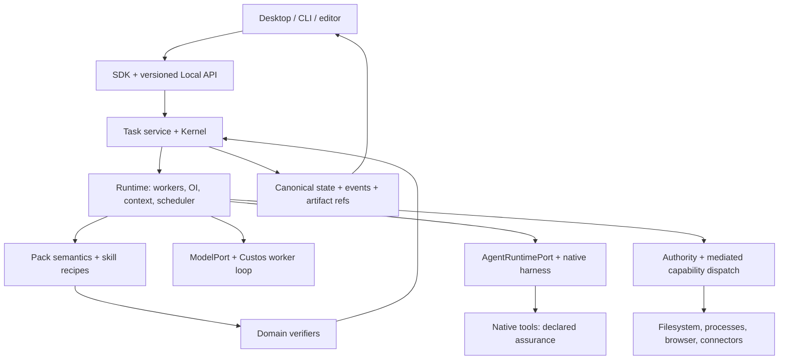
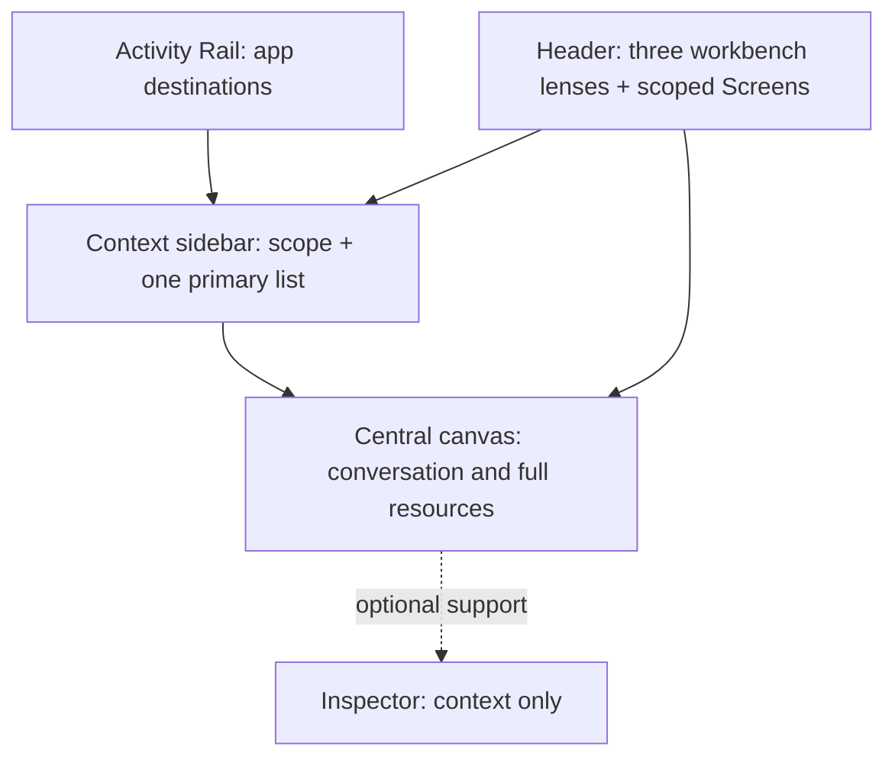
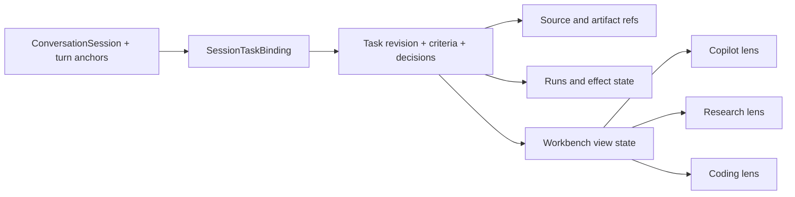
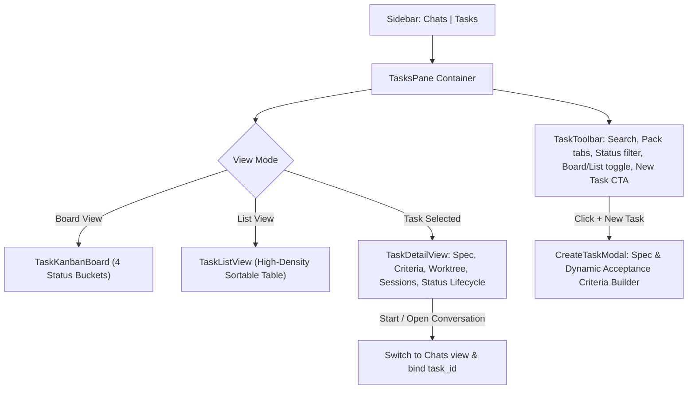
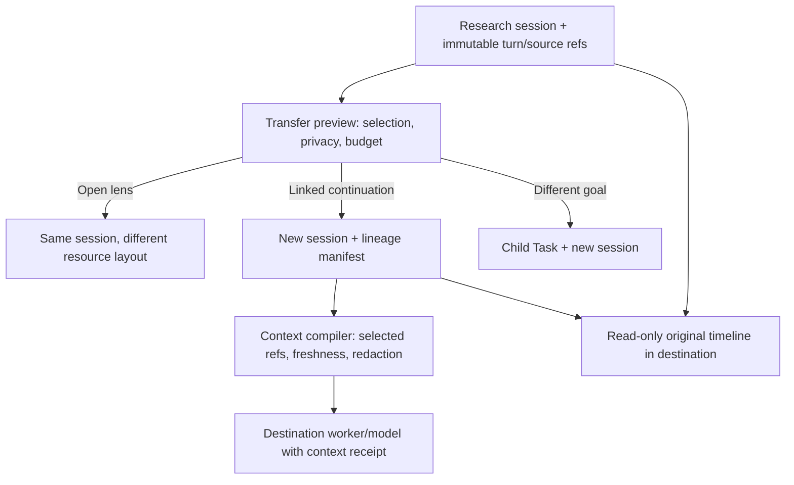
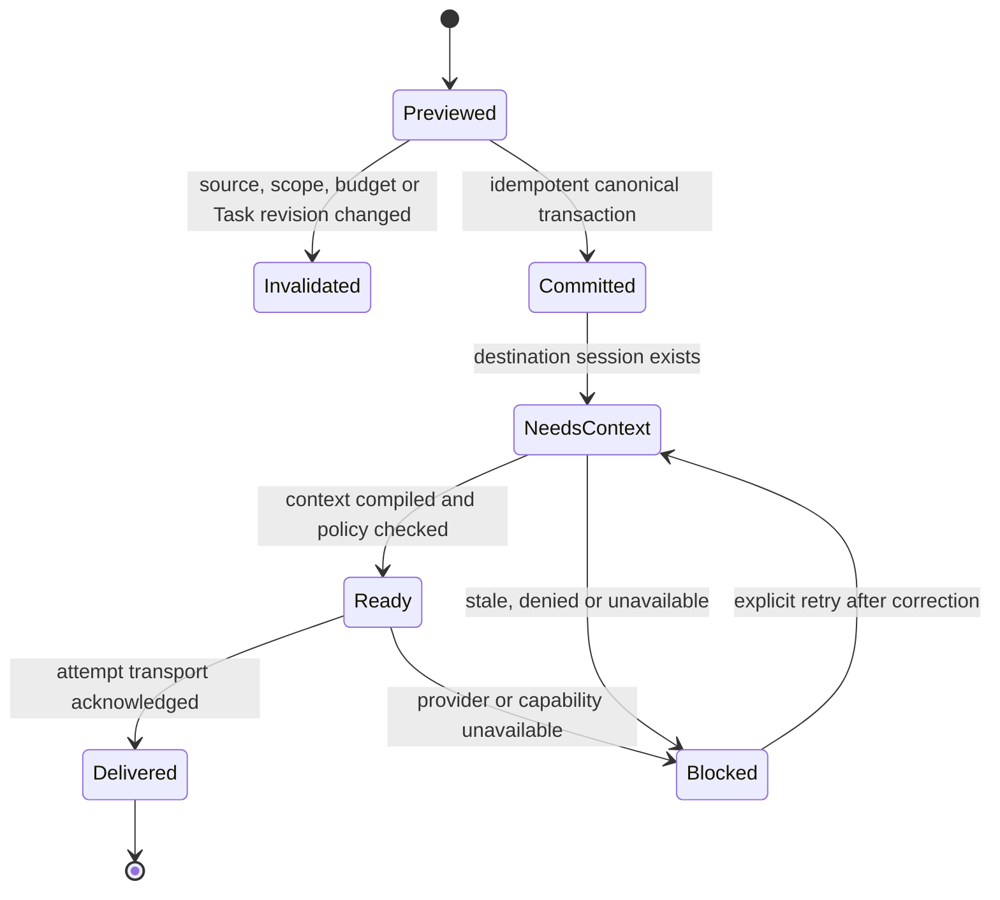
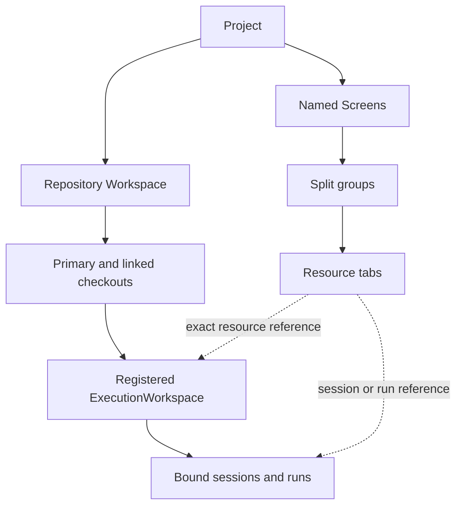
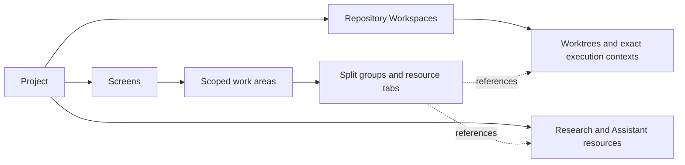

# Agent Workspace và giao diện ba miền

## Git identity and checkout correctness

LocalWorkspaceProvider verifies existing repository roots and declared checkout branch before marking Ready. Canonical path resolution cannot equate two failures; linked provisioning validates a literal branch with Git check-ref-format and resolves an explicit base to a commit before worktree add. No reset, stash or checkout is introduced. Sidebar registration uses detectWorkspace and actual main-worktree repository association, never a fabricated main branch or fake selected ID on failure. Full branch catalog/switch/fetch/push remains a separate capability migration; remote names or GitHub login alone do not establish transport authorization.

## Shared supervision and focused preferences implementation

Screen-to-canvas synchronization must ignore unchanged layouts and register focused commands only when their relevant identities change. This prevents context updates from starving route navigation; command registries clear on canvas unmount. This is a targeted lifecycle correction in the existing Screen owner.

The Activity Rail uses Home, Conversations, Tasks and Supervision, with Connections & Tools, Settings and Account below. Conversations and Tasks are independent cross-workbench history routes, not alternate workspace sidebar modes. The workspace sidebar always shows the Project selector and repository/worktree tree; no duplicate Project/workspace chooser appears on the rail. Home closes management and returns to the last working route. Settings/Connections remain embedded in the content area. History reads daemon sessions/Tasks and uses existing Project/session bindings for exact reveal; opening history never changes the working execution target. Supervision reuses `/dashboard` and aggregates daemon session-run records with bounded concurrency, explicit Project/all-session filtering, partial-load errors and an exact session/run inspector. Scope membership comes from loaded Project projections; unfiled daemon sessions are available in All sessions and are never assigned by title heuristics. Blocked Tasks are attention signals, not fabricated approval requests. Completed runs remain separate from accepted outcomes. Full approval/effect queues are not claimed where APIs are absent. Reveal synchronizes the existing Screen selection with the exact target session before navigation; a layout write does not force the workbench lens back to an earlier value. Task attention avoids adding a second blocked-Task card when a suspended run already represents that Task.

ActivityPane is the shared persisted/live run inspector and must never replace empty/error data with demo facts. Cancellation requires an advertised operation and is shown as requested until runtime confirms termination. Settings defaults to preferences; diagnostics are Advanced, while the existing AI configuration surface becomes Connections & Tools with links to existing extensions and capability-gated environments. These changes reuse the existing daemon client, run stream and modal owners, with no new schema, execution engine or dependency.

**Trạng thái: kiến trúc đích, chưa phải tuyên bố UI/runtime đã hoàn tất.** Tài liệu hiện thực hóa định vị trong [Custos.md](../../Custos.md), bổ sung cách người dùng làm việc với các contract hiện có. Không tạo một kernel, scheduler hay sản phẩm mang tên khác.

## 1. Quyết định sản phẩm

Định vị đầy đủ là **Custos SADE — Supervised Agent Development Environment**. Workspace là experience shell của cùng sản phẩm; xem [SADE design/supervision](sade-design-and-supervision.md) cho cơ chế S1–S2–human, loop ownership và outcome economics. Không giảm supervision thành thêm một tab Audit hoặc approval mỗi tool call.

Custos là **local-first Agent Workspace cho Coding, Research và Assistant**. Người dùng bắt đầu bằng hội thoại, mở tài nguyên cạnh agent, giao việc trong phạm vi rõ, kiểm kết quả và tiếp tục sau khi đóng phiên. Ba miền là ba bộ công cụ và cách đọc kết quả trong cùng workspace, không phải ba chatbot bắt buộc chạy cùng lúc.

Triết lý: **tối đa kết quả hữu ích trong ngân sách người dùng chọn, giữ chất lượng và quyền kiểm soát**. “Mạnh nhất, rẻ nhất” là mục tiêu tối ưu có điều kiện, không là cam kết đồng thời cho mọi bài toán. Một agent giỏi chạy trực tiếp luôn là lựa chọn hợp lệ; fan-out là tùy chọn có chi phí, không phải biểu tượng chất lượng.

[Orca](https://www.onorca.dev/) là nguồn tham khảo cho trải nghiệm agent cạnh terminal, diff, browser và worktree. [Repo upstream](https://github.com/stablyai/orca) giúp xác định đúng sản phẩm. Custos chọn triển khai trải nghiệm thống nhất giữa ba miền cùng contract về nguồn, quyền và kết quả; không kết luận Orca thiếu các cơ chế đó, không sao chép khẩu hiệu hiệu năng hay giao diện thương hiệu.

[Audit OrCa ở commit đã pin](../development/orca-source-study.md) xác nhận OrCa có runtime Run/Task/Dispatch, durable messages/receipts, structured Claude/Codex session, worktree/SSH và automation, không phải chỉ UI. Vì vậy UI Custos phải tách **resource workspace** (pane/host/checkout), **Task** (goal/scope/criteria), **Run/Dispatch** (attempt) và **Outcome** (verification) ngay trong navigation. Agent status dot và `worker_done` là trạng thái vận hành, không phải completion của criterion. Hai agent có thể chạy cùng Task nhưng tổng budget và source baseline phải hiện chung.

Hợp đồng chi tiết về executor picker, Custos worker so với native harness, subagent, shared retrieval/context service, các journey và empty/recovery states của ba lens nằm ở [SADE agent system design](sade-agent-system-design.md). Tài liệu này tiếp tục sở hữu layout và continuity UX; hai tài liệu dùng cùng Task/Run/resource IDs.

## 2. Những đối tượng không được trộn

| Đối tượng | Ý nghĩa | Không phải |
|---|---|---|
| Workspace | Phạm vi tài nguyên và bố cục làm việc; có thể không có Git repo | Một quyền tổng quát |
| Task | Goal, criteria, scope, budget, revisions và outcome bền vững | Một tab chat |
| Conversation/session | Lượt trao đổi, retention và bindings tới Task | Chính sách thực thi |
| Workbench | Một lens/preset UI lên cùng Task và tài nguyên đã bind: Copilot, Coding hoặc Research | Task mới, pack mới hay session mới |
| Run/WorkerRun | Một lần thực thi hoặc một ứng viên giải bài toán | Task mới bắt buộc |
| ExecutionWorkspace | Checkout, dataset/experiment directory hoặc connector scope cụ thể | OS sandbox |
| Pane | Một cách xem chat, file, diff, nguồn, terminal hoặc lịch | Owner của state backend |
| Artifact | Patch, brief, dataset card, experiment result hoặc draft có version | Bằng chứng tự động đủ để pass |

Workspace có nhiều Task; Task liên kết nhiều session; một session có thể chứa nhiều Task. Một Task có thể có nhiều candidate runs hoặc nhiều bước xuyên pack. Quan hệ này phải được map từ IDs hiện có; tên trong bảng là vocabulary thiết kế, không yêu cầu sinh thêm schema nếu contract hiện hữu đã đủ.

**Bất biến UX quan trọng nhất:** mở cùng công việc trong workbench khác giữ `task_id`, revision, source/artifact references, decisions, criteria, budget và pending effects. Bấm icon workbench thông thường khôi phục view gần nhất của lens đích, có thể là một session/Task khác; thao tác đó không sửa binding của công việc vừa rời đi. Hai hành động này có contract riêng ở §4.5. Nếu mục tiêu tách nhánh, user tạo linked conversation hoặc child Task tường minh.

**Session theo từng lens:** Copilot, Coding và Research có danh sách chat và lựa chọn gần nhất riêng. Bấm icon lens khôi phục chat cuối của lens đích; nếu chưa có thì là trạng thái `No conversation`, không tự đem chat từ lens vừa rời đi. `Open full chat in…` gắn cùng session vào danh sách đích và hiển thị mọi turn còn được giữ trong canonical journal. `Continue as linked chat` tạo session mới có lineage và bản hiển thị timeline nguồn; model-visible context vẫn phải qua compiler, privacy và budget với receipt. Không gọi lịch sử hiển thị đầy đủ là inference context đầy đủ. Khi tiếp tục từ Research sang Coding, notebook code/dataset/figure là nguồn và artifact để kiểm, không phải patch repo được áp dụng tự động.

Sidebar của mỗi lens còn có tìm kiếm trên tất cả session thuộc project. Chọn session ngoài lens gọi `OpenLens` rồi chọn cùng session ID trong lens hiện tại; không nhân bản journal và không mặc định chạy agent. Nút `+` mở resource picker nổi trên workspace, giữ tab đang xem cho tới khi người dùng chọn một resource. Danh mục Browser/Remote Fleet hiện phần metadata có thật và trạng thái transport chưa sẵn sàng theo capability registry; không dùng static catalog để tự quảng bá execution.
Remote Fleet nằm trong resource chung để Coding và Research cùng xem inventory host; daemon phải quảng bá `hosts.ping` hoặc `exec` trước khi UI cho phép probe/chạy lệnh. Browser khởi đầu bằng tab trống, không giả trang mẫu hoặc nhãn sandbox khi chưa có transport và isolation receipt.

## 3. Luồng và nơi ra quyết định



Daemon ráp implementations. Runtime quản lý run/workspace/process lifecycle qua ports; adapter thực hiện Git, PTY, browser hoặc connector I/O. UI gửi command và hiển thị projection; không spawn agent thực thi, tự merge hay tự mint permit. Webview host cũng không trở thành composition root thứ hai.

## 4. Bố cục và điều hướng

**Current implementation trace:** [Desktop/core interaction map](desktop-core-interaction-map.md) documents Screen/Tab identity, the three workbench paths, shared daemon wiring, persistent Python workers, model streams and the new MCP/Outbox implementations at `25cf689`. Its explicit gaps qualify older status descriptions below; UI availability and receipt labels are not proof of complete authority enforcement.

### Working resource implementation

Outbox advertises read operations while its outbound connector pipeline remains unconfigured. Its ledger includes failed and uncertain attempts. Approval and dispatch controls require an advertised operation and an admissible action state; missing receipt/permit metadata remains explicitly missing.

PTY process exit and stream completion are separate observations: queued output drains before EOF. File descriptors have independent ownership and close once even after the process exits. Terminal retention bounds session count as well as bytes per stream. These process-local terminals do not survive a daemon restart.

Every resource resolves its own session and workspace from its tab references. A missing explicitly bound reference produces an unavailable state instead of falling back to the globally selected conversation or checkout. Files, notebook execution, research prompts and drafts use the resolved reference for both display and commands.

`WorkbenchPane` supplies the shared compact toolbar, inline error/retry and honest empty state. Content remains in the centre; list/detail layouts adapt to pane width. Terminal and native-agent views use `useTerminalSession` for exact daemon-ID attachment, explicit start/stop, single-flight creation and scoped failure handling. Cached bindings never identify sessions by command substring. A restored tab does not spawn a process. PTY output reads are serialized with bounded retry delay; terminal rendering disposes subscriptions without terminating the process. Native Task runs retain their existing journal, run stream, cancellation and assurance.

Resource catalogue, resource rendering and canvas layout have separate source owners under `components/workbenches`; compatibility exports retain existing imports while the implementation is decomposed. All three workbenches share typography, surfaces, list selection, toolbar density and focus states; domain-specific content and execution controls remain visible.

### Desktop canvas implementation contract

The existing shell and resource host use a recursive group/split presentation tree. Each tab belongs to one group; active tabs must exist; ratios are bounded; closing the final tab preserves a usable empty group. Drag/drop, split right/down, merge, keyboard focus, resize and zoom never execute domain commands. Unknown kinds render unsupported. AppContext persists sanitized resource metadata by project/lens/workspace/session; the resource host persists the matching validated layout. Resource IDs bind scope on creation; worktree selection never retargets existing tabs. Compact desktop shows one focused group with group navigation. Coding, Research and Copilot expose distinct resource shortcuts and a contextual scope inspector. Main conversation can remain beside resources or be hidden using canvas expansion. Popout editing remains deferred until shared-window reconciliation. Scientific annotation/reproduction and external dispatch retain existing backend capability gates. Findings forwards actual handoff Task IDs to the shell, which refreshes Tasks and opens the destination Coding Task; this is not itself evidence of a verified scientific handoff. Drafts keeps unsaved edits in memory across resource navigation, offers explicit save, and local review/lock does not enqueue an Outbox action or claim scientific verification.

Desktop/headless integration theo [superplan §21](../development/workspace-restructuring-plan.md#21-superplan-kết-hợp-custos-và-orca-cho-desktop-và-headless): selective port OrCa presentation components qua Custos SDK facade; projection/event store do backend IDs/version/cursor chi phối; terminal/token streams bounded riêng với persisted state events. Layout restore không tự spawn agent. Mobile app/client/push/packaging chưa nằm trong phạm vi; giao diện hẹp dưới đây chỉ là responsive desktop.

Desktop dùng một shell, không làm ba ứng dụng UI rời. Khung điều hướng có hai vai trò trái tách bạch: Activity Rail dành cho đích cấp ứng dụng; sidebar kế bên đổi nội dung theo workbench và scope hiện hành. Không lặp Conversations/Tasks ở cả rail lẫn sidebar. Header giữ lens switcher và Screen switcher; canvas trung tâm là nơi mở workflow đầy đủ; Inspector bên phải chỉ là hỗ trợ tùy chọn.

**Vị trí file UI:** `components/shell` giữ khung và điều hướng; `components/workspaces/OrcaTabbedContainer.tsx` giữ danh mục resource và chọn pane; ba thư mục `workspaces/engineering`, `workspaces/research`, `workspaces/copilot` giữ màn hình theo lens; `workspaces/shared` giữ Browser/preview/fleet/notes dùng chung; `components/common` chỉ giữ control tái sử dụng. Không tạo thêm lớp re-export `views` song song. Một pane cũ tồn tại trong repo không có nghĩa đã nối vào catalog hoặc backend. Notebook Research chỉ hiển thị cell/result được lưu từ session thật; sửa source làm kết quả trước đó hết hiệu lực.

Điều hướng gọn: nút lens chỉ biểu tượng, có `aria-label`, trạng thái chọn và shortcut/tooltip; thanh tài nguyên chỉ hiển thị tab đang dùng. Nút `+` mở danh sách tài nguyên nổi theo lens, không sinh tab `New Tab` hoặc chuyển nội dung đang xem. Mỗi mục lấy trạng thái capability từ daemon/native host, ghi rõ khi không khả dụng; chọn mục mới mới mở tab. Các run có thể song song ở các workspace ID khác nhau, nhưng tab và inspector phải giữ identity của từng run, không suy ra thành công chỉ từ UI.

Settings chỉ có một nơi hiển thị Usage. `Models & accounts` cấu hình tài khoản và route account đã có backend; `Agent runtimes` chỉ liệt kê harness cài trên máy, không phải model provider hay subagent được cấp quyền; `Usage & limits` đọc attempt/quota, không cho chỉnh trần ngân sách chưa được enforce. Màn hình Dashboard/Chains lịch sử không được ghi cứng PID, token, reliability hay mô phỏng failover như đang chạy.

Settings modal là nguồn điều hướng duy nhất; sidebar settings cũ không được mount sẽ bỏ. Route `/settings` và `/chains` chuyển về modal tại Studio để giữ nguyên session; `Routing Combos` còn là preset thiết kế chưa ảnh hưởng thực thi và phải ghi nhãn như vậy.

Trong Settings vận hành, không hiển thị Routing Combos như một tab song song với tài khoản cho tới khi daemon dùng preset ấy trong route thật. Tài khoản/provider và priority/round-robin vẫn chỉnh qua API hiện có.

Capability của một pane tổng hợp phải lấy giao của các operation liên quan, không chỉ lấy một resource ID gần tên. Lab có thể mở sổ run khi ResearchRepository sẵn sàng nhưng không bật chạy cell nếu PythonKernelCoordinator không được daemon công bố. Files/Changes/Terminal cần workspace đã được daemon cấu hình; Activity cần workflow và run projection. Nhãn `available` của một struct UI không phải quyền thực thi.

API action catalog phải được suy từ capability registry cùng request, không duy trì bảng nút “available” cứng riêng. Nếu không có descriptor hoặc operation không được backend quảng bá, UI không hiện nút tác động; Outbox read-only không có Approve/Dispatch.

Trong Research, lỗi tải proposals/claims/recipes/workspaces là lỗi hiển thị chứ không được thay bằng `[]`. Artifact thiếu bytes vẫn có metadata/version/annotation, nhưng inspector phải nói preview không có; không tự tạo đoạn code `# Artifact…` để giả làm nội dung phiên bản.

- **Workbench switcher:** giữ một bộ ba icon Copilot/Coding/Research trên header hiện hữu. Một sidebar bên trái là điều hướng chính; xem §4.5 cho nội dung và hành vi. Connections/Settings mở từ footer/menu; Sources, Automations và fleet mở thành resource khi cần.
- **Workspace sidebar:** Project scope, contextual workspace/corpus selector và một danh sách chính ở chế độ Conversations hoặc Tasks. Chỉ render nhóm attention/pinned khi có dữ liệu; runs nằm trong Task hoặc workspace liên quan.
- **Main canvas:** panes tách/ghép được, mỗi pane giữ resource/run/task reference rõ ràng. Pane không bao giờ đổi Task âm thầm khi người dùng đổi sidebar.
- **Task strip:** mục tiêu, mode, model/harness thực dùng, đang làm gì, ngân sách và trạng thái. Pin model phải nhìn thấy.
- **Inspector:** criteria/evidence, route reason, approval, uncertainty, costs; mở theo ngữ cảnh. Detail mặc định thu gọn, pending effect không bị giấu.

Ba **workbench lens** là cấp điều hướng chính: **Copilot**, **Coding**, **Research**. Bố cục thích nghi theo resource đang mở: chat rộng, chat cạnh code/source, hoặc compare khi đã có candidates. Preset bổ sung chỉ xuất hiện khi người dùng cần đổi layout. Đổi lens khôi phục lựa chọn của lens đích; quyền, model, graph và contract của các công việc đã tồn tại giữ nguyên.

Giao diện hẹp chỉ có một pane tại một thời điểm, navigation bằng tabs và inspector dạng drawer. Keyboard navigation, focus restoration, screen-reader labels, trạng thái bằng chữ cùng màu, phím hủy và copy citation/diff cần có ngay. CLI cung cấp cùng command/status semantics, không cần tái tạo mọi pane desktop.

### 4.1. Shared shell của cả ba workbench



- **Task anchor:** hiện một hàng gọn khi session có Task đã bind hoặc attention cần xử lý. Click mở criteria, execution, cost và authority details. Chat thường hiện execution target/model trong composer; chi tiết `No Task` có thể nằm trong context menu, không chiếm một dashboard strip thường trực.
- **Conversation là pane bền vững, không phải toàn workspace:** có thể ghim trái/phải, thu nhỏ thành dock hoặc mở toàn canvas. Composer gửi vào session hiện hành và hiển thị Task anchor của lượt kế tiếp.
- **Workbench switcher đổi lens:** Coding ưu tiên repo/diff/test/terminal; Research ưu tiên corpus/source/claim/experiment; Copilot ưu tiên conversation/draft/calendar/automations. Các pane khác vẫn mở được khi cần.
- **Inspector là hỗ trợ theo ngữ cảnh, không phải control plane:** xem scope, source refs, status và usage; hành động đầy đủ mở ở canvas. Pending approval, uncertain effect và conflict không được ẩn khi Inspector đóng; chúng tạo attention entry có identity thật và mở đúng resource trung tâm.
- **Library chung:** source, artifact và outcome có stable ID/version. Kéo hoặc chọn một item vào pane không copy raw bytes vào chat; nó thêm reference có scope và provenance.

### 4.2. Continuity model: không mất session khi đổi miền

Custos không “chuyển một chat sang app khác”. Nó giữ một **Task spine** và mở một view khác trên spine đó:



Khi user bấm **Continue in Research** hoặc **Continue in Coding**, UI trước hết hỏi đó là mở cùng chat, tạo linked chat hay thêm bước công việc. Chỉ **linked continuation/Add pack step**, không phải `Open lens`, mới có backend command mang ngữ cảnh. Command đó thực hiện bốn việc có thể kiểm:

1. xác định Task hiện hành hoặc cho user chọn `same Task`, `child Task`, `new Task` khi goal khác;
2. bind các turn/source/artifact được user chọn bằng stable references và revision;
3. tạo/revise obligation của pack đích cùng acceptance cần thiết, không tự biến finding thành requirement;
4. compile ContextPack cho worker đích từ references, decisions và omissions **nếu user thực sự khởi chạy worker**; layout có thể mở lens đích sau khi continuation được ack mà không tự dispatch.

Transcript gốc vẫn ở session; workbench mới nhìn thấy summary có nguồn, selected artifacts, decisions và unresolved questions. Grant, permit, secret, native hidden state và toàn bộ raw transcript **không được kế thừa ngầm**. Native agent không hỗ trợ resume tương đương thì tạo WorkerRun mới, ghi rõ phần context đã chuyển và phần không chuyển được. Slice chat hiện tại cho phép mở cùng session trong lens khác; `workbench_opened` được ghi trong session journal SQLite qua Local API, và model run biên soạn tối đa 12.000 ký tự lịch sử gần nhất từ journal, ghi entry IDs được dùng/bỏ trong run metadata. Đây chưa phải handoff chọn nguồn có privacy filter/egress review và ContextReceipt đầy đủ; last-selected session còn device-local.

### 4.3. Ba lựa chọn khi chuyển hướng

| Lựa chọn | Dùng khi | Điều giữ | Điều tạo mới |
|---|---|---|---|
| **Open this conversation in…** | Cùng goal, chỉ cần công cụ khác | Cùng Task/session binding, criteria, sources, artifacts, budget | Lens membership/presentation state; ContextPack được compile khi thực hiện lượt mới |
| **Add pack step** | Cùng outcome nhưng cần Research → Coding hoặc Coding → Assistant | Cùng parent Task và shared lineage | Workflow node/obligation, pack artifact và run mới |
| **Fork child Task** | Goal/acceptance hoặc lifecycle đã tách | Selected source/artifact/decision refs có provenance | Task/revision/budget/authority riêng; liên kết parent-child |

Menu trên conversation phân biệt `Open in Coding`, `Add implementation step` và `Fork as coding task`. Bấm icon lens trên header là điều hướng tới view đã nhớ của lens đích theo §4.5; không dùng nó thay command chuyển conversation. Mọi mutation của Task cần preview diff contract ngắn.

### 4.4. Một chat có nhiều công việc

Mỗi turn có thể hiện Task chip nhỏ; composer có `Working on: <Task>` và cho chọn `No Task`. Chuyển active Task chỉ định tuyến lượt tiếp theo, không sửa provenance turn cũ và không cấp quyền. Khi matcher tìm thấy nhiều Task tương tự, UI cho 1–3 lựa chọn; không auto-attach theo recency. User có thể chọn turn/artifact để `Attach`, `Move`, `Copy reference` hoặc `Fork`, còn merge Task là operation riêng có conflict preview.

### 4.5. Điều hướng tối thiểu và tính nhất quán khi đổi ngữ cảnh

**Quyết định thiết kế:** giữ header hiện có với ba icon workbench, Activity Rail gọn cho đích cấp ứng dụng, một contextual sidebar có thể thu gọn và canvas trung tâm chứa conversation/resources. Rail không lặp Chats/Tasks với sidebar. Mỗi quyết định chọn Project, workbench scope, Screen, session, Task, workspace và resource có identity riêng. Đây là target dựa trên trace source; các bước dưới chưa được chứng minh bằng chạy ứng dụng hoặc usability study.

**Bằng chứng OrCa:** [`set-active-worktree.ts`](../../../orca/src/renderer/src/store/slices/worktrees/session/set-active-worktree.ts) reconcile các tab rồi cập nhật workspace/host, selected tab/file/browser và explorer view trong cùng state update; focus không được ghi thành smart-sort activity. [`active-worktree-surface.ts`](../../../orca/src/renderer/src/store/slices/worktrees/session/active-worktree-surface.ts) chọn lại surface đã nhớ. [`tab-types.ts`](../../../orca/src/shared/tab-types.ts) tách tab instance, backing entity, worktree và tab group. Đây là cơ sở để Custos khôi phục một ngữ cảnh làm việc có identity đầy đủ. OrCa activation còn có terminal preparation/generation/wake behavior; Custos chỉ khôi phục presentation hoặc attach runtime đã xác minh, còn spawn/continue phải có command lifecycle riêng.

**Bằng chứng Custos hiện tại:** [`StudioPage`](../../ui/desktop/src/app/studio/page.tsx) nhớ session theo Project/lens nhưng keys tab layout theo chuỗi tên Project/session/lens; selected workspace nằm riêng trong [`AppContext`](../../ui/desktop/src/context/AppContext.tsx). [`WorkspaceSidebar`](../../ui/desktop/src/components/shell/WorkspaceSidebar.tsx) nhận diện worktree theo path/parent, nhưng selection hiện đổi `workspace_id` mà không suy Project từ tên worktree; candidate path được đặt cạnh repo. Native send dùng `activeSession.workspaceId`, trong khi Files/header đọc selected workspace; model chat-turn hiện chưa truyền workspace trong `startRun`, nên execution binding vẫn cần hoàn tất. `sessionToWorkflowCard` nhận Task projection thật và sidebar có Chats/Tasks riêng; Task overview không tạo Session/Run khi mở.

**Nội dung sidebar:**

| Vị trí | Nội dung | Khi xuất hiện |
|---|---|---|
| Activity Rail | Workspaces/Work, Supervision; Connections, Settings, Account ở cuối | Không lặp Conversations và Tasks nếu contextual sidebar đã sở hữu lịch sử |
| Header | Ba icon Copilot/Coding/Research, Screen switcher theo lens, collapse controls | Lens switch không đổi Task binding hoặc execution target |
| Đầu sidebar | Project scope bằng tên rõ; selector có Personal và search | Không render Project thành thư mục giả hoặc dùng tên làm ID |
| Hàng hành động | New conversation; menu cạnh nó có New task; search dùng command palette chung | Chat thường vào composer trực tiếp; yêu cầu Task dùng intake theo nhu cầu |
| Context selector | Coding: repo/worktree/host; Research: study/corpus hoặc experiment folder; Copilot: scope cá nhân/project | Một hàng gọn; popover mở cây khi cần đổi; không giả rằng Research cần Git |
| Danh sách chính | Một chế độ mỗi lần: scope resources, Conversations hoặc Tasks | Chats/Tasks có cùng một vị trí điều hướng; Tasks dựa trên Task IDs, gồm cả Task không có conversation |
| Attention | Một mục Needs you mở queue dùng chung | Chỉ khi backend có attention; current-item preview xuất hiện ở canvas khi đang xử lý |
| Footer | Account/Settings/Connections | Không thêm các nhóm tính năng thường trực khác |

Pinned và Recent dùng chung danh sách chính; chỉ tạo section khi có hàng. Workspace picker Coding có repo → main/linked worktrees, search và trạng thái active/running. Khi user cần giám sát nhiều worktrees, action `Manage workspaces` mở Worktree Manager hiện hữu trong canvas; không thêm permanent sidebar thứ hai. Full file tree ở Files, sources ledger ở Sources, experiment runs ở Lab, drafts/outbox ở resources Copilot; sidebar chỉ giữ ngữ cảnh và việc cần quay lại. Bộ lọc worktree là view của danh sách, không là owner của history; luôn có đường `All conversations` trong Project để tìm các chat chưa bind workspace.

**Khác biệt của ba lens:** Coding nhớ checkout và file/diff/terminal; Research nhớ study/source/version và notebook/artifact; Copilot bắt đầu bằng chat rộng, mở draft/calendar/notes theo intent. Không tự mở ba tab mẫu khi tạo conversation. Pane của view đã dùng được khôi phục; first-use chỉ mở resource khi user chọn hoặc khi một kết quả thật cần được trình bày. Mỗi lens dùng chung typography, surfaces và spacing; icon, tên lens tại header/empty state và resource đặc trưng cung cấp nhận diện, màu nhấn chỉ bổ trợ. Switcher giữ icon-only với accessible name, tooltip khi focus/hover, selected/focus states; tên lens không lặp thành nhiều badge trên màn hình.

**Transition contract:**

| Thao tác | Hiệu ứng điều hướng | Contract cần giữ |
|---|---|---|
| Bấm icon lens | Lưu view hiện tại, restore view gần nhất của Project/lens đích | Không di chuyển session hiện tại sang lens khác; không sửa Task binding |
| Open this conversation in… | Mở cùng session ID trong lens đích sau membership ack | Giữ task/resource refs; chưa tự thêm pack obligation hoặc chạy agent |
| Chọn Project | Restore view của Project đó; nếu chưa có thì empty state | Không fallback vào một session/worktree ngoài Project |
| Chọn workspace trong picker | Restore resource view của workspace và conversation đã bind gần nhất nếu có | Nếu chưa có conversation tương thích, hiện empty composer; không retarget conversation cũ |
| Chọn conversation | Restore lens/view của lựa chọn, Task anchor và execution workspace đã bind | Nếu binding thiếu hoặc resource bị mất, giữ transcript; picker yêu cầu chọn trước hành động cần execution |
| Chọn Task | Mở Task overview/run liên quan; conversation được chọn nếu có binding rõ | Task không có session vẫn hiển thị; không tạo session hay resume run chỉ vì mở |
| Đổi execution target cho conversation hiện tại | Thao tác riêng từ context chip; kiểm source/binding và phản hồi backend | Native session phụ thuộc cwd cần continuation mới khi harness không hỗ trợ move; lịch sử turn cũ giữ target cũ |
| Mở Files/Terminal/source/candidate | Mở đúng resource/run/workspace ID; preview resource khác được ghi nhãn | Pane đang preview không thay execution target của composer |
| Đóng pane/sidebar | Lưu presentation state và giải phóng preview theo resource lifecycle | Stop run, archive workspace và xóa lịch sử là các thao tác có tên riêng |

**Danh tính view:** chọn Project là phạm vi điều hướng; execution target thực đến từ Task/Run/session binding. Navigation reducer/facade áp dụng một selection gồm `project_ref`, `lens`, `session_id?`, `task_id?`, `workspace_id?` và focused resource cùng nhau, dựa trên existing IDs. Đây là state UI đích, chưa yêu cầu type Rust hoặc protocol mới. Cache last view theo Project ID/lens; lưu workspace layout và tab refs theo workspace ID/lens, conversation scroll/draft theo session ID. Resource tab có instance ID và backing reference gồm đúng workspace/run/source/artifact/version khi có; dedup theo reference, không chỉ theo tool type. Hai terminal khác nhau hoặc hai diff ở hai worktrees không được resolve thành cùng tab.

Workspace binding chưa có trên backend thì hiển thị `Unbound` hoặc chọn target cho lần chạy mới; frontend không suy grant hoặc persistent relationship từ tên, path substring hoặc lựa chọn gần nhất. Pending text draft và resource selection không mất khi đổi view. Shell có thể cho preview worktree B cạnh chat bound A; composer giữ target A và pane ghi rõ B. Native agent session không được tiếp tục trên B bằng cách chỉ sửa một React field.

**Attention và completion:** queue dựa trên Task/Run/effect/approval IDs, độc lập session list. Reading/unread chỉ biểu thị đã xem; badge đang chạy dựa trên Run, Task accepted dựa trên outcome. Các Task nội bộ `conversation_chat_turn` thuộc execution detail của conversation; chúng không tự thành một project Task mới trong danh sách mục tiêu của user. Chọn Tasks là một projection có tiêu chí rõ, không đổi trạng thái hay xóa internal records. `Opened agent panel` và `Agent started` phải là hai phản hồi khác nhau.

**Trình tự triển khai tại các file hiện có:**

1. `AppContext`/`StudioPage`: facade selection theo IDs, giữ bound target của conversation, xử lý missing/cross-workspace selection; dừng dùng Project name để route execution/history.
2. `WorkspaceSidebar`/`WorkspaceTree`: Conversations/Tasks projection thật, compact context picker và một search chung; source/Task projection lỗi có retry, không tạo folder giả.
3. `StudioPage`/`AppWorkspaceShell`/`OrcaTabbedContainer`: resource refs và layout restore đúng workspace/lens; default first-use chat; resource picker giữ tab hiện tại tới khi chọn.
4. `AppHeader`/composer và execution facade: label/prompt target lấy cùng binding; available native/model paths trình bày capability thật; selection không khởi chạy agent.
5. Nối backend bindings còn thiếu qua domain/core/persistence/runtime/daemon hiện hữu, cập nhật DTO/fixtures theo packet; sau đó mới polish spacing và màu. Không có crate hay store transcript mới được chỉ định bởi kế hoạch này.

**Các journey phải kiểm:** A/B là hai worktrees cùng repo, cùng tên ở hai host, session không có workspace, Task không có session, hai conversations cùng Task, Research → Coding cùng session, đổi lens về view cũ, workspace bị archive trong lúc run còn sống, đóng pane khi run tiếp tục, stop đúng run sau khi chuyển view và reconnect giữ bound target. Kiểm cả state transition lẫn request `task_id/session_id/workspace_id/run_id`, không chỉ screenshot. Usability pass riêng cần chứng minh người dùng chỉ đúng execution target và tìm lại công việc mà không phải đọc toàn bộ mô hình nội bộ.

### 4.6. Orca-inspired Tasks UI Suite: Cấu trúc thành phần và luồng điều hành công việc chuẩn

Học hỏi từ cấu trúc UI của Orca ([`TaskPage.tsx`](../../../orca/src/renderer/src/components/task-page/TaskPage.tsx), [`SourceBar.tsx`](../../../orca/src/renderer/src/components/task-page/SourceBar.tsx), [`ListChrome.tsx`](../../../orca/src/renderer/src/components/task-page/ListChrome.tsx), và [`AgentKanbanBoard.tsx`](../../../orca/src/renderer/src/components/dashboard-popout/AgentKanbanBoard.tsx)), Custos xây dựng thành phần quản lý Tasks toàn diện tại `ui/desktop/src/components/tasks/`, kết nối trực tiếp với JSON-RPC daemon không dùng mock:



1. **Triết lý Task chuẩn từ Orca**:
   - Tách rời rành mạch giữa **Task** (mục tiêu cấp cao, có hợp đồng nghiệm thu, gắn với workspace/worktree cụ thể) và **Conversation / Chat Turn** (trao đổi hội thoại chi tiết).
   - Tự động lọc bỏ các turn nội bộ (`kind === 'turn_task'` hoặc `conversation_chat_turn`) khỏi bảng Tasks của người dùng, giữ cho danh mục công việc luôn sạch sẽ và tập trung vào mục tiêu lớn.
2. **4 Cột Trạng thái chuẩn (Kanban Buckets)**:
   - `Draft / Backlog`: Nhiệm vụ vừa tạo hoặc đang chờ kích hoạt.
   - `In Progress / Working`: Nhiệm vụ đang có agent thực thi (hiển thị live pulse radar indicator).
   - `Needs Review / Attention`: Nhiệm vụ bị chặn (blocked) hoặc đang chờ người dùng phê duyệt/nghiệm thu.
   - `Completed / Done`: Nhiệm vụ đã hoàn thành đạt đủ bằng chứng kiểm chứng.
3. **Chuyển đổi Dual-View (Board ↔ List)**:
   - Cho phép người dùng chuyển đổi linh hoạt giữa giao diện thẻ trực quan và bảng danh sách mật độ cao.
   - Lưu trạng thái hiển thị vào `localStorage` (`custos.tasks_view_mode`), tích hợp thanh công cụ tìm kiếm, bộ lọc domain pack (`Engineering`, `Research`, `Assistant`) và trạng thái vòng đời.
4. **Acceptance Criteria Tracking**:
   - Theo dõi tiến độ nghiệm thu rõ ràng (`N/M criteria met`).
   - Phân biệt minh bạch giữa tiêu chí bắt buộc (Mandatory/Required) và tiêu chí khuyến nghị (Optional).
5. **Execution Workspace / Worktree Binding**:
   - Gắn trực tiếp Task với worktree hoặc repo cụ thể, hiển thị branch đang checkout và base commit hash.
6. **Task-to-Conversation Continuity**:
   - Cho phép mở nhanh các phiên chat đã gắn với Task, hoặc tạo ngay phiên chat mới mang thuộc tính `task_id`.
   - Khi chuyển sang hội thoại, UI tự động điều hướng sang `Chats` view và ẩn `TasksPane` mà không gây mất dấu Task đang thực thi.
7. **Modal Tạo Task với Dynamic Criteria Builder**:
   - Hỗ trợ nhập Title, Domain Pack, Markdown Specification, chọn Worktree gắn kết, và thêm/bớt động các tiêu chí nghiệm thu kèm cờ bắt buộc.
8. **Đảm bảo Hexagonal Architecture & Zero Mock Data**:
   - Mọi thao tác đều gọi trực tiếp daemon JSON-RPC (`v1.tasks.create`, `v1.tasks.get`, `v1.tasks.list`, `v1.tasks.advance`, `v1.tasks.complete`, `v1.tasks.cancel`), tuân thủ quy tắc verification proof trước khi hoàn thành task (`v1.tasks.complete`).

## 5. Coding workspace

Luồng: mở repo → đọc snapshot → chat/explore → giao patch/refactor → agent chạy trong execution scope → diff/test → quyết định apply/integrate → outcome.

Panes: repo explorer, source anchors, agent chat/terminal, diff comments, test matrix, browser preview. Terminal phải hiện rõ cwd, run owner, local/remote host và assurance; manual terminal input không mặc nhiên nằm trong mediated path.

Coding lens không tạo một “Codex session” riêng khỏi Custos Task. Header của mỗi editor/diff/terminal hiển thị `task_id`, execution workspace/worktree, host và run owner; chat bên cạnh có thể **steer active run** hoặc **queue lượt sau** bằng hai action tách biệt. Từ Research, action `Implement selected claims` tạo `EngineeringBrief/Spec` từ đúng claim IDs/caveats rồi mở Coding; source passages vẫn mở lại được trong Inspector.

Native Agents pane submits a Task-backed `StartRun`, never an unscoped filesystem path. The selected workspace is resolved by daemon from `workspace_id`; the chosen harness is resolved by runtime from the composed registry and persisted with its launch attempt. Provider-governed native completion means only that the harness process returned successfully. It does not pass the Task criterion, verify the patch, or upgrade tool mediation. Steering is shown only when a real active run/session identifier is available; a placeholder such as `active_run` is not a protocol value.

Resource discovery is fail-closed and capability-driven. `resource_id` is a stable UI projection key, while capability `id` identifies the backend contract; they are not interchangeable with pane IDs, Task IDs or Run IDs. Before the capability registry resolves, every operational resource is unavailable. A degraded resource may render its durable metadata surface, but controls are enabled only when their exact operation name appears in `supported_operations`. Missing descriptors never inherit optimistic operations from the client catalog. Browser and Fleet therefore remain useful inventories while navigation, AX actions, probes and execution stay disabled until governed adapters are composed.

The Coding worktree card passes its selected `workspace_id` into Files, Terminal or Coding Agents. Each pane resolves that ID against daemon workspaces before showing data or starting a run; changing the Terminal workspace clears the previous terminal session immediately. The capability catalog publishes Coding Agents only at the operations supported by the registered harnesses, Drafts only when the Assistant repository is composed, and Outbox as a read-only degraded surface until approval and dispatch connectors exist. Contacts and Calendar currently store device-local lists and must identify them as local; they do not imply synced contacts, a live calendar connector or permission to send.

Agent controls follow the same rule at harness scope. A discovered OpenCode/Codex/Claude binary may be offered for a bounded native run, but Resume, Steer, Cancel-confirmed and exact usage remain hidden unless the tested harness profile advertises them. A local map entry is not an external session, and removing it is not cancellation. An empty result from an unimplemented event transport is an error rather than a completed agent turn.

### Worktree và candidate comparison

1. Giữ main checkout và dirty changes; không tự stash/reset. Lấy baseline commit cùng dirty manifest đã chọn.
2. Runtime cấp execution workspace cho writer; reader có thể dùng cùng read-only snapshot. Không bắt mọi câu hỏi tạo worktree.
3. Compare là **một Task, nhiều candidate runs** cùng criterion/baseline, có budget chung và cap từng ứng viên. UI preview số agent, dữ liệu ra ngoài và tổng chi phí trước chạy.
4. Giữ patch/artifact/evidence riêng từng candidate. Candidate fail/unknown không biến mất khỏi báo cáo chi phí.
5. Dùng cùng verifier baseline để so kết quả. Không xếp hạng “nhanh nhất” trước quality/scope gate; khác environment phải hiện không so trực tiếp được.
6. Chọn candidate không tự merge. Integration là effect riêng: check target HEAD/dirty/base hash, conflicts, scope, approval profile rồi verify snapshot đã tích hợp.
7. Cleanup chỉ workspace/process do Custos sở hữu; giữ dirty/untracked output đến khi có export/retention decision. Cancel không xóa artifact hoặc đảo ngược effect.

**Luồng launch phải hiển thị sự thật:** `requested_mode → actual_mode` (model worker, native structured session, native terminal), host, prompt-delivery status và lý do downgrade. Khi structured create có kết quả chưa rõ, UI hiện `start_unknown`/reconcile, không âm thầm mở terminal thứ hai. Terminal sống không chứng minh agent còn làm việc; agent hoàn thành không chứng minh Task accepted. Mất liên lạc remote hiện `unverifiable`, không `exited`. Những phân biệt này lấy từ source OrCa, nhưng kết quả/authority Custos vẫn do backend của mình sở hữu.

[Git worktree](https://git-scm.com/docs/git-worktree) quản lý nhiều checkout của cùng repo; đây là cách tách nhánh làm việc, không là bảo đảm file/network isolation. Repo Intelligence phải gắn worktree/snapshot/index generation, không dùng index của checkout A để chứng minh patch B. Xem [thiết kế Repo Intelligence](repo-intelligence-subsystem.md).

### Browser và Design mode

Capture DOM/CSS/screenshot là một source observation: lưu origin, URL, timestamp, viewport, selected element, build/source reference nếu xác định được, digest và parse limitations. Preview/redact secrets, personal data trước cloud egress; không thu screenshot toàn màn hình mặc định. Screenshot chứng minh trạng thái quan sát, không chứng minh toàn bộ behavior.

Browser inspect và browser act tách quyền: click có thể gửi form, thanh toán hoặc sửa dữ liệu; không gán mọi browser action là read-only. Dev server/process được runtime theo dõi owner và port; closing pane không tự kill server người dùng. Chromium engine/integration cần thử trên từng OS, không giả định Tauri webview tương đương browser automation.

## 6. Research workspace

Trọng tâm là research phục vụ lập trình, AI và Data: hiểu paper, so thuật toán, audit dataset, thiết kế/tái lập thí nghiệm và chuyển kết luận thành implementation có điều kiện.

| Công việc | Canvas chính | Artifact và gate |
|---|---|---|
| Đọc/QA nguồn | PDF/web/source passage + conversation | PaperCard/answer có locator và version |
| So sánh/literature | Corpus + criteria matrix + contradictions | Brief có coverage, support/unknown từng claim |
| AI/Data experiment | Dataset card + experiment runs + metrics/logs | Code/config/env/seed/data split/model version và limits |
| Research → code | Selected claims + engineering spec + target repo | Handoff provenance/privacy và acceptance đã làm rõ |

Search/read independent branches có thể song song; synthesis phải reconcile nguồn/versions, không vote theo số worker. NLI/LLM support assessment có sai số; locator tồn tại không đủ chứng minh claim. OCR/figure/table gaps phải nằm ngay cạnh kết quả có liên quan.

Experiment không dùng Git worktree như toàn bộ environment: pin dependency/container nếu dùng, GPU/compute limits, data access/license, network policy, seeds và output directory. Training/dataset download là effect có resource/egress implications. Notebook/kernel là managed process, không owner của canonical Task state. Code/API mutation chuyển Engineering obligation; không biến claim paper thành requirement tự động.

Research lens có ba lớp đồng thời: **Explore** (search/corpus/source viewer), **Reason** (question/claim/evidence/contradiction) và **Experiment** (dataset/notebook/run/metrics). Conversation có thể bắt đầu bằng web lookup nhanh; action `Deepen in Research` chỉ mang các nguồn/turn user chọn vào corpus ledger. Từ kết luận nghiên cứu, user chọn claims rồi `Continue in Coding`; Custos tạo handoff typed thay vì chép một đoạn summary không truy nguyên.

## 7. Assistant workspace

Ưu tiên hỗ trợ công việc developer và tri thức cá nhân: notes, reminders, schedules, drafts, notifications và bounded automation; mở rộng connector theo job cụ thể. “Jarvis” là cảm hứng trải nghiệm, không nghĩa ambient surveillance hoặc quyền vô hạn.

Panes: conversation, draft editor, recipient identity, calendar/timezone, inbox/outbox, automation history. Read-only answer/draft dùng scope tương ứng; send/create/delete cần effect preview đúng account, recipient, payload, attachments, timezone và expiry.

Automation editor thể hiện trigger, scope, recipient allowlist, provider/egress, per-run/total budget, max runs, expiry, retry/reconcile policy và revoke. Mặc định draft/notify. Standing grant không đồng nghĩa cho phép mọi payload. UI luôn phân biệt scheduled/running/drafted/sent/uncertain/cancelled; timeout không ghi “chưa gửi”.

Tên hiển thị nên là **Copilot** để diễn đạt lối vào hội thoại và trợ lý, còn `Assistant Pack` là semantics backend. Copilot luôn có thể hỏi nhanh, quản lý Task và mở artifact; các thao tác cá nhân như draft/calendar/outbox xuất hiện theo context thay vì biến thành một màn “fleet orchestrator”. Từ Coding/Research, `Summarize or notify` chỉ đưa selected outcome/artifact refs sang draft; quyền gửi không đi kèm.

## 8. Model API, native agent và skills

- **Model API/local model:** ModelPort cung cấp inference; Custos worker loop thêm tool use, context, checkpoints và verification. Chỉ endpoint không tự thành coding agent.
- **Native agent:** AgentRuntimePort điều khiển harness đã có loop/tools; giữ reasoning, context và feature riêng. Ghi support thực cho start/steer/cancel/resume/usage và tool interception.
- **Skill:** recipe/instruction gọi capabilities; dùng chung semantics và source contracts nhưng không hứa cùng native hidden state hoặc cùng khả năng interception.

Context adaptation gồm tool descriptions/examples, repo conventions, source refs và bounded feedback. Không chèn một vòng S1 “sửa mọi suy nghĩ” trước S2, không thay instruction của native harness bằng scaffold chưa được đo. S1 hỗ trợ bounded search/rank/extraction/test triage hoặc micro-worker trong worktree; S2 có thể bác bỏ hint, đọc lại source. Required verifier và permission không được S1 bỏ qua.

OI tổ chức topology ở ngoài worker: direct, single worker, independent readers, disjoint writers + join, candidate comparison, bounded iterative experiment, barriered automation. Chọn theo dependency/write overlap/privacy/budget và measured outcomes; pack không cố định topology. Xem [cognitive design](cognitive-fabric-and-orchestration.md) và [capability/skill ownership](capability-catalog-and-skills.md).

## 9. State, events và API behavior

Frontend lưu local presentation state: pane tree, sizes, theme, collapsed panels. Backend giữ Task/run/effect/criterion truth. UI không suy status từ câu trả lời agent hoặc đánh pass bằng toast.

Tận dụng command/event contracts hiện hữu, chỉ bổ sung phần thiếu sau contract audit:

| Intent giao diện | Backend responsibility | UI behavior khi pending/lỗi |
|---|---|---|
| Chọn/resume Task | Check revision/sources/pending effects | Hiện stale/reconcile, không tự repeat |
| Start/steer/cancel run | Lifecycle/capability/budget checks | Ack khác completion; giữ cancel pending |
| Compare candidates | Allocate bounded runs/reservations | Hiện tất cả spend và unsupported routes |
| Apply/integrate | Exact diff/target/preconditions/permit | Payload đổi làm approval stale |
| Approve/reject | Actor + expected version + exact intent | Không optimistic “đã thực thi” |
| Watch/reconnect | Persisted event cursor + projection version | Replay idempotent, detect cursor gap |
| Open/capture source | Scope + source revision + privacy | Hiện unavailable/parse gap |

Every command needs command ID/actor/expected version where state-sensitive; events carry seq/correlation and typed payload. Token streaming có thể ephemeral; approval/effect/outcome phải persisted. Permission details và assurance theo action, không một badge “secure” cho toàn agent.

### 9.1. Presentation state và deep link

`WorkbenchViewState` là projection phía client, có version và có thể rebuild; nó không nằm trong TaskContract và không quyết định quyền. Tối thiểu gồm `project_ref?`, `workspace_id?`, `task_id?`, `active_session_id?`, `lens`, pane tree, focused pane, resource references, inspector tab và local sizing. Workspace có thể vắng mặt ở personal chat và một số research/assistant flow. Persist theo user/device/window và identity của workspace/session theo §4.5; khi resource thiếu hoặc source revision stale, mở placeholder có nguyên nhân thay vì bỏ pane âm thầm.

Deep link đích dùng IDs ổn định, ví dụ `workspace/<id>/task/<id>?lens=research&resource=<source-ref>`. Link không nhúng secret/permit và khi mở phải recheck actor/scope. Restore layout chỉ mount view; không resume run, retry effect, tạo terminal hoặc khởi động notebook cho tới command tường minh.

### 9.2. Contract chuyển workbench

Không cần tạo một protocol mới nếu command/event hiện hữu biểu diễn đủ. Audit trước, rồi bổ sung tối thiểu các intent application-level:

| Intent | Input quan trọng | Kết quả/Failure |
|---|---|---|
| `SelectActiveTask` | session, task, expected binding version | Chọn anchor cho lượt sau; ambiguity/conflict không auto-resolve |
| `BindTurnsToTask` | turn IDs/range, task/revision, role | Binding có provenance; retention/scope mismatch bị từ chối |
| `OpenWorkbenchView` | workspace/task/lens/resource refs | Ack presentation target; không tạo run/effect |
| `AddPackObligation` | task revision, target pack/kind, selected artifacts, criteria draft | Task revision diff hoặc validation error |
| `ForkTaskFromSelection` | parent task, selected refs, goal/criteria/budget | Child Task riêng; không inherit grant/permit |
| `CompileContinuation` | task revision, consumer capability/privacy/token budget | ContinuationPacket + omissions + unsupported native state |

Frontend chỉ đổi lens ngay cho operation presentation-only. Với add/fork/bind, UI chờ backend ack/version mới; lỗi giữ user ở view cũ cùng selection để sửa, không làm mất dữ liệu.

## 10. Ranh giới triển khai và acceptance

Giữ `ui/desktop` là frontend sản phẩm chính; refactor theo feature modules trong repo hiện tại, không tạo `custos-ade-ui` hay `Rook`. Rust desktop host dưới `crates/custos-app/desktop` mỏng; `custos-daemon` là composition root đích. `ui/cli` hiện là frontend React khác, không phải Rust CLI: phải audit routes/host trước khi hợp nhất. Xem [migration plan](../development/workspace-restructuring-plan.md).

### 10.1 Interactive CLI provider and model flow

The interactive Node entrypoint under `ui/cli/bin` consumes the daemon loopback HTTP Local API discovered from the active profile. It must not implement provider transports or persist OAuth credentials. Mode, provider login and model selection are independent controls: `/mode` changes domain behavior only, while `/login` and `/model` access connected Codex, Claude or Antigravity accounts and live account-scoped model discovery. Submitting in a model-backed mode gates at that point if no account/model is selected. An empty or failed probe is an explicit unavailable state, never a bundled-model fallback.

The default `custos` conversation remains available as an explicitly local lightweight assistant when the daemon is absent; it must not claim to be a provider response. A future automatic economy route may choose a cheap admitted model, but it must expose the actual provider/model and cannot imply anonymous cloud access. Specialized mode requests carry a domain constraint: Code handles programming and software-engineering work, Research handles evidence-oriented analysis, and Assistant handles coordination and user-approved effects. Daemon discovery validates stale port files, checks workspace-local binaries before PATH, fails quickly when no binary exists, and returns a recoverable UI diagnostic instead of terminating the REPL.

For execution, the CLI creates a canonical Task whose metadata contains the selected provider account, then calls `v1.workflow.start_run` with `preferred_mode = model`, the selected model ID, the prompt, and current workspace root. The bottom activity rail is a projection of that pending request and supports interruption; it is not evidence that execution succeeded. UI-only chat simulation must not be shown as a provider response when the daemon path is unavailable.

Done phải có demo chạy thật: chat → Task → scoped run → source/artifact → criterion → restart/resume. Compare cần dirty main preservation, shared verification và total budget; research cần citation đúng URL nhưng sai support; assistant cần hai tên trùng và timeout sau send; UI cần disconnected/replay/stale approval/accessibility. Fake/demo providers được gắn nhãn, không hiển thị như real result.

Không trì hoãn UI đến khi mọi subsystem hoàn tất: xây workspace read-only cùng execution spine đầu tiên, sau đó controlled mutation và domain panes. Không công bố full product từ số folder hoặc ảnh mockup.

### 10.1. Component architecture đích

| Feature module | Sở hữu | Không sở hữu |
|---|---|---|
| `features/workspace-shell` | rail, sidebar, Task strip, lens switcher, attention | Task/run truth |
| `features/conversations` | transcript, composer, turn selection, queue/steer affordance | worker lifecycle |
| `features/workbench` | pane tree, resource tabs, presets, restore/deep links | source bytes và permissions |
| `features/tasks` | Task projection, criteria, binding/fork/revise UI | policy decision |
| `features/engineering` | repo/editor/diff/test/terminal projections | Git/process execution |
| `features/research` | corpus/source/claims/experiments projections | crawler/OCR/notebook execution |
| `features/assistant` | draft/identity/calendar/outbox/automation projections | connector dispatch |
| `features/attention` | approvals, uncertainty, conflicts, reconnect gaps | tự resolve effect |
| `shared/api` | generated DTO/client, event sync, capability negotiation | domain-specific display logic |

Hiện `StudioPage`, `AppContext`, `WorkspaceTabBar` và các prototype workspace đang trộn layout, demo data và domain actions. Refactor theo vertical packets: tạo facade/event store trước; tách shell/conversation; sau đó pane model và từng domain. Không đổi toàn bộ file tree một lần và không giữ `Session` UI DTO như alias cho Task.

### 10.2. Acceptance journey xuyên ba workbench

1. User chat: “Tìm các cách giảm chi phí context cho agent coding”; Copilot trả lời nhanh với nguồn, chưa buộc tạo Task.
2. User chọn ba nguồn và bấm `Deepen in Research`; Custos tạo/attach Task, mở Research lens cùng transcript binding, corpus ledger và câu hỏi còn thiếu.
3. Research tạo claims có support/unknown; user chọn hai claim và bấm `Implement selected claims`; cùng Task nhận Engineering obligation và mở Coding lens với `EngineeringBrief` có source refs.
4. Coding agent chạy trên đúng repo/workspace; diff, tests và cost gắn run. User vẫn mở lại passage Research hoặc hỏi Copilot mà không mất Task.
5. User chọn accepted outcome và `Draft update`; Copilot tạo draft từ selected artifact; send vẫn cần exact effect approval.
6. Đóng/mở app: Task, session bindings, artifacts và evidence phục hồi từ backend; layout phục hồi riêng; pending/uncertain effect được reconcile trước mọi retry.

Journey chỉ pass khi không copy grant, không mất turn/source provenance, không đánh worker completion thành Task success, và mọi lens cho thấy cùng task/revision/budget truth.

## 11. Kiểm tra desktop hiện hành và quyết định hoàn thiện

Phần này là **kiểm tra checkout hiện tại**, không thay thế đích ở §1–10. `ui/desktop` build được bằng `npm run build`; desktop host đã dùng `ensure_daemon_client` và chuyển `custos_request` qua `LocalApiClient`, nên bước host mỏng đã có thật. Build chỉ kiểm tra TypeScript/bundle, không xác nhận giao diện dùng đúng DTO Rust hoặc một journey ba miền chạy end-to-end. Browser dev hiện dùng simulator trong `daemon_client.ts`; ảnh browser không phải bằng chứng cho native Tauri/live daemon.

| Bề mặt | Đã hiện hữu | Khoảng cách tới UX đích |
|---|---|---|
| Shell | Header chuyển Chat/Code/Research bằng nút và phím; ba view có sidebar, transcript, composer; right tab container có nhiều loại resource. | `StudioPage` mount ba view riêng và chỉ lưu lens vào `localStorage`; shell chưa có Task strip, inspector, pane state và resource identity dùng chung. |
| Data/continuity | Desktop host gọi daemon; `AppContext` hydrate mọi Session và journal, `Open full chat in…` chờ backend ack và ghi membership event. | Chưa có turn-to-Task binding, selected references, privacy-filtered transfer hay backend ack cho `Continue as linked chat`; chỉ mở cùng session, không gọi đó là Task handoff. |
| Coding | Có chat, worktree modal và tab file/diff/terminal/changes. | Khi right tab đóng, chat vẫn chiếm khoảng 45% canvas và phần còn lại trống. Branch `wt-simd`, repo files, terminal/evidence trong OrCa tab là fixture; không được hiện như trạng thái live. |
| Research | Có Research chat và chỗ mở source/claim/experiment. | Nút corpus/experiment/claim hiện chủ yếu ra toast; một transcript Engineering có thể hiện y nguyên ở Research mà không có corpus/claim handoff, provenance hoặc acceptance Research. |
| Copilot/Assistant | Chat, action chuyển lens, prototype assistant/fleet. | Assistant effect/draft/identity/outbox chưa gắn Task/effect projections; tên model và mode ở một số view bị hard-code theo thương hiệu khác, không phản ánh executor thực. |
| Contract | Local API đã có Task, Session, Run, Workspace endpoints. | `types/domain.ts` còn là bản viết tay không khớp Rust: Task/Run status casing và variants, `TaskContract.pack` so với `pack_id`, `SessionMode`, cấu trúc journal/run/workspace status. `advanceTask` gửi `phase,status` thay vì `target_status`; `completeTask` gửi `evidence` thay vì `summary,evidence_claims`; `createSession('supervised', taskId)` không tạo attached session theo server. |
| Truth | Demo simulator giúp thử hình dáng nhanh. | Fixture khẳng định `Verified`, CAS proof, “Mediated Authority”, worktree/agent cụ thể mà không có receipt tương ứng. Mọi dữ liệu này phải mang nhãn `Demo` rõ tại nguồn và tại widget; live mode không được fallback sang fixture. |

### 11.1. Quyết định cấu trúc UI sau khi kiểm tra

Không cần thay Tauri, viết lại React, hay mở thêm một desktop product. **Giữ visual assets và các view hiện có như presentation prototypes**, nhưng chuyển quyền sở hữu state theo các ranh giới sau:

1. `WorkspaceShell` sở hữu route, rail, Task/sidebar selection, lens, pane layout và inspector placement. Nó không giữ Task/Run truth.
2. `ConversationSurface` sở hữu transcript, composer, turn selection và `Working on: Task | No Task`. Chỉ một conversation model dùng chung; Chat, Coding và Research có thể đổi bố cục/composer affordance, không tạo ba bản copy journal.
3. `ResourcePaneHost` nhận `resource_ref`, `workspace_id`, `task_id?`, `run_id?` và render file/diff/terminal, PDF/source, claims, experiment, draft, calendar hoặc outbox qua feature view. Pane đóng/mở chỉ đổi presentation state.
4. `TaskProjection` giữ Task/criterion/evidence/attention từ daemon. `SessionProjection` giữ transcript và binding. `RunProjection` giữ worker/attempt/usage. `WorkspaceProjection` giữ checkout/corpus/account resources. Mọi ID có type riêng; không dùng một `Session` UI object kiêm cả Task.
5. `LocalApiFacade` chứa DTO sinh hoặc kiểm bằng golden fixtures Rust–TS, command IDs, capability negotiation và event cursor. Tauri invoke là transport, không là business model. Browser demo có adapter riêng với `data_origin=demo`; không silently thay live failure bằng giả lập.

Đây là **ranh giới trách nhiệm**, chưa yêu cầu tạo đủ năm folder ngay. `StudioPage` có thể được rút từng phần qua facade và component adapter, giữ route hoạt động giữa các packet. `WorkspaceTabBar` hiện không phải thanh điều hướng đang render trong `StudioPage`; đừng tiếp tục polish nó như live Task strip trước khi gắn vào shell thật.

### 11.2. Hình dạng tương tác cuối cùng

| Vùng | Khi chưa có Task | Khi đang làm Task | Khi cần human |
|---|---|---|---|
| Header/Task anchor | Tên conversation/lens; model và context chip ở composer, có action tạo/attach Task | Goal/state gọn khi có Task; revision, obligations, assurance và cost mở trong detail | Attention item hiện rõ và mở đúng effect/approval dù inspector đóng |
| Sidebar | Recent conversations và workspace resources, không đổ toàn bộ demo vào live | Task liên quan, sessions bind, runs và nguồn; filter theo ID/pack thật | Approval/conflict/stale/disconnected đứng đầu danh sách |
| Canvas | Copilot chat chiếm chiều rộng hữu ích; không có vùng rỗng vô cớ | Coding: chat + file/diff/test/terminal; Research: chat + source/claims/experiment; Copilot: chat + draft/calendar/outbox | Giữ selection/pane, mở preview exact effect hoặc evidence liên quan |
| Inspector | Thu gọn; không giả `Verified` | Context, criteria, evidence, activity, permission, cost trên cùng Task | Tự mở đúng tab nhưng không tự approve, retry hay gửi effect |

Open lens chỉ đổi view và được phép tức thì. `Add Research/Coding/Assistant step` phải chọn turn/artifact refs, hiển thị obligation/criteria/egress diff, chờ Task revision ack rồi mới toast thành công. `Fork child Task` tạo goal/budget/scope riêng, không copy grant. Nếu API chưa hỗ trợ các command này, action phải ghi `Chưa hỗ trợ trong live mode` và giữ selection; tuyệt đối không báo “đã chuyển context” chỉ vì `setMode`.

**Wide window:** khi không có pane phải, conversation dùng toàn vùng sau sidebar với max readable text width ở giữa, không giữ một cột chat cố định 45%. Khi mở pane, splitter cho hai vùng có min-width; dưới ngưỡng desktop hẹp chỉ một vùng chính cùng tab/drawer để tránh text/code bị ép dưới chiều rộng đọc được. Tab `New tab` không được mang tên một resource đã tồn tại, còn pane rỗng phải cho thấy chọn file/source/diff hoặc đóng pane. Pane layout có thể lưu local theo user/window, nhưng restore không mở process/agent hay đánh thức effect.

**Tab tài nguyên do Studio shell sở hữu:** layout được nhớ theo workspace/lens, conversation draft/scroll theo session; first-use bắt đầu bằng conversation và chưa tự tạo resource tabs. `+` mở picker nổi của workbench hiện tại, giữ nội dung đang xem tới khi chọn resource; chọn rồi mới tạo tab instance hoặc reveal backing resource đã mở. Có thể mở hai terminal/files/diffs khi resource identities khác nhau theo §4.5. Coding ưu tiên Files/Changes/Terminal, Research ưu tiên Sources/Claims/Experiments/Synthesis, Copilot ưu tiên Notes/Drafts/Calendar khi cần. Đóng pane không để tab strip mồ côi. Mỗi resource hiện unavailable hoặc missing-data có nguyên nhân khi chưa được API hỗ trợ. Provenance của artifact nghiên cứu nối source, code, environment và run khi có dữ liệu; đây là hướng học từ [Claude Science](https://www.anthropic.com/news/claude-science-ai-workbench), không phải claim Custos đã có scientific backend.

**Failure/display contract:** A successful empty list is distinct from a failed read. Keep previously known data on transient read errors and show a persistent Retry path for saved-work hydration; never turn daemon failures into `[]`. A chat dispatch failure attaches to the submitted turn with the truthful persisted/not-persisted state; it is not an assistant answer and must not also create a duplicate toast. Run activities are a timeline, not a workflow DAG or verification result. Browser's local navigation errors are not a page console or network trace; absent native inspection capabilities must not produce synthetic selectors, status codes or timing.

### 11.3. Chi tiết bắt buộc theo lens

| Lens | Header và primary action | Main resources | Completion nhìn thấy được |
|---|---|---|---|
| Copilot | `Chat`, `Create/attach Task`, provider/model thực; Assistant action xuất hiện theo intent | Transcript, selected context, draft, recipient, calendar, outbox/automation | Draft khác sent; exact recipient/payload, receipt hoặc `uncertain`; không gắn Assistant với fleet dashboard |
| Coding | `Coding`, repo/branch/worktree/dirty baseline, actual harness và assurance | File/symbol, terminal theo owner, diff theo run/base hash, test matrix, browser preview, candidate compare | Run done khác Task pass; apply/merge cần precondition, approvals và verifier sau integration |
| Research | `Research`, corpus/scope/freshness và source coverage | Passage/PDF/web, claim support/contradiction, notes, dataset/experiment logs | Locator/version, parse gaps, support method và claim `unknown` ngay cạnh synthesis |

Branding của Custos giữ ổn định ở shell; `Codex`, `Claude`, local coder hoặc agent khác là **executor được chọn/thực chạy** hiển thị bằng tên thật từ attempt. Không đặt tên toàn lens là “Claude Science” hoặc “Codex 3-Column”, vì đổi provider không được làm mất ý nghĩa của workbench. Có thể giữ logo provider trong message/run card khi attribution thực sự có dữ liệu.

### 11.4. Thứ tự chuyển từ prototype sang sản phẩm

1. **Truth pass:** làm `Demo` rõ ở cả shell và resource widgets; ẩn/disable fixture proof, worktree, badge, commands trên live path; sửa khung Coding trống và action toast sai. Đây là việc UI độc lập, không cần backend mới.
2. **Contract pass:** golden fixtures từ Rust cho Task/Session/Run/Workspace/commands; sửa DTO, enum, `createSession`, `advanceTask`, `completeTask`; test deserialize/error. Nếu API thiếu instruction trong `StartRunRequest`, đừng gửi `instruction` rồi giả nó được worker dùng; thiết kế command/journal contract trước.
3. **Identity pass:** tách Task/Session/Run/Workspace projections và active IDs. Hydrate Task và Session độc lập; không ép một Task có đúng một Session. Chưa có binding API thì hiện `Unbound` thay vì ghép theo `task_id` không chắc chắn.
4. **Continuity pass:** cùng Task chuyển Chat → Research → Coding → Copilot qua `Open lens`/`Add step`/`Fork`, selected refs và backend revision ack; transcript không biến thành policy, không sao chép quyền.
5. **Pane/feature pass:** gắn file/diff/test, source/claim/experiment, draft/outbox vào resource APIs theo từng vertical slice. Những pane còn thiếu hiện empty/unsupported state trung thực.
6. **Hardening pass:** reconnect/replay, stale resource, run-start unknown, accessibility/focus/keyboard, narrow windows, reduced motion, provider switch, restart, native Tauri smoke test.

**Gate phát hành UI:** một fixture có một session chứa hai Task; một Task trải nhiều sessions/lenses; taskless chat; daemon disconnect/restart; Research→Coding giữ selected claim IDs; Coding→Copilot chỉ đưa accepted/redacted artifact; fake mail timeout hiện `uncertain`; fixture claim sai không thành verified; viewport hẹp không có vùng rỗng/cắt composer. Build xanh là điều kiện nền, không thay các gate này.

### 11.5. Những sửa code đã áp dụng trong packet hiện tại

Packet hiện tại đã thực hiện phần truth/layout/contract có thể làm mà không phát minh API mới: `Task` và `Session` có ID riêng trong UI projection (session chưa bind được đánh dấu `unbound`), journal được đọc từ endpoint journal riêng, session mới được tạo ở chế độ `assisted` rồi attach qua `v1.sessions.attach`, `advance` gửi `target_status` hợp lệ và `complete` dùng `summary/evidence_claims`. Lens actions đổi tên thành `Open ...` và nói rõ chúng chưa tạo handoff; Coding dùng 100% canvas khi pane phải đóng; browser fixtures có banner Demo và transcript không còn tự nhận là proof. Đây chưa phải continuity hoàn chỉnh: `BindTurnsToTask`, `AddPackObligation` và event cursor vẫn cần API/vertical slice riêng trước khi bật hành động handoff thật.

## 12. Lịch sử hội thoại và chuyển workbench

### 12.1. Điều học từ desktop hiện hữu, không suy đoán mã nội bộ

[Tài liệu lệnh ChatGPT desktop](https://learn.chatgpt.com/docs/reference/commands) mô tả chuyển Chat/Work/Codex, đi giữa chat/tab, mở review/file/browser và bố cục split/full. [Tài liệu projects/chats](https://learn.chatgpt.com/docs/projects) xác nhận Work history tách với Codex history và người dùng có thể đưa một ChatGPT chat hiện có vào Codex chat. Đó là bằng chứng về **hành vi sản phẩm công khai**, không cho phép suy ra schema, React state hay implementation nội bộ. Custos nên giữ cảm giác điều hướng rõ như vậy nhưng chủ động giải quyết vấn đề Research → Coding → Assistant bằng session lineage có provenance; không ép ba kho lịch sử vật lý riêng.

| Thành phần | Chủ sở hữu sự thật | Cách hiện trong UI |
|---|---|---|
| `ConversationSession` + journal | Session service/persistence, ID và turn IDs bền vững | Transcript có thể mở từ nhiều lens; turn giữ lens/actor/attempt attribution gốc |
| `home_lens`/workbench membership | Projection tổ chức, sửa được, không là quyền | Sidebar Copilot/Coding/Research lọc mặc định theo lens; Global search tìm tất cả |
| `Task` và session–task bindings | Kernel + bridge, nhiều–nhiều theo turn/interval ở target | Task chip và criterion chung; session mới không tự nhận grant |
| `ResourceTab` | Client presentation state theo workspace/session/window | File, source, claim, notebook, diff có stable ref; không đồng nghĩa một chat |
| `LinkedConversation`/transfer manifest | Canonical provenance cho session đích | Chip “Continued from Research”, mở transcript gốc và danh sách phần đã đưa vào model |

**Ba thao tác khác nhau:**

1. `Open in another workbench`: giữ `session_id`, Task và journal; chỉ đổi lens/layout, có thể thêm membership trong sidebar. Đây là mặc định khi user muốn nhìn cùng cuộc trò chuyện bên cạnh file, paper hoặc notebook. Không gọi model, không chạy notebook và không phát sinh quyền.
2. `Continue as linked chat`: tạo `destination_session_id` mới, chọn `target_lens`/executor, liên kết nguồn đến `source_session_id` và checkpoint turn. Cùng Task nếu goal/criteria không đổi; tạo pack obligation bằng revision riêng khi thật sự cần. UI hiển thị lịch sử gốc dưới dạng read-only linked timeline (có thể chọn **toàn bộ lịch sử hiển thị**), còn model nhận `ContextReceipt` ghi chính xác selected turns, source/artifact versions, summary, omissions, redactions và token count. Không tuyên bố đã chuyển native hidden state của Codex/Claude/Colab.
3. `Fork child Task`: khi outcome mới tách acceptance/budget/scope; chọn refs và decisions đưa sang Task con, tạo session đích mới. Grant/permit không copy, source untrusted không thành instruction. Parent vẫn nguyên.

Menu chuyển từ Research nên hiện `Mở Coding với chat này`, `Tiếp tục bằng chat Coding mới`, `Tạo Task coding riêng`. Từ Coding sang Research/Copilot dùng cùng ba nghĩa. Preview của lựa chọn thứ hai hiện số turn, nguồn, notebook/code, claim statuses, egress/provider, phần không thể chuyển và chi phí context dự kiến. Action `Chuyển toàn bộ lịch sử` nghĩa là **cho phép truy cập/hiển thị transcript nguyên bản theo ref**; không đồng nghĩa nhét toàn bộ vào một prompt. Người dùng có thể tăng phạm vi model-visible khi consent/budget cho phép. Composer đích hiện `Working on Task …`, `Linked from …` và `Model received: N turns + M source refs`; nếu thiếu API thì button disabled với lý do, không toast thành công giả.



**Atomicity và recovery:** client gửi `command_id`, source journal checkpoint/`expected_revision`, destination lens, selected stable IDs và transfer policy. Backend tạo destination session + provenance link + Task binding trong một canonical transaction; sau commit mới compile context/start run. Retry cùng command trả cùng destination ID, không nhân đôi chat. Nếu provider/context compilation fail, linked chat vẫn tồn tại ở trạng thái `needs_context` với manifest và lỗi; không giả message đầu tiên đã được model đọc. Source bị xóa/hết quyền/stale → `omitted/blocked`, không copy cache cũ. UI reload lấy server projection; local tab layout không là nguồn sự thật.

**Gap của checkout hiện tại:** `crates/custos-domain/src/session.rs` chỉ có `attached_to: Option<TaskId>`; `v1.sessions.attach` nhận một Task và journal entry chỉ có `entry_type/entry_data`, chưa có typed turn-to-task/lens/source binding. Desktop filter lịch sử theo lens và `Open full chat in…` ghi `workbench_opened` vào journal; last selection vẫn chỉ lưu localStorage trên thiết bị. `ui/desktop/src/app/studio/page.tsx` giữ resource-tab state trong React memory theo project/session, nên restart sẽ mất layout. Model turn đã nhận tối đa 12.000 ký tự lịch sử gần nhất và ghi included/omitted IDs trong Run metadata; full transcript hiển thị vẫn không đồng nghĩa model thấy toàn bộ hoặc context đã qua privacy/egress filter. Không dùng `ContinuationPacket` hiện tại (`task_summary` + free-form `current_state`) như hợp đồng transcript transfer hoàn chỉnh. Cần migration/versioned DTO và golden fixtures trước khi bật nút `Continue as linked chat`; không nên chỉ ghép hai transcript trong frontend.

### 12.2. Research có code như Colab nhưng không là Coding checkout

Research Workbench có bốn surface cùng Task: **Library** (paper/web/dataset/version/parse gaps), **Claims** (atomic claim ↔ passage/support/contradiction/unknown), **Experiments** (notebook/code/data/environment/metrics/negative runs), **Synthesis** (brief/figure/report với lineage). Nút `Run cell` mở compute request có environment, dataset scope, network, CPU/GPU, time/cost cap và approval profile; kernel output là `ExperimentArtifact`, không tự thành verified claim. `Open code in Coding` tạo artifact reference + snapshot/env/seed/data caveat; agent coding kiểm repo/branch và requirements trước patch. Worktree repo, notebook kernel và remote GPU là ba loại execution workspace khác nhau.

[Claude Science](https://www.anthropic.com/news/claude-science-ai-workbench) là tham chiếu cho artifact gắn code/environment/message history, reviewer citation/calculation và compute consent, **không có mã desktop công khai để chép toàn bộ**. Lựa chọn public components nên thử theo ranh giới sau, mỗi repo cần pin SHA/license/dependencies và đo latency/quality trước khi tích hợp:

| Nguồn chính thức | Học/thử | Ranh giới trong Custos |
|---|---|---|
| [PaperQA2](https://github.com/future-house/paper-qa) | PDF corpus, evidence retrieval, answer citations, fast/high-quality profiles | Optional research adapter/sidecar; Custos giữ SourceRecord, claim status, budget và provider routing. Không nhận citation text của library là criterion pass. |
| [OpenScholar](https://github.com/akariasai/openscholar) | Literature retrieval/synthesis/evaluation pattern | Benchmark/reference hoặc optional retrieval backend; không nhập toàn bộ training stack vào hot path. |
| [marimo](https://github.com/marimo-team/marimo) | Reactive Python/SQL notebook, source dạng `.py`, stale/dependency behavior | Optional managed compute/viewer; notebook không sở hữu Task, grant, evidence gate hay repo mutation. |
| [OpenAlex API](https://help.openalex.org/api/) + [Crossref REST](https://www.crossref.org/documentation/retrieve-metadata/rest-api/access-and-authentication/) | Discovery, metadata, DOI/version matching | Connector I/O có rate/egress/license policy; metadata không phải full text hay claim support. |

MCP phù hợp để nối công cụ ngoài khi có connector thực; in-process/direct API là hợp lý cho ingestion hot path. Không buộc PaperQA2 hoặc notebook qua MCP chỉ để gọi là “hub”. Chọn domain AI/Data/Software trước: paper + repo source + dataset card + notebook/experiment; biology viewers hay HPC chỉ thêm khi có user job và verification profile cụ thể.

### 12.3. Thứ tự triển khai và gate

1. **History projection:** sidebar lọc theo `home_lens` + `shared`, global search; mỗi session có một journal canonical, stable turn IDs. Đổi lens cùng chat không đẻ session mới. Test một Research session xuất hiện ở Coding sau `Open in Coding` mà journal ID không đổi.
2. **Linked continuation:** thêm manifest/binding transaction và `ContextReceipt`; preview selection toàn bộ/đoạn/brief, egress và omissions. Test Research 100-turn → Coding thấy toàn timeline nhưng model chỉ nhận 5 turns + 2 claim refs đã chọn; không mất nguồn gốc.
3. **Research vertical slice:** ingest một PDF/source version, mở passage, tạo claim có `unknown` và code/notebook artifact; chuyển selected claim + experiment caveat sang EngineeringBrief; source đổi thành stale ở cả hai lens.
4. **Compute boundary:** fake kernel trước; run/timeout/cancel/restart có receipt và cost, không chạy lại cell chỉ do reopen tab; sau đó mới thử marimo/Jupyter hoặc remote compute.
5. **Native harness:** khi Codex/Claude/agent khác được chọn ở chat đích, hiển thị `linked context delivered` hoặc `unsupported`; không nói đã resume internal state. So cùng pinned model baseline, đo handoff recall, unsupported claims, token/context cost, time-to-first-useful-output và user effort.

### 12.4. Hợp đồng danh tính và lịch sử

Thiết kế này phân biệt **lịch sử nhìn thấy** với **ngữ cảnh đã giao cho executor**. Một session có một journal canonical, được đọc theo cursor; Copilot/Coding/Research chỉ là các truy vấn và bố cục khác nhau trên journal đó. Không nhân bản message để tạo ba lịch sử. Mỗi lượt có `turn_id` ổn định, actor, lens lúc tạo, model/harness attempt nếu có, resource refs và privacy label. Sửa/xóa theo retention tạo event hoặc tombstone có audit, không viết lại turn cũ rồi để các liên kết trở thành sai.

Current Local API deletion scope is intentionally narrow: `v1.sessions.delete` removes the session record and its canonical `session_journal` entries, then evicts runtime caches. It is a conversation/session deletion command only; it must not cascade into Task, Run, WorkerRun, Evidence, Artifact, provider credentials or audit records. Full retention/tombstone semantics remain a later contract, so UI copy must not claim global erasure.

| ID/record đích | Sở hữu | Bất biến |
|---|---|---|
| `session_id`, `turn_id` | Session service; journal canonical | Một turn thuộc đúng một session nguồn; linked session chỉ tham chiếu, không đổi tác giả/nguồn. |
| `task_id`, `task_revision` | Kernel | Một Task có thể trải nhiều session; một session có thể chứa turn của nhiều Task; binding theo khoảng turn hoặc từng turn. |
| `lens_membership` | Session projection | `home_lens` là cách sắp xếp; thêm Coding membership không thêm quyền hay tạo Task. |
| `source_ref`, `artifact_ref` | Registry/CAS + pack | Luôn mang version/digest, sensitivity và trạng thái freshness; không suy ra support từ việc có ref. |
| `transfer_id`, `source_checkpoint` | Bridge/persistence | Liên kết bất biến từ session/turn gốc tới session đích; không biến link thành bản sao transcript. |
| `context_receipt_id`, `model_attempt_id` | Runtime/provider attempt ledger | Chứng minh **input đã chuẩn bị/gửi theo mức quan sát được**, không chứng minh model đọc/hiểu hết hoặc giữ hidden state. |

Lịch sử từng workbench là filter `membership OR home_lens`, thêm Task/project/updated_at để điều hướng; global search tìm toàn bộ session mà actor được phép đọc. Một session có thể hiện ở hai sidebar, nhưng chỉ một `session_id`. Khi người dùng chọn Task khác trong cùng chat, turn mới bind Task mới; các turn cũ giữ nguyên binding. Trường hợp imported Codex/Claude transcript cần lưu origin/harness cùng độ tin cậy của timestamp/tool receipt, không giả nó là journal native đầy đủ.

Desktop dùng từ `Workspace` cho repo/thư mục/worktree hoặc execution scope, `Workbench` cho Copilot/Coding/Research lens, `Task` cho công việc có contract và `Session` cho hội thoại. Nút `+ New` ở cùng vị trí trong cả ba lens mở lựa chọn Chat session hoặc Task; chỉ Task tạo TaskContract. Tạo chat rỗng phải gắn home lens bằng journal event bền vững. Đổi lens mặc định khôi phục session đã thuộc lens đích hoặc để trống, không tự mở session của lens nguồn. Mở chéo bằng `OpenLens` là thao tác riêng của người dùng. Resource canvas có đường retry khi daemon/API lỗi.

Sidebar chọn một trong hai projection ngang hàng `Chats` hoặc `Tasks`, không trộn Task thành hàng Session. `Chats` điều hướng session/journal của lens hiện tại; `Tasks` lấy Task thật từ daemon, lọc chat-turn nội bộ (`metadata.kind = conversation_chat_turn`) và lọc theo pack/lens. Chọn Task mở overview có status/contract và những Session có binding rõ; nếu không có Session, overview vẫn dùng được và không sinh Session/Run ngầm. Mở một conversation liên quan là thao tác riêng, trả người dùng về Chats. `+ New` giữ cùng vị trí ở mọi lens; modal phân biệt Chat với Task (Task hiện tạo contract cùng Session gắn Task theo API hiện có). Project và ExecutionWorkspace là lựa chọn độc lập: chọn worktree chỉ đổi workspace ID, không gọi `onSelectProject` theo tên nhánh/worktree. Candidate worktree nằm cạnh repo (`<repo>.worktrees/<branch>`), không nằm trong cây repo.

Task chưa có Session không được vật hóa thành session giả; danh sách Task độc lập phải dùng `task_id` đúng kiểu. Bucket hội thoại mặc định không xuất hiện như repo trong Workspace tree. Claim validation không thông báo đã verified khi verifier chưa kết nối; khóa draft không tạo Outbox action; notebook save phải giữ toàn bộ cell snapshot.

### 12.5. Lệnh chuyển và state machine

`OpenLens(session_id, target_lens, command_id)` là presentation command: sau ack, có thể persist membership/layout riêng nhưng không tạo message, Task revision hay model attempt. `PreviewContinuation` là read-only, chụp `source_checkpoint`, refs được chọn, source/Task versions và policy của destination. Preview là **estimate**, không phải permit. `CommitContinuation` là command có actor, `command_id`, `expected_source_checkpoint`, `expected_task_revision`, `target_lens`, `destination_task_kind` (`same` hoặc `child`), selected refs, transfer policy và privacy/egress consent; server tự kiểm lại mọi điều kiện đã preview. Không nhận raw path/recipient/model pin từ client như authority.



`Committed` là điểm duy nhất tạo session đích, lineage record và Task binding trong một SQLite transaction; unique `command_id` trả cùng `destination_session_id` khi retry. Context compilation và model dispatch ở ngoài transaction. Trạng thái `Ready` chỉ nghĩa là context đã được dựng; `Delivered` chỉ được dùng khi adapter chứng minh transport nhận request, không phải assurance rằng model đã sử dụng mọi byte. Nếu crash sau commit, startup/projector khôi phục `NeedsContext` và **không tự gọi model** trừ khi command chạy tiếp đã được user/standing scope cho phép. Nếu crash sau dispatch mà receipt chưa rõ, attempt ở `unknown/reconciling`; không tạo attempt mới mù. Không được cấp lại grant, permit, budget hoặc provider pin cho child Task từ session nguồn.

**Hợp đồng dữ liệu Layer 0:** `custos-domain` định nghĩa các value object tương ứng để validation/serialization dùng chung. Việc commit idempotent, persistence, context compilation và dispatch vẫn là công việc của bridge/persistence/runtime; sự hiện diện của struct không chứng nhận flow xuyên layer đã hoàn thành.

```text
ContinuationManifest {
  transfer_id, source_session_id, source_checkpoint_entry_id,
  destination_session_id, source_task_id?, destination_task_id?,
  target_lens, actor_id, command_id, created_at,
  selected_turn_ids[], selected_source_refs[], selected_artifact_refs[],
  display_scope, requested_model_scope, privacy_decision,
  source_task_revision?, manifest_version
}
ContextReceipt {
  transfer_id, model_attempt_id?, compiler_version, input_digest,
  included_turn_ids[], included_source_refs[], included_artifact_refs[],
  omitted_refs_with_reason[], redaction_digest, token_estimate,
  destination_provider, destination_model, delivery_state, recorded_at
}
```

`display_scope=full_source_timeline` chỉ cho UI fetch lượt gốc mà actor **hiện vẫn có quyền đọc**. `requested_model_scope` có thể là `selected`, `summary_plus_selected`, hoặc `bounded_full`; kể cả `bounded_full` vẫn qua privacy filter và context limit, phải báo phần bị bỏ. Manifest không chứa secrets, raw credential, executable permit hoặc native harness checkpoint. Nếu người dùng xóa/hạn chế nguồn sau khi link, UI hiển thị tombstone thay vì bản cached; ContextReceipt cũ vẫn là audit metadata nhưng bytes nhạy cảm tuân retention policy.

### 12.6. Context compiler của lượt chuyển

Compiler không tóm tắt toàn bộ transcript rồi gọi đó là continuity. Nó lấy manifest và Task revision tại checkpoint, xác thực quyền đọc/egress, kiểm source version/freshness, rồi xây ContextPack có ngân sách rõ. Thứ tự ưu tiên mặc định: (1) goal và acceptance hiện hành, (2) quyết định của human và unresolved/uncertain effects, (3) selected claim/experiment/patch với caveat và source version, (4) các turn được chọn, (5) recent-turn window, (6) source excerpts cần mở lại. Long raw transcript chỉ là phần tùy chọn sau khi đã giữ các mục bắt buộc. Mọi phần cắt, stale hoặc bị redacted xuất hiện trong `omitted_refs_with_reason` và UI `Model received`.

Source text, PDF, web và transcript import là dữ liệu bất tín: không được nâng chúng thành system instruction, Task grant hoặc acceptance criterion. Summary do model tạo có `generator/version/input refs` và nhãn *derived*, không thay thế user decision. Provider/harness switch phải kiểm capability, token window, privacy/local-only, cache invalidation và chi phí; nếu harness chỉ hỗ trợ prompt đầu vào mà không hỗ trợ checkpoint, nói rõ `new run with supplied context`. Chỉ khi attempt thực được ghi mới hiển thị cost/usage; thiếu usage báo `unknown`, không `$0`. Với session cực dài, preview nêu số turn **hiển thị**, số turn **sẽ gửi**, token estimate và những nguồn loại bỏ theo nhóm; cho user xem/edit selection trước khi chạy.

### 12.7. Research Workbench chuyên sâu cho software, AI và data

Research không chỉ là danh sách paper và một ô chat. Cùng Task spine, canvas có năm resource views có thể ghim hoặc tách pane:

| View | Dữ liệu có nguồn | Tương tác chủ đạo | Không được ngụ ý |
|---|---|---|---|
| `Library` | Corpus ledger, DOI/URL/version, inclusion, license, fetched_at, parse coverage | Search/filter, dedup, mở bản gốc | Metadata là full text hoặc claim support. |
| `Reader` | PDF/page/span, table/figure/OCR status, code repo/dataset links | Highlight → ask/claim, đối chiếu version | OCR hoặc link còn sống nghĩa là extraction đúng. |
| `Claims` | Atomic proposition, units/conditions, support/contradict/unknown links | So sánh nguồn và reviewer notes | Một citation là semantic proof. |
| `Experiments` | Notebook/code cells, dataset card, env/seed/config, logs/metrics/output digests | Run/stop/compare, inspect negative results | Cell chạy xanh nghĩa là hypothesis được chứng minh. |
| `Synthesis` | Brief, comparison matrix, figures, limits, selected claims | Review, export, handoff sang Coding | Brief tự trở thành Engineering requirement. |

`ExperimentArtifact` đích gồm `code_digest`, `environment_lock_ref`, `dataset_version/split`, `seed` khi có, `run_id`, `compute_profile`, `input/output digests`, `metrics_with_units`, `logs_ref`, `source_claim_refs`, `reproducibility_status` và `limitations`. Nếu notebook phụ thuộc trạng thái ẩn, remote dataset hoặc nondeterministic GPU, gắn `reproducibility_status=partial/unknown`; không ghi “reproducible” chỉ vì có file `.ipynb`. Figures phải mở được code/config/run sinh ra chúng. Review citation/calculation là verifier riêng có method/version và `unknown` khi không thể đánh giá; không buộc hai agent cho mọi câu hỏi.

Compute có contract `PreviewCompute → Approve/Grant → StartRun → Observe/Cancel → Receipt → Assess`. Local kernel, managed marimo hoặc Jupyter adapter, SSH/HPC và cloud GPU là execution backends **khác nhau**; chọn theo user job và khả năng sandbox/observability, không coi Jupyter message protocol là authority boundary. Output cell là artifact trong CAS; kernel process không viết canonical Task DB. Auto-rerun của reactive notebook không được vô tình chạy network/write/expensive cells ngoài scope đã duyệt; phân loại side effects và cap từng run. Mở lại tab không tự chạy lại. `Open in Coding` chỉ chuyển selected experiment/code refs + caveats; patch vào repo là effect Engineering riêng với base snapshot, diff và tests.

Research stack mặc định nên bắt đầu bằng local PDF/source inventory, lexical retrieval và versioned passage anchors; thêm metadata qua OpenAlex/Crossref theo egress policy; semantic rerank, PaperQA2/OpenScholar, notebook UI hay remote compute chỉ khi fixture chứng minh lợi ích. [Claude Science](https://www.anthropic.com/news/claude-science-ai-workbench) cho ví dụ artifact trace tới code/environment/message history và consent trước khi dùng tài nguyên mới; [marimo](https://docs.marimo.io/getting_started/key_concepts/) gợi ý notebook có dependency/reactivity; [Jupyter messaging](https://jupyter-client.readthedocs.io/en/stable/messaging.html) mô tả transport kernel. Chúng là tham chiếu kỹ thuật, không phải bằng chứng các adapter Custos đã có hoặc notebook được sandbox tự động.

[Mổ xẻ source Open Science Desktop tại SHA đã pin](../development/open-science-source-study.md) bổ sung một tham chiếu open-source có code: chat cạnh notebook/artifact, run và file-version provenance, reviewer findings và curated connectors. Custos chọn UX/lineage patterns, không thay core bằng OpenCode sidecar hay JSONL riêng. Đặc biệt, một run output quan sát theo mtime/hash thiếu không được gắn nhãn bằng chứng hoàn chỉnh; reviewer citation/figure chỉ xác nhận mức traceability đã kiểm, không tự hoàn thành semantic criterion.

### 12.8. Bản đồ triển khai vào repo hiện tại

Không tạo crate `workbench`, `science` hay `chat-history` mới. Đây là **địa chỉ thay đổi dự kiến**, phải cập nhật catalog vật lý khi code thật xuất hiện:

| Ranh giới | Đường hiện có cần mở rộng | Hợp đồng/gap cần đóng |
|---|---|---|
| Domain | `crates/custos-domain/src/session.rs`, `continuation.rs`, `context.rs`, `artifact.rs`, `run.rs`, `evidence.rs` | Typed turn/binding, lineage manifest, context receipt, selected-artifact handoff, launch/usage attempt và verifier/outcome values với validation thuần; giữ compatibility decode với `attached_to` trong thời gian migration. |
| Kernel/bridge | `crates/custos-core/` ports/policy, `crates/custos-bridge/` session–Task commands | Check actor/scope/revision/consent; một session nhiều Task theo turn range, không lấy `active_task_id` làm quyền. |
| Persistence | migration sau `0016_execution_workspaces.sql`, `crates/custos-persistence/src/repositories/session.rs` | Tables/index cho membership, binding, lineage, manifest/receipt và idempotent command; journal hiện có là nguồn transcript duy nhất. |
| Runtime | `crates/custos-runtime/` context/session orchestration | Compile selected refs, freshness/redaction/omission, attach attempt, crash reconciliation; không I/O trực tiếp từ domain. |
| Research pack/adapters | `crates/custos-packs/src/research/`, `crates/custos-adapters/` | Source/claim/experiment semantics ở pack; PDF/metadata/kernel/SSH/network I/O ở adapters; không đưa notebook process vào core. |
| Composition/API | `crates/custos-daemon/src/api.rs`, SDK DTOs | Preview/commit/get transfer, list history by lens, watch cursor, typed error/retry; daemon vẫn là host backend duy nhất. |
| Desktop | `ui/desktop/src/app/studio/page.tsx`, `ResearchView.tsx`, shared resource tabs | Sidebar projections, transfer preview, linked timeline, context receipt, research panes; local layout cache chỉ là preference. |

Migration không xoá/sửa `sessions.attached_to` ngay: thêm binding table canonical, backfill những attachment có thể xác thực, dual-read trong giai đoạn chuyển và chỉ ngừng legacy field sau fixtures/replay. `session_journal.entry_id` hiện là stable cursor nội bộ; nếu public turn ID cần tính ổn định xuyên import/export, tạo ID riêng hoặc mapping versioned, không dùng số rowid để suy ra quyền. `session_messages` và `session_journal` hiện cùng tồn tại; trước khi thêm record phải chốt một nguồn canonical cho transcript và biến bảng kia thành projection có test rebuild, tránh hai lịch sử lệch nhau. Schema cụ thể/foreign keys phải đối chiếu `tasks(id)` và migrations thực tế trước khi viết SQL; bảng trên không phải migration chạy sẵn.

### 12.9. Gate nghiệm thu theo lát cắt

1. **History:** một session hai Task và một Task hai sessions; sidebar mỗi lens + global search trả đúng ID, không duplicate journal; restart giữ provenance và quyền đọc.
2. **Same-session lens:** Research → Coding → Copilot giữ `session_id`, cursor, selected Task và mở lại source/notebook refs; không phát sinh model call hoặc approval do đổi lens.
3. **Linked chat:** 100 turns gốc vẫn xem được theo quyền; preview chọn 5 turns + 2 claims; receipt ghi đúng input/omissions; double-click/retry cùng `command_id` chỉ tạo một session đích; crash sau commit không mất link hoặc auto-dispatch.
4. **Boundaries:** child Task không kế thừa grant; local-only chặn cloud context; secret trong paper/chat không tới provider; user sửa recipient/payload làm approval cũ vô hiệu; native harness không được gắn nhãn resumed khi chỉ có prompt mới.
5. **Research:** paper đổi version làm claim phụ thuộc stale; OCR sai bảng để `unknown`; negative experiment vẫn lưu cost/outputs; notebook auto-rerun không lặp network write; code/figure mở đúng run/env; `Open in Coding` chỉ chuyển selected artifacts. Notebook trống không tự lưu code mẫu; thêm cell là thao tác tường minh của người dùng.
6. **Quality/UX:** so cùng task/model với manual copy/paste và chat-only: handoff recall, unsupported claims, user correction time, billed + unknown cost, p95 time-to-first-useful-output, accessibility/focus và viewport hẹp. Build xanh chưa chứng minh các gate này.

### 12.10. Hợp đồng tương tác phải giữ khi ghép desktop

Một hành động UI phải có identity và kết quả quan sát được; pane state không được thay thế Task/Run truth. `Continue in new agent` tạo preview gồm source session, checkpoint, model/harness đích, `focused` hoặc `bounded_full` context và phần không chuyển được; chỉ sau xác nhận mới tạo session/attempt mới. Hành động `Acknowledge` trong attention queue chỉ đánh dấu đã xem, không approve, cancel hoặc complete. `Reveal` mở đúng Task/Run/resource bằng ID, không dựa vào tên tab hoặc pane key. Đây là bài học từ [OrCa continuation dialog](../../../orca/src/renderer/src/components/agent-session-continuation/AgentSessionContinuationDialog.tsx) và [agent board](../../../orca/src/renderer/src/components/dashboard-popout/AgentKanbanBoard.tsx), cần triển khai trên API Custos chứ không port nguyên React store.

Trong Research, bôi chọn đoạn ở Reader hoặc câu trả lời chỉ tạo **selection candidate**. `Quote/Ask`, `Create passage anchor`, `Propose claim`, `Save memory` là bốn effect khác nhau: anchor cần source revision và offset/hash thật; claim vừa tạo ở trạng thái chưa đánh giá; memory cần scope/consent; không có thao tác nào tự tạo `SUPPORTS` hoặc `verified_by=deterministic_engine`. [Open Science selection actions](../../../open-science/apps/desktop/src/components/thread/SelectionActions.tsx) hữu ích cho thao tác nhanh nhưng chính nó không cung cấp criterion verification. Một artifact mở cạnh chat phải giữ artifact ID/version, có thể zoom/close mà không chạy lại compute; inspector tách code, inputs, environment, run, review và missing lineage. [Presented artifact pane](../../../open-science/apps/desktop/src/components/session/PresentedArtifactPane.tsx) và [trajectory](../../../open-science/apps/desktop/src/components/thread/TrajectoryPane.tsx) là mẫu UX, không là canonical journal.

`Attention` trên cả ba lens dùng projection duy nhất của pending approvals, uncertain attempts, verifier blockers và worker requests. `Trajectory` dùng persisted events + ephemeral stream có sequence/correlation; thiếu timestamp phải hiện thứ tự sự kiện thay vì giả duration. Research figure/run/card không hiển thị “verified” chỉ vì có hash, exit code hoặc reviewer không báo lỗi. Đổi lens giữ session và selected resource; linked continuation qua model/harness khác luôn có ContextReceipt. Các trạng thái `loading`, `empty`, `error`, `degraded`, `unknown` phải nhìn thấy được trong UI và không fallback sang fixture giả ở production.

### Ollama local connection

The desktop Local tab connects to Ollama through daemon IPC using the existing local provider configuration. Native discovery uses /api/tags and optional /api/show metadata; discovered IDs use ollama/ namespaces. RouterModelProvider strips that namespace and sends bounded non-streaming /api/chat requests without credentials. Legacy generic local OpenAI-compatible endpoints remain supported. Empty discovery is not an OpenAI fallback. Provider saves retain the existing repository/outbox boundary. No new public DTO, schema, dependency or crate is introduced.

Desktop chat presents automatic loopback discovery as **AI Local**. Provider hydration probes the standard Ollama endpoint through daemon IPC even when there is no saved local provider, then projects installed models as one transient local account. When the current selection is empty or stale, the first discovered model becomes the chat default; an already-valid explicit selection is preserved. The transient account is not persisted and its presentation identifier is never passed as `provider_account_id`, so the existing credential-free loopback route remains authoritative. Missing runtime or an empty local catalog fails closed with installation/start guidance and never falls back to cloud or the offline mock provider.

Ollama availability is a transient desktop projection, separate from saved configuration. While visible, the desktop probes configured Ollama accounts every 15 seconds and on window focus. Failed probes retain cached model names as disabled offline choices; successful probes restore availability without changing the selected model or automatically resuming a prompt. Offline Ollama requests fail explicitly and never switch to a cloud model. Reconnection is available through the existing model refresh action; no credentials or configuration are deleted.

### Provider usage monitoring

Settings projects durable model-run usage through v1.providers.usage, composed by the daemon using the existing RunPort and task query. Run metadata records selected provider account, requested/actual model and optional provider-reported input/output/total tokens before/after dispatch. ProviderRequest carries an optional selected account ID, so routing resolves that account rather than charging an unrelated service alias. Unknown measurements remain null; no sample usage, synthetic quota, billed-cost claim or new database schema is introduced. ModelResponse extends its existing text contract with optional measured token counts. Quota snapshots are separately fetched on explicit refresh through adapter HTTP transport, with bounded timeouts, per-account errors and freshness. Unsupported APIs remain unavailable; local Ollama quota is not applicable. Historical runs lacking account identity remain unattributed. The desktop Local indicator shows Online/Offline without cache diagnostic prose.

Provider brand icons are compiled locally from @iconify/json through unplugin-icons React components in the existing AgentIcons module. Only imported SVGs enter the desktop bundle; no runtime icon CDN is used. Usage quota windows display remaining percentage (100 minus validated provider used percentage); durable request/token usage remains measured consumption.

Usage & Quotas supports Expanded and Compact presentation modes, stored as a local desktop preference. Compact account panels retain measured token totals and remaining-quota chips while hiding the model table and token breakdown. Each account can be collapsed independently without stopping refresh; remaining quota stays visible, and expanded panels retain reset times and snapshot freshness.

Provider settings present connected identity/OAuth accounts as the sole account list, without a duplicate persisted-daemon provider section. Saved provider configuration remains owned by the daemon and account disconnect still uses the existing IPC path.

### Live conversation execution

Desktop chat opts into background workflow execution; legacy start-run calls remain blocking. Runtime registers the persisted run, ownership and cancellation before returning its handle. ModelProvider streaming and observable native harness events feed a bounded ephemeral run projection; canonical outcomes, journal messages and measured usage retain existing persistence/Outbox ownership. Public reasoning summaries are separate from answer text; unknown progress is never fabricated.

The daemon exposes session/run-scoped SSE with monotonic event IDs, Last-Event-ID replay, 15-second heartbeat, a 1,000-event/2 MiB per-run replay bound, five-minute terminal retention and snapshot recovery for cursor gaps. Slow subscribers cannot block execution. Disconnect does not cancel a run. Snapshot and SSE admission verify the run/session association; origin checks remain enforced. Tauri resolves the profile HTTP endpoint through its thin host.

Events carry session/turn/task/run correlation plus status, text deltas, public reasoning summaries, tool input/output, usage and canonical terminal result. Native observer callbacks are transport-neutral core contracts; adapters alone own incremental network/process reads. Cancellation reaches HTTP streaming receivers and native child processes. Activity payloads are bounded and redact credentials; display events never authorize tools.

Desktop maintains one message per run, batches deltas at 50 ms, reconnects without resubmitting prompts, retains partial text on errors and only follows scrolling when already at the bottom. Terminal snapshots replace provisional output without duplicating journal entries. Restart restores durable results without automatically replaying execution.

Completion events retain optional actual model and legacy token estimates separately from measured input/output usage.

`v1.workflow.session_runs` discovers durable run identities and journal timestamps by session metadata through existing task/run ports. Desktop reconnects these runs after hydration; restart projections report interrupted and never execute again.

Native Agents workbench starts a session-bound background run through AppContext, projects that run into chat, and consumes the same SSE contract in its inspector.

Terminal run metadata retains the canonical journal timestamp so hydration can restore run status onto the existing assistant entry without adding another message or changing the database schema.

Native conversations retain harness/workspace identity from existing Task metadata. Follow-up prompts create new session-bound native runs in that workspace; no hidden native-agent session is resumed. The chat composer identifies the native harness instead of showing a cloud-model selector.

The live API uses the existing RPC envelope:

| Operation | Contract |
|---|---|
| `v1.workflow.start_run` | `background: true` returns a registered run handle; omitted/false preserves blocking behavior. |
| `v1.workflow.live_run` | Requires `session_id`, `run_id`, and a cursor; returns replay events and a canonical snapshot, with `gap` for an unavailable cursor. |
| `v1.workflow.session_runs` | Returns session-scoped durable run identities, status, model/harness and optional canonical journal timestamp for hydration. |
| `GET /api/events` | Requires `session_id` and `run_id`; accepts `cursor` or `Last-Event-ID`. Invalid session/run association returns HTTP 403. |

SSE `run` payloads contain `id`, `session_id`, `turn_id`, `task_id`, `run_id`, `kind` and `payload`. SSE `snapshot` payloads contain the full current projection and cursor. `status` carries queued/running/thinking/tool-running or a terminal state; `text_delta` carries text; `reasoning_summary` carries public summary text; `tool_input`/`tool_output` carry redacted bounded activity; `usage` carries known measurements; `result` carries canonical status/text/error. Unavailable usage remains null. Activity is capped at 100 entries and 16 KiB per entry with explicit truncation markers. Upstream idle reads time out after 45 seconds; socket writes time out after five seconds. Native transport preserves the harness's configured execution timeout.

SessionManager exposes an assistant-entry append variant returning the exact persisted journal entry; the existing void append contract remains compatible. Runtime uses that returned timestamp for run/journal correlation instead of reading the latest shared journal entry after an await.

Opaque partial tool-argument fragments are omitted from the public activity projection; JSON-encoded tool payloads are decoded for recursive credential redaction before rendering. Display events remain non-authoritative.

Chat fenced code is rendered locally with highlight.js in the desktop projection. Explicit language fences use registered grammars; unlabelled fences use bounded automatic detection. Unknown languages remain escaped plain text. Inline code retains its compact style; highlighting is derived from each streamed message without changing persistence or execution contracts.

Conversation scroll edges use non-interactive, theme-aware backdrop blur overlays only where content extends beyond the viewport. AppWorkspaceShell tracks scroll bounds and observes content/viewport resizing; this is presentation-only and preserves chat follow-bottom behavior.

Conversation user messages align right inside a softly contrasted theme-aware container; assistant responses retain their existing content layout. Neither role displays an avatar or author label. Live status, Stop and activity controls remain available. Worktree navigation uses the build-time Iconify codicon/worktree glyph consistently, without new dependencies or execution contracts.

Desktop interface scale uses the current Tauri WebView zoom, with persisted discrete 70–160 percent levels in steps of ten. Browser preview uses document zoom with compensated root viewport dimensions. The main-window capability admits only the existing WebView zoom operation. Conversation composer replaces Send with an accessible Stop icon while a live run exists; message status badges are omitted while errors and activity remain visible.

Conversation Markdown supports inline and display LaTeX through remark-math and rehype-katex, with bundled local KaTeX fonts/styles and trust disabled. A presentation-only math-node normalization handles double-dollar display delimiters and escaped subscript markers emitted by models; text macros and ordinary code/text remain unchanged. Invalid or partial streamed formulas fall back to visible source.

Provider quota windows retain optional model group and explicit five-hour/weekly/other period metadata. Antigravity probes retrieveUserQuotaSummary first and keeps its independent Gemini and Claude/GPT buckets; existing quota/model-catalog probes remain fallbacks. Desktop presents two standard remaining-limit rows per group, marks absent windows as not reported and preserves unclassified provider windows separately. Local inference and GitHub Copilot keep their native quota formats. No weekly consumption is inferred from reset timestamps, model snapshots or Custos usage.

Unattributed usage is presented as Historical usage with its per-model table; it has no account-level token summary or quota panel. The model table remains available in compact view.

Desktop form controls share theme-aware dropdown surfaces, selected/focus states and accent-filled slider tracks. Existing CustomSelect retains its options contract and supports keyboard navigation; native range inputs retain browser keyboard behavior and explicit accessible labels. Control styling does not change provider or execution contracts.

Application single-choice selects use the shared neutral dropdown projection instead of OS-specific popup surfaces. A NativeSelect presentation adapter retains native options, value and change-event behavior via a hidden select; disabled options remain unavailable. Dropdown selection uses neutral contrast without accent glow, while keyboard focus remains visible. No provider/runtime contract changes.

Conversation presentation omits message author/avatar headers and all message badges. The composer uses a transparent Send button with an accent-filled icon when the draft contains non-whitespace text; an accessible filled Stop icon occupies the same button while a response is active. Errors and activity details remain visible.

Desktop toast feedback is reserved for actionable failures, unavailable operations and meaningful asynchronous results. Workbench navigation, model selection, prompt dispatch and immediate appearance changes remain quiet because their state is already visible. Unimplemented history/filter controls are disabled instead of emitting placeholder notifications.

Workbench action surfaces adhere to fail-closed contract honesty: capabilities and actions lacking execution adapter connectivity (such as Mobile Simulator visual evidence receipts, native AX tree extraction, and literature ingestion) are disabled with explicit explanatory tooltips rather than issuing simulated receipts or placeholder toasts. Slash command execution follows a single accepted command pipeline through daemon packs jobs, avoiding duplicate concurrent dispatch into chat LLM completion. JobRegistry distinguishes between task dispatch and task completion, recording an honest `started` state upon daemon task creation rather than synthetic immediate `done` indicators. Unreviewed artifacts default to an `Unknown` receipt status with neutral styling rather than hardcoded acceptance proofs.


### Desktop manual browser lifecycle

The desktop presentation host owns manual browser child webviews, independently of governed agent browser operations. Enable Tauri's existing `unstable` feature for multi-webview support. Each resource tab is created lazily on first activation, hidden while another tab is selected, and destroyed when its tab or resource panel closes, or when the main frontend reloads. Reopening a panel restores its last URL, not its page execution state. Closing a preview never terminates its development server or clears its browser profile.

Only the main application webview may invoke browser lifecycle/navigation/bounds/zoom commands. Browser content receives no application IPC capabilities. Navigation accepts HTTP, HTTPS and about:blank; unmanaged popup windows are denied. Agent inspect/act, snapshots and evidence remain governed by the existing daemon capability and permit contracts, and remain fail-closed when unavailable.

The native host registry serializes lifecycle requests by resource identity. Internal create requests and page events carry an instance token so late events from a destroyed view cannot update a reopened tab. The frontend lazy-loads the browser component, retains visited tabs while the panel is open, and synchronizes native bounds with layout, viewport, zoom and DPI changes. Native surfaces hide while application overlays are visible. Browser zoom combines the selected browser zoom with application zoom so preset widths remain CSS viewport widths; oversized presets are constrained to the available canvas. Creation uses a content skeleton with an available toolbar; subsequent navigation uses actual page-load events and an indeterminate progress strip. Failures expose Retry, never simulated success. Browser-only development displays a desktop-required state.


### Conversation rendering performance

The desktop shell memoizes Markdown by message text so typing in the composer, changing resource layout and scrolling do not reparse unchanged Markdown, math or code. Scroll-edge state changes only when top/bottom visibility actually changes; follow-bottom behavior still updates for every scroll. Resource content is memoized separately with stable shell callbacks, so composer edits do not rerender unrelated panes. Live message text and error/activity projections continue to update normally. This is a presentation optimization with no domain, daemon, authority or persistence contract change.


### Workbench integration from the development branch

The shared desktop shell retains the lazy native manual Browser and conversation-render memoization while integrating the existing development branch's Workflow DAG pane, emulator DTO/client methods and Remote Fleet UI/backend updates. The incoming iframe/CDP Browser presentation does not replace native manual browsing. Browser automation and emulator requests remain separate daemon APIs, not privileges granted to native web content.

The imported daemon code discovers agent-browser/SSH executables and accepts explicit browser/fleet connectivity flags. Discovery and flags do not certify Kernel permit mediation or verified completion. Browser capability metadata still advertises its limited operation set; Fleet availability is conditional on repository/transport discovery. Workflow default stage/evidence values are presentation fixtures, not verified Task evidence. This integration preserves upstream implementations without asserting architectural certification of those engines.


### Native phone web preview and device appearance

Manual Phone Simulator web preview reuses the desktop Browser child-webview lifecycle. The shared useNativeBrowser hook owns lazy API loading, instance-scoped events, per-tab serialized create/close, native bounds, overlay hiding, actual loading/error state and zoom. Browser and Phone tabs are retained after first activation, hidden on tab switch and destroyed when their tab/panel closes. Phone power-off or Home releases its native view; power-on restores the last URL as a fresh page. Device presets change viewport dimensions only; dimensions, rotation and scale resize the view without reloading. Phone media fullscreen is contained within the native child viewport through a document-start presentation shim, including exit, Escape, promise-before-event ordering and viewport-scoped fullscreen window/screen metrics; it must not request fullscreen for the Custos window. The shim does not expose application IPC. On Chromium hosts, Phone previews derive a mobile Chromium user agent from the actual host engine/version so sites serve mobile layouts without selecting Safari media paths. Device names select dimensions, not browser engines. Custom user agents can suppress default Client Hints; OS, touch and DPR remain explicitly unemulated. Other engines retain their native identity. Preview scale is fitted to the available canvas and combined with application zoom. This is a responsive desktop-engine preview, not iOS/Android OS, touch or DPR emulation; daemon emulator/automation APIs are unchanged. Mock AX trees, console data and evidence-success controls are not presented as real results.

Appearance preferences extend the existing custos.appearance.preferences device-local record with theme=light|dark|system, defaulting to system for new or legacy records. AppContext owns validated appearance state and resolved theme, observes OS changes and cross-window storage updates, and applies theme/density/reduce-motion from startup. Settings Appearance exposes accessible Light/Dark/System choices. Semantic canvas/surface/text/syntax/status tokens and dark variants use the resolved theme consistently, including native controls and the main window theme. An early HTML bootstrap prevents a saved explicit theme from flashing the OS default. Theme changes do not force third-party web pages to adopt Custos styling. No crate, daemon protocol, database schema or external dependency is added.

### Live response presentation pacing

AppContext coalesces live snapshots and progressively reveals incoming text at bounded intervals, catching up quickly to burst delivery. Existing text from an initial replay renders immediately. Terminal states, watcher completion, hidden pages and app/system reduced motion flush complete text immediately. Timers are cancelled with the live watcher. The projection never changes canonical provider output or event cursors.

Live response scheduling uses requestAnimationFrame only for the visible active conversation, with a 40 ms publication interval (25 updates per second). Inactive runs coalesce snapshots on a 200 ms timer without reveal animation. View/visibility changes cancel pending frames and synchronize the latest text; terminal states flush immediately. Frame/timer callbacks are disposed with the watcher.

### Fixed Left Activity Rail & User Profile Menu (Orca Parity)

Custos Desktop features an Orca-inspired fixed vertical Activity Rail spanning the far-left edge of the entire application window:
- **Geometry & Alignment**: `w-14` (56px) width, matte surface `bg-[#131315]`, subtle border-r `border-border-default/40`.
- **macOS Titlebar Overlay Integration**: Under `titleBarStyle: "Overlay"`, macOS native traffic lights (red, yellow, green) are anchored at `(x: 13, y: 14)`. The Activity Rail handles this with an integrated top drag region `pt-10` (`data-tauri-drag-region`) to ensure traffic lights breathe smoothly above navigation icons, while Windows and Linux use standard top padding with native window controls positioned at the top-right of `AppHeader`.
- **Top Navigation Group (Primary Views & Tools)**:
  1. **Studio (`Home`)**: Direct routing to Sovereign Studio (`/studio`) (`⌘1`).
  2. **Workspaces & Chats (`Layers`)**: Active conversation and workspace file tree with reactive sidebar sync.
  3. **Tasks & Kanban (`Clock`)**: Task execution audit logs, Kanban board, and active runs.
  4. **Agent Dashboard (`Compass`)**: Agent Fleet Dashboard and system status (`/dashboard`) (`⌘2`).
  5. **AI & Model Setup (`Cpu`)**: Sovereign AI & Model Hub modal (`⌘3`) for local GGUF/Metal hardware runtime, cloud providers, routing priority, subagent workers, and token quotas.
  6. **Extensions (`Blocks`)**: Modular extensions and Model Context Protocol (MCP) tool host dialog.
- **Bottom Section & User Profile Menu**:
  - **System Synchronized Indicator**: Blue circular pill with `Download` icon indicating local daemon status and update checks.
  - **Help & Documentation (`BookOpen`)**: Opens HelpModal with keyboard shortcuts cheatsheet, daemon IPC status, and architecture documentation.
  - **Settings Gear (`Settings`)**: Sovereign application preferences (`⌘,`) for General, Appearance, Keyboard Shortcuts, Daemon status, Security & Sandbox, Storage & Artifacts, and About Custos.
  - **User Profile Avatar**: Circular avatar with initials ("TV", Trần Vĩ) with a pink/rose gradient. Clicking toggles the floating `UserProfileMenu` popover matching Orca's canonical design:
    - User Identity card: Name ("Trần Vĩ") and GitHub connection status.
    - **AI & Model Setup**: Opens sovereign AI Hub with shortcut `⌘3`.
    - **Settings**: Triggers sovereign Settings dialog with shortcut `⌘,`.
    - **Help (`?`)**: Opens Help, keyboard shortcuts cheatsheet, daemon IPC status (`127.0.0.1:58653`), and architecture documentation.
    - **Log out**: Clean session sign-out and disconnect action.

Conversation model-picker presentation keeps its header and rounded footer inside one height-bounded flex surface; only the model list scrolls, while reasoning submenus remain outside the surface bounds. Effort selection invalidates the memoized model projection immediately, including when the routed model ID is unchanged, and retains the existing device-local preference. The conversation retains the upper scroll-blur overlay when content is scrolled, using a transparent masked backdrop blur without a canvas-colored gradient band; the bottom indicator and follow-bottom behavior remain intact. No runtime or provider contract changes.

### Conversation model capability and availability

Conversation selection carries an explicit provider account and optional reasoning_effort through the existing daemon StartRunRequest, domain StartRunCommand and provider ProviderRequest. Runtime persists both in run metadata before background execution. Exact catalog effort strings remain distinct, including xhigh, max and ultra; adapters alone translate supported controls into provider payloads. Missing effort preserves provider defaults. Native harness selection is unchanged.

Account discovery preserves reasoning metadata and filters hidden, disabled, internal and non-text models. Codex OAuth discovery and inference share client protocol 0.162.0; API keys retain their separate transport. Cache identity includes account, endpoint, auth method, credential creation and Codex protocol. Live discovery replaces cached IDs even for empty results. Static metadata never grants access. No Codex installation or credentials are imported.

The adapter catalog module owns an ephemeral, shared ModelAvailability projection keyed by verified account scope and model (or account-wide credentials/transport failure). The daemon composition root shares it between CredentialResolver and LocalApiDispatcher. Resolver admission validates account/model/effort against the verified catalog; router response observation classifies explicit access, quota, rate and network failures without classifying prompt errors as unavailable. Quota blocks survive catalog refresh and clear only after their reset or a positive quota observation; rate limits expire at retry time. Successful discovery clears access/offline blocks, not quota. The UI keeps unavailable selections visible as unavailable, blocks send, and never changes provider or resubmits automatically. Settings retains blocked reasons and Refresh. No inference probes, new database tables, dependencies or product crates are introduced.

Physical ownership: domain run.rs/provider_config.rs own existing command/discovery DTO extensions (Vĩ); provider request.rs and existing JSON schema own optional effort (Vĩ); adapters providers/{probe,catalog,router}.rs own discovery, payload and transient availability (Trường/Vinh); daemon api.rs/local_api/lib.rs/runtime.rs compose and expose these (Vĩ); runtime workflow/task_runtime.rs persists selected options (Vinh/Vĩ); desktop ModelSelector/AppContext and existing types own immediate account-scoped selection (Vinh). Rust source file counts remain unchanged; one migration extends the existing catalog table. Touched line counts and crate metrics are refreshed after implementation.
Catalog capability persistence uses migration 0032_provider_model_capabilities.sql to add capabilities_json to the existing provider_model_catalog table. It stores exact advertised effort values and the catalog default-model flag alongside the existing default_effort column, within the existing catalog/outbox transaction. Legacy rows lacking capability metadata expose no invented effort levels until discovery refreshes them. No table is added. Persistence ownership is Trường; the slice adds one SQL migration file and updates the existing migration loader and ProviderRepository.
Conversation capability validation: 325 adapter tests and 46 daemon tests pass (three existing live/native tests remain ignored), plus targeted provider compatibility, runtime metadata and two persistence migration/restart tests. Frontend production build and an isolated browser fixture pass for exact account/effort start-run parameters, reload persistence, quota-scoped hiding, disabled mouse/keyboard send with draft preservation, recovery without prompt replay, six reasoning levels, bounded rounded footer and unclipped light/dark flyouts. HTTP/provider responses are fixtures; no paid inference or account entitlement beyond discovery is certified. The current flat conversation transports advertise effort only where discovery metadata and an implemented wire mapping agree; unsupported transports omit the control.


Conversation model presentation uses a shared family/route projection in the existing ModelSelector module. A family groups catalog aliases within one provider service; endpoint and authentication remain properties of each exact account route and never grant access to another route. Catalog effort annotations select exact ID variants, while advertised parameter efforts use reasoning_effort. Labels take precedence over legacy ID suffixes. Conversation account choice is automatic under the saved Settings routing policy; known-unavailable accounts are excluded before reserving a route. A failed running request is not replayed. Display normalization preserves distinct versions and snapshots. Discovery deadlines must cover the provider probe window; OAuth Codex catalog refresh, rather than static IDs, supplies GPT-6. No new wire contract, dependency, crate or table is introduced.

Model-family regression verification lives in tools/model-catalog-smoke.mjs and uses the existing desktop TypeScript compiler plus Node built-in tests, with no dependency installation. It verifies account/auth/endpoint isolation, catalog-label ID variants, distinct versions, exact effort routes and unavailable-route refusal. Physical ownership is desktop model presentation (Vinh); one tooling test file is added, with no production source file added.

Model-family validation: six Node regression tests, browser fixtures for automatic policy routing and exact parameter/ID effort payloads, reload/availability behavior, and desktop TypeScript/production build pass. Live discovery from both configured OpenAI OAuth accounts returns gpt-6.1-sol, gpt-6-astra, gpt-6-sol and gpt-6-luna; the real-catalog browser check displays four deduplicated GPT-6 rows and one row each for Gemini 3.5 Flash and Flash Lite. These checks issue no inference request.

Conversation priority routing: the model picker contains no account selector. AppContext reserves an eligible account through the existing daemon v1.providers.route API at send time, including optional reasoning_effort, then pins that reservation to the run for attribution. The existing Settings policy orders eligible accounts (and retains its optional round-robin mode); credential, catalog effort and shared availability checks exclude unavailable accounts before selection. Model visibility is the union of available account routes. Older device-local account selections do not override policy. Gemini families sort before Claude and GPT-OSS.

Antigravity tiered reasoning: the adapter recognizes discovered gemini-3.8-flash-tiered as a verified low/medium/high thinkingLevel transport (medium default). Discovery supplements this exact model with implemented transport capabilities, without inventing model IDs or entitlement. Both generate and stream use a shared request builder that preserves the discovered ID and maps reasoning_effort to request.generationConfig.thinkingConfig.thinkingLevel. Unsupported effort values fail before network I/O; other ID-variant models retain their exact catalog route. Sources: https://antigravity.google/docs/models, https://antigravity.google/docs/cli/commands/effort/, https://firebase.google.com/docs/ai-logic/thinking and https://github.com/joeltjs/antigravity-proxy/blob/main/core/translator.py.

Implementation remains in existing desktop ModelSelector/AppContext/daemon_client, daemon api.rs/runtime.rs and adapters antigravity/mod.rs (Vinh, Vĩ, Trường/Vinh respectively). Existing model-catalog-smoke.mjs and Rust test modules cover the change; no new file, table, crate or dependency is introduced.

Priority/tiered verification: 327 adapter provider tests and 46 daemon tests pass (three existing tests ignored), along with six Node model-family tests, desktop TypeScript/production build, and a ten-check browser fixture covering no account selector, policy reservation, quota fallback, all-account hiding, Gemini-first order, tiered effort payload, persistence and no prompt replay. Real Antigravity discovery and browser rendering confirm gemini-3.8-flash-tiered with low/medium/high and medium default. Both HTTP inference transports are verified with fixtures only; live calls are discovery-only.

Conversation catalog curation excludes Gemini 2.5, 3 (exact major), 3.1, 3.5 and 3.6 and Tab-prefixed internal models by both raw ID and advertised display name, across discovered aliases. Gemini 3.7/3.8 and other provider families remain unaffected. The shared adapter predicate is applied on discovery, existing cached catalog reads and routing admission, so stale selections cannot dispatch a hidden entry.

Copilot discovery treats policy.state=enabled plus explicit chat capability as positive availability even when the legacy model_picker_enabled flag is false. Disabled/unconfigured policies, internal models, non-text models and unsupported endpoints stay excluded; other providers retain their visibility checks. The existing probe parser owns this provider-specific normalization (Trường/Vinh), daemon API/runtime apply shared curation to verified caches and admission (Vĩ), and existing desktop model catalog tests cover visibility (Vinh). No new file, dependency, crate or table is introduced.

Curated catalog validation: 329 adapter provider tests and 46 daemon tests pass (three existing tests ignored), plus six desktop model-family regression tests. After loading the rebuilt daemon, live account discovery returns five Copilot chat routes and four Antigravity routes (Gemini 3.8, Claude Sonnet, Claude Opus, GPT-OSS). Browser verification confirms Copilot model visibility, no excluded Gemini generation or Tab rows, and retained Gemini 3.8 effort controls. Verification uses catalog calls only; no paid inference is sent. Copilot policy compatibility reference: https://github.com/anomalyco/opencode/issues/42083.

### Existing workflow consolidation

Lab becomes a view switcher around NotebookWorkbenchPane and RunsLedgerPane; the notebook component owns editing/save/run/interrupt/reset. The existing coordinator source uses a persistent Python worker per session, despite older prose describing subprocess-per-cell; process state is not durable or a reproducibility certificate. Desktop sends the existing workspace_id field; daemon resolves cwd through the registered workspace and rejects cell/session/source mismatches. Session cell saves replace the full cell set atomically, preserve server execution fields, remove deleted cells, and emit an outbox notification.

Artifact inspection reuses CompanionFileViewer, FigureAnnotator, list/saveResearchAnnotations and existing lineage/review records. Scope-bound file content is read through WorkspaceFilesPort, never arbitrary daemon filesystem reads. Historical versions without captured bytes are explicitly unavailable; annotations remain attached to the selected version. Asking about a selection prepares a composer draft for human submission, not an automatic run. Compare operates on candidates of one Task/repository/base and fails visibly on missing IDs or read errors.

Existing `custos-adapters/src/workspace.rs` (Trường/Vinh) must return inspection errors for missing Git directories or failed git status; a missing checkout cannot project as clean. This extends the current WorkspaceProvider rather than adding a second inspection path.

Recorded run reproduction remains unavailable until a real config/seed manifest is present; the ledger never substitutes hardware metadata for config or invents a seed. Binary file DTO normalization retains the existing snake-case metadata used by shared viewers. Capability lookup is performed once per resource host and passed to its tab renderers.

Candidate create/integrate completion extends the existing daemon workspace commands and Workspace metadata. The single daemon serializes candidate mutations; caller command IDs and request digests persist with workspace records. Replayed creation returns recorded candidates without reprovisioning. Integration has a read-only preview, expected-head checks and a persisted intent/result; restart recovery reconciles Git ancestry/conflict state before any retry. No new command store, table or workspace backend is introduced. Desktop WorktreeManager uses the same client methods for preview and apply.

The legacy Assistant outbox create/approve/dispatch endpoints must fail without a configured mediated connector. They must not fabricate permit/receipt IDs or mark dispatching as approval. Local draft editing/review and read-only outbox remain usable; adding a real external connector is a separate composition/configuration requirement.

Canvas side-open commands consume the legacy split request into the existing canvas reducer, then clear it; no second split layout is rendered. Detached routes do not mount interactive resources until shared-window scope/state reconciliation exists. Integration recovery checks the recorded target branch reference, independent of the current checkout.

Assistant draft saves use the existing daemon/repository boundary: daemon supplies creation/update timestamps and validates scope/status, preserves immutable draft ownership, and computes reviewed payload digests. Reviewed content cannot be silently changed. Repository mutations include an outbox notification in the same transaction. DraftsPane ignores obsolete session responses and blocks overlapping edits/mutations.

The legacy FilesWorkbenchPane export delegates to FilesChangesPane, the canonical file/change viewer. It no longer owns a second tree loader, editor, or workspace selector. Existing imports remain compatible.

ResearchSynthesisPane continues through the existing resource host into Coding using the actual handoff receipt and selected destination Task. Workspace selection is explicit (or the resource's bound workspace), never the first registered workspace. New proposals begin with no selected claims; the server remains authoritative for evidence admission. The pane does not assert a safe worktree was created merely from a Task receipt.

Canvas tab navigation supports keyboard first/last/close and explicit move-to-group through the same reducer used by drag/drop. These actions move presentation ownership only and never start or terminate a backend run. Tab and panel accessible identities remain paired.

Resource opening uses findScopedResourceTab in the existing resource host to compare explicit kind, workspace, session, Task and agent identity. Shell and resource-picker fallback share this rule; opening a resource in the same scope focuses its tab, while another scope never reuses it. Native agent launch configuration may still open multiple tabs intentionally.

Task conversation creation extends AppContext.handleCreateChatSession with an optional existing Task ID. Both Task-list entrypoints use that single action: load the canonical Task, create/attach a daemon Session, record lens visibility, and project the bound conversation. It does not create a second Task or clear the selected Task. In-flight duplicate clicks for the same Task are rejected.

FindingsPane inspects stored reviewer records rather than minting verification in client state. New claims are ungrounded drafts, matching research_ingress. Findings prepares a selected claim in the existing Synthesis composer through its scoped resource URL; only ResearchSynthesisPane owns handoff submission. Opening or preparing a proposal never executes the handoff.

FilesChangesPane keeps a tab-bound workspace selector read-only; another workspace is opened through the shell rather than rebinding a live resource behind its identity. File selection does not reload the entire tree/diff summary. Workspace tree loads use request generations so obsolete responses cannot replace the current workspace.

The existing daemon session-attach route validates the destination Task through TaskService before mutating Session attachment. Missing or unreadable Tasks leave the Session unbound; attachment does not create a Task or start a Run.

NotebookWorkbenchPane exposes the existing code/markdown cell types and reuses MarkdownViewer for notes. Changing cell type invalidates prior execution output just like source edits. Markdown cells cannot execute; the existing save/run coordinator remains the sole execution owner.

Workbench frames are explicit presentation presets over the existing canvas: Coding Files/Agents/Terminal, Research Sources/Lab/Artifacts, and Copilot Drafts/Notes/Calendar. One shared workbenchResourceIds registry controls picker visibility and preset membership. Applying a desk reuses scoped tabs and retains other open resources; canvas arrange validates membership/uniqueness and never dispatches domain execution. Presets require a selected session and registered workspace.

ConversationPane owns one ephemeral composer draft per Session, shared across its main and resource renderers through useSyncExternalStore. Drafts are never written to localStorage or sent by navigation. Resource Ask appends to the tab-bound Session draft before the shell navigates to that conversation, preventing cross-session insertion or lost events during mounting. File attachments are cleared on Session changes.

The shared workspace shell exposes a persistent workbench workflow strip from the canonical resource membership/capability descriptors. It names the current conversation/workspace and provides direct resource navigation with unavailable reasons. Application-level workbench switching remains in AppTopBar; the strip controls resources rather than introducing another workbench selector.

The [desktop core and controls audit](../development/workbench-core-and-controls-audit.md) separates renderer controls, presentation state, execution, replay and scientific evidence across Orca and Open Science. Its chrome/identity/lifecycle recommendations are implementation review targets, not proof that Custos has reached them.

Desktop information hierarchy: the shell owns one workflow navigation row; canvas arrangement lives in a disclosure menu on the focused group, not a permanent desk header. Empty canvas provides a scoped workbench overview and existing desk action. Lab view selection is injected into the notebook content toolbar to avoid stacked navigation; embedded Markdown previews hide their standalone toolbar. Existing components/reducer remain the owners; no new production file or execution API.

### Workbench frame hierarchy and interaction specification

The reference audit informs the following Custos desktop design. The design uses the existing shell, canvas and content components; it does not introduce a fourth workspace or duplicate runtime. Implementation evidence and unresolved backend gates remain in `plan.md`.

| Layer | Purpose | Persistent controls | Contextual controls |
|---|---|---|---|
| AppTopBar | Choose the product context | Project/workbench, global search, settings/account | Actual usage and availability |
| Workspace sidebar | Choose the owner of work | Workspace, Conversations/Tasks, search and create | Session/Task actions on their own rows |
| Workflow strip | Navigate the current workbench | Primary resource names with capability reasons | Active resource indication |
| Group tab row | Identify and arrange resources | Tabs, add, split, zoom | Layout disclosure, move-to-group, close |
| Content toolbar | Operate on selected content | Only the controls needed by that resource | Save/run/history/review according to capability and state |
| Inspector | Explain the selected resource | Scope, backing identity and recorded origin | Actual version/run/evidence details |
| Status/attention | Describe execution and waits | Current workspace/Task/session | Real approval/error/retry with exact owner |

A pane title must not be repeated in a wrapper header above the same title. The layout preset is a shortcut in the focused group's Layout disclosure, not a permanent additional toolbar. Empty groups provide work-specific entry points and explain missing scope; they never create synthetic Tasks, sessions or execution receipts. Context inspection follows the selected tab's bound workspace/session/Task rather than silently describing the globally selected conversation.

| Workbench | User question | Primary resources | Default desk | Intended sequence |
|---|---|---|---|---|
| Coding | What changed, who is working, and what verifies it? | Files, Activity, Terminal, Worktrees, Agents | Files main, Agents above Terminal | Select Task/worktree → inspect/edit → explicitly run → inspect changes/evidence → preview integration |
| Research | Which source, code and run support this result? | Sources, Findings, Lab, Methods, Artifacts, Handoff | Sources main, Lab above Artifacts | Read sources → maintain claims → experiment → inspect output/provenance → review → prepare handoff |
| Copilot | What should be prepared, reviewed and acted on? | Drafts, Outbox, Contacts, Calendar; shared Notes | Drafts main, Notes above Calendar | Converse/plan → prepare draft → review exact content → supported external effect and receipt |

Shared Conversation, Notes and native previews are accessible from Resources, without presenting every shared tool as a primary workflow stage. The same resource membership registry feeds the workflow strip and picker. Unavailable capabilities cannot be bypassed by a preset; the UI reports the daemon's reason. Desk creation requires a selected conversation and registered workspace, and does not spawn a shell/agent or run a cell.

Research Lab uses one navigation/action baseline for Notebook and Runs where possible. The notebook retains its mounted editor when switching to Runs. Markdown rendered inside a cell reuses the shared renderer in embedded mode, with no second standalone viewer toolbar. Standalone Markdown files retain their full preview/source/copy controls.

#### Width and focus behavior

- The sidebar remains resizable within its existing bounded range; content groups adapt to their actual measured area.
- Main-plus-review tiling is a starting arrangement. When any group would become too small, show the focused group with explicit group navigation rather than unreadable slivers.
- Layout disclosure opens with keyboard/native details semantics, closes on Escape or focus departure, and restores focus to its summary on Escape.
- Workbench entry actions remain labelled; icon-only group actions have accessible labels. Disabled execution/navigation must carry a reason, and focus style uses shared tokens.
- Colors come from canvas/surface/foreground/border tokens so Light and Dark share the same hierarchy. Research starter cards must not force white text over light surfaces.

#### Review gates before declaring the design complete

Validate at 1440×900, 1280×800 and 1024×768, including Light/Dark, an empty workspace, populated Task/session, multiple groups, long tab names, unavailable daemon, and keyboard-only navigation. Check the actual useful content area and absence of duplicate title/action rows. A production build and reducer tests establish structural compatibility; they do not substitute for these visual checks or for backend execution conformance.

Conversation submit returns an explicit acceptance boolean through AppContext, Studio and the shared shell. Composer clears only the exact submitted Session draft after accepted run admission; rejection/error retains it, newer edits remain untouched, and an in-flight guard prevents double submit. Resource conversation panes remain draft-preparation surfaces rather than claiming execution acceptance. Steering likewise clears only after acknowledgement.

Tauri executes frontend command hooks from the desktop crate parent in this repository, so UI commands retain ../../ui/desktop; frontendDist is resolved relative to tauri.conf.json. Development explicitly uses the configured 1420 port. Desktop packaging consumes the existing Vite dist without adding another frontend or runtime.

Composer menu actions open the existing Skills/Plugins modals; unsupported connector/voice actions are disabled instead of claiming success. Text attachment reads must succeed within the explicit size/type bounds; binary attachments are rejected rather than represented by filenames. Activity rejection is not advertised without an implemented backend action.

Internal workbench UI uses shared pane-container responsive classes in index.css. Lists and details in Files, Agents, Activity, Sources, Findings, Artifacts, Methods, Synthesis, Drafts and Outbox adapt to each resource pane width rather than the application viewport. Narrow panes stack a bounded scrollable list above usable detail content; wide panes retain master/detail. Existing data loaders, editors and action owners are reused. Toolbar wrapping/focus/disabled affordances are shared within the resource host.

ContactsCalendarPane retains its existing local roster storage while providing searchable/editable contacts and a month/agenda calendar with explicit local date selection. Local contact records do not grant outbound authority, and local milestones are not daemon connector confirmations. Existing unparseable calendar text remains visible in agenda instead of being assigned an invented date.

### Internal panel sizing

The existing resource host is a named `resource-pane` inline-size container. Internal master/detail layout responds to its pane width, not the desktop window width. This matters because a wide desktop can contain a narrow split pane. Sources/claims/artifacts/proposals, repository/agents/activity, drafts/outbox and methods share the same sizing behavior: bounded list alongside details when wide; bounded list above details below 680px. List and detail keep independent scroll areas, and toolbars wrap rather than hiding actions. The calendar uses a seven-column semantic date layout at all widths and a bounded scrolling month section so its agenda still has space.

Local Contacts/Calendar state remains a presentation feature with no outbound authorization or connector receipt. The calendar exposes Month/Agenda, date selection, search, editable milestones and explicit invalid-date handling; local persistence failure remains visible instead of a success toast. This is implemented in the existing ContactsCalendarPane, not a parallel calendar subsystem.

### GitHub connection correction

The account dialog exposes optional GitHub connection beside an explicit return to local work. `v1.github.login` starts or resumes a dedicated `github-auth` terminal using the resolved gh executable and fixed `auth login --hostname github.com --git-protocol https --web --skip-ssh-key` arguments. Existing terminal read/write/terminate APIs carry the visible CLI interaction and cancellation; no second OAuth lifecycle or credential store is introduced. The UI can send Enter for native CLI prompts, presents the real device-code output, and verifies `v1.github.auth_status` after process exit. Closing/cancelling terminates only that login PTY; an expired/error exit is never reported as success. The daemon verifies github.com viewer with a bounded command and returns metadata only. Cached identity is unverified until checked. gh manages credentials and its own transport configuration; Git commit identity and repo/SSH transport remain distinct. Copilot configuration stays in model connections.

## 13. Unified Git and worktree product design

**Status: implementation target.** Screen/reveal composition is refined by §14 below. Existing Git operations are partial; this specification does not mark branch switching, remote synchronization, conflict management or durable operations as shipped. It supersedes earlier Git/navigation sketches where they disagree. The current source audit remains in [the development model](../development/coding-conversation-and-research-workbench-model.md#github-branch-and-worktree-core). Existing public API compatibility must be preserved.

### 13.1. Product model and identity

| Object | Meaning and ownership | Must not be inferred from |
| --- | --- | --- |
| Project | Human grouping of repositories and Screens | A single filesystem folder or active account |
| Repository Workspace | Product navigation node for one repository on one execution host | Remote URL, display name or selected Screen |
| Checkout / worktree | Concrete working directory with its own HEAD, index and working files | Branch name alone |
| ExecutionWorkspace | Existing daemon execution record for a registered checkout, folder or remote environment | A second repository model or a Screen ID |
| Branch | Repository ref; may have no checkout, or be checked out elsewhere | A task, terminal or running agent |
| Task / Session / Run | Work intent / conversation / one execution attempt; Run binds exact checkout and baseline | UI focus |
| Screen / group / tab | Project-owned arrangement / split leaf / resource view | Git allocation or process lifetime |

Repository identity is `(execution host identity, canonical common Git directory)`. Checkout identity adds the canonical checkout root. Separate clones of one remote remain separate repositories. Host filesystem case/symlink semantics determine canonical equality; do not lowercase paths generically. A moved or inaccessible path becomes unresolved until reconciled, not a newly invented repo. Remotes are mutable metadata, with credentials redacted from displayed URLs.

Preserve existing ExecutionWorkspace IDs, Task links and journals. The primary checkout appears as `Main checkout` with its actual branch, not an invented `main` branch. Product repository grouping initially projects existing checkout records plus observed Git metadata; stable identity must be persisted through existing repository/event ownership before claiming durable migration. No new domain schema or crate is authorized by this document.



### 13.2. Desktop placement and interaction

Keep Activity Rail destinations Home, Conversations, Tasks and Supervision, plus footer Connections & Tools, Settings and Account. Do not add another workspace selector, Git activity mode or permanent branch sidebar. Home returns to work from full-content management.

| Surface | Contents | Interaction |
| --- | --- | --- |
| Left sidebar | One Project picker, repositories, primary checkout, linked worktrees, creation/discovery status | Reveal checkout working area/anchored Screen per §14; row menu opens Branches, Changes, History, Remotes or worktree actions |
| Screen strip | Compact current title with one view; named Project Screen switcher when multiple; New, rename, duplicate layout, close, arrange | Switching restores layout, never creates/checks out a branch or restarts a run |
| Focused group header | Repository, checkout label, branch/detached OID, host and freshness | Branch opens picker for this exact checkout; context change affects only newly opened resources |
| Resource tabs | Chat, Task, Run, Files/Changes, Terminal, History, Browser/device preview | Each retains its own execution/resource reference; mixed-checkout groups show a scope label per tab |
| Files/Changes | Files has one hierarchical tree beside file content; Changes is a separate central resource | One implementation and shared loaders; tree is visible by default; staged/unstaged/untracked/conflicts shown in Changes |
| Worktrees resource | Repository-scoped inventory and selected-checkout details; comparison in split groups | Overview and lifecycle controls, not a second Project tree or branch catalog |
| Inspector/status | Compact, selected-resource context; exact run/operation/checkout details, errors and freshness | Details open on demand; no second global action toolbar or full workflow duplicated outside the canvas |

**Center-first inspector contract:** the canvas is the only primary work surface for complete workflows. Full file browsing/editing, diff review and Git mutation, notebook execution, source/claim review, task management, draft editing and Outbox inspection open in central resource tabs. The right Inspector is optional support for the currently focused resource: concise scope, provenance and recorded usage, plus links to the corresponding central workflow. It does not load or render a second file list/tree or changed-file list, and must not host a second editor, full commit workflow, complete notebook/source workflow, or alternate source of truth. Opening a workflow reveals its exact workspace/resource in the canvas; it does not mutate the resource or silently change its execution binding.

Inspector content is evidence-aware. Research may show source/claim anchors only when the active resource or daemon supplies them; otherwise it links to Findings and says what is unavailable. Copilot may summarize a real pending approval/effect or link to Outbox, but cannot claim policy enforcement, approve, or dispatch from a static panel. Workspace, Task, Session, model, cost and verification facts must have real provenance; missing usage is “not reported,” not zero. Loading, error, empty and stale states remain distinct. Contextual labels follow the selected workbench but do not alter resource ownership or permissions.

At 1440 px: rail approximately 48 px, sidebar 240–280 px, flexible canvas, optional Inspector around 280–360 px (default 300 px; resizable within 260–480 px). At 1280 px Inspector starts closed. Larger content opens in the canvas rather than widening the Inspector into a second workspace. When two groups cannot each retain approximately 360 px, use tabs/zoom rather than squeezing unreadable columns. Resizing is also keyboard-operable; keyboard actions resolve the focused resource target; no global branch selector can silently override another tab. Theme tokens and existing resize/canvas behavior remain canonical.

Example: Screen `Build` has Chat A and Terminal A bound to `feature/api`, beside Changes B bound to `feature/ui`. Selecting B in the sidebar changes the default for the next resource only. Existing Chat A and its next native run stay on A unless an explicit validated continuation changes that binding. A repository overview resource may intentionally have repository scope, but write actions still require an exact checkout.

### 13.3. Branch picker

One searchable picker opens from the checkout branch label or repo menu. Sections: current checkout, other local branches, remote-tracking refs. Rows show full ref identity, current-here/checked-out-elsewhere badge, associated checkout path/host, upstream and freshness when available. Ahead/behind is shown only after successful comparison against observed refs; cached remote refs are not live server state.

| Selection | Primary action | Other valid action |
| --- | --- | --- |
| Current branch | Reveal current checkout | Open Changes/History |
| Branch checked out elsewhere | Reveal that checkout; register it if external | Open resource in another split group |
| Available local branch | Use in new worktree | Explicit Switch this checkout |
| Remote-tracking branch | Create local tracking branch in new worktree | Explicit switch/create tracking branch in eligible checkout |
| Detached HEAD | Show exact commit and Create branch | New worktree from the commit |
| Unborn repo | Show no commits and first-commit workflow | Do not offer commit-based worktree creation |

The creation form names repo/host, mode (new branch or existing branch), full base ref and resolved commit, destination path and optional setup. Validate before creation, revalidate at execution, never reset an existing branch. Git remains authoritative about checkout ownership. A race produces an actionable conflict and refresh, not a second guessed branch or force checkout. Fetch is explicit and independently reported.

Switch is a command, not a picker selection side effect: show checkout path, old/new branch, local changes, unsaved buffers and active writer/session implications. Initial release blocks switching a checkout with any dirty state, unsaved editor buffer, active writer or unresolved mutation; offer a new worktree. Idle terminals remain bound to the same path and receive a visible branch-change notification. Existing chats require explicit baseline refresh/continuation acknowledgment before further writes after an external branch change. Do not auto-stash, reset, or retarget live runs.

### 13.4. Worktree lifecycle

Create, adopt, reveal, archive/unregister and physically remove are distinct actions. Existing workspace lifecycle Initializing/Ready/SetupFailed/Archived remains canonical; missing/locked/prunable/external are observed Git conditions, not replacement lifecycle enums.

Creation: resolve repo/host → inspect refs/path/ownership → allocate through existing provider → register exact checkout → run explicitly requested setup → observe Git → expose Ready or SetupFailed. Allocation and setup failures retain useful error/path information; never substitute an empty directory. Retry uses the same command identity and reconciles partial side effects before allocating again.

Discovery uses actual Git worktree inventory, including primary, locked and prunable entries. External checkouts are visible as external and are adopted by verifying their root/common-dir/host, without `worktree add`. Branch count is not worktree count. Refresh reconciles external create/remove/checkout changes.

Unregister hides/removes the app registration while preserving files and Git registration. Physical removal previews path, dirty/untracked files, active runs/terminals, unsaved buffers, lock status and remaining branch. Initial implementation refuses removal of dirty, locked or actively written checkouts; it must not terminate a run or delete a branch implicitly. Primary checkout is never removed by linked-worktree removal. Branch deletion is a separate action with explicit branch/OID and reachability checks. Archive terminates neither a Task nor a conversation journal; retain resource references as unavailable with recovery choices. Lifecycle operations reuse existing coordinator/adapter owners; do not silently overload current archive behavior where it already invokes teardown.

### 13.5. Changes, commit, history and conflict recovery

Changes is checkout-scoped and separates staged index, unstaged working tree, untracked files and conflicts. A partially staged file appears in both relevant sections. Diff explicitly says its endpoints: HEAD→index, index→working tree, base→candidate, or immutable commit→commit. Binary, renamed, deleted and submodule entries receive appropriate representations; no blank text diff is reported as proof of no changes.

Stage/unstage operate on explicit paths using literal path arguments. Commit shows repository, checkout, branch, staged file list and message. Commit only the existing staged index. Empty index disables Commit and returns a typed failure if called. `Stage all` is a separate explicit action. Preserve staged bytes on hook failure; show actual hook/error output. Return actual commit OID and refresh HEAD/index/worktree; an exit code alone is not a fabricated commit receipt. Commit identity comes from effective Git config, with a repair action if missing; GitHub profile does not set it silently.

Discard previews exact affected paths and tracked/untracked scope; do not turn folder selection into recursive deletion without explicit scope. It must recheck file identity/version before applying so a stale diff does not discard new edits. Unsaved buffers and external writes produce a conflict, not silent overwrite. Fine-grained hunk staging/discard is a later capability with patch/base validation, not a fake enabled button in the first release.

History is one resource opened in the existing tab host: paginated commit rows, author/time/OID/parents, selected commit file list/diff, explicit branch/base comparisons. Commit snapshots stay pinned to OIDs when live HEAD changes. Comparison marks unrelated histories or missing objects; shallow repositories expose the limitation rather than zero commits. Candidate comparison keeps its Task/base provenance and existing integration gate; ordinary Git merge is not Task acceptance.

Conflict state names merge/rebase/cherry-pick when detected and exposes affected files plus index stages. Resolve via supported editor/manual file work, then explicit stage and operation-specific Continue or Abort. Initial conflict UI may be read-only if mutation capability is absent. Never label abort as undo for arbitrary edits. Failed pull/rebase retains conflict state and recovery context; do not automatically reset to a clean checkout.

### 13.6. Remote and credentials

Remotes live in the repository resource/menu, not global Settings. Show remote name, redacted fetch/push URLs, upstream branch, account/SSH binding when known, last fetch result and independent ahead/behind freshness. Support multiple remotes and separate fetch/push targets; never assume origin/main or treat upstream as origin.

| Action | Required behavior |
| --- | --- |
| Fetch | Explicit remote; progress/cancel; refresh remote refs; does not claim local files were updated |
| Publish / Push | Exact source branch/OID and destination remote/ref; normal push first; show receipt and non-fast-forward/auth failures |
| Pull / Fast-forward | Show tracking target and expected HEAD; first release uses fast-forward-only and reports divergence |
| Rebase / Merge | Explicit target and preview, eligible clean checkout, writer exclusion and conflict recovery; separate capability from Pull |
| Clone | Explicit host, redacted remote and target folder; partial clone recoverable, no Ready until verified |
| PR | Separate GitHub API action bound to repo/account/base/head; successful push does not imply PR creation |

Force-push, hard reset and force-delete stay out of default actions. Do not bundle Push into Commit. GitHub API auth, HTTPS credential helper/SSH agent and user.name/email are independent. Account repair belongs in Connections & Tools; repo account selection belongs with repo remotes. Preserve host-specific account binding. Remote execution must resolve the owning host; no local fallback when an SSH/remote host is unavailable. Current github.com CLI login is a limited supported path, not Enterprise/multi-account/SSH parity.

### 13.7. Command, observation and concurrency contract

Extend existing versioned local API and core ports; names below describe required operation families, not new implemented endpoints. UI never executes Git or writes daemon storage directly. Adapters own process/file/credential I/O; runtime owns coordination; core owns pure policy/contracts; persistence owns durable records/events; daemon is sole composition root.

A mutating command carries command identity, resolved repository/ExecutionWorkspace/host, operation and literal arguments, expected HEAD/ref/base and operation-specific index/path observations, plus existing authorization context. The daemon re-observes before mutation. Stale expectations return Conflict with refreshed metadata. Display name, sidebar focus and client-supplied path cannot select an unrelated checkout. Authorize network/publishing effects through existing authority policy. This design approval does not authorize actual push/merge/discard actions on the user's repository.

Operation state is separate from workspace state: requested → running → succeeded / failed / cancelled / outcome-unknown. Persist command intent/results through existing events/outbox/repository boundaries; no second operation database or in-memory-only success ledger. On lost connection or cancellation after Git may have changed state, inspect refs/HEAD/index/paths before determining outcome. Never auto-retry commit, push or allocation without reconciliation. Backend timeout/output bounds and cancellation apply to every subprocess; redact credentials, preserve actionable diagnostics.

Use repository-level serialization for ref/topology/remote operations and checkout-level exclusion for index/worktree mutations, with a consistent repository-before-checkout lock order. Start conservatively by serializing app-issued writes per repository; narrow only with tests. Active native writers participate through existing workspace/run coordination; unknown terminal/external processes cannot be assumed locked by the app. Use final precondition checks, Git's own locks and external-change observation to detect races. Worktree isolation is not OS sandboxing.

Read projections carry observation time, source, coverage and explicit fresh/stale/error/unavailable states. Failed status is unknown, never clean. Bound background probes; prioritize focused checkout, visible inventory and active runs. After a mutation invalidate only affected repository/checkout projections; coalesce refreshes, reject late responses from old selections. Reconnect/startup reconciles unfinished operations before enabling conflicting mutations.

### 13.8. API and component consolidation

| Responsibility | Extend canonical owner | Consolidation requirement |
| --- | --- | --- |
| Physical Git/worktree lifecycle | `custos-adapters/src/workspace.rs`, existing WorkspaceProvider contract | Preserve provisioning tests; route new lifecycle operations through this boundary |
| Files/status/diff/index/commit and future Git reads | Existing WorkspaceFilesPort and workspace adapter implementations | Move direct Git subprocess work out of runtime incrementally; do not build a parallel Git service |
| Coordination, preconditions, recovery and Task bindings | `custos-runtime/src/workspace/coordinator.rs`, `files.rs`, existing run/integration owners | Preserve existing candidate/integration semantics; no UI-only writer gate |
| Versioned commands and capabilities | Daemon `api.rs`, `local_api/lib.rs`, composition in `runtime.rs` | Targeted inventory/branch/history/remote/conflict operations; advertise only composed operations |
| Persistence | Existing WorkspaceRepository and event/outbox owners | Preserve IDs and migration compatibility; durable identity/operation extensions need reviewed schema changes before code |
| Source control UI | Mounted `FilesChangesPane`, shared ResourceRef/canvas and daemon client | Converge legacy ChangesWorkbenchPane/FilesWorkbenchPane logic into mounted owner before adding more panes |
| Inventory and navigation | WorkspaceSidebar and WorktreeManagerPane | Sidebar is hierarchy; manager is details/actions; neither keeps a second Git truth store |
| Parallel work | ScreenContext, OrcaTabbedContainer, Session/Run bindings | Stored tab reference wins over global activeWorkspaceId; no first-workspace fallback |

Required operation families: repository/worktree inventory; branch catalog with checkout ownership; branch switch; worktree adopt/create/remove; scoped status/diffs/index/commit; history and comparisons; remote/upstream reads and fetch/push/fast-forward; conflict inspection and recovery. Extend existing request/result structures deliberately; exact DTO additions follow implementation review, not a competing protocol document. Capability availability includes host support and runtime composition; do not advertise a button just because a handler name exists.

### 13.9. Same canvas across all workbenches

Coding defaults to repository/checkouts and source control resources. Research keeps sources/notebooks/artifacts/runs; a notebook may explicitly reference a Git checkout without turning every research Screen into a worktree. Assistant keeps conversations/drafts/outbox/contacts; Git resources appear only when explicitly opened for a repository. All three retain the same Project Screen strip, split groups, tab persistence and scoped resource references. Domain-specific toolbars differ; Git is not a global required layer for non-Git resources.

Parallel Screens do not imply simultaneous OS windows; opening the same resource in two views does not create another process or checkout. Independent writable editor views need shared buffers/conflict handling, and preview/device ports belong to explicit host/process resources. Restore missing checkout/session resources as recoverable unavailable tabs, never attach them to the first available workspace.

### 13.10. Delivery gates

The dependency order and acceptance matrix are tracked in [plan §22](../../plan.md#22-unified-git-and-worktree-delivery). No gate is complete from static design or a passing frontend build alone. Mutation tests use disposable real Git repositories; credential/remote tests use local bare remotes or fakes. Actual account authorization and remote publishing are separate human actions.

## 14. Screens, work areas and parallel supervision

**Status: researched design target, not implementation certification.** This section resolves the ambiguity in §13.2 and earlier Screen sketches. Preserve Project-owned Screens while making a worktree immediately usable from the sidebar. Screen is the saved composition of resource views and interaction context, not only a geometry preset and not a new execution container. The source evidence and limits are in [Open Science study](../development/open-science-source-study.md#screen-composition-and-lifecycle-evidence).

### 14.1. Two independent relationships

The resource hierarchy answers what exists: Project → repository Workspace → physical checkout/worktree → bound sessions/runs. Research sources, notebooks, experiments and Assistant tasks/drafts are also Project-associated resources; their existence does not require a repository. The presentation hierarchy answers what is visible: Project → Screen → scoped work areas → split tab groups → resource views. Connections between the two are explicit references, not ownership transfers.

A work area is a visually identified region of the existing canvas, not a new Task, database entity, runtime, or mandatory navigation tier. In Coding, a worktree-centered area is the central working panel requested by the user: it can show several agent sessions, editor/diff and terminals internally. Put two such areas beside each other to compare/monitor worktrees without flattening their scope. A single area fills the center without redundant framing.

Implement work areas as optional scope annotations on bounded subtrees of the same canvas tree. Reuse the existing split/group/tab reducer and renderer; do not embed independent canvas providers recursively. A scope region can contain several leaf groups. The region and tab resource identity are distinct: tab references remain authoritative for every command. Read-only related evidence from another scope must carry its origin; mixed writable contexts use separate identified areas. Moving a tab does not change the backing checkout/kernel/session. Cross-area moves must preserve and visibly label its actual scope, or offer a move of its whole area; never rebind silently.



### 14.2. Screen ownership and what is saved

| Candidate ownership | Strength | Failure if used as universal rule |
| --- | --- | --- |
| Worktree owns every Screen | Simple direct Coding restore | Cannot naturally compose multiple repos or non-Git Research/Assistant work |
| Repo Workspace owns every Screen | Natural repository overview | Cross-repo work becomes orphaned or duplicated |
| Project owns Screen, optional resource anchor | Cross-repo/domain composition and direct resource reveal coexist | Requires explicit target references and deterministic navigation |

Choose the last option. Each Screen has one owning Project and can reference multiple workspaces/checkouts in that Project. An optional anchor identifies its main worktree, notebook/experiment, Task or session for naming and preferred reveal. Anchor is a navigation hint, never permission or inherited execution scope for existing resources. Several Screens may reference one worktree; one Screen may reference several worktrees. Only create additional named Screens when the user needs distinct arrangements.

Save resource references, optional anchor and area scope labels, recursive layout, active tab/group, zoom, revision/follow policy and view state. Do not store a second canonical transcript, agent process, kernel, Git state, Task state, credential or artifact in Screen data. Resource-specific drafts and unsaved buffers belong to shared resource/session owners so they survive view eviction. A layout preset is reusable geometry without live resource identity; duplicating a Screen instead retains references without duplicating execution.

No mandatory Screen wizard. Direct work starts in an automatically provided resource-centered Screen. With one Screen, show its title compactly; expose the fuller Screen switcher when multiple views are open or the user asks to manage them. Name meaningful Screens after work: `API implementation`, `Candidate review`, `Literature map`, `Experiment comparison`, `Release supervision`; do not generate anonymous Screen 1/2/3 for every click.

### 14.3. Exact sidebar and reveal behavior

| Gesture/state | Behavior |
| --- | --- |
| Click worktree already represented as a working area in current Screen | Focus/zoom that area's working content; preserve the other areas and an easy unzoom return |
| Worktree appears only as an overview card | Open its preferred working Screen; a status card is not considered the full work area |
| Click worktree not in current Screen, preferred anchored working Screen exists | Activate it and restore its layout; no process starts |
| No working Screen exists for worktree | Materialize one from a safe preset using existing sessions/resources; do not fabricate an agent or spawn a terminal automatically |
| Click another resource in an untouched preview Screen | Preview may be reused; preview owns no process/unsaved state and no arranged work |
| User edits, starts work, splits, arranges or pins preview | Promote to saved working Screen; subsequent navigation cannot replace it |
| Open beside / drag worktree into Screen edge | Add/reveal a scoped work area in the existing Screen; no implicit Git worktree creation |
| Open in another Screen | New view composition referencing the same resources; no clone of sessions/processes |
| Open Project | Restore last surviving Screen for that Project, else its default view |
| Switch Screen | Restore its areas/tabs/focus; existing background work continues |

Preferred reveal is a pointer/index into Screen state, not a second independently stored worktree-layout system. If its view no longer exists, resolve another saved anchored Screen or create the safe default. Current resource selection follows focused content for contextual actions. Sidebar selection alone cannot override a chat's execution binding. The global active workspace remains a fallback only during explicit new-resource creation; opening an existing scoped resource requires its stored target.

Do not make three competing active identities: active Project comes from the displayed Screen; default workbench/lens and resource anchor guide creation, while focused area/resource determines available actions. Invalid legacy Project/Screen bindings must be reconciled, not guessed from names or silently filed under a default while the Project list is incomplete.

### 14.4. The same composition model in three workbenches

| Workbench | Natural working center | Content inside its work area | Meaningful parallel separation |
| --- | --- | --- | --- |
| Coding | Registered worktree | Chats/native agents, Task/run, editor, Changes, terminals, app/device preview | Separate checkout/branch for independent writers; or explicit read-only collaboration on one checkout |
| Research | Question/Task, source study or notebook/experiment context | Research chat, sources/PDF, notebook, kernel/compute run, artifacts, claims/review | Independent experiments identify code/data/environment/seed and distinct kernel/run/output locations where required |
| Assistant | Task/session/draft or an approved workflow context | Chat, draft, calendar context, connector result and Outbox item | Distinct work items with independent context; effect permissions stay scoped to exact action/account |

These are different domain anchors, not three separate layout engines. Do not invent a generic domain WorkUnit entity just to make the UI table symmetrical. Research may use several repo/worktree-backed experiments, but paper review needs none. Assistant may open repository evidence, but a draft never acquires Git or outbound permissions because it shares a Screen with Coding.

The left Project/repo/worktree navigator stays stable. Research/Assistant resources enter through their existing resource picker, Task/session history and resource links; the default canvas exposes their domain resources rather than forcing empty worktree rows. Do not add three sidebar-mode buttons or duplicate Project selectors to achieve symmetry.

Workbench is a lens/preset/default action set; it is not a hard filter that closes incompatible tabs. A Screen can combine Research evidence, Coding changes and an Assistant draft. Its default lens controls suggested new resources; each area retains domain actions from its resource context. Changing the default lens never rewrites refs, moves data, restarts a run or grants an effect. Explicit cross-workbench handoff creates/links the existing Task/context receipt, whereas merely viewing evidence beside code is read-only composition.

### 14.5. Three kinds of parallelism

| Parallelism | What changes | What does not follow automatically |
| --- | --- | --- |
| Visual | Split areas, tabs, several Screens or eventually windows | New agent, isolated files, new kernel or extra permissions |
| Execution | Multiple actual Runs/processes/kernels with resource limits | Safe independent writers, acceptance or successful results |
| Isolation | Separate worktrees/kernel contexts/output roots and host policy | OS sandboxing, reproducibility or authority to publish |

Two chat tabs can address one worktree, but independent concurrent writers must pass runtime coordination or use separate worktrees. Separate notebook files can still share a kernel and hidden memory; show the kernel identity and serialize/use distinct kernels as required. Two Assistant drafts can still target the same external item/account; effect deduplication and revision checks must prevent duplicate dispatch. Screen split is not a parallel-work scheduling command.

Human actions `Open beside`, `New conversation` and `Run in isolated worktree` are therefore separate. The last requires an execution plan showing Task, repo/base, new checkout, agent and permitted effects; it must use existing allocation/admission and leave a real run receipt. Supervision can propose parallel work, but should not infer approval to create writers or spend resources from opening an overview.

### 14.6. Focus, compare and supervise

Use the same Screen/canvas with three presentation presets, not new entities or three runtimes:

- **Focus:** one working area expanded; secondary tools as tabs/splits.
- **Compare:** two or more explicit areas, pinned source revisions/run IDs when comparing results; expand either area and return without losing arrangement.
- **Supervise:** compact run/Task projections with attention-first ordering; open exact detail or working area on selection. Avoid rendering every live terminal/chat simultaneously.

Coding comparison: `repo/api@feature/api` beside `repo/web@feature/ui`. Research comparison: experiment Run A/B with dataset/environment/metric provenance. Assistant supervision: draft-review/outbound workflows with exact account and approval status. A mixed Project Screen can combine these areas without moving ownership.

The existing Supervision rail destination remains the aggregate entry across Projects and workbenches. A saved Project supervision Screen is a filtered composition of those same projections, not another run/status database. Aggregate by unique canonical run/Task ID, not number of tabs or agent labels. Show running, real awaiting-input/approval, blocked, failed, finished, cancelled and unknown/stale distinctly; never infer approval requests from generic blocked text or acceptance from completion. Preserve the difference between partial coverage and zero running jobs.

Compact cards show goal/Task, repo/experiment/work item, host, latest observed state and attention reason/time; optional progress only when reported. Click reveals exact Run; explicit `Open working area` takes the user to its worktree/experiment/task view. Stop/steer/approve target one run/request with advertised capability. No broadcast command across all agents without explicit target list and authorized batch semantics. Global supervision opens the owning Project Screen; cross-Project mixed editable Screens are deferred to avoid hidden context spill.

### 14.7. View, runtime and lifecycle independence

| Action | Presentation outcome | Runtime/resource outcome |
| --- | --- | --- |
| Switch lens/Screen, split/move/zoom area | Change visible arrangement/focus | No process or effect lifecycle change |
| Close resource tab | Remove that view, handle unsaved content | Does not itself cancel Run, shut down kernel or terminate PTY |
| Close Screen | Remove composition; use same-Project fallback or blank default | Background resources remain visible in Supervision/resource history |
| Stop Run / Shut down kernel / Terminate terminal | Update actual runtime state after explicit command | All views observe the same result |
| Remove worktree | Coordinated lifecycle action with checks from §13 | Never triggered by closing area or Screen |
| Duplicate Screen | New layout/view identities | Same underlying resource/process identities unless explicitly creating new work |

This deliberately differs from Open Science's leaf-owned terminal cleanup: Custos uses daemon-owned PTY/run identities. A close action may offer explicit Stop and close where useful, but closing a view alone cannot terminate work. Resource retention/timeouts remain daemon policy and are visible; no promise that processes survive daemon/host restart unless reattachment is supported. Restoring a layout reconnects to known resources or marks them unavailable; it never auto-replays terminal startup commands, launches agents or executes notebook cells.

Several views may observe the same resource. Shared editor buffers key by host/checkout/path; independent snapshot views key by immutable revision. Chat drafts key by canonical conversation; sends use existing acknowledgment/deduplication. PTY views share one process, with one active input/resize owner; secondary mirrors are read-only until explicit takeover. Kernel execution ownership is explicit. Unmount/eviction cannot be the resource shutdown signal.

### 14.8. State, performance and multi-window boundaries

Keep three state owners: canonical domain/runtime records in daemon; Screen/canvas references and geometry in the existing presentation owner; resource view/draft/buffer state in shared resource owners. No duplicate worktree layout registry, process store or global Screen-owned active session can overwrite another area. Current Screen.activeSessionId/defaultWorkspaceId remain legacy presentation hints until scoped area/focused-resource selection replaces their authority; preserve migrations and exact refs.

Stable Project IDs replace current display-name storage keys before claiming durable identity. Optional Screen anchor/scope metadata requires versioned restoration through existing types; this is a target extension, not an implemented DTO. Partial invalid tabs are recoverable independently; preserve valid siblings and user-pinned empty layouts. If a last-worktree/tab record is explicitly empty, do not repopulate it with a demo/default running process.

Keep active plus bounded recent Screens warm; park/reconnect expensive view instances and persist drafts independently before eviction. Subscribe to canonical state once per resource/host, fan out to views, throttle background logs/status and prioritize attention signals. Hidden panes cannot capture shortcuts, auto-focus editors or resize PTYs. Avoid claiming unbounded simultaneously mounted Screens are free.

Screen is not an OS window. Multiple native windows later host Screen views and need process/input ownership plus versioned layout edits; do not expose a working `Detach window` control until supported. Single-window parallel areas and several saved Screens deliver the initial scope without promising multi-host/window synchronization.

### 14.9. Rejected simplifications

Do not make Screen a synonym for worktree: it excludes non-Git/cross-repo work. Do not reduce Screen to geometry only: the useful thing restored is the chosen work, refs and focus. Do not remove Screen entirely: multi-resource research/comparison/supervision requires a persistent composition. Do not demand manual Screen creation before opening a worktree: direct navigation is a shortcut into that same model. Do not make every scope region a second persistent workspace or a new nesting level in the sidebar.

Implementation sequence: exact ResourceRef and runtime/view independence → direct resource reveal and anchored default views → optional scoped canvas subtrees → same-resource mirrors/ownership → aggregate and saved supervision → mixed-domain Screens → native windows only after explicit support. Tests and source limitations are recorded in plan §23. §13's Git operation gates remain required; better composition does not manufacture missing Git capabilities.

### Repository Git implementation boundary

`custos-adapters/src/repository_git.rs` extends the existing workspace adapter family for bounded local Git/gh commands, repository inventory, local ref switching, history, fetch and account metadata. Daemon routes `v1.workspace.git.repository`, `.switch`, `.fetch`, `.account`, `.github` and `v1.github.accounts` resolve a registered Ready local checkout first; remote SSH records fail closed. The exact local checkout/common-dir is re-observed. Account preference uses shared repository-local Git config, so all linked checkouts read one binding without a second SQLite store/schema. Bind only after verifying the requested host/user through gh; unbinding never logs out gh. Account-bound GitHub API calls scrub ambient auth and use the selected host's token only in the child. HTTPS fetch checks remote host/protocol; bound credentials are not sent to another host or injected into SSH. Snapshot exposes metadata only. Fetch is explicit, no checkout/merge/push, with timeout errors requiring refreshed observation.

Switch accepts an expected HEAD, validates literal local branch/ref and refuses dirty/in-progress checkout, occupied branch or known active run/terminal; adapter rechecks before Git. Daemon serializes it with existing candidate mutations; external writes remain a race surfaced by Git/preconditions, not a global lock guarantee. Scope-pinned Files/Changes ignores global sidebar changes; its Git panel shows actual branch inventory/account/remote/history. No fake file/diff/workspace fallback may mask an error or empty repo. Commit no longer stages all when index is empty. UI/server tests must inspect temporary real Git state; fake gh fixtures verify account/host isolation without real credentials. This slice is not full Orca remote-host/publishing/conflict parity.
