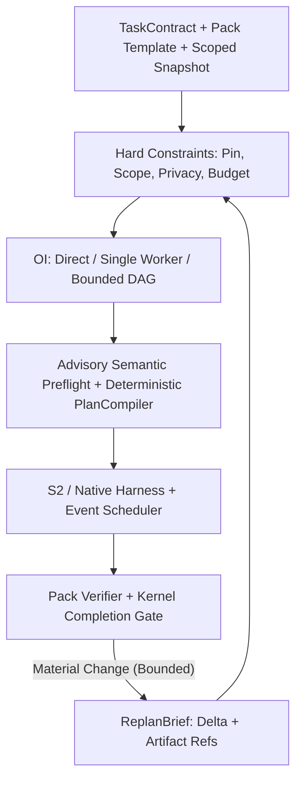

# Cognitive Fabric & Orchestration Intelligence (OI) Architecture

> **Classification:** Orchestration & Cognitive Architecture Specification  
> **Source of Truth:** Authoritatively governed by [Custos Master Specification](../../Custos.md).  
> **Documentation Triad:** Synchronized with [`codebase-architecture.md`](../development/codebase-architecture.md).

---

## 1. System Responsibility Boundaries

Orchestration Intelligence (OI) selects an **execution strategy within the TaskContract**; it is not a continuously running, unconstrained LLM planner. Direct execution or a pinned single worker / native coding harness remains the first-class baseline; complex multi-agent topologies (T0–T6) are admitted only when empirical utility gains are demonstrated.



### Responsibility Separation Matrix

| Component | Core Responsibility | Inviolable Restriction |
|---|---|---|
| **Human / TaskContract** | Defines goal, criteria, scope, pin, grants, revocations, and waivers | Never mutates historical receipts |
| **Domain Pack** | Supplies task templates, schemas, verifier obligations, and context recipes | Never issues execution permits |
| **S1 Heuristics** | Provides bounded, fast classification hints with source, version, and `abstain` | Never makes security decisions or passes criteria |
| **OI Selector** | Proposes topology (T0–T6), route, model, and budget reservations | Never widens scope, overrides user pins, or self-asserts success |
| **S2 / Native Harness** | Deliberative reasoning, tool invocation loops, patches, and action proposals | Never self-authorizes permits or self-verifies criteria |
| **PlanCompiler / Scheduler** | Validates structural graph dependencies, topological ready frontier, leases | Never proves semantic correctness |
| **Authority Gateway** | Verifies permits, enforces taint tracking, and audits receipts | Never selects topology based on convenience |
| **Evidence / Completion Gate**| Verifies empirical evidence against criterion revisions | Never passes unverified, errored, or unknown criteria |
| **Meta-Optimizer** | Measures Pareto utility and benchmarks policy revisions offline | Never mutates policy on active in-flight tasks |

---

## 2. Route Selection & Planning Investment

Prior to task execution, the OI pipeline evaluates:

```text
TaskContract + Scoped Source Snapshot + Pack Template
  -> Hard Constraints: Pin / Local-Only / Egress / Scope / Capability / Budget
  -> Candidate Topologies: T0 (Direct) | T1 (Single Worker) | T2 (Staged Pipeline) | T5 (Lead-Worker DAG)
  -> Planning Investment: D0 (Template Rules) | D1 (Bounded Planning) | D2 (Deliberative Analysis)
  -> Semantic Preflight (Advisory) + Deterministic PlanCompiler
  -> Versioned RoutePlan + Run Admission
```

- **D0 (Direct / Template Rules):** Applied for scoped queries, known recipes, or direct single-turn tasks.
- **D1 (Bounded Sequential):** Applied when multi-step handoffs and explicit intermediate dependencies exist.
- **D2 (Deliberative Planning):** Reserved for complex cross-subsystem tasks with high coupling, architectural risks, or high financial impact. D2 never overrides user model pins.

---

## 3. Two-Tier Plan Verification

1. **Advisory Semantic Preflight:** Pack-level checks identifying omitted criteria, ungrounded assumptions, un-testable nodes, and potential write set collisions. Returns structured findings with provenance.
2. **Deterministic PlanCompiler:** Executes structural validation:
   - Verifies artifact input/output directed acyclic graph (DAG) edges.
   - Rejects dependency cycles and unresolvable references.
   - Enforces effective write set isolation to prevent concurrent file mutation conflicts.
   - Runs strictly **once per workflow revision**, never on every tool call.

---

## 4. Re-planning & Delta Reachability

When execution encounters unexpected state (failing test, compilation error, or resource exhaustion):
- Triggers an explicit `ReplanTrigger` and generates a structured `ReplanBrief`.
- **Settled Node Preservation:** Completed graph nodes with valid, verified artifacts are locked and preserved; the planner only replans reachable downstream delta nodes.
- Re-planning iterations are bounded (maximum 3 replan iterations per task run). Exhaustion halts execution with `TaskStatus::RequiresIntervention`.

---

## 5. Physical Code Placement

| Responsibility | Defining Crate | Physical Path | Key Invariant |
|---|---|---|---|
| Domain Task, Workflow, and Criterion DTOs | `custos-contracts` | `platform/contracts/src/task/` | Zero-I/O pure structs and enums |
| Hard policy, budget, evidence, and authority | `custos-contracts` & `custos-engine` | `platform/engine/src/authority/` | OI never owns grants or permits |
| S1 FastPathFilter, Pareto Selector, T0–T6 Topologies | `custos-engine` | `platform/engine/src/orchestration/` | Pareto utility optimization ($U = w_q Q - w_c C - w_t T$) |
| Plan compilation, scheduler, and worker leases | `custos-engine` | `platform/engine/src/orchestration/` | Deterministic acyclic DAG verification |
| Governed agent loop & native harness integration | `custos-engine` & `custos-integrations` | `platform/engine/src/execution/` | ModelPort and AgentRuntimePort separation |
| Workbench recipes and verifier obligations | `workbenches/*` | `workbenches/{assistant, coding, quant, research}/` | Domain packs contain zero security policy |
| Storage, command ledger, and CAS artifacts | `custos-storage` | `platform/storage/src/` | Single-writer SQLite WAL transactions |
| Local API and composition root | `custos-daemon` | `apps/daemon/src/` | Thin transport adapter, zero direct DB writes |

---

## 6. Automated Verification Commands

```bash
# 1. Verify Pareto Selector and OI Topologies
cargo test --package tests-e2e --test oi_topologies_slice --offline

# 2. Verify platform engine state machines
cargo test --package custos-engine --lib --offline

# 3. Verify monorepo architecture boundaries
cargo xtask check-boundaries
```
