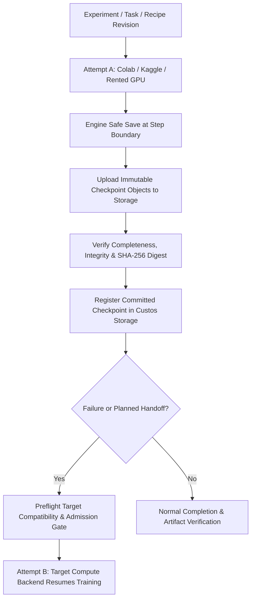

# Checkpoint Relay & Heterogeneous Training Failover Architecture

> **Classification:** Heterogeneous Compute Architecture Specification  
> **Source of Truth:** Authoritatively governed by [Custos Master Specification](../../Custos.md).  
> **Directory Index:** See [Custos Architecture Overview](README.md).

---

## 1. Executive Summary & Core Guarantees

Custos supports training resumption across heterogeneous compute environments (e.g. Google Colab -> Kaggle -> Rented Cloud GPU/SSH), provided:
1. Checkpoint bundles are committed to durable, externally accessible storage outside the source VM before termination.
2. The destination backend possesses valid credentials and network bandwidth to read the checkpoint bundle.
3. The execution engine verifies framework, precision, and state compatibility prior to dispatch.

This is **durable checkpoint resumption**, not live process memory migration. If a host terminates at step 450 while the latest committed external checkpoint is at step 400, the new attempt resumes from step 400; steps 401–450 must be re-executed. Un-uploaded local snapshots on dead instances are non-recoverable.

---

## 2. Invalidation of Fragile Assumptions

| Legacy Premise | Corrected System Invariant |
|---|---|
| Fixed session timeouts (e.g. 12h Colab, 30h/week Kaggle) | Timeouts, quotas, and hardware vary by tier and account; never hardcode limits as failure detectors. |
| Files in `/kaggle/working` or Colab `/content` are durable | Ephemeral local disk is discarded on VM termination; checkpoints mandate external committed storage. |
| Fixed LoRA checkpoint sizes | Checkpoint byte size depends on trainable rank, optimizer states, and tokenizer embeddings; measure exact bytes. |
| Implicit precision conversion (`bf16` -> `fp16`) maintains dynamics | Precision and accumulation changes alter numerical gradients; require explicit continuation contracts. |
| Network disconnect implies quota exhaustion | Socket loss signifies connection interruption only; remote jobs may continue running or be queued. |

---

## 3. Four Distinct Recovery Tiers

| Recovery Tier | Saved Assets | Admitted Operations | Canonical Outcome Label |
|---|---|---|---|
| **Tier 1: Export Only** | Model weights, adapter, tokenizer, config | Inference & evaluation only; fresh training initialization | `ExportOnly` (Never label as Resume) |
| **Tier 2: Warm Start** | Model weights loaded; optimizer/scheduler reset | New training lineage from learned weights with explicit reset | `WarmStartContinuation` |
| **Tier 3: Training-State Resume** | Model + optimizer + scheduler + RNG + trainer state | New attempt resumes logical training sequence under verified engine | `StateResumed` (Numerics may vary across hardware) |
| **Tier 4: Parity-Validated Resume** | Full state + verified deterministic fixture data progression | Claim numerical equivalence within tested tolerance | `ValidatedParity` (Within declared tolerance bounds) |

---

## 4. Four Separation Planes of Responsibility

1. **Compute Plane:** VM lifecycle, container provisioning, job launch, and teardown across Colab, Kaggle, and SSH/rented GPUs (`platform/integrations/src/compute/`).
2. **Training Engine Plane:** Safe checkpoint save/load boundaries, schema validation, optimizer/data compatibility checks (`workbenches/research`).
3. **Durable Storage Plane:** Upload, download, integrity verification (SHA-256), and CAS artifact versioning (`platform/storage`).
4. **Custos Control Plane:** Task/attempt lineage, authority grants, token budgets, and evidence admission (`platform/contracts`, `platform/engine`).



---

## 5. Checkpoint Bundle Composition

A complete training-state bundle consists of more than weight matrices. Resumption mandates:
- **Model / Adapter Weights:** Base model revision tag, LoRA adapter weights (`adapter_model.safetensors`), and adapter configuration (`adapter_config.json`).
- **Optimizer State:** Momentum buffers and learning rate states (`optimizer.pt`).
- **Learning Rate Scheduler:** Step count and decay curves (`scheduler.pt`).
- **RNG States:** Random number generator states across CPU, CUDA, and PyTorch (`rng_state.pth`).
- **Trainer State:** Step counter, global step, epoch progression, and best metric tracking (`trainer_state.json`).
- **Dataset Cursor:** Shard index, batch offset, and data sampler state to prevent duplicate data feeding.

---

## 6. Durable Commit & Preflight Admission Gates

Checkpoints undergo three progressive verification stages:
1. **Local Snapshot:** Files written to host disk. Does not protect against VM eviction.
2. **External Committed Checkpoint:** Complete immutable bundle verified in cloud/remote storage with known hash digests.
3. **Recovery-Tested Checkpoint:** External bundle loaded and preflight-verified against the destination engine profile.

### Admission Gate Requirements Prior to Destination Launch

Before launching attempt $B$ on a failover target:
1. Verify destination accelerator hardware (VRAM capacity $\ge$ model minimum requirements).
2. Validate storage credentials and egress policies between source storage and destination node.
3. Verify that the previous attempt's execution permit has lapsed or been safely fenced to prevent split-brain dual writers.
4. Record the resume offset explicitly (`resumed_from_step: 400`, never fabricate progress).

---

## 7. Architecture Mapping & Physical Placement

| Responsibility | Defining Crate | Physical Path | Prohibited Leaks |
|---|---|---|---|
| Immutable recipe & checkpoint DTOs | `custos-contracts` | `platform/contracts/src/execution/` | No network, filesystem, or GPU SDK imports |
| Compute allocation & authority grants | `custos-contracts` & `custos-engine` | `platform/engine/src/authority/` | Hardware compatibility cannot auto-grant spend |
| Experiment supervision & recovery FSM | `custos-engine` | `platform/engine/src/orchestration/` | No direct raw SSH/SQL calls in engine |
| Colab, Kaggle, SSH & GPU relay drivers | `custos-integrations` | `platform/integrations/src/compute/` | No task completion decisions |
| Checkpoint bundle verification & hashing | `custos-integrations` | `platform/integrations/src/compute/checkpoint.rs` | No arbitrary code execution or un-sandboxed pickle load |
| Relational run records & attempt lineage | `custos-storage` | `platform/storage/src/repositories/` | Single-writer SQLite transactions only |
| Research training recipes & verifiers | `custos-workbench-research` | `workbenches/research/src/` | Training loss alone cannot assert scientific success |

---

## 8. Automated Verification Commands

```bash
# 1. Verify contract definitions
cargo test --package tests-contract --lib --offline

# 2. Verify platform engine state transitions
cargo test --package custos-engine --lib --offline

# 3. Verify boundary invariants
cargo xtask check-boundaries
```
