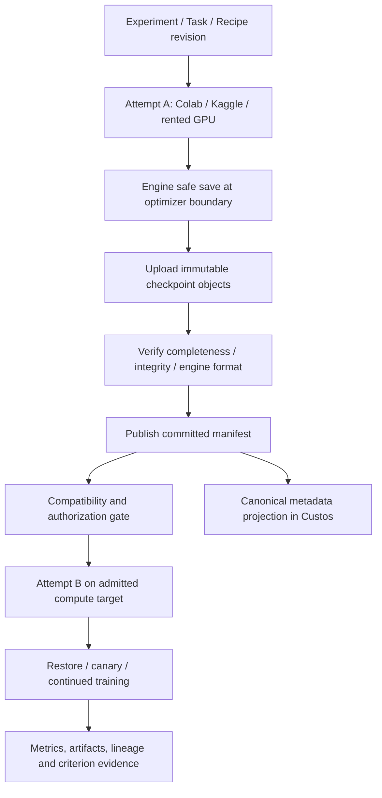
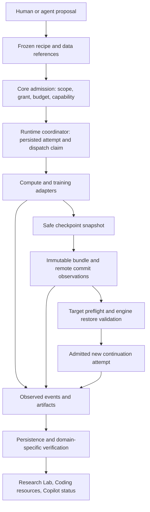

# Checkpoint relay và chuyển tiếp training giữa các compute backend

**Trạng thái:** thiết kế tổng thể với lát cắt admission/persistence đã hiện thực bên dưới; chưa triển khai full cloud relay hoặc kiểm thử GPU live. Đối chiếu ngày 18-10-2026 với source Colab CLI, Kaggle CLI, Unsloth Studio và tài liệu chính thức. Bản này thay các cam kết tuyệt đối của bản nháp trước, giữ hướng checkpoint relay nhưng phân biệt durability, resumability và scientific equivalence.

**Đã code lát cắt admission/persistence:** domain manifest validation (default Observed), protected progress/lineage checks, strict single-GPU Trainer inventory admission, failover rejecting implicit adaptation, bounded local SHA-256 inventory verification, migration 0035 và transactional execution snapshot/outbox. Existing executions get/list đọc được persisted compute metadata. Domain/core/persistence unit suites và local verifier tests đã chạy; chưa có remote upload/manifest commit service, checkpoint history ledger, engine-load/canary hoặc Unsloth/cloud runner. Metadata flags không là remote attestation; local verifier không promote protection. New continuation ở lát cắt này chọn checkpoint hiện đang gắn parent snapshot; support historical checkpoint selection cần ledger ở packet sau.

Verification của packet admission/persistence: `cargo test -p custos-domain -p custos-core -p custos-persistence --lib --offline -q` pass (domain 63, core 61, persistence 34 sau packet inspector); local verifier tests pass 2; daemon Research lifecycle pass, gồm assessment/missing ID. Persistence tests bao gồm file-backed restart, migration reopen, event-failure rollback, corrupt/legacy snapshots và invalid parent/namespace. Packet inspector tiếp theo đã đổi frontend: desktop build và 29 smoke tests pass; browser kiểm Lab/Training empty state và keyboard navigation. Không chạy GPU/live cloud hoặc populated-training UI end-to-end; không cài dependencies.

Đọc cùng [Colab/Kaggle adapters](remote-compute-colab-kaggle.md), [GPU thuê/SSH](remote-compute-external-gpu.md), [source study](../../../TRAINING_COMPUTE_SOURCE_STUDY.md) và [core refactor](../development/sade-core-refactor-plan.md). Không tạo Task engine, DB hoặc crate riêng.

## 1. Trả lời trực tiếp

**Có thể chuyển Colab → Kaggle → GPU thuê để train tiếp**, nếu checkpoint đã ra khỏi máy nguồn, đích có quyền đọc dữ liệu và engine kiểm được tính tương thích. Không phải live migration process/GPU memory; không bảo đảm không mất bất kỳ bước nào.

Nếu máy chết ở step 450, checkpoint mới nhất đã commit ngoài máy ở step 400, attempt mới chỉ tiếp tục từ 400; phần 401–450 cần chạy lại. Checkpoint local ở 450 chưa upload xong không được tính là đã backup. Nếu chỉ có adapter weights, có thể warm-start nhưng không phải đầy đủ training-state resume.

Sản phẩm nên hứa **giữ tiến độ đã được checkpoint bền vững và báo rõ khả năng phục hồi**, không hứa “không mất công train”. Hai máy khác kiến trúc/library có thể cho numerical trajectory khác ngay cả khi load đầy đủ state.

## 2. Các kết luận sai hoặc quá mạnh cần loại bỏ

| Bản nháp | Quyết định hiệu đính |
|---|---|
| Colab luôn ngắt đúng mốc, Kaggle luôn 9h/30h một tuần | Limits/hardware/eligibility phải theo profile, account và tài liệu hiện hành; không hardcode làm fault detector |
| Ghi /kaggle/working là checkpoint đã an toàn sau mọi failure | Chỉ là output location trong job; cần external committed copy hoặc provider output retention đã được xác nhận |
| LoRA checkpoint luôn 50–300 MB | Phụ thuộc trainable params, optimizer/state dtypes, embedding/modules_to_save và shards; đo bytes thực |
| Đổi bf16→fp16, microbatch→accumulation giữ optimizer dynamics 100% | Là compatibility/config change, có thể đổi numerics/data order/normalization; cần explicit continuation mode và validation |
| Idle notebook 30 phút → tự terminate | Kernel idle không chứng minh không có background training/upload hay user workload khác; phải có ownership + active operations + granted cleanup policy |
| Network volume giữ cả kernel | Volume giữ bytes, không giữ RAM/VRAM/process |
| HF private repo luôn miễn phí, R2 luôn không có tổng chi phí | Quota/pricing/operations/storage/transfer phải xét; không ghi claim giá chung trong kiến trúc |
| Không driver nào hỗ trợ migration dưới bất kỳ hình thức nào | Chỉ kết luận các Colab/Kaggle/SSH interfaces đã khảo sát không cung cấp transparent live migration này |
| Ngắt socket → quota exhausted | Observation loss không chứng minh nguyên nhân hay remote job đã dừng |

## 3. Bốn mức phục hồi phải hiển thị khác nhau

| Mức | Có gì | Cho phép làm gì | Nhãn kết quả |
|---|---|---|---|
| Export only | Weights/adapter/tokenizer/config dùng inference | Inference/evaluation; có thể khởi tạo lượt train mới | Không gọi Resume |
| Warm start | Load được weights, thiếu/không tương thích optimizer/data progress | Training lineage mới từ learned weights, reset state được ghi rõ | Warm-start continuation |
| Training-state resume | Model + optimizer + scheduler + engine state + data cursor/RNG thích hợp | Attempt mới tiếp tục logical training theo engine đã kiểm | State resumed, numerics not guaranteed identical |
| Reproducibility-validated resume | Trên fixture kiểm được data progression và metric/state tolerance so uninterrupted reference | Claim equivalence trong đúng scope/config đã test | Validated parity within stated tolerance |

Không dùng từ “exact” để chỉ bitwise identity khi đổi hardware nếu chưa có test chứng minh. Resume eligibility gắn engine/version/recipe, không gắn tên cloud. Torch checkpoint, TensorFlow checkpoint, MLX state, DeepSpeed/FSDP shard không là một format universal.

Nguồn nền: [Transformers Trainer](https://huggingface.co/docs/transformers/en/main_classes/trainer) phân biệt save-only-model với full state; [PyTorch reproducibility](https://docs.pytorch.org/docs/2.14/notes/randomness.html) không bảo đảm kết quả giống nhau xuyên releases/platforms.

## 4. Bốn mặt phẳng trách nhiệm

1. **Compute:** runtime/job/kernel/provision/stop/terminate của Colab, Kaggle, SSH, rented pods.
2. **Training engine:** safe save/load, checkpoint schema, optimizer/data/precision compatibility, canary validation.
3. **Durable storage:** upload/download/integrity/versioning/retention/access độc lập VM.
4. **Custos control plane:** Task/attempt lineage, authority, budget, recovery decisions, projections/evidence.

Không để provider notebook UI làm nơi duy nhất giữ trạng thái. Upload agent cần chạy cùng workload/remote side để laptop ngủ không làm ngừng backup; daemon vẫn giữ metadata/control, nhưng không cần ở giữa đường truyền mọi GB checkpoint. Khi daemon offline, chỉ các hành động đã được bounded grant và credential TTL cho phép tiếp tục; hết quyền không phát hành credentials vô hạn.



## 5. Checkpoint bundle: không chỉ một file weights

Extend existing artifact/recipe/execution models; bảng này là semantic contract, chưa là Rust/SQL schema đã freeze.

| Nhóm | Dữ liệu cần giữ hoặc xác nhận thiếu |
|---|---|
| Identity | Experiment/Task/attempt IDs, recipe revision, checkpoint ID, writer generation, parent checkpoint |
| Progress | Optimizer update step, epoch/data progress, samples/tokens consumed, schedule horizon; phân biệt microstep |
| Model | Base model/tokenizer exact revision, adapter architecture/config, trainable parameter mapping, model state/shards |
| Optimizer | Type, state format, parameter groups/order/mapping, hyperparameters, per-param state và precision |
| Training state | Scheduler, scaler nếu dùng, callbacks/EMA/algorithm-specific states; unfinished accumulation nếu engine support |
| Randomness/data | Python/NumPy/CPU/device RNG theo backend, sampler/shuffle/cursor, dataset/split/tokenization revision |
| Environment | Code digest/dirty patch, lock/image digest, Python/engine/torch/transformers/unsloth/bitsandbytes versions, CUDA/driver requirements |
| Topology | Device kind, precision/quantization, world size, sharding/parallelism mode, engine-specific layout metadata |
| Files | Object key/version, digest, bytes, required/optional role, completeness, compression/encryption metadata |
| Trust/access | Producer identity, sensitivity/license, authorized destinations, retention/expiry, who can commit/read |
| Validation | Engine format validator/version, integrity result, load/canary results, support gaps; no scientific pass inferred |

Checkpoint ở optimizer boundary là MVP: nếu chết giữa gradient accumulation thì quay về boundary đã commit. Chỉ resume microstep nếu engine thực sự lưu gradients/data/RNG đúng semantics. Global step không đủ khôi phục streaming dataset cursor; nếu stream không replayable/cursor không restore được, phải downgrade mode.

Unsloth source pin trong source study: [resume.py](../../../unsloth/studio/backend/core/training/resume.py) kiểm model, optimizer/scheduler và trainer step (MLX khác); [provenance.py](../../../unsloth/studio/backend/core/training/provenance.py) kiểm exact resources/load mode. Validator hiện này **không tự chứng minh toàn bộ RNG/dataloader parity**. Source cũng chặn một số S3-dataset resume; checkpoint đặt trên object storage không tự làm supported dataset-resume.

## 6. Durable commit: ngăn checkpoint nửa chừng thành “safe”

Proposed lifecycle: requested → staging → locally_complete → uploading → remotely_complete → validated → committed; failures thành incomplete/rejected. Đây là lifecycle của checkpoint, không thêm từng checkpoint phase vào Task FSM.

1. Engine lấy consistent snapshot tại safe boundary, không upload files đang bị trainer sửa.
2. Ghi bundle vào directory/object namespace duy nhất của attempt/generation/checkpoint. Không overwrite checkpoint đang dùng.
3. Flush local state theo capability, validate expected files/shards; async save phải chờ snapshot/staging completion trước buffer reuse.
4. Upload bounded parallel/multipart với retry và checksums; preserve resumable transfer metadata theo backend.
5. Kiểm remote object versions/bytes/digests và all required files. ETag không mặc định SHA-256, nhất là multipart.
6. Publish immutable committed manifest **sau cùng**. “Latest” pointer nếu dùng có compare-and-set/version preconditions hoặc authoritative metadata transaction; CAS conflict không được silently overwrite.
7. Custos ghi verified remote observations/manifest digest rồi hiển thị last protected step. Remote commit và local SQLite không atomic; daemon restart có thể discover/reconcile exact manifest.
8. Download destination chỉ nhận committed bundle, validate lại rồi engine load trong controlled environment.
9. Giữ ít nhất checkpoint trước đó đã commit trong retention policy; local Trainer rotation không được xóa bundle còn upload. GC không xóa parent đang được restore bởi attempt khác.

MVP dùng synchronous save + bounded upload dễ kiểm trước khi bật asynchronous staging/upload. Async cần cap in-flight checkpoints/host RAM và distinguish staged vs remotely durable. [PyTorch DCP](https://docs.pytorch.org/docs/2.14/distributed.checkpoint.html) tách các completion futures; framework save complete không tự là external storage backup nếu storage writer chỉ ghi local.

Hash phát hiện corrupt bytes, không chứng minh remote producer trung thực hay file optimizer an toàn. Không deserialize pickle/remote custom code tùy tiện trong trusted daemon; loaders có trust policy, hạn chế code execution và chỉ dùng weights-only khi phù hợp format. Engine compatibility validator chạy qua adapter/helper đã được authorize.

## 7. Storage chọn theo đường truyền thực, không theo tên “cloud”

| Lựa chọn | Vai trò | Điều kiện / hạn chế |
|---|---|---|
| S3-compatible object store | Default đề xuất cho cross-provider immutable bundles | Cần version/integrity/multipart/expiry semantics được conformance; S3-compatible không đồng nghĩa mọi backend có mọi tính năng |
| HF private repository | Backend tùy chọn cho artifact/version workflow | Full training bundle phải thực sự upload đủ; repo private, limits, commit pin và credentials được kiểm; không gọi model push là full resume backup |
| Google Drive | Đường bổ sung ở Colab khi user cho phép | Mount/file tồn tại không là atomic full-bundle commit; kiểm destination access từ Kaggle/rented host |
| Provider network volume | Fast local recovery trong provider | Không mặc định truy cập được từ cloud khác; replication/export path riêng |
| Local desktop | Export/last resort, không sole unattended relay | Laptop sleep/offline/storage full có thể ngừng bảo vệ |

Egress/transfer credential preflight phải pass **trước** bật nhãn protected run. Nếu Kaggle job không có permitted internet/secret/object-store path, chỉ cung cấp provider outputs hoặc export thủ công; không hứa mid-run cross-provider backup. Việc upload/checkpoint có thể lộ training data/optimizer info; privacy policy áp dụng cả optimizer state và logs.

Scoped upload credentials: exact attempt prefix/object operations, expiry, no root account key, no bucket-wide delete/list nếu không cần. Presigned URLs là bearer secrets có thể reuse tới expiry, không tự one-use; không log hoặc đặt vào notebook output. TTL phải bao được planned upload hoặc có bounded renewal mechanism; desktop offline/expired URL là degraded protection, không im lặng tiếp tục ghi “safe”. [AWS presigned URL semantics](https://docs.aws.amazon.com/AmazonS3/latest/userguide/using-presigned-url.html).

Không ghi mức giá/HF quota/R2 egress cố định trong runtime policy. Storage, operations, cross-region transfer, checkpoint conversion và retained disks đều vào cost estimate theo account/profile hiện hành.

## 8. Bounded loss: RPO, recovery time và checkpoint schedule

Custos theo dõi ba con số khác nhau: latest observed training step, latest locally complete step, latest remotely committed step. Chỉ số thứ ba bảo vệ khỏi mất VM.

Ví dụ minh họa, không benchmark: training báo step 450; local checkpoint 440; remote commit 400. Failure không có cứu dữ liệu bổ sung → recovery từ 400; tối đa 50 observed steps cần lặp trong ví dụ. Missing telemetry có thể làm observed count cũ; report khoảng/unknown.

RPO là mục tiêu mất tiến độ; RTO gồm detection + reconciliation + allocation/queue + download + environment setup + restore/validation. Không có capacity/quotas thì RTO có thể không đạt, kể cả checkpoint còn nguyên.

Với checkpoint interval I, save time S, upload+verification U và bounded backlog, cửa sổ protection lag có thể gần I+S+U. Đây là planning estimate, không hard guarantee khi network/save bị treo. Training step time thay đổi thì cap theo elapsed time và safe boundary, không chỉ save_steps. UI lấy actual remote commit age làm sự thật.

Chọn interval từ measured overhead, tolerable rework, hazard và bandwidth. Khi U lớn hơn interval, thêm checkpoint nhanh hơn chỉ tạo backlog: coalesce queued snapshots nếu không phá retention, giảm tần suất, chọn storage gần hơn hoặc pause có consent. Không prune last good bundle để tiết kiệm chỗ giữa failure window.

Admission profile cho phép: best-effort backup; required bounded protection (lag vượt cap → checkpoint/pause/attention theo grant); hoặc no mid-run protection (không auto-failover claim). Không hứa hook lúc shutdown cứu được SIGKILL; signal grace save chỉ là opportunistic improvement, periodic external commit vẫn là nền.

## 9. Compatibility gate trước mọi handoff

| Khác biệt source → target | Quyết định |
|---|---|
| Cùng engine/code/model/data/state format; resources pass | Candidate training-state resume, vẫn cần load/canary |
| Khác GPU nhưng supported precision/kernels/quantization | Resume có kiểm, ghi environment delta và numerical caveat |
| Không hỗ trợ source dtype/quantization/kernel | Không silent cast; chọn compatible GPU hoặc explicit config-change continuation |
| VRAM ít hơn | Profile load/optimizer/activations; propose microbatch/sequence/offload changes có revision |
| Đổi effective batch/scheduler/data order | Changed training recipe; không trình bày trajectory như unchanged |
| Đổi distributed world size/sharding | Chỉ khi engine-specific reshard/conversion supported và tested; no generic shard copy |
| Thiếu optimizer/scheduler/data cursor | Downgrade warm start hoặc block, không resume label giả |
| Dataset/model revision inaccessible | Block hoặc authorized resource replacement thành experiment revision |
| Thay framework, CUDA↔MLX/ROCm, unknown checkpoint version | Conversion path riêng, validation bắt buộc; default unsupported |
| Corrupt/partial checkpoint hoặc untrusted artifact | Reject/fallback last committed valid; không tự load |

Công thức effective batch ≈ microbatch × accumulation × data-parallel replicas chỉ mô tả một khía cạnh. Loss normalization, tokens per batch, dropout/RNG, batchnorm, optimizer/scheduler, sample order và floating-point reduction còn ảnh hưởng; “cùng effective batch” không chứng minh tương đương 100%.

Preflight đích kiểm architecture/VRAM (không chỉ weights), driver/runtime/library, licenses/data access, disk/bandwidth, credentials, load model+optimizer, rồi isolated canary update/eval với no accidental external publish. Canary dùng fork state và recorded consumed data; hoặc explicitly là training step đầu của attempt mới, không consume data ngầm rồi bỏ state. Nếu fail không mutate parent checkpoint.

MVP chỉ một engine recipe, single NVIDIA GPU, pinned software, có đầy đủ checkpoint ở step boundary. Multi-GPU/FSDP/DeepSpeed/resharding và dtype change là later tested profiles, không default universal resume. DCP có cơ chế distributed save/load nhưng không bảo đảm compatibility mọi PyTorch version; pin engine/version và fixtures.

## 10. Planned handoff và unplanned recovery

### Planned handoff

1. Capacity/quota/deadline warning hoặc user yêu cầu migrate; đây là request có authority riêng.
2. Preflight candidate target và estimate transfer/queue/setup cost, kiểm standing grant/fallback preference.
3. Trainer safe-boundary save → external commit validated. Drain pending uploads.
4. Quiesce source job và observe stopped khi supported; giữ resource đủ lâu để recover nếu target fail.
5. Fence checkpoint writer/source attempt; prepare destination lease/attempt riêng.
6. Restore exact checkpoint + environment compatible, canary verify rồi tiếp tục.
7. Quan sát destination training active với durable identity; update lineage/cost projection.
8. Cleanup source compute theo ownership/policy, xác nhận billing resource release; storage giữ theo retention.

Không giữ hai GPU chạy vô thời hạn để “an toàn”: overlap budget/deadline explicit. Có thể reserve capacity trước quiesce nhưng allocation là paid effect phải có permission.

### Unplanned interruption

1. Stream/heartbeat mất → suspected/unreachable, không quota/dead chắc chắn.
2. Reconcile exact account/job/version/process bên provider; giữ last observation/cause evidence.
3. Chọn newest **committed validated compatible** checkpoint, không newest directory.
4. Nếu source chắc chắn stopped: new attempt restore. Nếu source có thể còn chạy: user/standing policy quyết định chờ, stop/reconcile, hoặc start isolated recovery branch với duplicate spend warning.
5. Tại destination, verify checkpoint/config trước load, bind resumed_from và resume mode, update lineage.
6. Source quay lại không được overwrite latest canonical branch; stale writer outputs vẫn lưu quarantine/branch thay vì xóa lịch sử.
7. Resolve source lease/billing riêng: new attempt successful không chứng minh source đã dừng.

Fencing metadata không tự kill GPU hay chặn Internet side effects của old job. Fencing được enforce ở commit service/credentials/conditional writes khi có; nguồn có old PUT URL vẫn có thể upload vào own immutable prefix tới expiry, nhưng không được promote thành canonical latest branch. Không cấp toàn quyền ghi shared latest object cho mỗi VM.

## 11. Ma trận giữa các backend

| Chuyển tiếp | Điều kiện bắt buộc / giới hạn |
|---|---|
| Colab → Kaggle | External commit accessible trong Kaggle; batch package chứa recipe/checkpoint ref, compatible actual GPU, quota/internet/data access; new Kaggle version |
| Kaggle → Colab | Checkpoint đã exported/committed ngoài ephemeral run hoặc downloadable provider output đã xác nhận; allocate kernel mới, không chuyển interactive memory |
| Colab/Kaggle → GPU thuê | Cloud credentials/grant/cost ceiling, storage download route, compatible image/device; không assume paid GPU luôn available |
| GPU thuê → Colab/Kaggle | Model/optimizer có thể vượt VRAM/disk/time/permission đích; gate phải cho phép “không có target phù hợp” |
| GPU thuê → GPU thuê | Quote/region/storage/sharding compatibility; provider volume không tự mount xuyên vendor |
| Same host restart | Persistent disk còn đủ checkpoint, process lost; vẫn restore state và verify, không dùng PID cũ |

Không vòng qua nhiều account để né quota hoặc anti-abuse. Official CLI không tự chứng minh mọi deployment được phép trên free tier; verify account/product policy và current access. Không có target hợp lệ thì pause/wait/export, không tự bỏ quality/privacy constraints.

## 12. Rented GPU: cost-aware recovery, không “rẻ nhất mỗi giờ”

Chi tiết physical lifecycle ở [external GPU design](remote-compute-external-gpu.md). Ưu tiên Dedicated SSH integration và một paid provider profile (đề xuất Runpod Pods) trước khi thêm Vast/khác; đây là sequencing decision, không claim vendor tối ưu.

Compare expected cost-to-finish: remaining measured work + rework + allocation/setup + model/data transfer + checkpoint I/O + storage + likely interruption/recovery. Giá/giờ thấp hơn có thể total cost cao hơn hoặc fail không có capacity. Không đưa con số rental hardcode vào UI.

Lease giữ resource/account/quote timestamp, region, actual GPU count/VRAM, image digest, disk/volume IDs, max runtime, ownership và cleanup strategy. Quote hết hạn phải refresh theo granted price tolerance trước allocate. Không auto-chuyển paid backend nếu user chỉ cho free compute.

Paid guardrails: block new spend ở limit; warnings/reservation + remote job max duration khi supported; provider-side expiry/reaper hoặc managed scheduler TTL khi có. Local daemon watchdog không hard-cap hóa đơn nếu laptop offline/API down/provider billing delayed. Stop khác terminate và không hủy charges storage tự động; cần retention costs riêng.

Preemption warning nếu provider có thì save/upload sớm nhưng không dựa vào việc chắc sẽ nhận warning. Spot/interruptible risk được hiển thị, checkpoint policy bắt buộc theo supported profile.

## 13. Placement và data contract trong Custos

| Concern | Owner hiện hữu để mở rộng |
|---|---|
| Checkpoint manifest/artifact lineage/recipe deltas | domain recipe/execution/artifact models, no I/O |
| Resume admission, authority, payload/account scope | core policy/contracts; không concrete storage client |
| Safe-save/load and engine compatibility | training adapter/Python helper + Research pack verifier semantics |
| Upload/download/immutable commit I/O | adapters storage integration, CAS reference importer; credentials isolated |
| Recovery policy / candidate target / attempt transitions | runtime workflow/experiment; OI proposes, core admits |
| Durable metadata/leases/events | persistence via ports, transactional canonical state |
| VM/kernel/provider lifecycle | compute adapters + existing remote fleet/contracts |
| API/events and composition | daemon + SDK, no second endpoint server in desktop |
| Status/action projections | existing Research notebook/Runs/Artifacts/attention, not a new workbench |

Proposed minimal record extension: checkpoint ID/manifest digest/state/remote committed step; resume eligibility record(engine/target/validator/results); handoff command(source attempt/checkpoint/target/mode/config deltas/grant); destination attempt.resumed_from; storage/compute refs and cleanup observations. Reuse existing attempt/effect FSMs; đừng thêm PreemptedWithCheckpoint vào every Task status, vì source termination và checkpoint validity là hai trục.

API command inventory cần implement bằng existing envelope: request checkpoint, list committed checkpoints, assess target compatibility, plan handoff, start admitted continuation, reconcile source/destination, release resource. Names/DTOs freeze bằng fixtures khi implementation, không tạo universal cloud SDK contract phình to.

Agent có thể propose fallback/triage failure/compare metrics. Không tự cast precision, đổi dataset, thuê GPU hoặc publish checkpoints. Rented GPU failover khi unattended cần standing grant bao provider/account/data region/price/time/overlap/storage/security và allowed resume modes.

### 13.1 Source-backed gap analysis and ownership decisions

This section is the implementation placement decision, not a claim that the missing components exist. Inspection covered the active domain/core/persistence/daemon/desktop paths and pinned upstream training entry points. The three upstream checkouts remain Unsloth `cf0b66c83ae6216028d4f2e3aa0720e9cd37befc`, Colab CLI `006ff96ac2d0e4dcfb702467a76493d687929be8`, Kaggle CLI `6894864ff4095cf98e9e36d3a694ff5fc9ba3818`. No upstream code was copied in this clarification.

#### Current gaps, with consequences

| Observed source | What exists | Consequence and required correction before launch |
|---|---|---|
| `custos-core/src/contracts/compute.rs` | `ComputePort` and a test-only `OfflineCompute`; no production implementation found | A declared port is not available compute. Do not advertise allocate/release/telemetry until a concrete adapter is wired and tested. `plan_failover` is a hardware proposal, not a dispatch permit or engine proof. |
| `custos-domain/src/recipe.rs`; `ResearchRepository::save_recipe` | Recipe command/environment/inputs can be updated under the same ID; attempts refer to that ID without a frozen recipe digest | A historical run can appear to refer to today's edited command. Before first launch, bind a canonical recipe/config/input/environment snapshot and digest to the attempt using existing artifact/revision mechanisms; edits create a new revision for future attempts. Do not rewrite old attempts. |
| `execution_record.rs`; `ResearchRepository::save_execution_record` | Validated JSON snapshot, monotonic milestone checks, parent ID/checkpoint linkage; one current checkpoint | Useful metadata integrity, not append-only checkpoint history. Same checkpoint ID must not later denote different bytes. Add immutable checkpoint references/history and observed verification records before remote commit or historical resume. Legacy NULL snapshots have no trustworthy compute lineage; do not manufacture it during migration. |
| `TrainingCheckpointManifest::validate_for_state_resume` | Required metadata and a specific single-GPU Trainer file inventory | Presence flags/file names do not establish engine compatibility. Required files must be engine-profile-specific, including scaler/custom state where applicable; streaming cursor semantics, parameter mapping and dataset revision require an actual restore test. |
| `tools/checkpoint.rs` | Synchronous bounded local hash verification; called by tests, not the product launch path | Not a sandbox or race-free filesystem capability. Before exposing it, authorize the root, freeze the bundle, bound file count/total work, provide cancellation/deadline outside the domain, and run blocking work off the async executor. No optimizer deserialization in the trusted daemon. |
| `runtime/notebook/coordinator.rs` | Interactive persistent Python worker, inline subprocess I/O and direct ResearchRepository coupling | Do not turn this cell worker into a cloud-training supervisor. Preserve existing notebook behavior while moving process I/O behind adapters and repository access behind existing ports incrementally. Reset/interrupt notebook is not stop/release background training. |
| `TrainingRunsPane.tsx` | Session-scoped read-only inspection; recipe enumeration followed by bounded execution queries; no real launch controls | Appropriate initial inspector, not a scalable experiment index. Add a session/Task-scoped paginated query through the existing repository/API before large histories. View scope is not authorization; backend must enforce admitted actor/project scope before remote or multi-user exposure. |
| `CheckpointResumeAssessment` | Declared inventory assessment; `can_start` always false; explicit unverified obligations | Keep it as metadata assessment. Target preflight, integrity, restore results and authority must remain separately identified; never repurpose this response as a permit. |

The `committed_protected` enum remains a stored declaration in this slice. A production writer must only promote it after trusted storage observations; accepting a helper's JSON flag or a UI-supplied boolean would defeat the design. Restoring an execution JSON snapshot after restart also does not restore the Python/GPU process.

#### Physical placement without a second backend

Paths below distinguish existing files from proposed modules. Proposed paths are not instructions to generate empty folders; create them only with a working vertical packet and catalog/test updates.

| Responsibility | Existing anchor | Planned implementation placement | Forbidden responsibility |
|---|---|---|---|
| Immutable recipe/attempt/checkpoint values | `custos-domain/src/{recipe,execution_record,compute,artifact}.rs` | Extend these values when the first runnable profile needs the fields | No filesystem, HTTP, process or model calls |
| Admission and effect rights | `custos-core/src/contracts/compute.rs`, existing authority/effect contracts | Extend only the operation boundaries needed by the first engine/storage profile; keep compute lifecycle separate from save/load semantics | No cloud SDK; hardware compatibility cannot grant spend |
| Experiment supervision and recovery | `custos-runtime/src/notebook/` and existing workflow scheduler | Proposed `custos-runtime/src/research/` coordinator uses ports for attempts, engine, storage and compute; register through existing runtime modules | No raw SSH/CLI/SQLite; no second task scheduler or AI loop |
| Provider execution I/O | `custos-adapters/src/` and existing remote/workspace adapters | Proposed `custos-adapters/src/compute/` for exact Colab/Kaggle/SSH/provider lifecycle adapters | No criterion completion or canonical DB writes |
| Engine save/load/start/observe | `custos-adapters/src/` | Proposed `custos-adapters/src/training/` supervises a versioned helper or existing Studio integration; pinned portable helper under existing approved `sidecars/` only if required | No hidden cloud allocation, package installation or grant creation |
| Bundle transport and remote integrity | Existing artifact/CAS boundaries; local verifier in `tools/checkpoint.rs` | Proposed `custos-adapters/src/checkpoint/` for bundle/upload/download operations; move the current verifier only when actual production callers exist | No remote transfer in domain/core or desktop; no blanket bucket credentials |
| Canonical attempts/history/events | `custos-persistence/src/repositories/research.rs` and migrations | Extend existing repository under single-writer transactions, expose through core ports | No helper-owned SQLite or second experiment store |
| Research quality and recipes | `custos-packs/src/research/` | Supported engine profile, input eligibility, eval/held-out metric obligations and artifact interpretation | Training loss alone cannot declare scientific success |
| Composition/API/client | Existing `custos-daemon/src/{api,runtime}.rs`, SDK/client bindings | Wire concrete implementations only in daemon; typed bounded operations over existing local API | No training HTTP server embedded in Tauri host |
| Presentation | Existing `LabPane`, `TrainingRunsPane`, notebook/Runs/Artifacts and attention views | Render backend capabilities, exact attempt and checkpoint IDs, observed freshness and actionable blockers | No credentials, scheduler or process lifecycle in React state |

This does not split more crates. Physical adapters can start as a small module per implemented concern; do not add a generic plugin/hub/factory framework to support hypothetical engines. Internal Python helper traffic can use supervised stdio; MCP is optional exposure to agent clients, A2A only for a genuinely remote agent. Colab/Kaggle job submission is not inherently agent-to-agent delegation.

#### Lifecycle and identity rules



- Task groups the goal/criteria/rights; Recipe revision defines execution; ExecutionRecord denotes an observed attempt; checkpoint denotes immutable recoverable bytes. None is a Screen or notebook cell. Multiple views share references, not duplicated jobs.
- Source attempt, destination attempt and allocation each retain exact external account/job/version/host identities. Their states may differ: source unreachable, destination waiting, checkpoint readable and storage charges active can all be true together.
- API timeout after start/submit/allocate is uncertain dispatch, not failed-with-no-effect. Persist dispatch intent before effect; reconcile by request/job identity before retry. Never run a portable script as fallback merely because Studio start returned no response.
- Cleanup has three independent effects: stop training, release compute, remove retained storage. Each needs an allowed operation and observation. Successful training does not imply any of them happened.
- Recovery from an older checkpoint records rework; do not add replayed steps to logical progress twice. Missing observation timestamp/freshness remains unknown, not a live heartbeat.

#### Delivery contract for the next packets

The F0–F9 roadmap remains the single execution roadmap. The following acceptance clarifications refine it rather than introducing another campaign:

1. **Finish F0 identities before a Start button:** freeze recipe/code/data/environment, bind attempt ownership and dispatch ID, define the supported engine inventory and secret-reference rules. Test recipe edits cannot alter historical attempts; invalid/legacy lineage fails closed. Reconcile existing Run/WorkerRun linkage rather than creating a second generic Run model.
2. **F1 local save → crash → restore:** use one tiny CPU fixture with available engine dependencies, no model download required. Compare step, optimizer/scheduler state and next data item against an uninterrupted reference; test corrupted/missing state and cancelled verifier work. A deterministic toy fixture proves control-path correctness only, not Unsloth/GPU support. Follow with the pinned single-GPU Unsloth profile when explicitly provisioned.
3. **F2 remote commit:** implement one authorized storage path with immutable object versions and manifest-last publication. Test death during each file/manifest phase, expired credentials, false/composite checksum interpretation and full disk. A failed upload cannot advance protected progress. Preserve the previous known-good checkpoint.
4. **F3 restart and concurrency:** discover/reconcile committed manifests after daemon restart; reject stale writers and conflicting checkpoint ID/digest. Test source possibly alive and duplicate submit without enabling duplicate canonical training. Add historical checkpoint query and typed observation freshness.
5. **F4–F6 one target at a time:** expose only implemented operations; distinguish Colab interactive runtime, Kaggle versioned batch, and owned SSH/rented resource. Verify exact allocation, artifact capture and cleanup. Paid resource and external data transfer require explicit configured scope, not merely a user preference for cheap compute.
6. **F7 handoff:** first demonstrate two compatible environments with full checkpoint round-trip; then test the supported cloud pair. UI may say continued only after observed restore/progress; queued submission remains queued. Numerical parity needs a stated tolerance and held-out evaluation, not identical weights-file names.
7. **F8–F9 optimization last:** S1 can extract/rank telemetry or estimate risk; OI proposes targets/checkpoint cadence; S2 diagnoses/revises scripts. They cannot override source truth, grants, price bounds or engine incompatibility. Compare measured cost-to-accepted-result, including storage/transfer/rework, against a direct single-target baseline before enabling automatic policy.

Research evidence constrains these decisions: [Trainer documentation](https://huggingface.co/docs/transformers/main_classes/trainer) distinguishes full-state resume from model-only saves; [PyTorch reproducibility](https://docs.pytorch.org/docs/2.14/notes/randomness.html) limits equivalence claims across environments. [S3 integrity documentation](https://docs.aws.amazon.com/AmazonS3/latest/userguide/checking-object-integrity-upload.html) distinguishes full-object/composite checksums, so a multipart checksum must not be compared blindly with the manifest's whole-file SHA-256. [Colab FAQ](https://research.google.com/colaboratory/faq.html) makes resource availability dynamic; a proactive handoff is bounded recovery, not guaranteed uninterrupted capacity. These sources support constraints, not proof that Custos has implemented them.

### 13.2 Notebook continuity, backup and automatic target selection

The [notebook binding design](remote-compute-colab-kaggle.md#41-notebook-compute-binding-and-recovery-design) is the entry point for interactive GPU use. Kernel reconnection, fresh-kernel replay and checkpoint restore are different operations. A frozen training recipe can be launched from a notebook, but its attempt/recovery lifecycle must be supervised independently of the cell and Screen.

#### Backup contract

Three separately reported durability classes are sufficient for the initial product:

| Class | Useful guarantee within observed scope | Failure it does not cover |
|---|---|---|
| Local snapshot only | Saved files available on the current host | Host deletion, ephemeral VM loss or inaccessible disk |
| External committed checkpoint | Complete immutable bundle observed in storage independent of source compute, with known integrity/access status | Storage deletion/expiry, revoked access, unsupported restore engine or target unavailability |
| Recovery-tested checkpoint | External committed bundle restored and validated in a stated engine/environment profile | Every future GPU/framework/configuration or an untested data stream |

Protection and geographic/administrative independence are separate: a volume outside a process may still disappear with the resource or account. Record storage location/version/retention and failure domain; do not claim a disaster-recovery replica merely because an object has a remote URL. A second copy is optional according to loss tolerance, privacy and cost, not required for every small notebook. Credentials and access policy remain separate from the manifest bytes; losing a key can make a correct backup unusable.

Backups cover the reproducible inputs needed for continuation, not only optimizer files: retain or pin accessible model/tokenizer, code/environment and dataset revisions. Check dataset authorization at the destination before launch. Deleting a backup must check restore-in-progress and parent/retention references; automatic pruning cannot remove the only known-good checkpoint while a new upload is incomplete. Local save rotation and remote backup retention require coordination.

#### Recovery authority and one active recovery controller

Default is **ask before switching**. Optional automatic continuation is bounded by exact allowed account/provider/region, max rate/total reservation/runtime/overlap, checkpoint profile, allowed numerical/config deltas and data-egress rules. It can choose no target. A free-tier source does not grant access to paid fallback; the policy must stop/wait when neither Colab nor Kaggle is admissible.

Candidate ranking considers actual support first, then availability observations, environment/VRAM/disk, model/data access, transfer and restore time, protection lag, remaining work and total expected cost. Account quota or GPU type not observable remains unknown, not a positive preflight. Historical timing can propose a handoff window, never guarantee that a runtime will survive until it.

If an optional external managed-job system such as SkyPilot owns restarts for a submitted job, Custos observes that controller's durable job identity and normalizes its attempts. It must not independently submit a replacement after the same transient failure. Controller ownership is chosen at admission and persists with the execution profile. Switching controller is a new handoff after reconciliation, not a retry. External controller behavior/authority/budget enforcement needs conformance; it is not automatically custos-mediated.

Existing command/effect records must durably capture proposal, selected checkpoint digest, target admission, source quiescence or unresolved overlap, destination submission identity, observed restore/progress and cleanup observations. These are workflow observations on existing attempts/effects, not another task engine or unreviewed SQL schema. Lost reply at any mutation leaves an explicit reconciliation obligation. Source coming back cannot reclaim the canonical writer generation from its successor.

#### Concrete scenario and stopping conditions

Illustration, not an executed demo: Notebook N attaches to Colab kernel A; a frozen Unsloth recipe starts attempt A1. Periodic callback commits C400 externally while A1 later reports step 450. A trusted warning or human policy triggers handoff. Custos checks a candidate Kaggle version profile and backup access; if compatible/admitted, it submits attempt B1 with C400, observes restore and subsequent progress, and separately reconciles source/release. The notebook keeps its saved cells and opens B1's logs/metrics. It does not pretend Kaggle has the interactive Python namespace from kernel A. Future interactive cells require an admitted interactive binding.

If Kaggle cannot read the checkpoint, has no permitted network/quota, or cannot support the engine, automatic policy can try an explicitly allowed owned/rented target. No valid target means protected checkpoint retained + waiting/attention; not checkpoint deletion, precision downgrade or unapproved rental. A missing backup means restart/warm-start/export choices with honest loss, not a Resume action.

Repository research relevant to these choices is recorded once in remote notebook §4.1: Jupyter Client/Server for interactive protocol, Enterprise Gateway as deferred distributed-kernel option, SkyPilot for optional managed-job recovery, fsspec for optional storage plumbing. The existing Unsloth/Colab/Kaggle source study remains the concrete vendor baseline. New repo main-branch pages are research references, not pinned dependencies or a claim of full source audit.

## 14. Giao diện trạng thái và ví dụ nghiệm thu

Projection cần trả: latest observed/local/remote step, last protected time, checkpoint completeness, resume eligibility per target, missing states, predicted rework/RTO, paid resource still active/unknown, selected lineage. Renderer chỉ hiển thị dữ liệu thật, no progress timers giả.

Ví dụ minh họa:
- Attempt A / Colab: observed step 450, remote protected step 400, source status unreachable.
- Checkpoint C400: committed + format validated, full state; download available.
- Candidate B / paid GPU: price estimate + data policy + compatibility result; source chưa stopped → duplicate spend warning.
- User/policy admits B; new attempt resumes C400, progress/history nói resumed from 400, không ghi “tiếp tục 451”.
- Sau failure injection, compare B sau N steps với uninterrupted reference theo tolerance/profile; scientific acceptance vẫn qua held-out eval riêng.

Close Screen không cancel upload/training; stop source không delete committed checkpoint; delete checkpoint là retention/destructive action riêng. No verified checkpoint → show export/warm-start/restart choices, không enable full Resume. Status wording không kết luận quota từ socket disconnect.

## 15. Implementation roadmap theo dependency

**Packet đang hiện thực — admission và metadata durability:** sửa existing domain compute/execution validation, core failover planning và ResearchRepository persistence. Manifest default Observed, declared full-state phải có required metadata/files; commit milestone kiểm step/status và không đi lùi. Add migration 0035 `record_json` nullable snapshot trên existing research_execution_records; snapshot và legacy query projections ghi cùng transaction/outbox, identity không được đổi khi upsert. Legacy rows tiếp tục decode; corrupted snapshots fail thay vì mất metadata im lặng. Hardware plan `RequiresAdaptation` không tự được execute; no fallback plan khi incompatible. Đây là metadata/invariant foundation, chưa remote storage integrity verification hay actual Unsloth training integration.

Local integrity seam: adapter `tools/checkpoint.rs::verify_local_checkpoint_files` kiểm scoped bundle inventory bằng SHA-256, byte limits và symlink rejection; không deserialize optimizer/execute code và không promote remote protection. Caller vẫn phải authorize root/read scope. Initial state-resume inventory profile là single-GPU Hugging Face/Unsloth trainer bundle (model/adapter, optimizer, scheduler, RNG, trainer state); unknown/sharded formats không tự được coi supported.

### 15.1 Product flow: một experiment, ba nơi chạy, một training engine

Thiết kế ứng dụng cụ thể là **Training trong Research/Lab hiện có**, không thêm top-level workbench thứ tư. User bắt đầu bằng chat hoặc recipe form; dataset/code/checkpoint vẫn mở như resource cùng Task. Coding có thể chỉnh training script của experiment đó, Copilot có thể đọc trạng thái đã được cấp scope; không copy experiment sang ba store.

Một recipe version cần bốn lựa chọn độc lập:

| Lựa chọn | User thiết lập | Quyết định lưu vào contract |
|---|---|---|
| Engine | Unsloth supported profile; model, dataset, LoRA/QLoRA và parameters | Exact engine/code/model/data revisions; giới hạn tính năng và validator |
| Primary compute | Colab, Kaggle hoặc own/rented GPU | Account/resource profile, capabilities và requested hardware |
| Protection | Durable storage, safe-save cadence, maximum acceptable protection lag | Upload/retention/access policy; thiếu protection phải hiện trước start |
| Continuation policy | Ask first, hoặc auto trong danh sách đã cho phép | Ordered targets, allowed resume modes/config deltas, spend/overlap/time/data-region constraints |

Ví dụ cấu hình sản phẩm, không DTO đã tồn tại: primary Colab; fallback Kaggle nếu full-state compatible; rented GPU chỉ khi user approve hoặc có paid standing grant; storage đã probe từ cả nguồn và đích; no silent dtype/data change. User chọn “auto” không cấp quyền mọi vendor/account/mức giá.

Start flow: validate recipe → probe compute/storage/engine → materialize Task/effect scope → allocation/submission → train + checkpoint relay → persistent observations. Không chỉ validate JSON rồi ghi “ready”: phải xác nhận checkpoint save/load capability, egress và destination access cho đúng job profile.

### 15.2 Chủ động chuyển trước khi hết thời gian

Custos không có đồng hồ đếm ngược chính xác cho mọi Colab runtime. Mỗi signal có source, observed_at, confidence và scope: provider deadline nếu API cung cấp; explicit user max duration; quota/rate observations; provider warnings; historical estimate chỉ là estimate. Không suy ra quota exhaustion từ socket drop, không công bố “còn đúng 20 phút” khi thiếu dữ liệu.

Proposed planning rule: handoff lead time dựa measured p95 save + upload/verify + destination queue/setup/restore, cộng safety margin và bounded overlap budget. Deadline unknown thì vẫn periodic backup và offer scheduled/user-defined handoff; không thể bảo đảm tránh mọi abrupt termination.

Chuỗi chủ động Colab → Kaggle:

1. Scheduler nhận trusted deadline/user deadline hoặc policy warning threshold; persist handoff proposal trong cùng Task.
2. Probe Kaggle auth/eligibility, compatible device requirements, submission settings, checkpoint download route và quotas khi observable. Preflight **không** đồng nghĩa đã reserve GPU hoặc chắc không phải queue.
3. Chuẩn bị immutable private submission package với pinned Unsloth recipe, input/config digests và remote checkpoint reference; chưa submit nếu chưa authorized.
4. Yêu cầu Unsloth source save tại safe optimizer boundary, commit checkpoint C; freeze checkpoint ID sau commit, không trỏ job đích vào mutable “latest”.
5. Quiesce/stop source theo supported semantics; source chưa confirmed stopped thì áp policy chờ/reconcile hoặc isolated continuation có duplicate-compute warning. Optional target warm-up overlap phải có quyền và budget.
6. Submit Kaggle version mới, persist returned identity/reconcile unknown response; bootstrap load checkpoint C rồi canary/continue. LLM train recipe chỉ chạy một data stream canonical, không hai nguồn cùng ghi một output prefix.
7. Observe target started/training progress, ghi Attempt B.resumed_from=C, tổng progress tính từ protected state và rework; không cộng steps lặp của A/B như progress mới.
8. Source resource release/retained-storage cleanup được verify riêng. Nếu target không khởi động, giữ checkpoint, show waiting/fallback choices; không báo “đã chuyển” chỉ từ successful submit.

Nếu source chết trong bước 2–4, dùng last committed compatible checkpoint và chuyển sang unplanned recovery. Nếu Kaggle hết quota/không đủ VRAM/không có permitted network thì skip với reason; không đổi sang paid GPU tự động ngoài grant. Đây là khả năng **proactive checkpoint handoff**, không zero-downtime GPU migration.

### 15.3 Unsloth là lõi training tích hợp, không là cloud orchestrator

Mục tiêu sản phẩm là có **built-in Unsloth engine adapter**: user chọn supported recipe ngay trong Custos, không phải tự copy notebook template mỗi lần. Source Unsloth đã clone không có nghĩa adapter đã được ship; current status vẫn planned/integration-unverified.

Tách hai launch profiles:

- **Portable script runner:** pinned Unsloth library + explicit training recipe chạy trong Colab/Kaggle/SSH/Pod environment. Phù hợp batch Kaggle; không đòi dựng Studio web server trong mỗi notebook. Custos owns job packaging, observation, checkpoint relay và resume admission.
- **Existing Unsloth Studio backend:** tùy chọn attach supported authenticated API/MCP của một Studio đã vận hành. Normalize start request/job IDs, stop/save/progress/export và resource provenance; không coi Studio DB/session success là Custos criterion pass. Profile này không tự available trên mọi compute target.

Adapter đặt theo target map hiện có: training I/O ở adapters/Python helper, recipe/eval semantics ở Research pack, scheduling/recovery ở runtime, authority/evidence ở core, canonical metadata ở persistence. Không thêm Unsloth vào model-provider registry, không copy Studio frontend/runtime/DB vào desktop.

Minimal supported profile nên bắt đầu **một LLM LoRA recipe, single GPU, pinned environment**, với các operations validate/preflight, start/observe, safe-save/checkpoint eligibility, stop nếu supported, restore và export. Không mặc định hỗ trợ mọi architecture/diffusion/optimizer/quantization. Yêu cầu checkpoints được bật; adapter reject protected mode nếu save strategy tắt hoặc backend không export đủ state.

Studio source [training tool](../../../unsloth/studio/backend/studio_mcp/tools/training.py) phân biệt validate_only, start_request_id và actual job_id, đồng thời có start errors ngay cả khi HTTP 200. Custos phải preserve distinctions, không launch native script lần hai sau uncertain API start. For portable runner, own supervisor identities phải có fidelity tương đương thay vì giả Studio IDs.

License/per-file provenance là integration gate: core library và Studio optional components có license khác nhau; separate process không tự miễn mọi nghĩa vụ license. Không copy code Studio có AGPL headers rồi gắn chung nhãn Apache. Không auto-install/update packages trên host user hoặc VM ngoài granted environment/setup scope.

### 15.4 Definition of done cho yêu cầu tự chuyển

Demo đầu tiên phải chứng minh một experiment Unsloth recipe chạy trên source được hỗ trợ, checkpoint complete được commit ngoài máy, planned interruption xảy ra, target khác restore đúng C, tiến độ mới tiếp tục và artifacts/evaluation/lineage đều mở được sau daemon restart. Source release và retained costs có observation riêng.

Fixture phải có cả target quota denied, checkpoint upload incomplete, source unknown alive, target GPU incompatible, paid fallback not granted và laptop offline. Các case này dừng/wait/reconcile trung thực, không fake successful failover. Chỉ sau demo này mới bật nhãn “auto continuation supported” cho đúng source–target–engine profile đã kiểm.

| Packet | Deliverable cụ thể | Gate trước packet sau |
|---|---|---|
| F0 Source/contract freeze | Pin engine/adapter versions, audit current models/ports/credential paths, required checkpoint files/cursor fixtures | No parallel schema, define supported single-GPU recipe và resume modes |
| F1 Local round-trip | Safe save/load + manifest validation, interrupted deterministic tiny training fixture | Same step/scheduler/data cursor, corrupted/missing files rejected; no cloud needed |
| F2 Durable relay | One object-store backend, immutable uploads/manifest commit, retry/expiry/retention | Kill during file save/upload/commit, newest incomplete ignored; previous valid recoverable |
| F3 Provider-independent attempt recovery | Restart metadata reconciliation/fencing/lineage, external credential lifecycle | Two writers, stale uploader, laptop offline; no duplicate canonical branch |
| F4 Colab protected run | CPU correctness trước, single GPU opt-in; external checkpoint callback + compatible recovery | Abrupt kill then restore from remote commit; no backup claim if network/grant unavailable |
| F5 Kaggle protected batch | Private/versioned package, allowed secret/network path + periodic relay; output fallback profile | Version pin, kill before output collection, upload blocked downgrade; no quota-based promises |
| F6 Dedicated/rented GPU | Existing SSH + one paid provider, durable storage + lease/teardown | Cloud API lost reply/stop failure, data intact, charges unresolved visible |
| F7 Cross-provider handoff | Colab↔rented first on compatible image, then Kaggle matrix | Real input/model/state identities, rollback/rework stated, canary and eval evidence |
| F8 Controlled heterogeneity | dtype/VRAM/world-size conversions từng profile | Change recipe/relabel continuation, engine-specific parity/quality tests |
| F9 Measured policy | Optional auto fallback/OI target selection/checkpoint interval tuning | Accepted quality/cost/RPO/RTO measured; policy không nới grant |

Tests add to existing core/runtime/persistence/adapter/contract/e2e suites and supervised helper tests; no mock success in production. Fast tests use tiny CPU engine fixtures, simulated I/O faults; actual GPU/provider tests are opt-in with budget/cleanup. Không cài cloud dependencies hoặc charge resources chỉ để “nghiên cứu”.

## 16. Các phép đo phải công bố

### Read-only desktop admission inspection

Focusing Lab within the same bound session/Task must preserve that resource tab. Canvas selection synchronizes canonical identities only when they actually differ, rather than invoking conversation-opening navigation on every peer-tab click.

`v1.research.executions.resume.assess {execution_id}` loads durable metadata and reports `metadata_valid`, `state_inventory_declared`, `blockers`, and `unverified_checks`. All successful responses include `can_start: false`: local/remote byte verification, destination compatibility/quota/authorization and actual engine restore are separate obligations, not implied by an inventory. Unknown execution or malformed request fails explicitly. Research Lab → Training lists only persisted attempts bound to the active session; missing session/data/backend produces an actionable empty/error state, never mock runs. Refresh re-reads metadata; it does not probe a GPU or execute a recipe. Tab navigation uses ArrowLeft/Right, Home/End. `/` focuses Training search only within that pane and outside editable controls; Escape clears it. Native buttons retain Tab/Enter/Space behavior and visible focus.

Checkpoint wall-time/bytes, local staging và external commit latency; protected-step/time lag; upload queue/failed retries; restore/download/canary time; resume mode và compatibility rejection causes; reworked optimizer steps/samples/tokens; source/destination overlap; storage/transfer/compute billed vs estimates; full experiment quality/accepted outcomes.

Recovery success phải là load and continued useful training, không chỉ HTTP 200. Cost tính cả failures và retained volumes. Không gộp warm-start với full-state-resume trong success rate. Cross-GPU trajectory tolerance và held-out metric margin đặt trước; sample nhỏ chỉ report feasibility.

### 16.1 Performance and cost policy

**Scope:** measured design for the notebook/compute/training/backup path, not a benchmark result or a whole-product source audit. Current source inspection covers the local notebook coordinator, Training pane query path and execution persistence. No live prices, throughput or recovery probabilities have been measured. All tuning remains profile-specific and subordinate to §§6–13 safety and identity rules.

#### Optimize the accepted result, not a component score

Hard admission filters run first: explicit target/account, privacy/data region, required quality/engine semantics, recoverability, budget and deadline. Compare only admissible options. GPU utilization, tokens/second and hourly rate are diagnostic signals, not product success.

```text
total billed = compute + storage + requests + network/transfer + paid tools/models
              (each invoice/usage item attributed once across all attempts)
cost per accepted experiment = total billed for all attempted experiments / accepted count

estimated remaining cost(target) = rate * estimated billed remaining time
                                + incremental storage/transfer/requests
                                + estimated recovery/overlap/cleanup exposure
```

No accepted result means the ratio is undefined: report spend, failed/abstained count and human minutes. Local compute and human time may be valued separately, never labeled billed. Setup, failed training and recovery are components of billed time, not additional charges to add again when they already appear on the invoice. Forecasts keep ranges, timestamp, tariff/account and assumptions; missing usage is unknown, not zero.

Remaining billed time includes environment/model/data preparation, useful training, saves, evaluation and observed cleanup delay. A larger GPU can be cheaper overall if it finishes sooner; a free resource can be unsuitable when queue/limits or replay prevent completion. Do not infer GPU performance from VRAM or GPU names alone. Different workloads need separate measured profiles.

#### Measurement contract

| Plane | Required measurements | Avoid misleading reporting |
|---|---|---|
| Interactive notebook | p50/p95 connect/attach, command admission→dispatch, dispatch→first output, cell completion, reconnect; output gaps | Separate queue, remote execution and rendering; do not claim total cell time as Custos overhead |
| Training | Useful non-padding tokens or samples/sec, sequence distribution, optimizer steps, peak allocated/reserved VRAM, host RSS, data wait, eval time | Count logical progress once across resumed attempts; raw steps/sec is not comparable across changed batches/sequence lengths |
| Protection | Safe-save pause, staging bytes/time, upload throughput, verify/commit time, pending bytes, commit age/progress lag | Activation/gradient checkpointing is not a durable training backup; local stage completion is not remote protection |
| Recovery | Detection/reconcile, allocation/queue, environment/input preparation, download/restore/canary, replayed work | Failed recovery attempts and unknown source overlap remain in totals |
| Control plane | API/repository latency, DB transaction/lock time, event backlog, queue bytes, helper CPU/RSS, observer count | Closing extra panes should not change remote workload or spawn duplicate observers |
| Economics/quality | Billed/estimated/unknown usage, retained storage, held-out evaluation and acceptance rate | Lower training loss, lower memory or higher throughput cannot substitute for agreed quality |

Use monotonic clocks within a process for latency and UTC timestamps for cross-host observations; include host clock uncertainty rather than subtracting unsynchronized clocks as exact durations. Each observation carries attempt/kernel epoch, recipe/environment digest, producer and freshness. GPU timing must account for asynchronous device execution; profile in bounded diagnostic windows rather than synchronizing every step in production. Detailed profilers, per-step LLM analysis and full tensor dumps are opt-in overhead.

#### Current bottlenecks and their proper fixes

| Observed source | Risk at scale | First targeted improvement / owner |
|---|---|---|
| `runtime/notebook/coordinator.rs`: Python `StringIO`, reply after cell returns, Rust line-delimited response | Large output consumes RAM; long cells provide no incremental progress; a queue capacity of 32 requests does not cap bytes | Adapter-level bounded output chunks/spooling and backpressure; runtime per-kernel admission/cancellation; expose truncation/gaps instead of silent loss |
| `TrainingRunsPane.tsx`: list recipes then query each recipe with fan-out four and client session filter | Request count grows with every recipe, even unrelated histories; concurrent panes repeat reads | Existing ResearchRepository/API adds indexed scoped pagination and summary projection; shared client subscription/query cache keyed by scope/revision; detail inventory on demand |
| Execution snapshots include checkpoint file inventories | Rewriting/decoding large inventories for routine progress can grow DB work | Keep canonical immutable manifest/artifact reference plus compact indexed progress projections when implementing checkpoint history; batch lossy telemetry separately from durable decisions |
| Local verifier loops synchronously over files | Large bundles can monopolize a worker and cannot currently observe cancellation | Authorized immutable snapshot, blocking I/O executor, cancellation/deadline and resource caps at adapter boundary; preserve final digest correctness |
| Local notebook worker and repository I/O reside in runtime | Harder to tune/process-isolate without coupling correctness | Extract I/O through ports incrementally as described in §13.1; not a broad rewrite or new service |

These are source-derived risks, not measured regressions. The inspector is intentionally read-only; never make it faster by trusting client-provided protection flags. SQLite durability/atomic outbox for authority and commit decisions must not be weakened to speed up telemetry. Ephemeral metric coalescing must not drop approvals, effect attempts, checkpoint commits or unknown-state reconciliation records.

#### Data path and caching

Keep the desktop/control API out of the tensor/large-checkpoint hot path. Train/save/upload near the workload; destination downloads directly from admitted storage when permitted. The daemon stores references, evidence and compact observations. Local-only/privacy constraints can forbid this route; the optimizer must then reject the route, not silently upload.

Stage/cache versioned model/data/environment artifacts near compute. Key caches by immutable content/config/toolchain and tenant/privacy scope; a mutable model tag or dataset URL is not a safe key. Verify cache integrity on import/use according to trust profile. Set disk/retention caps and protect in-use checkpoints from eviction. Dependency layers/base model weights may be reused; optimizer state is not interchangeable across attempts. Avoid recompressing already-compressed tensors or universal dedup schemes before measuring actual bandwidth, CPU cost and restore complexity.

Reuse one supervised observer per external workload with reference-counted views, bounded log ring/CAS segments and event cursor replay. Prefer existing event transports; use adaptive polling with backoff/jitter where streams are unavailable, lower frequency for terminal jobs, and explicit freshness. Coalesce noncritical metric repainting, not control events. No per-cell LLM router, full-history reread or GPU polling loop per React pane.

#### Engine optimization is a tested recipe profile

Apply one change at a time against the same model/data/objective and evaluation. Record engine/driver/framework versions, startup/compile overhead and warm/cold results. Short sessions may not amortize compilation. An engine/vendor speed claim is not a Custos result.

| Technique | Potential benefit | Required guardrail |
|---|---|---|
| Data preprocessing/caching, loader workers, pinned memory/prefetch | Reduce input stalls | Host-memory/CPU budget; benchmark worker counts/transfer path; pinned memory is not always faster |
| Fused attention/optimizer or compile in the supported engine | Reduce kernel/dispatch overhead | Supported hardware/shapes/version; numerical checks, warm-up cost and fallback without hidden recipe change |
| Mixed precision | Reduce some compute/memory costs | Supported dtype/scaler semantics and checkpoint state; no silent dtype conversion on resume |
| Larger microbatch within headroom | Better throughput for some profiles | Measured OOM headroom and identical objective constraints; effective-batch/config changes are revisions |
| Gradient accumulation | Fit a desired effective batch into less memory | Not inherently faster than a true larger batch; compare useful throughput and gradient semantics |
| Activation/gradient checkpointing | Trade recomputation for lower activation memory | Distinct from durable checkpointing; measure added compute versus cheaper/larger-batch target benefit |
| LoRA/QLoRA | Reduce trainable-state/memory requirements for suitable tasks | A different training method, not automatically equivalent to full fine-tuning; accepted-quality gate and engine restore profile |

Do not start with multi-GPU, offload, aggressive quantization or automatic sequence-length reduction as generic cost fixes. Their communication/I/O/quality and restore implications need their own measured profiles. OOM can justify a proposal; it cannot authorize silently changing the experiment.

The [PyTorch tuning guide](https://docs.pytorch.org/tutorials/recipes/recipes/tuning_guide.html) and [transfer guide](https://docs.pytorch.org/tutorials/intermediate/pinmem_nonblock.html) motivate profiling data/device paths rather than universal toggles. Hugging Face distinguishes [gradient accumulation](https://huggingface.co/docs/transformers/grad_accumulation) from throughput gains and [gradient checkpointing](https://huggingface.co/docs/transformers/grad_checkpointing) from memory-free execution. These references justify tradeoffs only; no vendor percentage is adopted as a target.

#### Checkpoint cadence and switch break-even

Use measured save/upload/verification latency, tolerated loss, observed interruption signals and bandwidth. Start with synchronous safe-save plus one bounded upload pipeline. Increase concurrency only when throughput measurements justify it without violating RAM/network caps. When uploads fall behind, bound/coalesce eligible queued snapshots while retaining last good and referenced snapshots; do not accumulate unbounded RAM or call every local snapshot protected.

An initial simple planning model can estimate average replay near half the checkpoint interval only when interruptions are approximately independent/uniform and upload lag is separately included. This is a modeling assumption, not a Colab guarantee. Where observations are sparse, choose an explicit user-approved protection cadence and report actual commit lag; do not fit a false precise failure probability.

For planned price-driven switching, compare **future** costs, not already sunk source costs. Require estimated savings to exceed transfer/setup/restore/replay/overlap costs plus an uncertainty margin, while quality, deadline, privacy and protection remain admissible. Keep a cooldown/hysteresis and cap migrations; never chase short-lived prices between providers. On imminent/unplanned source loss, recovery is a different objective and may be worthwhile without immediate savings. No exact live price, quota or capacity is assumed.

#### S1, S2, OI and release policy

Deterministic rules handle hard constraints, limits and cached capability facts. S1 optionally classifies logs/anomalies or ranks already-admissible targets; uncertain scores abstain. OI schedules/coalesces/prepares proposals using measured estimates; S2 handles diagnosis and code/config proposals at meaningful milestones, not every metric. Record their token/latency overhead in experiment cost. No model output changes authority, converts precision or marks backup verified.

Use existing usage/effect records for reservations and settlement; do not add an independent FinOps daemon or billing truth store. Provider delayed usage may exceed local forecasts; expose unknown spend and remote resource state. Idle GPU utilization is not sufficient to release a resource: verify owned active kernels/jobs/transfers and the granted idle/expiry policy. Automated release is separate from deleting retained storage, and unresolved release remains attention-worthy.

#### Benchmark and enablement gates

1. Instrument one direct local/remote single-target baseline first, including actual accepted quality, outputs and save/restore. Measure framework execution separately from Custos overhead.
2. Add bounded logs, scoped pagination/shared observers and cache once instrumentation identifies their cost. Compare small versus large histories, one versus multiple panes, and output flood/cancellation fixtures.
3. Benchmark the pinned single-GPU engine profile with fixed data/order/objective and cold/warm preparation; report useful throughput, total time/cost and memory headroom. Repeat runs and report variability, not one best sample.
4. Compare checkpoint cadences under controlled interruption/storage/network faults. Report recovery success, actual lost/replayed work and total spend, including failures.
5. Compare direct target versus proposed fallback/migration policy under the same fixtures and predeclared quality margin. Include no-capacity, offline-controller, upload backlog and source-unknown cases. Insufficient samples mean inconclusive, not savings verified.
6. Enable optimized defaults per engine/source/target profile only when required safety gates pass and measured cost/time benefits hold within the quality margin. Retain explicit pinned/direct mode and a reversible policy version. Do not extrapolate across arbitrary models or GPU vendors.

No numerical SLO is frozen without workload/hardware/baseline measurements. The next implementation remains immutable recipe/attempt identity and a real notebook/engine round-trip; this section refines acceptance criteria, not permission to jump to an untested cost router.

## 17. Nguồn và giới hạn nghiên cứu

- [Colab FAQ](https://research.google.com/colaboratory/faq.html): resource limits/availability động; không hardcode lịch ngắt hay bảo đảm GPU. Chính sách deployment/account phải được kiểm trước tích hợp unattended.
- [Kaggle notebook docs](https://www.kaggle.com/docs/notebooks) và local [versioned API](../../../kaggle-cli/src/kaggle/api/kaggle_api_extended.py): session options/output và versioned jobs; chưa có chứng nhận interrupted output survives mọi failure.
- [Transformers Trainer](https://huggingface.co/docs/transformers/en/main_classes/trainer), [Accelerate checkpointing](https://huggingface.co/docs/accelerate/usage_guides/checkpoint): trainer state và data-position restoration phải theo engine/config.
- [PyTorch DCP](https://docs.pytorch.org/docs/2.14/distributed.checkpoint.html): distributed state và completion stages/version caveats; không là cross-framework universal converter.
- [PyTorch reproducibility](https://docs.pytorch.org/docs/2.14/notes/randomness.html): reproducibility limits khi đổi platform/version.
- [Runpod storage](https://docs.runpod.io/pods/storage/types) và [maintenance/data safety](https://docs.runpod.io/pods/maintenance-and-outages): resource persistence và backup phải thiết kế riêng; volume không kernel memory.
- [Vast instance lifecycle](https://github.com/vast-ai/docs/blob/main/guides/instances/manage-instances.mdx), [pricing semantics](https://github.com/vast-ai/docs/blob/main/guides/pricing.mdx): stopped instances/storage khác destroyed; vendor/account checks trước paid ops.
- [AWS presigned URLs](https://docs.aws.amazon.com/AmazonS3/latest/userguide/using-presigned-url.html): scoped time-limited bearer access, integrity và replay caveats.
- Local Unsloth source pins/paths trong [source study](../../../TRAINING_COMPUTE_SOURCE_STUDY.md); save_steps=0 tại [training.py](../../../unsloth/studio/backend/core/training/training.py) tắt checkpoint. Framework defaults/version docs không thay source conformance.

**Chốt thiết kế:** portable training là engine-aware durable checkpoint + explicit continuation attempts + compatible compute + bounded authority/cost, không một nút tự đổi GPU. Việc quan trọng nhất cần build trước là checkpoint round-trip và remote commit; chưa có chúng thì thêm nhiều GPU adapters chỉ tăng nơi có thể mất tiến độ.
