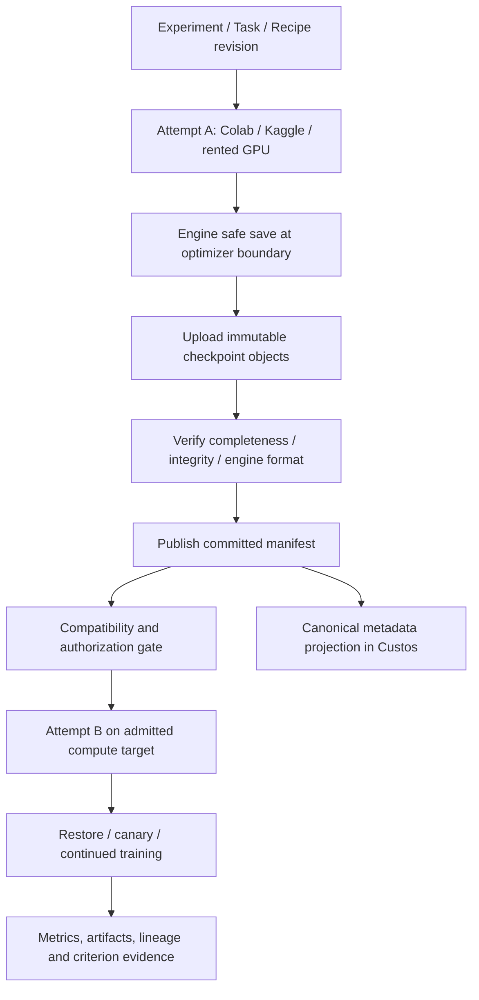

# Checkpoint relay và chuyển tiếp training giữa các compute backend

**Trạng thái:** thiết kế nghiên cứu đã hiệu đính, chưa triển khai hoặc kiểm thử GPU live. Đối chiếu ngày 18-10-2026 với source Colab CLI, Kaggle CLI, Unsloth Studio và tài liệu chính thức. Bản này thay các cam kết tuyệt đối của bản nháp trước, giữ hướng checkpoint relay nhưng phân biệt durability, resumability và scientific equivalence.

Đọc cùng [Colab/Kaggle adapters](remote-compute-colab-kaggle.md), [GPU thuê/SSH](remote-compute-external-gpu.md), [source study](../../../TRAINING_COMPUTE_SOURCE_STUDY.md) và [core refactor](../development/sade-core-refactor-plan.md). Không tạo Task engine, DB hoặc crate riêng.

## 1. Trả lời trực tiếp

**Có thể chuyển Colab → Kaggle → GPU thuê để train tiếp**, nếu checkpoint đã ra khỏi máy nguồn, đích có quyền đọc dữ liệu và engine kiểm được tính tương thích. Không phải live migration process/GPU memory; không bảo đảm không mất bất kỳ bước nào.

Nếu máy chết ở step 450, checkpoint mới nhất đã commit ngoài máy ở step 400, attempt mới chỉ tiếp tục từ 400; phần 401–450 cần chạy lại. Checkpoint local ở 450 chưa upload xong không được tính là đã backup. Nếu chỉ có adapter weights, có thể warm-start nhưng không phải đầy đủ training-state resume.

Sản phẩm nên hứa **giữ tiến độ đã được checkpoint bền vững và báo rõ khả năng phục hồi**, không hứa “không mất công train”. Hai máy khác kiến trúc/library có thể cho numerical trajectory khác ngay cả khi load đầy đủ state.

## 2. Các kết luận sai hoặc quá mạnh cần loại bỏ

| Bản nháp | Quyết định hiệu đính |
|---|---|
| Colab luôn ngắt đúng mốc, Kaggle luôn 9h/30h một tuần | Limits/hardware/eligibility phải theo profile, account và tài liệu hiện hành; không hardcode làm fault detector |
| Ghi /kaggle/working là checkpoint đã an toàn sau mọi failure | Chỉ là output location trong job; cần external committed copy hoặc provider output retention đã được xác nhận |
| LoRA checkpoint luôn 50–300 MB | Phụ thuộc trainable params, optimizer/state dtypes, embedding/modules_to_save và shards; đo bytes thực |
| Đổi bf16→fp16, microbatch→accumulation giữ optimizer dynamics 100% | Là compatibility/config change, có thể đổi numerics/data order/normalization; cần explicit continuation mode và validation |
| Idle notebook 30 phút → tự terminate | Kernel idle không chứng minh không có background training/upload hay user workload khác; phải có ownership + active operations + granted cleanup policy |
| Network volume giữ cả kernel | Volume giữ bytes, không giữ RAM/VRAM/process |
| HF private repo luôn miễn phí, R2 luôn không có tổng chi phí | Quota/pricing/operations/storage/transfer phải xét; không ghi claim giá chung trong kiến trúc |
| Không driver nào hỗ trợ migration dưới bất kỳ hình thức nào | Chỉ kết luận các Colab/Kaggle/SSH interfaces đã khảo sát không cung cấp transparent live migration này |
| Ngắt socket → quota exhausted | Observation loss không chứng minh nguyên nhân hay remote job đã dừng |

## 3. Bốn mức phục hồi phải hiển thị khác nhau

| Mức | Có gì | Cho phép làm gì | Nhãn kết quả |
|---|---|---|---|
| Export only | Weights/adapter/tokenizer/config dùng inference | Inference/evaluation; có thể khởi tạo lượt train mới | Không gọi Resume |
| Warm start | Load được weights, thiếu/không tương thích optimizer/data progress | Training lineage mới từ learned weights, reset state được ghi rõ | Warm-start continuation |
| Training-state resume | Model + optimizer + scheduler + engine state + data cursor/RNG thích hợp | Attempt mới tiếp tục logical training theo engine đã kiểm | State resumed, numerics not guaranteed identical |
| Reproducibility-validated resume | Trên fixture kiểm được data progression và metric/state tolerance so uninterrupted reference | Claim equivalence trong đúng scope/config đã test | Validated parity within stated tolerance |

Không dùng từ “exact” để chỉ bitwise identity khi đổi hardware nếu chưa có test chứng minh. Resume eligibility gắn engine/version/recipe, không gắn tên cloud. Torch checkpoint, TensorFlow checkpoint, MLX state, DeepSpeed/FSDP shard không là một format universal.

Nguồn nền: [Transformers Trainer](https://huggingface.co/docs/transformers/en/main_classes/trainer) phân biệt save-only-model với full state; [PyTorch reproducibility](https://docs.pytorch.org/docs/2.14/notes/randomness.html) không bảo đảm kết quả giống nhau xuyên releases/platforms.

## 4. Bốn mặt phẳng trách nhiệm

1. **Compute:** runtime/job/kernel/provision/stop/terminate của Colab, Kaggle, SSH, rented pods.
2. **Training engine:** safe save/load, checkpoint schema, optimizer/data/precision compatibility, canary validation.
3. **Durable storage:** upload/download/integrity/versioning/retention/access độc lập VM.
4. **Custos control plane:** Task/attempt lineage, authority, budget, recovery decisions, projections/evidence.

Không để provider notebook UI làm nơi duy nhất giữ trạng thái. Upload agent cần chạy cùng workload/remote side để laptop ngủ không làm ngừng backup; daemon vẫn giữ metadata/control, nhưng không cần ở giữa đường truyền mọi GB checkpoint. Khi daemon offline, chỉ các hành động đã được bounded grant và credential TTL cho phép tiếp tục; hết quyền không phát hành credentials vô hạn.

## 5. Checkpoint bundle: không chỉ một file weights

Extend existing artifact/recipe/execution models; bảng này là semantic contract, chưa là Rust/SQL schema đã freeze.

| Nhóm | Dữ liệu cần giữ hoặc xác nhận thiếu |
|---|---|
| Identity | Experiment/Task/attempt IDs, recipe revision, checkpoint ID, writer generation, parent checkpoint |
| Progress | Optimizer update step, epoch/data progress, samples/tokens consumed, schedule horizon; phân biệt microstep |
| Model | Base model/tokenizer exact revision, adapter architecture/config, trainable parameter mapping, model state/shards |
| Optimizer | Type, state format, parameter groups/order/mapping, hyperparameters, per-param state và precision |
| Training state | Scheduler, scaler nếu dùng, callbacks/EMA/algorithm-specific states; unfinished accumulation nếu engine support |
| Randomness/data | Python/NumPy/CPU/device RNG theo backend, sampler/shuffle/cursor, dataset/split/tokenization revision |
| Environment | Code digest/dirty patch, lock/image digest, Python/engine/torch/transformers/unsloth/bitsandbytes versions, CUDA/driver requirements |
| Topology | Device kind, precision/quantization, world size, sharding/parallelism mode, engine-specific layout metadata |
| Files | Object key/version, digest, bytes, required/optional role, completeness, compression/encryption metadata |
| Trust/access | Producer identity, sensitivity/license, authorized destinations, retention/expiry, who can commit/read |
| Validation | Engine format validator/version, integrity result, load/canary results, support gaps; no scientific pass inferred |

Checkpoint ở optimizer boundary là MVP: nếu chết giữa gradient accumulation thì quay về boundary đã commit. Chỉ resume microstep nếu engine thực sự lưu gradients/data/RNG đúng semantics. Global step không đủ khôi phục streaming dataset cursor; nếu stream không replayable/cursor không restore được, phải downgrade mode.

Unsloth source pin trong source study: [resume.py](../../../unsloth/studio/backend/core/training/resume.py) kiểm model, optimizer/scheduler và trainer step (MLX khác); [provenance.py](../../../unsloth/studio/backend/core/training/provenance.py) kiểm exact resources/load mode. Validator hiện này **không tự chứng minh toàn bộ RNG/dataloader parity**. Source cũng chặn một số S3-dataset resume; checkpoint đặt trên object storage không tự làm supported dataset-resume.

## 6. Durable commit: ngăn checkpoint nửa chừng thành “safe”

Proposed lifecycle: requested → staging → locally_complete → uploading → remotely_complete → validated → committed; failures thành incomplete/rejected. Đây là lifecycle của checkpoint, không thêm từng checkpoint phase vào Task FSM.

1. Engine lấy consistent snapshot tại safe boundary, không upload files đang bị trainer sửa.
2. Ghi bundle vào directory/object namespace duy nhất của attempt/generation/checkpoint. Không overwrite checkpoint đang dùng.
3. Flush local state theo capability, validate expected files/shards; async save phải chờ snapshot/staging completion trước buffer reuse.
4. Upload bounded parallel/multipart với retry và checksums; preserve resumable transfer metadata theo backend.
5. Kiểm remote object versions/bytes/digests và all required files. ETag không mặc định SHA-256, nhất là multipart.
6. Publish immutable committed manifest **sau cùng**. “Latest” pointer nếu dùng có compare-and-set/version preconditions hoặc authoritative metadata transaction; CAS conflict không được silently overwrite.
7. Custos ghi verified remote observations/manifest digest rồi hiển thị last protected step. Remote commit và local SQLite không atomic; daemon restart có thể discover/reconcile exact manifest.
8. Download destination chỉ nhận committed bundle, validate lại rồi engine load trong controlled environment.
9. Giữ ít nhất checkpoint trước đó đã commit trong retention policy; local Trainer rotation không được xóa bundle còn upload. GC không xóa parent đang được restore bởi attempt khác.

MVP dùng synchronous save + bounded upload dễ kiểm trước khi bật asynchronous staging/upload. Async cần cap in-flight checkpoints/host RAM và distinguish staged vs remotely durable. [PyTorch DCP](https://docs.pytorch.org/docs/2.14/distributed.checkpoint.html) tách các completion futures; framework save complete không tự là external storage backup nếu storage writer chỉ ghi local.

Hash phát hiện corrupt bytes, không chứng minh remote producer trung thực hay file optimizer an toàn. Không deserialize pickle/remote custom code tùy tiện trong trusted daemon; loaders có trust policy, hạn chế code execution và chỉ dùng weights-only khi phù hợp format. Engine compatibility validator chạy qua adapter/helper đã được authorize.

## 7. Storage chọn theo đường truyền thực, không theo tên “cloud”

| Lựa chọn | Vai trò | Điều kiện / hạn chế |
|---|---|---|
| S3-compatible object store | Default đề xuất cho cross-provider immutable bundles | Cần version/integrity/multipart/expiry semantics được conformance; S3-compatible không đồng nghĩa mọi backend có mọi tính năng |
| HF private repository | Backend tùy chọn cho artifact/version workflow | Full training bundle phải thực sự upload đủ; repo private, limits, commit pin và credentials được kiểm; không gọi model push là full resume backup |
| Google Drive | Đường bổ sung ở Colab khi user cho phép | Mount/file tồn tại không là atomic full-bundle commit; kiểm destination access từ Kaggle/rented host |
| Provider network volume | Fast local recovery trong provider | Không mặc định truy cập được từ cloud khác; replication/export path riêng |
| Local desktop | Export/last resort, không sole unattended relay | Laptop sleep/offline/storage full có thể ngừng bảo vệ |

Egress/transfer credential preflight phải pass **trước** bật nhãn protected run. Nếu Kaggle job không có permitted internet/secret/object-store path, chỉ cung cấp provider outputs hoặc export thủ công; không hứa mid-run cross-provider backup. Việc upload/checkpoint có thể lộ training data/optimizer info; privacy policy áp dụng cả optimizer state và logs.

Scoped upload credentials: exact attempt prefix/object operations, expiry, no root account key, no bucket-wide delete/list nếu không cần. Presigned URLs là bearer secrets có thể reuse tới expiry, không tự one-use; không log hoặc đặt vào notebook output. TTL phải bao được planned upload hoặc có bounded renewal mechanism; desktop offline/expired URL là degraded protection, không im lặng tiếp tục ghi “safe”. [AWS presigned URL semantics](https://docs.aws.amazon.com/AmazonS3/latest/userguide/using-presigned-url.html).

Không ghi mức giá/HF quota/R2 egress cố định trong runtime policy. Storage, operations, cross-region transfer, checkpoint conversion và retained disks đều vào cost estimate theo account/profile hiện hành.

## 8. Bounded loss: RPO, recovery time và checkpoint schedule

Custos theo dõi ba con số khác nhau: latest observed training step, latest locally complete step, latest remotely committed step. Chỉ số thứ ba bảo vệ khỏi mất VM.

Ví dụ minh họa, không benchmark: training báo step 450; local checkpoint 440; remote commit 400. Failure không có cứu dữ liệu bổ sung → recovery từ 400; tối đa 50 observed steps cần lặp trong ví dụ. Missing telemetry có thể làm observed count cũ; report khoảng/unknown.

RPO là mục tiêu mất tiến độ; RTO gồm detection + reconciliation + allocation/queue + download + environment setup + restore/validation. Không có capacity/quotas thì RTO có thể không đạt, kể cả checkpoint còn nguyên.

Với checkpoint interval I, save time S, upload+verification U và bounded backlog, cửa sổ protection lag có thể gần I+S+U. Đây là planning estimate, không hard guarantee khi network/save bị treo. Training step time thay đổi thì cap theo elapsed time và safe boundary, không chỉ save_steps. UI lấy actual remote commit age làm sự thật.

Chọn interval từ measured overhead, tolerable rework, hazard và bandwidth. Khi U lớn hơn interval, thêm checkpoint nhanh hơn chỉ tạo backlog: coalesce queued snapshots nếu không phá retention, giảm tần suất, chọn storage gần hơn hoặc pause có consent. Không prune last good bundle để tiết kiệm chỗ giữa failure window.

Admission profile cho phép: best-effort backup; required bounded protection (lag vượt cap → checkpoint/pause/attention theo grant); hoặc no mid-run protection (không auto-failover claim). Không hứa hook lúc shutdown cứu được SIGKILL; signal grace save chỉ là opportunistic improvement, periodic external commit vẫn là nền.

## 9. Compatibility gate trước mọi handoff

| Khác biệt source → target | Quyết định |
|---|---|
| Cùng engine/code/model/data/state format; resources pass | Candidate training-state resume, vẫn cần load/canary |
| Khác GPU nhưng supported precision/kernels/quantization | Resume có kiểm, ghi environment delta và numerical caveat |
| Không hỗ trợ source dtype/quantization/kernel | Không silent cast; chọn compatible GPU hoặc explicit config-change continuation |
| VRAM ít hơn | Profile load/optimizer/activations; propose microbatch/sequence/offload changes có revision |
| Đổi effective batch/scheduler/data order | Changed training recipe; không trình bày trajectory như unchanged |
| Đổi distributed world size/sharding | Chỉ khi engine-specific reshard/conversion supported và tested; no generic shard copy |
| Thiếu optimizer/scheduler/data cursor | Downgrade warm start hoặc block, không resume label giả |
| Dataset/model revision inaccessible | Block hoặc authorized resource replacement thành experiment revision |
| Thay framework, CUDA↔MLX/ROCm, unknown checkpoint version | Conversion path riêng, validation bắt buộc; default unsupported |
| Corrupt/partial checkpoint hoặc untrusted artifact | Reject/fallback last committed valid; không tự load |

Công thức effective batch ≈ microbatch × accumulation × data-parallel replicas chỉ mô tả một khía cạnh. Loss normalization, tokens per batch, dropout/RNG, batchnorm, optimizer/scheduler, sample order và floating-point reduction còn ảnh hưởng; “cùng effective batch” không chứng minh tương đương 100%.

Preflight đích kiểm architecture/VRAM (không chỉ weights), driver/runtime/library, licenses/data access, disk/bandwidth, credentials, load model+optimizer, rồi isolated canary update/eval với no accidental external publish. Canary dùng fork state và recorded consumed data; hoặc explicitly là training step đầu của attempt mới, không consume data ngầm rồi bỏ state. Nếu fail không mutate parent checkpoint.

MVP chỉ một engine recipe, single NVIDIA GPU, pinned software, có đầy đủ checkpoint ở step boundary. Multi-GPU/FSDP/DeepSpeed/resharding và dtype change là later tested profiles, không default universal resume. DCP có cơ chế distributed save/load nhưng không bảo đảm compatibility mọi PyTorch version; pin engine/version và fixtures.

## 10. Planned handoff và unplanned recovery

### Planned handoff

1. Capacity/quota/deadline warning hoặc user yêu cầu migrate; đây là request có authority riêng.
2. Preflight candidate target và estimate transfer/queue/setup cost, kiểm standing grant/fallback preference.
3. Trainer safe-boundary save → external commit validated. Drain pending uploads.
4. Quiesce source job và observe stopped khi supported; giữ resource đủ lâu để recover nếu target fail.
5. Fence checkpoint writer/source attempt; prepare destination lease/attempt riêng.
6. Restore exact checkpoint + environment compatible, canary verify rồi tiếp tục.
7. Quan sát destination training active với durable identity; update lineage/cost projection.
8. Cleanup source compute theo ownership/policy, xác nhận billing resource release; storage giữ theo retention.

Không giữ hai GPU chạy vô thời hạn để “an toàn”: overlap budget/deadline explicit. Có thể reserve capacity trước quiesce nhưng allocation là paid effect phải có permission.

### Unplanned interruption

1. Stream/heartbeat mất → suspected/unreachable, không quota/dead chắc chắn.
2. Reconcile exact account/job/version/process bên provider; giữ last observation/cause evidence.
3. Chọn newest **committed validated compatible** checkpoint, không newest directory.
4. Nếu source chắc chắn stopped: new attempt restore. Nếu source có thể còn chạy: user/standing policy quyết định chờ, stop/reconcile, hoặc start isolated recovery branch với duplicate spend warning.
5. Tại destination, verify checkpoint/config trước load, bind resumed_from và resume mode, update lineage.
6. Source quay lại không được overwrite latest canonical branch; stale writer outputs vẫn lưu quarantine/branch thay vì xóa lịch sử.
7. Resolve source lease/billing riêng: new attempt successful không chứng minh source đã dừng.

Fencing metadata không tự kill GPU hay chặn Internet side effects của old job. Fencing được enforce ở commit service/credentials/conditional writes khi có; nguồn có old PUT URL vẫn có thể upload vào own immutable prefix tới expiry, nhưng không được promote thành canonical latest branch. Không cấp toàn quyền ghi shared latest object cho mỗi VM.

## 11. Ma trận giữa các backend

| Chuyển tiếp | Điều kiện bắt buộc / giới hạn |
|---|---|
| Colab → Kaggle | External commit accessible trong Kaggle; batch package chứa recipe/checkpoint ref, compatible actual GPU, quota/internet/data access; new Kaggle version |
| Kaggle → Colab | Checkpoint đã exported/committed ngoài ephemeral run hoặc downloadable provider output đã xác nhận; allocate kernel mới, không chuyển interactive memory |
| Colab/Kaggle → GPU thuê | Cloud credentials/grant/cost ceiling, storage download route, compatible image/device; không assume paid GPU luôn available |
| GPU thuê → Colab/Kaggle | Model/optimizer có thể vượt VRAM/disk/time/permission đích; gate phải cho phép “không có target phù hợp” |
| GPU thuê → GPU thuê | Quote/region/storage/sharding compatibility; provider volume không tự mount xuyên vendor |
| Same host restart | Persistent disk còn đủ checkpoint, process lost; vẫn restore state và verify, không dùng PID cũ |

Không vòng qua nhiều account để né quota hoặc anti-abuse. Official CLI không tự chứng minh mọi deployment được phép trên free tier; verify account/product policy và current access. Không có target hợp lệ thì pause/wait/export, không tự bỏ quality/privacy constraints.

## 12. Rented GPU: cost-aware recovery, không “rẻ nhất mỗi giờ”

Chi tiết physical lifecycle ở [external GPU design](remote-compute-external-gpu.md). Ưu tiên Dedicated SSH integration và một paid provider profile (đề xuất Runpod Pods) trước khi thêm Vast/khác; đây là sequencing decision, không claim vendor tối ưu.

Compare expected cost-to-finish: remaining measured work + rework + allocation/setup + model/data transfer + checkpoint I/O + storage + likely interruption/recovery. Giá/giờ thấp hơn có thể total cost cao hơn hoặc fail không có capacity. Không đưa con số rental hardcode vào UI.

Lease giữ resource/account/quote timestamp, region, actual GPU count/VRAM, image digest, disk/volume IDs, max runtime, ownership và cleanup strategy. Quote hết hạn phải refresh theo granted price tolerance trước allocate. Không auto-chuyển paid backend nếu user chỉ cho free compute.

Paid guardrails: block new spend ở limit; warnings/reservation + remote job max duration khi supported; provider-side expiry/reaper hoặc managed scheduler TTL khi có. Local daemon watchdog không hard-cap hóa đơn nếu laptop offline/API down/provider billing delayed. Stop khác terminate và không hủy charges storage tự động; cần retention costs riêng.

Preemption warning nếu provider có thì save/upload sớm nhưng không dựa vào việc chắc sẽ nhận warning. Spot/interruptible risk được hiển thị, checkpoint policy bắt buộc theo supported profile.

## 13. Placement và data contract trong Custos

| Concern | Owner hiện hữu để mở rộng |
|---|---|
| Checkpoint manifest/artifact lineage/recipe deltas | domain recipe/execution/artifact models, no I/O |
| Resume admission, authority, payload/account scope | core policy/contracts; không concrete storage client |
| Safe-save/load and engine compatibility | training adapter/Python helper + Research pack verifier semantics |
| Upload/download/immutable commit I/O | adapters storage integration, CAS reference importer; credentials isolated |
| Recovery policy / candidate target / attempt transitions | runtime workflow/experiment; OI proposes, core admits |
| Durable metadata/leases/events | persistence via ports, transactional canonical state |
| VM/kernel/provider lifecycle | compute adapters + existing remote fleet/contracts |
| API/events and composition | daemon + SDK, no second endpoint server in desktop |
| Status/action projections | existing Research notebook/Runs/Artifacts/attention, not a new workbench |

Proposed minimal record extension: checkpoint ID/manifest digest/state/remote committed step; resume eligibility record(engine/target/validator/results); handoff command(source attempt/checkpoint/target/mode/config deltas/grant); destination attempt.resumed_from; storage/compute refs and cleanup observations. Reuse existing attempt/effect FSMs; đừng thêm PreemptedWithCheckpoint vào every Task status, vì source termination và checkpoint validity là hai trục.

API command inventory cần implement bằng existing envelope: request checkpoint, list committed checkpoints, assess target compatibility, plan handoff, start admitted continuation, reconcile source/destination, release resource. Names/DTOs freeze bằng fixtures khi implementation, không tạo universal cloud SDK contract phình to.

Agent có thể propose fallback/triage failure/compare metrics. Không tự cast precision, đổi dataset, thuê GPU hoặc publish checkpoints. Rented GPU failover khi unattended cần standing grant bao provider/account/data region/price/time/overlap/storage/security và allowed resume modes.

## 14. Giao diện trạng thái và ví dụ nghiệm thu

Projection cần trả: latest observed/local/remote step, last protected time, checkpoint completeness, resume eligibility per target, missing states, predicted rework/RTO, paid resource still active/unknown, selected lineage. Renderer chỉ hiển thị dữ liệu thật, no progress timers giả.

Ví dụ minh họa:
- Attempt A / Colab: observed step 450, remote protected step 400, source status unreachable.
- Checkpoint C400: committed + format validated, full state; download available.
- Candidate B / paid GPU: price estimate + data policy + compatibility result; source chưa stopped → duplicate spend warning.
- User/policy admits B; new attempt resumes C400, progress/history nói resumed from 400, không ghi “tiếp tục 451”.
- Sau failure injection, compare B sau N steps với uninterrupted reference theo tolerance/profile; scientific acceptance vẫn qua held-out eval riêng.

Close Screen không cancel upload/training; stop source không delete committed checkpoint; delete checkpoint là retention/destructive action riêng. No verified checkpoint → show export/warm-start/restart choices, không enable full Resume. Status wording không kết luận quota từ socket disconnect.

## 15. Implementation roadmap theo dependency

| Packet | Deliverable cụ thể | Gate trước packet sau |
|---|---|---|
| F0 Source/contract freeze | Pin engine/adapter versions, audit current models/ports/credential paths, required checkpoint files/cursor fixtures | No parallel schema, define supported single-GPU recipe và resume modes |
| F1 Local round-trip | Safe save/load + manifest validation, interrupted deterministic tiny training fixture | Same step/scheduler/data cursor, corrupted/missing files rejected; no cloud needed |
| F2 Durable relay | One object-store backend, immutable uploads/manifest commit, retry/expiry/retention | Kill during file save/upload/commit, newest incomplete ignored; previous valid recoverable |
| F3 Provider-independent attempt recovery | Restart metadata reconciliation/fencing/lineage, external credential lifecycle | Two writers, stale uploader, laptop offline; no duplicate canonical branch |
| F4 Colab protected run | CPU correctness trước, single GPU opt-in; external checkpoint callback + compatible recovery | Abrupt kill then restore from remote commit; no backup claim if network/grant unavailable |
| F5 Kaggle protected batch | Private/versioned package, allowed secret/network path + periodic relay; output fallback profile | Version pin, kill before output collection, upload blocked downgrade; no quota-based promises |
| F6 Dedicated/rented GPU | Existing SSH + one paid provider, durable storage + lease/teardown | Cloud API lost reply/stop failure, data intact, charges unresolved visible |
| F7 Cross-provider handoff | Colab↔rented first on compatible image, then Kaggle matrix | Real input/model/state identities, rollback/rework stated, canary and eval evidence |
| F8 Controlled heterogeneity | dtype/VRAM/world-size conversions từng profile | Change recipe/relabel continuation, engine-specific parity/quality tests |
| F9 Measured policy | Optional auto fallback/OI target selection/checkpoint interval tuning | Accepted quality/cost/RPO/RTO measured; policy không nới grant |

Tests add to existing core/runtime/persistence/adapter/contract/e2e suites and supervised helper tests; no mock success in production. Fast tests use tiny CPU engine fixtures, simulated I/O faults; actual GPU/provider tests are opt-in with budget/cleanup. Không cài cloud dependencies hoặc charge resources chỉ để “nghiên cứu”.

## 16. Các phép đo phải công bố

Checkpoint wall-time/bytes, local staging và external commit latency; protected-step/time lag; upload queue/failed retries; restore/download/canary time; resume mode và compatibility rejection causes; reworked optimizer steps/samples/tokens; source/destination overlap; storage/transfer/compute billed vs estimates; full experiment quality/accepted outcomes.

Recovery success phải là load and continued useful training, không chỉ HTTP 200. Cost tính cả failures và retained volumes. Không gộp warm-start với full-state-resume trong success rate. Cross-GPU trajectory tolerance và held-out metric margin đặt trước; sample nhỏ chỉ report feasibility.

## 17. Nguồn và giới hạn nghiên cứu

- [Colab FAQ](https://research.google.com/colaboratory/faq.html): resource limits/availability động; không hardcode lịch ngắt hay bảo đảm GPU. Chính sách deployment/account phải được kiểm trước tích hợp unattended.
- [Kaggle notebook docs](https://www.kaggle.com/docs/notebooks) và local [versioned API](../../../kaggle-cli/src/kaggle/api/kaggle_api_extended.py): session options/output và versioned jobs; chưa có chứng nhận interrupted output survives mọi failure.
- [Transformers Trainer](https://huggingface.co/docs/transformers/en/main_classes/trainer), [Accelerate checkpointing](https://huggingface.co/docs/accelerate/usage_guides/checkpoint): trainer state và data-position restoration phải theo engine/config.
- [PyTorch DCP](https://docs.pytorch.org/docs/2.14/distributed.checkpoint.html): distributed state và completion stages/version caveats; không là cross-framework universal converter.
- [PyTorch reproducibility](https://docs.pytorch.org/docs/2.14/notes/randomness.html): reproducibility limits khi đổi platform/version.
- [Runpod storage](https://docs.runpod.io/pods/storage/types) và [maintenance/data safety](https://docs.runpod.io/pods/maintenance-and-outages): resource persistence và backup phải thiết kế riêng; volume không kernel memory.
- [Vast instance lifecycle](https://github.com/vast-ai/docs/blob/main/guides/instances/manage-instances.mdx), [pricing semantics](https://github.com/vast-ai/docs/blob/main/guides/pricing.mdx): stopped instances/storage khác destroyed; vendor/account checks trước paid ops.
- [AWS presigned URLs](https://docs.aws.amazon.com/AmazonS3/latest/userguide/using-presigned-url.html): scoped time-limited bearer access, integrity và replay caveats.
- Local Unsloth source pins/paths trong [source study](../../../TRAINING_COMPUTE_SOURCE_STUDY.md); save_steps=0 tại [training.py](../../../unsloth/studio/backend/core/training/training.py) tắt checkpoint. Framework defaults/version docs không thay source conformance.

**Chốt thiết kế:** portable training là engine-aware durable checkpoint + explicit continuation attempts + compatible compute + bounded authority/cost, không một nút tự đổi GPU. Việc quan trọng nhất cần build trước là checkpoint round-trip và remote commit; chưa có chúng thì thêm nhiều GPU adapters chỉ tăng nơi có thể mất tiến độ.
