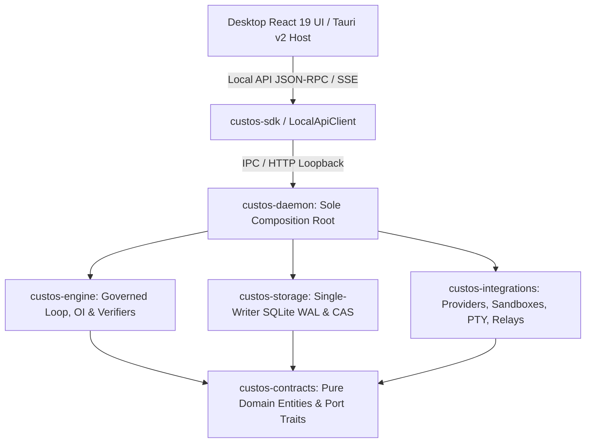

# Desktop & Backend Core Interaction Map

> **Classification:** Interaction Map & Integration Specification 
> **Source of Truth:** Authoritatively governed by [Custos Master Specification](../../Custos.md). 
> **Directory Index:** See [Custos Architecture Overview](README.md).

---

## 1. System Topology & Architectural Axis

Custos is a Supervised Agent Development Environment (SADE) where **Assistant, Coding, Research, and Quant** serve as specialized lenses over shared resources rather than four disconnected backends:
- **Conversation Session:** Transient interaction and chat sequence.
- **Task:** Durable, contract-bound unit of goal, scope, and criteria.
- **Run & WorkerRun:** Concrete execution attempts in a task graph.
- **Resource Tab:** View or editor projection anchored to a stable Universal Resource Reference (URR).



---

## 2. Process, Host & Wire Transport Layer

- **Desktop Host:** Thin Tauri v2 native shell (`apps/desktop/native`), wrapping React 19 frontend (`apps/desktop/ui`).
- **Transport Security:** High-performance loopback IPC or HTTP over `127.0.0.1:<port>/api/request`. All requests carry session authorization headers.
- **Streaming Architecture:** Server-Sent Events (SSE) stream incremental model tokens, PTY terminal bytes, and task state transitions directly to the React canvas without whole-page re-renders.

---

## 3. Command Lifecycle: From UI Click to Durable State

Every user action in the desktop interface executes through a deterministic 7-stage pipeline:

```text
[1. User Action in UI]
 (e.g. Approve Outbox Message, Run Backtest, Commit Code Patch)
 
[2. DaemonClient Request]
 (v1.<domain>.<method> with idempotency command_id)
 
[3. LocalApiDispatcher & Admission Gate]
 (Validate actor, workspace_id, token budget, and rate limits)
 
[4. Two-Phase Authority Mediation]
 (authorize() -> verify policy -> issue ExecutionPermit)
 
[5. Platform Integrations Execution]
 (execute() inside OS sandbox Seatbelt/Bubblewrap or PTY)
 
[6. Transactional Outbox & CAS Commit]
 (Single-writer SQLite WAL write with EvidenceRecord)
 
[7. Reactive State Projection]
 (Event stream broadcast -> ScreenContext / AppContext update)
```

---

## 4. Multi-Screen & Tab Tree Layout Mechanics

The Desktop UI implements a non-destructive multi-screen layout managed by `ScreenContext`:
1. **Worktree-Anchored Screens:** Each screen is bound to an exact Git worktree checkout path (`workspace_id`).
2. **Split Canvases:** Nested horizontal/vertical split ratios preserved across restarts.
3. **Draft Preservation:** Typing a prompt in one workbench lens preserves uncommitted drafts when switching to another lens.
4. **Zero Layout Jitter:** Canvas dimensions use strict CSS containment and `shrink-0` bounds on all status badges.

---

## 5. Physical Architecture Mapping

| Subsystem | Defining Crate | Physical Path | Key Invariant |
|---|---|---|---|
| Desktop Native Host | `custos-desktop` | `apps/desktop/native/src/` | Thin platform wrapper |
| Desktop UI (React 19) | Frontend Bundle | `apps/desktop/ui/src/` | Zero-Mock data integrity, 3-tier hierarchy |
| Client SDK & Transport | `custos-sdk` & `custos-protocol` | `sdk/client-rust/`, `sdk/protocol/` | Transport-neutral wire schemas |
| Daemon Composition Root | `custos-daemon` | `apps/daemon/src/` | Sole composition root, thin transport |
| Platform Contracts (Ring 0) | `custos-contracts` | `platform/contracts/src/` | Zero-I/O pure domain models & ports |
| Platform Storage (Ring 1) | `custos-storage` | `platform/storage/src/` | Single-writer SQLite WAL & CAS |
| Platform Integrations (Ring 1) | `custos-integrations` | `platform/integrations/src/` | Model codecs, sandboxes, PTY, compute relays |
| Platform Engine (Ring 2) | `custos-engine` | `platform/engine/src/` | Governed loop, S1/S2 OI, Completion Gate |
| Vertical Workbenches (Ring 3) | `workbenches/*` | `workbenches/{assistant, coding, quant, research}/` | Domain-specific logic, schemas, and UI views |

---

## 6. Automated Verification Commands

```bash
# 1. Compile Desktop UI
npm --prefix apps/desktop/ui run build

# 2. Run Canvas Smoke Test Suite
node tests/desktop/canvas-smoke.mjs

# 3. Verify Rust Architecture Boundaries
cargo xtask check-boundaries
```
