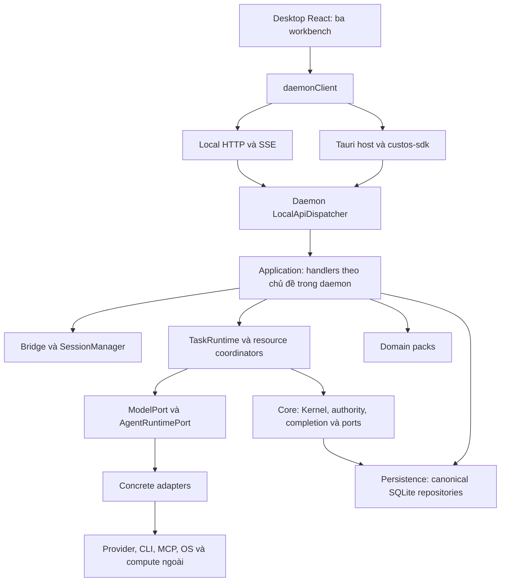
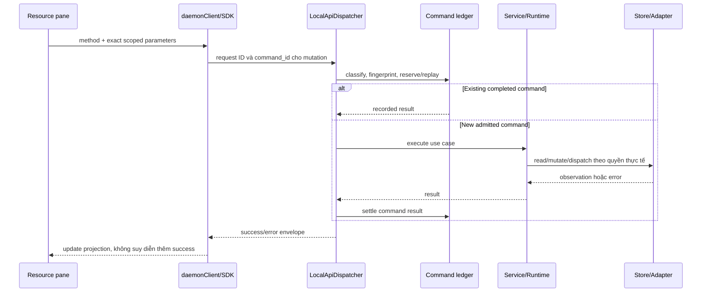

# Custos — bản đồ tương tác Desktop và toàn bộ lõi

**Phạm vi:** kiến trúc đang có trong source, hợp đồng tương tác mục tiêu và các khoảng trống phải đóng. Đây không phải tuyên bố mọi subsystem đã production-ready.

**Working-tree refactor:** the SHA snapshot below remains historical evidence. Application handlers are being extracted into daemon `application/{tasks,sessions,workspaces,research,compute,assistant,providers,execution,integrations,packs,system}.rs`; `application/mod.rs` owns dispatch grouping, not an independent service/container. Existing `LocalApiDispatcher` dependencies remain composition inputs and existing API DTOs remain unchanged. Command admission must fail closed on storage failure. An extraction is not itself proof that all filesystem/network I/O has moved behind adapter ports. Run persistence hardening must preserve generation identity and reject stale/terminal overwrites before claiming full CAS. No external jobs or sending effects are authorized by this refactor.

Outbox approval is being completed as a durable `Pending → Approved → Dispatching` gate, preserving concurrent edits discovered during this refactor. Runtime-mediated approval follows Kernel authorization; Assistant approval persists before reporting success. Pending-to-dispatch is rejected. This closes the missing durable approval state, not the remaining exact-payload/actor/Kernel authority gaps documented below.

**Mốc đối chiếu:** `vi-rft`, commit `25cf6896abcecf5e093ba83826fc1c08207cd48f`. Remote `refs/heads/vi-rft` được đọc trực tiếp ngày 20-10-2026 và khớp HEAD; working tree sạch trước khi viết tài liệu này. Các thay đổi tài liệu của lượt này chưa thuộc commit đó.

**Cách đọc:** `source` = thấy implementation; `composed` = có wiring trong bootstrap/đường API; `checked` = có phép kiểm cụ thể trong mục 19; `target` = điều kiện kiến trúc cần đạt. Không cộng các nhãn này thành “hoàn thiện 100%”. File/symbol bên dưới là mốc truy source, không phải bằng chứng hành vi external.

## Mục lục

1. [Bản chất và trục kiến trúc](#1-bản-chất-và-trục-kiến-trúc)
2. [Những gì nhánh refactor đã bổ sung](#2-những-gì-nhánh-refactor-đã-bổ-sung)
3. [Process, host và transport](#3-process-host-và-transport)
4. [Hệ định danh và quan hệ](#4-hệ-định-danh-và-quan-hệ)
5. [Khung UI và ownership](#5-khung-ui-và-ownership)
6. [Canvas, Screen và chuyển workbench](#6-canvas-screen-và-chuyển-workbench)
7. [Một lệnh từ UI xuống dữ liệu](#7-một-lệnh-từ-ui-xuống-dữ-liệu)
8. [Conversation, model và native harness](#8-conversation-model-và-native-harness)
9. [Coding Workbench](#9-coding-workbench)
10. [Research Workbench](#10-research-workbench)
11. [Notebook, GPU và training](#11-notebook-gpu-và-training)
12. [Copilot và Outbox](#12-copilot-và-outbox)
13. [MCP, A2A, sandbox và trust](#13-mcp-a2a-sandbox-và-trust)
14. [S1, S2, OI và Meta](#14-s1-s2-oi-và-meta)
15. [Persistence, credentials và recovery](#15-persistence-credentials-và-recovery)
16. [Settings và capability projection](#16-settings-và-capability-projection)
17. [Hiệu năng và vòng đời tài nguyên](#17-hiệu-năng-và-vòng-đời-tài-nguyên)
18. [Khoảng trống và thứ tự hoàn thiện](#18-khoảng-trống-và-thứ-tự-hoàn-thiện)
19. [Bằng chứng kiểm tra và nghiệm thu](#19-bằng-chứng-kiểm-tra-và-nghiệm-thu)
20. [Bản đồ file và quy tắc phát triển](#20-bản-đồ-file-và-quy-tắc-phát-triển)

## 1. Bản chất và trục kiến trúc

Custos là một môi trường làm việc có giám sát: Coding, Research và Copilot là ba cách nhìn và thao tác trên công việc, không phải ba backend độc lập. Conversation là nơi giao tiếp; Task là đơn vị mục tiêu/tiêu chí; Run và Attempt là đơn vị thực thi; resource tab là nơi xem/làm việc với một đối tượng đã định danh.

Bốn đồ thị phải được giải thích riêng:

| Trục | Câu hỏi | Chủ sở hữu |
|---|---|---|
| Điều hướng | Đang mở project, workbench, Screen và tab nào? | React contexts và layout projection |
| Thực thi | Công việc nào chạy, trên workspace/agent/kernel nào? | Runtime và application handlers |
| Quyền | Hành động nào được phép, theo scope và payload nào? | Core/Kernel và effect dispatch |
| Bằng chứng | Điều gì đã xảy ra, kết quả nào được xác minh? | Receipts, verifiers, persistence |

Đổi màu, chuyển tab hoặc chuyển workbench không được tự thay ba trục còn lại. Một process chạy thành công không tự làm Task pass; một API có implementation không tự được gọi là được Kernel kiểm soát.

Sơ đồ biểu diễn wiring/trách nhiệm, không phải graph import hoặc lời khẳng định mọi effect hiện đều đi qua authority. Mục 18 ghi các đường chưa đạt.

## 2. Những gì nhánh refactor đã bổ sung

Lịch sử sau `c96f414` có năm commit. Tên commit là chỉ mục thay đổi, không là chứng nhận completion:

| Commit | Phần đã bổ sung | Cần đọc cùng |
|---|---|---|
| `31f8a22` | Compute adapters, experiment contracts, checkpoint relay fixtures và tài liệu GPU | Mục 11: recipe/adapter thật khác deterministic fixture |
| `037a55d` | Command ledger, profile isolation, session/runtime hardening | Mục 7 và 15: retry, claim, startup reconcile |
| `b810eae` | MCP stdio/HTTP, federation, Outbox payload/CAS và migration | Mục 12–13: authority và bootstrap còn gap |
| `597a89b` | Desktop workbench decomposition, Workflow DAG pane, Copilot Outbox | Mục 5–10: UI ownership và data binding |
| `25cf689` | Sandbox implementations, P2P wire, HTTP token check, MCP resources, provider reasoning stream | Mục 8 và 13: code tồn tại không chứng minh conformance/enforcement |

Phần UI hiện có bao gồm pane controls dùng chung, resource catalogue tách khỏi renderer/layout, exact terminal attachment, research list/detail, các tab Notebook/Runs/Training độc lập và build chunking. Không viết lại lịch sử thành “đã bê toàn bộ OrCa/Open Science”.

OrCa cung cấp cảm hứng workspace/worktree, PTY và resource canvas. Open Science cung cấp cảm hứng source–claim–experiment–artifact. Goose/agentgateway/OpenGateway là nguồn harness/connectivity patterns. Trạng thái nhập/tái hiện từng hành vi phải xem [upstream source map](../development/upstream-source-map.md); không có dependency runtime bắt buộc vào các checkout nghiên cứu bên cạnh Custos.

## 3. Process, host và transport

### 3.1 `custos-app` thực sự làm gì?

`crates/custos-app` là thư mục chứa executable hosts, không phải một Rust package sở hữu mọi logic. Desktop package hiện tên `custos-app-desktop`; CLI host là `custos-app-cli`. Workspace có nhiều Cargo members, nên “11 canonical crates” là vocabulary phân tầng trong tài liệu, không phải số package thực tế trong Cargo metadata.

Desktop host `desktop/src/lib.rs` sở hữu:

- Khởi tạo/attach daemon qua SDK và profile.
- Trạng thái Connecting/Ready/Recovering/Degraded/Incompatible.
- Native commands `custos_request`, `custos_dispatch`, `custos_http_endpoint`.
- Window/webview và embedded browser registry; kiểm caller qua `browser::authorize`.
- Retry attachment khi mất kết nối; không sở hữu Task reducer, SQL hoặc GPU scheduler.

Desktop Cargo dependencies có SDK/domain/Tauri, không link persistence/runtime/daemon. Đây là host mỏng đã thể hiện trong source. **CLI host chưa đồng nhất:** manifest vẫn phụ thuộc daemon/core; không gọi toàn bộ client layer đã tách sạch.

### 3.2 Hai đường vào cùng backend

| Đường | Chuỗi hiện có | Điều cần hiểu |
|---|---|---|
| Native request | React → invoke `custos_request` → SDK LocalApiClient → daemon | SDK hiện dùng loopback TCP, không phải Unix socket/named pipe đã hoàn tất |
| Browser/fallback | React → POST `/api/request` → cùng dispatcher | Không tạo một backend riêng cho web |
| Live output | Snapshot RPC → GET `/api/events` → cursor replay | Native UI cũng dùng HTTP cho live stream |
| Embedded browser | React native-browser client → Tauri webview commands | Nội dung web không được hưởng quyền gọi native command như main UI |

`daemonClient.request` tạo command ID cho mutation, ưu tiên invoke khi native, fallback HTTP cho lỗi transport/timeout; business rejection không được retry mù. Host cũng có retry SDK. Do đó retry safety phụ thuộc command ledger và exact ID, không chỉ UI disable nút.

**Giới hạn bảo mật hiện có:** `http_server.rs::is_authorized_ipc_client` chấp nhận Origin local trước khi kiểm `CUSTOS_IPC_TOKEN`; không đặt token thì default allow. Origin validation không phải chứng minh caller identity. Browser HTTP/SSE client chưa gắn token. Không mô tả đây là mandatory authenticated local API. Target là token/OS peer identity thực, strict origin bổ sung, áp đồng nhất RPC và events.

## 4. Hệ định danh và quan hệ

| Đối tượng | Ý nghĩa | Không đồng nhất với |
|---|---|---|
| Project | Nhóm công việc/repository/corpus để điều hướng | Một process hay một grant |
| ExecutionWorkspace | Root filesystem và metadata checkout/worktree | Một tab hoặc một conversation |
| Worktree | Checkout Git cụ thể khi dùng Git | Mọi Research/Copilot task đều cần Git |
| Workbench | Lens Engineering/Research/Copilot | Chọn model hoặc tạo Task mới |
| Screen | Bố cục có tên, `homeWorkbench`, optional anchor | Một VM, kernel hoặc runtime |
| Tab/resource ref | ID đối tượng đang xem: session/workspace/task/run/source/artifact | Bản sao nội dung hoặc cấp quyền |
| Session | Conversation, journal, lens bindings | Tiêu chí hoàn thành Task |
| Task | Goal, scope, trạng thái, tiêu chí | Một lượt inference |
| Run/WorkerRun | Thực thi model/harness trong Task | Process PTY hoặc training attempt |
| TerminalSession | Process shell/native interactive + byte cursor | Structured harness run |
| Notebook kernel | Worker Python đang giữ namespace trong bộ nhớ | Notebook document lưu trên đĩa |
| ExecutionAttempt | Lần chạy experiment, target và external ref | Một cell hoặc lease GPU |
| Checkpoint | Manifest/inventory phục hồi | File export model đơn thuần |

Task/Session là các identity liên kết, không phải hai chế độ loại trừ nhau. Một chat có thể tồn tại trước promotion; một Task có thể tiếp tục qua conversation khác theo binding. Schema/API hiện phải được đối chiếu trước khi claim mọi quan hệ many-to-many đã được enforce đầy đủ.

Scope được bind khi mở tài nguyên. Global active workspace chỉ là default cho tài nguyên mới. Source cần version/locator; file cần workspace/base snapshot; run cần session/run pair; external job cần account/target/job/version. Không dùng title hoặc command substring làm identity.

## 5. Khung UI và ownership

| Vùng | Source owner | Công việc |
|---|---|---|
| Studio route | `app/studio/page.tsx` | Lens/session restoration, mở cùng chat ở lens khác, sidebar mode |
| Global projection | `context/AppContext.tsx` | Workspaces, sessions, tasks, provider selection, dispatch và live projection |
| Screen projection | `context/ScreenContext.tsx` | Screen lifecycle, anchors, layout restore và reveal worktree |
| Activity rail/header | `components/shell/ActivityRail.tsx`, `AppTopBar.tsx` | Điều hướng sản phẩm, lens, native window actions |
| Sidebar | `WorkspaceSidebar.tsx`, `WorkspaceTree.tsx` | Project/repository/worktree và chat/task discovery |
| Workspace shell | `AppWorkspaceShell.tsx` | Ghép chat/canvas/Inspector, callbacks mở resource và handoff |
| Resource catalogue | `workbenches/workbenchResources.tsx` | Kind, aliases, icon, lens membership và capability projection |
| Resource renderer | `workbenches/ResourceContent.tsx` | Scope resolution và component cho từng resource |
| Canvas layout | `workbenches/OrcaTabbedContainer.tsx` | Groups, split, tab move/close/focus/zoom |
| Shared pane chrome | `common/WorkbenchPane.tsx` | Toolbar, error/retry và empty state |
| Inspector | `shell/RightSidebar.tsx` | Thông tin hỗ trợ; không sao chép full editor hoặc execution console |

AppContext là owner server projection, **không phải** source of truth của permission/job state. Component được giữ edit buffer/search/selection cục bộ, nhưng không được tạo danh sách workspace/run giả hoặc tự nâng trạng thái backend.

Chuẩn tương tác theo UI/UX skill áp dụng ở đây: trạng thái chọn rõ, icon có tên truy cập, back/restore giữ ngữ cảnh, loading/error có đường xử lý, bàn phím không bị shortcut chiếm khi nhập/IME. Không thay theme hoặc icon library chỉ để viết bản kiến trúc.

## 6. Canvas, Screen và chuyển workbench

`types/canvas.ts` sở hữu cây split/group và reducer; `types/screen.ts` mô tả Screen, anchor, presets và homeWorkbench. `ScreenContext` lưu projection theo project; `AppContext` lưu scoped tab preferences. Đây là hai mặt bố cục có liên quan, không được biến thành hai registry thực thi.

Các thao tác cần giữ invariant:

1. Một tab thuộc đúng một group; active tab tồn tại trong group.
2. Split/move/resize/zoom không dispatch domain command.
3. Đóng group chuyển tài nguyên theo reducer; đóng tab không mặc định stop process.
4. Restore chỉ khôi phục references/layout, không spawn terminal/kernel/GPU.
5. Missing explicit reference phải hiển thị unavailable; không âm thầm chuyển sang session khác.
6. `homeWorkbench` phục vụ lọc/switch Screen; pane chéo domain không cần nhân đôi dữ liệu.

`openFullChatIn` gọi `v1.sessions.open_in_lens` rồi mở cùng session ở lens đích. Đây là giữ lịch sử bằng identity, không chuyển hidden state của provider. **Mở chat ở Coding** khác **Research handoff tạo yêu cầu kỹ thuật mới**; thao tác trước không cấp quyền của thao tác sau.

Các ngữ cảnh cần test riêng: hai Screen cùng research; nhiều Coding worktree; research + file editor song song; chuyển project khi còn draft; stale workspace; screen restore có run đã kết thúc. Các smoke tests hiện không thay được native multi-window reconciliation.

## 7. Một lệnh từ UI xuống dữ liệu

Source: `api/commands.rs`, `api.rs::handle_request`, SDK `local_api`, persistence `command_ledger.rs`. Method classification hiện dựa một phần suffix; tồn tại ledger không chứng minh mọi operation đã phân loại đúng hoặc external exactly-once.

Command idempotency, Task dispatch claim và external provider idempotency là ba cấp khác nhau. Timeout sau external side effect có thể uncertain dù command ledger còn sống. Mutation phải có actor/scope/state constraints theo use case; read vẫn có privacy/egress constraints.

Envelope/schema types trong SDK là contract hiện hữu; TS còn nhiều DTO và camel/snake normalization thủ công. Target là golden fixtures cho wire shapes và lỗi, không giả toàn bộ client đã generated.

## 8. Conversation, model và native harness

### 8.1 Direct model turn

`ConversationPane` → AppContext send/start logic → session/message và workflow API → `TaskRuntime` → `ModelPort` → `RouterModelProvider` → provider endpoint/local adapter. Runtime giữ claim/run/journal và tách model turn khỏi tool execution.

Nhánh mới có `providers/streaming.rs`: decode wire stream thành `ProviderEvent`; TaskRuntime map text/reasoning summary/usage/result vào live projection. UI `watchRun` lấy snapshot, replay SSE theo cursor, kiểm session/run, reconnect với backoff và ngừng theo terminal status. Reasoning summary được provider công bố không phải toàn bộ suy luận kín; UI không hứa xem được hidden chain-of-thought.

Account/model/effort selection đi vào run metadata/request. Chuyển workbench không tự đổi model pin; đổi model không biến hidden session/cache upstream thành portable state. Billed/estimated/unknown usage cần giữ riêng, không hiển thị zero vì thiếu usage.

### 8.2 Structured native run và interactive terminal

| Path | Owner | Output/lifecycle |
|---|---|---|
| Structured harness | `HarnessRegistry` + `AgentRuntimePort` + TaskRuntime | RunHandle, journal, cancel/steer theo profile |
| Interactive native CLI | TerminalCoordinator + PTY | Bytes/input/resize/EOF; không tự có structured reasoning/test evidence |
| Custos governed loop | `GovernedAgentRuntime` | Bounded model/tool iterations khi có executor đã nối |

Bootstrap đăng ký governed runtime nhưng hiện truyền danh sách tools rỗng và không gọi `with_tool_executor` ở chỗ wiring đó. Không mô tả mặc định đây là coding agent đầy đủ mọi tool. Native harness profile có mediation/worktree ownership/cost visibility; provider-governed không được nâng thành custos-mediated chỉ vì output hiện trong Custos.

`startNativeConversation` tạo/attach conversation và run; pane lưu session/task/run refs. PTY dùng `useTerminalSession`: exact tab/workspace/command binding, explicit Start/Stop, single-flight launch. Process exit khác stream EOF; output cuối phải drain trước EOF. XTerminalView dispose không tự kill process. Daemon restart không phục hồi terminal OS process đã mất.

## 9. Coding Workbench

| Tài nguyên UI | API/đường backend | Dữ liệu và giới hạn |
|---|---|---|
| Project/worktree tree | `v1.workspaces.detect/list/create`, candidates spawn/compare/integrate | WorkspaceCoordinator + LocalWorkspaceProvider + workspace repositories; scope phải là checkout cụ thể |
| Files tree/editor | `v1.workspace.files.tree/read/write` | File content/base identity; UI editor không sở hữu filesystem authority |
| Changes/diff/Git | `v1.workspace.diff`, `diff.file`, `git.stage/unstage/discard/commit` | Diff theo workspace; mỗi mutation cần semantics riêng, không suy quyền push |
| Terminal | `v1.terminal.*` | TerminalCoordinator/PTy/bounded buffer; explicit process lifecycle |
| Agents | `v1.harness.*`, `v1.workflow.start_run` | Interactive PTY và structured Task run tách nhau |
| Activity | `workflow.session_runs/live_run/cancel_run`, SSE | Quan sát run đã định danh; cancel acceptance không phải rollback effect |
| Workflow DAG | `WorkflowDagWorkbenchPane` và live activities | Call-tree/DAG projection; không chứng minh mọi topology OI đã chạy production |
| Tasks | `v1.tasks.*`, bridge attach/promote | Goal, criteria, spans, continuation; không hoàn thành chỉ vì harness exit 0 |
| Evidence/review | Reviewer/evidence APIs và core completion | Receipt/claim/reviewer method còn phải nối criterion/source freshness |

Repo intelligence là capability phục vụ snapshot/search/context của Coding, không là protocol MCP/RAG duy nhất và không mặc định thành subagent. Concrete index/search I/O thuộc đúng adapter/service owner; OI có thể chọn specialist worker nhưng không tạo graph/DB độc lập chỉ vì gọi là intelligence.

Browser/emulator/fleet là peer resources dùng khi capability thực có; cài binary hoặc có list metadata không chứng minh remote execution đã verified. Browser native rendering và headless backend automation là hai integration path cần hiển thị assurance riêng.

## 10. Research Workbench

| Tài nguyên | Component | Hợp đồng backend |
|---|---|---|
| Sources | `LiteraturePane` | `research.sources.*`, `anchors.*`; source/version/hash và exact selection |
| Findings/claims | `FindingsPane` | `research.claims.*`, reviewer records; semantic assessment khác locator check |
| Notebook | `NotebookWorkbenchPane` qua `LabPane` | `notebook.cells.*`, kernel status/execute/interrupt/reset |
| Runs | `RunsLedgerPane` | Research experiment records; journal/receipt không là mọi GPU attempt |
| Training | `TrainingRunsPane` | Recipe/execution metadata và resume assessment; hiện read-only |
| Methods | `ResearchMethodsPane` | Research recipes và execution records; mô tả method không tự execute |
| Artifacts | `ArtifactsWorkbenchPane` | Artifact list/get/lineage; mở file phải scope/canonicalize |
| Synthesis | `ResearchSynthesisPane` | Proposal save/handoff, claims/recipes/workspace selection |

Sources hiện có reader cho dữ liệu được lưu và anchors; không gọi mọi source là PDF đã parse đủ hình/bảng. Source tồn tại, citation đúng URL và semantic support là ba phép kiểm khác nhau. Claim cần origin/source version, support/contradiction/unknown và reviewer method.

Research → Coding handoff tạo/nhận Task ID rồi shell refresh/select đích. Đây là artifact/contract transformation, không chuyển quyền sửa repo từ claim hoặc từ việc đọc paper. User mở cùng chat ở Coding vẫn giữ session; không cần copy toàn bộ corpus vào prompt.

Notebook/Runs/Training là các tab độc lập, không một pane Lab lồng nhiều tầng navigation. Content chính nằm trung tâm; Inspector chỉ tóm tắt source/attempt/scope/pending issues. Không duplicate controls Save/Run/Approve ở cả hai nơi.

## 11. Notebook, GPU và training

### 11.1 Local notebook đã thay đổi

Ở SHA này, `PythonKernelCoordinator` có **Python worker actor sống lâu**, queue request và `__globals__` giữ namespace giữa các cell. Nhận định cũ “mỗi cell một subprocess, không giữ biến” không còn chính xác với implementation hiện tại.

Đây là custom Python execution worker, chưa phải chứng minh Jupyter protocol đầy đủ, rich display/comm widget, remote GPU attachment hoặc notebook portability. Interrupt/reset và epoch phải giữ output gắn đúng code/kernel generation. Worker hiện thu stdout/stderr vào StringIO rồi truncate khi kết thúc: output giới hạn ở response không bảo đảm peak process RAM đã bị chặn khi cell đang chạy.

### 11.2 Ba lớp trạng thái compute

Notebook document, kernel connection và compute lease phải tách. Background training thuộc Experiment/ExecutionAttempt, không thuộc vòng đời một tab Notebook. Domain `experiment_attempt.rs` có `ExecState`, `ResourceState`, external ref và progress; checkpoint contracts tách engine state khỏi storage protection.

Luồng target: recipe snapshot → preflight → permission/budget → persist prepared attempt → submit → exact external identity → observe → protected checkpoint → recovery attempt → reconcile release. Ba progress cần phân biệt observed step, local checkpoint step, protected checkpoint step.

### 11.3 Hiện trạng cần công bố trung thực

- Có `ExecutionTargetPort` và Colab/Kaggle/rented GPU adapters, API preflight/submit/observe/stop/release/collect.
- Resolver vẫn có automatic mock fallback khi thiếu binary/host; submit có placeholder script khi thiếu recipe entrypoint; adapter nhận idempotency key nhưng chưa enforce đầy đủ.
- Colab checkpoint request còn trả thành công mà chưa thực hiện lưu. Stop/release có đường bỏ qua lỗi, rồi daemon ghi confirmed.
- Kaggle version parsing có fallback, status/output chưa buộc đầy đủ version identity. Không gọi là exact version reconciliation đã hoàn tất.
- SSH adapter tắt host-key verification, dùng shell strings và cleanup staging; chưa đạt safe managed GPU lifecycle.
- Training UI đọc `ResearchExecutionRecord`, trong khi API compute mới dùng persisted `ExecutionAttempt`; đây là hai projection cần map rõ, không tự coi UI đã điều khiển đầy đủ attempt mới.
- `CheckpointStorePort` có contract; chưa thấy concrete implementation của trait trong adapters/persistence qua tìm kiếm lượt này. Deterministic relay fixture không thay live storage/Unsloth resume.

Không hứa live migration RAM/VRAM. Resume chỉ từ checkpoint được verify và engine/target compatible. Không lấy LoRA/GGUF export làm bằng chứng đã khôi phục optimizer/RNG/dataloader. Giá GPU thấp không thay total cost gồm transfer, setup, replay và storage. Tham chiếu [supervised experiment specification](supervised-experiment-execution-and-recovery.md).

## 12. Copilot và Outbox

Drafts giữ nội dung, unsaved edit buffer, explicit save/review; Notes có version/history. Contacts/Calendar dùng connector capabilities: resource hiện trong UI không chứng minh đã có connector gửi mail/tạo lịch thật. Copilot không phải bản sao Coding không có repo.

Outbox ở commit mới không còn chỉ read-only code: migration `0039_outbox_dispatch_intent.sql` thêm payload/recipient; API có create/approve/dispatch; repository có CAS Pending→Dispatching và receipt/uncertain/failure records. UI đọc action states và capability operations.

**Tuy nhiên đường này chưa đạt authority mục tiêu:**

1. Create chấp nhận/generate `permit_id`; một ID không chứng minh Kernel đã cấp permit đúng payload.
2. Approve đọc record và trả `status: approved`; chưa thấy durable approval transition tại handler đó.
3. Dispatch CAS trực tiếp từ pending, không đòi approval bền vững ở bước đọc này. Test MCP còn dispatch mà không approve.
4. Recipient `mcp://` chuyển sang federation; HTTP URL được POST trực tiếp. Cần target allowlist/SSRF/egress checks và authority chung, không chỉ chọn transport từ chuỗi recipient.
5. Recipient ngoài hai dạng trên đi vào nhánh simulated delivered nhưng receipt gắn `CustosMediated`; không được công bố là gửi thật.
6. HTTP 2xx hoặc MCP result không lỗi là operational observation, không tự chứng minh người nhận nhận đúng hoặc external effect chỉ xảy ra một lần.

**Target:** exact preview/identity → durable approval bound digest → Kernel authorization → atomic attempt claim → connector-specific dispatch → reconcile → criterion evidence. Edit payload invalidates approval; uncertain không resend mù. UI capability availability phải dựa vào pipeline này, không chỉ repository đã configured.

## 13. MCP, A2A, sandbox và trust

### 13.1 MCP hiện có gì?

`mcp/adapters/client.rs` đã có real constructors `new_stdio`, HTTP client và tools/resources methods; default `new` vẫn là mock. Federation có prefix validation, sorting, timeout, resources và optional ToolGate. Nhận định trước đây “client chỉ có mock” phải được thay bằng trạng thái này.

Các giới hạn đang thấy:

- Stdio initialize dùng version `2024-11-05`, không mặc định conformance latest spec.
- HTTP path POST JSON-RPC và đọc JSON; chưa chứng minh full Streamable HTTP/SSE negotiation, OAuth discovery/PKCE, server-initiated requests và reconnect.
- `list_tools` API trả Vec, cần kiểm pagination/notifications/schema refresh và result size bounds.
- ToolGate là optional; không có gate thì dispatch tiếp tục. Bootstrap thường chưa register external server hoặc wire durable authority gate vào hub.
- `McpCapabilityAdapter` khác vẫn fail closed khi thiếu durable claim; sự tồn tại wrapper này không bảo vệ mọi đường gọi hub.

Tool discovery là dữ liệu bất tín, không cấp quyền. Cần đồng nhất server/account/tool/schema identity, tool annotations không là security oracle. Resource read cũng có privacy scope; OAuth token phải gắn đúng upstream resource, không dùng daemon token để chuyển tiếp.

### 13.2 A2A/ACP/CAP

`roaming/a2a.rs` có đường Iroh QUIC khi node được wire và fallback delegated metadata. Đây là custom P2P framed exchange; không được gọi là toàn bộ A2A standard đã conformant chỉ vì struct có tên A2A. Remote task correlation, auth, result/error/cancel semantics cần fixtures riêng.

Native harness/ACP/CAP profiles nằm ở adapter boundary; PTY driver không biến CLI thành giao thức structured hoàn chỉnh. Inbound federation/gateway server chỉ thêm theo user job; không đặt OpenGateway thành runtime bắt buộc giữa Desktop và daemon.

### 13.3 Sandbox

Seatbelt/Bubblewrap có command/profile implementations trong nhánh mới. Nhưng bootstrap workflow hiện wire `SovereignDeveloperAdapter`; chưa chứng minh từng native harness, PTY, Python worker và network connector đều chạy trong OS profile đó. Cần call-path và escape tests từng OS trước khi nâng assurance. Worktree cô lập conflict Git, không là security sandbox.

## 14. S1, S2, OI và Meta

| Thành phần | Source hiện có | Vị trí hợp lý trong tương tác |
|---|---|---|
| S1 | `runtime/cognitive/s1/{judge,scout,micro_executor,calibration}.rs` | Tín hiệu hẹp/ranking/bounded work, có abstain; không tự cấp quyền |
| S2 | ModelPort/AgentRuntimePort/native harness | Reasoning, đề xuất artifact/action/plan |
| OI | `runtime/oi/engine.rs`, builder/estimator/selector/replanner/topologies | Đề xuất strategy trong constraints |
| Policy/compiler | `core/oi/` và domain OI types | Admissibility, conflict, join và plan invariants |
| Meta | Trace/eval/policy proposal vocabulary | Đo và đề xuất policy version; không tự ghi đè Task đang chạy |

`OiEngine` tạo candidates, estimate rồi select. Có các topology modules và tests không chứng minh mọi UI turn hiện gọi OI hoặc scheduler chạy full DAG. Không tìm thấy OiEngine/S1 invocation trực tiếp trong TaskRuntime qua truy vấn lượt này; cần trace từng entrypoint trước khi quảng bá auto-orchestration toàn hệ thống.

UI nên cho xem actual model/harness/strategy/reason/cost và fallback, không luôn mở bảng quản trị. Direct pinned là đường first-class. Chọn topology hay microexecutor không được nới local-only, scope, approval hoặc giảm verifier required. Mọi claim tiết kiệm phải so same-model/same-task baseline và tính failed attempts/human time.

## 15. Persistence, credentials và recovery

Canonical store là `SqliteTaskStore` cùng repositories: tasks/events, sessions/journal, runs/claims, workspaces, research, assistant, providers, outbox và experiment attempts. Các migration gần nhánh này: command ledger, experiment attempts và Outbox payload. Runtime dùng ports; daemon wire store cụ thể.

`CustosRuntime::bootstrap` đối soát credentials, Outbox effects và runs; restore dispatch claims trước phục vụ workflow. Đây là canonical state recovery, không hồi sinh OS terminal/Python namespace/remote GPU một cách tự động.

| Vùng | Có thể khôi phục gì | Không suy ra |
|---|---|---|
| localStorage | Layout, selection, tab refs, appearance/model preferences | Job sống, permit hợp lệ hoặc effect chưa xảy ra |
| SQLite | Canonical records, commands, journal, attempts | External API atomic với SQLite |
| LiveRuns | Snapshot/events bounded trong process | Mọi token event được lưu bền vững sau restart |
| PTY/kernel | Process-local attachment khi process còn tồn tại | Daemon restart giữ RAM/namespace |
| Remote target | External ref và observations | CLI timeout nghĩa là job chưa tạo |
| Checkpoint store | Files/manifest đã commit khi implementation tồn tại | Inventory metadata đủ để resume |

Credentials service có vault abstraction, generation/conflict protection và OAuth sweeper. Default bootstrap chọn file vault trừ khi `CUSTOS_VAULT_BACKEND=keyring`; không viết “mọi secret mặc định đều trong OS keychain”. UI nhận metadata/status, không cần access/refresh token trong localStorage/log/event.

ProfileResolver sở hữu database/endpoint/lock paths. Multi-profile isolation phải bao trùm credential refs, command actor scope, caches và endpoint discovery; chỉ đổi database filename chưa đủ.

## 16. Settings và capability projection

Appearance/font/scale/layout là device preferences; model/provider credentials và runtime configuration đi qua daemon. UI `SettingsModal`, AI Setup và `features/ai-setup/*` không được tự mint capability hoặc gọi provider bypass API. Có nhiều component entrypoints tương tự tên; cần trace imports trước khi xóa như duplicate.

Capability catalogue từ `api/capabilities.rs` và `v1.resources.capabilities` quyết định resource status/operations. UI catalogue tĩnh mô tả vị trí và label, không phải bằng chứng endpoint configured. Target có một phép chiếu ổn định: inventory/compiled/composed/exercised/verified kèm reason và scope; trạng thái planned không được biến thành enabled action.

Một Settings save thành công chỉ chứng minh config được chấp nhận, không chứng minh OAuth/provider/model/remote GPU làm việc. Connection test, model discovery, runtime load, actual request và billing observation phải riêng.

## 17. Hiệu năng và vòng đời tài nguyên

Thiết kế một backend dùng chung tránh ba bản sao workload manager, nhưng một process không tự bảo đảm ít RAM/CPU. Các owner quan trọng:

| Tài nguyên | Owner | Giải phóng/giới hạn |
|---|---|---|
| React pane và viewer | Resource host/component | Lazy imports, cleanup observers/subscriptions; tab visibility khác process lifetime |
| SSE | daemonClient + LiveRuns | Abort on unmount, cursor replay, event/text caps và retention |
| Terminal | TerminalCoordinator | Session count/history byte caps; explicit terminate; drain EOF |
| Python worker | PythonKernelCoordinator | Per-kernel actor, reset/interrupt; phải đo peak output/namespace memory |
| Local LLM | InferenceRuntime/model adapter | Load/unload/admission cần instrumentation; không mỗi tab một model |
| MCP subprocess | Client transport | Connection pool/lifecycle, timeout, kill-on-drop; không mỗi call spawn tùy ý |
| GPU ngoài | Attempt/lease owner | Stop, release, storage retention và billing confirmation riêng |
| Canonical DB | Persistence | Transactions, bounded queries/indexes; không copy full DB vào context |

Build hiện chia bundle; entry JS khoảng 302.36 kB, chunk lớn nhất khoảng 331.17 kB chưa gzip. Đây là build artifact measurement, không phải startup latency/RSS benchmark. Training metadata query fan-out được giới hạn theo batch nhưng còn nhiều query theo recipe; cần profiling trước khi thêm cache.

Metrics cần đo: p50/p95 first useful output, startup/restore, idle/active RSS, pane-switch frame time, retained terminal/live-run count, model VRAM, checkpoint transfer time, billed/estimated/unknown cost và cost per accepted task. Không lấy số paper/vendor thay số Custos.

## 18. Khoảng trống và thứ tự hoàn thiện

| Ưu tiên | Khoảng trống source-backed | Gate trước khi đóng |
|---|---|---|
| P0 | Outbox đã có durable Approved gate trong working tree; synthetic delivered và permit ID không là authorization vẫn còn | Không approval/invalid digest không dispatch; unsupported recipient fail closed; receipt gắn actual observation |
| P0 | HTTP Origin có thể bypass token; no-token allowance | Wrong/missing token không gọi được protected RPC/SSE; native và browser auth nhất quán |
| P0 | Compute auto mock/placeholder, stop/release confirmed khi bỏ lỗi | Missing adapter unavailable; real recipe digest; uncertain được giữ; post-read release |
| P0 | SSH host verification/command input/cleanup | Host-key pinning, validated escaped args, không cleanup dữ liệu chưa bảo vệ |
| P1 | MCP hub gate optional và chưa production registration | Fail closed default, server/account scope, durable claim, protocol/error/cancel fixtures |
| P1 | Research Training record và compute Attempt chưa nối xuyên UI | Một attempt có cùng ID xuyên notebook/run/training/checkpoint/lease |
| P1 | Notebook response cap không là peak memory cap | Long-output/infinite-cell/process failure tests và resource limits thực |
| P1 | Sandbox code chưa chứng minh default call-path | File/network/child escape tests trên từng OS/path |
| P1 | OI/S1 topology source chưa là end-to-end UI execution | Actual decision record → graph → workers → evidence; pinned baseline ablation |
| P2 | API đã tách theo chủ đề; các handler vẫn dùng shared context và còn direct I/O; client contexts lớn | Tách concrete I/O qua adapters/ports theo use case, giữ contract/error/idempotency; không chỉ đổi tên file |

Không cần refactor toàn bộ lần nữa để sửa các lỗi P0. Đầu tiên đóng đường hiệu ứng nguy hiểm, sau đó tách handler theo những use case đã ổn định: conversation/workspace/research/assistant/compute/connections. `api/tasks.rs`, `api/commands.rs`, `api/transport.rs` hiện không có nghĩa toàn bộ application layer đã tách.

## 19. Bằng chứng kiểm tra và nghiệm thu

Chạy lại trong lượt viết tài liệu ở mốc SHA trên:

| Phép kiểm | Kết quả | Không chứng minh |
|---|---|---|
| `git ls-remote origin refs/heads/vi-rft` | SHA khớp HEAD | Các docs mới đã được push |
| `npm --prefix ui/desktop run build` | Pass, không warning build trong output | Visual QA/native interaction hoặc performance SLA |
| `node tools/canvas-smoke.mjs` | 35/35 pass | Mọi pane callback và backend action đúng quyền |
| `cargo test -p custos-adapters mcp:: --offline` | 14/14 pass | Live Kaggle/Colab OAuth, full MCP wire conformance; nhiều bài dùng mock/creation |

Không chạy job cloud, không đăng nhập account, không thuê GPU, không gửi mail, không push code và không chạy lại full workspace tests trong lượt này. Kết quả 61/62 daemon từ phiên trước không được gán cho HEAD mới.

Nghiệm thu tích hợp tiếp theo phải bao gồm:

- Chuyển lens/screen/project khi đang stream; không đổi run/session hoặc mất draft.
- Cùng chat mở Coding/Research; handoff riêng có typed artifact và không chuyển grant.
- Hai workspace có file/terminal cùng tên; thao tác chỉ vào đúng ID.
- Native invoke timeout rồi HTTP retry cùng command ID; không tạo duplicate effect.
- MCP schema/list changes, denied gate, expired OAuth, timeout sau call; unknown không tự success.
- Outbox payload edit, no approval, wrong recipient, receipt-write crash; không synthetic delivery.
- Notebook cell A đặt biến, cell B dùng biến; reset đổi epoch; chạy cell cũ không gắn output mới.
- GPU source chết trước/sau checkpoint upload; restore chỉ protected bytes; release timeout không confirmed.
- UI Light/Dark, keyboard/focus, zoom/split, native browser isolation và daemon reconnect.

## 20. Bản đồ file và quy tắc phát triển

Các đường dẫn dưới tương đối từ repo root; dùng chúng để tìm source thay vì tạo thêm subsystem song song:

| Topic | Files chính |
|---|---|
| Host/client | `crates/custos-app/desktop/src/{lib,browser}.rs`, `crates/custos-sdk/src/{lib,profile}.rs`, `local_api/` |
| Daemon composition | `crates/custos-daemon/src/{runtime,profile,http_server}.rs` |
| Application ingress | `crates/custos-daemon/src/api.rs`, `api/{commands,tasks,transport,capabilities}.rs` |
| UI transport | `ui/desktop/src/api/{daemon_client,native_browser}.ts` |
| UI scope/layout | `context/{AppContext,ScreenContext}.tsx`, `types/{canvas,screen}.ts` |
| UI resource hosting | `components/workbenches/{workbenchResources,ResourceContent,OrcaTabbedContainer}.tsx` |
| Coding | `components/workbenches/engineering/`, `runtime/{workspace,terminal,agent,workflow}/`, adapters `harness/` và `workspace.rs` |
| Research | `components/workbenches/research/`, `runtime/notebook/`, packs `research/`, persistence `repositories/research.rs` |
| Copilot | `components/workbenches/copilot/`, domain `assistant.rs`, repositories `assistant.rs`, `outbox.rs` |
| Compute | Domain `compute.rs`, `experiment_attempt.rs`; core contracts `compute.rs`, `experiment.rs`, `checkpoint_store.rs`; adapters `compute/` |
| MCP/remote | Adapters `mcp/`, `roaming/a2a.rs`, `sandbox/`; không chuyển policy core vào gateway upstream |
| OI/cognition | Domain/core/runtime `oi/`; runtime `cognitive/` và context/memory |
| Verifier/evidence | Core task/authority/completion và domain evidence; pack-specific verifiers; test fixtures theo criterion |
| Durable state | `crates/custos-persistence/src/{store,connection,migrations}.rs`, `repositories/`, migrations SQL |

Khi thêm feature: ghi user interaction → stable resource identity → Local API operation → application owner → runtime/adapter → canonical record → evidence → failure/recovery → UI state. Nếu chưa chỉ được chuỗi này, chưa tạo action enabled.

Bản đồ này bổ sung as-built evidence cho [Custos.md](../../Custos.md), [Workspace/UI](agent-workspace-and-ui.md) và [physical catalogue](../development/codebase-architecture.md), không thay thế chúng bằng một kiến trúc đích cạnh tranh. Khi sửa code, cập nhật status và gap ở đúng topic; không giữ kết luận cũ sau khi source thay đổi.
