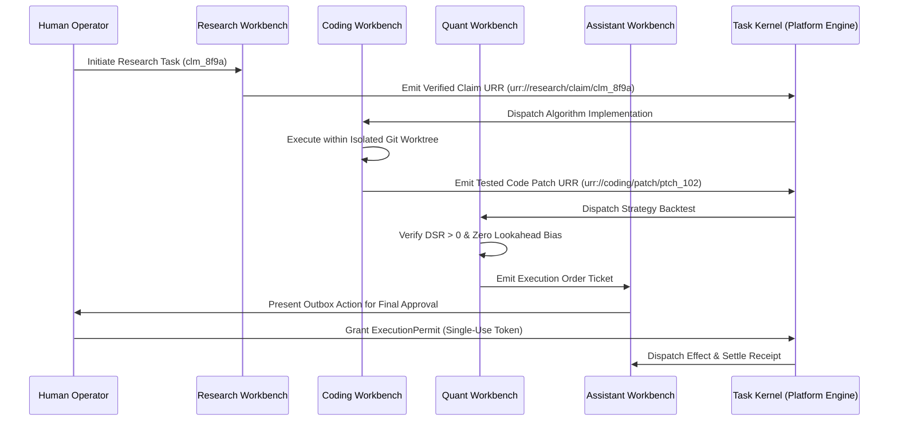

# Domain Packs & Multi-Workbench Workflows Specification

> **Classification:** Domain Packs & Multi-Workbench Architecture Specification  
> **Source of Truth:** Authoritatively governed by [Custos Master Specification](../../Custos.md).  
> **Directory Index:** See [Custos Architecture Overview](README.md).

---

## 1. Domain Pack Architecture & Shared Substrate

Custos organizes domain specialization into **Four Sovereign Workbenches** (`workbenches/{assistant, coding, quant, research}`), each adhering to the symmetrical 5-part structure:
`manifest/` (metadata), `migrations/` (DB tables), `recipes/` (workflows), `schemas/` (JSON specs), `src/` (Rust code).

### Shared Foundation vs. Pack Declaration

| Component | Pack Declaration | Shared Foundation Implementation |
|---|---|---|
| **Task Kinds** | Inputs, expected outputs, criteria, and rubrics | Task FSM, lifecycle revisions, session bindings (`platform/contracts`) |
| **Context Recipe** | Information sources, extraction prompts, coverage targets | Scope/privacy filters, CAS snapshots, context compiler (`platform/engine`) |
| **Capabilities / Skills** | Tool requirements, instructions, and rubrics | Registry availability, Two-Phase mediation, signed permits (`platform/engine`) |
| **Workflow Candidates** | Direct, sequential, or Lead-Worker DAG topologies | Hard filters, DAG compiler, topological scheduler (`platform/engine`) |
| **Verifier Profile** | Deterministic assertions, test commands, oracle checks | Independent verifiers, CAS digests, Completion Gate (`platform/engine`) |
| **Economics & Evals** | Domain benchmark fixtures and evaluation rubrics | Pareto selector, attempt ledger, token accounting (`platform/engine`) |
| **Product Views** | Domain-specific UI panels, tearsheets, inspectors | React 19 UI workbench views (`apps/desktop/ui`) |

---

## 2. Coding Workbench (`workbenches/coding`)

Specialized for software engineering, code refactoring, bug diagnosis, and test verification:
- **Task Kinds:** `repo_explain`, `diagnose`, `bugfix`, `feature_implementation`, `refactor`, `code_review`.
- **Git Worktree Isolation:** Autonomous coding agents execute inside isolated Git worktrees. Never mutate the primary checkout directory without human consent.
- **Verification Gates:** Automated compilation checks (`cargo check`), test suite execution (`cargo test`), syntax parsing, and 3-way worktree diff validation.

---

## 3. Research Workbench (`workbenches/research`)

Specialized for scientific research, academic paper exploration, and machine learning experiments:
- **Task Kinds:** `source_ingestion`, `claim_extraction`, `citation_grounding`, `alce_verification`, `experiment_run`.
- **Claim-Evidence Linking:** Scientific claims are backed by immutable passage locators and CAS hash digests. A citation without grounded passage support fails the Completion Gate.
- **4-Step ALCE Pipeline:** Retrieval -> Grounding -> Synthesizing -> Verifying.
- **Compensating Saga Rollbacks:** If an experiment batch fails intermediate review, `create_task_batch` executes compensating rollbacks to clean up orphaned downstream tasks.

---

## 4. Quantitative Workbench (`workbenches/quant`)

Specialized for financial modeling, factor discovery, and algorithmic trading:
- **Task Kinds:** `alpha_discovery`, `backtest_execution`, `risk_audit`, `order_planning`.
- **Zero-Mock Financial Data:** Real market data (OHLCV bars) ingested from genuine feeds; synthetic or spoofed order books are strictly prohibited.
- **Statistical Bias Verifiers:**
  - `DeflatedSharpeVerifier`: Corrects for family-wise multiple testing bias and non-normal asset return distributions (Bailey & López de Prado).
  - `LookaheadBiasChecker`: Validates that trading signals at step $T$ depend exclusively on historical data available at $\le T$.
- **Outbox Integration:** Approved order tickets serialize into `OutboxActionItem` entries requiring single-use `ExecutionPermit` tokens.

---

## 5. Assistant Workbench (`workbenches/assistant`)

Specialized for personal productivity, communications, and scheduling:
- **Task Kinds:** `draft_email`, `schedule_event`, `contact_lookup`, `daily_briefing`.
- **Two-Phase Outbox Mediation:** Outgoing communications (emails, chat messages, external mutations) are held in `PendingApproval` state until explicitly confirmed by the operator.
- **Personal Facts Store:** Durable, temporal fact store preserving user preferences without prompt leakage.

---

## 6. Cross-Workbench Handoff & Saga Protocol

Workflows cascade seamlessly across workbenches via immutable Universal Resource References (URR):



---

## 7. Automated Verification Commands

```bash
# 1. Run workspace boundary validation
cargo xtask check-boundaries

# 2. Run workbench unit & integration tests
cargo test --package custos-workbench-assistant --lib --offline
cargo test --package custos-workbench-coding --lib --offline
cargo test --package custos-workbench-quant --lib --offline
cargo test --package custos-workbench-research --lib --offline
```
