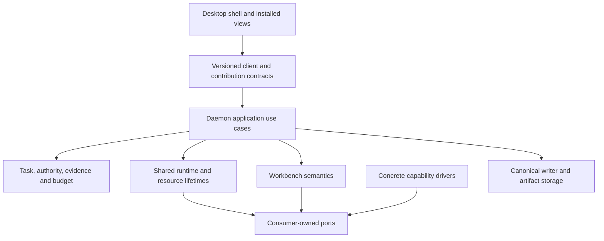
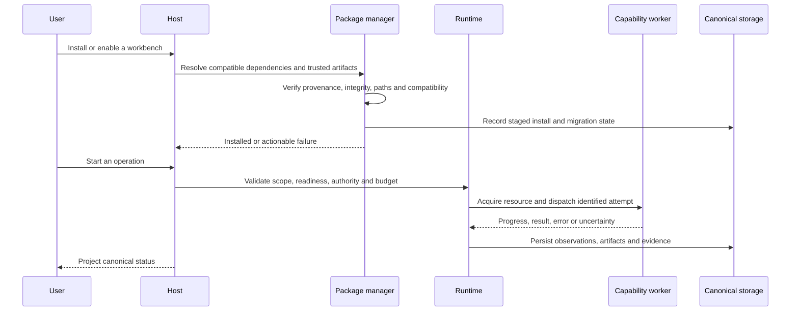

# Workbench packages and reusable capabilities

**Status:** target architecture with partial implementation on `new_rft`. Source-folder moves and manifest validation are not independent package distribution. The [canonical refactor plan](../development/modular-workbench-refactor-plan.md) is the implementation queue; the [physical catalog](../development/codebase-architecture.md) distinguishes current owners from future extraction.

**Implementation placement:** [move plan §15](../development/modular-workbench-refactor-plan.md#move-plan) is the concrete backend/UI/data ownership ledger. Correctness fixes happen before moves. Specialist domain types, use cases and UI migrate together; driver source and runtime resource lifetime remain reusable. Host-executed scoped storage operations must precede independent backend installation; moving a repository into a worker with raw SQLite is forbidden. Targets are planned until their packet gates pass.

## 1. Responsibility and dependency boundaries

Custos has one shared control plane and specialist workbench contributions. A capability is reusable execution behavior, not a mandatory crate, process or root directory. Extract a separately installable component only when it has a real build artifact, lifecycle boundary or heavy optional dependency to manage.

An adapter implements a port; it does not decide completion, issue grants or instantiate the entire application. The daemon composition root injects implementations. Research defines claim support and experiment intent; a notebook driver executes cells. Quant defines backtest semantics; it may use the same notebook or compute capability without installing Research UI. Assistant does not own the common S1/S2/OI runtime.

## 2. Current source ownership

The root `capabilities/` scaffold has been removed. Six compute/A2A Rust files there were byte-identical uncompiled copies; the compiled implementation remains in its existing Cargo package. Source descriptors now sit beside actual modules:

| Stable ID | Current compiled implementation | Boundary and limitations |
|---|---|---|
| `workspace` | `platform/adapters/src/workspace/` | Folder/Git access and worktree provisioning; caller scope still required |
| `terminal` | `platform/adapters/src/terminal/` | PTY driver; terminal lifetime is separate from visible tab |
| `notebook` | `platform/adapters/src/notebook/` | Python driver; resource enforcement must be verified per driver/OS |
| `compute` | `platform/adapters/src/compute/` | Colab/Kaggle/rented-target adapters and checkpoint store; metadata is not proof of cloud execution |
| `documents` | `platform/adapters/src/documents/` | Scoped, bounded UTF-8 source acquisition; no PDF/OCR implementation implied |
| `local-inference` | `platform/adapters/src/local_inference/` | Local inference implementation; native build feature and runtime readiness are distinct |
| `mcp` | `platform/adapters/src/mcp/` | Tool discovery/transport; discovery metadata is not authority |
| `remote-agents` | `platform/adapters/src/a2a/` | Remote delegation transport; no automatic grant transfer |

Each `manifest.json` here is a **source descriptor**, consumed by developer checks. It is not an authenticated installable package or proof of runtime readiness. `xtask validate-packs` checks that descriptors have exported modules, unique IDs and satisfy workbench manifest references. It does not execute drivers or attest all Cargo feature combinations.

`documents::SourceFetchAdapter` replaces the old generic `tools::source_fetch` path. `compute::checkpoint::verify_local_checkpoint_files` owns local checkpoint integrity checks. MCP builtins remain under MCP; no general-purpose adapters `tools` bucket or forwarding facade is retained.

Current `platform/components` still contains specialist pack implementation and `platform/domain` still has specialist types. Workbench `backend/src` copies are not automatically authoritative merely because they exist. Resolve their compilation/callers before later extraction. UI remains in `ui/desktop`; the native shell is in `apps/desktop/native`. This cleanup does not claim these migrations are finished.

## 3. Separate state, capability and authority

Keep these facts distinct: component discovered, installed, enabled, UI loaded, dependency ready, job running, action authorized. A descriptor, active lens or successful import does not imply the remaining states.

Task scope, privacy, installed/enabled support and worker capability determine the disclosed tool subset. Authority validates the exact effect before dispatch. A lens switch changes presentation/defaults; it must not enlarge grants, reroute a running pinned model or expose a private corpus. Context and cost accounting remain shared across workbenches.

Source acquisition, notebooks and compute are not forced into every model prompt. Disclose only relevant operations; measure token cost and accepted-task quality rather than promising fixed savings. Native harness tools remain provider-governed unless Custos actually intercepts them.

## 4. Installation and execution flow

The sequence is the required target. Current source descriptors and `xtask` do not implement this entire sequence. The existing `xtask package` command fails explicitly until it really produces a verified artifact; it must not print a false staging-success message.

A simple recipe needs no dedicated worker. New native code absent from the host binary needs a supported versioned worker boundary or host update, not downloaded Rust crate hot-loading. Stateful notebook/PTY sessions need command streams, cancellation and reconnect/epoch semantics distinct from one-shot jobs. OS-enforced resource limits must be reported separately from declared budgets and observed usage.

## 5. Data ownership and removal

- Platform storage owns canonical writes, transactions, effects, task identities and migration execution.
- Workbench owns schema meaning and migration definitions; downloaded workers do not open raw SQLite or submit arbitrary SQL.
- Artifacts/datasets/checkpoints live in managed artifact storage or user-selected locations; resource registry stores references, not another blob store.
- Derived indexes can be rebuilt; secrets use secure references and do not enter package manifests or logs.
- Uninstall removes managed executable assets only after dependency/lease checks. It does not erase user research, notebooks, model checkpoints or canonical history.
- Purge is a separate operation with scope and preview. Previously applied migration history may remain after uninstall; table absence is not a universal invariant.
- A generic Base viewer preserves access to metadata/raw exports. Specialized renderer availability after uninstall is an explicit compatibility feature, not an automatic promise.

## 6. Distribution acceptance

A workbench is independently downloadable only after all of these gates pass:

1. A clean Base installer omits unselected implementation and heavy dependency payloads. Catalog metadata may remain.
2. Workbench UI is a separate compatible contribution bundle using a narrow Host API. `React.lazy` alone does not remove shipped bytes.
3. Missing specialist backend behavior can be installed and activated through a tested execution boundary.
4. Trusted artifact identity, safe extraction, dependency versions, migration recovery and rollback/freshness policy are enforced.
5. Closing a tab preserves an authorized background job; disable/uninstall handles live resources explicitly.
6. Task/session/artifact continuity works across workbenches without transferring permissions implicitly.
7. Installer bytes, process RSS, startup time, CPU and total accepted-task cost are measured separately. No fixed 20–45 MB or savings percentage is established.

First-party UI code sharing the host renderer is trusted code. React error boundaries help with render failures; they are not isolation from infinite loops, memory exhaustion or malicious extensions.

## 7. Development tools and verification

- `tests/desktop/{canvas-smoke,model-catalog-smoke}.mjs`: executable regression checks using the existing desktop compiler.
- `tests/desktop/browser-native-smoke.mjs`: native browser interaction check; requires a launched debug-enabled desktop.
- `xtask/scripts/workbench-control-audit.cjs`: static source inventory of sibling upstream checkouts; never a production agent tool.
- `xtask/scripts/check_{deps,layering,naming}.sh`: architecture checks rooted in the current Cargo layout. Missing source roots/search errors must fail.
- `docs/development/legacy-team/`: preserved team notes and RFCs, explicitly historical.

The retired Repo Intelligence Python subsystem and obsolete fixed-crate migration/Goose installer scripts are not part of Custos. Keep actual distribution clients in `packages/`, examples in `examples/` and user configuration in `config/`; delete by responsibility and callers, not by folder size.

Run `cargo run -p xtask --offline -- validate-packs`, targeted contract/adapter tests, workspace check, desktop build and desktop smoke tests. Native/cloud/GPU behavior requires additional live acceptance tests and is not certified by this cleanup.
