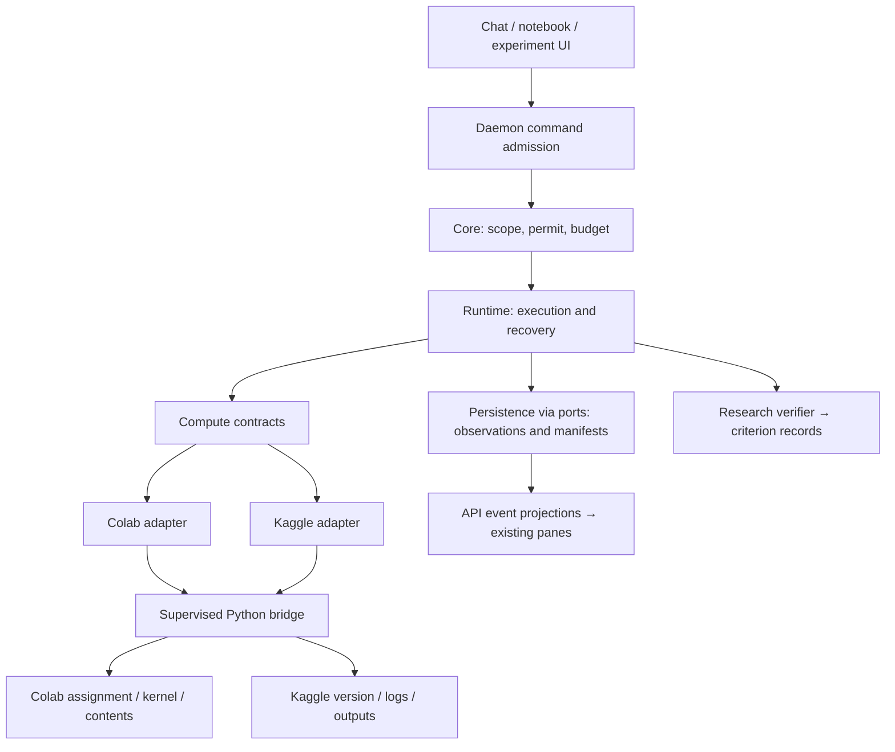
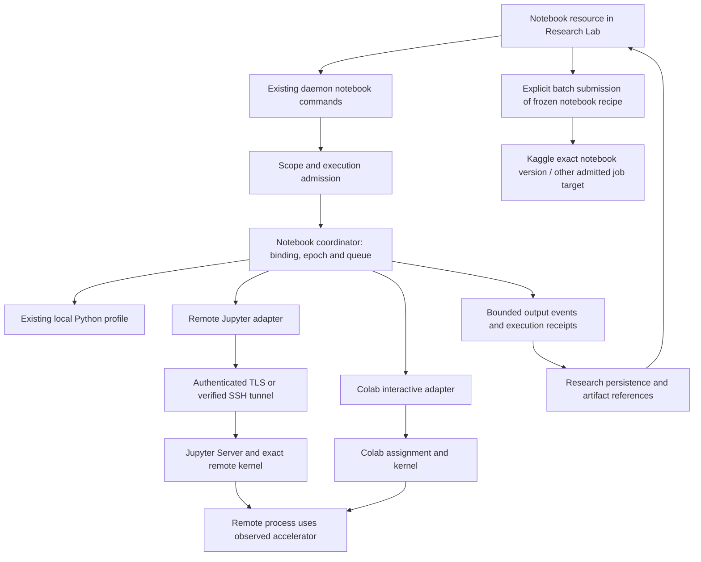

# Remote compute: Colab và Kaggle trong Custos

**Trạng thái:** thiết kế tích hợp để review, chưa là tính năng đã triển khai. Khảo sát source ngày 18-10-2026; không login, cấp GPU, gửi dữ liệu hay chạy job thật. Mọi tên module/operation mới bên dưới là target đề xuất, không API hiện hữu. Không thêm crate, dependency hoặc migration trong đợt tài liệu này.

Liên hệ: [Research workbench](research-workbench-blueprint.md), [SADE core refactor](../development/sade-core-refactor-plan.md), [training/compute source study](../../../TRAINING_COMPUTE_SOURCE_STUDY.md). Đây là phần HOW cho remote compute, không một orchestration engine mới.

## 1. Quyết định kiến trúc

**Cross-backend recovery:** dùng [checkpoint relay](compute-relay-and-heterogeneous-failover.md) và [rented GPU lifecycle](remote-compute-external-gpu.md). Colab/Kaggle adapters không tự bảo vệ state nếu engine chưa safe-save và upload checkpoint complete ra durable storage. Latest observed step khác latest protected step; chuyển backend tạo attempt mới có resume mode/compatibility evidence, không live-migrate RAM hoặc tự thuê GPU vượt grant.

Đưa Colab CLI và Kaggle CLI vào **compute adapter**, không `ModelPort`, không native coding harness và không một workbench riêng. Chúng cung cấp nơi chạy code/job; model hoặc agent đưa ra đề xuất, Custos giữ quyền, Task và evidence. Research sở hữu recipe, dataset/experiment semantics; Coding có thể dùng cùng compute capability để chạy benchmark/test; Copilot có thể báo tiến độ trong scope được cấp.

Hai adapter khác nhau về bản chất:

- **Colab:** runtime assignment + persistent remote kernel + file transfer; thích hợp notebook tương tác và supervised jobs. Runtime có thể vẫn tồn tại sau client disconnect.
- **Kaggle:** submit một notebook/script version → theo dõi version đó → logs và outputs; thích hợp batch experiments. Live logs không phải quyền chạy thêm cell hay đọc arbitrary memory trong job.

Tái sử dụng `Recipe`, `EnvironmentSpec`, `ExecutionRecord`, notebook models, Task/WorkerRun/effect/outbox và CAS. Những model hiện tại chưa đủ remote lifecycle phải được mở rộng bằng migration có review, không tạo DB riêng cho mỗi provider. `ExecutionRecord::Completed` chỉ là thực thi kết thúc, không scientific verification.

## 2. Nguồn đã đối chiếu và phạm vi lấy

| Nguồn pin local | Thành phần đọc / lấy behavior | Không suy ra |
|---|---|---|
| `google-colab-cli` SHA `006ff96ac2d0e4dcfb702467a76493d687929be8` | `client.py`, `runtime.py`, `contents.py`, `state.py`, auth/CLI và run/session commands | Account được cấp GPU mong muốn, runtime sống vô hạn hoặc mọi command hỗ trợ mọi OS |
| `kaggle-cli` SHA `6894864ff4095cf98e9e36d3a694ff5fc9ba3818` | `KaggleApi.kernels_push/status/logs/logs_stream/output`, version/path/log fixtures | Có arbitrary interactive kernel, SSH hay pause/resume qua các API này |

Hai repo khai báo Apache-2.0; giữ license/notices cho source được lấy, audit dependencies riêng. Ưu tiên gọi **pinned Python implementation** qua helper được supervise, không port lại HTTP/OAuth/Jupyter stack sang Rust. Không copy toàn repo vào `crates/`. Các checkout AgentHub là reference, production build không import bằng đường dẫn sibling tuyệt đối.

Lưu ý source quan trọng:

1. Colab source `cli.py` mặc định OAuth2 tại SHA này; README còn ghi ADC. Adapter phải chỉ định auth mode, không phụ thuộc default ngầm.
2. `ColabClient.assign` có reconcile assignment trước một số retry POST; cần giữ behavior và kiểm timeout window ngoài helper.
3. `ColabRuntime.stop(shutdown_kernel=False)` đóng channels, khác shutdown kernel và khác `unassign` VM.
4. `execute_code` nếu không truyền timeout có thể kế thừa default ngắn của dependency; phải đặt timeout theo operation và xử lý unknown, không repeat cell mù.
5. `colab run` convenience path có cleanup nhưng không đủ chứng minh đã tải mọi artifact hay remote release thành công; không dùng nguyên command này làm durable Custos job controller.
6. Kaggle logs có SSE khi đang chạy và persisted blob khi xong; CLI follow dedup bằng event count, không phải durable server cursor.
7. Kaggle Python package có import-time authentication attempt trong `__init__.py`; helper phải isolate auth/config/profile, không để import tự dùng account mặc định của máy.

## 3. Capability matrix thực dụng

| Operation | Colab target | Kaggle target | Bật lúc nào |
|---|---|---|---|
| Probe auth/account/backend version | Có | Có | Kiểm profile + read-only call, không chỉ process exit |
| Allocate/adopt runtime | Assignment | Không expose persistent VM allocation | Quota/eligibility và ownership rõ |
| Attach notebook/kernel | Có, kernel/session IDs | Không qua batch CLI đang khảo sát | Colab protocol conformance pass |
| Execute cell | Có | Không | Notebook/kernel/epoch/source scope được validate |
| Run script/notebook job | Có, orchestration trên runtime | Có, versioned push | Recipe/config/input digest + authorization |
| Live logs | Kernel output/job observations | Có, versioned SSE/blob | Bounded/redacted stream, reconnect tested |
| Collect files | Contents download | Versioned outputs | Staging/path/size/hash/manifest checks |
| Install environment | Có qua explicit code/process | Trong submitted code/image settings được hỗ trợ | Effect mới, package/network scope rõ |
| Interrupt current cell | Conformance-gated; không suy ra chỉ từ execute/restart | Không advertise | Chứng minh backend interrupt thật, không map sang release |
| Restart kernel | Có source path | Không expose như interactive action | Epoch + pending execution handling tested |
| Stop job | Tùy recipe/process isolation | Không advertise nếu chưa có supported cancel contract | Xác định được target process/version và observed stop |
| Release runtime | Unassign endpoint | Không có equivalent VM lease trong batch adapter | Colab post-read xác nhận; Kaggle không dùng delete thay cancel |
| Resume training | Engine/checkpoint-specific, job mới | Submit job/version mới từ checkpoint hợp lệ | Không “resume in-place” giả |
| Remote terminal/SSH | Optional later | Không qua audited batch path | Auth/host/terminal teardown tested; không là MVP dependency |

Đăng ký support theo adapter **version + account + operation**. Unsupported khác auth-required, quota-exhausted, temporarily-unavailable và uncertain. Không trả `available` chỉ vì Python import được.

## 4. Placement trong repository

| Thành phần | Nơi hiện có để mở rộng | Phần bổ sung dự kiến |
|---|---|---|
| Pure data | `custos-domain/src/recipe.rs`, `execution_record.rs`, `notebook.rs` | Remote refs/observation/completeness; tách notebook identity khỏi conversation |
| Trusted contracts | `custos-core/src/contracts/` | Operation-specific compute/kernel/job/storage contracts sau inventory, dùng domain-only values |
| Authority/effects | `custos-core/src/authority/`, runtime gateway hiện có | Allocation, upload, execute, submit, restart, release intents; exact scope/payload |
| Coordination | `custos-runtime/src/notebook/`, `workflow/` | Notebook queue/epoch; durable submit/observe/collect/recover; experiment coordinator khi first job ship |
| Concrete Rust integration | `custos-adapters/src/compute/{mod,colab,kaggle,process}.rs` (target) | Supervise helper, validate outputs, canonical external identity, error mapping |
| Python vendor bridge | `sidecars/compute-py/` (target, chưa tồn tại) | Thin wrappers `colab_backend`, `kaggle_backend`, entrypoint; pinned dependency environment, không agent framework |
| Persistence | `custos-persistence/src/repositories/research.rs` và existing stores/migrations | Execution bindings, resource observation, upload/output manifests, recovery state theo port |
| Pack semantics | `custos-packs/src/research/` | prepare/validate recipe, interpretation/eval, reproducibility obligations |
| Daemon application/API | `custos-daemon/src/` | Compose ports, admit commands, publish canonical events/capabilities |
| Desktop | existing `components/workbenches/research/` + daemon client | Extend Notebook/Lab/Runs/Artifacts; Connections profile; không tạo Colab app/Kaggle app |

Tên target không yêu cầu generate hết files trước. `compute-py` là I/O bridge ngoại biên, không ghi SQLite, không mint permit, không quyết định Task pass. Rust adapter không tự chứa workflow scientific hoặc provider LLM.

### 4.1 Notebook compute binding and recovery design

**Design only:** the current `NotebookCell` and `NotebookKernelState` are keyed by conversation `session_id`; the active coordinator runs a local Python worker. Remote Jupyter connections, multiple notebooks per conversation, compute selection and automatic continuation are not implemented by the Training inspector. No package or cloud runtime is installed by this design.

#### Separate five resource identities

| Resource | Meaning | What survives losing compute |
|---|---|---|
| Notebook document | Stable notebook identity, versioned cells, selected files/data and saved outputs; linked to Task/conversation rather than identified by them | Content and recorded outputs, subject to actual persistence |
| Kernel binding | Exact connection profile/server/kernel/process identity plus epoch and permitted operations | Reference/last observation, not Python variables |
| Compute lease | Exact provider account/resource, ownership, region, actual accelerator and cleanup obligations | Canonical metadata and unresolved billing responsibility |
| Training attempt | Frozen recipe/code/data/environment, external job identity, logical progress and parent attempt | Observations/artifacts/checkpoint lineage; not a running process |
| Checkpoint bundle | Immutable engine-specific state and commit/integrity observations | Only bytes committed to storage that remains accessible |

Notebook is not a Git worktree and is not owned by a Screen. One conversation can refer to several notebooks; two Screens opening the same notebook share the admitted kernel binding and execution queue, not duplicate executions. Initial support uses one active kernel per notebook; comparison uses an explicit fork/new notebook binding, not silent variable sharing. Legacy session-keyed notebooks must migrate deterministically with preserved cell IDs/outputs and links; do not derive new notebook identity from a display title.

Current core `contracts/kernel.rs::KernelPort` means the trusted Task Kernel, not a Python/Jupyter kernel. Do not overload or replace it. Add only the minimal notebook-execution contract to the existing core contract layer when implementing the first remote connection, with explicit notebook terminology and conformance fixtures. Domain types stay I/O-free.

#### Connection path

A GPU is available to the remote process through its framework/device environment; it is not forwarded into the desktop process. SSH is transport/host access, Jupyter is a kernel protocol, and a rented-GPU provider is allocation control. They can compose, but are not interchangeable backends. Prefer an existing authenticated Jupyter Server over a private connection or a verified SSH tunnel for the first remote slice. A raw ZeroMQ implementation in Rust and a public unauthenticated notebook server are not prerequisites.

Connect sequence: select an account/host profile → validate endpoint/trust/credential scope → read capabilities and kernelspecs → adopt an explicitly selected kernel or authorize creation → bind exact identity/epoch → probe environment and actual accelerator with a separately admitted bounded diagnostic → show connected status. Creating a kernel is execution, not a read-only probe. Installing packages, creating a VM or uploading files are additional effects, never hidden inside Connect.

Persist only connection/credential references and redacted endpoint metadata. No tokens in notebook cells, URL queries, output logs, prompts or frontend localStorage. Connection setup must constrain destination hosts/redirects and tunnel targets; do not let notebook content choose arbitrary internal URLs. Verify TLS/SSH identity, retain account binding, and do not weaken host verification to make reconnection succeed.

#### Execution and output correctness

- Bind every cell operation to notebook/cell/source digest, kernel ID/epoch, command ID, scope and deadline. A stale binding/epoch/source revision fails before dispatch. Serialize ordinary cell execution per kernel while allowing independent kernels to run concurrently.
- Jupyter requests have message identity and parent correlation. Match output by exact request/kernel, not the current selected cell or global execution counter. A shell reply and IOPub output can arrive separately; track both, including gaps and post-idle asynchronous output. Idle is not proof a background training process has ended.
- Handle stream/error/result/display updates with bounded payloads, output truncation markers and CAS references for large artifacts. Treat rich HTML/JavaScript and widget communication as untrusted, not permission to execute frontend code. Initial profile can support text/images and explicitly mark widgets/comm unsupported. Default `allow_stdin=false` until an explicit safe input flow exists.
- Local inline Python worker is not yet a full Jupyter kernel. Declare its supported output/interrupt semantics rather than claiming protocol parity. Moving process I/O to an adapter must preserve current notebook behavior and outputs.
- Cell timeout/disconnect after dispatch leaves outcome uncertain; never auto-resend arbitrary cell code. Reconnect to the exact kernel if available, mark missing output, or ask for an explicit new operation. Daemon event replay recovers persisted events, not messages the adapter never received.

#### Three different meanings of switching GPU

| Request | Supported design | Must not claim |
|---|---|---|
| Reconnect after transport loss | Reattach exact surviving kernel; verify epoch/process continuity; recover observed output where possible | That a connection loss means kernel death, or all missing output can be replayed |
| Change interactive notebook compute | Create/adopt another kernel, new binding epoch; retain saved content/outputs with old provenance; offer explicit replay of selected reproducible cells | Moving arbitrary Python namespace, open files, sockets or VRAM; automatic replay of effectful cells |
| Continue a managed training job elsewhere | Safe-save → independent durable commit → target/engine/authority checks → new attempt restores exact checkpoint | Live migration or guaranteed zero lost steps |

For notebook replay, dependency order must be declared or reviewed; text position alone cannot prove safe order. Network writes, file deletion, dataset publication, account actions and cloud allocations are not replay-safe. Generic `pickle`/`dill` serialization of a whole namespace is not a portable or safe default. Background training should launch as a supervised job from an immutable recipe, rather than an untracked thread owned by a cell execution.

#### Operations and user-visible truth

The existing Local API remains the only desktop entry. Extend existing notebook operations for bind/detach/reconcile, with expected identity/epoch. Keep compute allocation/release, notebook interrupt/restart, job stop and checkpoint operations separate. Operation names and DTOs are frozen only in their implementation packet; this design does not create another protocol namespace.

The future Notebook Compute control renders capabilities and observed state, not a list of always-enabled providers. It must distinguish connection unavailable, kernel busy, observation stale and compute still allocated. A notebook can be disconnected while its remote job and billing resource remain active. Restart warns about memory loss; release previews the exact owned resource and other known active bindings/jobs. Shared/adopted resources cannot be terminated by closing a notebook. Kaggle is shown as a batch destination, not an interactive kernel choice.

Autocontinuation policy belongs to the job, not the toolbar selection: allowed source/target accounts, regions, compatible engine profiles, resume mode, cost/overlap limits and required protection must all be explicit. When a target is unavailable, show waiting/export/fallback choices. Never switch to paid compute, different data or lower precision merely to keep a progress bar moving.

#### Additional upstream research and selection

Research URLs below were read as online source/docs, not cloned or SHA-audited. Pin exact commits/licenses/security advisories and run conformance before copying or adding any dependency. This is a focused study, not a whole-repository audit.

| Upstream | Read entry points | What Custos should learn / not import |
|---|---|---|
| [jupyter/jupyter_client](https://github.com/jupyter/jupyter_client) | [`session.py`](https://github.com/jupyter/jupyter_client/blob/main/jupyter_client/session.py), [messaging specification](https://jupyter-client.readthedocs.io/en/stable/messaging.html) | Request/parent IDs, kernel-session changes and channel semantics; use a compatible client/adapter rather than designing an ad-hoc notebook wire protocol. It does not preserve arbitrary state across machines. |
| [jupyter-server/jupyter_server](https://github.com/jupyter-server/jupyter_server) | [REST API](https://jupyter-server.readthedocs.io/en/latest/developers/rest-api.html), [`connection/channels.py`](https://github.com/jupyter-server/jupyter_server/blob/main/jupyter_server/services/kernels/connection/channels.py) | Kernel lifecycle and channel bridge; optional existing-server attachment, not copying a server into Tauri. REST/kernel channels and version-dependent buffering require conformance; no universal durable replay assumption. |
| [jupyter-server/enterprise_gateway](https://github.com/jupyter-server/enterprise_gateway) | [`enterprisegatewayapp.py`](https://github.com/jupyter-server/enterprise_gateway/blob/main/enterprise_gateway/enterprisegatewayapp.py), [`remotemanager.py`](https://github.com/jupyter-server/enterprise_gateway/blob/main/enterprise_gateway/services/kernels/remotemanager.py) | Optional later deployment for distributed kernels; not the default local-first dependency or a required Kubernetes control plane. Custos still owns admission and resource identity. These two additional code paths require deeper audit before integration. |
| [skypilot-org/skypilot](https://github.com/skypilot-org/skypilot) | [managed-job guide](https://docs.skypilot.ai/en/latest/examples/managed-jobs.html), [`jobs/recovery_strategy.py`](https://github.com/skypilot-org/skypilot/blob/master/sky/jobs/recovery_strategy.py) | Relaunch/recovery strategy and persistent checkpoint requirements. Optional managed-job backend for clouds it actually supports; no evidence here of a Colab/Kaggle universal backend. If adopted, do not stack an independent Custos retry controller over its recovery controller. |
| [fsspec/filesystem_spec](https://github.com/fsspec/filesystem_spec) | [`transaction.py`](https://github.com/fsspec/filesystem_spec/blob/master/fsspec/transaction.py), [transaction documentation](https://filesystem-spec.readthedocs.io/en/latest/features.html#transactions) | Optional Python storage plumbing; transaction guarantees depend on the filesystem and are described as semi-atomic. It cannot replace Custos immutable manifest/verification protocol or guarantee multi-object remote atomicity. |

Selection: Jupyter Client/Server concepts directly inform the next notebook contract; Enterprise Gateway is deferred; SkyPilot is an optional provider adapter candidate after direct single-target correctness; fsspec is optional only if the chosen Python storage path needs it. No dependency is added solely because a repo appears in this table.

#### Placement and delivery order

Extend domain `notebook.rs` with document/binding/observation semantics only when implemented; existing recipe/execution/checkpoint types retain job provenance. Core adds a minimal notebook-execution contract distinct from the trusted Task Kernel. Existing runtime `notebook/coordinator.rs` owns queues/epochs through ports; proposed adapters `notebook/` owns remote/local process transport, while `compute/`, `training/`, `checkpoint/` retain allocation, engine and storage responsibilities from the relay design. Existing ResearchRepository, daemon composition, SDK and Lab remain the persistence/API/presentation owners. No second notebook store or provider registry.

This refines the earlier Colab-first roadmap: **first make the existing local notebook contract safe and host-independent; attach an existing remote Jupyter Server on an owned GPU host; then add cloud allocation and Colab interactive integration.** Kaggle remains a separate batch slice. This avoids testing kernel transport, cloud billing, auth and checkpoint recovery as one inseparable first feature.

Acceptance sequence:

1. Local regression: preserve cells/outputs/interrupt/reset; two notebooks in one conversation and two panes of one notebook do not share unintended state or double-dispatch.
2. Owned remote CPU/Jupyter fixture: two dependent cells, correct source/output IDs, bounded MIME outputs, lost reply, restarted kernel, stale epoch and daemon reconnect; no automatic replay.
3. Remote GPU opt-in: actual framework device availability/memory observation, exact environment binding and successful bounded workload. `nvidia-smi` alone does not prove the framework can use the device.
4. Background job separation: launch a frozen recipe, disconnect/close/reopen without killing it; stop job and release compute tested independently. No lease cleanup of another notebook's/adopted workload.
5. Save/restore and remote commit follow relay F0–F3, then provider F4–F7; a new GPU kernel can open the same notebook, while only the admitted training attempt restores checkpoint state.
6. Failure tests include expired auth/tunnel, resource replacement, unknown source still alive, storage outage, unavailable fallback quota, privacy-rejected target and denied paid fallback. Expected result may be blocked/uncertain/waiting, never fabricated continuity.

## 5. Cách wrap CLI: không parse giao diện terminal

MVP dùng thin Python helper import các module API tại SHA/package đã pin. Tái sử dụng conventions envelope stdio/JSON/version/deadline/cancellation của Custos; concrete helper binding được freeze bằng fixtures ở packet đầu, không tạo protocol có tên mới. Không bắt buộc thêm MCP/A2A giữa hai process do chính Custos sở hữu.

Rust gửi typed operation và resource refs; Python trả structured observation/error/output chunks. stdout dành cho transport, vendor logs chuyển stderr có redaction. Nếu vendor in ra stdout thì isolate capture và giới hạn; không decode bảng rich/ANSI hay đoán status từ câu “Session terminated”. Remote notebook stdout là payload data, không được trộn vào transport framing.

Helper lifetime khác remote lifetime: helper có thể restart; assignment/job vẫn phải reconcile. One-shot worker phù hợp control calls; kernel attachment/stream observer cần long-lived supervised process. Không một global mutex chặn mọi Colab/Kaggle account vì một cell đang train. Queue theo kernel/resource; observation có bounded concurrency/backpressure và deadline riêng.

Mỗi operation khai báo retry semantics: read/idempotent observation, mutation có external identity, hoặc non-idempotent/unknown. Killing helper chỉ hủy local control, không phải remote stop. Dependency/version pin và platform checks nằm ở adapter profile; không auto-update CLI hoặc pip install trên máy user khi app khởi động.

Nếu muốn cho native Codex/Claude dùng compute, expose **cùng admitted capability** qua MCP hoặc tool bridge hiện có. Không cài thêm MCP server vendor đi thẳng vào account để bypass Custos. Native tools ngoài mediation phải hiển thị provider-governed/unknown, không dùng nhãn custos-mediated.

## 6. Identity và persistence contracts cần chốt

Tái sử dụng existing IDs trước; bảng dưới mô tả fields cần có, chưa là struct/schema migration đã duyệt.

| Record/reference | Fields tối thiểu | Quan hệ / invariant |
|---|---|---|
| Compute connection | connection ID, backend, account subject, credential ref, adapter version, auth/capability status | Account change không retarget run cũ; credentials không trong event |
| Remote runtime binding | resource ID, account, endpoint/assignment ref, stable allocation token/hash khi dùng, ownership, requested/observed hardware, last observation | Label/name không là identity; adopted runtime khác Custos-created |
| Kernel binding | notebook ID, runtime ID, remote kernel/session IDs, epoch, environment fingerprint, status | Chat session ID không là kernel key; reset tăng epoch |
| ExecutionRecord extension | recipe ID/revision, Task/Run/attempt refs, backend resource/version refs, code/input/env digests, requested/observed status | Re-run là attempt mới; không sửa lịch sử thành recipe hiện tại |
| Submission record | local operation/command ID, prepared digest, external owner/slug/version hoặc assignment/job ID, launch/reconcile state | Persist trước/ sau external call; unknown không submit lại tự động |
| Stream observation | source, resource/version/epoch, local event seq, remote IDs nếu có, timestamp, replay/completeness | Local cursor không giả làm provider exactly-once cursor |
| Artifact manifest | producing attempt, remote path, relative logical path, bytes/digest, media, downloaded status, completeness, sensitivity | Partial download không publish như complete checkpoint |
| Usage observation | source/unit, interval, billed/estimated/unknown, account/resource ref | Quota balance delta không tự là cost chính xác của một job |

Reuse SQLite canonical transaction/event pattern. Remote credentials/proxy tokens ở protected credential path/keychain; upstream SessionState có token nên không dump vào DB/event/log. Provider-local metadata file chỉ là adapter cache, không Task source of truth; deleting cache không đồng nghĩa đã release remote resource.

`ExecutionRecordStatus` hiện chưa có uncertain/reconciling. Không map timeout thành Failed chỉ để vừa enum: cần mở rộng status tương thích hoặc tách effect/submission uncertainty record đúng existing lifecycle; quyết định cụ thể trước migration. Tương tự resource state phải biểu diễn unknown/stale/auth-required, không chỉ Idle/Busy.

## 7. Colab: luồng tương tác đầy đủ

### 7.1 Connect và allocate/adopt

1. User tạo Connection profile, chọn OAuth2 hoặc ADC explicit. Probe không cấp GPU; browser consent chỉ khi user gọi connect. Colab account auth khác credentials được đưa vào VM cho GCP/Drive.
2. Runtime inventory đọc actual assignments. UI cho chọn **attach existing** hoặc **allocate new**; attach existing cần consent về resource/code đã có, không tự sở hữu quyền release.
3. Allocation preview hiển thị requested accelerator/shape, quota snapshot nếu lấy được, time budget, account và data policy. Reserve/intent/outbox trước POST.
4. Sinh allocation identity ổn định theo strategy API chấp nhận, giữ qua retry. Query assignment sau timeout trước POST lại; nếu không xác định được mapping, để uncertain và hỏi xử lý.
5. Ghi endpoint/assignment, ownership và observed hardware. Requested T4 không được hiện như actual T4 trước probe. TPU là capability riêng, không thay tên GPU trong cùng command.
6. Bind notebook tới kernel/session IDs. Reattach qua token refresh/assignment lookup; kernel đổi thì epoch mới, old variable state không còn verified.

### 7.2 Chạy cell / script

Cell source revision + selected input refs + kernel epoch được preview/admit. Serialize executions theo kernel; tùy chọn queue không cho hai pane gửi cùng cell vô tình. Persist attempt trước send và bind provider message/parent ID khi client expose được.

Outputs gồm stdout/stderr/display/result/error với execution identity. Preserve MIME metadata, sanitize HTML/SVG, bound output bytes và lưu large payload vào artifacts. Có kernel idle nhưng thiếu reply/output không tự đủ để xác nhận execution hoàn chỉnh: trạng thái và output completeness tách riêng.

Chạy script dài cần recipe job identity và process wrapper có structured metrics/checkpoint manifest, không chỉ chạy `!python` rồi suy ra job ID từ dòng text. Tách execution deadline, observer timeout và resource lease/maximum runtime; hết observer timeout chưa nói script đã dừng. MVP không cho auto-input vào OAuth/password prompts; cần user action rõ, không agent đọc secrets.

Chuyển notebook Local → Colab không di chuyển Python heap/variables. Giữ code, versioned inputs và observed outputs; user chọn rerun các cell cần thiết sau dependency/environment check. Không tự replay cell có file/network effects chỉ để “khôi phục context”. Code chạy trong VM có thể đọc dữ liệu/credentials đã có trên VM: attachment preview phải nói rõ trust boundary này.

### 7.3 Ngắt, restart, detach, release

| Hành động | Semantics | Không được tự làm |
|---|---|---|
| Detach | Đóng client/channels; giữ remote resource | Không báo GPU released |
| Interrupt | Yêu cầu ngắt execution target nếu backend support | Không restart kernel để giả interrupt, không hứa save checkpoint |
| Restart kernel | Reset namespace/kernel; epoch mới; pending attempts reconcile | Không giữ output cũ như fresh execution |
| Stop recipe job | Target process/job riêng nếu có contract đáng tin | Không kill mọi việc trên shared runtime |
| Release runtime | Unassign whole VM sau consent/ownership checks | Không chỉ xóa local session metadata |

Trước release: hiển thị active jobs, unsaved/partial outputs, retention choice. Collect required artifacts trước teardown khi user chọn bảo toàn; thất bại phải hiện và cho quyết định, không im lặng xóa VM. Sau request unassign, query assignments đến confirmed absent hoặc bounded unresolved; resource vẫn trong attention list nếu chưa chứng minh release. Không vô hạn ping/keepalive để né chính sách nền tảng.

## 8. Kaggle: batch có version, không giả interactive notebook

### 8.1 Prepare package và submit

Research recipe tạo immutable submission package: script/ipynb, kernel metadata, input dataset/model refs, environment/install instructions được phép, output manifest convention. Có package digest và scan secrets. Không upload toàn repo; chọn exact files. Egress và dataset license/access phải cho phép.

Preview có account/owner/slug, **private/public setting**, code/notebook digest, input refs, internet/accelerator/runtime options được API hỗ trợ, output paths, budget/quotas khi biết. `no_run` là save-only, không hiện Running. Không tự publish model/dataset/notebook như một bước “đồng bộ file”.

Persist submission prepared → invoke `kernels_push` → normalize typed response, resolve exact external version từ supported response/query. Nếu response chưa đủ ID, reconcile; không chọn latest làm authoritative ref. Với shared slug, serialize Custos submissions và đối chiếu exact code/version metadata; remote UI/user khác vẫn có thể tạo versions ngoài Custos.

Timeout sau save/push là **unknown submission**, không push lại để “chắc”. Nếu API không có idempotency/digest lookup đủ mạnh, không hứa exactly-once; user cần xem candidate versions hoặc dùng new explicit attempt. Một marker trong version notes nếu API hỗ trợ giúp tìm nhưng không tự là security proof.

### 8.2 Observe exact version

Status/logs/files/output luôn dùng owner/slug/**version**. Job v7 chạy sau không thay v6 đang quan sát. Poll status có backoff; SSE theo capability; end-of-log không mặc định job success. Persist local event sequence để desktop replay và trạng thái stream completeness.

Khi reconnect stream chỉ replay từ đầu, không dedup logs bằng hash toàn cục vì hai dòng loss giống nhau vẫn hợp lệ. Dùng replay index trong cùng stream generation, so prefix khi có thể; nếu provider thay blob thì lưu segment/gap metadata và reconcile final logs. Không claim exactly-once log delivery. Metric record dedup theo attempt + metric name + step/split/producer sequence, không theo text chung.

Agent đọc error/OOM/logs để đề xuất recipe revision tiếp theo. Không chạy thêm Python trong job đang chạy qua batch interface. Cần kiểm tensors/extra diagnostics thì thêm instrumentation vào **lần chạy mới**; không làm screenshot/browser automation thành capability backend “inspect”.

### 8.3 Collect và đánh giá

Khi terminal observation: list/download tất cả output pages cho đúng version, stage files, validate names/root/limits, digest bytes, import CAS và manifest. Preserve artifacts từ failed run nếu user muốn; download thất bại là incomplete collection, không làm mất external execution result.

Job completed → artifacts collected → quality evaluation là ba mốc riêng. Không có metrics/checkpoint thì report missing, không tạo giả `metrics.json`. Resume là submit recipe/version mới từ checkpoint đã xác minh có đủ state, access và compatible environment; chưa có thì disable. Delete kernel/notebook là destructive artifact action, không alias “stop job”.

## 9. Data transfer và scientific provenance

Input manifest phải giữ source revision/digest, target URI/path, bytes, selected scope, privacy/consent. Colab Contents implementation đọc/ghi whole-file base64: MVP có giới hạn file/request phù hợp, không hứa streaming TB. Dataset lớn dùng supported remote dataset/object-store reference có auth/consent riêng; URL không đủ pin content nếu mutable.

Kaggle dataset/model attachments chỉ nhận refs đã resolve và record exact revision khi API cho phép. Không tự tạo public Kaggle Dataset để vận chuyển local sensitive data. Remote network/install code có thể kéo mutable dependency: record resolved versions/digests hoặc mark environment partial.

Output staging không follow symlink hoặc traversal/absolute path từ server; chống archive bombs khi có archive, giới hạn count/size, sanitize previews. Checkpoint nhiều files chỉ complete khi manifest đầy đủ và engine validator chấp nhận. Large weights có thể giữ external reference + retention/access status thay vì tải hết; UI nói “remote only”, không “saved locally”.

Chỉ gọi fully reproducible nếu input/code/environment/hardware/randomness capture đủ cho criterion. Dataset sample hash không full hash; observed GPU info không attestation; metric file do job tạo là untrusted observation, cần independent eval để quyết định quality.

## 10. Proposed Local API và event contract

Reuse versioned request envelope hiện có: command ID, actor, Task/Run, expected revision, deadline, privacy và payload. Các operation dưới là **API inventory đề xuất**; khi implement ưu tiên mở rộng namespace notebook/research hiện có, tránh alias hai API cùng semantics.

| Nhóm | Operations cần hỗ trợ | Ghi chú |
|---|---|---|
| Connections | list/probe/connect/disconnect | Disconnect account không ngầm stop remote workloads |
| Compute resources | list/get/allocate/adopt/reconcile/detach/release | Backend-specific support; release cần exact resource/ownership |
| Notebook | attach/execute/interrupt/restart/get-state | Extend existing notebook calls; include notebook/kernel/epoch |
| Research executions | validate/submit/get/list/observe/collect | Reuse `v1.research.recipes.*` và `v1.research.executions.*`; new commands typed |
| Recovery | list-unresolved/reconcile-submission/reconcile-release | Không generic retry mutation |
| Artifacts | list/import/open/export | Existing resource/artifact host; exact producing attempt |

Mutation response trả operation/attempt ID + state observed/prepared/uncertain, không block HTTP đến lúc train xong. Duplicate command ID trả prior receipt. Stale expected version/account/kernel epoch từ chối trước effect. Error có code/retryability/observation certainty/recovery action, message đã redacted; HTTP timeout không phải external failure.

Các event dự kiến: resource observation changed, kernel epoch changed, execution admitted/observed, output chunk available, submission uncertain, artifact collection updated, release unresolved. Reuse canonical event envelope/cursor; names và payload freeze bằng golden fixtures, không append unversioned DTOs trong frontend.

Không cần riêng WebSocket server cho Colab/Kaggle ở desktop. Vendor stream → adapter observations → canonical daemon event projection → client; large chunks/resource bytes dùng bounded retrieval, không nhét toàn checkpoint/log vào event bus.

## 11. Agent, OI và authority

Agent nhìn capability operations cùng schema, available backend và uncertainty. Recipe proposal, hardware recommendation, log triage hoặc evaluation plan không cấp quyền allocate/upload/execute/publish. OI chọn interactive Colab hay batch Kaggle dựa dependencies, availability, budgets và user preference; chưa đủ data dùng explicit choice, không tự đổi backend sau uncertain submit.

S1 hữu ích cho schema/data profiling, log categorization, loss anomaly signals và metric extraction; phải có source/step refs và abstain. S2 dùng evidence để debug/model selection, không cần cheap model xen vào mọi cell. Parsed OOM là hypothesis cho job failure trừ khi exact run observation xác nhận.

Effect preview bind account, backend/resource, notebook/job version, code/input/config digests, network/data scope và expiry. New code/one changed parameter hoặc khác dataset làm approval cũ không còn áp dụng nếu vượt scope của standing grant. UI hỏi tại consequential boundaries, không bắt approve từng status poll trong scope.

**Assurance quan trọng:** Custos có thể mediate việc gửi cell/job, nhưng arbitrary code trên remote VM có thể dùng network/files/credentials trong VM. Không tuyên bố mỗi effect bên trong Python đều custos-mediated chỉ vì submit qua gateway. Gắn observation/assurance theo operation và remote execution profile; local-only phải từ chối upload/run trên cả hai backend. Drive/GCP auth propagation là effect riêng, không mặc định từ Colab login.

Standing automation cần backend/account allowlist, max allocations/jobs/concurrency, data scope, deadlines, budget, retention/release policy và revoke. Revoke chặn future dispatch; remote code đã chạy có thể cần stop/release riêng và có thể chưa dừng. Quota limits, runtime durations và prices phải probe/verify, không hardcode lời hứa GPU miễn phí/vô hạn.

## 12. Research workbench và các workbench khác

Không thêm top-level workbench. Dùng các surfaces hiện có:

- **Connections → Compute:** Colab/Kaggle profiles, account identity, adapter version, auth/eligibility/capabilities; action Connect/Probe. Không dùng model-provider token như GPU credential.
- **Notebook/Lab:** runtime selector Local/Colab; observed hardware, kernel/epoch, reconnect state; Run chỉ khi interactive capability available. Với Kaggle có “Submit notebook version”, không cùng nút execute cell giả.
- **Runs ledger:** mọi remote executions theo Project/Task, kể cả Screen đã đóng; exact backend/version, requested/observed status, last contact, metrics/artifacts, attention.
- **Execution inspector:** Inputs, Code/Config, Environment, Logs, Metrics, Artifacts, Events; thiếu data hiện unknown/incomplete. Không bịa live chart bằng timer.
- **Artifacts:** remote/local completeness, producing attempt, checkpoint eligibility, open in Coding hoặc compare runs giữ identity/provenance.

UI không gắn remote resources vào Git worktree giả: Project/folder/notebook/Task là resource scope; execution endpoint remote có identity riêng. Đây cần hiệu đính worktree-only rule trong implementation packet, như [core plan](../development/sade-core-refactor-plan.md) đã nêu, không âm thầm bypass.

Thiết kế interaction theo UI/UX guidance: explicit pending/error recovery, accessible status text và actions; không chỉ một chấm màu hoặc toast biến mất. Uncertain submission có `Check remote status`, không `Run again` mặc định. `Release runtime` tách khỏi close tab và có resource name/account/active work preview. Charts giữ NaN/missing là missing, có table/unit/split và không interpolate thành điểm đo thật.

Coding có thể mở same execution/artifact pane bên source/diff; Copilot có thể trả lời “job nào lỗi?” từ scoped observations. Chuyển Screen/lens không start/stop resource, không di chuyển credential/grant, không mất original conversation. Empty state chỉ dẫn connect/attach; không hardcode GPU/job rows.

## 13. Failure và recovery matrix

| Failure window | State trung thực | Recovery |
|---|---|---|
| Allocate POST timeout | Assignment uncertain | Query stable allocation/account mapping trước retry |
| Kaggle push response lost | Submission uncertain | Resolve exact candidate versions/code refs; ambiguity→human, không latest/re-push mù |
| Cell timeout / socket drop | Execution possibly running, output incomplete | Reattach đúng kernel/epoch/message identity; nếu không biết outcome giữ unknown |
| Token expiry/account switch | Observation auth-required | Re-auth đúng original account; không retarget resource |
| Daemon/helper killed | Remote may still run | Startup scans durable active/unresolved refs, reconstruct observer; không launch lại |
| Colab runtime replaced | Old kernel lost/stale | New epoch/binding, user chọn rerun recipe; không assume variables recovered |
| Kaggle log replay/change | Segment replay/gap | Version/generation handling + final blob reconcile; local cursor retained |
| Output download partial | Artifact collection incomplete | Retry read into staging; không submit job lại |
| Release request failed/lost | Resource release unresolved | Keep visible, post-read absent confirmation; no “stopped” from local cache deletion |
| Budget reached, cancel unsupported | New dispatch blocked; existing job may run | Alert actual limit, offer proven platform controls; không claim hard billing cap |
| Parent Task cancelled | Stop requested, effects unresolved | Each backend-specific operation reconciled; keep artifacts/resource responsibility |

## 14. Implementation packets và kiểm thử

1. **Contract packet:** inventory existing notebook/research APIs, freeze fixtures cho identity/status/unsupported/error; add minimal ports qua existing core contracts, schema migration plan/rollback; no sidecar dependencies installed yet.
2. **Read-only connection packet:** explicit auth profile, account-scoped inventory/status/version capability probes, supervised helper và secrets redaction. Tests không cần GPU; no import-time auth leakage sang default user account.
3. **Colab interactive slice:** allocate/adopt → attach → upload tiny selected file → execute two cells giữ state → collect → detach/reconnect → verified release. Start CPU cho conformance; GPU request là riêng gated live test.
4. **Kaggle batch slice:** validate private package → push immutable version → status/live logs → collect versioned outputs → evaluation. Handle no_run và unknown submission trước enable user-facing submit.
5. **Recovery packet:** daemon restart, helper crash, duplicate commands, stale epochs/versions, partial artifact/cost states. Add two-pane concurrency tests và leaked resource attention.
6. **Training packet:** one recipe/engine + one backend, metric/checkpoint validator/held-out eval; rồi mới cross-backend compare và bounded sweeps.
7. **Advanced packet:** actual interrupt/job stop, SSH/remote terminal, additional runtimes/TPU, Studio integration khi conformance đủ; unsupported hiện rõ trước đó.

Gate tests phải bao gồm:

- Adapter contract fixtures cho upstream response shapes, error/auth/quota/timeout và pinned version changes.
- No command executes shell-interpolated model text; paths/args canonical và upload grant bound đúng bytes.
- Lost allocation/push receipt không duplicate remote execution; read retry không thành mutation retry.
- Hai notebooks chung chat khác kernel; hai panes chung notebook không double-run cùng command ID.
- Replay logs không mất lặp hợp lệ; corrupted MIME/file path/large output không phá transport/renderer.
- Failed training vẫn giữ partial outputs; invalid checkpoint không Resume; loss decrease không pass quality criterion.
- Restart không chạy lại cell/job, resource còn dùng khi close Screen vẫn xuất hiện; release failed còn unresolved.
- UI build + canvas smoke và actual interaction tests khi sửa TS; targeted Rust/sidecar tests khi sửa implementation.

Live tests phải opt-in, account-specific, CPU trước, có budget/cleanup manifest và post-read confirmation; không chạy từ unit test/build. Chưa live thì ghi source-verified/integration-unverified, không gắn connected/running mocks.

## 15. Nguồn đọc tiếp

- Colab local: [client](../../../google-colab-cli/src/colab_cli/client.py), [runtime](../../../google-colab-cli/src/colab_cli/runtime.py), [contents](../../../google-colab-cli/src/colab_cli/contents.py), [state](../../../google-colab-cli/src/colab_cli/state.py), [CLI auth default](../../../google-colab-cli/src/colab_cli/cli.py), [run lifecycle](../../../google-colab-cli/src/colab_cli/commands/run.py).
- Kaggle local: [API implementation](../../../kaggle-cli/src/kaggle/api/kaggle_api_extended.py), [version fixtures](../../../kaggle-cli/tests/unit/test_kernel_versions.py), [log fixtures](../../../kaggle-cli/tests/unit/test_kernels_logs.py), [output safety](../../../kaggle-cli/tests/unit/test_kernels_output_paths.py).
- Custos hiện có: [Recipe/EnvironmentSpec](../../crates/custos-domain/src/recipe.rs), [ExecutionRecord](../../crates/custos-domain/src/execution_record.rs), [notebook](../../crates/custos-domain/src/notebook.rs), [Python coordinator](../../crates/custos-runtime/src/notebook/coordinator.rs), [ResearchRepository](../../crates/custos-persistence/src/repositories/research.rs). Những link này là current implementation để mở rộng, không chứng nhận remote adapters đã có.
- Official [Colab CLI](https://github.com/googlecolab/google-colab-cli), [Kaggle kernel command guide](https://github.com/Kaggle/kaggle-cli/blob/main/skills/references/kernels.md). Online main có thể khác SHA local; production pin và conformance quyết định behavior được bật.

**Chốt:** Custos sở hữu ý định, quyền, vòng đời quan sát, provenance và đánh giá; Colab/Kaggle cung cấp compute. Common control plane, different execution semantics. Đường đầu tiên là supervised notebook/job có outcome thật và resource cleanup rõ, không một GPU cloud riêng hay ba CLI chạy tự do sau UI.
