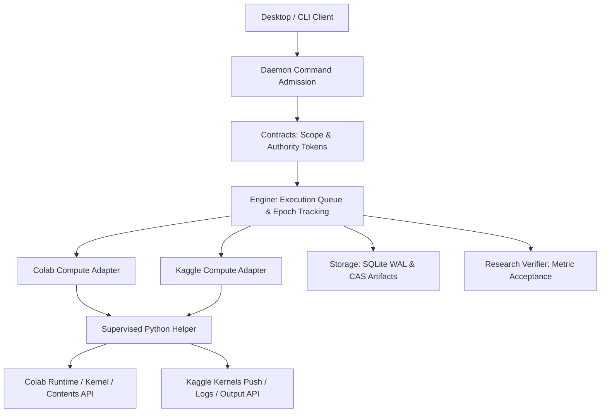

# Remote Compute: Colab and Kaggle Integration Architecture

> **Status:** Authoritative Architectural Specification  
> **Topic:** External compute provider adapters (Google Colab and Kaggle), execution lifecycle, identity invariants, and failure recovery  
> **Governing Boundaries:** `custos-contracts`, `custos-storage`, `custos-integrations`, `custos-engine`, and `workbenches/research`.

---

## 1. Architectural Decisions

1. **Cross-Backend Recovery:** Checkpoint relay and rented GPU lifecycles enforce that adapters cannot guarantee state continuity unless the execution engine has safely persisted and uploaded a validated checkpoint manifest to durable storage. Latest observed step is strictly distinct from latest protected step. Transitioning across backends spawns a new execution attempt with explicit compatibility evidence rather than live-migrating volatile RAM.
2. **Compute Adapter Classification:** Colab and Kaggle integrations reside squarely within `custos-integrations` as compute adapters. They are neither LLM model ports nor native coding harnesses. They provide raw execution environments: models suggest actions, but Custos retains authority, task tracking, and evidence ledgers.
3. **Core Behavioral Differences:**
   - **Google Colab:** Runtime assignment + persistent remote kernel + bidirectional file transfer. Optimized for interactive notebooks and supervised training jobs.
   - **Kaggle:** Versioned push of immutable script/notebook packages + streamed logs + output manifests. Optimized for isolated batch experiments.
4. **Data Reuse:** Directly reuses `AnalysisRecipe`, `EnvironmentSpec`, `ExecutionRecord`, notebook models, task leases, and CAS.

---

## 2. Upstream References & Source Boundaries

| Upstream Source | Audited Components | Excluded Assumptions |
|---|---|---|
| `google-colab-cli` | `client.py`, `runtime.py`, `contents.py`, `state.py`, auth CLI | Cloud accounts are not guaranteed specific GPU types; runtimes do not live indefinitely. |
| `kaggle-cli` | `KaggleApi.kernels_push`, `status`, `logs_stream`, `output` | Interactive kernel execution, SSH tunneling, and mid-run pauses are unavailable via this API. |

Both upstream tools are licensed under Apache-2.0. Custos invokes pinned Python helper implementations under supervised process wrappers rather than re-implementing full Jupyter/OAuth HTTP stacks in Rust.

---

## 3. Capability Matrix

| Operation | Colab Target | Kaggle Target | Activation Condition |
|---|---|---|---|
| **Probe Auth / Status** | Supported | Supported | Verified credentials + non-mutating status call. |
| **Allocate / Adopt Runtime** | Supported via VM assignment | Not supported (no persistent VM lease) | Valid account quota and explicit user consent. |
| **Attach Notebook / Kernel** | Supported via session ID | Not supported | Conformance tests pass. |
| **Execute Cell** | Supported | Not supported | Validated notebook cell digest and kernel epoch. |
| **Run Batch Script / Job** | Supported on active runtime | Supported via versioned push | Frozen recipe, dataset digest, and signed authority token. |
| **Stream Live Logs** | Supported via kernel output | Supported via versioned SSE | Bounded buffer, redacting secrets, cursor tracking. |
| **Collect Artifacts** | Supported via Contents API | Supported via versioned outputs | Manifest verification and SHA-256 validation. |
| **Interrupt Current Cell** | Supported (protocol-gated) | Not supported | Verified interrupt signal; never mapped to VM shutdown. |
| **Restart Kernel** | Supported | Not supported | Namespace reset; increments execution epoch. |
| **Release Runtime** | Supported via unassign | Not supported | Verified VM unassignment with provider receipt. |

---

## 4. Placement Across Canonical Platform Blocks

| Component | Canonical Crate | Physical Path | Responsibilities |
|---|---|---|---|
| **Pure Data** | `custos-contracts` | `platform/contracts/src/execution/` | Remote backend enums, hardware observation types, notebook identities. Zero I/O. |
| **Authority & Effects** | `custos-contracts` & `custos-engine` | `platform/contracts/` & `platform/engine/` | Allocation, upload, execution, and release tokens; exact payload hashes. |
| **Coordination** | `custos-engine` | `platform/engine/src/orchestration/` | Notebook execution queues, epochs, durable submission, and watchdog services. |
| **Concrete Adapters** | `custos-integrations` | `platform/integrations/src/compute/` | Supervised helper processes, stream parsing, error classification. |
| **Persistence** | `custos-storage` | `platform/storage/src/repositories/` | Execution bindings, resource observations, manifests, and crash recovery. |
| **Domain Semantics** | `workbenches/research` | `workbenches/research/src/` | Recipe validation, literature grounding, and evaluation criteria. |
| **API Wiring** | `apps/daemon` | `apps/daemon/` | Command admission, event broadcasting, and capability discovery. |
| **Desktop UI** | `apps/desktop` | `apps/desktop/ui/src/` | Notebook canvas, compute selector, run ledger, and artifact inspector. |

---

## 5. Five Disjoint Resource Identities

To prevent state corruption across remote and local boundaries:
1. **Notebook Document:** Stable document UUID, versioned cells, and outputs. Keyed independently from conversation session IDs.
2. **Kernel Binding:** Specific connection profile, remote kernel/session UUID, execution epoch, and active lease.
3. **Compute Lease:** Cloud account, instance/runtime UUID, allocated hardware shape, and cleanup obligations.
4. **Training Attempt:** Frozen recipe digest, external job UUID, dataset SHA-256, and parent attempt lineage.
5. **Checkpoint Bundle:** Content-addressed files and committed manifest digests in accessible durable storage.

---

## 6. Execution Lifecycle & Failure Recovery

| Failure Scenario | Ground Truth State | Recovery Action |
|---|---|---|
| **Allocation POST Timeout** | Assignment state uncertain | Query allocation API for assigned runtime before retrying POST. |
| **Kaggle Push Response Lost** | Submission state uncertain | Reconcile candidate versions via metadata query; avoid duplicate push. |
| **Cell Timeout / Socket Drop** | Execution possibly active on host | Reconnect to exact kernel session and epoch; do not re-send mutating code. |
| **Credential Expiry** | Authentication required | Re-authenticate original account; never retarget running job to new credentials. |
| **Daemon Process Crash** | Remote workload remains active | Startup scan reads durable active lease records and reconstructs observers. |
| **Colab Runtime Revoked** | Remote kernel and RAM lost | Increment execution epoch; prompt user to rerun necessary recipe cells. |
| **Partial Artifact Download** | Collection incomplete | Resume file staging from remote source; never re-execute the training job. |
| **Release Call Fails** | Teardown unresolved | Retain visible lease alert; poll until provider confirms instance deletion. |

---

## 7. Verification Invariants

1. **No Ambient Network Authority:** Submitting a notebook or batch job requires an explicit single-use `ExecutionPermit` bearing the SHA-256 hash of the payload.
2. **No Fictional State Continuation:** Switching compute backends resets kernel memory. Unsaved variables are never assumed to persist across environments.
3. **Evidence Integrity:** Raw stdout/stderr streams from remote execution are captured into CAS and linked to the corresponding `ExecutionRecord`.
