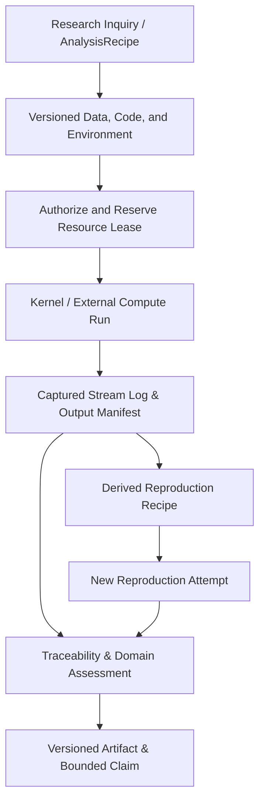

# Research Workbench: Systems Architecture and Execution Blueprint

> **Status:** Authoritative Architectural Specification  
> **Topic:** Scientific inquiry lifecycle, literature grounding, empirical notebook execution, and reproducible artifacts  
> **Governing Boundaries:** `custos-contracts`, `custos-storage`, `custos-integrations`, `custos-engine`, and `workbenches/research`.

---

## 1. Architectural Foundations and Design Goals

The Custos Research Workbench provides an end-to-end scientific development cycle:
$$\text{Inquiry} \longrightarrow \text{Evidence Retrieval} \longrightarrow \text{Empirical Analysis} \longrightarrow \text{Artifact Generation} \longrightarrow \text{Verification} \longrightarrow \text{Dissemination}$$

Users initiate tasks via conversational dialogue or structured recipes, directly manipulating research papers, data tables, Jupyter notebook kernels, figures, and technical reports. While sharing core execution engines, task supervisors, and resource registries with Coding and Assistant workbenches, Research maintains dedicated domain semantics for scientific rigor.

### Key Invariants
1. **Verifiable Ingestion:** Full-text documents and dataset versions are cryptographically hashed; metadata lookups are never conflated with full-text reading.
2. **Deterministic Provenance:** Artifacts distinguish between observed execution records (actual captured stdout/stderr and exit codes) and reproduction recipes (synthesized scripts).
3. **No Phantom Claims:** Claims cite exact passage anchors within immutable document revisions; claims without verifiable source spans are classified as `L0Ungrounded`.
4. **Isolated Kernel State:** Notebook kernels execute in sandboxed environments with bounded memory, explicit execution epochs, and separate interrupt control channels.

---

## 2. Core Research Workflows

| Workflow | Inputs | Usable Outputs | Completion Criteria |
|---|---|---|---|
| **Source Reading** | PDF / URL / repo document + question | Extracted claims, passage anchors, parse coverage report | Anchors resolved against immutable text spans; parse gaps recorded. |
| **Literature Matrix** | Topic, candidate papers, scope | Comparative evidence matrix, contradiction ledger | Deduplicated source ledger with uniform inclusion/exclusion criteria. |
| **Data Exploration** | Dataset reference + analytical query | Schema profile, transform scripts, exploratory figures | Raw inputs preserved; transformations executed via isolated kernel. |
| **Empirical Baseline** | Dataset splits, model spec, token/compute budget | Versioned code/config, run records, metrics, figures | Uniform train/val splits; negative and failed runs preserved. |
| **Result Reproduction** | Artifact / prior run / paper claim | Replication attempt, metric delta report | Environment differences and missing inputs explicitly identified. |
| **Figure Refinement** | Figure artifact + visual annotations | Code patch, newly rendered figure version | Presentation styling isolated from semantic data normalization changes. |
| **Research to Coding** | Validated method / code prototype | Engineering brief, benchmark specs | Domain assumptions translated into enforceable compiler/unit tests. |
| **Research to Assistant** | Findings / executive summary | Outbox digest, structured briefing cards | Limitations, caveats, and cryptographic receipts preserved. |

---

## 3. Research Domain Data Model

| Domain Model | Physical Location | Core Responsibilities |
|---|---|---|
| `SourceRevision` | `custos-contracts` | Canonical identity, SHA-256 digest, acquisition route, parser version, access license. |
| `DatasetVersion` | `custos-contracts` | Storage URI, tabular schema, row counts, partition manifests, fingerprint method. |
| `AnalysisRecipe` | `custos-contracts` | Executable specification defining how an empirical experiment is run. |
| `EnvironmentSpec` | `custos-contracts` | Python/R runtime version, locked dependencies, container digests, hardware constraints. |
| `KernelSession` | `custos-contracts` | Stateful compute lease, notebook binding, execution epoch, active status. |
| `ExecutionRecord` | `custos-storage` | Historical observation of process execution, exit codes, CAS log URIs, produced artifacts. |
| `ArtifactVersion` | `custos-storage` | Immutable digest, producing task revision, MIME type, schema, completeness flag. |
| `ResearchObservation` | `custos-storage` | Measured metric values, error bounds, estimator metadata, dataset split reference. |
| `VerificationClaim` | `custos-contracts` | Atomic scientific statement, passage span anchor, verifier oracle identity, status. |
| `ReviewFinding` | `custos-storage` | Discrepancy finding, methodological check, severity tier, resolution state. |

---

## 4. Kernel Execution & Environment Lifecycle

1. **Queueing & Epochs:** Each kernel session maintains an ordered execution queue. Every code cell submission receives an operation ID, cell ID, code hash, and monotonic execution epoch.
2. **Isolated Concurrency:** Distinct notebooks do not share in-memory namespace by default. Concurrent agent modifications to the same kernel session are serialized by the engine.
3. **Out-of-Band Control:** Kernel interrupt (SIGINT) and restart mechanisms operate over separate control channels, preventing deadlocks when cell execution hangs.
4. **Rich Output Ingestion:** Cell outputs are captured as structured MIME bundles (text/plain, image/png, application/json) and archived to CAS. Truncation flags are raised if byte caps are exceeded.

---

## 5. Architectural Boundaries across Platform Crates

| Layer / Crate | Repository Path | Architectural Responsibilities |
|---|---|---|
| **Contracts** | `platform/contracts` (`custos-contracts`) | Pure scientific data models, claim enums, execution states, and authority tokens. Zero I/O. |
| **Storage** | `platform/storage` (`custos-storage`) | SQLite persistence for sources, claims, execution records, annotations, and CAS manifests. |
| **Integrations** | `platform/integrations` (`custos-integrations`) | Concrete Jupyter kernel bridges, PDF/text parsers, SSH host clients, and external connectors. |
| **Engine** | `platform/engine` (`custos-engine`) | Task coordination, kernel lease lifecycles, admission watchdogs, and evaluation gates. |
| **Workbench** | `workbenches/research` | Domain-specific research flows, literature ingestion, recipe templates, and citation rubrics. |
| **Desktop UI** | `apps/desktop/ui/src/components/workbenches/research` | Paper reader, notebook canvas, figure annotator, and artifact comparison views. |

---

## 6. Verification & Quality Gates

The Research Workbench is validated through automated tests and strict quality gates:
- **Passage Anchor Verification:** Ensures cited spans match source texts byte-for-byte; flags stale anchors upon document updates.
- **Traceability Review:** Verifies that figures and tabular numbers in generated reports trace directly to an `ExecutionRecord` in CAS.
- **Reproducibility Matching:** Runs verification suites comparing re-executed metrics against original baseline bounds under matching environment revisions.
