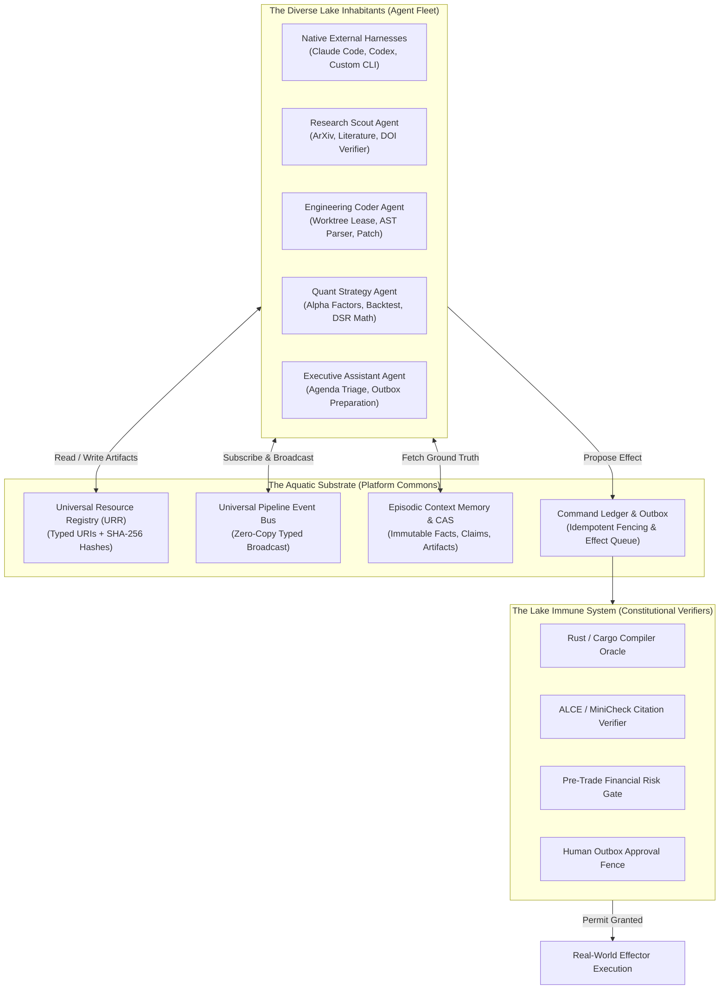
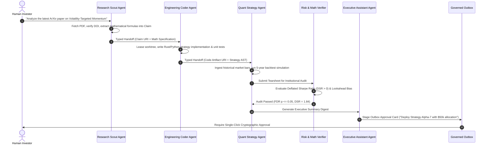

# SADE Agent Lake Ecosystem: The Multi-Agent Living Commons

> **Status:** Authoritative Product & Ecosystem Design Specification.
> **Metaphor & Product Vision:** **"Ao Hồ SADE" (The Living Agent Lake)** — An open, intelligent, governed habitat where diverse, heterogeneous agents (native harnesses, internal LLM workers, specialized domain scouts, and independent verifiers) are released together, discover shared resources, cooperate through typed handoffs, and foster each other's evolutionary development.
> **Cross-References:** [`sade-foundations.md`](sade-foundations.md), [`sade-design-and-supervision.md`](sade-design-and-supervision.md), [`cognitive-fabric-and-orchestration.md`](cognitive-fabric-and-orchestration.md), [`Custos.md`](../../Custos.md).

---

## 1. The Core Philosophy of the Agent Lake (Triết Lý Ao Hồ SADE)

An agent operating in isolation is a brittle, single-purpose tool. Conversely, multi-agent frameworks that rely on unconstrained, noisy group chat quickly devolve into chaos, context window exhaustion, and hallucination loops.

The **SADE Agent Lake** rejects both extremes. It conceives multi-agent collaboration as a **living, governed ecological commons**:
- The **"Water" (Substrate):** A shared, single-writer state substrate composed of the **Universal Resource Registry (URR)**, the **Pipeline Event Bus**, **Content-Addressable Storage (CAS)**, and **Episodic Memory**.
- The **"Inhabitants" (Agent Fleet):** Heterogeneous agent species—native external CLIs (Claude Code, OpenCode), internal LLM workers, specialized domain scouts (Research, Coding, Quant, Assistant), and constitutional verifier oracles.
- The **"Symbiosis" (Cooperation):** Autonomous, typed, schema-validated handoffs where the verified output of one agent becomes the immutable input for another.
- The **"Ecological Guardrails" (Safety & Immune System):** Strict resource carrying capacities (token/GPU quotas), single-use cryptographic `ExecutionPermit` gates, and an unbypassable human approval fence for irreversible real-world side effects.



---

## 2. Pillar I: The Aquatic Substrate (Môi Trường Nước)

In an ecological lake, fish survive and communicate because of the water medium. In SADE, the substrate provides four foundational capabilities:

### 2.1 Universal Resource Registry (URR)
Every resource produced or consumed by any agent receives a globally unique, content-addressed URI:
$$\text{URI} = \mathbf{urr://}[\text{component\_id}]/[\text{resource\_kind}]/[\text{id}]\#[\text{sha256\_digest}]$$

- **Zero-Copy Referencing:** When the Research Scout extracts a claim from an academic paper, it does not paste 20 pages of text into a prompt. It publishes the claim into the URR as `urr://research/claim/clm_8f9a2#e3b0c44...`. Any other agent (Coding or Quant) references this URI directly.
- **Physical Provenance:** The URR table ([`0044_universal_resource_registry.sql`](file:///Users/mac/Project/AgentHub/Custos/platform/storage/migrations/0044_universal_resource_registry.sql)) records MIME types, physical storage paths, byte sizes, and parent lineage JSON.

### 2.2 Universal Pipeline Event Bus (`PipelineEventBus`)
An in-process, typed, broadcast distribution system ([`platform/runtime/src/event_bus.rs`](file:///Users/mac/Project/AgentHub/Custos/platform/runtime/src/event_bus.rs)) connecting all agents in the lake:
- `market_bar_closed`: Dispatched when a new OHLCV bar is validated.
- `code_ast_changed`: Dispatched when code is parsed and AST is updated without syntax errors.
- `science_claim_verified`: Dispatched when a scientific claim is grounded with source citations.
- `agent_outbox_dispatched`: Dispatched when an action is executed through the governed outbox.

Any agent dropped into the lake can attach a subscriber and react asynchronously to ecosystem developments.

### 2.3 Content-Addressable Storage (CAS) & Context Memory
Expensive artifacts (compiled binaries, embeddings, AST symbol tables, backtest tearsheets, LoRA weight checkpoints) are stored by their SHA-256 hash. Once computed by one agent, they are immediately available to all other agents with zero re-computation cost.

---

## 3. Pillar II: Heterogeneous Agent Inhabitants (Đa Dạng Quần Thể Agent)

The SADE Agent Lake welcomes any agent implementation, categorized into four distinct ecological niches:

```
┌────────────────────────────────────────────────────────────────────────────────────────┐
│                        THE FOUR NICHES OF THE SADE AGENT LAKE                          │
├────────────────────────────────────────────────────────────────────────────────────────┤
│ 1. NATIVE EXTERNAL HARNESSES (Cá Di Cư - Migratory Species)                            │
│    - Claude Code, Codex, Antigravity, OpenCode, or custom CLI scripts.                │
│    - Drop-in via AgentRuntimePort and A2A AgentCard discovery.                         │
│    - Sandboxed inside leased worktrees; transparently monitored with ExecutionReceipts.│
├────────────────────────────────────────────────────────────────────────────────────────┤
│ 2. GOVERNED INTERNAL WORKERS (Cá Bản Địa - Native Inhabitants)                         │
│    - Custos-native reasoning loops running Claude 3.5 Sonnet / Haiku or local models.  │
│    - Native integration with TaskRuntime, context compaction, and budget tokens.       │
├────────────────────────────────────────────────────────────────────────────────────────┤
│ 3. SPECIALIZED DOMAIN AGENTS (Cá Chuyên Môn - Specialist Niches)                       │
│    - Research Scout: Ingests ArXiv PDFs, extracts grounded claims, verifies DOIs.     │
│    - Engineering Coder: Generates patches, manages worktrees, runs test suites.        │
│    - Quant Analyst: Runs alpha factor discovery, computes Deflated Sharpe Ratios.     │
│    - Executive Assistant: Triages inbox, manages calendars, prepares approval cards.   │
├────────────────────────────────────────────────────────────────────────────────────────┤
│ 4. CONSTITUTIONAL VERIFIER ORACLES (Hệ Miễn Dịch - The Immune System)                  │
│    - Independent, non-generative evaluators: Cargo Compiler, ALCE Citation Oracle,    │
│      Lookahead Bias Detector, Pre-Trade Risk Gate, Security Linter.                    │
│    - Act as the objective gatekeepers between agent proposals and task completion.     │
└────────────────────────────────────────────────────────────────────────────────────────┘
```

---

## 4. Pillar III: Cross-Domain Symbiosis & Autonomous Handoffs

The true power of the Agent Lake is **cross-domain collaboration without manual human babysitting**. Agents collaborate through structured, schema-validated handoffs:

### 4.1 Symbiotic Pipeline 1: Science $\rightarrow$ Code $\rightarrow$ Quant $\rightarrow$ Human
How a scientific paper becomes a live trading strategy across four specialized agents:



### 4.2 Symbiotic Pipeline 2: The Self-Healing Repair Loop ($T_6$ Evaluator-Optimizer)
When an agent encounters a failure, it does not give up; peer agents in the lake provide active diagnosis and repair:
1. **Generation:** Coder Agent drafts a code patch.
2. **Evaluation:** Compiler Verifier intercepts and executes `cargo check`. Compiler fails with error `E0308 (mismatched types)`.
3. **Diagnosis:** Verifier extracts the exact AST error range and attaches it to the task continuation packet.
4. **Repair:** Coder Agent receives the structured error envelope, adjusts types, and re-submits.
5. **Resolution:** Loop terminates strictly when the Compiler Verifier emits an `ExecutionReceipt` with exit code 0.

---

## 5. Pillar IV: Ecological Governance & Anti-Pollution

A shared lake must not become a toxic swamp. If an agent goes rogue (hallucinating facts, running infinite loops, or attempting unauthorized network calls), the SADE ecosystem enforces four biological defenses:

```
┌────────────────────────────────────────────────────────────────────────┐
│                    THE FOUR ECOLOGICAL DEFENSES                        │
├────────────────────────────────────────────────────────────────────────┤
│ 1. ANTI-POLLUTION (Completion Gate & Zero-Mock Epistemology)          │
│    - No agent may publish a "Fact" into shared memory without physical│
│      evidence (ExecutionReceipt, compiler exit code 0, citation link). │
│    - CompletionGate categorically rejects self-reported completion.    │
├────────────────────────────────────────────────────────────────────────┤
│ 2. CARRYING CAPACITY (Resource Quotas & Admission Coordinator)         │
│    - Token budget limits, maximum step quotas, GPU lease timeouts.     │
│    - If an agent enters an infinite loop, its budget headroom hits 0   │
│      and it is gracefully suspended by TaskRuntime.                    │
├────────────────────────────────────────────────────────────────────────┤
│ 3. CONSTITUTIONAL AUTHORITY GATE (Single-Use ExecutionPermits)         │
│    - Agents cannot execute tools or write files directly.              │
│    - Every action requires an ExecutionPermit cryptographically bound  │
│      to the SHA-256 hash of the canonical payload.                     │
├────────────────────────────────────────────────────────────────────────┤
│ 4. THE IRREVERSIBLE EFFECT FENCE (Human-in-the-Loop Outbox)            │
│    - Sending real capital orders, emailing external clients, or        │
│      deploying to production CANNOT be performed autonomously.         │
│    - Must be staged as an Outbox proposal awaiting human approval.     │
└────────────────────────────────────────────────────────────────────────┘
```

---

## 6. Pillar V: Continuous Collective Evolution (Tiến Hoá Quần Thể)

An Agent Lake is not static; it grows smarter over time as agents accumulate shared knowledge:

1. **Recipe & Skill Spawning:**
   - When an agent develops a novel, highly effective multi-step workflow, it exports the DAG as a declarative YAML recipe into `workbenches/[domain]/recipes/`.
   - The recipe is immediately registered into the universal catalog and becomes an executable capability available to all other agents in the lake.
2. **Offline Trajectory Distillation & Policy Optimization:**
   - Every completed task trajectory, candidate evaluation, and verification outcome is recorded in the SQLite history ledger.
   - Offline evaluators analyze which model or harness solved subproblems at the highest quality-per-dollar ratio, continuously refining the heuristic estimates of the **OI Planner** ([`platform/runtime/src/oi/estimator.rs`](file:///Users/mac/Project/AgentHub/Custos/platform/runtime/src/oi/estimator.rs)).
3. **Collective Memory Synthesis:**
   - As scientific claims are grounded and codebases are indexed into AST symbol graphs, the shared Context Memory expands, allowing new agents dropped into the lake to start from a foundation of verified truth rather than blank system prompts.

---

## 7. Concrete Verification & Acceptance

The SADE Agent Lake architecture is strictly verified against the workspace Quality Gates:
- `schema_compat.rs`: Verifies that all workbench manifests, capability descriptors, and canonical schemas exist and parse cleanly.
- `canvas-smoke.mjs`: Validates 51 UI regression scenarios ensuring screen isolation, multi-agent tab preservation, and live token observers.
- `vertical_slice.rs`: Enforces authority permits, single-use token consumption, and evidence completion gate truthfulness.
