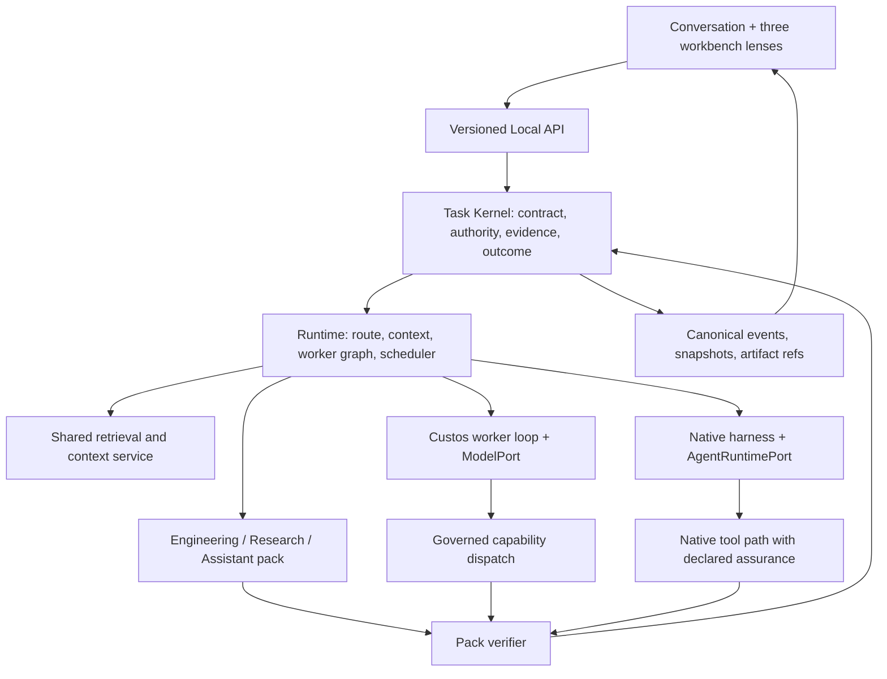
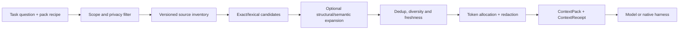

# SADE agent system and three-workbench interaction contract

**Status:** target architecture with an audited current-state map. A named module, pane, or upstream feature is not proof of an end-to-end capability. The product intent is defined in [Custos.md](../../Custos.md); the physical code map is [codebase-architecture.md](../development/codebase-architecture.md).

## 1. Product contract

Custos offers one supervised work environment with three lenses: Copilot, Coding, and Research. A person can begin in any lens, continue the same Task in another lens, and inspect which sources, model or harness, workers, effects, and evidence produced an outcome. The system optimizes accepted work per cost within the user's scope, quality threshold, provider pin, privacy, and time budget.

The reusable unit is a **Task with versioned context and outcome**, not a chat transcript or a specific agent session. Each lens has its own session list and remembers its last selected conversation. A person may explicitly expose an existing complete session in another lens or create a linked continuation there. A short read-only question may stay ephemeral. Starting a durable run, write, experiment, background job, or outbound action materializes the Task contract. The UI never treats switching lenses, opening a pane, or restoring layout as permission to execute.

The diagram shows responsibility, not a claim that every native tool is mediated. Each action reports `custos-mediated`, `provider-governed`, `observe-only`, or `unknown` from its tested execution path.

## 2. Five distinct things called an agent

| Concept | Meaning | Owner | Example |
|---|---|---|---|
| Model endpoint | One inference request, stream, usage and tool-call proposal | `ModelPort` contract; concrete provider adapter | Local coder model, cloud model, model proxy |
| Custos worker | Custos-owned reasoning/tool loop using a model endpoint | `custos-runtime/src/agent/` | Coding implementer using a local coder model |
| Native harness | External program owning its own loop and possibly its tools | `AgentRuntimePort`; adapter in `custos-adapters/src/harness/` | Codex, Claude Code, OpenCode |
| Worker role | A bounded job in one Task's execution graph | Workflow runtime and pack recipe | Read-only repo scout, claim reader, verifier |
| Remote agent | Separate identity and trust domain reached over a network protocol | Optional A2A adapter | Independently operated specialist service |

The user chooses a model or a harness in the same executor picker, with a visible type label and capability disclosure. Selecting a local coding model creates a Custos worker; it does not magically turn the model endpoint into an autonomous harness. A subagent is a child `WorkerRun` with a smaller source scope, tool set, budget, deadline, and output contract. In-process child workers do not require A2A. A2A is only for a truly remote agent boundary.

### Worker lifecycle

`proposed → admitted → queued → running → waiting_human | reconciling → observed_terminal → verified | limited` is the conceptual lifecycle. The current FSM/types must be reused and extended only after contract audit. `observed_terminal` says the worker finished; the Task passes only after criterion-specific verification. A worker launched in an uncertain external window is reconciled before any retry. A child worker cannot enlarge its parent's grant, source scope, egress, or aggregate budget.

Every worker has: `task_id`, `run_id`, `worker_run_id`, parent worker if any, role, pack, input refs and snapshot, model/harness and actual version, allowed capabilities, write set, deadline, budget reservation, output schema, event cursor, assurance, and terminal observation. A Task may run one direct worker, a sequential chain, or a bounded graph. Fan-out needs independent inputs or disjoint writes, a declared join rule, and a measured benefit; it is never the default for a simple chat turn.

### Agent interaction visible to the human

The Task strip shows active worker count, actual executor, locality, spend and unresolved attention. Opening a worker card shows its instruction/job summary, source scope, workspace or dataset, tools, progress events, output artifact, and what it cannot see. The person can ask a follow-up to the parent, steer a child only if that harness really supports steering, cancel a run with a separate `requested` versus `observed stopped` state, or request a new candidate. A worker's question, approval request, crash, unknown effect, or blocked join appears in the attention queue with a `Reveal` action that opens the precise pane and object.

## 3. Shared retrieval and context service

“RAG hub” means a shared **logical retrieval and context pipeline**, not a new crate, MCP server, graph database, or always-on agent. Its public job is to turn a scoped question plus source inventory into a versioned `ContextPack` and `ContextReceipt`. The receipt states what was selected, omitted, redacted, stale, or unavailable; it also records the actual egress target. No retrieved content becomes an instruction or grant.

The cheap path is exact IDs, symbol/path/DOI/contact lookup, and lexical search. AST/reference expansion, embeddings, reranking, or an S1 judgment are optional decisions with measured recall, latency and cost. S1 can rank candidates, detect ambiguity, or recommend another retrieval pass; policy code checks scope, privacy, source freshness and egress. S2 uses the resulting material to reason; a citation or source locator must be reopenable independently of the answer.

| Pack recipe | Canonical source and useful retrieval | Output and UI proof |
|---|---|---|
| Coding | Git HEAD + selected dirty bytes, worktree/index generation, exact path/symbol/trace, references and tests | Source spans and base hash; code map, omissions, changed-source warning |
| Research | DOI/URL/PDF version, page/section/table/figure spans, dataset/method/run refs, counterevidence | Passage viewer, parse coverage, claim relation and source version |
| Assistant | User-authorized notes, stable contact/event IDs, timestamped connector snapshot and personal preferences | Identity card, freshness, privacy/egress and exact payload preview |

The same source registry and context compiler support all three packs, while pack recipes supply selection and verifier obligations. The service must not collapse a research claim into a fact or choose a recipient solely from an untrusted document. Its indexes are rebuildable projections; canonical source records, artifacts and evidence remain under Task/persistence ownership. Repo Intelligence is a Coding retrieval subsystem, usable by both a Custos worker and a native harness through an admitted capability. It is not inherently an agent or MCP server.

### Retrieval modes and budgets

`none` for context already supplied; `single` for one scoped lookup; `iterative` when source coverage is insufficient; `parallel-read` for independent corpora; `abstain` for inaccessible or contradictory evidence. The route records why it expanded search, the maximum calls/tokens/time, and a stop reason. Native harnesses may have their own retrieval; Custos records the sources it passed in and what it can observe, and labels hidden retrieval or tool activity accordingly.

## 4. Pack-owned worker recipes

Pack manifests describe jobs and evidence, while the runtime owns scheduling and the kernel owns authority and completion. A skill is a reusable bounded operation/recipe with inputs, outputs, capability request, resource estimate, and provenance obligations. A skill may call deterministic code or a model; that does not make it an autonomous agent. An autonomous specialist needs a worker role, lifecycle, event stream and budget.

| Pack | Direct path | Optional specialist workers | Acceptance and stop condition |
|---|---|---|---|
| Coding | One pinned model/harness reads repo, explains or proposes patch | Read-only locator, implementer in owned worktree, independent verifier/reviewer | Anchors reopen; patch base/scope valid; trusted behavior tests or review tied to criterion. Stop on stale base, write conflict or missing oracle. |
| Research | One reader answers from a versioned passage | Independent corpus scouts, claim extractor, contradiction finder, experiment worker, reviewer | Locator, extraction and semantic support are separate; run inputs/environment/output lineage visible. Stop at parse gap, contradictory support or unverifiable claim. |
| Assistant/Copilot | One conversational worker answers or drafts | Identity resolver, schedule planner, personal recall, bounded automation worker | Stable recipient/time and exact effect receipt. Draft never means sent; timeout after dispatch is uncertain and requires reconciliation. |

The pack can suggest a worker graph. OI chooses among admissible direct/single/bounded-graph candidates using expected quality, total cost, latency, risk and uncertainty. Hard user constraints filter before optimization. S1 may supply typed, abstainable signals; it cannot issue permits, mark claim support as true, or force an expensive graph. Meta analyzes traces offline and proposes a new policy version after evaluation. The strongest S2 model remains selectable and pinnable; no S1 shortcut silently downgrades it.

## 5. Desktop interaction contract

The desktop has one quiet, typography-first shell. The three lenses are recognized by icon, title, resource set, and one restrained accent; no separate neon theme or decorative AI dashboard. The conversation remains a persistent pane or dock. The currently bound Task and the destination of the next message are visible near the composer. Resource panels use daemon `resource_id` and `supported_operations`; unavailable actions are disabled with a reason.

| Surface | What the human sees | What an action does |
|---|---|---|
| Global rail | Copilot, Coding, Research icons with tooltip and keyboard shortcut | Changes lens/layout only; retains Task and conversation |
| Task strip | Goal, Task state, run/worker count, actual executor, budget, source freshness, attention count | Opens precise Task or attention detail |
| Conversation | Turns with Task binding; selected source/artifact chips; agent event summaries | Sends a turn in the selected Task or an explicit `No Task` conversation |
| Resource canvas | Typed source, code, diff, notebook, artifact, draft, calendar or terminal pane | Opens an existing object; pane restore has no side effect |
| Inspector | Context receipt, worker graph, criteria/evidence, effect history, cost and unknowns | Reveals provenance and permits a scoped correction/waiver command |
| Attention queue | Questions, exact approvals, conflicts, uncertain effects and completed outcomes | Reveal, answer, approve exact payload, reject, or acknowledge separately |

### Three concrete journeys

1. **Copilot → Coding:** user asks about a bug in chat; source chips show read material. `Work on this in Coding` opens the lens with the same Task and session. `Create patch step` previews repo, allowed paths, behavior criterion, executor and cost; acceptance creates a new workflow obligation. Agent edits in an owned workspace, then diff/tests/evidence appear. `Apply` checks base and scope; `Push` is a distinct effect.
2. **Research → Coding:** user selects two passages, a claim and an experiment result. `Implement selected findings` previews exact source/claim IDs, caveats, stale items and redactions. A linked continuation creates an Engineering brief and can open Coding without launching a worker. The source viewer and original chat remain accessible. Coding's model receives only selected, permitted refs, not the entire research transcript or a mail grant.
3. **Coding/Research → Copilot:** user selects an accepted patch summary or reviewed brief and asks for an update to a colleague. Copilot drafts, resolves the stable recipient, displays exact body/attachments and privacy route, then asks approval to send. Editing any payload byte invalidates prior approval. `Sent`, `failed`, and `uncertain` come from receipt/reconciliation, not the agent's prose.

The switcher must distinguish `Open lens`, `Open full chat in…`, `Continue as linked chat`, `Add pack step`, and `Fork child Task`. `Open lens` restores that lens's last conversation. `Open full chat in…` adds the existing session to the destination lens's history and opens the same canonical journal, without rewriting original turns or changing the Task contract. `Continue as linked chat` creates a destination session and a lineage manifest; the source timeline can be displayed in full as read-only context. The destination model receives only what the context compiler admits within its budget. The UI reports delivered turn IDs, summaries, omitted bytes, redactions and unsupported native hidden state; “full history visible” must not be phrased as “every token sent to the model.” `Add pack step` and `Fork child Task` write Task lineage and obligations separately. No transfer copies an active permit.

Research notebook code is for exploring data, reproducing methods and demonstrating an analysis. Sending a Research finding to Coding creates an Engineering brief with selected code/data/claim/artifact references; it does not apply notebook cells as a repository patch. The Coding agent validates the target repo and behavior criterion before implementation.

### Empty, error and recovery states

Every pane can show `loading`, `available`, `degraded`, `unavailable`, `stale`, or `offline`, with a meaningful next action. An empty research library offers `Add source`; an absent repo offers `Choose workspace`; a missing connector offers `Connect account` or `Work with a draft`; an unsupported native steer control is hidden. A daemon disconnect keeps the last rendered data labeled stale and blocks mutations until resync. On reconnect, the client resumes by event cursor and command ID, then reconciles pending attempts before offering retry. Closing a pane or switching lenses never cancels a run.

## 6. Backend/API slices and ownership

| Responsibility | Existing home | Target contract and current gap |
|---|---|---|
| Task, criteria, authority, evidence | `custos-domain`, `custos-core` | Canonical IDs/revisions and gates; no pack or model writes success directly. |
| Model and harness contracts | `custos-provider`; `custos-core/src/contracts/harness.rs` | One inference attempt versus an autonomous harness; capability/version/assurance per actual path. |
| Agent loop, worker graph, OI | `custos-runtime/src/agent`, `workflow`, `oi` | Persisted child-worker ownership, bounded graph and join; no second agent-loop authority. |
| RAG/context and Repo Intelligence | `custos-runtime/src/context`; pack recipes in `custos-packs` | Versioned inventory, permission filter, retrieval, ContextPack/Receipt, freshness and cost; existing lexical compiler is a component, not the full service. |
| External reads/effects | `custos-adapters` | Provider, harness, filesystem, MCP, browser, connector and notebook adapters with real capability discovery and receipt semantics. |
| State and recovery | `custos-persistence` | Task/Run/Attempt, source/artifact/evidence, event cursor, worker claim and uncertain effect reconciliation. |
| API composition | `custos-daemon`, `custos-bridge`/SDK | Stable command/query/event DTOs; daemon binds actor and resolves workspace/harness; client never writes DB. |
| Experience | `ui/desktop`, thin host `custos-app` | Shared shell, three lens presets, resource/attention registry, Task binding and explicit handoffs. |

An internal retrieval query is a runtime service call, not MCP. MCP is an adapter for external tools/data and may expose a reviewed subset outward. ACP is an editor-to-agent integration option. A2A is a remote-agent boundary. None of these protocols is required to move from Copilot to Coding or to run local subagents. The protocol hub only provides connection discovery, lifecycle, identity and conformance at those boundaries; Task authority remains in the kernel.

### Proposed commands and projections (map onto existing Local API before adding schema)

`GetTaskWorkspace(task_id)`, `ListResources(workspace_id)`, `WatchEvents(after_seq)`, `CompileContext(task_id, selected_refs, destination_pack, dry_run)`, `StartRun(task_id, workspace_id, executor_id, expected_revision)`, `GetWorkerGraph(run_id)`, `ContinueWithSelectedRefs(source_session_id, task_id, destination_pack, ref_ids, mode)`, `ApproveExactEffect(intent_digest)`, and `GetOutcome(task_id)` describe behavior, not a declaration that these route names exist. Reuse existing DTOs and commands wherever semantics already match. Each write has actor, `command_id`, expected revision and idempotent result; reads include freshness/version. The UI does not synthesize a successful run from a completed stream.

## 7. Verified state of this checkout

| Capability | Code evidence | Assessment |
|---|---|---|
| Three lens navigation and many resource panes | `ui/desktop/src/app/studio/page.tsx`, `OrcaTabbedContainer.tsx`, Research and Engineering pane folders | Present as UI; resource operations now follow daemon descriptors. Session history was previously one shared list and explicit full-session transfer was absent; the per-lens projection is a separate implementation gate. |
| Task-backed native launch | `custos-runtime/src/workflow/task_runtime.rs`, daemon `api.rs`, desktop `AgentsWorkbenchPane.tsx` | Present for the current native path; launch completion is not Task acceptance. |
| Custos-owned worker loop | `custos-runtime/src/agent/runtime_port.rs` and `machine.rs` | Code exists and a governed harness is composed. Its full multi-turn/tool/evidence parity with native harnesses is not established by those files. |
| Retrieval and Repo Intelligence | `custos-runtime/src/context/compiler/compiler.rs` and `repo_intelligence/` | Lexical token packing and repo analysis exist; a measured, versioned cross-pack RAG/context service is still target work. |
| Pack specialization | `custos-packs/src/{engineering,research,assistant}` | Manifests/skills and some verifiers exist; several declared features are not proven production flows. |
| Research workbench | Literature/Claims/Notebook/Runs/Synthesis/Artifact panes and daemon research API | Partial real surfaces; provenance completeness, claim support and sessionful notebook semantics need per-path proof. |
| Native OpenCode lifecycle | `custos-adapters/src/harness/opencode.rs` | Bounded CLI path exists. Production server events, continuation, steer and cancel are not connected; capability profile must say so. |
| Parallel worktree integration | Workspace and lease modules, existing implementation plan | Target: durable ownership, conflict-safe integration, crash recovery and user-visible candidate comparison. |

The large Goose-derived `custos-runtime/src/engine/` tree is not exported from runtime `lib.rs`. It is an inventory for selective study, not a production agent loop or evidence that its subagent machinery is mounted. The local `../opencode` checkout is an older Go fork and is not interchangeable with the current OpenCode binary/API used by Open Science. Review pinned upstream code and conformance fixtures before adapting transport behavior.

## 8. Build sequence and release gates

1. **One trusted path per pack:** Coding repo explanation/patch, Research source question/claim, Copilot draft. Each starts from chat, binds a Task as needed, returns reopenable artifact/criterion state and resumes after daemon restart.
2. **Context receipt:** scope/freshness/egress filtering, source IDs and omissions across all three pack recipes. Compare exact/lexical baseline to optional AST/semantic/S1 expansion on accepted outcomes and cost.
3. **Worker graph:** one child read-only scout, persisted ownership and events, bounded budget, explicit join/unknown. Then add worktree-isolated writer candidates and human comparison. Do not infer internal delegation safety from a prompt or from an A2A name.
4. **Research depth:** source/passages/claim support, experiment attempt and artifact lineage, review card and selected handoff. A citation with wrong support and a failed run with partial output are mandatory fixtures.
5. **Assistant effects:** stable identity, exact draft, fake connector outbox, uncertain reconciliation, then real connector. A draft and an externally observed send have different status and UI copy.
6. **Workbench continuity:** switch lens without mutation; add step/fork with manifest; reopen original chat and exact source/artifact; compare accepted result, spend and human time against a pinned single-worker baseline.

For every gate report what is implemented, exercised, degraded or unavailable. A screenshot or compiled module is not an end-to-end test. Performance claims use task mix, model, hardware, source version, cold/warm cache, paid usage and unknown spend.

## 9. Primary source anchors and interpretation

- [Orca orchestration](https://github.com/stablyai/orca/blob/main/docs/site/content/docs/cli/orchestration.mdx) describes Run/Task/Dispatch/worker supervision; [Orca worktrees](https://github.com/stablyai/orca/blob/main/docs/site/content/docs/model/worktrees.mdx) shows checkout-scoped resources and candidate work. Custos adapts those interaction patterns to its own Task/authority/evidence contracts.
- [OpenCode agents](https://opencode.ai/docs/agents/) describes primary agents, subagents and tool permissions. It is evidence for OpenCode's interface, not proof that Custos currently observes or mediates every native child action.
- [Open Science repository](https://github.com/ai4s-research/open-science/blob/master/README.md) describes notebook, run, provenance and reviewer surfaces. The pinned [local source study](../development/open-science-source-study.md) identifies what its code actually records and what is best effort.
- [The original RAG paper](https://arxiv.org/abs/2005.11401) motivates combining a generator with retrieved material. Custos's scope, provenance, freshness and per-pack recipes are product design decisions requiring its own evaluation.
