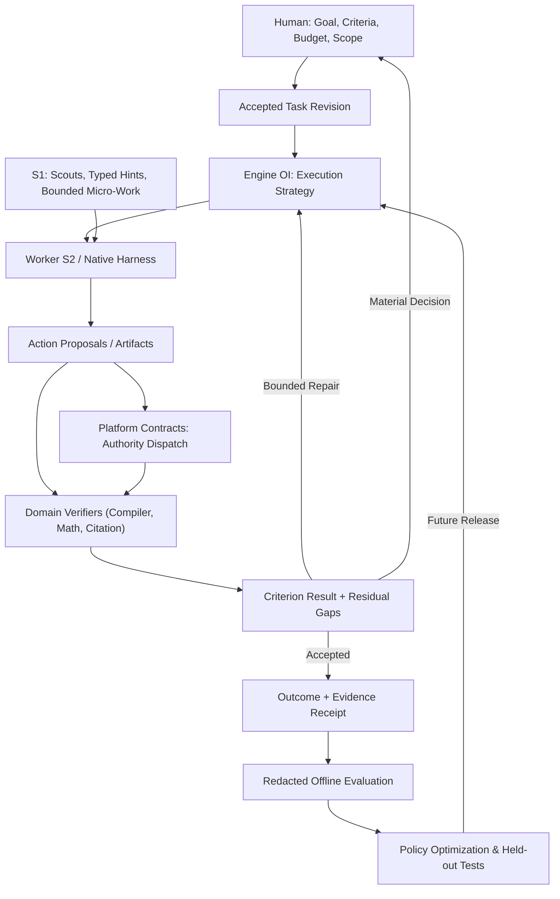

# Custos SADE: Identity, Supervision Mechanics, and Architectural Invariants

> **Status:** Authoritative Architectural & Systems Supervision Specification  
> **Topic:** Supervised Agent Development Environment (SADE) identity, human-in-the-loop governance, and outcome economics  
> **Governing Boundaries:** `custos-contracts`, `custos-storage`, `custos-integrations`, `custos-engine`, and `workbenches/*`.

---

## 1. Definition and Value Proposition

**Custos is a local-first Supervised Agent Development Environment (SADE): an environment where humans and autonomous agents collaboratively research, construct, verify, and automate intellectual workflows, with operational economics optimized for verified task completion.**

Key conceptual distinctions:
- **Development:** Encompasses software engineering, quantitative research, and scientific discovery. The Assistant workbench binds execution with calendars, communications, and bounded personal operations.
- **Supervision:** Denotes clear comprehensibility, steering, and attribution of responsibility for all actions. It does not mandate micro-approving every individual tool call.
- **Agent Workspace:** The human-agent interaction surface; SADE represents the unified system architecture.

The core identity of Custos is an **evidence-supervised adaptive execution runtime**: allowing expansive reasoning within delegated authority, eliminating unnecessary repetitive steps, escalating consequential operations to the human operator, and resuming cleanly from physical state.

---

## 2. Research-Derived Decisions

| Reference Source | Empirical Lesson | Custos Architectural Invariant |
|---|---|---|
| [Orca worktrees & CLI](https://www.onorca.dev/docs/model/worktrees) | Development environments require real terminals, diffs, and worktrees, not just conversational chat. | Native CLI and Desktop hosts share 100% parity across workspace and run semantics. |
| [Orca orchestration](https://www.onorca.dev/docs/cli/orchestration) | Tracked orchestration is foundational infrastructure. | Custos introduces structured criteria, task lineage, and authority tokens via `custos-contracts`. |
| [Goose subagents](https://github.com/aaif-goose/goose) | Context isolation and specialized extensions need rigid lifecycle limits. | Parent capabilities are not automatically granted to subagents; every grant is explicit. |
| [RouteLLM](https://arxiv.org/abs/2406.18665) | Strong/weak model routing introduces non-trivial quality-cost trade-offs. | Routing decisions require paired ablation against pinned baselines before claiming savings. |
| [Cost-aware protocol routing](https://arxiv.org/abs/2608.14927) | Failure risk is predictable before committing expensive protocol steps. | Decouples "is additional effort needed?" from "which effort is effective?". |
| [MAST Taxonomy](https://arxiv.org/abs/2503.13657) | Multi-agent collaboration exhibits acute failure modes under ambiguous state. | Rigorous join, replan, and false-pass tests; agents are never added arbitrarily. |

---

## 3. Core Architectural Commitments

1. **Environment-Native:** Workspaces, processes, source checkouts, artifacts, and execution runs are first-class physical entities. Chat serves as a control plane, not the sole state store.
2. **Preserved High-Order Reasoning:** S2 and native harnesses maintain uninterrupted multi-step reasoning. Orchestration intelligence (OI) never fragments complex edits into trivial disjoint prompts.
3. **Evidence-Grounded Coordination:** Coordination graphs are driven by resource dependencies, write sets, and verifiable acceptance criteria. Critique agents are not considered unbiased verifiers.
4. **Holistic Outcome Economics:** Cost accounting encompasses total end-to-end token consumption, planning overhead, retrieval passes, failed candidate runs, verification suites, and human review minutes.
5. **Supervision by Exception:** Routine operations run within pre-authorized policy scopes. Human intervention is requested only when authority limits, ambiguity, or external side effects demand it.
6. **Resilience Without Fictional State:** State resumption relies on physical SQLite journals, verified hashes, and content-addressable storage (CAS).

---

## 4. The Three Execution Loops

- **Worker Loop:** Manages tool execution, prompt context, and immediate reasoning within leased boundaries.
- **Task Loop:** Governs workspace leasing, dependency resolution, token budgets, and criteria verification.
- **Improvement Loop:** Evaluates trajectory journals offline; runtime policies never mutate mid-flight.

---

## 5. Structured Supervision Boundaries

| Decision Point | Autonomous System Scope | Mandatory Human Escalation |
|---|---|---|
| **Goal / Criteria** | Draft suggestions, extract missing constraints | Irreconcilable semantic interpretations |
| **Strategy Selection** | Apply admissible DAG recipes and model routing | Changing provider egress, scope expansion, or budget increases |
| **Execution** | Read, parse, run tests, apply bounded patches | Irreversible external network calls, real capital operations, git push |
| **Integration** | Hash verification, unit tests, conflict checking | Tradeoff selection among competing candidates |
| **Completion** | Record cryptographic receipts, pass/fail state | Semantic waiver requests or inconclusive criteria |
| **Recovery** | Reconcile idempotent transactions | Non-deterministic external state loss |

---

## 6. Layer Ownership in Code

Custos organizes its architecture across four canonical platform blocks:
1. **`custos-contracts`**: Universal domain models, invariants, completion gates, and authority tokens.
2. **`custos-storage`**: Single-writer SQLite persistence, WAL management, and migration engines.
3. **`custos-integrations`**: Concrete adapters, Git worktrees, PTY terminals, and provider network I/O.
4. **`custos-engine`**: Governed execution loops, task runtime, and orchestration intelligence.
