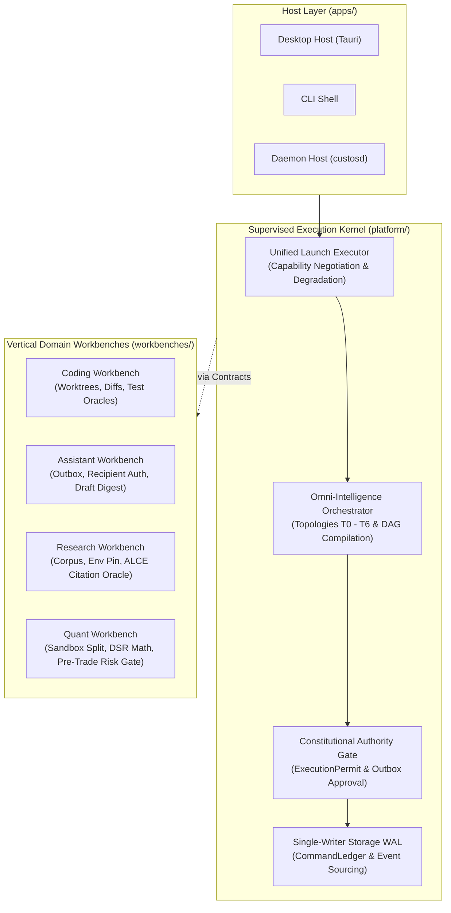

# SADE Foundations: The Multi-Domain Supervised Execution Kernel

> **Status:** Authoritative Architectural Foundation Specification.
> **Cross-References:** [`Custos.md`](../../Custos.md), [`codebase-architecture.md`](../development/codebase-architecture.md), [`desktop-core-interaction-map.md`](desktop-core-interaction-map.md), [`evidence-and-completion-gate.md`](evidence-and-completion-gate.md).
> **Theoretical Lineage:** Orca Fleet Kernel (Coding) + Claude Science (Research) + Inalpha / OpenFinGym (Quant Finance) + Anthropic Governed Agent Philosophy (*"Building Effective Agents"*, *Model Context Protocol*, *Constitutional AI*).

---

## 1. Executive Synthesis — From Coding Fleet to SADE

Orca demonstrated that modern agent orchestration is fundamentally **not** an editor, a chat window, or a terminal wrapper. Orca is an **autonomous fleet kernel for software engineering**:
1. **Unified Launch Executor:** Before spawning an agent, it creates an isolated workspace, queries host capabilities, negotiates structured session shapes, and degrades gracefully rather than failing.
2. **Worktree-Native Isolation:** Every task leases an isolated Git worktree with shared caches, scoped branches, and locked preparation.
3. **Reconciled Lifecycle with Deadlines:** Teardown does not hang indefinitely; orphan cleanup is proven; concurrent writes serialize through sidecars and sequential queues.

However, **coding cannot be the sole archetype of autonomous work**. If an architecture blindly copies Git worktrees, terminal streams, and code diffs across all disciplines, it commits fatal category errors:
- In **Executive Assistance**, there is no filesystem to isolate; the isolation boundary is the **recipient identity and payload digest**, and the most catastrophic effect is sending an irreversible message to the wrong person.
- In **Scientific Research**, a code commit is meaningless without environmental reproducibility; isolation means **pinning dataset hashes, conda/pip lockfiles, and random seeds**, and completion demands **ALCE/MiniCheck citation oracles and containerized reproduction**, not model self-assertion.
- In **Quantitative Finance**, backtest code beauty cannot grant live trading authority; isolation means **air-gapped backtest sandboxes vs paper gateways vs live exchange gateways**, and completion requires **positive Deflated Sharpe Ratio (DSR), zero lookahead bias, and machine risk-rule enforcement at the HTTP transport boundary**.

Therefore, the **Specialized Agent Development Environment (SADE)** extracts the generic supervised execution kernel from Orca, anchors it with Anthropic's governance philosophy, and mounts **four distinct vertical domain adapters** on top:

$$\mathbf{SADE} = \mathbf{Orca\ Fleet\ Kernel} + \mathbf{Anthropic\ Constitutional\ Governance} + \mathbf{4\ Domain\ Adapters}$$



---

## 2. The Three Ontological Differentiators Across Domains

A single unified system design must respect the three radical differences in physical reality across domains:

| Dimensional Axis | Coding (Orca Standard) | Assistant (Personal Copilot) | Research (Claude Science) | Quant Finance (Inalpha / OpenFinGym) |
|---|---|---|---|---|
| **1. Unit of Isolation** | **File / Branch Scope** (`git worktree` with `.worktreeinclude` and shared package caches). | **Recipient Identity + Payload Scope** (No filesystem jail; isolated approval outbox). | **Corpus + Environment + Dataset Pin** (`dataset_hash`, `seed`, `environment_lock`, CAS). | **Data Split + Strategy AST + Execution Mode** (Air-gapped Backtest vs Paper vs Live Gateway). |
| **2. Most Dangerous Effect** | **Faulty file write or merge** (Benign/Revertable via Git history). | **Sending erroneous email / message to external recipient** (Irreversible, social/legal damage). | **Fabricating / hallucinating scientific claims** (Contaminates human knowledge base). | **Erroneous exchange order execution** (Direct, catastrophic, irreversible financial capital loss). |
| **3. Proof of Completion** | **Diff inspection + compiler check + test suite pass**. | **Canonical payload SHA-256 matching approval + provider delivery receipt**. | **Claim-to-source provenance link + independent containerized reproduction package**. | **Positive Deflated Sharpe Ratio (DSR) + clean lookahead bias audit + pre-trade risk pass + broker fill receipt**. |

---

## 3. The Seven Invariant Primitives across Four Domains

Every autonomous domain within SADE implements exactly **seven invariant primitives**. The generic platform manages the lifecycle, storage, and orchestration of these primitives; each vertical workbench registers its domain-specific semantics and acceptance gates:

```
┌────────────────────────────────────────────────────────────────────────────────────────┐
│                        THE SEVEN INVARIANT SADE PRIMITIVES                             │
├────────────────────────────────────────────────────────────────────────────────────────┤
│ 1. WORKSPACE   : The isolated physical or logical context where work occurs.          │
│ 2. TASK        : The bounded unit of intent with state, budget, and acceptance criteria│
│ 3. DISPATCH    : The execution instance leasing an executor or specialized worker.     │
│ 4. EFFECT      : The dangerous outbound boundary that alters external reality.         │
│ 5. EVIDENCE    : The verifiable proof of completion required by the Completion Gate.   │
│ 6. AUTHORITY   : The security permissions, preconditions, and approval permits.       │
│ 7. OBSERVATION : The sensory environment state perceived by the reasoning model.       │
└────────────────────────────────────────────────────────────────────────────────────────┘
```

### The $7 \times 4$ Domain Matrix & Acceptance Gates

| Primitive | Coding Workbench | Assistant Workbench | Research Workbench | Quant Finance Workbench |
|---|---|---|---|---|
| **1. Workspace** | **Git Worktree:** Dedicated checkout per task; shared build directory; `.worktreeinclude` sync.<br>**Gate:** Worktree path exists, branch locked, orphan cleanup verification. | **Inbox / Agenda Scope:** Recipient graph, active conversation thread, draft store.<br>**Gate:** Identity resolution valid; zero ambiguous recipient names. | **Research Project Corpus:** Raw papers, notebooks, dataset snapshot, pinned environment lockfile.<br>**Gate:** SHA-256 dataset match, lockfile reproducibility check. | **Quant Strategy Context:** Strategy source AST, historical dataset split (train/test/val), gateway mode.<br>**Gate:** Invariant backtest isolation; zero live socket in backtest mode. |
| **2. Task** | **Engineering Task:** Bug fix, feature implementation, refactor, AST repo explanation.<br>**Gate:** Base commit reachable, target files within declared scope. | **Delegation Task:** Communication drafting, calendar scheduling, inbox triage.<br>**Gate:** Recipient pre-conditions verified, message schema valid. | **Inquiry Task:** Literature survey, claim extraction, experiment replication, review.<br>**Gate:** Source citations resolvable, claim extraction boundaries valid. | **Alpha Task:** Factor discovery, backtest evaluation, risk audit, order ticket generation.<br>**Gate:** Historical bar span $\ge 20$, split dates chronologically disjoint. |
| **3. Dispatch** | **Terminal / Coder Worker:** Subprocess jail, PTY lease, execution timeout.<br>**Gate:** PTY allocated, cancellation token wired, deadline enforced. | **Draft / Approval Worker:** In-process draft generator and Outbox dispatcher.<br>**Gate:** Outbox entry created, zero automated direct external dispatch. | **Lab / Compute Worker:** Jupyter kernel driver, remote GPU container, Colab/Kaggle relay.<br>**Gate:** Compute admission permit verified, GPU allocation quota valid. | **Backtest / Risk Worker:** Python backtest runner, statistical factor analyzer, risk reviewer.<br>**Gate:** Subprocess execution sandbox locked, AST security audit clean. |
| **4. Effect** | **Code Modification:** File write, git commit, branch push, pull request.<br>**Gate:** Git diff check, permit bound to patch SHA-256 hash. | **External Communication:** Send email, post message, update external calendar.<br>**Gate:** Human approval outbox record, canonical payload digest match. | **Execution & Publishing:** Notebook cell execution, experiment run, artifact publish.<br>**Gate:** Compute admission token, CAS immutable artifact persistence. | **Order Placement:** Exchange order creation, cancel, replace, leverage update.<br>**Gate:** Machine Pre-trade Risk Gate evaluation, human approval permit, broker ticket. |
| **5. Evidence** | **Software Verification:** Compilation pass, test suite pass, lint pass, diff receipt.<br>**Gate:** `ExecutionReceipt` with exit code 0, test runner report. | **Delivery Proof:** Canonical payload SHA-256 digest, provider message ID / receipt.<br>**Gate:** Provider ack received; status transitions to `Receipted`. | **Scientific Reproducibility:** Claim-source citation link, ALCE/MiniCheck score $\ge 90\%$, replay package.<br>**Gate:** Citation coverage oracle pass, replay artifact verified. | **Statistical & Risk Proof:** Deflated Sharpe Ratio $> 0$, lookahead bias clean, FDR $p \le 0.05$, fill receipt.<br>**Gate:** DSR formula pass, Benjamini-Hochberg FDR pass, broker fill receipt. |
| **6. Authority** | **Filesystem Perm:** Write scope limited to leased worktree path.<br>**Gate:** Path traversal forbidden, execution permit verified single-use. | **Recipient Authority:** Explicit human consent for target recipient and payload.<br>**Gate:** Approval status `Approved`, SHA-256 payload unchanged. | **Resource Admission:** Workload admission permit, compute quota, egress consent.<br>**Gate:** GPU admission coordinator grant, egress firewall pass. | **Financial Risk Limits:** Notional order limit, max drawdown limit, kill-switch state.<br>**Gate:** PreTradeDecisionGate pass, TTL-bound token active, kill-switch disengaged. |
| **7. Observation** | **Code Artifacts:** File content, AST symbols, compiler diagnostics, git status.<br>**Gate:** Normalizer parity, camelCase wire format, secret redaction. | **Context Streams:** Inbox threads, contact metadata, calendar availability.<br>**Gate:** PII masking, contact graph deduplication. | **Scientific Data:** PDF text/XML, BibTeX metadata, execution logs, plot images.<br>**Gate:** Content-Addressable Storage (CAS) ref resolution, binary metadata valid. | **Market Feeds:** Historical OHLCV bars, Level-2 orderbook depth, factor IC metrics.<br>**Gate:** Provenance verified, time-travel / lookahead leakage audit clean. |

---

## 4. The Seven Cross-Domain Design Principles

Extracted from the synthesis of Orca, Claude Science, and Inalpha, these seven principles govern all architectural choices across SADE:

### 1. Workspace-First, Agent-Second
An agent must never execute in a "null" or unanchored environment. The runtime must allocate and verify the physical/logical workspace first, negotiate capability support with the host, and select the session shape accordingly. If structured sessions are unsupported, it degrades gracefully (e.g. to a constrained terminal agent) rather than failing abruptly.

### 2. Effect Permitted Only via Canonical Payload Digest
Every action with real-world side effects requires an `ExecutionPermit` cryptographically bound to the SHA-256 digest of the canonical payload:
$$\text{Permit}_{\text{valid}} \iff \text{SHA-256}(\text{CanonicalPayload}) = \text{Digest}_{\text{approved}}$$
Any mutation in the payload—even a single whitespace or parameter shift—invalidates the permit. Agents propose exact prepared tool calls; effectors re-validate arguments before firing.

### 3. Inspectable Evidence Over Self-Reporting
No task may transition to `Succeeded` based on model claims ("I have fixed the bug" or "the claim is true"). The **Completion Gate** ([`platform/core/src/kernel/completion.rs`](file:///Users/mac/Project/AgentHub/Custos/platform/core/src/kernel/completion.rs)) requires physical, inspectable evidence: compiler output, delivery receipts, citation graph oracles, or statistical test results.

### 4. Provable Isolation Over Declared Isolation
Isolation cannot be an unverified claim. The system must physically prove boundaries:
- In Coding: Worktree lock proof and orphan cleanup verification.
- In Assistant: The approval outbox is physically segregated from the drafting agent loop.
- In Research: Conda/pip environment hash, random seed, and dataset snapshot pins.
- In Quant: Backtest execution sandboxes have zero socket bindings to live exchange gateways.

### 5. Reconciled Lifecycle with Deadlines
All agent processes, subprocesses, and background workers operate under explicit deadlines. If a crash or timeout occurs while an effect is in `Dispatching` status, the state transitions to `Uncertain`—**it is never blindly retried**. Background reconcilers inspect external reality to settle uncertain states.

### 6. Human-in-the-Loop at Irreversible Boundaries
Human approvals are not squandered on low-risk read operations (reading files, browsing papers, computing historical factors). Approvals are strictly concentrated at **irreversible boundaries**:
- Coding: Merging to production / PR submission.
- Assistant: Dispatching external communication.
- Research: Large GPU compute allocation / public publishing.
- Quant: Real capital order dispatch to live brokers.

### 7. Typed Handoffs Over Chat Transcripts
Multi-worker orchestration does not pass unstructured, noisy conversation transcripts between steps. Transitions between pipeline stages use **strongly typed, schema-validated handoffs**:
- Coding: `worker_done` envelope with patch diff and verifier exit code.
- Assistant: Structured draft object with recipient ID and message body.
- Research: Extracted Claim records with DOI source citations.
- Quant: Strategy AST revision with backtest tearsheet and risk audit verdict.

---

## 5. Physical Architecture Realization in Custos

Custos maps this theoretical framework across three physical directory roots with zero architectural leakage:

```
Custos/
├── apps/                         <-- Host Layer & Inbound Wire Adapters
│   ├── daemon/                   <-- Headless Sovereign Daemon (custosd)
│   │   ├── src/api/              <-- Inbound Wire Adapters (JSON-RPC / REST)
│   │   └── src/application/      <-- Pure Application Services (Zero Wire Deps)
│   ├── desktop/native/           <-- Tauri 2.0 Desktop Shell
│   └── cli/                      <-- CLI Developer Console
│
├── platform/                     <-- The 8 Invariant Platform Crates (Hexagonal Architecture)
│   ├── core/                     <-- Constitutional Kernel, Authority & Completion Gate
│   ├── domain/                   <-- Pure Zero-I/O Domain Models (7 Primitives)
│   ├── runtime/                  <-- Unified Launch Executor, TaskRuntime, OI Engine
│   ├── storage/                  <-- Single-Writer SQLite WAL, CommandLedger, Outbox
│   ├── provider/                 <-- Cognitive Engine Gateway (ModelPort)
│   ├── adapters/                 <-- Effectors, Sandboxes, Terminals, MCP Hub
│   ├── components/               <-- Domain Packs, Verifier Oracles, Skill Libs
│   └── bridge/                   <-- External Harness Bridge (Claude Code, etc.)
│
└── workbenches/                  <-- Vertical Domain Contribution Bundles (SADEs)
    ├── coding/                   <-- Engineering: Worktrees, Recipes, Diffs
    ├── quant/                    <-- Quantitative: Tearsheet Schema, Risk Migrations
    ├── research/                 <-- Research: Literature Schema, Claim Verification
    └── assistant/                <-- Executive: Drafts Schema, Outbox Migrations
```

---

## 6. Verification & Quality Gates

Every refactoring, capability addition, or workbench contribution must satisfy the **Five Mandatory Quality Gates** (`cargo run -p xtask -- gate`):

1. **Gate 1 — Pack Manifest Validation (`schema_compat.rs`):** All workbench manifests, capability manifests, and canonical schemas must exist, parse, and validate against the JSON specification.
2. **Gate 2 — Desktop Host Build (`npm --prefix ui/desktop run build`):** Guarantees zero TypeScript compilation errors and clean bundle packaging.
3. **Gate 3 — Canvas Regression Smoke (`tools/canvas-smoke.mjs`):** Passes all 51 automated React/Node regression tests verifying screen isolation, layout round-trips, wire normalizations, and live run observers.
4. **Gate 4 — Architecture Invariants & Contracts (`check_deps.sh`, `check_layering.sh`, `vertical_slice.rs`):**
   - Zero-I/O Domain Invariant: `custos-domain` has zero external I/O crate dependencies.
   - Adapter Isolation: Adapters do not depend on app binaries.
   - Authority Single-Use: Permits cannot be reused or forged.
   - Completion Gate Truthfulness: Foreign-task or unverified claims are categorically rejected.
5. **Gate 5 — Workspace Cargo Check (`cargo check --workspace --all-targets --offline`):** Guarantees zero compilation errors across all workspace members and integration test targets.
