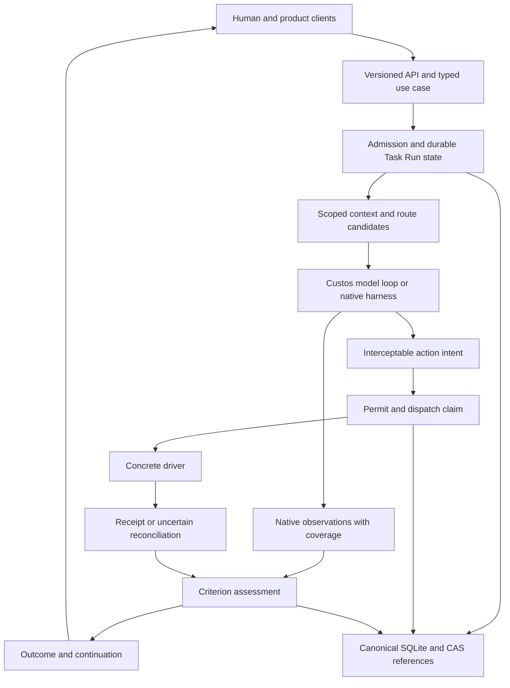

# SADE foundations and supervised work contracts

**Status** — Target product architecture. Source observations use branch `vi`, HEAD `f3cfaa3d`. The master specification defines the product, the canonical plan records implementation gaps, and source/tests determine exercised behavior. SADE means **Supervised Agent Development Environment**.

[Master specification](../../Custos.md), [interaction contract](sade-agent-system-design.md), [physical catalog](../development/codebase-architecture.md), [current three-root review](../development/modular-workbench-refactor-plan.md#three-root-target-review), [document synthesis review](../development/modular-workbench-refactor-plan.md#sade-synthesis-review).

## 1. Product contract

Custos provides a local-first workspace for human-directed and delegated agent work. Base includes Assistant/Copilot. Coding, Research and Quant contribute specialist workflows, artifacts, verification and UI according to enabled distribution. Task, Session, Run, authority, resource identity and canonical data remain shared across workbenches.

The four product objectives are continuity across sessions/executors, scoped authority over effects, inspectable criterion-specific evidence, and cost/latency/quality accounting per accepted outcome. Direct use of a strong pinned model or native harness remains an admissible baseline. More workers and S1 stages require a measured benefit within user constraints.

Orca and Open Science provide upstream patterns for supervised execution and scientific workspace interaction. Reuse claims require pinned source paths, attribution and conformance. Custos's authority/evidence/storage contracts are product decisions with their own tests. The [Orca study](../development/orca-source-study.md) and [Open Science study](../development/open-science-source-study.md) record the scoped source investigations.

Constitutional AI studies model training through principles, critique/revision and AI feedback. Custos enforces runtime permissions using policy code, permits and execution boundaries. Those mechanisms require separate evidence. [Constitutional AI paper](https://arxiv.org/abs/2212.08073).

## 2. Shared entities and explicit lifetimes

| Entity | Owned responsibility | Lifecycle constraint |
|---|---|---|
| Project/workspace | Scope, source roots, corpus or logical connector context | Physical resources are acquired when required |
| Session | Conversation journal, actor and Task bindings | Opening history grants no execution authority |
| Task/revision | Goal, criteria, scope, privacy and budget | Material change preserves historical revisions |
| Run/worker/attempt | Admitted execution, executor, reservation and outputs | Generation fencing and terminal reconciliation |
| Environment/resource binding | Workspace, PTY, kernel, compute target and artifact mounts | Real IDs, ownership and independent leases |
| Intent/grant/permit/effect attempt | Exact authorized action and dispatch state | Revalidate target, payload, scope, epoch and expiry before mediated dispatch |
| Source/artifact/evidence/outcome | Versioned inputs and criterion assessment | Stale/unknown/waived remain explicit |
| Observation | Progress, stream, logs, spans and coverage | Bounded telemetry exposes dropped events |

These are design vocabulary. Concrete types, serialized versions and FSMs are reused from source. A fixed entity count does not define schema completeness. Workspace can be logical, folder-based or Git-backed. Worktree leasing supports concurrent Coding writers where required by the workflow.

## 3. Domain-specific acceptance

| Workbench | Context and resources | Criterion-specific evidence | Effects requiring scoped authority |
|---|---|---|---|
| Coding | Repo/folder, selected dirty bytes, toolchain, optional isolated worktree | Reopenable anchors, patch base/scope, trusted behavior tests and review where required | File changes, commands, dependency installation, commits, push/merge |
| Research | Versioned corpus, passages, datasets, optional notebook/kernel/compute | Locator validity, extraction fidelity, semantic support assessment, reproducibility for experiment jobs | Code/cell execution, data access/egress, paid compute and publication |
| Assistant | Contacts, calendars, notes, files and authorized connectors | Stable identity/time, exact payload, provider receipt and reconciliation | Send/update/delete, automation and account-scoped external writes |
| Quant | Dataset/splits, strategy, evaluation assumptions, paper/live mode | Input lineage, specified statistical checks, costs/leakage review and explicit uncertainty | Market/account access, external orders and cancellation/replacement |

A repo explanation, literature comparison, notebook experiment and order dispatch have different criteria. Approval profiles may grant bounded recurring actions. Human attention follows ambiguity, sensitivity, external effect and policy, including private reads and costly execution.

ALCE supplies citation evaluation methods. MiniCheck supplies an automated grounding assessment approach. Research acceptance records assessor/version, passage coverage and known errors, with domain calibration and human adjudication where required. Thresholds are chosen for the intended criterion and evaluation slice. [ALCE](https://aclanthology.org/2023.emnlp-main.398/), [MiniCheck](https://aclanthology.org/2024.emnlp-main.499/).

DSR is a probabilistic statistical assessment under specified trial-selection and return-distribution assumptions. Quant records its inputs, frequency convention, trial history, benchmark and chosen significance threshold. A successful statistical check does not authorize an order. [Bailey and López de Prado](https://davidhbailey.com/dhbpapers/deflated-sharpe.pdf).

## 4. Runtime and data flow

One profile has one canonical writer. Domain semantics own their schemas, while host storage owns physical transaction/migration execution. Large immutable content uses CAS references, derived indexes/projections are rebuildable. Native tools report effective assurance per execution path. A post-run observed intent supports audit and assessment, while pre-effect mediation requires an actual interception/enforcement boundary.

Cancellation distinguishes requested, acknowledged and confirmed. A connection loss may leave a remote billed job running. An uncertain external effect is reconciled before a retry. Required lifecycle/effect facts use durable persistence, high-volume presentation telemetry has bounded queues and coverage diagnostics.

Environment assurances come from concrete provision/probe receipts. Worktree creation, file confinement, process isolation and network restrictions have separate checks. Environment teardown retains actual resource IDs and cleanup progress across partial failures. Shared kernels/GPU targets have independent leases.

## 5. Physical owners

| Root | Current source owner | Responsibility |
|---|---|---|
| Platform domain | `platform/domain` | Pure types and invariants |
| Trusted policy | `platform/core` | Kernel, authority, evidence and ports |
| Orchestration | `platform/runtime` | Agent/context/OI/session/workflow/environment lifetime |
| Inference | `platform/ai` | Model contracts, catalog/pricing, cloud/local engines |
| External mechanisms | `platform/adapters` | Harnesses, host drivers, connectors and OS boundaries |
| Durable data | `platform/storage` | SQLite/CAS, repositories, migrations and recovery |
| Contributions | `platform/components` | Catalog, resolution, activation and version compatibility |
| Specialist work | `workbenches/{assistant,coding,research,quant}` | Domain models/services/recipes/skills/verifiers and UI contributions |
| Product host | `apps/{daemon,desktop,cli}` | Composition, typed use cases, wire transport and native entrypoints |
| Public contracts | `sdk/protocol`, client SDKs | Versioned wire/client and worker contracts |
| Desktop renderer | Current `ui/desktop`, target `apps/desktop/ui` | Shared shell and contribution hosting |

Topic-specific detail lives inside these owners. Shared capability placement follows scope, lifecycle, policy and dependency requirements. Consumer count is a reuse signal. Physical SQL repositories belong in storage where they implement host-owned persistence contracts, while orchestration, parsing and domain math retain their respective owners.

## 6. Verification and current gaps

`cargo --offline xtask check-boundaries` passed in the preceding three-root review. Its dependency/source/line-limit checks cover the rules implemented by the checker. `cargo xtask gate` currently validates packs, builds desktop, runs selected Node checks, architecture checks and testkit/contract tests, then performs workspace cargo check. Full workspace tests, native launch, provider/GPU conformance and product journeys have separate gates.

The current source review identified name-derived environment cleanup IDs, profile-derived isolation assertions, inactive-to-success supervision mapping and a raw native execution path. OI estimates and selection remain heuristic. Training/evaluation runners contain simulation logic, and production harness types expose mock helpers used by integration tests. Source-backed remediation and test boundaries are defined in the [canonical plan](../development/modular-workbench-refactor-plan.md#sade-synthesis-review).

Implementation readiness is assessed per path with source revision, fixture, observed result and limits. Build success, file naming, upstream architecture and passing simulated jobs establish only their respective tested properties.
