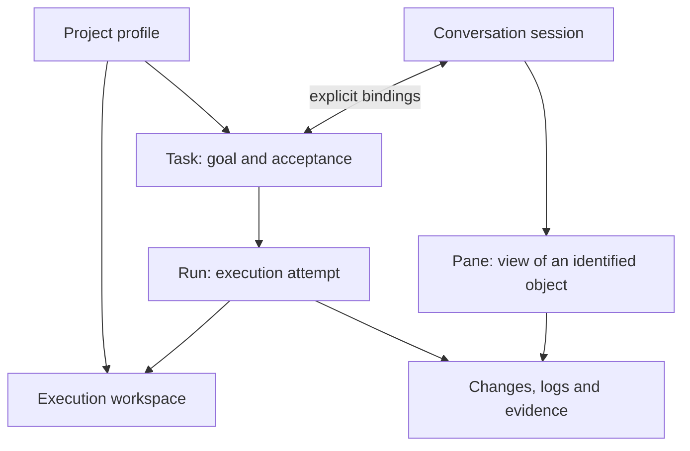
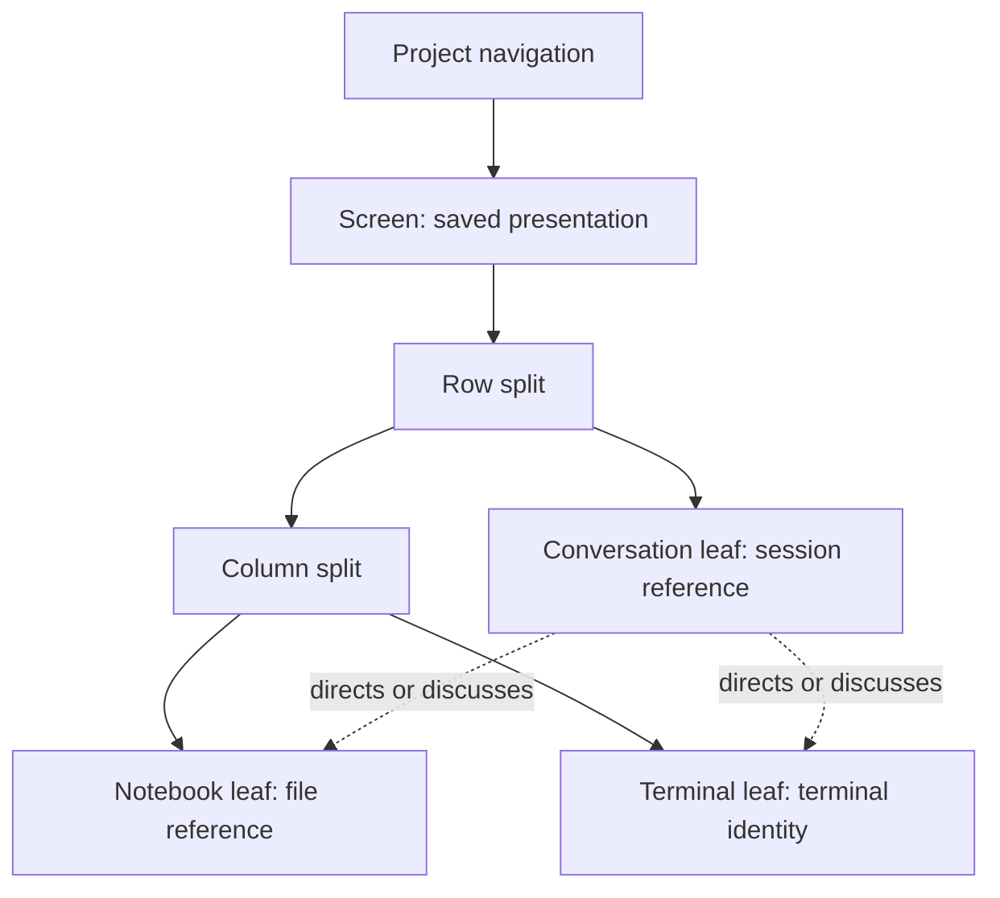
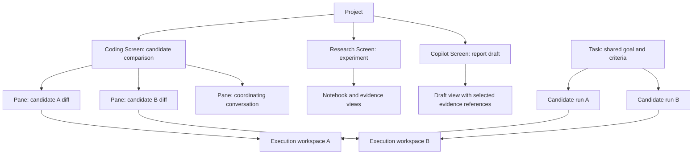
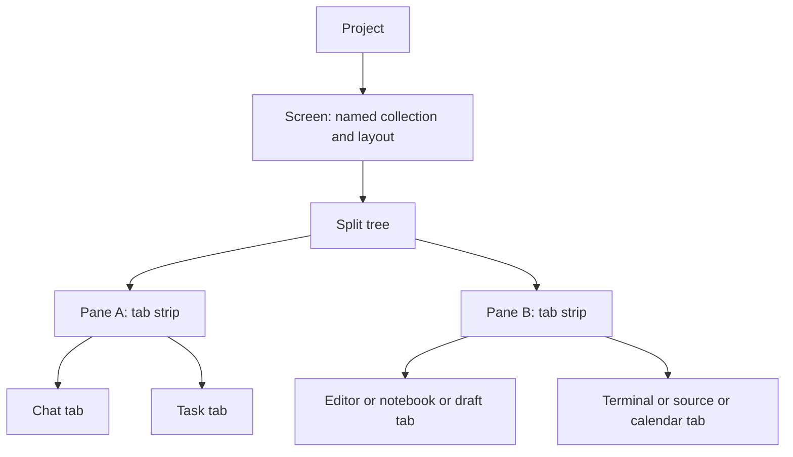

# Coding Conversation and Research Workbench Model

## Definitive Screen and tab interpretation

This section supersedes earlier navigation and container alternatives in this research log. The remaining sections preserve source evidence and implementation findings, not competing product prescriptions.

- Project owns repository/workspace registrations and saved Screens as separate collections.
- One repository is one user-facing workspace; worktrees are checkout targets underneath it. Existing execution workspace IDs remain authoritative backend locators.
- Screen is one named, saved collection of resource tabs plus their arrangement. It belongs to Project; it may use multiple repositories/worktrees and has optional defaults for opening new resources.
- Pane is a visible rectangular region containing one tab strip. Existing CanvasGroup is its technical representation. There is no additional mandatory group layer.
- Tab is a view of a specific resource. It has a presentation ID separate from the resource's session/file/terminal/notebook/run identity.
- Workbench is the Screen's default tool vocabulary and specialized behavior, not a separate canvas or transcript store.
- Window is an actual desktop window. Screen is an arrangement shown within it. Parallel Screens in separate windows require lifecycle reconciliation; they are not required for ordinary multi-pane work.

The two hierarchies are Project → repository workspace → checkout/worktree, and Project → Screen → split tree → pane/tab group → resource tab. Task, session and Run connect to those by explicit references, not container ownership. Closing a Screen does not remove worktrees, sessions or Tasks.

### Consistent navigation

Home returns to the working Screen with the primary Project/repository/worktree navigator. Conversations and Tasks on the rail are global saved-work browsers with Project/workbench filters; opening either does not change execution scope. Supervision inspects ongoing work and decisions. Settings and Connections use the management surface and retain a visible Home return. No rail workspace chooser duplicates the sidebar, and the primary sidebar never switches into three competing Workspaces/Conversations/Tasks modes.

The Screen strip selects named arrangements. A pane's tab strip selects the resource shown in that region. A pane plus opens a resource there; Screen plus creates an arrangement. They must not both be called New tab. Two visible tab strips after a split represent two regions of the same Screen, not two independent Screen instances.

### Screen association and workspace selection

A Screen can reference multiple workspace scopes. It can also be marked as focused on a particular worktree for navigation. Sidebar worktree selection should reveal a matching open view in the current Screen first; otherwise restore a remembered matching Screen, or offer opening that worktree's resource in the current Screen. It must not replace all existing tabs or assign their scope to the newly selected worktree. An explicitly comparative Screen remains comparative; the focused pane identifies which side an action targets.

Default scope for a new resource resolves from an explicitly selected target, then a compatible focused resource, then a Screen default; when missing or ambiguous, show the target picker. Existing session-bound execution cannot be moved through this default. Resource scope is authoritative for editor saves, terminal input, browser target and run control. All requests use actual IDs; visual position and Project title do not determine execution.

### Shared shell across domains

| Layer | Coding | Research | Copilot |
| --- | --- | --- | --- |
| Screen/pane/tab operations | Identical | Identical | Identical |
| Suggested tabs | Conversation, Task, editor/diff, terminal, preview | Conversation, source/PDF, notebook, experiment, figure, draft | Conversation, Task, draft/document, calendar, outbox |
| Execution target | Checkout and host | Compute scope, code/data version and kernel | Account/recipient and action scope when applicable |
| Review | Change and actual checks | Source support, experiment lineage and uncertainty | Exact content/recipient and external receipt |

A standalone terminal does not require a chat; a source or draft does not require a repository. Optional tools are offered only with a real supported renderer and lifecycle. Do not fabricate resource content to make a preset appear complete. First use can show one empty pane; presets arrange chosen existing objects without automatically creating executions.

### Lifecycle and duplication rules

Opening a session or resource already shown in the active Screen focuses its view by default. Explicit Open another view creates another presentation instance when the resource supports it; it does not clone the session, shell or kernel. New terminal creates a new terminal resource; moving a terminal view preserves its existing resource. A CLI agent's terminal and structured chat are alternative views of the same harness session only when its adapter establishes that mapping; otherwise they are different resources and must be labelled accordingly.

Splitting creates a pane; moving a tab changes its presentation owner; maximizing retains the tree. Closing a view is separate from stop/delete/archive. Pinning protects saved arrangements from replacement, not memory eviction. Resource state and admitted runs outlive hidden or evicted views according to their own lifecycle.

Multiple saved Screens, simultaneously visible panes and concurrent executions are independent. One Task can run candidate A and B in separate worktrees; one comparison Screen can inspect both. The Screen does not itself schedule or grant the work. A Research experiment and a Copilot draft can remain active through the same core without adopting Git semantics.

### Persistence contract and current limits

Restore Screen identity, its scoped tab descriptors, tab membership, layout, focus and home workbench as one coherent presentation snapshot. Restoring a layout does not run a shell command, replay a send or grant a capability. Unknown/missing resources show recovery states; unsaved buffers need preservation or explicit handling. Multiple window ownership and native detach remain separate gates.

This is the product contract to converge on. Current ScreenContext/tab persistence still has incomplete ownership and migration as described later in this log; the latest rail/history changes do not prove that full Screen restoration or simultaneous native windows are complete.

Status: research proposal, not a claim of implemented parity or an amendment to the canonical architecture. This document answers the supplied sidebar critique and studies the local Open Science source. It reuses Custos entities rather than proposing another session, task, or execution store.

## The product decision

Coding conversation is the durable thread of intent, decisions, and evidence for a piece of engineering work. Its value is continuity: why this change exists, what the human authorized, what attempts happened, what the results mean, and what remains unresolved. Files, terminals, diffs, and previews are the working objects through which that conversation acts.

Research conversation is the durable thread of inquiry. It connects a question to methods, sources, executable artifacts, observations, and qualified conclusions. Open Science demonstrates useful interactions for this thread; it does not by itself establish a complete scientific evidence or acceptance system.

The common principle is one conversation connected to real working objects, with explicit scope. Opening another pane must not create a second task, execution engine, or copy of the same ledger.

## Correcting the supplied hierarchy

The pasted text correctly identifies mixed navigation axes. Its proposed strict tree needs qualification. The original screenshots were not supplied with the text, so claims about what individual screenshot rows represent cannot be verified.

| Supplied interpretation | Source-grounded correction | UI consequence |
| --- | --- | --- |
| Project > Workspace > Worktree > Task > Session | Custos binds sessions and tasks many-to-many; ExecutionWorkspace includes Git, folder, and SSH forms | Use navigation projections of relationships, not a false ownership tree |
| Every repository has a main/master row | Actual branch, detached state, chosen base ref, folder, or remote scope matters | Display observed identity rather than an invented base branch |
| Every subagent row represents another worktree | Open Science derives subagent rows from task tool calls and child session IDs | Show workspace only when an explicit binding exists |
| Cloud means remote execution | Provider location and execution host are independent | Separate model/provider from Local/SSH execution information |
| Done means validated | Process completion, successful test execution, and accepted change are distinct | Show results and acceptance separately |
| Worktrees guarantee isolation | Git working directories do not isolate services, shared directories, credentials, or external effects | Show actual runtime authority and scope |
| Clicking worktree changes every open pane | Switching a workspace layout is valid; silently rebinding existing resources is not | Retain resource IDs and scope in pinned panes |

Custos references: [conversation identity](../../Custos.md#12a-agent-workspace), [canonical specification](../../Custos.md), and [ExecutionWorkspace types](../../crates/custos-domain/src/workspace.rs). In particular, the specification's SessionTaskBinding allows multiple tasks per session and multiple sessions per task. A branch is not a task ID.

The diagram expresses the proposed interaction model, not a declaration that every runtime association is already implemented. Worktree is one Git workspace arrangement. A child run is not automatically an independently accepted child task.

## What Coding chat must own

The conversation answers five questions throughout the work:

1. What problem are we solving, and what counts as success?
2. What scope, constraints, and authority apply?
3. What is the agent proposing or currently attempting?
4. What changed, and which observations support the result?
5. Which decision or action comes next?

This requires more than a transcript. The visible conversation should retain the user's request, material decisions, concise execution progress, and a result grounded in changes and checks. Tool traffic can fold into expandable execution details. The terminal remains the source for terminal interaction; the changes pane remains the source for reviewing edits.

Do not force a formal Task for every exploratory question. A session can begin with discussion and later bind to a Task when work becomes explicit. Preserve the session identity and explain the new binding. Create another Task when the goal and acceptance criteria become independently meaningful, not merely because another terminal or agent was opened.

### A concrete Coding interaction

The user asks to fix duplicate submission. The session captures expected behavior and constraints, binds the existing task or creates the required task through the canonical path, and shows the selected execution workspace. The agent examines code; its progress links to files. It edits; the same resulting diff opens beside the conversation. Checks produce actual run results. The final answer links the changes and distinguishes checks that ran from checks that remain unavailable.

Selecting a diff range and choosing Ask adds a bounded reference to that range and revision. It must not silently include the entire repository. Opening a terminal does not grant a new capability. Selecting another workspace changes the active working context visibly; an already opened diff retains its original comparison.

The composer should expose relevant scope compactly: task binding, workspace/branch, selected references, model, and effective action mode. Detailed authority belongs in a disclosure or request, not in repeated stacked toolbars. Stop response, pause an autonomous goal, and terminate a process are different operations and need different labels.

### Pane responsibilities

| Surface | Primary responsibility | Avoid duplicating |
| --- | --- | --- |
| Conversation | Intent, decisions, direction, result interpretation | Raw terminal history and full file browser |
| Files/editor | Read and edit a particular file in a known workspace | Another task/session sidebar |
| Changes | Inspect a concrete comparison and review edits | A second change store |
| Terminal | Interactive execution in an identified host/cwd | An unrelated agent lifecycle |
| Runs/activity | Attempts, process state, logs, checks | Another interpretation of task completion |
| Preview | Inspect an actual output or application | An unscoped generic dashboard |

Orca's documented per-worktree layouts support switching the complete tab/split tree. That is useful presentation behavior, not evidence that Task and Session belong beneath Worktree. See [tabs, panes, and splits](https://www.onorca.dev/docs/model/tabs-panes-splits) and [worktrees](https://www.onorca.dev/docs/model/worktrees).

## Open Science: the actual interaction architecture

Source basis: local Open Science commit `04b64817c12e7fdbe0e052bfa1aeaf8802feecde`, package 0.6.0. [Upstream repository](https://github.com/ai4s-research/open-science). Source paths below refer to that checkout, not a promise about future upstream behavior. The existing [source study](open-science-source-study.md) and [control audit](workbench-core-and-controls-audit.md) contain the wider inventory.

### Layout is presentation, not scientific ontology

`apps/desktop/src/lib/layout.ts` defines recursive pane splits, conversation leaves, standalone terminal/files/notebook/editor content, and dedicated artifacts. A leaf can display a session or standalone content. A screen is a layout container; it is not necessarily a conversation or research task.

`components/session/PaneTree.tsx` distinguishes the active pane from mounted but inactive screens. This matters for keyboard routing and focus: a hidden conversation must not answer global actions for the visible one. `PaneScope.tsx` scopes dialogs to the relevant pane. `ContentPane.tsx` deliberately avoids adding another header when the content already owns one and reuses a document pane beside a file tree.

Custos implication: adopt one canvas with well-defined resource leaves. A notebook, artifact inspector, or file editor should not rebuild another application shell inside its pane. Opening a source and opening the navigation section for sources are different actions.

### Conversation is the working narrative

`components/thread/TurnWork.tsx` keeps active work visible and folds completed tool work behind a compact duration entry. The request and response remain readable. Its local fold state survives mounted screen switches, not necessarily application reload.

`TrajectoryPane.tsx` derives its timeline from the same thread blocks. It is another projection of actual messages and tool calls, not another execution pipeline. `SubagentPane.tsx` derives rows from task calls or child session IDs and lazily loads transcripts. These rows do not establish a distinct worktree for each child.

`GoalPill.tsx` exposes running, paused, blocked, and done goal states and autonomous turn counts. `lib/goalPrompts.ts` recognizes injected continuation messages by text prefixes because the plugin does not provide a separate marker. This is a brittle source-specific workaround; Custos should retain structured actor/origin information rather than infer human versus machine intent from prose. A goal's done state is not scientific validation.

### Pane actions connect discussion to the actual object

`runtime/tools/present_artifact.ts` validates an existing workspace-relative file and returns structured presentation instructions: inline or panel, right or bottom, and current screen, new screen, or new session. `lib/runtime.ts` consumes completed tool events and applies those instructions. Merely mentioning a filename is not equivalent to presenting it.

Presentation deduplication uses an in-memory handled set; it is not durable exactly-once behavior across restarts. The path checks establish lexical scope and existence, not a complete symlink-safe sandbox proof.

`NotebookEditor.tsx` lets the user ask about a cell by preparing conversation context from code and outputs. `ProvenancePanel.tsx` and `RunsPage.tsx` prepare a reproduction request in the composer and return to the relevant session; they do not silently run the command. This is a strong interaction to retain: inspect evidence, prepare an explicit next action, then execute under the correct authority.

### Runtime binding is a correctness boundary

`lib/runtime.ts` supports OpenCode and ACP runtime kinds. Draft sends verify the intended workspace against the runtime before creating a session. Creation transfers draft state, model settings, and pane identity to the canonical session. Session-specific client routing prevents a response or permission answer from going to the wrong directory.

The distinction matters when a UI has several conversations beside files and terminals: visual adjacency does not prove execution scope. A successful session creation also does not prove the subsequent message was accepted. Custos must retain acknowledgement and retry semantics without duplicating a user's send or losing its draft.

### Notebook is a shared artifact, not a second chat

`NotebookEditor.tsx` reads and writes actual `.ipynb` files, preserves cell identities, debounces autosave, polls external changes, executes cells, and provides stop/reset behavior. Human and agent can therefore work on the same artifact rather than disconnected representations of it. The persistent Python/R kernel carries state between cells; stopping/resetting it changes that state.

For Custos, the open design gap is the relationship between existing persisted notebook cells and a shared notebook file. A second parallel notebook model would worsen duplication. Before implementation, define one authoritative artifact identity, explicit synchronization, external-change handling, and the relationship between saved cell outputs and kernel execution state. A kernel process is not an OS sandbox or a reproducibility certificate.

### Runs and provenance are useful but incomplete evidence

`apps/desktop/src/lib/runs.ts` recognizes experimental commands from tool events using interpreter and execution-surface heuristics. It preserves the original command and recognizes local, SSH, HPC, Modal, and Jupyter surfaces. This is not universal instrumentation of all execution.

`crates/osd-core/src/runs.rs` records command, session/model, status, duration, execution surface, code/output artifacts, log hash, and environment information. Output discovery uses a bounded filesystem scan and modification-time window. Concurrent writers can defeat a causal interpretation. Remote output cannot be assumed to exist locally, and a submitter's environment can differ from the compute environment.

`crates/osd-core/src/provenance.rs` records file versions and available content/diff/log/environment/run links. Environment snapshots are best effort, not sealed execution environments. A hash identifies observed bytes; it does not guarantee those bytes remain retrievable. Reproduction controls should explain whether a complete executable recipe is available or only a historical command/code reference.

Custos implication: show recorded facts with their coverage. Do not upgrade inferred output association into proven causality, or successful exit into a valid scientific finding.

### Review is a second observation with a known boundary

`lib/autoReview.ts` makes automatic review optional and gates it on configured reviewers and recognized successful file mutation tools. Bash writes are deliberately outside this trigger list. Subagents and review turns are excluded to avoid recursive reviews.

`lib/runtime.ts` forks the relevant conversation checkpoint into a hidden reviewer session, uses the reviewer model, scopes changed paths, and attaches the structured result to the parent. This freezes a conversation boundary, but the source files can still change in the shared workspace. A reviewer may observe newer bytes unless artifacts are pinned separately. Missing structured findings must not be presented as a pass.

The bundled `traceability-review` skill checks citations, identifiers, quantitative links, and figure/code freshness. It is a traceability procedure, not a proof that a claim is true. A second model is not an independent experiment.

## The Research workbench Custos should pursue

The primary unit is a research question with visible scope, method, and acceptance conditions. The conversation carries the inquiry. The canvas opens the objects needed for the current step. Keep the primary navigation compact: conversations/questions and working resources; expose specialized ledgers when they are needed.

| Stage | Main object | Conversation contributes | Evidence required before stronger claims |
| --- | --- | --- | --- |
| Frame | Question and method | Clarify hypotheses, assumptions, exclusions | Explicit scope and criteria |
| Read | Paper/source and selected passage | Compare interpretations, ask about a cited span | Source identity, location, accessible content |
| Experiment | Shared notebook/code and dataset | Plan and explain an attempt | Input/code versions and execution context |
| Inspect | Run, table, figure, artifact | Explain observations and anomalies | Actual outputs and links to originating execution |
| Synthesize | Draft with claims and citations | Separate observation, inference, uncertainty | Traceable support for each material claim |
| Review | Findings attached to a fixed target | Resolve objections and record decisions | Reviewed revision, coverage, unresolved findings |

These stages are not six mandatory tabs or six separate workflows. A researcher can jump between them. A paper and notebook may be open together while the same conversation continues.

Recommended default: a readable conversation beside the current paper, notebook, figure, or draft. Sources/files belong in a collapsible navigator. Runs, provenance, trajectory, subagents, and review appear through object-specific actions or a secondary inspector. On narrow windows, switch the focused object rather than compress every panel into unreadable columns.

Essential actions should describe their target: Ask about selection, Open source, Run cell, Stop kernel, Inspect run, View provenance, Prepare reproduction, Present artifact, Review this revision. Avoid generic Run or Review controls whose target changes implicitly with focus.

## Priority and acceptance

First establish conversation and resource scope consistently across Coding and Research. Next complete shared notebook/artifact identity and its external-change behavior. Then strengthen run-to-output lineage and pinned review targets. Only after those foundations should broader scientific workflow automation be expanded.

The proposal is acceptable when a user can answer, without guessing: which question/task this conversation serves; which workspace and host a command uses; which exact object a pane displays; whether selected material reached the model; which run produced an output; which revision a review examined; and what evidence remains missing.

No production implementation is claimed by this study. The existing Custos canonical entities remain authoritative; proposed interactions need to be mapped onto actual endpoints and completion gates before being represented as operational controls.

## Screen: the shared composition model for all Custos workbenches

This follow-up audits the Screen implementation itself at the same Open Science commit. A Screen is a saved arrangement of working views, not a conversation, research task, execution workspace, or process. Its central abstraction is spatial composition: several independently identified objects can be arranged together without becoming one runtime object.

### Exact source model

`LayoutGroup` in `apps/desktop/src/lib/layout.ts` is the implementation name for a Screen. It contains `id`, user-controlled `name`, `projectId`, a nullable `tree`, `focusedLeafId`, and transient `zoomedLeafId`. Project ownership groups Screens for navigation; it does not establish that every leaf uses the same directory. `projectScope.ts` resolves legacy Screen project affiliation from conversations first, then terminal/file paths. This is a navigation heuristic, not an execution authorization rule.

The tree has two node forms:

- A split contains an axis, N children, and their proportional sizes.
- A leaf has a stable pane ID and holds either a conversation session, standalone content, or a session-associated artifact. Standalone content supports terminal, files, notebook, and editor. A standalone terminal does not require a conversation owner.

The data structure permits repeated nested subdivision. This does not mean literally unlimited usable panes or unlimited performance. `MIN_SIZE` is a local fraction, not a global minimum pixel size, and normalization can flatten splits into many siblings. The source does not establish an invariant that every resulting pane remains at least ten percent of the whole window.

Sharing a Screen does not automatically share conversation context, kernel state, permissions, task ownership, or a working directory. Those are separate bindings. A user should be able to arrange views together without merging their state.

### What each layout action actually does

| Action | Open Science behavior | Required Custos interpretation |
| --- | --- | --- |
| New Screen | Adds a layout in the active project; can start with a chosen content surface | Create presentation first; resource creation or execution remains an explicit command |
| Split / dock | Inserts beside a leaf; matching axes add siblings, perpendicular axes nest | Mutate the layout; retain the existing resource identity |
| Normalize | Collapses one-child splits and flattens matching axes while preserving proportions | Preserve a valid tree without treating layout shape as runtime state |
| Resize | Changes proportions; renderer drags an adjacent pair and commits to the store | Resize views without restarting processes or sending model turns |
| Focus | Selects the leaf; active focus routes relevant app actions | Target actions using the focused view's own resource, not an unrelated global session |
| Maximize | Temporarily displays one leaf while retaining the tree | Restore the original arrangement when unzoomed |
| Move across Screens | Moves the same leaf ID; removes it from the original tree | Move presentation ownership without cloning a terminal, draft, or run |
| Close pane | Removes the leaf, collapses the layout, and selects a survivor; final leaf leaves an empty Screen | Separate close-view behavior from resource deletion and process cancellation |
| Close Screen | Removes that arrangement; the final Screen of a project becomes empty | Do not delete its tasks, sessions, source files, or evidence |
| Switch project | Returns to the remembered Screen, then first Screen, otherwise an empty one | Navigation must not implicitly create a task or start work |

`openSessionEphemeral` first finds a session already shown and focuses it. Otherwise it reuses a tentative preview Screen until real interaction pins it. Renaming, typing, or splitting can make a preview permanent. This is a concrete solution to accumulating duplicate Screens, not merely a cosmetic tab style. A reusable document pane similarly avoids opening a new editor for every file click. Explicitly retained or independently edited views need separate handling so reuse never discards unsaved work.

### Four identities and three independent lifetimes

The source distinguishes Screen ID, pane/leaf ID, session ID, and content identity such as notebook path or terminal. A pane ID is not its position in the tree. `moveLeaf` and `moveLeafToActiveGroup` preserve that ID specifically because terminal instances and unsent state depend on it.

`lib/terminalSessions.ts` owns live xterm instances and detached containers by leaf ID. Splitting or dragging can unmount a React component, so component cleanup cannot be the authority for killing its shell. The registry reparents the existing terminal. Layout persistence scans all remaining leaves and prunes terminals only when their pane has actually left every Screen. Used terminals receive a close confirmation in the leaf UI. This particular source couples terminal lifetime to pane lifetime; Custos must decide close semantics per resource through its existing daemon/native owner, rather than blindly copy that coupling to runs and kernels.

There are three separate lifetimes to preserve:

1. View lifetime: mounted, hidden, moved, restored, or closed.
2. Resource lifetime: session, terminal, kernel, file, draft, browser instance.
3. Execution lifetime: a model turn, shell command, notebook execution, or dispatch.

Closing a conversation view does not by itself mean cancel its agent turn. Hiding a notebook does not mean reset the kernel. Closing a terminal may end an interactive shell, but that must be a deliberate resource policy. Deleting a file is a different command from closing its editor.

### Persistence, recovery, and performance

The layout is stored in device-local `ai4s.layout.v2`; last Screen per project uses a separate preference record. This persists layout descriptors, not process memory. Restoration checks known content kinds, advances ID counters, drops retired content without necessarily discarding every Screen, and clears maximization. Session reconciliation removes references to deleted sessions after session data becomes available.

Terminal restoration is more than visual: the saved cwd, startup command, and detected CLI session can determine a resume command. This may type a command into a newly opened shell. Custos should not allow arbitrary saved layout data to become an implicit execution authorization. Restoring arrangement and resuming execution must follow different paths, with actual host availability and authority checked.

`app/routes/LiveSessionPage.tsx` is authoritative for Screen mounting. Some nearby comments still say every Screen stays mounted; the route implements a bounded recent set instead. `MOUNTED_SCREENS` is 10 and `WARM_SCREENS` is 5. Active, warm-hidden, cold-mounted, and evicted views have different rendering costs. Warm views use both `visibility: hidden` and `content-visibility: hidden` so they do not intercept clicks while layout work is skipped. State that must survive eviction lives outside the components. The numerical choices are upstream tuning values, not Custos requirements.

`PaneTree` combines Screen activity and per-Screen focus before enabling app-wide actions. Merely having a focused ID in a hidden Screen does not make it the active keyboard target. Directory-specific runtime streams remain distinct from rendering. Different directories displayed together require correctly routed session clients, not one mutable global cwd.

Read source tests include `layout.test.ts`, `layout.projects.test.ts`, and `terminalSessions.test.ts`. They cover duplicate avoidance, project navigation, artifact placement, persistence, pane identity during moves, and terminal pruning. They were inspected as evidence of intended behavior, not executed in this audit. No native interaction or performance benchmark was run here.

### Custos comparison: reuse the existing owner

| Concern | Current Custos source | Gap or design decision |
| --- | --- | --- |
| Recursive layout | `ui/desktop/src/types/canvas.ts`: binary group/split tree, tabs within each group, resize/focus/zoom/move/merge | Already supports nested composition; do not add a parallel Screen reducer |
| Presentation bounds | Split action caps groups at 16; restored trees have depth/node validation | Do not promise unlimited subdivision; use readable dimensions and explicit limits |
| Resource identity | `ResourceRef` plus scoped resource tabs | The broad optional-field type is not proof every kind has a complete locator or implemented renderer |
| Persistence | `OrcaTabbedContainer.tsx`: validated layout per scope; `AppContext.tsx`: scoped tab metadata | Extend the existing persistence owner for named arrangements, with migration, rather than another competing localStorage store |
| Resource retention | Visited tab content is retained and hidden; keys include canvas scope and tab ID | Same-scope retention is not proof of process continuity across scope switches or reload |
| Main chat | `AppWorkspaceShell.tsx` renders a main conversation outside the resource column; `OrcaTabbedContainer.tsx` also supports a conversation resource using the same `ConversationPane` | Peer chat rendering already exists, but outer and inner placement can duplicate it; unify composition rather than build another chat component |
| Screen collection | One active canvas tree per current scope; no named Screen collection demonstrated in the audited path | Multiple saved arrangements need an explicit collection in the existing presentation state |
| Remaining legacy state | Outer chat/resource column widths and split flags coexist with the inner canvas | Consolidate these responsibilities deliberately; do not stack another splitter system on top |

Open Science uses N-ary splits with one surface per leaf. Custos uses binary splits whose leaves are tab groups. Both can express useful recursive layouts. Converting Custos to N-ary trees is not required to obtain the product benefit and would require careful persistence migration. The important change is what the canvas can compose and how safely it preserves identity.

### One shared model, three workbench presets

For Custos, Screen should mean a named, restorable arrangement over the existing canvas. Workbench means the current domain lens and its defaults. Session means the conversation. ExecutionWorkspace means the actual execution location. These concepts must retain separate names and IDs.

| Workbench | Example Screen | Domain objects remain authoritative |
| --- | --- | --- |
| Coding | Conversation beside editor/diff with terminal below | Task, session, workspace, run, comparison |
| Research | Conversation beside paper/notebook, figure or provenance when needed | Source, notebook artifact, run, claim, evidence |
| Copilot | Conversation beside draft, reference or calendar | Draft, contact/calendar record, approved outbox operation |

A Screen may contain several conversations if the user explicitly asks for that arrangement. It must not force one coordinator session, synthesize child agents, or share their context because they appear beside one another. The default should remain small and readable. Presets are starting arrangements, not compulsory nested dashboards.

`AppContext.tsx` currently scopes tabs by project, workbench, execution workspace, and active session. A Screen intended to hold several conversations must not change its own identity whenever focus moves to another conversation. The active session can remain the focused conversation projection, but the saved arrangement needs a stable presentation identity independent of that selection. This is a specific migration concern, not permission to weaken each resource's workspace/session binding.

The migration order is: finish resource identity and per-kind lifecycle semantics; unify existing outer and peer conversation placement; let the existing canvas own the full central arrangement; support stable named saved arrangements through its current persistence path; then add bounded retention and regression coverage. Reuse existing renderers, daemon APIs, session journal, and resource catalog throughout.

Acceptance requires checking split/move without process restart; hidden panes cannot steal input; switching arrangements preserves draft and scope; layout restoration never silently executes work; closing views does not delete domain records; missing hosts/resources render recoverable states; and opening an already visible resource focuses it unless another view was explicitly requested. This is the common core worth taking from Open Science for all three Custos workbenches.

## Parallel Screens and parallel worktrees are independent axes

The supplied follow-up proposes a useful direction but overstates several guarantees. Screen IDs are stable presentation IDs; Open Science's local implementation uses generated `g`/`p` sequence IDs, not necessarily UUIDs. Warm transitions do not guarantee zero latency or exact restoration of every transient UI state. Cold-mounted Screens retain mounted components with `display:none`; eviction unmounts them. `ai4s.layout.v2` is localStorage, not a specifically managed JSON file. Pinning should preserve a saved arrangement against replacement or close-others, not promise permanent residency in RAM. Retention must remain bounded even when many Screens are pinned.

The pasted description of the current Custos storage key is approximate: `AppContext.tsx` computes scope from project, workbench, workspace, and active session; the canvas host uses `custos.canvas.v1:${scope}`. Session-dependent scope is a real design constraint, but a native reproduction is needed before claiming every focus change necessarily resets the layout. A new key alone is insufficient: tab metadata and tree membership must migrate together. The proposed `Screen` sketch lacks that tab/resource registry, so `CanvasState` containing only tab IDs cannot restore its resources by itself.

### Four meanings of parallel

| Meaning | Example | What enables it |
| --- | --- | --- |
| Saved working contexts | Coding, Research, and Copilot Screens remain available | Stable Screen collection and selection |
| Simultaneous visibility | Two worktree diffs or a paper and notebook are visible together | Pane composition, or explicit multiple-view/window support |
| Concurrent execution | Two agents execute in different worktrees while an experiment runs | Runtime admission, workspace binding, authority and resource budgets |
| Coordinated work | Candidate runs share criteria and their results are compared | Task/Run relationships, baseline and evidence/integration gates |

One does not imply the others. A background Screen does not need to be mounted for its admitted run to continue. Three saved Screens are not necessarily three simultaneously visible windows. A pane tree does not create an execution scheduler. Multiple visible chats do not create a multi-agent plan.

### What comes from Orca and what Custos must extend

Orca's `src/shared/tab-types.ts` defines tabs with `entityId`, `groupId`, `worktreeId`, and optional `executionHostId`. Its split tree points to tab groups. `src/renderer/src/store/slices/tabs/tabs-create-actions.ts` writes `unifiedTabsByWorktree`, `groupsByWorktree`, and `layoutByWorktree`. This agrees with the [documented per-worktree layouts](https://www.onorca.dev/docs/model/tabs-panes-splits).

Consequently, placing two different worktrees' resources in one comparison Screen is a Custos design extension, not a parity claim about Orca's ordinary worktree-scoped layout. Reuse the principles of stable identity, resource renderers, host routing and lifecycle; do not embed an entire Orca shell inside every pane or import its store as another backend.

Recommended default: a Screen has a home workbench and optional default execution target, but every pane binds its own resource scope. Home workbench supplies navigation, tools, and presets; it does not force all resources into one runtime context. Cross-workbench views can be explicitly opened when useful. The existing shell should derive its displayed lens from the active Screen rather than maintain two conflicting selections. Opening the same canonical session elsewhere must retain its journal identity and still respect context compilation boundaries.

This is a relationship graph. Worktrees do not become children owned and deleted by the Screen. One worktree can be inspected from several Screens; one Screen can inspect several worktrees. A specific interactive terminal keeps one owner and one runtime identity. Opening another view of it is not permission to create another shell or duplicate input delivery.

### Concrete Coding journey

1. Begin one Task with a known baseline and acceptance criteria. Create two candidate workspaces explicitly when independent implementations are wanted; do not create them merely by opening two Screens.
2. Admit Run A against workspace A and Run B against workspace B. Give each run an explicit session/turn association, host, budget, authority and output scope. A second writer to either workspace requires conflict handling; two agents do not become safe because their chats are in different panes.
3. A focused development Screen can show A's conversation, editor and terminal. A separate comparison Screen can show A and B's diffs and actual checks. Switching between them keeps the existing run and terminal IDs.
4. Compare candidates against the same baseline and criteria. A live diff can move as code changes; a review result must identify the revision it examined. A fair benchmark also needs comparable input/environment conditions.
5. Select a result, revalidate target and candidate heads, and integrate through the existing explicit gate. If the target moved, return a stale/conflict result or prepare a new integration attempt. Integration is not implied by selecting a tab and does not delete other candidates.

Use separate branches for independently evolving candidates, or explicit detached worktrees where supported. Git ordinarily rejects checking out a branch already checked out elsewhere; common refs and repository state remain shared. See [Git worktree rules](https://git-scm.com/docs/git-worktree). A worktree lock against pruning is not a concurrent writer lock.

Two worktrees can still collide on database instances, fixed ports, shared caches, external accounts, or output directories. Each run needs the relevant allocation or conflict policy: separate server ports, candidate-specific outputs, deliberate cache sharing, and configured external-effect authority. A browser preview must bind to the actual candidate server/host rather than infer it from the currently selected worktree.

### Research and Copilot can remain active beside Coding

Research's execution unit is not necessarily a Git worktree. Experiments need explicit code/data revisions, compute environment and kernel epochs. Two views of one notebook refer to one artifact; two independent experiments require explicitly separate executions and appropriate kernel/output scopes. A Screen split does not clone a Python namespace, GPU allocation or dataset. Admission should account for shared CPU/GPU/RAM and remote capacity, not the number of visible panes.

Copilot draft views can coexist with those experiments and candidate runs. A report can reference selected research evidence and coding results without copying their entire conversations. Multiple editors of the same draft need dirty-state/revision handling. External dispatch needs its own approved operation and idempotency; restoring a Screen or opening an outbox view must never send another message. These concerns reuse Custos's existing journal, artifact and effect boundaries.

For all three workbenches, visibility, view residency, execution status, attention requests, and evidence validity are independent. Expose a compact status summary for admitted background work and requests needing attention. Do not steal focus when a background run completes. Cost and compute budgets apply to execution even when its Screen is hidden or evicted.

### Backend readiness must precede the parallel promise

Custos already has workspace, workflow lease, native run, candidate and integration concepts, but their existence does not prove a single consistent concurrent-write contract across every path. `workflow/task_runtime.rs` deliberately skips implicit leases for native runs so those use the selected registered workspace. In the non-native path inspected here, `acquire_lease(...).ok()` converts a provisioning error to absence of a lease. Before any path is advertised as isolated parallel execution, its admission behavior must make required isolation failures explicit and prove the actual execution target. The generic lease manager is not itself proof of a global one-writer rule for user-selected workspaces.

This is a source-level readiness finding, not a completed security audit or demonstrated collision. UI-only Screen work must not silently broaden the concurrency guarantees of existing runtime paths. Native harnesses that create their own worktrees also require a declared owner so Custos does not create a second nested lifecycle manager.

### Implementation sequence without duplicate systems

1. Extend the existing presentation state with stable Screen membership, scoped tab descriptors, active Screen, and home workbench. Migrate the current tab metadata and canvas tree together; keep a recoverable previous layout when migration cannot resolve resources.
2. Unify main and peer conversation placement using the existing `ConversationPane`. Preserve independent drafts and exact send routing; one admitted turn per applicable session/runtime constraint, not one turn per visible view.
3. Make all actions resolve an explicit resource target. An active-worktree picker may set the default for new resources or a visibly confirmed future run; it cannot retarget old panes or in-flight work.
4. Verify admission, writer conflicts, execution host identity, cancellation boundaries, output scopes, and integration preconditions before exposing concurrent candidate execution as supported.
5. Add named arrangements, previews/pinning, bounded retention, and attention routing across the three workbench lenses. Multiple windows require shared-state and ownership reconciliation and should not be implied by ordinary Screen tabs.

Required journeys include: two Screen views of one resource; a comparison Screen across two worktrees; identical paths on different hosts; two pending sends in distinct sessions; attempted duplicate writers; closing or evicting a Screen during execution; restore with a disconnected host; candidate server port collisions; stale integration heads; and a research result referenced by a Copilot draft without automatic dispatch. Layout tests alone cannot establish these backend guarantees.

## Unified interaction contract across the three workbenches

This section resolves the terminology and presentation choices discussed above. It is the recommended interpretation of this proposal where earlier examples could suggest competing hierarchies. It does not assert production completion.

### One composition grammar

A Screen is the named collection of working views and their complete arrangement. In Open Science code this outer object is called `LayoutGroup`; in Orca code a `TabGroup` means an inner region with a tab strip. These implementation names do not describe equivalent levels.

For Custos use exactly this visible grammar: Project owns Screens; a Screen contains a split tree; its leaves are panes with tab strips; each tab displays a resource view. In existing code the inner pane is `CanvasGroup`. A pane and a tab group are the same region here, not two nested containers. The UI need not expose the technical word group at all.

The user's description, “a Screen is a group containing working tabs,” is therefore correct at the product level. Splitting that group creates two visible tab regions inside the same Screen. Do not introduce mandatory WorktreeGroup, ResearchGroup, or CopilotGroup containers. Worktree association is per resource, with optional Screen defaults; visual grouping can be expressed using the existing split tree.

Project contains registered repository workspaces and their worktrees separately. Research sources and Copilot documents can belong directly to Project or an external connection; neither needs a fabricated repository. “One repository = one workspace” is a useful user-facing convention, but existing `ExecutionWorkspace` already represents several execution forms. Implement the projection without creating a competing backend workspace registry or silently redefining existing IDs.

### What must be identical

| Surface | Shared contract in Coding, Research and Copilot |
| --- | --- |
| Project navigation | Same position and selection behavior; repositories/worktrees and project resources remain discoverable |
| Workbench selection | Same three controls; restore the last appropriate Screen, with a clear first-use state |
| Screen strip | Same create, select, rename, pin, close and overflow behavior |
| Pane/tab frame | Same tab sizing, focus indication, keyboard behavior, move, split, resize, maximize and empty state |
| Resource opener | Same picker mechanism, with domain-relevant suggestions and actual availability |
| Scope disclosure | Same place for the focused resource's Project, workspace/host, Task and session references when applicable |
| Inspector | Same optional detail region, driven by the selected object |
| Activity/attention | Same presentation for running, waiting for input, failed, disconnected and completed work |
| Recovery | Same distinction between loading, empty, unavailable, missing resource, conflict and error |
| Appearance/accessibility | Same theme tokens, density, minimum readable dimensions, focus navigation and narrow-window behavior |

The screen strip chooses an arrangement. The pane strip chooses a resource. Their visual levels must differ without adding a third permanent strip for each domain dashboard. A resource may have its own necessary toolbar, but must not repeat the shell navigation, Screen bar, or canvas layout controls inside its content.

### What should differ

| Contract | Coding | Research | Copilot |
| --- | --- | --- | --- |
| Suggested resources | Files, diff, terminal, agent session, preview | Paper, notebook, dataset, figure, run, synthesis | Draft, reference document, calendar, outbox |
| Primary object action | Save, compare, execute an identified command | Run an identified cell, inspect provenance, cite a source | Save draft, prepare an action, inspect approval/receipt |
| Execution context | Host, checkout, baseline, process | Compute host, code/data revision, kernel epoch | Account/recipient scope and external operation |
| Outcome interpretation | Change and checks against criteria | Observation, inference, evidence coverage | Prepared content, approved action, recorded external result |

These are content and command differences within the same frame. “Same interface” does not mean a PDF reader must look like a terminal or that every resource needs a generic Run button. Scope and authority are specific to the selected operation.

### One meaning for every navigation action

Selecting a Screen restores its saved tabs, layout and home workbench together. Selecting a workbench navigates to the last Screen for that Project/lens, or a suitable empty first-use state; it does not rewrite the home workbench of the current Screen. If the current session is to be opened in another workbench, use the explicit canonical session membership action rather than implying it happened through navigation.

Keep all Project Screens in one collection; the strip can group or filter by workbench with an obvious All Screens route. A Screen's home workbench determines default suggestions, not an exclusive resource whitelist. An explicitly opened paper can remain visible in Coding. Existing tabs never disappear because a filter or workbench changes.

Selecting a repository/worktree browses or restores work in that scope. Changing the default target for new tabs is distinguishable from reopening a saved Screen; neither silently retargets existing tabs or an in-flight run. Resource openers resolve missing scope explicitly. A template placeholder has a Choose source/workspace/notebook state, not invented data or an executable default.

Screen-level plus creates a Screen. Pane-level plus opens/selects a resource in that pane. Create conversation, create file, start terminal and start run are distinct operations, even when the picker offers them together. Ordinary open/reveal should focus an existing view in the active Screen where appropriate. A resource used from another Screen should be offered as open here or reveal there rather than causing an unexpected global navigation jump. Multiple view instances share resource identity but keep appropriate view state; they do not clone a runtime.

Closing a tab closes its view after dirty-state/lifecycle handling. Closing a pane should merge its tabs into a surviving region by default; “Close tabs in pane” is a separate action. Closing a Screen removes the arrangement after relevant unsaved-state handling, not its Task, session or worktree. Resource stop/delete/archive commands are explicit. Pinning protects an arrangement from accidental replacement/close-others; it does not prevent memory eviction.

### Defaults without three different applications

Offer the same starting choices everywhere: Conversation, Work beside conversation, and Custom empty Screen. The domain chooses the suggested companion: Coding editor/diff, Research paper/notebook, Copilot draft. Do not eagerly create a collection of preset Screens, real sessions, worktrees, kernels or external actions at first use.

Two panes are a reasonable starting arrangement when useful objects are available, with single-pane and maximize available everywhere. Three or more visible panes are a user choice, not a requirement for a workbench to look complete. A shared compact layout shows the focused region with explicit navigation to the others; it preserves the saved arrangement rather than inventing a second mobile tree.

Parallel worktree supervision is a comparison arrangement with scoped tabs, not a nested full application per worktree. For example, show A/B run summaries or diffs, then maximize one when intervention is required. Research compares experiment outputs through the same arrangement; Copilot can inspect several drafts or tasks similarly. No additional group type is required.

### Current checkout follow-up: Screen UI exists but ownership is incomplete

The checkout now includes `types/screen.ts`, `context/ScreenContext.tsx`, and `components/workbenches/ScreenSwitcherBar.tsx`, beyond the earlier source snapshot. These files were inspected without editing production code. Their presence changes the readiness assessment: this is no longer just a proposed Screen bar, but its tab/state integration still needs correction and verification.

Source observations at this follow-up:

- `ScreenProvider` chooses its persistence key from `activeWorkspace?.id || currentProject`, contrary to the proposed Project-owned collection. State is loaded through a one-time initializer, while the persistence effect follows the changing key; no scope-change reload/reconciliation appears in that provider. This can write the currently held collection under a different scope key. A regression journey is required before rollout.
- Defaults and new Screens initialize an empty `tabRegistry`, while `canvasState` references tab IDs. The inspected canvas integration reconciles the saved tree against `resourceTabs` from AppContext rather than restoring a Screen-owned tab set. Thus the new Screen model alone does not yet establish independent restorable working tabs.
- Screen layout is read into the existing scope-keyed canvas and written back through separate effects. Switching Screen can expose the old canvas state to the new active Screen before restoration is committed. Hydration and persistence need one explicit transition with stale-write protection; merely adding more synchronization effects will not establish ownership.
- `createScreen(preset)` uses initial tab IDs but does not consume preset tab descriptors or `splitConfig`, and takes home workbench from the current lens rather than the supplied preset. A preset definition is not proof its resources or layout are created correctly.
- The provider derives workbench from Screen state, but existing workbench navigation also changes AppContext selection. Selection responsibilities need one navigation contract; a layout update must not unexpectedly undo a user's workbench choice.
- ScreenSwitcherBar has hardcoded dark colors, and the Screen type describes pinning as protection from LRU eviction. Both conflict with the shared appearance and bounded residency contract above.

These are static source findings, not a claim that every failure has been reproduced in native UI. Preserve concurrent user edits. Fix ownership and migration through the existing state owners rather than retaining two independent tab/layout systems with bidirectional effects.

### Verification matrix for consistent workbenches

Run the same presentation journeys for all three lenses: create empty Screen; open two resources; split, move, maximize and restore; rename/pin; navigate away and return; reload; close dirty content; retry unavailable content; and operate with keyboard and narrow/light/dark layouts. Compare expected selection, identity, layout and recovery behavior rather than screenshots alone.

Add cross-domain journeys: a Coding Screen with a Research source; two sessions in one Screen; two worktrees with identical filenames; two Screens viewing the same resource; Project switch while a run continues; and a Copilot draft referring to selected research evidence. Saved Screen descriptors, tab membership and layout must be restored as one coherent snapshot, while execution remains governed separately. This is the acceptance boundary for one consistent Custos interface.

## Human supervision: one shared operational surface

### Why it belongs in Custos

The canonical [SADE supervision design](../architecture/sade-design-and-supervision.md), especially sections 4–7, requires understanding, control and accountability by exception. Human intervention is needed for material interpretation, changed scope/budget, consequential effects, candidate tradeoffs, ambiguous acceptance, and uncertain recovery. This is broader than watching terminals or approving every tool call.

The recommendation is one shared **Supervision** destination, absorbing the proposed Activity destination rather than adding independent Activity, Agent Dashboard, Fleet Dashboard and Review Inbox navigation items. It can retain Activity as a subordinate history view. This is a navigation proposal; the existing canonical UI specification prefers compact Needs you/contextual inspectors, so adopting a permanent rail entry requires explicit reconciliation with that specification. A single Needs you shortcut and a dashboard route can open the same surface without duplicating state.

The dashboard is a full view of operational projections, not a fourth workbench or another runtime. Coding, Research and Copilot all contribute work to it. Default to the current Project, with an explicit All Projects scope. Screens remain spatial arrangements; supervision is about the work whether its view is open, hidden or absent.

### Four questions and four levels of detail

The surface must answer: what needs my decision; what work is happening; what results need examination; and what remains failed, stale or uncertain. A configured agent or installed CLI is not a running job. Primary rows represent identifiable work attempts, grouped by Task where appropriate, with executor information attached. Nested native children must be labelled observed/opaque if their lifecycle is not independently controllable.

| Level | Human purpose | Content |
| --- | --- | --- |
| Attention badge / compact status | Notice a material exception without leaving work | Actual pending requests and running-work counts; no tool-call notification flood |
| Shared supervision view | Triage across workbenches/workspaces | Needs you, Running, Results to review, and History/filtering |
| Selected-work inspector | Understand cause, scope and choices | Objective, execution target, observed progress, request, evidence, authority and usage coverage |
| Reveal working resource | Inspect or intervene precisely | Existing session, diff, terminal, notebook, artifact or exact external-action preview |

Hosts, installed harnesses and providers are configuration/availability entities in Connections & Tools. They can be execution filters or references here, but must not be mixed with human review queues as if an offline host were an accepted/failed Task.

### Information shown per item

Show the work title, Task/run identity, domain, executor/harness/model when known, host and workspace, actual state, latest observed activity with timestamp, elapsed time, and why human input is needed. An observation is not a private reasoning transcript. An agent-written plan or progress statement should remain identifiable as reported information, distinct from an observed tool result.

The inspector connects the chain goal → attempt → changed/output artifacts → checks/evidence → remaining gap. Display progress through observed stages and criteria coverage; do not fabricate a completion percentage or confidence score. Keep process state, Task acceptance, attention, data freshness and evidence status as separate dimensions. A completed run can still need review; a running one can have a pending question; disconnected telemetry does not prove the worker stopped.

| Human decision | Required review object | Appropriate action semantics |
| --- | --- | --- |
| Answer a question | Exact request ID and options/context | Answer that request, not send an unrelated prompt |
| Approve an external effect | Exact target, payload, scope and current preconditions | Approve/deny that version; edits invalidate stale approval |
| Choose a candidate | Pinned comparison, checks and unresolved tradeoffs | Select result; integration remains a separate command |
| Resolve uncertainty | Known observations, missing receipt and reconciliation options | Reconcile before retry when duplicate effects are possible |
| Accept or reject an outcome | Criterion-linked evidence and gaps | Record acceptance/waiver through supported Task operations |

Mark seen only clears unread state. It does not resolve a request, approve an effect, accept a Task or stop a run. Closing a card only dismisses a view unless an explicit operation says otherwise. Needs you counts should use actual unresolved requests; a separate Results to review section can show completed outcomes without pretending a formal human-review request exists.

### Domain-specific examples inside the same frame

Coding: agent A edits one worktree while agent B runs tests in another; a candidate card shows changed paths and actual checks, and a stale integration target requires a new decision. Research: an experiment finished but a source or method does not support a claim; inspect dataset/code versions, negative results and reviewer findings. Copilot: an ambiguous recipient or changed payload prevents dispatch; an uncertain send result offers reconciliation, not an optimistic Sent badge.

The same list/board and inspector support all three. A relationship view can show recorded parent/child runs or dependencies where data exists, but a DAG, planner or specialist role must not be inferred from chat wording. Begin with list plus inspector; an optional board is useful for scanning, not another workflow state machine. A saved supervision view can eventually be opened as a Screen resource without creating another supervision service.

### Current implementation and source findings

- `app/dashboard/page.tsx` is currently a small status/usage page: daemon availability, loaded sessions, configured accounts, model attempt counts and recorded tokens. It is not the supervision dashboard described above. Its data loading also conflates usage-query failure with daemon offline, so connectivity and usage errors need separate presentation before reuse.
- `components/workbenches/engineering/ActivityPane.tsx` currently substitutes `CANONICAL_DEFAULT_RUNS` when real session runs are empty or fail to load. It has hardcoded snapshots claiming permits, sandbox execution, verification, confidence and persistence events. Despite their name these are not canonical runtime facts. They cannot appear as live evidence in supervision; successful empty, load failure and explicit demo data need separate states. No production file was changed during this audit.
- `JobActivityDock` reads the UI JobRegistry and says Orca handles background concurrency. Custos runtime/daemon owns execution. `JobRegistryContext.tsx` stores jobs in React state and initially marks locally dispatched entries running, so it is not a durable cross-project run index or acknowledgement of runtime admission. The label is not evidence of an integrated Orca scheduler.
- Client methods such as `listSessionRuns`, `watchRun`, `cancelRun`, and harness steering exist, but a method's presence does not establish per-harness conformance, durable global attention, or exact cancellation completion. Cross-session supervision requires a reliable projection/reconciliation path, not merely looping over whichever sessions happen to be loaded.
- The source comparison `orca/src/renderer/src/components/dashboard-popout/AgentKanbanBoard.tsx` groups a dashboard snapshot into Needs You, Working, Done and optional Idle, supports filters, and distinguishes acknowledgement from reveal. Custos can reuse this interaction lesson while retaining its richer Task/effect/evidence meaning. Orca pane keys are not replacements for Custos domain IDs.

### Controls and rollout gates

Reveal and inspect can be available from valid references. Answer, steer, pause, resume, cancel, approve, retry and integrate require actual advertised operations for that exact resource/harness. Pause goal, stop token generation and terminate process are distinct. Show command submitted, acknowledged, pending confirmation, failed or outcome unknown as warranted; do not label stopped merely because a UI entry disappeared.

First remove live-looking fallback facts and establish truthful session/run/attention projections. Then implement Needs you and selected-work inspection with exact requests. Add bounded live updates, reconnect cursors/snapshot recovery and freshness labels before claiming background supervision. Finally enable richer candidate/evidence/budget views and supported controls. Known usage, estimates, reservations and unknown spend remain distinguishable; estimates alone cannot enforce a hard budget.

Verification must include an empty session without fake jobs; failed run-query without fake verification; an unknown/disconnected worker; duplicated and stale attention events; a changed approval payload; seen versus approved; cancel submitted without terminal acknowledgement; a completed run with failed acceptance; opaque native children; background work without a mounted Screen; and reveal routing to an identical filename/worktree on another host. This is the minimum foundation for trustworthy human supervision, beyond adding an attractive agent dashboard.

## Navigation and supervision implementation record

The two preceding navigation/supervision proposals are now implemented in the existing desktop components: Projects/Conversations/Tasks/Supervision on the rail, configuration/footer entries separated, preferences-first Settings, and Connections & Tools reusing the AI configuration owner plus existing extensions, diagnostics and capability-gated environment views. The dashboard route reads actual daemon session runs with at most four concurrent session queries, explicit partial errors and 15-second visible-page refresh. Project filtering uses known loaded session membership; All sessions includes unfiled work. This is a session-run projection, not a complete global effect/approval service.

ActivityPane no longer contains canonical-default demo run snapshots. The shared inspector uses exact session/run IDs, rejects stale responses and labels stream reconnection. No new native control is enabled merely by the new dashboard. Screen layout feedback and command-registration loops discovered in live navigation were corrected; unchanged layout observations preserve state identity. Reveal was exercised with an existing completed daemon run and showed its exact saved conversation and output, rather than the Screen's previously selected session.

Validation: frontend TypeScript/Vite production build passed; 24 Node regressions passed; browser checks covered Supervision empty/results/selected-run, Settings, Connections & Tools, Project picker and Reveal. Native process cancellation, global approvals, all-project membership beyond loaded projections and full Screen persistence migration remain outside the verified slice. Existing unrelated dirty files were preserved. Build warnings about chunk size and Tauri mixed static/dynamic imports remain.

## Home return and management surfaces correction

The latest rail supersedes the earlier Projects/Conversations/Tasks arrangement: Home is the first stable destination, followed by Projects scope selection and Supervision. Conversations and Tasks are actual sidebar views beside Workspaces, rather than separate application destinations. The previous sidebar accepted list-mode callbacks but only rendered the workspace tree; it now renders the supplied conversation and Task projections and selection/create callbacks. The duplicate collapsed sidebar rail and its additional Settings entry were removed.

Settings and Connections & Tools can fill the main content area using an embedded presentation of their existing components. The application rail remains outside that content and usable. Home dismisses those management surfaces and restores the last working route. The working Outlet remains mounted while management is shown, so opening preferences does not destroy the current canvas or draft. Opening one management surface closes the other. This is content-area maximization, not a native separate-window or fullscreen API.

Validated with production build and 24 regressions. Browser checks covered Supervision → Settings → Home, workspace → Connections → Home, real Conversations/Tasks sidebar lists, and typing an unsent draft then opening Settings and returning Home with the draft intact. The temporary test draft was cleared without sending. Existing project/workspace execution and Task state were not mutated.

## GitHub, branch and worktree core

The complete implementation target is now consolidated in [Workspace/UI §13](../architecture/agent-workspace-and-ui.md#13-unified-git-and-worktree-product-design), with delivery and acceptance in [plan §22](../../plan.md#22-unified-git-and-worktree-delivery). This section records source comparison and current gaps; do not implement another parallel Git design from these earlier notes.

### Separate three identities

GitHub account authentication identifies the user to the GitHub API. Git transport authentication uses a credential helper/SSH agent or a deliberately bound host/account credential. Git commit identity is repository user.name/user.email. None proves either of the other two. Local repo/branch/worktree discovery works without GitHub login. A saved profile/avatar is not proof that a remote push can succeed. Authentication must remain host-specific for github.com versus Enterprise.

Custos source-control connection uses `v1.github.login` with a dedicated bounded gh CLI terminal, and `v1.github.auth_status` verifies the authenticated github.com viewer. Status now returns whitelisted profile metadata without reading/exporting a token. Frontend Copilot OAuth reuse, direct-browser device polling and public-username pseudo-login are removed. The UI profile is unverified on restore. gh retains its machine credentials; this still does not constitute a full repo-specific credential bridge or verify SSH/commit identity. Copilot/model authentication remains separate. No real credential was read or printed during this audit.

### Canonical relationship

Project groups repository workspaces. A repository is identified by host and canonical common Git directory, not remote URL alone: separate clones can share a remote without being the same local repository. Each checkout/worktree has its own working directory, HEAD/index/dirty state and host. Branch refs belong to repository history; a worktree checks out a branch or a detached commit. A branch without a checkout is not a running workspace. Runs bind to an exact registered checkout and baseline, including relevant dirty state. Screen tabs reference those resources and do not own Git lifecycle.

Sidebar should show repo → actual primary checkout / linked worktrees. A separate branch picker lists local branches, remote-tracking refs and ownership markers: current here, checked out elsewhere, available, detached, unborn, missing or unknown. Observed local refs are not guaranteed current on the server: fetch is an explicit network operation with freshness and errors.

### Orca source comparison

`orca/src/main/providers/git-provider-contract.ts` has actual Git operations for status/history, local branch list, checkout, upstream status, fetch/pull/push, branch/commit comparison and worktree provisioning/removal. `src/main/git/repo-branch-conflict.ts` validates literal refs and probes local/remote conflicts. `src/main/git/worktree-listing.ts` distinguishes stricter listing from best-effort projections and maps host-specific paths. Runner/credential modules manage host execution and noninteractive credentials; the tab tree is only the view of these operations. This is why recreating the sidebar is insufficient for Orca-equivalent Git behavior.

### Custos readiness and boundaries

| Layer | Observed implementation | Remaining work |
| --- | --- | --- |
| Repo discovery | Existing detectWorkspace probes Git root, origin/upstream, current branch, worktrees and immediate child repos | Full common-dir/host identity, strict error coverage, remote redaction and external-change reconciliation |
| Checkout registration | Existing WorkspaceCoordinator and LocalWorkspaceProvider lifecycle; registration checks actual root and branch in this change | First-class adoption separate from provisioning; migration for stale stored branch metadata |
| Worktree creation | Git worktree add supports new/existing local branch and optional base commit | Explicit UI mode and base picker, remote ref resolution, operation idempotency/concurrent-create recovery |
| Branch inventory/switch | No complete list/switch API demonstrated in current local API | Add through existing Git adapter/port and daemon, dirty/live-writer checks and explicit execution continuation |
| Changes | File/diff/stage/unstage/discard/commit port exists | Confirm each advertised action's real authority and receipts |
| Candidate/integration | Existing candidate provisioning/comparison and head/precondition-aware integration path | Broad failure/concurrency coverage; do not claim merge acceptance from process exit |
| Remote collaboration | GitHub viewer/auth metadata paths exist | Repo/host-bound credentials, clone/fetch/push, upstream/conflict state and PR flows with actual receipts |

No branch checkout, fetch, pull, push, clone, merge or credential mutation was executed by this audit. Git tests run only in disposable temporary repositories.

### Behavior when the human selects a branch

If that branch is already checked out elsewhere, reveal the registered/discovered checkout and its Screen or explicitly open a resource there. If it is not checked out, offer Use in new worktree or Switch this checkout. The former preserves independent work; the latter requires actual Git switch support, dirty/live-run checks and clear consequences for all views of the checkout. A Screen click alone never does either. For remote-only branches, resolve the intended remote/ref and credential host before a network operation or tracking branch creation. Preserve unrelated dirty bytes rather than automatic stash/reset.

A run cannot silently continue on different code because branch selection changed. An active writer should block conflicting checkout mutation or require controlled stop/continuation; exact support depends on harness. Existing open resources retain checkout identity and refresh observed content after a successful operation. Reviews pin hashes; same branch name at a later commit is not the same review target.

### Changes and verification in this slice

LocalWorkspaceProvider no longer treats two failed canonicalizations as equal paths. Registering an existing checkout checks actual Git root and symbolic branch (including unborn branch); a mismatched declared branch fails rather than relabeling the checkout. New branch names use Git validation and reject previous-checkout expansion; explicit bases resolve to commit hashes with end-of-options protection before provisioning. Existing non-resetting branch behavior and dirty teardown protection are retained.

WorkspaceSidebar no longer invents main on missing branch data, adopts observed checkouts using detectWorkspace, and does not select synthetic IDs when registration fails. Discovered main-worktree association is stored as existing metadata, separate from the checkout being registered. It no longer groups a worktree under an unrelated first repository or treats any path containing .worktree as proof of Git ownership.

Nine real-Git adapter tests passed, including new root/branch mismatch, nonrepo/subdirectory registration and invalid branch/base rejection checks. Production frontend build passed; full branch manager, remote authentication and native Git journeys remain unverified/unimplemented where indicated above. This slice improves correctness; it is not full Orca parity.
