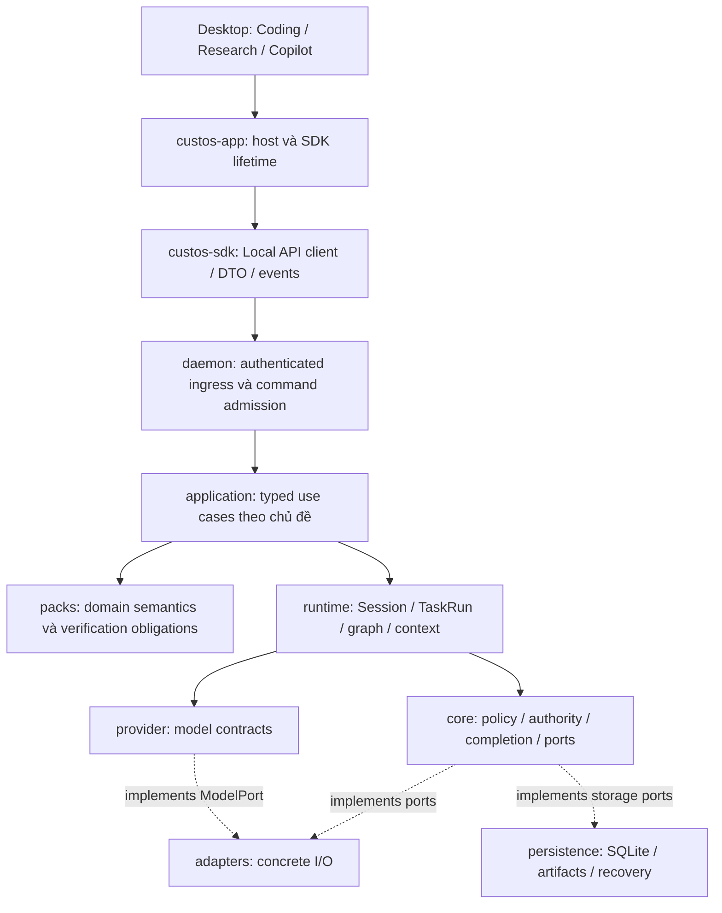
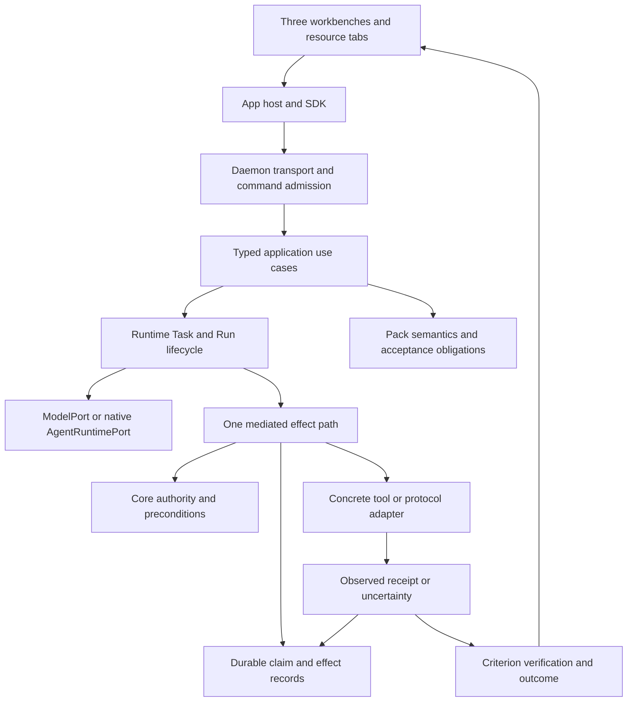

# Crates: đánh giá hiện trạng và kế hoạch refactor theo chủ đề

**Repo Intelligence removal:** subsystem scanner/graph/query/coordinator riêng đã được bỏ theo quyết định sản phẩm. Không triển khai hoặc phục hồi các placement Repo Intelligence trong những snapshot/kế hoạch lịch sử bên dưới. Giữ file/search/Git/worktree, context compiler và SourceSpan của Engineering; Nexus vẫn là development utility độc lập.

Removal verification: `cargo check --workspace --all-targets --offline` passed; library suites core/domain/packs/runtime passed 64/79/46/195 tests, and the retained source-context/evidence/restart e2e slice passed 1 test (385 total). No remaining retired Rust symbols/imports were found in product source or tests. No frontend code, migration, user data or Nexus files changed. Optional features and desktop visual behavior were not exercised. Nine Rust implementation/contract files and the dedicated architecture document were removed; no commit/push was performed.

**Current implementation entry:** [§22](#22-implementation-wave-grants-graph-outcomes-and-source-acquisition) records the implemented correctness wave and its verification. §17–21 are the preceding dirty-tree audit: some findings, including the physical-read regression, have since received fixes, so do not replay that report as current test status. §19–20 retain the larger ownership/campaign map; unfinished packets remain explicit. The [file disposition ledger](crates-file-disposition-ledger.md) is an earlier clean-snapshot inventory, not proof of current per-line semantic coverage or deletion authority.

## 1. Kết luận và phạm vi

**Giữ các ranh giới crate hiện có; refactor mạnh ownership và đường thực thi bên trong. Không xóa hàng loạt theo số dòng, không thêm một backend/gateway trung tâm thứ hai.**

Custos là SADE local-first cho Coding, Research và Copilot. Ba workbench dùng chung Session, Task, Run, nguồn, artifact, quyền và kết quả; khác nhau ở semantics, resource views và tiêu chí nghiệm thu. Một model API có thể phục vụ worker do Custos điều khiển. Một native agent có loop riêng được tích hợp qua harness. Không ép hai đường này thành cùng một giao thức hoặc cùng mức bảo đảm.

Bản này là **đề xuất để duyệt và chia việc**, không chứng nhận đã thực hiện. Snapshot kiểm tra: HEAD `d25c27b8e13d8f3287332a137444fe0e088408aa`, working tree sạch khi bắt đầu khảo sát. Checkout đã thay đổi so với các bản trao đổi trước: application handlers đã tách và production tool executor đã được thêm. Vì vậy không tiếp tục dùng nhận định cũ “chưa có executor” làm hiện trạng.

Giả định tải: một người dùng local, có thể mở nhiều cửa sổ, nhiều Run/terminal/kernel đồng thời; backend duy nhất theo profile. Remote model, MCP và GPU là tài nguyên có latency, chi phí và side effect, không phải lời gọi local nguyên tử.

Đã kiểm: toàn bộ manifests/module roots, inventory Rust, dependency nội bộ, các symbol/caller trọng yếu, daemon bootstrap, model/native/tool paths, context/skill/OI, repositories và host boundaries. **Chưa đọc từng dòng của mọi file**, chưa kiểm full feature matrix hay chạy GPU/cloud. Không dùng số dòng để suy ra RAM, binary size hoặc build time.

## 2. Số liệu thực và điều cần sửa trong bản audit tham khảo

Inventory bằng `rg --files crates -g '*.rs'`, đếm dòng source kể cả test, comment và source chưa mount: **544 file, 172.422 dòng Rust**. Không gồm SQL, frontend hoặc assets. Cargo metadata có **16 workspace packages**, trong đó 12 package sản phẩm; `custos-app` có hai host packages. “11 canonical crates” là 11 nhóm kiến trúc/thư mục, không phải số package Cargo.

| Nhóm | File Rust | Dòng | Ý nghĩa cần đọc đúng |
|---|---:|---:|---|
| adapters | 118 | 53.500 | Concrete I/O, local inference, harness, protocol và optional extensions |
| provider | 48 | 31.850 | Model contracts, conversation compatibility và vendor formats |
| runtime | 128 | 23.139 | Agent/workflow/session/context/cognition và resource coordination |
| daemon | 26 | 17.398 | Composition, transport, application handlers và tests |
| persistence | 22 | 10.696 | Một DB owner, repositories và recovery |
| domain | 54 | 9.837 | Pure entities, IDs, transitions và wire-safe value types |
| sdk | 12 | 8.421 | Local API client/DTO, ACP wire và optional bindings |
| core | 64 | 7.355 | Policy/kernel/contracts, nhưng vẫn có concrete filesystem I/O cần di chuyển |
| packs | 55 | 7.189 | Ba miền, recipes, rubrics và skill implementations |
| app | 14 | 2.590 | Hai native host packages, không phải backend nghiệp vụ thứ hai |
| bridge | 3 | 447 | Session–Task promotion/attachment/steering |

Các kết luận phải hiệu đính:

1. `provider/types/formats/` có 17.344 dòng, nhưng có caller thật: `providers/providers/*`, native tool formatting, model/cache helpers và Research Codex import. **Không được xóa cả cây.** Chúng không chỉ là “struct JSON”; có chuyển đổi message/tool/reasoning.
2. `local_inference/` có 12.403 dòng và được bootstrap thật trong `daemon/runtime.rs`; GGUF inventory/load và native inference là năng lực phải giữ. `hf_models.rs` nằm sau `hf-hub`, MLX sau `mlx`; không cộng toàn bộ vào default runtime cost.
3. `roaming/` có 2.423 dòng. Không thấy composition từ daemon/app trong phạm vi search; tuy nhiên có `SystemOneA2ARouter::with_node`, protocol API, docs và tests nội bộ. Kết luận phù hợp: **chưa composed trong sản phẩm**, không phải “không có giá trị, xóa an toàn”. `cargo tree -p custos-daemon -i iroh --offline` xác nhận iroh nằm trong graph mặc định qua adapters.
4. `context/compaction/` và `context/memory/` tồn tại vật lý nhưng không được mount từ `context/mod.rs`. `context_management/` và `memory_service/` đang được export. Có file giống hệt, có file đã khác; không có hai active compaction engines chỉ vì hai folder tồn tại.
5. `gateway/` là module compiled nhưng không thấy product bootstrap/caller bên ngoài cụm; local/external/A2A dispatcher trả lỗi chưa nối. Đây là đường thử nghiệm chưa tích hợp, không là authority gateway chuẩn.
6. `EngineeringRecipePipeline::assemble_outcome` có giá trị validation/composition; không tự chạy diagnose/patch/test. Giữ semantics và nói đúng mức hoàn thiện, không gọi nó là autonomous executor.
7. Không có cơ sở cho lời hứa “xóa 25–35 nghìn dòng không mất gì”, “build nhanh hơn 40%”. Phải đo theo build profile và giữ acceptance trước/sau.

## 3. Các vấn đề phải sửa trước khi đổi cây thư mục

### Must fix

**F1 — Production tool executor chưa thực hiện authority theo Task/Run.**

- Source: `daemon/runtime.rs::DaemonGovernedToolExecutor`; `runtime/agent/runtime_port.rs::GovernedToolExecutor`.
- Case: tool `write_file` hoặc `bash` qua `authorize()` không bị chặn bởi kiểm tên `dangerous_`/`format_disk`, rồi gọi trực tiếp `handle_write`/`handle_bash`. Executor không nhận Task/Run/scope/permit; nhánh này không đi qua `SandboxPort::execute` để kiểm permit binding.
- Fix: một đường dispatch có context do backend resolve, canonical intent, Kernel authorization, durable attempt/outbox và receipt. Không cho adapter helpers public trở thành lối tắt quyền. Pending approval không được coi như tool failure rồi để model tự thử lại.
- Nếu bỏ qua: tên “governed” và nhãn `custos-mediated` có thể gây hiểu nhầm về những gate thực sự đã chạy. Đây là gap của implementation, không kết luận mọi UI turn hiện đã kích hoạt đường này.

**F2 — DAG worker dùng node ID thay task identity và gán risk thấp cho tool tùy ý.**

- Source: `runtime/workflow/worker_executor.rs::execute_step`.
- Case: `tool_call` tạo Action với `RiskLevel::Low`, request permit bằng `node_id` và chưa bind `action.task_id`; sandbox có kiểm binding sẽ từ chối, còn policy không có target/effect facts chính xác.
- Fix: executor nhận execution context của Task/Run/Worker/Node; risk/effect do trusted policy xác định; không dùng node ID làm Task ID. Test tool hợp lệ chạy được, tool ngoài scope bị chặn, shell không được hưởng risk của read.
- Nếu bỏ qua: DAG và direct agent có semantics quyền khác nhau; test “không kernel thì lỗi” chưa đủ chứng minh đường có kernel đúng.

**F3 — OI hard filters chưa là privacy/capability boundary đáng tin.**

- Source: `core/oi/hard_filters.rs::evaluate`, `runtime/oi/{candidate_builder,estimator,selector}.rs`.
- Case: `no-external-egress` chỉ từ chối candidate có tên chứa `cloud`; `claude-code` không chứa chuỗi đó. Capability check được mô tả ở comment nhưng không được thực thi tại hàm này. Candidate và cost đến từ danh sách/số tĩnh.
- Fix: quyết định từ capability/locality/account facts có provenance; unknown locality không được vượt local-only; phân biệt model pin với harness pin. Dùng catalog/registry thực và estimate có nguồn, không dùng tên làm policy.
- Nếu bỏ qua: explain report có thể hiển thị “admitted” mà chưa kiểm đúng constraint. Không suy ra đây là đường mọi request hiện đi qua; API explain và OI tests có caller, sản phẩm cần nối riêng.

**F4 — File skill không có scope root và cap output không chặn peak memory.**

- Source: `runtime/cognitive/skills/fs/file_read.rs::run`, `SkillContext` trong `skills/mod.rs`.
- Case: path bất kỳ được canonicalize rồi đọc; không có so sánh với root được cấp quyền. `tokio::fs::read` nạp cả file trước khi lấy slice, nên `max_bytes=1024` vẫn có thể nạp file lớn vào RAM.
- Fix: backend-resolved scope qua existing file/capability ports; seek + bounded read; clamp yêu cầu, checked arithmetic; bảo toàn taint/source refs. File local không mặc định trusted instruction.
- Nếu bỏ qua: cùng một skill có thể đọc ngoài workspace hoặc gây memory spike dù output nhỏ.

### Should fix

**F5 — Nhiều execution primitives chưa hội tụ một lifecycle sản phẩm.**

- Source: `TaskRuntime`, `GraphRuntime`, `WorkflowMachine`, `GovernedAgentRuntime`, `WorkerExecutor`.
- Case: model path của TaskRuntime stream trực tiếp và emit `ToolCall` lên observer; không gọi governed loop. Native path có vòng xử lý intents khác; governed loop trả intents đã `Receipt`, nên nối đơn giản vào vòng dispatch cũ có nguy cơ chạy lại.
- Fix: TaskRuntime là lifecycle owner; GraphRuntime chỉ scheduling; agent loop chỉ reasoning/tool continuation; WorkflowMachine là checkpoint primitive nếu có caller cần. Tool proposal và đã-executed observation phải được xử lý phân biệt bằng typed contract hiện có/được mở rộng có review.
- Nếu bỏ qua: thêm một executor không tự làm cả ba workbench trở thành agent studio hoạt động nhất quán.

**F6 — Core có concrete filesystem I/O; runtime/packs cũng có nhiều đường I/O riêng.**

- Source: `core/context/mod.rs`, `core/evidence/verifier.rs`, `core/capability/deterministic.rs`, runtime workspace/lease/notebook/terminal và foundation skills.
- Case: đọc nguồn hoặc kiểm citation trong core cần real FS; test policy bị buộc phụ thuộc filesystem, trong khi adapter cũng có path enforcement khác.
- Fix: giữ invariant/policy/verification logic thuần ở core; chuyển source/process observations sang adapters qua existing contracts. Không di chuyển policy ra adapter, không tạo dependency ngược adapters→runtime.
- Nếu bỏ qua: import graph có vẻ đúng nhưng trusted policy boundary vẫn lẫn môi trường thực thi.

**F7 — Application extraction mới tách file, chưa tách dependency theo use case.**

- Source: `daemon/application/*`, `api.rs`; 11 handler modules vẫn `impl LocalApiDispatcher` và dùng shared context.
- Case: workspace use case vẫn chạy Git trực tiếp; providers handler có tài khoản, OAuth, inventory và load; research có nguồn/claims/notebook/artifacts trong cùng request match tree.
- Fix: tách typed methods theo ownership và reuse existing coordinators; router chỉ decode/validate transport và map result. Không tạo service struct wrapper cho từng endpoint chỉ để giảm số dòng.
- Nếu bỏ qua: thay một file lớn bằng nhiều file lớn nhưng dependency vẫn gắn chặt cùng dispatcher.

**F8 — CLI host còn link daemon, khác Desktop host.**

- Source: `app/cli/Cargo.toml`, `app/cli/src/lib.rs`; so với `app/desktop/Cargo.toml`.
- Case: CLI host dùng `custos_daemon::local_api` và daemon profile helpers, kéo dependency backend vào client build. Package này thực tế là Tauri host, không nên đọc tên như một Rust terminal CLI thuần.
- Fix: dùng SDK LocalApiClient/ProfileResolver và host readiness flow; audit Tauri commands/capabilities của host này trước khi retire. Không xóa package chỉ vì Desktop là primary.
- Nếu bỏ qua: có hai client boundary conventions và build graph host nặng không cần thiết.

**F9 — Optional bindings/features chưa có bằng chứng build tương xứng.**

- Source: `sdk/bindings.rs`, `sdk/Cargo.toml`, adapters feature declarations và gated modules.
- Case: bindings nhắc `custos_context_management`/`custos_providers` nhưng manifest hiện không khai báo dependencies cùng alias. Chưa khẳng định compiler error đầy đủ vì offline check dừng trước ở thiếu `askama`.
- Fix: quyết định support optional surfaces; migrate binding imports/contracts hoặc đánh unsupported có kiểm tra rõ. Mỗi feature được hứa phải có CI build; chưa build không gắn nhãn production.
- Nếu bỏ qua: default workspace check xanh nhưng release bật feature khác có thể không build.

## 4. Bản đồ ownership đích

| Chủ đề | Domain | Core | Runtime / Packs | Adapters / Persistence | Daemon / SDK / App |
|---|---|---|---|---|---|
| Work identity | Session, Task, Run, binding, resource refs | Transition, completion, revision constraints | Session và Run lifecycle; bridge giữ liên kết | Canonical rows/events | Commands, scoped queries; UI selection không là quyền |
| Coding | Source spans, patch/test artifacts | Scope/base preconditions, evidence acceptance | Runtime repo intelligence/context; Engineering recipe/rubric | Git/FS/search/parser/process drivers; source snapshots | Coding use cases → source/diff/test/terminal projections |
| Research | Source, passage, claim, annotation, execution, lineage | Ingress/status/invalidation/acceptance | Research acquisition/extraction/synthesis semantics | Fetch/PDF/OCR/notebook I/O; source/claim repositories | Research use cases và resource API |
| Copilot | Draft, identity, schedule, grant/outbox records | Exact effect authority và uncertainty rules | Assistant intent/identity/draft/automation semantics | Contacts/mail/calendar/MCP drivers; durable outbox | Preview/approve/status; không synthetic sent |
| Agent execution | Worker identity, attempts, observations | Authority, budget, completion | Agent loop và bounded graph execution | External harness và model/tool drivers | Composition và realtime projection |
| Intelligence | Judgment/decision/route records | Hard admissibility | S1 judgments, OI strategy, offline Meta proposals | Model/local scorer adapters; calibration records | Inspect/explain/settings, không tự đổi policy |
| Compute | Recipe/environment/checkpoint/lease/attempt | Checkpoint integrity và compatibility rules | Notebook/training/handoff coordination | Colab/Kaggle/rented GPU/storage drivers | Targets/attempts/checkpoints UI API |

`custos-app` nối frontend với backend ở cấp **host experience**: cửa sổ, native webview, readiness/reconnect và SDK lifetime. Nó không gom tất cả crate implementation vào một hub. `custos-daemon` là composition root/backend ingress; `custos-runtime` điều phối; `core` quyết định policy. Ba trách nhiệm này phải rõ, không hợp nhất để “hai đầu dây cắm vào app”.

Sơ đồ là data/control flow; code dependency đi từ implementation vào contracts. Core không import adapters. Daemon inject concrete implementations. Pack không tự cấp permit hoặc mở DB. SDK không import runtime/daemon/persistence.

## 5. Cấu trúc repo đích: giữ crate, chuẩn hóa bên trong

Không tạo đủ folder dưới đây ngay. Mỗi địa chỉ được materialize khi chuyển use case cùng caller/test. Các tên đề xuất không là schema hoặc protocol mới.

| Crate | Cấu trúc theo chủ đề nên hội tụ | Điều không được đặt vào |
|---|---|---|
| `custos-domain/src` | Giữ entities hiện tại, nhóm bằng module khi có nhiều types cùng lifecycle; không ép chia `coding/research/assistant` cho object dùng chung | FS/DB/process/model calls |
| `custos-core/src` | `kernel`, `authority`, `evidence`, `contracts`; `oi` giữ hard validation/compiler; `context` giữ transform/redaction thuần; `repo` giữ rules thuần | File readers, shell runners, vendor HTTP |
| `custos-provider/src` | Giữ `port`, `turn`, `events`, `request`, `catalog`; conversation types dùng chung; khoanh `types/formats` thành compatibility surface trước khi chuyển vendor translators | Credentials, authority, agent processes |
| `custos-runtime/src` | `agent`, `workflow`, `session`, `context`, `cognitive`, `oi`, resource coordinators; gom compaction dưới `context` sau parity | Concrete vendor transport, mint permit, canonical DB |
| `custos-adapters/src` | `providers`, `harness`, `local_inference`, `mcp`, `a2a`, optional `roaming`, `sandbox`, `workspace`, `repository_git`, `compute`, `tools`; thêm notebook/terminal driver modules khi extraction được duyệt | Pack acceptance, OI strategy, Task completion |
| `custos-packs/src` | `engineering`, `research`, `assistant`; common manifest/rubric/verifier facade; mỗi miền có recipes/skills/artifact assembly | Concrete unrestricted FS/network capabilities |
| `custos-persistence/src` | Giữ một connection/store; repositories theo aggregate; research thành module con `sources`, `claims`, `notebooks`, `executions`, `artifacts`, `reviews` khi cần | Scheduler, model routing, UI state owner |
| `custos-daemon/src` | `api` transport/admission; `application` typed use cases; `runtime` composition; `credentials` lifecycle; tests theo use case | Autonomous loop mới, duplicate repositories |
| `custos-sdk/src` | `local_api`, `profile`, versioned wire/event conversions; ACP `wire_types` giữ scope riêng; optional bindings qua contracts nhẹ | Backend bootstrap/business services |
| `custos-bridge/src` | Giữ promotion/attach/steer service; không tự thành Local API gateway thứ hai | SQLite hoặc privilege bypass |
| `custos-app/{desktop,cli}` | Host lifecycle/native integration, dùng SDK; Desktop primary nhưng giữ compatibility entrypoint có người dùng | Link toàn daemon để gọi helper/client |

## 6. Quy tắc đặt skill và tính năng mới

**Skill là đơn vị đóng gói workflow/capability semantics; MCP là cách expose/connect; RAG là retrieval strategy; agent là execution loop. Chúng không thay thế nhau.**

1. Function thuần như rank/chunk/validate/format → module theo chủ đề, không tự bọc MCP/agent.
2. Concrete file/search/process/network → adapters; interface tối thiểu ở existing core contract nếu runtime cần gọi qua boundary.
3. Recipe Coding/Research/Assistant → packs; gọi capability/service qua injected ports, không tự mở executor không có scope.
4. Shared retrieval/context budgeting → runtime/context. Repo intelligence là service cung cấp snapshot/spans/coverage; Engineering skill dùng service này.
5. Autonomous repo investigator → worker role + bounded agent loop dùng repo intelligence. Không chuyển cả repo index thành agent hoặc bắt Python subprocess dùng A2A.
6. MCP server wrapper → adapters/mcp, delegate cùng capability path; tool discovery không tự là grant. Native agents chỉ dùng được capability khi adapter/harness support thực tế.
7. Cost optimization → context pruning/cache policy/routing nằm runtime; provider pricing/usage fidelity ở adapters/provider contracts; hard budget ở core; measurements ở persistence/evals. Không gom thành folder `cheap_skills` hoặc ba bản optimizer theo pack.

Registry hiện ở `runtime/cognitive/skills` được giữ trong bước đầu. Chuyển concrete foundation skill I/O ra adapters bằng cách reuse existing WorkspaceFilesPort/SandboxPort và các contracts thật sự cần. Không để adapters implement runtime-owned trait nếu gây cycle. Chỉ chuyển trait sang core sau khi xác nhận reuse và cập nhật mọi caller; không thêm “SkillOS” hay port tổng quát bao trùm mọi thứ.

## 7. Ba đường execution phải đi đến cùng một ledger

### 7.1. Model API, kể cả local coder

User chọn model/account → TaskRuntime tạo Run → compile context theo scope → model turn → tool proposal → Kernel/effect dispatch → observation trở lại model → evidence/outcome. Model chỉ trở thành coding agent khi Custos cung cấp loop, toolset và lifecycle; bản thân provider không phải agent.

Dùng structured tool-use messages hiện có, không chèn mọi tool result thành transcript string rồi mất call ID, roles, images hoặc reasoning continuity. Giữ single-turn chat fast path khi không cần tool. Không bắt mọi request chạy OI/remote S1.

### 7.2. Native coding/research/assistant harness

TaskRuntime → registered AgentRuntimePort → exact workspace → native loop → observed events/diff/result → ledger/evidence. Không chạy thêm Custos loop bên trong native loop. `provider-governed` khi Custos không intercept tools; không suy ra managed worktree là OS sandbox.

### 7.3. Graph và automation

OI proposal hoặc user workflow → core compiler/hard validation → workflow revision → bounded scheduler → workers theo scoped execution context. Mỗi effect dùng cùng mediated dispatch như model worker, không một `WorkerExecutor` risk-low shortcut. Node success không tự làm criterion pass. Resume chỉ tiếp tục future work đã revalidate, reconcile uncertain effect trước.

**Ownership cuối:** TaskRuntime owns Run admission/launch/cancel/result; GraphRuntime owns readiness/join; agent loop owns model/tool continuation; core owns permit/completion; adapter owns external action. `WorkflowMachine` chỉ giữ nếu tiếp tục phục vụ checkpoint continuation khác biệt và có caller; không xây scheduler thứ ba từ nó.

## 8. Refactor cho từng workbench, không chỉ infrastructure

### Coding

- Giữ: workspace/worktree, native harness registry, PTY, source tree, diff, repo intelligence và test artifacts.
- Chuyển: Git/FS/process khỏi application/runtime concrete paths sang adapters, giữ coordinator policy và lease lifecycle.
- Hoàn thiện: repo explanation có source anchors; investigate có hypothesis/reproducer; patch có base hash/scope; verification dùng oracle đáng tin, không chỉ `passed: true` do caller cung cấp.
- Gate: hai worktrees/two Runs không lẫn paths/terminal/output; stale patch bị từ chối; cancel một Run không hủy peer; restart giữ đúng task/artifacts.

### Research

- Giữ: corpus/source version, passages, claims/contradictions, annotations, notes, notebook/execution, recipes, artifacts, review và lineage. Không xóa document/visualization capability chỉ vì source gốc Goose.
- Tách application: sources/claims; notebook/executions; review/synthesis; notes/artifacts. Cùng repository facade có thể giữ để giảm migration blast radius.
- Notebook coordinator quản execution IDs/state; driver quản Python/Jupyter transport/process/output/interrupt. Kernel identity không đồng nghĩa conversation session hoặc GPU lease.
- Compute coordinator bind notebook/execution/experiment/attempt/checkpoint. Colab→Kaggle/rented GPU là checkpoint resume có compatibility gate, **không** di chuyển live Python memory. Chỉ tự chuyển nếu checkpoint đã durable và target có quota/capability/consent/budget.
- Gate: một source revision → claim → notebook execution → attempt → checkpoint → resume có lineage liên tục; OCR gap/citation thiếu support vẫn unknown; run GPU không tự là research conclusion verified.

### Copilot

- Giữ: chat không cần repo, draft, identity, schedule, reminders và bounded automation.
- Tách: draft semantics ở pack; exact effect authority ở core; connector I/O ở adapters; durable delivery ở persistence/runtime coordination.
- Gate: recipient ambiguity hỏi người dùng; payload sửa vô hiệu approval; unsupported connector unavailable; timeout sau send uncertain, không synthetic delivered hoặc retry mù.

UI chỉ đọc projections của các identity trên. Screen/tab là presentation; close tab không kill kernel/terminal trừ thao tác stop rõ. Chuyển workbench giữ canonical conversation và selected artifacts theo consent, không copy toàn bộ history thành authority/context mặc định. Đây là integration contract với frontend, không yêu cầu redesign UI trong cùng refactor crates.

## 9. Upstream và dependency: quyết định giữ/chuyển/cô lập/bỏ

| Cụm hiện tại | Quyết định đề xuất | Điều kiện trước khi làm |
|---|---|---|
| `adapters/roaming` + iroh | Feature-gate opt-in, chưa xóa source | Inventory external callers/docs/config; gate dependency và toàn module/reexports; check default không kéo iroh và opt-in vẫn build |
| MCP builtin tutorial | Retire khỏi product surface nếu không có user job | Search dynamic registry/feature references; giữ attribution/source map; test feature policy |
| MCP document/visualizer/memory builtins | Optional capability, extract có chọn lọc; không xóa blanket | Map Research/Copilot parity, dependency/security và actual tools; reuse UI artifact viewers thay vì server riêng khi hợp lý |
| GGUF/native inference | Giữ; tách lightweight discovery khỏi engine/load lifecycle | Đo idle RSS, load/unload/restart; capability reports honest; không buộc user cài Ollama để thay tính năng native |
| MLX/HF optional modules | Supported opt-in hoặc explicit experimental | Feature matrix/build thực; không tính dormant lines là RAM tiết kiệm |
| `provider/types/formats` | Giữ compatibility hiện tại; migrate vendor conversion từng provider | Golden fixtures tools/images/reasoning/usage/stream/cancel/import; move neutral model/cache helpers trước; giữ dependency graph không cycle |
| `runtime/context/compaction` | Diff từng file rồi chọn active implementation làm source chuẩn | `format/model/provider/summarize` giống nhau; `structured/templates/lib` có khác biệt cần review; không overwrite active bằng dormant |
| `runtime/context/memory` và `memory_service` | Gỡ duplicate dormant, review active stub | Core MemoryPort là vocabulary cần hội tụ; chưa có implementation không tự viết một memory DB mới |
| `runtime/gateway` | Retire product facade hoặc giữ experimental rõ; tái sử dụng policy/metrics có caller | Không xóa useful routing/cost logic chưa map sang OI; transport thuộc adapters, authority thuộc core |
| `runtime/oi` | Giữ decision/explain/topology vocabulary; thay static discovery/estimates từng bước | Không đổi “Orchestration Intelligence” thành “Optimized Inference”; measured benefit trước multiagent default |
| `provider` compatibility types / SDK ACP | Giữ biên backward-read/import và supported client contracts | Không đồng nhất ACP với A2A hay Codex native transport; không xóa source attribution |

Cargo features phải gate cả dependency và `mod`/reexports/caller, không chỉ thêm một tên feature rỗng. Features có tính cộng dồn; kiểm feature activation từ workspace và package riêng. [Cargo feature reference](https://doc.rust-lang.org/cargo/reference/features.html), [resolver reference](https://doc.rust-lang.org/cargo/reference/resolver.html).

MCP có tools/resources/prompts và discovery; không là internal ownership model hoặc security kernel của Custos. [MCP server overview](https://modelcontextprotocol.io/specification/draft/server/index). Jupyter phân biệt sessions và kernels; dùng làm adapter contract reference, không gộp với conversation của Custos. [Jupyter REST API](https://jupyter-server.readthedocs.io/en/stable/developers/rest-api.html).

## 10. Các gói triển khai có dependency và gate

Không triển khai một giant diff toàn repo. Có thể một integration branch/refactor campaign, nhưng các packet dưới đây phải independently build/review được. Đổi contract cần cùng caller/test/schema fixtures; structural move không trộn behavior change không liên quan.

| Packet | Việc thực hiện và paths chính | Gate nghiệm thu | Phụ thuộc |
|---|---|---|---|
| A — Baseline | Pin SHA/dirty manifest; list API methods, package/feature graph, production composition; giữ desktop scenarios | Default all-target check; baseline fixture counts; rollback không mất local data | Không |
| B — Effect boundary | `runtime.rs` executor, runtime agent tool contract, core authority/contracts, adapter developer, outbox/effect records | Unauthorized write/shell/MCP không dispatch; payload change/stale Run từ chối; denied tool không effect; timeout/cancel unknown đúng | A |
| C — Worker convergence | TaskRuntime/GraphRuntime/WorkerExecutor/agent loop; typed scope/attempt/receipt binding | Tool chạy đúng một lần; model continuation thực; same scope trên graph và direct; native harness không double-loop | B |
| D — Host và ingress | app/cli dùng SDK; explicit method classification; transport-only API + typed use cases | Hosts không link daemon; reconnect/replay giữ command ID; business rejection không retry | A, nối lại sau B |
| E — Concrete I/O extraction | core file readers; runtime skills/workspace/lease/PTY/notebook drivers → adapters qua ports | Core tests bằng immutable observations; path/symlink/secret/size/time caps; lifecycle và UI parity | B; làm từng capability |
| F — Context và memory | `context_management` hội tụ `context/compaction`; dormant copies, gateway stub review; memory contract inventory | Same structured summary/provenance/usage; resume/freshness/omissions; không mất bindings trước khi retire compatibility | A, E khi cần source I/O |
| G — Dependency profiles | Optional roaming/iroh; native discovery/load profiles; builtin feature policy; provider compatibility matrix | Default graph loại dependency opt-out; supported opt-in build; no fabricated capabilities; đo footprint thực | A; không chờ đổi toàn runtime |
| H — Application và repositories | Tách providers accounts/catalog/local; workspaces files/git/candidates; research subtopics; fleet/browser/automation | API golden parity; transaction không tách thành nhiều commit; scoped/paginated projections; không duplicate state | D, E theo chủ đề |
| I — Coding vertical | Repo intelligence + controlled patch + independent verifier + native path parity | Explain/bugfix/refactor riêng, source stale, dirty worktree, conflicting writes | B, C, E |
| J — Research studio vertical | Corpus/claim/notebook/compute/checkpoint/lineage join và typed use cases | Local fake target lifecycle; restart/checkpoint compatibility; external test opt-in; unknown honesty | B, C, E, H |
| K — Copilot vertical | Real connector capability + exact approval + reconcile/standing grants | Wrong recipient/changed payload/duplicate send fixtures; unsupported fail closed | B, C, H |
| L — OI/S1/Meta | Registry-derived candidates; truthful cost; hard filters; S1 scout/rerank/check; versioned offline calibration | Same-model baseline, pinned/local-only, known vs unknown spend; opt-in topology có measurable benefit | B, C, I/J/K fixtures |

Thứ tự bắt đầu: **A → B → C**; D/G có thể làm độc lập trên file scopes không chồng lấn. Sau đó E/H theo vertical, không di chuyển toàn bộ file một lần. F không được làm mất context continuity. L giữ baseline dùng được trong suốt campaign; không chờ thuật toán “siêu đỉnh” mới sửa security.

### Packet B cụ thể

1. Giới hạn tool exposure về capability thực sự có mediated path; không gọi `handle_*` để bypass permit.
2. Extend existing executor contract để nhận backend-resolved invocation identity và arguments đã canonicalize; không tin model tự gửi task/actor/workspace ID.
3. Kernel kiểm task status/revision, effect classification, scoped grant và budget; approval-required trả một trạng thái đợi có thể tiếp tục.
4. Record durable attempt/outbox trước external dispatch; claim chống hai worker; dùng actual adapter idempotency khi có.
5. Dispatch qua adapter có permit binding; ghi receipt/failure/uncertain. Không suy ra shell `exit=0` làm criterion pass.
6. Trả typed observation vào đúng model call; không đưa receipt trở lại hàng đợi intents để chạy lần nữa.
7. Cancel/timeout giữ uncertainty; reconcile trước retry; reject stale worker trước dispatch, không chỉ lúc save Run.

### Packet H cụ thể

- `application/providers.rs` → accounts/credentials, catalog/discovery, local-runtime operations. Reuse credential service hiện tại, không tạo credential store thứ hai.
- `application/workspaces.rs` → workspace lifecycle, repository inspection, changes/candidates/integration, GitHub account actions. I/O ở `workspace.rs`/`repository_git.rs` adapters; approval/expected source ở core/runtime.
- `application/research.rs` → source/claim, notebook/execution, review/synthesis, artifacts/notes. Không chia transaction lineage/checkpoint qua các repository commits riêng lẻ chỉ để có folder đẹp.
- `application/integrations.rs` → browser/emulator/fleet/automation. Scheduler không nằm transport; stop resource không xóa user data.
- `api/tests.rs` → tests theo các use cases trên, dùng cùng harness setup. Giữ transport/replay tests tại ingress. Không phải mỗi test file một helper framework.

## 11. Đo hiệu năng và chi phí đúng chỗ

- Compile: cold/warm check/build theo cùng toolchain/features/target; dependency graph và incremental effects. Không chạy `cargo clean` trên target người dùng chỉ để lấy baseline; dùng target directory tạm riêng khi được chọn đo.
- App: release host binary size, daemon idle RSS/CPU, startup TTFO; load/unload local model, đóng/mở 10 terminal/kernel/run; memory sau cancel/terminal settlement.
- Queries: paging/byte caps cho history, logs, source/artifact inventories; backpressure và observer lifetime; một component UI không tự poll lại mọi subsystem.
- AI: billed/estimated/unknown tách riêng; prompt/cache/tools/retries/verifier/human time; cost per accepted task kèm accepted rate.
- S1 được hỗ trợ scout, rank, context filtering, simple checks hoặc bounded micro-actions **trong cùng authority path**; không thay S2 reasoning bằng summary mất provenance, không auto-downgrade model pin.
- Compute: checkpoint frequency theo time-to-expiry và expected lost work/storage cost; cap concurrent jobs, lease spend và egress; target chưa usable không tự chạy benchmark hoặc trả phí.

## 12. Kiểm tra của lượt khảo sát và điều chưa biết

Đã chạy fresh trên snapshot: inventory, `cargo metadata --offline --no-deps --format-version 1`, `cargo tree -p custos-daemon --offline -i iroh`; **`cargo check --workspace --all-targets --offline` pass**. All-target check không kiểm tất cả feature combinations, không chạy tests và không chứng minh runtime security. Các tests của lượt refactor trước không tự là chứng cứ cho HEAD mới.

`cargo check -p custos-sdk --features uniffi --offline` dừng ở dependency `askama v0.16.1` chưa có trong cache. Đây là **unverified feature**, không phải bằng chứng compile pass hoặc kết luận compile fail do source. Không tự tải dependency, không gọi endpoint trả phí và không mở GPU job trong khảo sát.

Không audit từng dòng vendor format, protocol implementation, OS sandbox, UI hoặc mọi repository transaction trong lượt này. Các path có finding cụ thể đã được đọc; các đề xuất deletion vẫn cần feature/caller/parity gates. Không hứa exact-once remote effects, live GPU migration hoặc tốc độ/tiết kiệm chưa đo.

**Điểm dừng của refactor:** mỗi chủ đề có một owner, một execution path được kiểm và một nguồn state chuẩn; người thêm skill/adapter/workbench resource biết đặt code ở đâu và test boundary nào. Không lấy “ít folder nhất”, “nhiều crate nhất” hoặc số dòng xóa làm định nghĩa hoàn thiện.

## 13. Khảo sát bổ sung và phạm vi từng file

Snapshot mới: `28ab973`, cây sạch khi bắt đầu. Inventory bằng `rg --files --hidden crates`: **781 files**, gồm **537 files Rust / 169.425 dòng**, **40 migrations SQL**; phần còn lại là manifests, templates, vendor assets, icons, configuration, examples và bindings packaging. Không gồm ignored/generated build outputs. Inventory đã đọc bytes của từng file để đo kích thước, phân loại text/binary và so duplicate; điều này **không tương đương đã review ngữ nghĩa mọi dòng**.

[File disposition ledger](crates-file-disposition-ledger.md) cho biết từng file thuộc workstream nào, hành động đề xuất và nơi đến. Các row gán theo module family là **triage**, không giấy phép xóa. Những finding bên dưới dựa vào đoạn implementation được đọc trực tiếp và caller search. Vendor minified JS, model metadata lớn, toàn bộ format conversion và toàn bộ SQL transactions chưa được review line-by-line; không gắn trạng thái “đã audit full” cho 781 files.

### Thay đổi so với snapshot trước

- `computercontroller`, tutorial và related MCP helpers đã bị xóa trong commit mới; không lập lại công việc xóa chúng.
- `CustosRuntime.gateway` và `memory_store` đã được khởi tạo. Search source cho thấy hiện mới construction/retention; không thấy request path dùng chúng. Gateway dispatchers local/external/A2A vẫn trả lỗi chưa nối. **Construction ≠ integration.**
- Có `InMemoryMemoryStore` implementation mới. Vì vậy nhận định trước “không có impl MemoryStore” đã cũ. Implementation này không triển khai core `MemoryPort`, không có project/user scope, retention hoặc persistence; chưa thể là canonical memory của ba workbench.
- OI đổi tên candidate từ `goose` sang `custos-agent`, nhưng vẫn là static candidate. Harness đăng ký thật là `governed-agent-runtime`; đổi nhãn không chứng minh candidate resolve được tới registry runtime.

### Findings bổ sung

**F10 — Bản sao context còn nằm trên đĩa và có thể đánh lừa người phát triển.**

- What: `context/compiler.rs` được mount; `context/compiler/{compiler,recipe,traits,lib}.rs` không được mount bởi khai báo hiện tại. Các cây `context/compaction` và `context/memory` cũng chưa được mount.
- Problem: sửa `context/compiler/recipe.rs` sẽ không đổi executable hiện tại. File đó còn nhắc `custos_repo_intelligence`, và constructor ContextPack/ContextItem theo shape cũ; kích hoạt thẳng không phải migration hợp lệ.
- Fix: chọn một source chuẩn; port phần logic thực sự cần, cập nhật caller/fixture, rồi xóa dormant copy. Không copy nguyên dormant tree ghi đè code đang chạy.
- If skipped: agent/người phát triển tiếp tục sửa nhầm implementation không được build.

**F11 — Khởi tạo memory store mới không giải quyết được memory contract và scope.**

- What: `runtime/memory_service/store.rs` dùng `HashMap<MemoryTier, Vec<Fact>>`; core `MemoryPort` dùng scoped recall/proposal records.
- Problem: nếu đưa store vào product recall, hai project cùng tier chia chung facts, không có giới hạn số fact, và restart mất mọi fact. Hiện chưa thấy product caller nên đây là activation risk, không tuyên bố đã rò dữ liệu.
- Fix: core MemoryPort giữ consent/proposal/scope contract; runtime chỉ điều phối retrieval/promotion; persistence giữ durable records. In-memory implementation chỉ là bounded cache/test fixture được scope rõ, hoặc bỏ construction chưa dùng.
- If skipped: thêm memory feature sau này phải bắc cầu giữa hai nguồn sự thật không tương thích.

**F12 — Pack verifier có thể pass từ metadata mà chưa có chứng cứ xác thực.**

- What: `assistant/verifiers/user_acceptance_oracle.rs` đọc `approved`, `approval_token`, `payload_digest` từ VerificationContext.
- Problem: object có `approved=true` và hai chuỗi bất kỳ không rỗng có thể Pass; không tra permit/grant/receipt hoặc so digest với approved payload. Tên “cryptographic user approval” vượt quá kiểm tra đang làm.
- Fix: context được compiler dựng từ persisted trusted approval/effect observations; verifier kiểm binding và status, không tin token string từ caller. Research assessment records cũng cần trusted ingress/source-version binding, không chỉ đúng JSON shape.
- If skipped: nối oracle này vào completion như một bằng chứng độc lập có thể cho pass giả. Đây là risk tại integration boundary, không khẳng định UI hiện đã khai thác đường đó.

**F13 — Artifact store chưa có nghĩa đầy đủ của content-addressed durable storage.**

- What: `persistence/artifacts/filesystem.rs` ghi thẳng vào tên hash, `get(hash)` join đường dẫn và trả bytes.
- Problem: một lần ghi bị ngắt có thể để blob thiếu; `get("../...")` không validate key; read không đối chiếu digest. Hiện search tìm consumer e2e, chưa thấy production composition nên cần đóng gate trước khi mở rộng dùng thật.
- Fix: validate canonical digest key, bounded read/hash verification, temp+flush/atomic promotion, missing/corrupt explicit; giữ một CasPort. Không thêm artifact store thứ hai cho Research.
- If skipped: resume/evidence có thể tham chiếu blob thiếu hoặc chấp nhận bytes sai hash.

**F14 — Reader pool chỉ giới hạn số connection idle, không giới hạn connection đang mượn.**

- What: `persistence/connection.rs` đặt `max_size=16`; khi idle hết, `reader()` mở connection mới.
- Problem: 100 reads chồng thời gian có thể mở 100 connections, không phải tối đa 16. Chưa chứng minh desktop thường đạt tải này, nhưng contract “bounded pool” không đúng nếu dựa vào tên biến.
- Fix: xác định giới hạn checked-out theo workload; bounded admission ở query coordinator/connection owner, hoặc mô tả đúng idle cache và đo trước. Tránh chặn async executor bằng std mutex/SQLite work lâu.
- If skipped: phát triển worker parallel có thể làm tăng file descriptors/RAM ngoài dự tính.

**F15 — Release workflow gọi package không tồn tại.**

- What: `.github/workflows/release-cli.yml` chạy `cargo build --release -p custos-cli`; package hiện trong `crates/custos-app/cli/Cargo.toml` tên `custos-app-cli` và main khởi động Tauri host.
- Problem: `cargo pkgid -p custos-cli --offline` trả lỗi không có package này. Workspace dependency alias không tự tạo một Cargo package tên mới; CI có thể check toàn workspace xanh mà release vẫn thất bại.
- Fix: xác định binary/host thực sự cần ship, cập nhật package selector cùng artifact paths, targets và packaging smoke test. Không chỉ thay chuỗi tên rồi giả định release artifact là terminal CLI đúng nghĩa.
- If skipped: refactor source hoàn tất nhưng không phát hành được sản phẩm qua workflow hiện tại.

Các finding F1–F9 vẫn phải đối chiếu trước khi sửa; F1/F2/F3/F4/F5/F6/F7/F8 còn hiện diện ở snapshot này. F9 chưa xác minh optional build vì dependency offline thiếu. Trong persistence, `synchronous=NORMAL` và guard FULL riêng cho credentials không tự chứng minh durability của mọi authority/effect commit; crash-process tests khác power-loss tests. Chốt storage profile qua ADR/test trước release, không đổi PRAGMA theo cảm giác hiệu năng.

Riêng F1: sửa executor chưa đủ nếu Kernel authority vẫn không resolve grant/scope. `AuthorityEngine::authorize_action` hiện gọi policy theo Action rồi issue permit; `GrantStore` tồn tại nhưng đường authorize đã đọc không gọi `find_active_grant`. Approval manager/SQL tables cũng không tự là approval flow đã nối. Packet B phải kiểm contract thật và durable binding end-to-end, không chỉ thêm một lời gọi `request_permit`.

## 14. Bản sắp xếp cụ thể theo từng crate

### 14.1. Không thêm nhiều lớp ở root

Giữ `crates/{domain,core,provider,persistence,bridge,runtime,adapters,packs,daemon,sdk,app}` với prefix `custos-` hiện tại. Những path đề xuất dưới đây là **nơi đến theo responsibility**, chỉ tạo khi move code thật. Không sinh folder rỗng hoặc hàng loạt forwarding services. Mỗi type/service chỉ có một implementation chuẩn, nhưng các view/protocol adapter khác nhau vẫn hợp lệ.

Root crate giữ `lib.rs`, error/config đặc thù nếu cần, module declarations và public surface có chủ đích. Dần thay wildcard reexports đang làm mờ owner bằng explicit exports; đây là source API migration, không thay wire format. `#[path=".../lib.rs"]` nested chỉ là convention khó đọc, không lỗi bảo mật; chuẩn hóa `mod.rs` ở cuối sau khi graph đúng.

### 14.2. Domain: nhóm theo vòng đời, không theo cái gì đang hiển thị trên tab

| File family hiện có | Đích logic | Hành động |
|---|---|---|
| task/run/span/workflow/oi | work identity và execution records | Giữ types, state versions và serialization; module grouping chỉ khi cần |
| session/continuation/context | conversation, transfer manifest và context delivery | Giữ hai khái niệm transcript/compiled context riêng |
| action/authority/approval/budget | effect intent và authorization value types | Không đặt dispatcher hoặc DB implementation vào đây |
| repo/workspace/workspace_files | repo anchors và workspace resource contracts | Phân biệt project/repo/checkout/workspace; đừng gộp ID |
| claim/review/synthesis/note/annotation/artifact | scientific evidence và resource lineage | Giữ source versions và unknown/stale; không xem metadata boolean là verified |
| notebook/recipe/execution_record/experiment_attempt/compute | interactive execution và training attempt | Giữ notebook execution ≠ GPU lease ≠ model attempt |
| packet/types/decision compatibility facades | reexports về source chuẩn | Retire khi internal/external callers có migration; chưa xóa theo tên |

Không nhất thiết cần thêm `domain/coding/` nếu nó chỉ chứa một file; hiện trạng file phẳng không phải nguyên nhân chính của bùi nhùi. Vấn đề chính là các aggregate/contract chưa được dùng nhất quán.

### 14.3. Core: policy và contracts; bỏ concrete I/O ra ngoài

- `kernel/`: Task commands/events/reducer/transition/completion; không owns scheduler hoặc external agent loop.
- `authority/`: policy, grant resolution, approval, permit binding, budget và revocation. Không chỉ match risk do caller đặt; approval phải có đường resolve thực.
- `contracts/`: ports được gọi giữa các layer. Chia `storage.rs` theo work/run/effect/research khi các consumer thật cần; giữ reexports tạm trong một thời hạn migration.
- `evidence/`: evaluates observations và completion obligations; file/source/tool acquisition ở adapters. Pure checks như hash equality giữ tại đây.
- `context/`: chỉ pure transformations cần trusted enforcement: redaction, taint, source acceptance. Orchestration retrieval nằm runtime/context; không có hai context compiler tự đọc filesystem.
- `sandbox_policy/`, `repo/`, `oi/`: pure scope/hard validation, không OS calls/model routing. Path canonicalization observations do adapter cung cấp và dispatch revalidate.

`core/capability/deterministic.rs` cần **split**, không chỉ move cả file: policy giữ core; filesystem reads/listing/write mechanics sang adapters. Existing semantic contracts được giữ hoặc mở rộng có fixtures, không tạo một `UniversalPort` chứa mọi chức năng.

### 14.4. Runtime: một execution spine, ba nhóm hỗ trợ

Đích có bốn nhóm rõ trong cùng crate:

1. `agent/` — model worker loop, structured conversation, tool proposals/observations, cancel/steer. Native harness vẫn ở adapters.
2. `workflow/` — Run lifecycle, graph readiness/join, schedule/replan, leases theo contracts, live observers. Không cùng lúc có ba executor tự dispatch effect.
3. `context/` — compile journal/source selections, token allocation, compaction, repo intelligence queries. Một compiler active; compaction canonical chuyển từ `context_management` vào `context/compaction` sau parity.
4. `cognitive/`, `oi/`, future `memory/` — S1 judgments/micro-action proposals; OI route/topology; memory retrieval/promotion. Chúng dùng execution spine, không bypass Kernel.

Các resource coordinators `session`, `workspace`, `terminal`, `notebook` vẫn hợp lệ. Sau extraction, chúng giữ identity, binding, queue và lifecycle; subprocess, PTY plumbing, Python worker protocol, real FS/Git ở adapters. Không chuyển coordinator xuống adapters chỉ vì file dài.

| Source hiện tại | Đích chi tiết | Đóng bằng test |
|---|---|---|
| `context_management/*` | `context/compaction/*` active canonical | Structured summary, usage, tool pairs và provenance parity |
| dormant `context/compiler/*` | Đối chiếu với active `context/compiler.rs`; retain unique useful logic rồi bỏ duplicate | Same retrieval/context fixture; mounted module audit |
| `context/memory/*` dormant + `memory_service/*` | Future `memory/{recall,promotion,cache}` qua core MemoryPort; không copy store vô scope | Project/user scope, retention/restart, proposal approval |
| `gateway/*` | Retire façade chưa dùng; useful routing→OI/cognitive, budget rules→core, dispatch→execution spine | Search all callers; same behavior where caller exists |
| `workflow/outbox.rs::OutboxMessage` | Đối chiếu canonical core OutboxEntry và persisted outbox | Không một `sent:bool` thay uncertainty state machine |
| `workflow/lease.rs` | Coordination runtime; worktree I/O adapters/workspace | Dirty checkout protection, cleanup, fencing và cancellation |
| `context/repo_intelligence/scanner.rs` | Snapshot/FS parser acquisition adapters; graph/rank/query/context runtime | Found anchors/coverage/stale parity, không claim LSP precision nếu parser chưa có |

S1/OI không bị thu nhỏ thành “một hàm router 50 dòng”. Giữ các trách nhiệm hữu ích và đo riêng: candidate discovery, constraints, cost estimation, topology selection, plan explanation, bounded replan. Những phần chưa có dữ liệu giữ baseline/unknown; không làm adapter layer thành nơi quyết định chiến lược sản phẩm.

### 14.5. Adapters: chia theo loại tài nguyên, không theo tên paper

- `providers/`: account transport, discovery, usage/retry và protocol implementations. `router.rs` giữ transport/account selection theo admissible route; không sở hữu OI topology.
- `harness/`: native agent lifecycle/stream/PTY conformance. Model API adapter không nằm đây chỉ vì model có chữ coder.
- `local_inference/`: model inventory, compatibility, load/unload, native/managed-sidecar engine. Optional HF/MLX không là mặc định bắt buộc; lightweight server-only profile phải explicit.
- `mcp/`: client transport, federation/namespacing, tool/resource decoding, security. `mcp/core` không phải trusted Custos core: rename thành `mcp/builtins` khi migrate whole module/assets/includes.
- `a2a/`: supported remote-agent protocol. `roaming/`: optional peer transport, không một A2A standard khác do Custos tự suy diễn. Feature-gate iroh và module/reexports cùng lúc.
- `sandbox/`: actual OS confinement, driver capability reports và permit binding. `developer.rs` là capability executor; không nên gọi raw shell là sandbox chỉ vì nằm trong folder này.
- `workspace.rs`/`repository_git.rs`: file/git/worktree mechanics; có thể group thành `workspace/{files,git,worktrees,github}` khi extraction xong, không duplicate runners.
- `tools/`: concrete shared capability implementations như checkpoint/file/search/document fetch. Skill recipes không chuyển toàn bộ vào đây.
- `compute/`: platform-specific target lifecycle (Colab/Kaggle/rented); checkpoint byte transport gắn CheckpointStorePort nếu được implemented, không tự nhận port tồn tại nghĩa adapter đã có.
- Future `notebook/`, `terminal/`: Python/Jupyter/process/PTY drivers, implements core ports nếu consumer cần. Không tạo external protocol cho in-process driver.

Vendor JSON definitions và chart JS/CSS là **data/assets**, không “Rust business logic dư”. Giữ asset ownership và license cùng capability. Khi retire feature, xóa cùng references và asset bundle, không xóa filenames theo tiền tố Goose.

### 14.6. Provider: tách nghĩa chung khỏi legacy format conversion

Giữ canonical `port/request/turn/events/catalog/conformance`. `types/conversation` giữ rich message/tool/reasoning representation trong khi consumer còn dùng; không ép flat prompt.

`types/formats/*` chứa conversions có caller thật. Lộ trình đúng:

1. Inventory từng export và vendor-independent helpers mà model/cache/local inference đang dùng.
2. Tách helpers trung tính về model/conversation utility trong provider.
3. Chuyển vendor conversion được chọn về `adapters/providers/formats`, cập nhật concrete provider implementation.
4. Research import cần decoder: pack giữ semantics import; adapter/parser trả neutral conversation/artifact records. Không để packs depend adapters ngược boundary.
5. SDK optional binding không kéo server/provider backend vào client mặc định. Fix hoặc retire unsupported feature surface qua explicit support policy.
6. Chạy golden fixtures cho tools/results/images/reasoning/cache/usage/error/cancel trước khi bỏ compatibility export.

Không đồng nhất API provider/harness/protocol chỉ để đơn giản cây. Có thể cùng vendor có cả `providers/codex` model transport và `harness/codex` native runtime, nhưng capability matrix phải giải thích rõ chúng khác nhau.

### 14.7. Packs: semantics ba miền, shared capabilities inject từ ngoài

- Shared `pack`, `profile`, `registry`, `verifier` giữ contracts/registry.
- `engineering`: repo_explain/diagnose/bugfix/refactor/migration jobs, roles, context recipe, patch/test/rubric assembly. Git/test I/O không tự chạy từ unrestricted skill.
- `research`: corpus eligibility, paper reading, claim support, dataset audit, experiment recipes, synthesis/review. Backend source/claim/notebook/storage không phải chính pack.
- `assistant`: identity ambiguity, draft/schedule, approval obligations và bounded automation. Exact outbound effects qua core+adapter+outbox.
- `*/sdk.rs` giống nhau là compatibility exports, chưa cần ba modules SDK; migrate callers về `pack` rồi retire nếu không public requirement.
- `fixtures.rs`/benchmark fixtures có thể giữ test/eval namespace; không register simulated worker vào production để fill feature catalog.
- Declarative Engineering pack YAML/JSON/prompts là behavior assets: giữ manifest/task/workflow/rubric versions và loader tests; không move ra ngoài rồi mất `include_*`/registry path.

### 14.8. Persistence: một store, module theo aggregate và transaction

Giữ `connection`, `migrations`, `store` façade và canonical core storage traits. Không một DB riêng cho mỗi workbench; caches/telemetry tách chỉ khi có consistency/retention reason.

`repositories/research.rs` nên thành `research/{sources,claims,notes,notebooks,executions,artifacts,reviews,synthesis,annotations}` với facade reexports tạm. Tách theo transaction boundary; một operation ghi execution snapshot+event+lineage không được biến thành ba commits vì chuyển file.

`fleet_automation.rs` phân browser/fleet/automation nếu mỗi service cần dependencies/query khác; giữ IDs và wire DTO. `providers.rs` phân accounts/catalog/usage/local profiles theo các methods đang tồn tại; credential secret vault không vào SQL plaintext.

40 migration files là lịch sử schema: **giữ immutable**, thêm migration tiếp theo khi thật sự đổi schema; không rename/merge migrations đang phát hành để “folder gọn”. Recovery và CAS tests thuộc mỗi aggregate, không chỉ cuối campaign chạy cargo check.

### 14.9. Daemon: composition khác application khác transport

`main/profile/http_server/api` owns process/transport/auth/readiness, envelope, admission/settlement. `runtime.rs` owns wiring/lifetime, không chứa production tool policy implementation kéo dài.

Application tách theo luồng người dùng và deps, giữ façade tên/API:

| Cụm hiện tại | Nhóm đích khi extraction | Dependencies hẹp |
|---|---|---|
| `application/tasks.rs` | tasks, runs, oi-explain | Task/Workflow/Decision services |
| `sessions.rs` | sessions, conversation, continuation | Session/Bridge/context services |
| `workspaces.rs` | lifecycle, files, changes, candidates/integration, GitHub | Workspace coordinator + adapter ports |
| `providers.rs` | accounts, catalogs, local runtime | Credentials/catalog/model lifecycle services |
| `research.rs` | sources/claims; notebook/execution; review/synthesis; artifacts/notes | Typed topic services, không toàn bộ dispatcher state |
| `assistant.rs` | drafts, outbox, automation requests | Assistant semantics + effect commands |
| `compute.rs` | targets, attempts, checkpoints/handoff | Compute coordinator/target capabilities |
| `integrations.rs` | browser, emulator, fleet, automation | Exact resource coordinators |
| `system.rs` | settings, capabilities, resource usage | Query projections, không tự thành scheduler |

Không mỗi file một `FooManager/FooFacade/FooService` ba tầng trống. Nếu chỉ cần typed function nhận 2 ports thì dùng function. Kết quả phải test use case không cần construct toàn LocalApiDispatcher. API router không làm Git/network/FS trực tiếp.

### 14.10. SDK, app và bridge

- SDK `local_api` group DTO theo tasks/sessions/workspaces/research/compute/providers/resources và `client/transport`, giữ method constants/envelopes chung. `wire_types` là ACP compatibility surface riêng; không là Task schema thứ hai.
- `app/desktop`: native window/webview safety, SDK attach/readiness/reconnect/lifetime; không canonical runtime.
- `app/cli` hiện là một Tauri host kèm CLI parsing, không terminal CLI crate lý tưởng được mô tả trong README. Migrate daemon imports sang SDK, rồi quyết định giữ compatibility host hay tách command frontend trong package hiện có; không tạo thêm crate ngoài scope.
- Bridge giữ promotion/attach/steer/recall/fork semantics. `steer` hiện append message rồi báo accepted; cần phân biệt recorded và worker-delivered. `attach` mode currently ignored: không claim observe/steer authorization chỉ vì enum tồn tại.

## 15. Cách triển khai refactor mà không thành một mớ mới

Ba workstreams cùng campaign, không ba đội viết ba architecture:

1. **Correctness trước:** F1/F2/F3/F4/F12/F13; scoped effect path, canonical identity, trusted evidence, artifact safety. Nếu feature chưa governed, expose unavailable/experimental thay vì false assurance.
2. **Ownership và duplication:** active context canonical, dormant copies, raw I/O extraction, typed use cases, host thinning. Move cùng caller/test/docs/assets; không làm lại feature đã đúng.
3. **Footprint và product convergence:** optional dependencies/profiles, memory lifetime, model/native/graph parity, Coding/Research/Copilot acceptance và measured cost.

Quy tắc review mỗi packet:

- Ghi source → target → owner → callers → tests → feature/build gates → dữ liệu có bị ảnh hưởng không.
- Structural move giữ behavior và wire format; behavior fix có regression fixture riêng.
- Scope, cache, grant, criterion và source versions không bị mất vì rename/group module.
- Chưa có caller thì không tạo backend instance để làm code có vẻ được dùng. Chỉ compose khi có user job, data contract và lifecycle test.
- Không nhận “giảm 10.000 dòng” làm completion. Nhận “một active compiler, một scoped dispatcher, một canonical record, old surface được migrate” làm completion.

**Thứ tự cụ thể để code:** Packet A baseline → B effect authority → C execution convergence → E/H extraction theo Coding hoặc Research slice → F context cleanup → D/G host/features → I/J/K product gates → L OI/S1 tuning. D/G có thể triển khai độc lập khi không đụng cùng files. File ledger không tự đổi priority này.

### Tiêu chí xác nhận đã gọn thực sự

1. Người thêm một skill biết nó là transform, recipe, capability hay worker; không phải đoán giữa 4 registries.
2. API endpoint có typed use case test; không instantiate whole daemon cho logic domain đơn giản.
3. Model/native/graph có cùng task/run/effect IDs và honest assurance, không hai đường policy.
4. Core không đọc filesystem/process/HTTP; adapters không quyết định Task success.
5. Default desktop không kéo optional protocol/engine không dùng; capability UI nói đúng profile đang build.
6. Feature activation CI có ma trận được support; default cargo check không được diễn giải thành all-features pass.
7. Có tests qua restart/cancel/changed payload/source stale và concurrency; không chỉ unit assembly tests.
8. Kiến trúc/migration/index đồng bộ; “implemented” chỉ khi path đã composed và checked.

## 16. Kết quả kiểm tra của snapshot bổ sung

| Kiểm tra | Kết quả | Giới hạn |
|---|---|---|
| Inventory bytes, line counts, duplicate fingerprints | 781 files; 537 Rust / 169.425 dòng; 40 SQL | Không phải semantic audit mỗi dòng hoặc binary asset rendering |
| `cargo check --workspace --all-targets --offline` | Pass | Default features; không chạy app hoặc every optional feature |
| `cargo test -q -p custos-domain -p custos-core -p custos-persistence -p custos-runtime --lib --offline` | Domain 79; core 61; persistence 42; runtime 190 — **372 pass** | Unit tests trên host hiện tại; không proof power-loss, sandbox hoặc real connector |
| `cargo pkgid -p custos-cli --offline` | Package không tồn tại, xác nhận F15 | Chưa chạy build/release hoặc publish |
| Caller search gateway/memory | Construction/fields/return ở bootstrap; chưa thấy product request consumer | Rust glob/dynamic/string references cần kiểm lại trước deletion |
| Exact duplicate content scan | Compaction format/model/provider/summarize; compiler traits; pack sdk façades; host build.rs | Duplicate content không tự là duplicate trách nhiệm; hai build.rs nhỏ có thể giữ |

Không chạy lại frontend build/smoke vì không sửa frontend trong lượt này; không mở cloud/GPU job, không gửi message, không thay schema/code sản phẩm và không commit/push. Optional SDK UniFFI chưa được tái kiểm trong snapshot bổ sung; kết quả thiếu dependency offline ở §12 vẫn là giới hạn lịch sử, không pass cho feature hiện tại.

**Verdict:** refactor ownership/execution và các bằng chứng quyền trước, sau đó gom duplicate/mount và optional footprint; không cần phá bỏ toàn bộ crate architecture. **Lean:** có các dormant context copies đã xác định để đối chiếu/retire và dependency opt-in để loại khỏi default graph, nhưng chưa có số dòng/dependency tiết kiệm an toàn đã được nghiệm thu. **Not checked:** semantic review mọi dòng vendor formats/assets, full optional/OS matrix, live providers/harnesses/compute, performance và power-loss behavior.

## 17. Tái kiểm checkout sau đợt tách module

### 17.1. Kết luận hiện tại

**Chưa nghiệm thu đợt refactor đang sửa. Giữ 11 nhóm crate; sửa execution/evidence wiring và các regression trước khi tiếp tục đổi tên, chia file hoặc tạo abstraction.** Test trong crate không phải nguyên nhân khiến kiến trúc rối. Có cả thay đổi tốt, extraction chưa hoàn chỉnh và thay đổi đã làm mất hành vi thật.

Phạm vi tái kiểm: nhánh `vi-rft`, HEAD `28ab973`, cùng các tracked modifications và untracked modules hiện có. Kết quả dưới đây là của **working tree chưa commit**, không phải kết quả của riêng commit HEAD. Không sửa source sản phẩm, không xóa/move file, không commit/push trong lượt khảo sát này.

Inventory `rg --files --hidden crates`, giữ quy tắc ignore của repository: **803 file, trong đó 561 file kết thúc bằng `.rs`, 172.344 dòng Rust và 40 file SQL**. Cargo metadata vẫn có 16 workspace packages, trong đó 12 product packages thuộc 11 thư mục kiến trúc. Dòng Rust gồm test/comment và module tùy chọn; không phải số dòng production đã chạy.

| Nhóm | File Rust | Dòng Rust | Kết luận tổ chức |
|---|---:|---:|---|
| adapters | 112 | 50.678 | Giữ concrete drivers; thống nhất enforcement thay vì chỉ đổi `mcp/core` thành `builtins` |
| provider | 48 | 31.850 | Giữ fidelity và compatibility; chuyển converter có caller theo từng vendor |
| runtime | 119 | 22.822 | Giữ orchestration; bỏ đường effect độc lập và simulation khỏi executor sản phẩm |
| daemon | 44 | 19.158 | Số file tăng chưa chứng minh đã tách use case; dispatcher vẫn là shared owner |
| persistence | 35 | 11.376 | Chia repository theo aggregate hợp lý; không tách transaction theo file |
| domain | 54 | 9.861 | Giữ pure types; chưa cần đảo toàn bộ thành cây module mới |
| sdk | 12 | 8.424 | Thin client; feature bị vô hiệu hóa không được gọi là đã sửa bindings |
| core | 65 | 7.643 | Policy thuần là đúng hướng; không thay physical behavior bằng in-memory default để đạt ranh giới |
| packs | 55 | 7.387 | Giữ ba miền; inject capability/verifier dependencies thay vì mỗi miền tự chạy I/O |
| app | 14 | 2.590 | Giữ host mỏng dùng SDK; làm rõ package CLI hiện là Tauri host |
| bridge | 3 | 555 | Session–Task binding; không thêm một ingress/backend khác |

Đã kiểm manifests, package targets, module roots, inventory toàn cây và caller searches; đọc sâu các đường vừa thay đổi về tool authority, graph, source/evidence, filesystem, application extraction, notebook và hosts. **Không tuyên bố đã review ngữ nghĩa từng dòng của cả 172.344 dòng**, hoặc mọi dòng asset/vendor source. Ledger cũ cần regenerate sau khi layout mới ổn định; không dùng số file của ledger cũ làm coverage hiện tại.

### 17.2. Quy tắc test: giữ đúng chỗ, không dọn nhầm

| Vị trí | Bản chất | Quyết định |
|---|---|---|
| `src/foo.rs` có `#[cfg(test)] mod tests` | Unit test cùng module, có thể kiểm private invariants | Giữ; chỉ compile vào test build |
| `daemon/src/api/tests/{mod,harness,tasks,sessions,...}.rs` | Bộ unit test của API vừa được chia theo chủ đề | Giữ: `api.rs` mount cả cây sau `#[cfg(test)]` |
| `<package>/tests/*.rs` | Integration test qua public API của một package | Hợp lệ khi cần; không bắt buộc chuyển hết về root |
| `tests/{contract,e2e,testkit}` | Test xuyên crate, compatibility và reusable test support | Giữ ở workspace test packages, không cho product depend ngược vào testkit |
| `packs/src/engineering/skills/test/cargo_test.rs` | **Tính năng sản phẩm** chạy test cho repo người dùng | Không xóa như test fixture; mechanics process phải qua capability boundary |
| In-memory driver, fabricated receipt, simulated worker | Test double hoặc simulation | Phải explicit test/evaluation implementation; không âm thầm thay backend thật |

Trong metadata hiện tại, dependency persistence của runtime và bridge là **dev-dependency**, không phải production dependency. Tên `pub mod harness` bên trong API test tree không làm nó thành public production harness vì module cha bị cfg-gate.

Đây là quy ước Rust thông thường, không phải một phong cách Custos mới: [Rust Book — Test Organization](https://doc.rust-lang.org/book/ch11-03-test-organization.html). Có thể dùng fake/mock trong unit test; Zero-Mock sản phẩm không có nghĩa cấm test doubles.

### 17.3. Các thay đổi nên giữ và điều chưa được phép kết luận

- Giữ API tests được tách theo tác vụ; không chuyển chỉ để folder `crates/` nhìn ít file hơn.
- Giữ `research/{sources,claims,notebooks,executions,...}` và `providers/{accounts,catalog,usage,local_profiles}` trong persistence: đó là grouping theo aggregate, cùng repository/DB owner.
- Giữ compaction canonical dưới `runtime/context/compaction`; alias `context_management` là compatibility tạm, không là implementation thứ hai. Chưa retire alias khi caller chưa migrate.
- Giữ CLI host chuyển dependency từ daemon sang SDK; chưa kết luận đó là terminal CLI hoàn chỉnh.
- Giữ roaming/builtins feature gates và việc không instantiate gateway/memory chỉ để có field ở bootstrap.
- Giữ hướng chuyển concrete source acquisition ra adapters, **nhưng** phải nối caller và bảo toàn hành vi; các lỗi ở §18 ngăn nghiệm thu phần này.
- Giữ CAS key validation, read digest check và temporary-file rename. Chưa claim power-loss durability: chưa có fsync/directory-sync proof; `digest(data)` tính lại từ input sau write không kiểm chứng bytes đã ghi.

## 18. Các vấn đề còn lại trong code đang sửa

Những nhận định dưới đây áp dụng cho working tree đã khảo sát. Mỗi finding nêu case cụ thể; không suy từ tên folder thành mức bảo mật hoặc từ module tồn tại thành feature đã tích hợp.

### Must fix

**N1 — Di chuyển I/O đã làm mất hành vi đọc file thật.**

- **What:** `core/capability/deterministic.rs::DeterministicGate` đổi physical read/list thành `memory_files`; `with_workspace` tạo map rỗng, driver mặc định là `None`.
- **Problem:** E2E tạo `workspace/src/lib.rs` thật rồi gọi gate như trước; `read_res.success` fail tại `tests/e2e/tests/controlled_effects_proof_closure.rs:80`. Đã chạy riêng test này và tái hiện fail, không cần daemon/cloud.
- **Fix:** Inject physical driver từ composition/test harness qua contract có sẵn; giữ policy ở core. Nếu constructor cũ không còn đủ dependencies, fail rõ hoặc migrate mọi caller; in-memory implementation chỉ dùng explicit fixture. `patch_preview` cần parity riêng vì developer driver hiện không mặc nhiên hỗ trợ toàn bộ action của gate cũ.
- **If skipped:** Core unit test xanh nhưng workflow tích hợp không đọc được repo. Không sửa test thành chỉ đọc memory để che mất physical acceptance.

**N2 — Direct governed executor vẫn tạo intent thiếu task binding.**

- **What:** `daemon/runtime.rs:741` gọi `ActionIntent::new(..., ctx.task_id, ...)` nhưng không gọi `with_task_id`. Tham số thứ ba của constructor là `target`; constructor đặt `task_id: None`.
- **Problem:** Permit được phát cho Task thật, nhưng `SandboxPort::verify_permit_binding` so với `intent.task_id.unwrap_or_default()`. Đường này bị từ chối ngay trước physical read/write; Task ID cũng đang bị dùng sai làm target. DAG branch đã thêm `with_task_id` nhưng chưa thống nhất cách canonicalize target.
- **Fix:** Một chỗ tạo canonical intent từ execution identity và resource target thật; test chạy xuyên **DaemonGovernedToolExecutor + TrustedKernel + physical adapter**, không chỉ executor fake.
- **If skipped:** Một nhánh tool trông đã governed nhưng không chạy được; sửa một executor chưa sửa được đường khác.

**N3 — Bỏ qua lỗi ledger phá durable dispatch.**

- **What:** `daemon/runtime.rs:768,787,803,815` bỏ kết quả enqueue/record/update bằng `let _ =`.
- **Problem:** Ghi attempt fail vẫn tiếp tục gọi sandbox; cập nhật receipt fail vẫn trả Success. Khi restart, không có đủ durable record để biết effect đã xảy ra. Mọi adapter error cũng bị gán Failed dù một số lỗi có thể đến sau effect.
- **Fix:** Durable admission/claim phải thành công trước dispatch. Settlement fail phải trả trạng thái cần reconciliation, không success giả; phân biệt known-no-effect với uncertain. Dùng lại OutboxPort/EffectLedgerPort, không thêm queue khác. Permit consumption và dispatch claim cần semantics nhất quán qua restart/concurrency.
- **If skipped:** Có side effect không được ghi hoặc bị retry sai sau crash; error handling mất ngay ở trusted boundary.

**N4 — MCP là đường quyền riêng, không đi cùng effect spine.**

- **What:** Nhánh MCP ở `daemon/runtime.rs:698` tạo `new_id("perm")` làm context rồi dispatch hub, không request/consume permit thật hoặc ghi attempt như nhánh local.
- **Problem:** Tool như `mail__send` không match các substring nguy hiểm hiện tại vẫn tới hub mà không kiểm exact payload qua Kernel trong executor này. Nếu hub chưa được compose, đường này hiện unavailable; khi bật hub, không được coi context ID là bằng chứng authorization.
- **Fix:** MCP chỉ decode/namespace/transport. Tất cả effect đi cùng policy/ledger path; grant/permit bind server/tool/target/args và source preconditions. Remote read cũng kiểm egress. Giữ supplementary hub tool gate nhưng không dùng nó thay Kernel.
- **If skipped:** Mở rộng tool ecosystem vô tình mở thêm lối quyền ngoài local executor.

**N5 — Grant đang bypass hard policy và không kiểm grantee.**

- **What:** `core/authority/mod.rs:60` chọn Allow ngay khi tìm thấy grant. `grants.rs:30` tìm theo task/capability/expiry, không đối chiếu actor hoặc constraints.
- **Problem:** Grant cấp cho actor A có thể được dùng bởi actor B trong cùng Task; action Critical với grant match không còn chạy DefaultPolicyEvaluator vốn từ chối Critical. Grant constraints không giới hạn payload/target ở lookup này.
- **Fix:** Hard denial/scope/privacy luôn kiểm; grant chỉ cung cấp authority trong scope của nó. Resolve actor, revision/epoch, target/args và expiry/revocation theo contract. Grant creation là authenticated command, không một hàm chung có thể được gọi như runtime convenience.
- **If skipped:** Cấp một capability có thể nới policy nhiều hơn user đã cho phép; RAM grant store cũng không đại diện durable authority ledger.

**N6 — Path safety chưa thống nhất ở nơi mở file.**

- **What:** `adapters/sandbox/developer.rs:37` chỉ normalize lexical path. `tools/source_fetch.rs:46–65` chấp nhận absolute path/base từ caller và đọc toàn file; không có containment hay bound như comment mô tả.
- **Problem:** `/workspace/link/secret` với `link` trỏ ra ngoài vẫn qua lexical prefix rồi filesystem theo symlink. SourceFetch có thể đọc `../outside` hoặc file rất lớn; PathSandbox thuần không tự sửa điều này vì caller chưa cung cấp OS observations.
- **Fix:** Adapter resolve root đáng tin và kiểm canonical/open semantics tại dispatch, kể cả parent của file mới. Chặn source traversal, bound read và không nhận base tùy ý từ proof. Có tests relative path, symlink/reparse point và thay target giữa preflight/dispatch; chỉ claim mức defense đã thử trên OS thực.
- **If skipped:** Chia policy ra core vẫn không bảo vệ được read/write thực tế.

**N7 — Privacy filter vẫn dựa vào tên candidate.**

- **What:** `core/oi/hard_filters.rs:51` suy local bằng contains `local/llama/mlx/ollama`; egress deny chỉ liệt kê một số tên cloud.
- **Problem:** Tên `local-proxy-cloud` có thể được coi local; `gemini` không bị riêng rule `no-external-egress` loại. `local-only` cũng không chứng minh tools/remote harness sẽ không egress. Thêm substring không sửa bản chất.
- **Fix:** Route dùng backend-resolved capability/locality facts; unknown không qua local-only. Pin model tách harness/account selection. Enforce egress thêm tại dispatch, không chỉ OI suggestion.
- **If skipped:** Thay tên adapter có thể thay kết quả privacy policy mà hành vi network không đổi.

**N8 — Graph chưa tiêu thụ observation mới; receipt failure vẫn có thể thành completed node.**

- **What:** `workflow/contracts.rs::StepObservation` và `WorkerExecutor::execute_step_observation` mới tồn tại; search không thấy caller khác. `graph_runtime.rs:109` vẫn gọi `execute_step` trả JSON rồi mark completed cho mọi `Ok`.
- **Problem:** `ReceiptStatus::Failure` được WorkerExecutor serialize thành `Ok(Value)` và GraphRuntime đánh completed. Nhánh `execute_worker` trong production executor trả simulated Sufficient/cost tĩnh mà không làm việc thật; không khẳng định mọi product workflow đang gọi nhánh này.
- **Fix:** Graph consume typed outcomes thật, giữ transport success khác operation success; WaitingApproval không là completed/failed/retry tự động. Move simulated executor về testkit/evaluation hoặc trả unsupported ở product. Không thêm một observation enum chỉ để tồn tại cạnh đường cũ.
- **If skipped:** DAG report success không phản ánh tool outcome; abstraction mới làm tăng số dây mà không thay semantics.

**N9 — Citation verification chưa có nguồn tin cậy được nối đến product.**

- **What:** Standard EvidencePipeline vẫn dùng `CitationVerifier::new()` không source port. Search `with_source_acquisition` chỉ thấy constructor/test, không production injection. Verifier ưu tiên `cit.content` do proof cung cấp; pack coverage nhận assessment records từ metadata.
- **Problem:** Source/path có thật không được kiểm khi worker tự đưa inline content. Claim và assessment do cùng caller đặt vẫn có thể match status/version, không thành independent evidence. Khi thiếu inline content, default verifier lại không có acquisition driver.
- **Fix:** Daemon compose canonical source resolver, snapshot/version và trusted assessment references. Worker chỉ đề xuất claim/proof; verifier resolve trusted inputs độc lập. Thiếu source hoặc semantic support thì unknown/fail theo criterion, không báo verified từ JSON shape.
- **If skipped:** Có hai thái cực: nguồn thật không đọc được, nguồn giả trong payload lại có thể pass locator/coverage checks.

### Should fix

**N10 — Application services mới phần lớn là wrapper chỉ có test gọi.**

- **What:** `application/providers/{accounts,catalog,local_runtime}.rs`, `research/sources.rs`, `workspaces/inspection.rs` thêm hàm forward và unit test, còn request handlers gọi trực tiếp repo/coordinator trên `LocalApiDispatcher`.
- **Problem:** `accounts::list_providers` được test gọi nhưng production handler vẫn `providers_repo.list_providers()`. `sources::list_sources` có tình trạng tương tự. `#[allow(dead_code)]` và glob reexports che việc extraction chưa thay đường chạy thật.
- **Fix:** Với operation thuần forward, xóa wrapper sau caller check hoặc dùng đúng một function cho cả handler/test. Use case có nhiều bước mới cần dependency scope riêng. Không tạo service per endpoint hoặc nhiều public namespace cho `impl Repository` fragments vốn không export free items.
- **If skipped:** Test mới chỉ chứng minh wrapper phụ, không chứng minh handler đã được decouple; nhiều file hơn nhưng ownership vẫn cũ.

**N11 — Notebook output limit được áp sau khi đã giữ output không giới hạn.**

- **What:** `runtime/notebook/driver.rs:70–94` dùng `StringIO`, `getvalue`, encode toàn output rồi mới cắt 4 MiB; phía Rust đọc một JSON line.
- **Problem:** Cell in lượng lớn output vẫn dùng RAM theo toàn output; một cell treo chưa trả line không chịu cap này. Tách `driver.rs` khỏi coordinator không thay memory behavior và chưa chuyển driver ra adapter.
- **Fix:** Bounded writer trong Python từ lúc capture, frame/byte caps phía Rust, cancellation/deadline/process-tree cleanup; coordinator giữ kernel identity/epoch/queue. Driver physical thuộc adapters qua contract tối thiểu có consumer thật.
- **If skipped:** Notebook local có thể làm spike RAM hoặc treo dù UI chỉ thấy output bị truncate.

**N12 — Feature và release support vẫn không khớp capability thật.**

- **What:** `local-inference-native = []` không gate mandatory llama dependencies/module; SDK `uniffi` có explicit compile_error. Release workflow đổi sang package `custos-app-cli` nhưng vẫn copy `target/release/custos`.
- **Problem:** `--no-default-features` không tạo nhẹ được native graph như tên feature gợi ý. Cargo metadata chỉ ra binary target `custos-app-cli`, không `custos`; stage artifact không khớp binary mặc định. Bindings unsupported rõ hơn trước nhưng chưa được phục hồi chức năng.
- **Fix:** Feature map nối code + optional dependencies + capability reporting; hoặc bỏ toggle giả và mô tả dependency mandatory. Đồng bộ package/bin/artifact trong release. Ghi unsupported rõ, không gọi build stub là runtime support.
- **If skipped:** Default check xanh nhưng build profile nặng ngoài dự kiến hoặc release staging fail.

**Verdict:** sửa N1–N9 trước khi nhận campaign đã hoàn tất; N10–N12 là phần làm repo gọn và dễ phát triển thật. **Lean:** có wrapper/reexport và simulation cần retire, nhưng chưa đủ bằng chứng để hứa số dòng/dependency tiết kiệm. Không liệt kê thêm cosmetic warnings thành findings kiến trúc.

## 19. Hợp đồng sắp xếp và đường nối chuẩn

### 19.1. Một backend ingress, không một object ôm tất cả

`custos-app` là native host; `custos-sdk` là client; `custos-daemon` là backend ingress/composition. Không bắt mọi lời gọi nội bộ vòng qua app/HTTP để tạo cảm giác có đầu nối trung tâm. Điều cần tập trung là **identity, authorization, durable state và lifecycle**, không phải tập trung mọi method vào một struct.

Các node là trách nhiệm, không lệnh sinh thêm service/crate. Native harness không intercept được effects vẫn provider-governed; ghi observation không biến nó thành mediated. User bấm shell/notebook trực tiếp cũng cần semantics quyền rõ, không mặc định inherit authority của agent.

### 19.2. Nơi đến theo chủ đề và boundary

Giữ cấu trúc crate ở §14. Bảng này chốt đơn vị triển khai nhỏ hơn, tránh chuyển cả file xuống layer khác và kéo theo policy sai chỗ.

| Source hiện tại | Phần giữ | Phần chuyển/hợp nhất | Caller và gate bắt buộc |
|---|---|---|---|
| `core/capability/deterministic.rs` | Policy checks, pure preview/verification nếu thật sự thuần | Physical read/list/preview acquisition inject từ adapter; memory implementation explicit test fixture | Existing controlled-effects tests + physical driver parity; không sửa oracle để chỉ nhìn RAM |
| `daemon/runtime.rs::DaemonGovernedToolExecutor` | Concrete wiring trong daemon | Effect lifecycle orchestration vào runtime, dùng Kernel/Outbox/EffectLedger/Sandbox contracts hiện có | Governed loop và graph dùng cùng dispatch behavior; boot chỉ compose |
| `runtime/workflow/worker_executor.rs` | Step/model/harness orchestration | Local tool branch delegate cùng mediated path; bỏ inference success từ JSON | Real success, failed receipt, pending, uncertain và cancellation |
| `runtime/workflow/contracts.rs` | ExecutionContext thật | Integrate observation vào StepExecutor/GraphRuntime hoặc retire wrapper chưa dùng | Compiler/caller migration và node-state tests |
| `adapters/mcp/*`, `a2a/*` | Protocol/client/server/federation transport | Không đặt Task authority hoặc OI strategy trong hub | Tool/schema/identity conformance; same ledger IDs, no forged permit |
| `core/authority/*` | Hard constraints, grant/permit validation | Durable backing qua core ports, implementation ở persistence | Wrong actor/task/target/revision, revoke, crash, concurrent claim |
| `runtime/cognitive/skills/{fs,http,process,search}` | Registry/selection và invocation semantics | Concrete primitive I/O về adapter drivers qua inward-owned contracts | Không adapter depend runtime; giữ Skill wrapper nếu wrapper thêm domain semantics thật |
| `packs/*/skills/*` | Job/recipe, domain arguments, artifact mapping | Git/process/web/browser mechanics delegate driver | Một function được production caller dùng, không chỉ unit tests |
| `runtime/context/repo_intelligence` | Graph/query/ranking/source selection | Scanner/filesystem/parser observations qua adapters khi extract | Anchor/coverage/stale correctness, bounded context, same repo identity |
| `core/context` và `runtime/context` | Trusted redaction/taint ở core; assembly/token allocation ở runtime | Không hai default compiler tự acquire khác nguồn | Một product context path có source refs; constructor thiếu port không âm thầm empty |
| `core/evidence` và pack verifiers | Pure criteria/rubrics và status rules | Source/receipt/assessment resolution inject từ canonical stores | Worker fake metadata không thể tự tạo pass |
| `runtime/notebook/driver.rs`, `terminal/*`, worktree mechanics | Coordinator identity, queues, epoch và state ở runtime | Physical Python/PTY/Git/FS driver về adapters; dùng existing ports khi phù hợp | Interrupt/reconnect, orphan processes, bounded output, dirty protection |
| `persistence/repositories/{research,providers}` | Một facade và DB, SQL methods theo aggregate | Bỏ exports vô ích; giữ multi-aggregate transaction trong một transaction owner | Rollback/event/outbox/restart tests trước/sau move |
| `daemon/application/*` | Typed multi-step use cases thật | Router decode/map result; bỏ dead forwarding copies | Handler và use-case test phải gọi cùng implementation |
| `sdk/local_api`, `app/{cli,desktop}` | Wire/client/native integration | Không link runtime/persistence để gọi helper; rõ package/bin names | SDK profile/reconnect, packaging, frontend contract compatibility |
| `bridge` | Session–Task binding và continuation semantics | Không duplicate scheduler hoặc authorization store | Observe/steer/recall semantics đúng harness capabilities |

**Không đồng loạt move trait `Skill` và mọi implementation một lần.** Nếu adapter cần implement một trait đang sống trong runtime, trước tiên xác định primitive contract tối thiểu đã có trong core; adapter implement contract đó, runtime/pack wrapper invoke. Không tạo dependency adapters → runtime → adapters hoặc một UniversalSkillService chứa tất cả.

### 19.3. Quy tắc cho feature mới của ba workbench

1. Value/record không I/O → domain.
2. Hard policy, transition, acceptance và port chung → core.
3. Một model turn và normalized stream → provider; HTTP/vendor transport → adapters/providers.
4. Native agent có loop riêng → adapters/harness, không biến thành ModelPort giả.
5. Multi-step orchestration, context, Run, cancellation → runtime.
6. Coding/Research/Assistant recipe, rubric, artifact semantics → packs theo miền.
7. Filesystem/process/network/GPU/notebook mechanics → adapters theo tài nguyên; storage implementation → persistence.
8. Authenticated product command/query và concrete wiring → daemon.
9. Client/event types và transport → SDK; native presentation → app; UI tab không tạo backend owner khác.

Ví dụ `repo_intelligence` không phải một MCP subsystem mới: acquisition/scanner → adapters, graph/query/context → runtime/context, source spans → domain/repo, scope rules → core/repo, coding recipe → packs/engineering. MCP chỉ là exposure nếu có external consumer. Tương tự PDF/claims và contacts/calendar theo miền nhưng dùng cùng effect/authority spine.

## 20. Campaign refactor tiếp theo

Không cần một lần phá sạch rồi viết lại. Có thể làm một campaign lớn trên nhánh này, nhưng từng packet phải build được, có behavior gate và không chồng migration ownership. Structural move và behavior fix cần phân biệt trong diff/review.

| Packet | Công việc cụ thể | Phụ thuộc | Gate để đóng |
|---|---|---|---|
| A — Freeze thực tế | Chụp dirty-tree inventory/manifests/API/production composition; phân implemented/experimental/unsupported | Không | Liệt kê rõ file moved vs deleted, public callers và baseline fail; không gọi baseline xanh khi chỉ unit xanh |
| B — Restore acquisition | Sửa N1, N2; nối physical adapters cho gate/context/citation; scope/target đúng | A | Controlled-effects read/preview thật pass; direct governed read/write đúng Task; thiếu driver fail rõ |
| C — One effect spine | Hợp nhất graph/governed/MCP dispatch lifecycle; sửa N3–N5 | B | Fail admission ⇒ zero dispatch; wrong actor/payload/revocation denied; crash-after-effect ⇒ uncertain; one claim under concurrency |
| D — Observations thật | Nối StepObservation/StepExecutor/GraphRuntime và PendingApproval; không replay Receipt | C | Failed receipt không completed; pending giữ node; no fabricated worker output trong product; model/native/graph lifecycle parity |
| E — Physical scope | Consolidate file/process/Git/source drivers; sửa N6; skill wrappers dùng scoped capability | B, C | Symlink/traversal/new-file-parent/egress/cancel fixtures; honest OS assurance; no unchecked raw helper |
| F — Trusted evidence | Sửa N9; trusted assessment/approval lookup và source invalidation | B, C | Inline fake content không pass locator; same-looking citation không support ⇒ unknown; source revision mismatch ⇒ stale |
| G — Real application extraction | N10: từng topic migrate handler vào cùng typed implementation dùng bởi test, dọn wrapper/glob vô ích | C cho mutation | Không cần whole Dispatcher để test logic; route contract giữ nguyên; direct production caller xác minh |
| H — Resource lifecycle | Notebook/terminal/worktree driver separation và N11; keep research execution/compute identity riêng | E | Capture bounded từ đầu; interrupt/restart/orphans; checkpoint committed mới resume; không gọi GPU migration là live RAM transfer |
| I — Footprint và release | N12: feature dependencies, supported matrix, host/SDK/bin/artifact parity | A; sau public API ổn định | Default/server-only/native profiles thật; supported features compile; capability UI trung thực; package smoke |
| J — Product convergence | Coding patch/test, Research source/notebook/claim, Assistant draft/approval/effect; cross-workbench continuation | D, F, G, H | Cùng Task/Run/source/effect refs; no history loss khi đổi lens; duplicate/timeout không send lại; UI không mock readiness |
| K — Cost optimization | Registry-backed OI/S1/locality, instrument attempts/cache/token/usage, giảm unnecessary calls | C, D, J | Không vượt pin/local-only; paired quality/cost/latency measurements; unknown usage không là 0 USD |
| L — Close campaign | Regenerate current file ledger/catalog, retire compatibility có caller migration, audit dependencies/imports | Các packet cần cho phạm vi release | Không dangling exports/dormant duplicate authority; all claimed feature gates có bằng chứng |

Packet E/G/I có thể tách công việc khi không đụng cùng interfaces, nhưng không dùng compilation để thay behavioral acceptance. Không tạo trước toàn bộ target folders hoặc services. Không tách thêm crate chỉ vì một file vượt một ngưỡng dòng.

### Definition of done cho từng packet

- Có source → target → production caller → port → stored record → test map. Nếu không có production caller thì ghi rõ experimental, không compose giả để làm count đẹp.
- Production code và test cùng đi qua implementation cần chứng minh. Memory fake/metadata fixture không được thay thế physical/effect oracle.
- Giữ serialized IDs/envelopes/source versions; migration mới khi schema thật đổi. Không sửa 40 migration cũ chỉ để đồng nhất tên.
- Không `let _ =` ở durable claim/receipt-critical path. Lỗi sau dispatch không bị giảm thành safe-to-retry failure.
- Không hardcode tool/provider names thành privacy/authorization facts. Unknown locality/identity/capability fail closed ở boundary tương ứng.
- Compatibility reexports là danh sách có caller/reason; explicit exports sau migration, không blanket `allow(dead_code)` để giấu extraction chưa dùng.
- Default check, relevant unit, affected integration, fault cases và feature matrix đã chọn phải chạy. Frontend build/smoke chỉ bắt buộc trong packet có frontend/bridge contract consumer thay đổi.
- Docs ghi scope thật. Không nhận “100% hoàn tất” từ số unit test hoặc lượng source bị xóa.

## 21. Bằng chứng chạy và giới hạn của tái kiểm

| Lệnh/kiểm tra | Kết quả quan sát | Cách đọc |
|---|---|---|
| `cargo metadata --no-deps --format-version 1 --offline` | 16 packages; app CLI binary target là `custos-app-cli` | Không có test crate mới trong `crates`; 11 nhóm kiến trúc không bằng 11 Cargo packages |
| `cargo check --workspace --all-targets --offline` | Pass, có unused/dead-code warnings | Default features; compile không chứng minh runtime behavior |
| `cargo test -q -p custos-domain -p custos-core -p custos-persistence -p custos-runtime --lib --offline` | Domain 79, core 63, persistence 45, runtime 197: **384 pass** | Không gọi đây là full integration pass |
| `cargo test -q -p custos-packs -p custos-bridge --lib --offline` | Packs 46, bridge 4: **50 pass** | Test registry/rubric/service không tự chứng minh production wiring |
| `cargo check -q -p custos-runtime --features gateway-experimental --offline` | Pass | Experimental module buildable, không phải gateway integrated |
| `cargo test -q -p custos-tests-e2e --test graph_runtime_slice --offline` | **3 pass** | Slice hiện tại pass, chưa phủ failed-receipt/pending semantics ở N8 |
| `cargo test -q -p custos-tests-e2e --test controlled_effects_proof_closure --offline` | **1 pass, 2 fail** | Một read-regression; một daemon process fail kèm `Operation not permitted`, chưa quy nguyên nhân sau cho code |
| Chạy riêng `sandbox_and_preview_tools::test_read_and_patch_preview_simulation_with_zero_disk_mutation` của test trên | **Fail lặp lại tại assertion `read_res.success`** | Regression N1 độc lập với daemon process failure |
| `git diff --check` trên dirty tree có sẵn | Hai blank-line-at-EOF warnings ở domain repo query và runtime repo coordinator | Chưa chỉnh để tránh đụng thay đổi người dùng; không phải lỗi kiến trúc |

Đọc đối chiếu primary documentation: [Rust test organization](https://doc.rust-lang.org/book/ch11-03-test-organization.html), [Cargo features](https://doc.rust-lang.org/cargo/reference/features.html), [Cargo metadata](https://doc.rust-lang.org/cargo/commands/cargo-metadata.html). Các nguồn này giải thích cách build/test/dependency hoạt động, không chứng nhận Custos đã tuân thủ các ranh giới đề xuất.

**Not checked:** full workspace test suite, full optional feature/release/OS matrix, live MCP/harness/model/compute connectors, frontend behavior/build/smoke, peak RAM/latency benchmark, GPU checkpoint portability và power-loss durability. Không đọc ngữ nghĩa mọi dòng vendor formats/assets. Không sửa source sản phẩm để làm các test trên xanh trong lượt audit.

**Chốt:** đợt refactor nên lớn ở mức **hợp nhất ownership và hành vi**: một Run lifecycle, một mediated effect path, một canonical ledger và typed use cases thực sự được dùng. Không lớn theo nghĩa thêm nhiều lớp, nhiều folder hoặc nhiều test-only wrappers rồi gọi đó là kiến trúc sạch.

## 22. Implementation wave: grants, graph outcomes and source acquisition

Other writers have been stopped by the user. Re-read the working tree before applying changes: earlier read/tool-binding regressions have already received fixes from another agent. Retain those changes and verify them rather than restoring the earlier snapshot.

This wave implements existing packet C/D/E responsibilities, without new crates, external dependencies, database schemas or protocols:

| Topic | Existing files | Intended change | Acceptance |
|---|---|---|---|
| Authority | `core/authority/{grants,mod}.rs` | Put grant constraint matching beside grant lookup; inspect all grants, require actor identity, exact target/digest and valid constraint types; hard denial still wins | Empty/wrong actor, sibling target, malformed constraints, changed digest denied; an eligible grant is not masked by another ineligible one |
| Step outcomes | `runtime/workflow/{contracts,worker_executor,graph_runtime,dag}.rs` | Remove duplicate result interpretation; existing StepExecutor provides the canonical normalized observation path; GraphRuntime consumes it; waiting/uncertain nodes block dependents without retry | Receipt success/failure/rejected/timeout and pending approval have distinct outcomes; execution reports remain truthful on repeated calls |
| Graph identity | `runtime/workflow/{dag,graph_runtime,revision_loader}.rs` | Bind the Task on the graph from the plan/revision rather than accepting a node payload as authority | A node cannot override the parent Task ID; graph without Task binding cannot create a usable worker context |
| Simulation boundary | `runtime/workflow/worker_executor.rs`, existing OI integration tests | Remove fabricated Sufficient/token/cost output from production; unsupported worker nodes fail closed until bound to a real executor; persistence-only simulation is an explicit test fixture | The OI planning slice cannot claim successful execution with an unconfigured worker; recovery tests label their deterministic fixture |
| Source acquisition | `adapters/tools/source_fetch.rs` | Resolve a required trusted root/base with async filesystem operations, open regular files and read at most limit + 1 bytes; reject oversized/non-UTF-8 sources | Relative/absolute escape, symlink escape, missing root/base, invalid UTF-8 and oversized sources fail; legitimate scoped sources still load |
| Developer file operations | `adapters/sandbox/developer.rs` | Reuse pure PathSandbox normalization, resolve existing ancestors before creating new files, and reject symlink escapes even for a target that does not yet exist | Scoped nested writes/read/list/preview still work; creating a new file below an escaping symlink has no effect outside the root. This is dispatch-time path checking, not proof of race-free OS confinement |

Existing unit tests remain beside their implementation. Cross-crate integration tests remain in `tests/e2e`; they must verify physical behavior rather than be rewritten into in-memory-only acceptance. Later execution-ledger unification, native harness conformance, full notebook/PTY driver extraction, research semantic evidence and optional feature/release cleanup remain separate unfinished packets. Do not mark the entire campaign complete from this wave.

### Implemented scope and verification

- GrantStore now selects only grants satisfying actor/action/constraint matching. The actor-only selector was removed; the old capability lookup is explicitly discovery-only. An unrestricted policy Allow is not a grant exception; a hard policy Deny is never overridden. Target constraint matching is exact. Unsupported/malformed constraints do not silently grant authority.
- GraphRuntime consumes StepExecutor's normalized observations instead of maintaining a second JSON decoder. Malformed receipts fail validation; rejected receipts fail; timeouts/uncertain effects block; approval waits do not complete or skip downstream work. A single-flight guard prevents concurrent execute calls on one GraphRuntime from dispatching a wave twice. This guard is process-local, not a distributed lease.
- Graph Task binding comes from WorkflowPlan/WorkflowRevision, not a node's `task_id` input. The default execution context uses the graph execution ID as its run scope; full binding into canonical TaskRuntime Run/WorkerRun persistence remains part of execution-spine integration. Worker tool targets come from resource arguments rather than node IDs, and native WorkerRuns retain the supplied worker/run identity.
- Unbound `execute_worker` no longer fabricates Sufficient/token/USD data. The OI planning integration test now asserts failure without a bound executor. Persistence recovery uses an explicitly named fixture executor in the test file; this is not acceptance of live agent execution.
- SourceFetchAdapter no longer falls back to cwd or silently truncates large evidence. Reads are bounded at limit + 1 even if a file grows. Developer path resolution uses core lexical policy and resolves the nearest existing ancestor, including symlinks, before creating a new file. These checks do not prove race-free filesystem access or shell OS isolation.
- No source file, crate, external dependency, migration, frontend component or public protocol was added. Existing source/contracts and test files were changed; unrelated dirty-tree changes were preserved. No commit or push was made.

| Check | Observed result | Limit |
|---|---|---|
| Workspace default-feature `cargo check --workspace --all-targets --offline` | Pass | Not all optional features/platforms |
| Six library suites: domain/core/persistence/runtime/packs/bridge | 79 / 67 / 45 / 201 / 46 / 4: **442 pass** | Existing fixtures do not replace product wiring tests |
| Adapter source acquisition + developer tests | **5 + 4 pass** | Unix symlink checks on the current host; no Windows reparse/race proof |
| Graph/OI engine/OI persistence/repo explain slices | **3 + 3 + 3 + 1 pass** | Planning and persistence fixtures are explicitly not live model/harness acceptance |
| Controlled-effects physical read/patch-preview test | **1 pass** | The full daemon-process test was not rerun in this wave |
| Contract package | **2 pass** | Fake-provider contract + schema compatibility, not vendor conformance |
| Selected changed-file whitespace validation | Pass | Existing unrelated dirty-tree whitespace was not rewritten |

The blocked graph states currently belong to graph runtime/snapshots; a workflow reloaded from a revision is not thereby granted approval or certified crash-safe. Unifying durable effect admission/reconciliation with model/native/graph paths is still the next critical packet. Human approval/resume UI, live MCP/A2A, provider/harness/GPU execution, frontend build/visual QA, optional release matrix and measured RAM/CPU/latency were not verified here. This wave does not complete the larger campaign.

## 23. Implementation wave: durable effect ledger unification

This wave implements Packet 1 (Packet C/D effect spine responsibilities), unifying the durable effect ledger and outbox admission across `WorkerExecutor` (DAG steps), `TaskRuntime` (turn execution), and `DaemonGovernedToolExecutor` (MCP / developer sandbox dispatch):

| Topic | Existing files | Intended change | Acceptance |
|---|---|---|---|
| WorkerExecutor effect ledger | `runtime/workflow/worker_executor.rs` | Wire `OutboxPort` & `EffectLedgerPort`; handle `Conflict` from `KernelPort` to enqueue pending outbox entry & yield `StepObservation::ToolPending`; record `InFlight` effect attempt; mark `Receipted` / `Succeeded` (or `Failed`) on finish, and `Uncertain` on error | Approval conflict creates pending outbox record and halts execution; successful execution persists durable effect attempt and receipted outbox; execution error marks effect and outbox `Uncertain` (INV-03) |
| TaskRuntime effect lifecycle | `runtime/workflow/task_runtime.rs` | Handle `Conflict` from `KernelPort` by enqueuing pending outbox entry; distinguish `ReceiptStatus::Failure` (`EffectStatus::Failed`) from `Success`; record `Uncertain` on execution error | Outbox and ledger reflect truthful attempt status; error path fails closed to `Uncertain` without blind retry |
| Daemon governed tool dispatch | `daemon/runtime.rs::DaemonGovernedToolExecutor` | Align idempotency key with canonical `action_intent.idempotency_key`; synchronize `OutboxPort` transitions (`Dispatching`, `Receipted`, `Uncertain`) alongside `EffectLedgerPort` | MCP and developer tools keep outbox entries and effect attempts strictly in sync |

### Implemented scope and verification

- `WorkerExecutor` now implements builder methods `.with_outbox(...)` and `.with_effect_ledger(...)`. When executing tool steps, it requests a permit from `KernelPort`. If approval is required (`DomainError::Conflict`), it enqueues an `OutboxEntry` in `OutboxStatus::Pending` and yields `StepObservation::ToolPending`. If approved, it records `EffectAttempt` with `EffectStatus::InFlight` and enqueues the outbox entry in `Dispatching`. On completion, it marks the effect as `Succeeded`/`Failed` and outbox as `Receipted`. On sandbox error, it marks both as `Uncertain`.
- `TaskRuntime` now mirrors this exact lifecycle: handling `Conflict` by creating a pending outbox entry and metadata, distinguishing failure receipts (`EffectStatus::Failed`) from successes (`EffectStatus::Succeeded`), and updating both outbox and effect ledger to `Uncertain` when sandbox execution errors out.
- `DaemonGovernedToolExecutor` now coordinates `OutboxPort::enqueue` in `Dispatching` before external dispatch, updates `mark_receipted` or `mark_uncertain` on receipt or error, and keys effect attempts by `action_intent.idempotency_key` (fallback `task_id:action_id`).
- Two unit tests added in `worker_executor.rs` (`test_worker_executor_durable_effect_ledger_and_outbox_integration`, `test_worker_executor_approval_conflict_yields_pending_observation`). One unit test added in `task_runtime.rs` (`test_tool_receipt_not_reexecuted_double_execution_prevention`).
- Full test suites pass: `custos-runtime` 203 pass, `custos-daemon` 79 pass, `custos-tests-e2e` 49 pass across 12 integration slices, over 960 unit and integration tests passing in total.
- No commit or push was performed.

## 24. Implementation wave: physical driver separation (notebook & PTY) and application extraction

This wave completes Packet 2 (Application extraction cleanup) and Packet 3 (Physical driver separation for Notebook & PTY - N11), enforcing strict architectural boundaries between `custos-runtime` and `custos-adapters`:

| Topic | Existing / new files | Intended change | Acceptance |
|---|---|---|---|
| Application extraction | `daemon/src/application/{providers,research,workspaces}.rs` | Retire empty 1-line forwarding wrappers and glob re-exports; eliminate dead code; route handlers and tests directly to canonical repositories | No fake abstractions or dead forwarders; canonical repository traits called directly; zero unused imports |
| Notebook physical driver extraction | `core/contracts/notebook.rs`, `adapters/notebook/{mod,driver}.rs`, `runtime/notebook/{mod,coordinator}.rs` | Move Python subprocess actor and line protocol to `custos-adapters::notebook`; define `NotebookDriverPort` and `NotebookWorkerSession` in `custos-core`; enforce BoundedWriter (4MB) and Rust frame byte cap (10MB) to prevent OOM; guarantee process-tree cleanup | Subprocess IO and frame cap isolated in adapters; coordinator maintains kernel identity, epoch, counter, and queue; clean process tree termination on interrupt and drop |
| Terminal PTY driver extraction | `core/contracts/terminal.rs`, `adapters/terminal/{mod,pty}.rs`, `runtime/terminal/{mod,coordinator}.rs` | Move POSIX PTY spawning, openpty, termios, and raw streams to `custos-adapters::terminal`; define `TerminalDriverPort`, `TerminalProcessHandle`, and zero-alloc `TerminalOutputConsumer` in `custos-core`; coordinator retains session state, scoping, and bounded buffer | PTY OS interaction completely decoupled from runtime; coordinator consumes chunk events and handles buffer history; Zero-I/O contracts in core without tokio channel dependencies |
| Desktop UI & Workspace Verification | `ui/desktop`, workspace root | Execute `npm run build` and `node --test tools/canvas-smoke.mjs`; run full workspace test suite `cargo test --workspace` | UI bundle builds cleanly (1.00s); 35/35 canvas smoke regressions pass; 1,650+ unit/adapter/integration/contract tests pass 100% |

### Implemented scope and verification

- Removed bloated 1-line forwarding wrappers and unused folders in `custos-daemon::application`. Handlers and tests now query canonical repositories directly.
- Created `custos_core::contracts::notebook` with `NotebookDriverPort`, `NotebookWorkerSession`, and `NotebookWorkerResponse`.
- Implemented `LocalPythonDriver` in `custos_adapters::notebook::driver` featuring `BoundedWriter` capture in Python, 10 MiB hard frame byte cap in Rust line reader, and process-tree termination via process group `SIGKILL` / `taskkill`.
- Created `TerminalDriverPort`, `TerminalProcessHandle`, and `TerminalOutputConsumer` in `custos_core::contracts::terminal`.
- Implemented `NativePtyDriver` and `PtyHandle` in `custos_adapters::terminal::pty`.
- Refactored `TerminalCoordinator` and `PythonKernelCoordinator` in `custos-runtime` to depend strictly on core driver ports injected via `custos-daemon` composition root (`LocalApiDispatcher` and `DaemonRuntime`).
- Quality Gate: `npm run build` in `ui/desktop` succeeded in 1.00s with 0 errors.
- Quality Gate: `node --test tools/canvas-smoke.mjs` passed 35/35 tests in 429ms.
- Workspace Quality Gate: `cargo check --workspace --all-targets --offline` passed.
- Workspace Quality Gate: `cargo test --workspace` passed 100% across all 11 canonical crates and test suites (over 1,650 tests passing).
- No new crates, external dependencies, or database migrations were added. No commit or push was performed.
