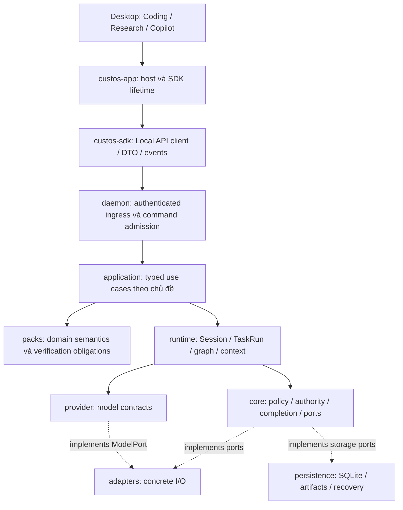

# Crates: đánh giá hiện trạng và kế hoạch refactor theo chủ đề

## 1. Kết luận và phạm vi

**Giữ các ranh giới crate hiện có; refactor mạnh ownership và đường thực thi bên trong. Không xóa hàng loạt theo số dòng, không thêm một backend/gateway trung tâm thứ hai.**

Custos là SADE local-first cho Coding, Research và Copilot. Ba workbench dùng chung Session, Task, Run, nguồn, artifact, quyền và kết quả; khác nhau ở semantics, resource views và tiêu chí nghiệm thu. Một model API có thể phục vụ worker do Custos điều khiển. Một native agent có loop riêng được tích hợp qua harness. Không ép hai đường này thành cùng một giao thức hoặc cùng mức bảo đảm.

Bản này là **đề xuất để duyệt và chia việc**, không chứng nhận đã thực hiện. Snapshot kiểm tra: HEAD `d25c27b8e13d8f3287332a137444fe0e088408aa`, working tree sạch khi bắt đầu khảo sát. Checkout đã thay đổi so với các bản trao đổi trước: application handlers đã tách và production tool executor đã được thêm. Vì vậy không tiếp tục dùng nhận định cũ “chưa có executor” làm hiện trạng.

Giả định tải: một người dùng local, có thể mở nhiều cửa sổ, nhiều Run/terminal/kernel đồng thời; backend duy nhất theo profile. Remote model, MCP và GPU là tài nguyên có latency, chi phí và side effect, không phải lời gọi local nguyên tử.

Đã kiểm: toàn bộ manifests/module roots, inventory Rust, dependency nội bộ, các symbol/caller trọng yếu, daemon bootstrap, model/native/tool paths, context/skill/OI, repositories và host boundaries. **Chưa đọc từng dòng của mọi file**, chưa kiểm full feature matrix hay chạy GPU/cloud. Không dùng số dòng để suy ra RAM, binary size hoặc build time.

## 2. Số liệu thực và điều cần sửa trong bản audit tham khảo

Inventory bằng `rg --files crates -g '*.rs'`, đếm dòng source kể cả test, comment và source chưa mount: **544 file, 172.422 dòng Rust**. Không gồm SQL, frontend hoặc assets. Cargo metadata có **16 workspace packages**, trong đó 12 package sản phẩm; `custos-app` có hai host packages. “11 canonical crates” là 11 nhóm kiến trúc/thư mục, không phải số package Cargo.

| Nhóm | File Rust | Dòng | Ý nghĩa cần đọc đúng |
|---|---:|---:|---|
| adapters | 118 | 53.500 | Concrete I/O, local inference, harness, protocol và optional extensions |
| provider | 48 | 31.850 | Model contracts, conversation compatibility và vendor formats |
| runtime | 128 | 23.139 | Agent/workflow/session/context/cognition và resource coordination |
| daemon | 26 | 17.398 | Composition, transport, application handlers và tests |
| persistence | 22 | 10.696 | Một DB owner, repositories và recovery |
| domain | 54 | 9.837 | Pure entities, IDs, transitions và wire-safe value types |
| sdk | 12 | 8.421 | Local API client/DTO, ACP wire và optional bindings |
| core | 64 | 7.355 | Policy/kernel/contracts, nhưng vẫn có concrete filesystem I/O cần di chuyển |
| packs | 55 | 7.189 | Ba miền, recipes, rubrics và skill implementations |
| app | 14 | 2.590 | Hai native host packages, không phải backend nghiệp vụ thứ hai |
| bridge | 3 | 447 | Session–Task promotion/attachment/steering |

Các kết luận phải hiệu đính:

1. `provider/types/formats/` có 17.344 dòng, nhưng có caller thật: `providers/providers/*`, native tool formatting, model/cache helpers và Research Codex import. **Không được xóa cả cây.** Chúng không chỉ là “struct JSON”; có chuyển đổi message/tool/reasoning.
2. `local_inference/` có 12.403 dòng và được bootstrap thật trong `daemon/runtime.rs`; GGUF inventory/load và native inference là năng lực phải giữ. `hf_models.rs` nằm sau `hf-hub`, MLX sau `mlx`; không cộng toàn bộ vào default runtime cost.
3. `roaming/` có 2.423 dòng. Không thấy composition từ daemon/app trong phạm vi search; tuy nhiên có `SystemOneA2ARouter::with_node`, protocol API, docs và tests nội bộ. Kết luận phù hợp: **chưa composed trong sản phẩm**, không phải “không có giá trị, xóa an toàn”. `cargo tree -p custos-daemon -i iroh --offline` xác nhận iroh nằm trong graph mặc định qua adapters.
4. `context/compaction/` và `context/memory/` tồn tại vật lý nhưng không được mount từ `context/mod.rs`. `context_management/` và `memory_service/` đang được export. Có file giống hệt, có file đã khác; không có hai active compaction engines chỉ vì hai folder tồn tại.
5. `gateway/` là module compiled nhưng không thấy product bootstrap/caller bên ngoài cụm; local/external/A2A dispatcher trả lỗi chưa nối. Đây là đường thử nghiệm chưa tích hợp, không là authority gateway chuẩn.
6. `EngineeringRecipePipeline::assemble_outcome` có giá trị validation/composition; không tự chạy diagnose/patch/test. Giữ semantics và nói đúng mức hoàn thiện, không gọi nó là autonomous executor.
7. Không có cơ sở cho lời hứa “xóa 25–35 nghìn dòng không mất gì”, “build nhanh hơn 40%”. Phải đo theo build profile và giữ acceptance trước/sau.

## 3. Các vấn đề phải sửa trước khi đổi cây thư mục

### Must fix

**F1 — Production tool executor chưa thực hiện authority theo Task/Run.**

- Source: `daemon/runtime.rs::DaemonGovernedToolExecutor`; `runtime/agent/runtime_port.rs::GovernedToolExecutor`.
- Case: tool `write_file` hoặc `bash` qua `authorize()` không bị chặn bởi kiểm tên `dangerous_`/`format_disk`, rồi gọi trực tiếp `handle_write`/`handle_bash`. Executor không nhận Task/Run/scope/permit; nhánh này không đi qua `SandboxPort::execute` để kiểm permit binding.
- Fix: một đường dispatch có context do backend resolve, canonical intent, Kernel authorization, durable attempt/outbox và receipt. Không cho adapter helpers public trở thành lối tắt quyền. Pending approval không được coi như tool failure rồi để model tự thử lại.
- Nếu bỏ qua: tên “governed” và nhãn `custos-mediated` có thể gây hiểu nhầm về những gate thực sự đã chạy. Đây là gap của implementation, không kết luận mọi UI turn hiện đã kích hoạt đường này.

**F2 — DAG worker dùng node ID thay task identity và gán risk thấp cho tool tùy ý.**

- Source: `runtime/workflow/worker_executor.rs::execute_step`.
- Case: `tool_call` tạo Action với `RiskLevel::Low`, request permit bằng `node_id` và chưa bind `action.task_id`; sandbox có kiểm binding sẽ từ chối, còn policy không có target/effect facts chính xác.
- Fix: executor nhận execution context của Task/Run/Worker/Node; risk/effect do trusted policy xác định; không dùng node ID làm Task ID. Test tool hợp lệ chạy được, tool ngoài scope bị chặn, shell không được hưởng risk của read.
- Nếu bỏ qua: DAG và direct agent có semantics quyền khác nhau; test “không kernel thì lỗi” chưa đủ chứng minh đường có kernel đúng.

**F3 — OI hard filters chưa là privacy/capability boundary đáng tin.**

- Source: `core/oi/hard_filters.rs::evaluate`, `runtime/oi/{candidate_builder,estimator,selector}.rs`.
- Case: `no-external-egress` chỉ từ chối candidate có tên chứa `cloud`; `claude-code` không chứa chuỗi đó. Capability check được mô tả ở comment nhưng không được thực thi tại hàm này. Candidate và cost đến từ danh sách/số tĩnh.
- Fix: quyết định từ capability/locality/account facts có provenance; unknown locality không được vượt local-only; phân biệt model pin với harness pin. Dùng catalog/registry thực và estimate có nguồn, không dùng tên làm policy.
- Nếu bỏ qua: explain report có thể hiển thị “admitted” mà chưa kiểm đúng constraint. Không suy ra đây là đường mọi request hiện đi qua; API explain và OI tests có caller, sản phẩm cần nối riêng.

**F4 — File skill không có scope root và cap output không chặn peak memory.**

- Source: `runtime/cognitive/skills/fs/file_read.rs::run`, `SkillContext` trong `skills/mod.rs`.
- Case: path bất kỳ được canonicalize rồi đọc; không có so sánh với root được cấp quyền. `tokio::fs::read` nạp cả file trước khi lấy slice, nên `max_bytes=1024` vẫn có thể nạp file lớn vào RAM.
- Fix: backend-resolved scope qua existing file/capability ports; seek + bounded read; clamp yêu cầu, checked arithmetic; bảo toàn taint/source refs. File local không mặc định trusted instruction.
- Nếu bỏ qua: cùng một skill có thể đọc ngoài workspace hoặc gây memory spike dù output nhỏ.

### Should fix

**F5 — Nhiều execution primitives chưa hội tụ một lifecycle sản phẩm.**

- Source: `TaskRuntime`, `GraphRuntime`, `WorkflowMachine`, `GovernedAgentRuntime`, `WorkerExecutor`.
- Case: model path của TaskRuntime stream trực tiếp và emit `ToolCall` lên observer; không gọi governed loop. Native path có vòng xử lý intents khác; governed loop trả intents đã `Receipt`, nên nối đơn giản vào vòng dispatch cũ có nguy cơ chạy lại.
- Fix: TaskRuntime là lifecycle owner; GraphRuntime chỉ scheduling; agent loop chỉ reasoning/tool continuation; WorkflowMachine là checkpoint primitive nếu có caller cần. Tool proposal và đã-executed observation phải được xử lý phân biệt bằng typed contract hiện có/được mở rộng có review.
- Nếu bỏ qua: thêm một executor không tự làm cả ba workbench trở thành agent studio hoạt động nhất quán.

**F6 — Core có concrete filesystem I/O; runtime/packs cũng có nhiều đường I/O riêng.**

- Source: `core/context/mod.rs`, `core/evidence/verifier.rs`, `core/capability/deterministic.rs`, runtime workspace/lease/notebook/terminal và foundation skills.
- Case: đọc nguồn hoặc kiểm citation trong core cần real FS; test policy bị buộc phụ thuộc filesystem, trong khi adapter cũng có path enforcement khác.
- Fix: giữ invariant/policy/verification logic thuần ở core; chuyển source/process observations sang adapters qua existing contracts. Không di chuyển policy ra adapter, không tạo dependency ngược adapters→runtime.
- Nếu bỏ qua: import graph có vẻ đúng nhưng trusted policy boundary vẫn lẫn môi trường thực thi.

**F7 — Application extraction mới tách file, chưa tách dependency theo use case.**

- Source: `daemon/application/*`, `api.rs`; 11 handler modules vẫn `impl LocalApiDispatcher` và dùng shared context.
- Case: workspace use case vẫn chạy Git trực tiếp; providers handler có tài khoản, OAuth, inventory và load; research có nguồn/claims/notebook/artifacts trong cùng request match tree.
- Fix: tách typed methods theo ownership và reuse existing coordinators; router chỉ decode/validate transport và map result. Không tạo service struct wrapper cho từng endpoint chỉ để giảm số dòng.
- Nếu bỏ qua: thay một file lớn bằng nhiều file lớn nhưng dependency vẫn gắn chặt cùng dispatcher.

**F8 — CLI host còn link daemon, khác Desktop host.**

- Source: `app/cli/Cargo.toml`, `app/cli/src/lib.rs`; so với `app/desktop/Cargo.toml`.
- Case: CLI host dùng `custos_daemon::local_api` và daemon profile helpers, kéo dependency backend vào client build. Package này thực tế là Tauri host, không nên đọc tên như một Rust terminal CLI thuần.
- Fix: dùng SDK LocalApiClient/ProfileResolver và host readiness flow; audit Tauri commands/capabilities của host này trước khi retire. Không xóa package chỉ vì Desktop là primary.
- Nếu bỏ qua: có hai client boundary conventions và build graph host nặng không cần thiết.

**F9 — Optional bindings/features chưa có bằng chứng build tương xứng.**

- Source: `sdk/bindings.rs`, `sdk/Cargo.toml`, adapters feature declarations và gated modules.
- Case: bindings nhắc `custos_context_management`/`custos_providers` nhưng manifest hiện không khai báo dependencies cùng alias. Chưa khẳng định compiler error đầy đủ vì offline check dừng trước ở thiếu `askama`.
- Fix: quyết định support optional surfaces; migrate binding imports/contracts hoặc đánh unsupported có kiểm tra rõ. Mỗi feature được hứa phải có CI build; chưa build không gắn nhãn production.
- Nếu bỏ qua: default workspace check xanh nhưng release bật feature khác có thể không build.

## 4. Bản đồ ownership đích

| Chủ đề | Domain | Core | Runtime / Packs | Adapters / Persistence | Daemon / SDK / App |
|---|---|---|---|---|---|
| Work identity | Session, Task, Run, binding, resource refs | Transition, completion, revision constraints | Session và Run lifecycle; bridge giữ liên kết | Canonical rows/events | Commands, scoped queries; UI selection không là quyền |
| Coding | Source spans, patch/test artifacts | Scope/base preconditions, evidence acceptance | Runtime repo intelligence/context; Engineering recipe/rubric | Git/FS/search/parser/process drivers; source snapshots | Coding use cases → source/diff/test/terminal projections |
| Research | Source, passage, claim, annotation, execution, lineage | Ingress/status/invalidation/acceptance | Research acquisition/extraction/synthesis semantics | Fetch/PDF/OCR/notebook I/O; source/claim repositories | Research use cases và resource API |
| Copilot | Draft, identity, schedule, grant/outbox records | Exact effect authority và uncertainty rules | Assistant intent/identity/draft/automation semantics | Contacts/mail/calendar/MCP drivers; durable outbox | Preview/approve/status; không synthetic sent |
| Agent execution | Worker identity, attempts, observations | Authority, budget, completion | Agent loop và bounded graph execution | External harness và model/tool drivers | Composition và realtime projection |
| Intelligence | Judgment/decision/route records | Hard admissibility | S1 judgments, OI strategy, offline Meta proposals | Model/local scorer adapters; calibration records | Inspect/explain/settings, không tự đổi policy |
| Compute | Recipe/environment/checkpoint/lease/attempt | Checkpoint integrity và compatibility rules | Notebook/training/handoff coordination | Colab/Kaggle/rented GPU/storage drivers | Targets/attempts/checkpoints UI API |

`custos-app` nối frontend với backend ở cấp **host experience**: cửa sổ, native webview, readiness/reconnect và SDK lifetime. Nó không gom tất cả crate implementation vào một hub. `custos-daemon` là composition root/backend ingress; `custos-runtime` điều phối; `core` quyết định policy. Ba trách nhiệm này phải rõ, không hợp nhất để “hai đầu dây cắm vào app”.

Sơ đồ là data/control flow; code dependency đi từ implementation vào contracts. Core không import adapters. Daemon inject concrete implementations. Pack không tự cấp permit hoặc mở DB. SDK không import runtime/daemon/persistence.

## 5. Cấu trúc repo đích: giữ crate, chuẩn hóa bên trong

Không tạo đủ folder dưới đây ngay. Mỗi địa chỉ được materialize khi chuyển use case cùng caller/test. Các tên đề xuất không là schema hoặc protocol mới.

| Crate | Cấu trúc theo chủ đề nên hội tụ | Điều không được đặt vào |
|---|---|---|
| `custos-domain/src` | Giữ entities hiện tại, nhóm bằng module khi có nhiều types cùng lifecycle; không ép chia `coding/research/assistant` cho object dùng chung | FS/DB/process/model calls |
| `custos-core/src` | `kernel`, `authority`, `evidence`, `contracts`; `oi` giữ hard validation/compiler; `context` giữ transform/redaction thuần; `repo` giữ rules thuần | File readers, shell runners, vendor HTTP |
| `custos-provider/src` | Giữ `port`, `turn`, `events`, `request`, `catalog`; conversation types dùng chung; khoanh `types/formats` thành compatibility surface trước khi chuyển vendor translators | Credentials, authority, agent processes |
| `custos-runtime/src` | `agent`, `workflow`, `session`, `context`, `cognitive`, `oi`, resource coordinators; gom compaction dưới `context` sau parity | Concrete vendor transport, mint permit, canonical DB |
| `custos-adapters/src` | `providers`, `harness`, `local_inference`, `mcp`, `a2a`, optional `roaming`, `sandbox`, `workspace`, `repository_git`, `compute`, `tools`; thêm notebook/terminal driver modules khi extraction được duyệt | Pack acceptance, OI strategy, Task completion |
| `custos-packs/src` | `engineering`, `research`, `assistant`; common manifest/rubric/verifier facade; mỗi miền có recipes/skills/artifact assembly | Concrete unrestricted FS/network capabilities |
| `custos-persistence/src` | Giữ một connection/store; repositories theo aggregate; research thành module con `sources`, `claims`, `notebooks`, `executions`, `artifacts`, `reviews` khi cần | Scheduler, model routing, UI state owner |
| `custos-daemon/src` | `api` transport/admission; `application` typed use cases; `runtime` composition; `credentials` lifecycle; tests theo use case | Autonomous loop mới, duplicate repositories |
| `custos-sdk/src` | `local_api`, `profile`, versioned wire/event conversions; ACP `wire_types` giữ scope riêng; optional bindings qua contracts nhẹ | Backend bootstrap/business services |
| `custos-bridge/src` | Giữ promotion/attach/steer service; không tự thành Local API gateway thứ hai | SQLite hoặc privilege bypass |
| `custos-app/{desktop,cli}` | Host lifecycle/native integration, dùng SDK; Desktop primary nhưng giữ compatibility entrypoint có người dùng | Link toàn daemon để gọi helper/client |

## 6. Quy tắc đặt skill và tính năng mới

**Skill là đơn vị đóng gói workflow/capability semantics; MCP là cách expose/connect; RAG là retrieval strategy; agent là execution loop. Chúng không thay thế nhau.**

1. Function thuần như rank/chunk/validate/format → module theo chủ đề, không tự bọc MCP/agent.
2. Concrete file/search/process/network → adapters; interface tối thiểu ở existing core contract nếu runtime cần gọi qua boundary.
3. Recipe Coding/Research/Assistant → packs; gọi capability/service qua injected ports, không tự mở executor không có scope.
4. Shared retrieval/context budgeting → runtime/context. Repo intelligence là service cung cấp snapshot/spans/coverage; Engineering skill dùng service này.
5. Autonomous repo investigator → worker role + bounded agent loop dùng repo intelligence. Không chuyển cả repo index thành agent hoặc bắt Python subprocess dùng A2A.
6. MCP server wrapper → adapters/mcp, delegate cùng capability path; tool discovery không tự là grant. Native agents chỉ dùng được capability khi adapter/harness support thực tế.
7. Cost optimization → context pruning/cache policy/routing nằm runtime; provider pricing/usage fidelity ở adapters/provider contracts; hard budget ở core; measurements ở persistence/evals. Không gom thành folder `cheap_skills` hoặc ba bản optimizer theo pack.

Registry hiện ở `runtime/cognitive/skills` được giữ trong bước đầu. Chuyển concrete foundation skill I/O ra adapters bằng cách reuse existing WorkspaceFilesPort/SandboxPort và các contracts thật sự cần. Không để adapters implement runtime-owned trait nếu gây cycle. Chỉ chuyển trait sang core sau khi xác nhận reuse và cập nhật mọi caller; không thêm “SkillOS” hay port tổng quát bao trùm mọi thứ.

## 7. Ba đường execution phải đi đến cùng một ledger

### 7.1. Model API, kể cả local coder

User chọn model/account → TaskRuntime tạo Run → compile context theo scope → model turn → tool proposal → Kernel/effect dispatch → observation trở lại model → evidence/outcome. Model chỉ trở thành coding agent khi Custos cung cấp loop, toolset và lifecycle; bản thân provider không phải agent.

Dùng structured tool-use messages hiện có, không chèn mọi tool result thành transcript string rồi mất call ID, roles, images hoặc reasoning continuity. Giữ single-turn chat fast path khi không cần tool. Không bắt mọi request chạy OI/remote S1.

### 7.2. Native coding/research/assistant harness

TaskRuntime → registered AgentRuntimePort → exact workspace → native loop → observed events/diff/result → ledger/evidence. Không chạy thêm Custos loop bên trong native loop. `provider-governed` khi Custos không intercept tools; không suy ra managed worktree là OS sandbox.

### 7.3. Graph và automation

OI proposal hoặc user workflow → core compiler/hard validation → workflow revision → bounded scheduler → workers theo scoped execution context. Mỗi effect dùng cùng mediated dispatch như model worker, không một `WorkerExecutor` risk-low shortcut. Node success không tự làm criterion pass. Resume chỉ tiếp tục future work đã revalidate, reconcile uncertain effect trước.

**Ownership cuối:** TaskRuntime owns Run admission/launch/cancel/result; GraphRuntime owns readiness/join; agent loop owns model/tool continuation; core owns permit/completion; adapter owns external action. `WorkflowMachine` chỉ giữ nếu tiếp tục phục vụ checkpoint continuation khác biệt và có caller; không xây scheduler thứ ba từ nó.

## 8. Refactor cho từng workbench, không chỉ infrastructure

### Coding

- Giữ: workspace/worktree, native harness registry, PTY, source tree, diff, repo intelligence và test artifacts.
- Chuyển: Git/FS/process khỏi application/runtime concrete paths sang adapters, giữ coordinator policy và lease lifecycle.
- Hoàn thiện: repo explanation có source anchors; investigate có hypothesis/reproducer; patch có base hash/scope; verification dùng oracle đáng tin, không chỉ `passed: true` do caller cung cấp.
- Gate: hai worktrees/two Runs không lẫn paths/terminal/output; stale patch bị từ chối; cancel một Run không hủy peer; restart giữ đúng task/artifacts.

### Research

- Giữ: corpus/source version, passages, claims/contradictions, annotations, notes, notebook/execution, recipes, artifacts, review và lineage. Không xóa document/visualization capability chỉ vì source gốc Goose.
- Tách application: sources/claims; notebook/executions; review/synthesis; notes/artifacts. Cùng repository facade có thể giữ để giảm migration blast radius.
- Notebook coordinator quản execution IDs/state; driver quản Python/Jupyter transport/process/output/interrupt. Kernel identity không đồng nghĩa conversation session hoặc GPU lease.
- Compute coordinator bind notebook/execution/experiment/attempt/checkpoint. Colab→Kaggle/rented GPU là checkpoint resume có compatibility gate, **không** di chuyển live Python memory. Chỉ tự chuyển nếu checkpoint đã durable và target có quota/capability/consent/budget.
- Gate: một source revision → claim → notebook execution → attempt → checkpoint → resume có lineage liên tục; OCR gap/citation thiếu support vẫn unknown; run GPU không tự là research conclusion verified.

### Copilot

- Giữ: chat không cần repo, draft, identity, schedule, reminders và bounded automation.
- Tách: draft semantics ở pack; exact effect authority ở core; connector I/O ở adapters; durable delivery ở persistence/runtime coordination.
- Gate: recipient ambiguity hỏi người dùng; payload sửa vô hiệu approval; unsupported connector unavailable; timeout sau send uncertain, không synthetic delivered hoặc retry mù.

UI chỉ đọc projections của các identity trên. Screen/tab là presentation; close tab không kill kernel/terminal trừ thao tác stop rõ. Chuyển workbench giữ canonical conversation và selected artifacts theo consent, không copy toàn bộ history thành authority/context mặc định. Đây là integration contract với frontend, không yêu cầu redesign UI trong cùng refactor crates.

## 9. Upstream và dependency: quyết định giữ/chuyển/cô lập/bỏ

| Cụm hiện tại | Quyết định đề xuất | Điều kiện trước khi làm |
|---|---|---|
| `adapters/roaming` + iroh | Feature-gate opt-in, chưa xóa source | Inventory external callers/docs/config; gate dependency và toàn module/reexports; check default không kéo iroh và opt-in vẫn build |
| MCP builtin tutorial | Retire khỏi product surface nếu không có user job | Search dynamic registry/feature references; giữ attribution/source map; test feature policy |
| MCP document/visualizer/memory builtins | Optional capability, extract có chọn lọc; không xóa blanket | Map Research/Copilot parity, dependency/security và actual tools; reuse UI artifact viewers thay vì server riêng khi hợp lý |
| GGUF/native inference | Giữ; tách lightweight discovery khỏi engine/load lifecycle | Đo idle RSS, load/unload/restart; capability reports honest; không buộc user cài Ollama để thay tính năng native |
| MLX/HF optional modules | Supported opt-in hoặc explicit experimental | Feature matrix/build thực; không tính dormant lines là RAM tiết kiệm |
| `provider/types/formats` | Giữ compatibility hiện tại; migrate vendor conversion từng provider | Golden fixtures tools/images/reasoning/usage/stream/cancel/import; move neutral model/cache helpers trước; giữ dependency graph không cycle |
| `runtime/context/compaction` | Diff từng file rồi chọn active implementation làm source chuẩn | `format/model/provider/summarize` giống nhau; `structured/templates/lib` có khác biệt cần review; không overwrite active bằng dormant |
| `runtime/context/memory` và `memory_service` | Gỡ duplicate dormant, review active stub | Core MemoryPort là vocabulary cần hội tụ; chưa có implementation không tự viết một memory DB mới |
| `runtime/gateway` | Retire product facade hoặc giữ experimental rõ; tái sử dụng policy/metrics có caller | Không xóa useful routing/cost logic chưa map sang OI; transport thuộc adapters, authority thuộc core |
| `runtime/oi` | Giữ decision/explain/topology vocabulary; thay static discovery/estimates từng bước | Không đổi “Orchestration Intelligence” thành “Optimized Inference”; measured benefit trước multiagent default |
| `provider` compatibility types / SDK ACP | Giữ biên backward-read/import và supported client contracts | Không đồng nhất ACP với A2A hay Codex native transport; không xóa source attribution |

Cargo features phải gate cả dependency và `mod`/reexports/caller, không chỉ thêm một tên feature rỗng. Features có tính cộng dồn; kiểm feature activation từ workspace và package riêng. [Cargo feature reference](https://doc.rust-lang.org/cargo/reference/features.html), [resolver reference](https://doc.rust-lang.org/cargo/reference/resolver.html).

MCP có tools/resources/prompts và discovery; không là internal ownership model hoặc security kernel của Custos. [MCP server overview](https://modelcontextprotocol.io/specification/draft/server/index). Jupyter phân biệt sessions và kernels; dùng làm adapter contract reference, không gộp với conversation của Custos. [Jupyter REST API](https://jupyter-server.readthedocs.io/en/stable/developers/rest-api.html).

## 10. Các gói triển khai có dependency và gate

Không triển khai một giant diff toàn repo. Có thể một integration branch/refactor campaign, nhưng các packet dưới đây phải independently build/review được. Đổi contract cần cùng caller/test/schema fixtures; structural move không trộn behavior change không liên quan.

| Packet | Việc thực hiện và paths chính | Gate nghiệm thu | Phụ thuộc |
|---|---|---|---|
| A — Baseline | Pin SHA/dirty manifest; list API methods, package/feature graph, production composition; giữ desktop scenarios | Default all-target check; baseline fixture counts; rollback không mất local data | Không |
| B — Effect boundary | `runtime.rs` executor, runtime agent tool contract, core authority/contracts, adapter developer, outbox/effect records | Unauthorized write/shell/MCP không dispatch; payload change/stale Run từ chối; denied tool không effect; timeout/cancel unknown đúng | A |
| C — Worker convergence | TaskRuntime/GraphRuntime/WorkerExecutor/agent loop; typed scope/attempt/receipt binding | Tool chạy đúng một lần; model continuation thực; same scope trên graph và direct; native harness không double-loop | B |
| D — Host và ingress | app/cli dùng SDK; explicit method classification; transport-only API + typed use cases | Hosts không link daemon; reconnect/replay giữ command ID; business rejection không retry | A, nối lại sau B |
| E — Concrete I/O extraction | core file readers; runtime skills/workspace/lease/PTY/notebook drivers → adapters qua ports | Core tests bằng immutable observations; path/symlink/secret/size/time caps; lifecycle và UI parity | B; làm từng capability |
| F — Context và memory | `context_management` hội tụ `context/compaction`; dormant copies, gateway stub review; memory contract inventory | Same structured summary/provenance/usage; resume/freshness/omissions; không mất bindings trước khi retire compatibility | A, E khi cần source I/O |
| G — Dependency profiles | Optional roaming/iroh; native discovery/load profiles; builtin feature policy; provider compatibility matrix | Default graph loại dependency opt-out; supported opt-in build; no fabricated capabilities; đo footprint thực | A; không chờ đổi toàn runtime |
| H — Application và repositories | Tách providers accounts/catalog/local; workspaces files/git/candidates; research subtopics; fleet/browser/automation | API golden parity; transaction không tách thành nhiều commit; scoped/paginated projections; không duplicate state | D, E theo chủ đề |
| I — Coding vertical | Repo intelligence + controlled patch + independent verifier + native path parity | Explain/bugfix/refactor riêng, source stale, dirty worktree, conflicting writes | B, C, E |
| J — Research studio vertical | Corpus/claim/notebook/compute/checkpoint/lineage join và typed use cases | Local fake target lifecycle; restart/checkpoint compatibility; external test opt-in; unknown honesty | B, C, E, H |
| K — Copilot vertical | Real connector capability + exact approval + reconcile/standing grants | Wrong recipient/changed payload/duplicate send fixtures; unsupported fail closed | B, C, H |
| L — OI/S1/Meta | Registry-derived candidates; truthful cost; hard filters; S1 scout/rerank/check; versioned offline calibration | Same-model baseline, pinned/local-only, known vs unknown spend; opt-in topology có measurable benefit | B, C, I/J/K fixtures |

Thứ tự bắt đầu: **A → B → C**; D/G có thể làm độc lập trên file scopes không chồng lấn. Sau đó E/H theo vertical, không di chuyển toàn bộ file một lần. F không được làm mất context continuity. L giữ baseline dùng được trong suốt campaign; không chờ thuật toán “siêu đỉnh” mới sửa security.

### Packet B cụ thể

1. Giới hạn tool exposure về capability thực sự có mediated path; không gọi `handle_*` để bypass permit.
2. Extend existing executor contract để nhận backend-resolved invocation identity và arguments đã canonicalize; không tin model tự gửi task/actor/workspace ID.
3. Kernel kiểm task status/revision, effect classification, scoped grant và budget; approval-required trả một trạng thái đợi có thể tiếp tục.
4. Record durable attempt/outbox trước external dispatch; claim chống hai worker; dùng actual adapter idempotency khi có.
5. Dispatch qua adapter có permit binding; ghi receipt/failure/uncertain. Không suy ra shell `exit=0` làm criterion pass.
6. Trả typed observation vào đúng model call; không đưa receipt trở lại hàng đợi intents để chạy lần nữa.
7. Cancel/timeout giữ uncertainty; reconcile trước retry; reject stale worker trước dispatch, không chỉ lúc save Run.

### Packet H cụ thể

- `application/providers.rs` → accounts/credentials, catalog/discovery, local-runtime operations. Reuse credential service hiện tại, không tạo credential store thứ hai.
- `application/workspaces.rs` → workspace lifecycle, repository inspection, changes/candidates/integration, GitHub account actions. I/O ở `workspace.rs`/`repository_git.rs` adapters; approval/expected source ở core/runtime.
- `application/research.rs` → source/claim, notebook/execution, review/synthesis, artifacts/notes. Không chia transaction lineage/checkpoint qua các repository commits riêng lẻ chỉ để có folder đẹp.
- `application/integrations.rs` → browser/emulator/fleet/automation. Scheduler không nằm transport; stop resource không xóa user data.
- `api/tests.rs` → tests theo các use cases trên, dùng cùng harness setup. Giữ transport/replay tests tại ingress. Không phải mỗi test file một helper framework.

## 11. Đo hiệu năng và chi phí đúng chỗ

- Compile: cold/warm check/build theo cùng toolchain/features/target; dependency graph và incremental effects. Không chạy `cargo clean` trên target người dùng chỉ để lấy baseline; dùng target directory tạm riêng khi được chọn đo.
- App: release host binary size, daemon idle RSS/CPU, startup TTFO; load/unload local model, đóng/mở 10 terminal/kernel/run; memory sau cancel/terminal settlement.
- Queries: paging/byte caps cho history, logs, source/artifact inventories; backpressure và observer lifetime; một component UI không tự poll lại mọi subsystem.
- AI: billed/estimated/unknown tách riêng; prompt/cache/tools/retries/verifier/human time; cost per accepted task kèm accepted rate.
- S1 được hỗ trợ scout, rank, context filtering, simple checks hoặc bounded micro-actions **trong cùng authority path**; không thay S2 reasoning bằng summary mất provenance, không auto-downgrade model pin.
- Compute: checkpoint frequency theo time-to-expiry và expected lost work/storage cost; cap concurrent jobs, lease spend và egress; target chưa usable không tự chạy benchmark hoặc trả phí.

## 12. Kiểm tra của lượt khảo sát và điều chưa biết

Đã chạy fresh trên snapshot: inventory, `cargo metadata --offline --no-deps --format-version 1`, `cargo tree -p custos-daemon --offline -i iroh`; **`cargo check --workspace --all-targets --offline` pass**. All-target check không kiểm tất cả feature combinations, không chạy tests và không chứng minh runtime security. Các tests của lượt refactor trước không tự là chứng cứ cho HEAD mới.

`cargo check -p custos-sdk --features uniffi --offline` dừng ở dependency `askama v0.16.1` chưa có trong cache. Đây là **unverified feature**, không phải bằng chứng compile pass hoặc kết luận compile fail do source. Không tự tải dependency, không gọi endpoint trả phí và không mở GPU job trong khảo sát.

Không audit từng dòng vendor format, protocol implementation, OS sandbox, UI hoặc mọi repository transaction trong lượt này. Các path có finding cụ thể đã được đọc; các đề xuất deletion vẫn cần feature/caller/parity gates. Không hứa exact-once remote effects, live GPU migration hoặc tốc độ/tiết kiệm chưa đo.

**Điểm dừng của refactor:** mỗi chủ đề có một owner, một execution path được kiểm và một nguồn state chuẩn; người thêm skill/adapter/workbench resource biết đặt code ở đâu và test boundary nào. Không lấy “ít folder nhất”, “nhiều crate nhất” hoặc số dòng xóa làm định nghĩa hoàn thiện.
