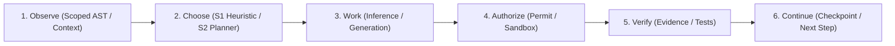

# Delivery Blueprint, Release Gates & Execution Sequence

> **Classification:** Normative Delivery Blueprint  
> **Source of Truth:** Authoritatively defined in [Custos Master Specification](../../Custos.md).  
> **Directory Index:** See [Custos Developer Hub](README.md).

Custos engineering strictly enforces the **Vertical Slices** methodology: each development milestone produces an end-to-end, runnable, verifiable system rather than disconnected horizontal abstraction layers. Every slice spans the entire stack—from domain state machines and SQLite persistence up through the local daemon API and desktop UI controls.

---

## 1. The Adaptive Verified Work Loop

Every vertical feature slice must traverse the core work loop:



1. **Observe:** Fetch source files, git diffs, and project metadata strictly within authorized scope.
2. **Choose:** Select optimal execution topology (T0 Direct to T6 Dynamic Replan) within budget constraints using Pareto optimization.
3. **Work:** Generate candidate code patches, research claims, or strategy models without executing unvetted physical mutations.
4. **Authorize:** Intercept side-effect intents at the Authority Engine; verify single-use cryptographic permits.
5. **Verify:** Bind test receipts, compiler outputs, and citation checks to task criteria at the Completion Gate.
6. **Continue:** Commit durable checkpoints; preserve state for subsequent interaction sessions.

---

## 2. Continuous Quality Pipeline (`cargo xtask gate`)

Before any pull request or commit is merged, it must satisfy all 5 automated gates:

| Gate | Focus Area | Mandatory Exit Criteria | Automated Verification |
|---|---|---|---|
| **Gate 1** | **Manifests & Descriptors** | 4/4 workbenches valid, 8 capabilities valid, zero kernel-workbench leaks. | `cargo xtask check-boundaries` |
| **Gate 2** | **Desktop UI Build** | Strict TypeScript typecheck and Vite asset bundling with zero compilation errors. | `npm --prefix ui/desktop run build` |
| **Gate 3** | **Canvas Smoke Invariants** | 51/51 headless DOM invariants pass (zero mock leaks, truthful controls). | `node ui/desktop/scripts/canvas-smoke.mjs` |
| **Gate 4** | **Architecture Invariants** | Layering rules, naming conventions, and file line ceiling ($\le 600$ lines) pass. | `cargo test -p custos-testkit -p custos-tests-contract --lib --tests` |
| **Gate 5** | **Workspace Cargo Check** | Clean compilation of all 20 packages in the workspace across all targets. | `cargo check --workspace --all-targets --offline` |

---

## 3. Product Acceptance Gates (Gates A–OPT)

Product release milestones require satisfying the 8 Product Acceptance Gates:

| Acceptance Gate | Focus Area | Mandatory Exit Criteria | Target Suite |
|---|---|---|---|
| **GATE A** | **Local Process E2E** | Run from CLI through Daemon, invoking a local model under `LocalOnly` flag. | `tests/e2e` |
| **GATE B** | **Worktree Isolation** | Prove all filesystem mutations take place exclusively inside `isolated_worktree`. | `platform/adapters`, `platform/runtime` |
| **GATE C** | **Crash Resilience** | Simulate SIGKILL between outbox staging and physical execution; verify restart into `Uncertain`. | `tests/contract` |
| **GATE D** | **Security Taint Test** | Inject prompt injection payloads into untrusted inputs; verify complete quarantine. | `platform/core`, `tests/contract` |
| **GATE E** | **SWE-Bench Baseline** | Resolve sample SWE-bench Lite issues autonomously without human code intervention. | `evals/` |
| **GATE F** | **Research Reproducibility** | Reproduce benchmark algorithm from citations, producing a verifiable `ReproducibilityBundle`. | `workbenches/research` |
| **GATE G** | **LongMemEval Temporal** | Distinguish between outdated and active facts across multi-turn sessions without hallucination. | `evals/memory` |
| **GATE OPT** | **Economic Non-Inferiority** | System 1 fast routing reduces execution cost by $\ge 20\%$ compared to direct frontier models. | `evals/calibration`, `evals/oi` |

---

## 4. Architectural Package Delivery Sequence

The Custos monorepo organizes its 20 packages into an audited, unidirectional dependency graph:

```text
Ring 0 (Platform):
  platform/domain -> platform/core -> platform/storage -> platform/ai -> platform/runtime -> platform/adapters -> platform/components

Ring 1 (Workbenches):
  workbenches/assistant (Personal copilot & outbox approvals)
  workbenches/coding    (Code generation, worktree branching, patch verification)
  workbenches/research  (Academic literature, claims, citation verification)
  workbenches/quant     (Backtesting, risk gates, order ticket governance)

Ring 2 (Applications & Protocols):
  sdk/protocol -> sdk/client-rust -> apps/daemon -> apps/cli -> apps/desktop/native
```

### Pull Request Standards
- **Atomic Commits:** Each PR addresses a single vertical feature or refactor slice.
- **Contract Test Coverage:** Changes to traits or database schemas must include migration and contract tests.
- **Line Count Invariant:** No modified or newly added source file may exceed 600 physical lines.
- **Zero Mock Policy:** Release binaries must not contain mock implementations; test scaffolding is gated behind `#[cfg(any(test, feature = "test-support"))]`.

---

## 5. Empirical Verification Standard

All performance targets, latency numbers, and efficiency benchmarks stated in PR descriptions or plans remain `[Pending Empirical Verification]` until automated end-to-end test fixtures demonstrate repeatability under real workload conditions.
