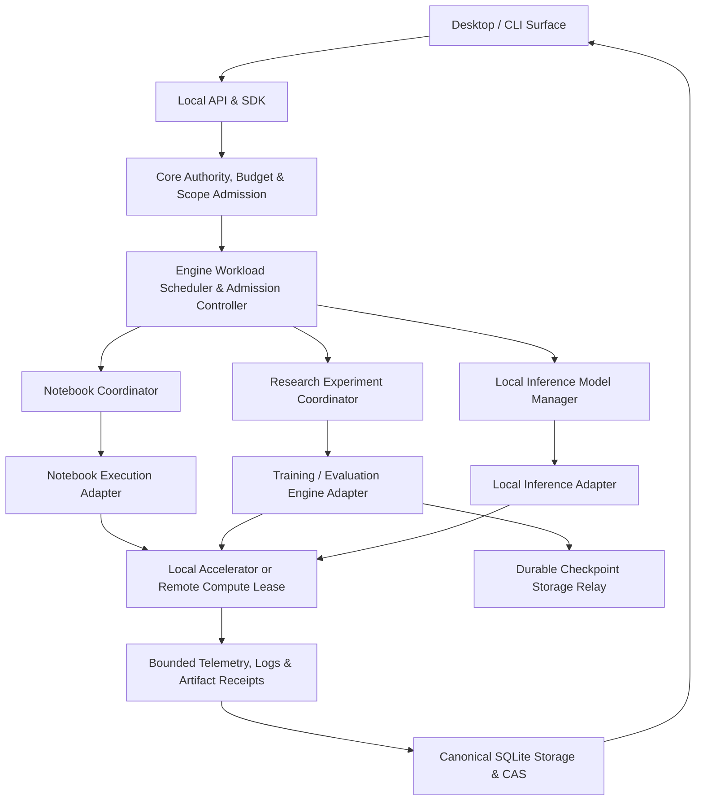

# GPU Workload Components and Resource Admission Plan

> **Status:** Authoritative Architectural & Delivery Plan  
> **Topic:** GPU consumer components (Notebooks, Training, Evaluation, Local Inference), resource admission, coexistence policies, and golden test verification  
> **Governing Boundaries:** `custos-contracts`, `custos-storage`, `custos-integrations`, `custos-engine`, and `workbenches/research`.

---

## 1. Primary GPU Consumers

| Component | GPU Functional Role | Primary Inputs / Outputs | Delivery Status |
|---|---|---|---|
| **Notebook / Kernel Execution** | Interactive tensor execution requested by user/agent. | Versioned cell + dataset refs $\rightarrow$ outputs, artifacts, execution receipts. | Core; local then remote kernel bindings. |
| **Training / Fine-Tuning Runner** | Forward/backward passes, optimizer updates, periodic checkpointing. | Frozen recipe + model/data/env $\rightarrow$ checkpoints, step metrics, artifacts. | Core; single-engine pipeline first. |
| **Evaluation Runner** | Batch inference, validation loss, benchmark metrics. | Candidate checkpoint + held-out dataset + evaluation rubric $\rightarrow$ score report. | Aligned with training vertical. |
| **Local Reasoning Inference** | Token streaming for S1/S2 agent reasoning via model contracts. | Scoped prompt + model profile $\rightarrow$ completions, tool calls, token usage. | Integrated via local inference runtime. |
| **Batch Inference / Prediction** | High-throughput offline inference across large datasets. | Model artifact + dataset partition $\rightarrow$ prediction manifests, error logs. | Follows baseline training/eval pipeline. |
| **Embedding & Reranking** | Vector similarity and passage retrieval acceleration. | Document chunks + embedding model $\rightarrow$ dense vectors, provenance records. | Optional; CPU/remote baseline first. |
| **OCR / Document Vision** | Accelerated visual document parsing and layout analysis. | Source image/PDF $\rightarrow$ extracted markdown, coverage metrics, bounding boxes. | Optional capability extension. |

Model download, dataset staging, preprocessing, SHA-256 hashing, SQLite journal writes, and UI rendering remain CPU/RAM/IO bound and are never dispatched to GPU.

---

## 2. Component Architecture & Dataflow

---

## 3. Workload Coexistence & Resource Arbitration Policies

When multiple GPU consumers contend for the same physical accelerator, the engine enforces deterministic arbitration:

| Coexistence Scenario | Engine Policy |
|---|---|
| **Training + Evaluation on same GPU** | Sequential execution or engine-managed inline eval; secondary model weights are never loaded concurrently without explicit headroom. |
| **Training + Interactive Notebook** | Exclusive lease by default; notebook cell execution is serialized or rejected until the training run yields resources. |
| **Local Chat Inference + Background Embeddings** | Batch concurrency caps enforced via model slot manager; embeddings yield at batch boundaries to minimize interactive latency. |
| **Two Notebooks with Unknown VRAM** | Workloads are serialized or bound to distinct physical devices; low GPU utilization is never assumed to imply free VRAM. |
| **Unmanaged External Process occupying GPU** | Engine records memory pressure and halts admission; unowned third-party processes are never terminated autonomously. |
| **User Pins Local-Only while GPU is Busy** | Engine queues the request or falls back to supported CPU execution; cloud provider fallback is strictly blocked without explicit consent. |

---

## 4. Placement Across Canonical Platform Blocks

| Layer / Crate | Repository Path | Architectural Responsibilities |
|---|---|---|
| **Contracts** | `platform/contracts` (`custos-contracts`) | Workload descriptors, device observation structs, execution states, and authority tokens. Zero I/O. |
| **Storage** | `platform/storage` (`custos-storage`) | Durable persistence of compute leases, telemetry snapshots, checkpoint manifests, and execution records. |
| **Integrations** | `platform/integrations` (`custos-integrations`) | Concrete device probes (NVML, MPS), Jupyter bridges, training engine runners, and local model inference backends. |
| **Engine** | `platform/engine` (`custos-engine`) | Workload admission, mutual exclusion locks, lease queues, checkpoint relays, and watchdog monitors. |
| **Workbench** | `workbenches/research` | Scientific experiment models, training recipes, evaluation rubrics, and dataset manifests. |
| **Desktop UI** | `apps/desktop/ui/src/` | Compute resource pickers, active workload activity monitors, and artifact inspectors. |

---

## 5. Verification Packets & Golden Acceptance Gates

| Packet | Key Scope | Verification Gate | Status |
|---|---|---|:---:|
| **GPU-A: Admission Seam** | Workload registry, device profile probes, and scoped reservation queues. | `gpu_workload_admission_golden_test.rs` | **VERIFIED** |
| **GPU-B: Local Notebook Path** | Kernel session bindings, execution epochs, and bounded output streams. | `gpu_workload_admission_golden_test.rs` | **VERIFIED** |
| **GPU-C: Training & Evaluation** | Deterministic CPU fixtures, single-GPU training recipes, and bounded checkpoints. | `gpu_training_eval_coexistence_golden_test.rs` | **VERIFIED** |
| **GPU-D: Inference Coexistence** | Model slot managers, cold-load serialization, and mutual exclusion locks. | `gpu_training_eval_coexistence_golden_test.rs` | **VERIFIED** |
| **GPU-E: Remote Target Integration** | SSH host bridges, provider API adapters, and disconnected lease reconciliation. | `gpu_remote_target_golden_test.rs` | **VERIFIED** |
| **GPU-F: Protected Checkpoint Relay** | Content-addressed checkpoint manifests and cross-backend recovery handoffs. | `gpu_checkpoint_relay_golden_test.rs` | **VERIFIED** |
| **GPU-G: Multi-Target Scaling** | Colab and Kaggle compute profiles, versioned push, and output collection. | `gpu_multi_target_golden_test.rs` | **VERIFIED** |

---

## 6. Failure Recovery & Resource Invariants

1. **No Silent GPU Preemption:** Training runs are never terminated with `SIGKILL` to prioritize conversational chat. Preemption requires explicit policy authorization and a completed engine checkpoint.
2. **Out-of-Memory (OOM) Containment:** Device OOM errors are logged with memory state snapshots. Previously committed checkpoints are preserved intact, and only resources owned by the failed attempt are released.
3. **Lease Cleanup Discipline:** Releasing a compute lease verifies that no dependent background jobs, notebook kernels, or uncollected artifacts remain unhandled. Retained cloud storage is explicitly reported to the user.
