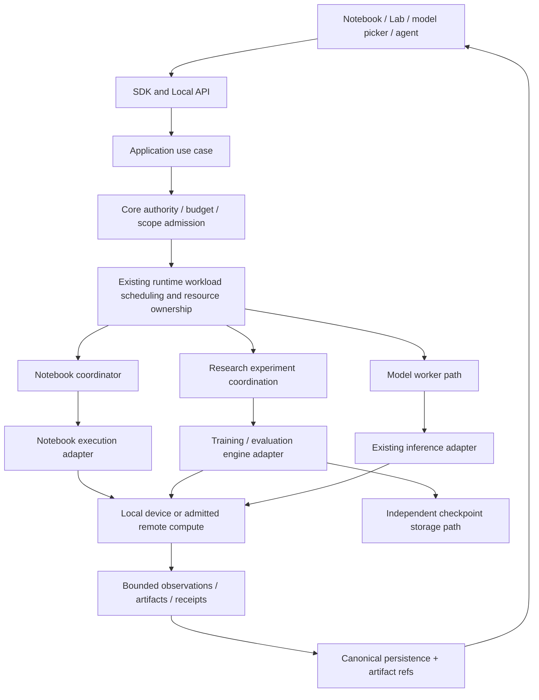

# Custos — kế hoạch các thành phần sử dụng GPU

**Trạng thái:** thiết kế để triển khai, không phải danh sách GPU features đã shipped. **Đối chiếu:** 19-10-2026, `vi-rft`, HEAD `c96f414` cộng working changes đang được thực hiện. Không ghi đè các thay đổi đó. Không allocate GPU, thêm dependencies hoặc chạy training trong packet tài liệu này.

**Phạm vi chính:** các thành phần bên trong sản phẩm thực sự tiêu thụ GPU: notebook, training/finetune, inference và evaluation; cách chúng chọn target, xin quyền/tài nguyên, thực thi, thu kết quả, chia sẻ và release. Colab/Kaggle/GPU thuê là execution targets, không phải các thành phần nghiệp vụ riêng.

Đây là decomposition của [F04/F06/F08/F10/F11](sade-core-refactor-plan.md#17-superplan-hoàn-thiện-sau-audit), không campaign refactor cạnh tranh. [Remote notebook](../architecture/remote-compute-colab-kaggle.md#41-notebook-compute-binding-and-recovery-design) giữ kernel protocol; [checkpoint relay](../architecture/compute-relay-and-heterogeneous-failover.md) giữ backup/handoff; [GPU thuê](../architecture/remote-compute-external-gpu.md) giữ cloud/host lifecycle. File này chốt consumers, shared ownership và thứ tự nối vào sản phẩm.

## 1. Các thành phần nào dùng GPU?

| Thành phần | GPU làm gì | Input/output | Thứ tự hỗ trợ |
|---|---|---|---|
| Notebook/kernel execution | Chạy tensor code do user/agent yêu cầu trong kernel được bind | Versioned cell + data refs → output/artifacts/execution receipt | Chính, local rồi remote supported kernel |
| Training/finetune runner | Forward/backward, optimizer update, checkpoint | Frozen recipe/model/data/env → checkpoints/metrics/training artifacts | Chính, một engine/profile trước |
| Evaluation runner | Batch inference, validation metrics, comparison | Exact candidate checkpoint + held-out data + rubric → scored report | Đi cùng training vertical |
| Local reasoning inference | Generate/token streaming cho S1/S2/agent qua model contracts | Scoped prompt/model profile → text/tool proposals/usage | Reuse local_inference đã có, không tạo serving engine mới |
| Batch inference/prediction | Chạy model trên tập dữ liệu, không update weights | Model artifact + dataset → predictions/errors/metrics | Sau first training/evaluation, khi có use case |
| Embedding/reranking | Index/query acceleration nếu backend thật sự dùng GPU | Source spans/model version → vectors/ranks/provenance | Optional; CPU/remote baseline trước |
| OCR/vision/audio processing | Parse/extract/transcribe với model tăng tốc | Source artifact → extracted artifacts/coverage/confidence | Optional theo capability đã có; không ép mọi Research dùng GPU |

Download model/dataset, tokenization, preprocessing, hashing, upload checkpoint, daemon DB, OI planning và frontend không mặc định là GPU workloads. Chúng vẫn dùng CPU/RAM/I/O và có thể làm GPU đói dữ liệu; tối ưu pipeline chứ không chuyển mọi bước lên GPU.

Model API cloud không phải GPU lease mà Custos sở hữu. Native agent có thể dùng GPU bên ngoài nhưng chỉ có provider-governed visibility; không hứa Custos biết/control VRAM của mọi provider.

## 2. Hiện trạng và nền tái sử dụng

| Source hiện có | Reuse | Chưa được suy ra |
|---|---|---|
| [local_inference/mod.rs](../../crates/custos-adapters/src/local_inference/mod.rs) | InferenceRuntime, model slots/cold-load coordination, loaded-model operations | Đã có arbitration chung với arbitrary notebook/training processes |
| [local_inference/backend.rs](../../crates/custos-adapters/src/local_inference/backend.rs) | Backend load/generate contracts và model settings | Backend nào cũng hỗ trợ cùng accelerator/training |
| [notebook coordinator](../../crates/custos-runtime/src/notebook/coordinator.rs) | Persistent worker/epochs/queue; source đang được refactor nên recheck trước patch | GPU binding/remote kernel/full Jupyter semantics đã hoàn chỉnh |
| [compute contracts](../../crates/custos-core/src/contracts/compute.rs) | Probe/telemetry/allocation/release và compatibility vocabulary | Có production adapters cho mọi cloud hoặc job lifecycle đầy đủ |
| [recipe](../../crates/custos-domain/src/recipe.rs), [execution record](../../crates/custos-domain/src/execution_record.rs) | Experiment inputs/env/progress/lineage | Recipe ID mutable tự là immutable launch specification |
| [checkpoint verifier](../../crates/custos-adapters/src/tools/checkpoint.rs) | Local bounded integrity verification | Remote commit attestation hoặc optimizer-state restore |
| [TrainingRunsPane](../../ui/desktop/src/components/workbenches/research/TrainingRunsPane.tsx) | Existing Lab inspection/resource host | Có runner vì UI đã có Training tab |

Mọi proposed path dưới đây chỉ tạo với functional packet, port/fixtures/catalog. Không sinh cả cây rỗng hoặc namespace RPC mới theo tài liệu.

## 3. Kiến trúc nội bộ và dataflow

Một shared admission/resource owner là trách nhiệm bên runtime/workflow + core ports, không thêm GPU microservice. Notebook/engine/inference vẫn giữ lifecycle chuyên biệt; không ép tất cả thành một execute(command) hoặc ModelPort.

Daemon bootstrap compose. Application handler gọi use case; core kiểm quyền/invariants; adapters thực hiện device/process/network calls. Custos-app chỉ native shell/client, không nạp CUDA/MLX training stack để quản GPU từ frontend.

## 4. Identity: nối đúng job tới đúng thiết bị

Cần tham chiếu các identities hiện có/mở rộng tối thiểu, không dùng label hiển thị làm khóa:

- Account/connection profile và privacy scope.
- Host/runtime identity; local host khác remote target/account dù cùng tên GPU.
- Compute lease: adopted hay Custos-created, ownership, expiry, cleanup/billing responsibility.
- Device identity backend-scoped; không chỉ ordinal 0, vì ordinal có thể đổi theo process/visibility. GPU UUID/partition ID dùng khi có, không fabricate khi unavailable.
- Workload/attempt: notebook execution, training/evaluation attempt hoặc model request; producing command/task/run.
- Notebook document/binding/kernel/epoch; conversation chỉ association.
- Loaded model handle/revision/config và active consumers.
- Dataset/checkpoint/artifact refs với exact revision/digests.

Một compute lease có thể có nhiều workloads nhưng không đồng nghĩa chúng được concurrent share GPU. One notebook hai panes không được tạo hai kernels; one model hai conversations không được load duplicate weights nếu scope/profile compatible; khác credentials/privacy/config không share ngầm.

## 5. Thành phần A — Notebook dùng GPU

**Owner:** notebook coordinator; I/O qua notebook adapter; admission theo nguồn code/data/target. GPU là device mà kernel process dùng, không GPU được truyền vào desktop.

Luồng: chọn Notebook → chọn supported compute profile → connect/create kernel có quyền → probe bounded environment/device → bind notebook/kernel/epoch → execute exact cell revision → correlate outputs → save receipt/artifacts.

Yêu cầu implementation:

1. Kernel có environment/backend capability rõ: CPU, CUDA, MPS hoặc backend supported; installed framework không chứng minh device usable. Chạy diagnostic có bounded timeout và scope, không install packages ngầm.
2. Cell execution serialized theo kernel; kernels độc lập chạy song song chỉ sau resource admission. Nhận cell code GPU tùy ý không thể estimate VRAM chính xác; default conservative/exclusive khi uncertainty cao.
3. Giữ namespace khi reconnect đúng surviving kernel; restart/kernel switch mất variables và device tensors. Hiển thị explicit fresh kernel/replay, không hứa live memory migration.
4. Text/image outputs bounded; tensor preview summary/slice có caps, không serialize toàn bộ GPU tensor về React. Rich output là untrusted.
5. Notebook bắt đầu long training phải chuyển thành managed job hoặc giữ warning rõ về in-kernel lifetime; background thread trong cell không tự là supervised attempt.
6. Interrupt cell, restart kernel, detach view, stop training và release compute là actions riêng. Restart báo mất variables/loaded tensors; release preview mọi known consumers.

**Gate:** hai notebooks một chat không chia globals ngoài ý muốn; cùng notebook nhiều panes không duplicate GPU execution; disconnect không replay cell; correct epoch/source/version; output flood/OOM/interrupt recoverability; no target allocation on render.

## 6. Thành phần B — Training/finetune runner

**Owner:** research runtime coordination; pack giữ recipe/quality semantics; engine adapter giữ framework-specific lifecycle. Unsloth là một supported engine integration, không compute allocator.

Stages: validate/freeze recipe → resource admission → stage inputs → prepare environment → launch exact attempt → observe step/metrics → checkpoint → finalize artifacts → evaluate → release theo policy.

Phải freeze: code/model/tokenizer/dataset/split revisions, trainable parameters/LoRA settings, optimizer/scheduler, precision/quantization, batch/accumulation/world size, environment/image, seed/data state policy, checkpoint cadence, output root và cost/deadline.

Resource profile gồm weights + gradients + optimizer + activations + framework workspace, host RAM/staging buffers và disk. Không dự toán training chỉ từ model file size hoặc inference footprint. LoRA giảm trainable state không tự bảo đảm toàn model fit.

Helper trên target nhận admitted run spec, phát structured events và engine checkpoints; bootstrap/event framing dùng chung được, save/load validation phải engine-specific. Không dùng generic 150-line hook để chứng nhận mọi framework. Protect engine state bằng external commit, không log checkpoint metadata rồi tự nâng protected.

**Gate:** actual small training run với metric/artifact; source/recipe immutable; submit timeout reconcile; safe checkpoint boundaries; duplicate launch; OOM/crash; correct stopped/failed/completed distinctions; model quality đánh giá riêng với training success.

## 7. Thành phần C — Evaluation và batch inference

**Owner:** research pack cho eval recipe/criteria; runtime job lifecycle; evaluation/inference adapter cho process/model execution. Reuse admitted job/observations, không create eval scheduler riêng.

Evaluation inputs: exact candidate checkpoint/model revision, held-out dataset/split, task metrics/rubric version, sampling/seed/prompt/tokenizer settings, device/env và resource cap. Output gồm metric counts/denominator/failures/unknown, predictions/artifact refs và latency/cost; không chỉ score đẹp.

- Chạy inline cùng training process chỉ khi engine support và recipe ghi rõ; otherwise child evaluation attempt riêng sau protected artifact.
- Nếu training vẫn giữ GPU/loaded optimizer, eval không tự spawn model thứ hai vào cùng device. Chọn sequential safe point hoặc target khác có permission/budget.
- Batch prediction có status riêng, resumability theo output shards/input cursor khi implement; không dùng training checkpoint semantics cho mọi inference request.
- Approved export phục vụ inference khác full training checkpoint. Adapter weights cần exact base model/config khi load.
- Train loss giảm không chứng minh held-out improvement; no test leakage/publish ngoài scope.

**Gate:** repeat eval fixed fixture, partial failures, source revision mismatch, missing base, no memory collision với training, cancellation, resume batch chỉ khi output/idempotency contract cho phép.

## 8. Thành phần D — Local model inference cho agent/S1/S2

**Owner:** reuse local_inference InferenceRuntime/backend slots và existing ModelPort adapter. Không đặt local model serving vào NotebookKernel để tiết kiệm code.

Resource use gồm model weights + context/KV cache + batching/scratch/backend overhead; request reserve gắn profile/context/output limits. Giữ cold-load serialization và loaded model reuse hiện có; thêm admission seam với shared workload owner, không một model cache thứ hai.

- Acquire model consumer trước generate; unload chỉ khi không còn in-flight request/consumer và policy cho phép. Open/close model picker không load/unload weights.
- Device/backend/config change phải new profile/load identity; không dùng model-name-only cache khi semantics khác.
- Same GPU occupied by training: queue local inference hoặc user-admitted alternative. Không silently cloud fallback, đổi account/model hoặc kill training để chat nhanh.
- Small S1 model có thể CPU nếu recipe/backend support và user policy cho phép; đây là route decision có version/reason, không assumption mọi S1 cần GPU.
- Cancel generation không tự unload shared model hoặc stop external user-owned inference server.

**Gate:** simultaneous requests reuse đúng handle; load failure cleanup; profile change; unload-vs-generate race; cancel; queue fairness; no duplicate load theo pane; actual peak memory/context profile measurement.

## 9. Thành phần E — Embedding/rerank/OCR tùy chọn

Không chặn MVP notebook/training để implement các GPU consumers chưa có nhu cầu. Khi thêm skill mới:

1. Pack sở hữu inputs/output/quality rubric; runtime retrieval/context chọn batch/caps; model/device I/O trong adapter.
2. Key cache theo source digest, model/version/tokenization/dimension/config và privacy scope. Không mix vectors của models khác.
3. Background index batch có cap và cooperative boundaries; pause queue khi interactive job cần tài nguyên, không kill user kernel.
4. Không gửi whole corpus/tensors lên cloud vì local GPU busy. Route/egress theo contract.
5. OCR/vision output giữ coverage/uncertainty; GPU acceleration không tự tăng accuracy.

**Gate:** quality baseline CPU/remote trước acceleration; bounded batches/peak memory; source invalidation, cancellation, partial artifact; optional modules chỉ tạo với first real capability.

## 10. Shared resource admission, queue và coexistence

Trách nhiệm dùng existing runtime workflow/scheduling, core admission và adapter device observations. MVP một lease được quản lý rõ trên một device; không xây cluster scheduler mới.

Admission steps:

1. Resolve scope/operation/target ownership và supported backend.
2. Probe actual capability/health/last-observed freshness; no telemetry = unknown, không zero usage.
3. Estimate profile memory/CPU/disk/time/spend với interval; add measured headroom, không fixed promise từ tên card.
4. Reserve device/workload slot và budget atomically theo existing persistence semantics khi cần durable coordination; external workloads vẫn có thể cạnh tranh ngoài Custos.
5. Queue hoặc admit; launch bind attempt/lease/device; settle observations/usage; release reference khi thật terminal.

| Tình huống | Policy MVP |
|---|---|
| Training + eval cùng một GPU | Sequential hoặc engine-managed inline eval; không spawn extra model mặc định |
| Training + arbitrary notebook code | Exclusive by default trên target do Custos quản; sharing opt-in sau benchmark/isolation limits |
| Chat inference + embeddings | Batch/concurrency caps theo backend profile; background indexing yield tại batch boundary |
| Hai notebooks có workloads unknown | Serialize/admit riêng hoặc target khác; không suy VRAM free từ GPU utilization thấp |
| User-owned process chiếm VRAM | Observe pressure, queue/reject; không terminate process không sở hữu |
| User pin local-only khi GPU busy | Queue/explicit supported CPU option, không cloud fallback |

Reservation là admission accounting, không hard VRAM partition cho arbitrary Python process. CUDA_VISIBLE_DEVICES/device selection không là security sandbox hay VRAM quota. Isolation hard chỉ claim khi backend/OS profile thực sự enforce và đã test; otherwise cooperative/best-effort với explicit limits.

Không preempt training bằng SIGKILL để ưu tiên chat. Preemption chỉ theo grant và engine-safe checkpoint/stop semantics; starvation/backoff/queue limits theo measured use case, không priority graph khổng lồ.

## 11. Memory, CPU, disk và output bounds

Giữ riêng host RSS, device allocated/reserved/peak, available device observations, loaded model inventory, dataset cache, pinned buffers và checkpoint staging/upload buffers. Với Apple backend phải probe backend-specific memory/pressure; không áp toàn bộ CUDA telemetry fields hoặc cộng dồn số không tương thích.

PyTorch CUDA allocator phân biệt allocated tensors và reserved cache; empty_cache không giải phóng live tensors. Vì vậy không dùng một lệnh clear cache làm cơ chế thu hồi notebook namespace hoặc GPU reservation. [CUDA memory semantics](https://docs.pytorch.org/docs/2.14/notes/cuda.html#memory-management).

Data pipeline tokenization/dataloader workers/prefetch có RAM/CPU budget; throughput thấp chưa chắc GPU thiếu. Bound checkpoint snapshots in flight; upload chậm không được tạo unlimited host copies. Large outputs/downloads stream vào staging/CAS theo quota, không through React/base64 snapshots không giới hạn.

OOM handling: record actual device/profile/error; giữ previous committed checkpoint; release only owned resources; prompt/admit recipe change hoặc new attempt. Không tự giảm sequence/precision/batch rồi giữ label unchanged experiment. Long-running kernel sau OOM có thể còn state; require engine/kernel health check trước reuse, không assume killed.

## 12. Colab/Kaggle/GPU thuê áp dụng cho component nào?

| Target profile | Notebook | Training/eval jobs | Local reasoning model replacement |
|---|---|---|---|
| Local backend | Existing Python hoặc supported framework kernel | Supported local engine, hardware-dependent | Existing inference adapter |
| Colab | Interactive kernel khi adapter/account capability pass | Supported script/kernel job, exact runtime identity | Không mặc định làm production model server |
| Kaggle | Batch execution/export of frozen notebook, không interactive cell giả | Versioned batch + supported logs/outputs | Không coi batch endpoint là streaming ModelPort |
| Dedicated SSH / rented GPU | Authenticated supported kernel/verified tunnel | Supervised process/job, stop/release khác nhau | Serving endpoint chỉ khi explicit deploy capability/policy |

Mac/backend này sang CUDA/backend khác là compatibility/conversion question, không GPU dropdown switch. Runtime capability, account eligibility và provider policies kiểm trước launch. Không hardcode accelerator quota/time remaining từ marketing; unknown còn unknown.

## 13. Backup và handoff theo loại consumer

| Consumer | Có thể bảo vệ gì | Không chuyển tự động |
|---|---|---|
| Notebook | Saved document, selected artifacts, explicit managed job checkpoint | Arbitrary Python RAM/open sockets/device tensors |
| Training | Engine-state checkpoint đã committed + compatible restore | Unsaved steps, unsupported optimizer/data state |
| Evaluation/batch | Completed output shards/input cursor nếu supported | Mutable in-memory metrics accumulator chưa persist |
| Inference request | Persisted response/journal/explicit continuation | Hidden KV/reasoning state qua arbitrary backends |
| Index/OCR | Completed derived artifacts, source/model version | Old derived result nếu source/model đã đổi |

Controller mất kết nối không stop remote GPU. On-target checkpoint protection tiếp tục trong standing grant/credential TTL. Auto-handoff khi laptop offline cần controller còn online có authority đúng, không hứa local-only app tự wake/run trên server.

UI phải hiện observed/local saved/protected step và last observation age riêng. Writer generation enforced tại canonical commit boundary; mỗi attempt namespace riêng; stale source không promote latest. Resume eligibility kiểm engine/environment/state, không chỉ manifest có hash. Chi tiết giữ ở relay spec, không duplicate algorithm tại từng consumer.

## 14. Placement cụ thể trong codebase

| Nơi | Công việc |
|---|---|
| domain compute/recipe/execution_record/notebook | Pure workload/resource/binding/profile references và states; reuse schemas, extend thiếu fields sau fixtures |
| core contracts compute/storage/harness + authority | Operation admission, ownership/budget, minimal notebook/job/device contracts; không sửa Task KernelPort thành Python kernel |
| runtime workflow | Shared queue/reservations/cancel/recovery; module theo responsibility khi first vertical cần |
| runtime notebook | Notebook binding/kernel epoch/cell queue và output correlation |
| runtime research (proposed) | Training/eval attempts, checkpoint/canary/handoff coordination |
| adapters local_inference | Existing model slots/load/generate/unload integration với resource admission |
| adapters notebook (proposed) | Local/remote kernel transport/process I/O |
| adapters compute (proposed) | Device probes, target provision/adopt/status/release, CLI/API operations |
| adapters training (proposed) | Engine runner, save/load/validation và structured event helper |
| adapters checkpoint + existing tools/checkpoint | Remote storage transfer/commit observations + reuse local integrity verifier, không verifier trùng |
| packs engineering/research/assistant | Domain recipe/context/quality obligations; skills reuse admitted capabilities |
| persistence + daemon | Durable records/queries, application use cases, sole composition/bootstrap |
| UI existing notebook/Lab/model/settings panes | Resource selection/status/controls, no credentials/process/GPU execution in React |

Không thêm custos-gpu crate, per-workbench resource pools/DB, provider-as-training-engine shortcut, hoặc mandatory MCP server cho internal device calls. Internal workers/tools dùng existing ports; MCP/native agents chỉ expose admitted capabilities với same scope.

## 15. Backend/client contracts cần hoàn thiện

Đây là operation families, chưa freeze tên RPC/DTO mới:

- Query capability/resource inventory: exact profile/host/device/backend, availability/freshness, supported operations và reason unavailable.
- Preview/admit workload: source refs, recipe/request digest, expected resources/spend, owner/target, policy restrictions.
- Notebook binding/execution: notebook/kernel/epoch/cell revision + command identity.
- Training/evaluation submit: immutable recipe/checkpoint refs + attempt/lease mapping; accepted handle khác actual running.
- Observe/reconcile: command/task/run/attempt/resource identity, monotonic event sequence, stale/gap marker, bounded artifacts/metrics.
- Stop/interrupt/detach/release: distinct capability checks, exact resource preview và observed receipts.
- Model residency: loaded model/config/backend/active consumers, request queue; unload denied/wait nếu còn in-flight.

F02 command dedup và F03 expected-state/fencing là prerequisites cho mutations. Client retry không create GPU/job lần hai; observation failure không terminal execution. App shutdown chỉ detach trừ explicit stop policy.

## 16. Các điểm phải hiện trong UI hiện có

Đây là requirements cho implementation, không redesign cả desktop:

1. Notebook compute selector cho exact supported kernel/target, device observation, busy/connected/stale; Restart/Interrupt/Detach đúng semantics.
2. Training detail: frozen recipe, actual accelerator/env, state/queue reason, metrics, three progress milestones, checkpoints, cost và supported stop/resume controls.
3. Model settings/status: loaded backend/model/memory observation, active consumers và queue reason khi bị training chiếm resource.
4. Shared Activity: workloads across all lenses, source ownership và orphan/uncertain resources. Shared stream, không mỗi pane poll provider riêng.
5. Confirmation cho paid allocation, data upload, source stop/release và changed training recipe. Không enable từ metadata-only inventory.

Changing lens/window/tab không own resource lifetime. Same conversation dùng code/Research/Copilot vẫn nhìn cùng active workload refs, không ba GPU sessions độc lập.

## 17. Implementation packets và deliverables

| Packet | Thay đổi chính | Gate trước packet tiếp |
|---|---|---|
| GPU-A — Inventory/admission seam | Map existing inference/kernel owners, device/profile refs, capability/query + scoped reservation trong runtime hiện có | No GPU required fixture; ownership/duplicate admission/cancel/restart tests; exact current→target map |
| GPU-B — Local notebook device path | Local kernel binding/epoch, bounded diagnostic/output, CPU path rồi one actually supported accelerator profile | Two notebooks isolation, one notebook/two panes, OOM/interrupt/stale result; real device identity |
| GPU-C — First training + eval | Tiny CPU deterministic correctness fixture, then one engine/single-GPU recipe; immutable attempt, bounded metrics/artifacts/eval | Actual training/eval + fault/recovery; helper types không đủ; no parallel model OOM |
| GPU-D — Inference coexistence | Existing slots/load/unload join admission; foreground/background caps và no silent fallback | In-flight unload race, repeated chat/training/notebook, no duplicate models per pane, memory/resource plateau |
| GPU-E — First remote target | One supported SSH/kernel/job or platform adapter, exact external IDs, observer/reconcile/release | Live account/target conformance với permission; disconnect/billing responsibility retained |
| GPU-F — Protected jobs + handoff | On-target upload/commit + supported same-engine source-target continuation | Partial uploads, stale writer, laptop offline, destination unavailable; no zero-loss claim |
| GPU-G — More targets/optional consumers | Colab/Kaggle/paid profiles riêng; embeddings/OCR acceleration khi có use case; measured placement | Capability-specific conformance; quality/cost baseline, no blanket support |

GPU-A/B map F03/F04/F06; C/E/F map F10; D map F04/F08; G tối ưu map F11. Đây là feature deliverables trong existing superplan, không đổi toàn bộ R/F numbering.

Ưu tiên notebook + training/eval. Không cần embeddings/OCR GPU hoặc universal multi-GPU scheduler để nghiệm thu first studio vertical. Không tự chọn paid target; live validation theo authority cụ thể.

## 18. Acceptance suite, metrics và rollback

Required scenarios:

- Two workloads claim same managed exclusive device; one rejected/queued, no double launch.
- Two views use one notebook/model; one resource owner/load, correct scope.
- User process already uses GPU: honest unknown/pressure, no unauthorized kill.
- Notebook OOM/cancel/kernel reset; GPU memory/host buffers handles recover hoặc unresolved owner rõ.
- Training holds GPU while chat local-only arrives: queue/fail rõ, no cloud/account fallback.
- Eval waiting for training checkpoint/model unload; no hidden second weights load.
- Slow output/large tensor/checkpoint/upload backlog bounded; no peak allocation hidden by final truncation.
- Source disconnect/restart/provider timeout: reconcile exact attempt/kernel/resource; no mutation replay.
- Lease release with other consumers, adopted resource, retained storage; explicit block/receipt.
- Changed precision/dataset/engine/checkpoint unsupported: new recipe/adaptation or block, no false resume.

Measure cold/warm model/kernel startup, queue latency, first output, tokens/s or steps/s, eval throughput, CPU/RSS/device allocated/reserved/peak when available, checkpoint lag/upload time, artifact growth, billed/estimated/unknown spend. Logs/observer/cancel remain responsive under active workload.

Fix device/engine/recipe/data/cache/concurrency before comparing; report unknowns and failure spend. Do not claim faster/cheaper from folder split or fewer model files. Reservation estimate is not peak measurement; individual GPU % is not whole-system efficiency.

Rollout/rollback: first additive contracts/fixtures, then one composed path, migrate callers, retire old path only after parity. Persist lease/attempt/external IDs across binaries; unknown state requires reconciliation, not cleanup. Stop new admissions on failed gate, keep observations/release accessible. No automatic destructive schema downgrade, model deletion or terminate external user resources.

**Done cho GPU studio:** notebook dùng đúng kernel/device, training/eval/inference không tranh tài nguyên vô thức, mỗi workload có owner/attempt/observations, artifacts/evidence bền vững, limits/cancel/recovery thật và UI truthful. GPU dropdown hoặc telemetry card riêng lẻ chưa đủ.

## 19. Nguồn và giới hạn

- Local inference/backend/notebook/compute/recipe/checkpoint source links ở §2: focused source mapping, không full runtime audit. Working tree đang thay đổi nên implementation phải recheck current callers/features.
- [PyTorch CUDA memory](https://docs.pytorch.org/docs/2.14/notes/cuda.html#memory-management): allocated/reserved/empty_cache semantics; không chứng minh Custos hard isolation.
- [PyTorch MPS](https://docs.pytorch.org/docs/2.14/notes/mps.html): backend-specific device execution; không mặc định mọi CUDA engine hỗ trợ Mac.
- [Training source study](../../../TRAINING_COMPUTE_SOURCE_STUDY.md): pinned Colab/Kaggle/Unsloth traces; capability/account/live proof vẫn cần.
- [Superplan F06/F10](sade-core-refactor-plan.md#17-superplan-hoàn-thiện-sau-audit): canonical migration/safety gates. Không thêm engine/process/service vì tài liệu có thêm một consumer.

Packet này chỉ viết plan và links; không sửa GPU code, cài model/framework, cấp credentials, allocate resources hay chạy performance benchmark.
