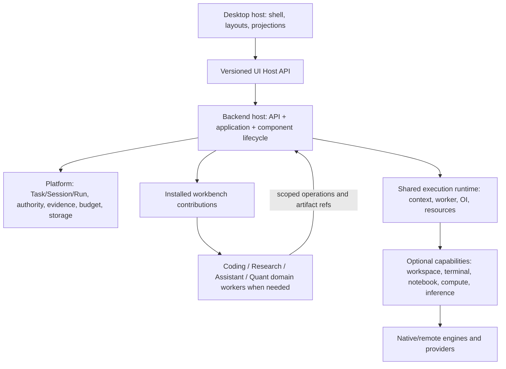
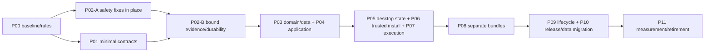
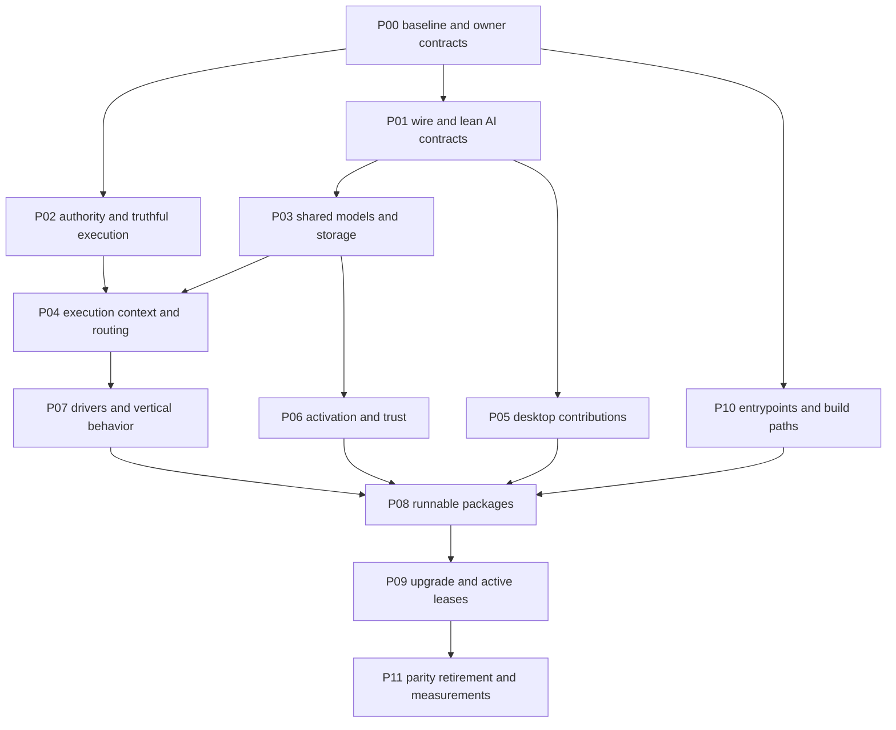
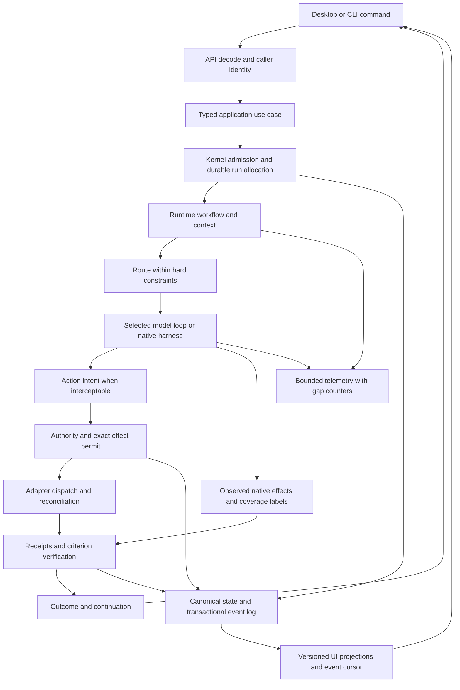

# Custos — Kế hoạch refactor platform, workbench và desktop

**Trạng thái** là kế hoạch refactor theo packet. Cleanup root hỗ trợ ở cuối §16 đã được thực hiện theo yêu cầu người dùng, các packet khác giữ trạng thái trong ledger. Người dùng đã cho phép bỏ ràng buộc số lượng 11 crates khi thiết kế đích.

**Snapshot hiện hành** ngày 13-11-2026 nằm ở [§17](#three-root-target-review), đối chiếu branch `vi` tại `f3cfaa3d`. Các nhận định cũ phải được kiểm lại theo source hiện tại trước khi thi công.

**Baseline lịch sử** là `new_rft`, HEAD `9cd903b` cộng working tree hiện hữu tại snapshot 09-11-2026 trong [baseline JSON](platform-refactor-baseline.json). Hash từng file được kiểm trước mỗi packet và giữ các thay đổi đang có.

**Điểm vào theo từng file** nằm ở [§16](#platform-file-plan), [CSV](platform-refactor-file-map.csv) và [baseline](platform-refactor-baseline.json). Snapshot của kế hoạch bao phủ 1.381 file với 638 file platform. Các row retired/relocated phản ánh cleanup sau snapshot. Đọc source/callers của packet trước khi chuyển.

**Điểm vào thi công hiện hành:** [§15 — move/gộp/giữ/bỏ](#move-plan) cụ thể hóa backend, desktop, data/lifecycle, write sets và acceptance của P00–P11. [§2](#2-audit-ưu-tiên-trước-khi-chuyển-cấu-trúc) đã cập nhật các lỗi thực sự còn lại trên `new_rft`; không lặp lại foreign-task/operation-ID/SPY→BTC như chưa được sửa. Phần §15 là **kế hoạch**, không là source đã chuyển.

**Đầu vào:** [Custos.md](../../Custos.md), manifests và source hiện tại, desktop/CLI build, tests, các đề xuất distribution được gửi. Kế hoạch này thay execution entry cũ trong chính file này; P00–P11 vẫn giữ ý nghĩa tương ứng nhưng được cụ thể hóa cho vertical packages. Các campaign R/F/W trước là lịch sử/fixtures, không là queue song song.

## new_rft: concrete capability ownership and repository cleanup

The working tree has moved Cargo packages into `platform/`, `apps/` and `sdk/`; this is not independent downloadable distribution yet. The earlier `capabilities/*/adapters/src` compute/A2A files are byte-identical, uncompiled copies of live adapters. Remove those copies rather than maintaining two implementations. Metadata-only capability scaffolds move beside their live driver; do not invent a worker/crate just to fill a target tree.

| Responsibility | Current single source owner | Boundary |
|---|---|---|
| Notebook, terminal, workspace, compute, local inference, MCP, A2A | `platform/adapters/src/host/{execution,workspace,terminal,...}` and `connectors/{mcp,a2a,...}`, plus `platform/ai/src/local` for inference | Concrete I/O implements core/provider ports; no canonical DB or permission issuance |
| Source text acquisition | `platform/adapters/src/host/documents/source_fetch.rs` | Scoped bounded UTF-8 reads; PDF/OCR is not implemented by this adapter |
| Checkpoint integrity | `platform/adapters/src/host/execution/compute/checkpoint.rs` | Local inventory verification, not remote backup or live migration |
| Capability lifetime, admission, job coordination | `platform/runtime/` and existing core ports | One owner per resource; tab closure is not job cancellation |
| Domain objectives, recipes and UI | workbench contribution; legacy `platform/components` remains transitional | A manifest alone does not extract current domain implementation |
| Desktop regression tests | `tests/desktop/` | Node tests use existing desktop TypeScript dependencies |
| Development checks and source audits | `xtask/scripts/` | CI and `just` call these paths; no product tool catalog here |
| Old team/RFC notes | `docs/development/legacy-team/` | Historical, not a competing architecture authority |

Remove the root `tools/` directory: retire the explicitly removed Repo Intelligence development subsystem, retain active tests/audit utilities at the owners above. Remove root `scripts/` after moving active checks; retire the old destructive 11-crate migration and unused Goose download scripts. Keep the active NPM release wrapper in `packages/custos-npm-package`, user configuration examples and user `.custos` data. The unused root examples and editor metadata scaffold are retired by the support-root cleanup recorded below.

OOP/system design here means consumer-owned behavior contracts, constructor injection, explicit lifetime and composition; no capability manager per manifest, inheritance tree, duplicate registry or fabricated independent install state. Model/harness contracts remain distinct. Required capability metadata is checked against live module paths; runtime readiness and authority are separate checks. Driver manifests are source descriptors, not authenticated install manifests.

Remaining source tangles after this cleanup, to resolve in the existing packets:

1. `apps/daemon/src/application/mod.rs` still imports `crate::api::*` and implements use cases on the transport dispatcher. P04 should inject application services into transport; do not add another broad forwarding manager.
2. `platform/components/src/lib.rs` still exports all four domains; `platform/domain/src/lib.rs` still carries Quant/Research semantics. P03/P07 must migrate actual callers, verifiers and storage contracts before claiming specialist backend absence from Base.
3. `workbenches/*/backend/src/domain` currently contains prototype types without Cargo compilation units. These are not byte-identical copies and are preserved for reconciliation, not promoted as canonical implementations. `sdk/protocol/src` contains copies of core wire contracts without its own Cargo manifest; P01 must select one compiled owner, migrate imports, then remove copies.
4. `ui/desktop` still owns shipped workbench panes; `apps/desktop/native` is the native host, not proof of separate frontend bundles. P05/P08 must isolate state/Host API and packaging, preserving session/Task continuity.
5. `platform/adapters` still builds the shared driver package; local native inference remains enabled by its default feature. P10 needs a measured Base build and dependency/payload inspection. Source reorganization alone saves no promised runtime RAM or token cost.

Verification for this cleanup: workspace `cargo check --workspace --all-targets --offline` passed; desktop production build passed; Node regressions 51/51 (49 desktop/model plus 2 negative guard fixtures), xtask unit tests 2/2, schema contracts 3/3, scoped source acquisition 5/5 and checkpoint integrity 2/2 passed. Eight source descriptors and four workbench references validate. Shell syntax, moved audit/native-smoke syntax and `git diff --check` passed. The user's pre-existing staged migration was compared byte-for-byte before and after and is unchanged. No commit, push, DB migration, live cloud/GPU run, native browser interaction or full semantic source audit was performed. Removed development content was preserved outside the repo in the temporary cleanup backup.

Actual downloadable extraction remains P06–P10: separate build payload, host/worker handshake, dependency closure, compatible schemas, trusted activation and lease-aware removal. Never move shared notebook/compute under Research solely because Research currently uses it; Quant and Coding may consume the same capability without Research UI.

## 1. Phạm vi và độ sâu kiểm tra

| Phạm vi hiện hữu | Files | Lines của text files |
|---|---:|---:|
| `crates/custos-domain` | 82 | 16.889 |
| `crates/custos-core` | 67 | 8.815 |
| `crates/custos-provider` | 53 | 39.946 |
| `crates/custos-runtime` | 105 | 23.634 |
| `crates/custos-packs` | 80 | 9.184 |
| `crates/custos-adapters` | 196 | 60.312 |
| `crates/custos-persistence` | 86 | 14.455 |
| `crates/custos-bridge` | 4 | 578 |
| `crates/custos-daemon` | 65 | 23.793 |
| `crates/custos-sdk` | 41 | 6.833 |
| `crates/custos-app` | 93 | 2.842 |
| `ui/desktop` | 236 | 58.093 |
| `ui/cli` | 48 | 8.620 |
| **Tổng** | **1.156** | **273.994** |

Inventory loại `node_modules`, `target`, `dist`, `.git`; bao gồm manifests, lockfiles, assets, bindings và tests trong hai vùng. Tập source extensions có 915 files/250.394 lines, **có cả generated và test code**, không phải toàn bộ là production logic. Text được đọc toàn nội dung bằng structural scanner: hash, line count, declarations/import patterns; không gọi regex là AST hoặc call graph. [Baseline JSON](modular-workbench-audit-baseline.json) giữ full HEAD, dirty manifest, coverage, checks và source drift để tái kiểm.

[Per-file disposition ledger](modular-workbench-file-map.csv) có đủ 1.156 files với source/hash/topic/target candidate/action/packet/review depth. 34 files được đánh dấu đã theo selected production traces/ranges trong đợt này; các file còn lại không được quảng bá là đã review ngữ nghĩa từng dòng. Target là quyết định theo nhóm cần kiểm caller/dynamic references, không là script bulk rename. Không kết luận một file dư chỉ vì không thấy static import.

Baseline checks đã chạy: `cargo check --workspace --all-targets --offline` pass; desktop build pass; CLI UI build pass; canvas smoke 43/43; core completion tests 7/7. Chúng không chứng minh tính đúng của mọi capability hoặc distribution. Không chạy live GPU, broker, mail, native harness, OS escape hoặc power-loss tests. Các findings dưới cần fixture riêng dù baseline xanh.

## 2. Audit ưu tiên trước khi chuyển cấu trúc

Giả định tải: một người dùng local, nhiều cửa sổ/panes, workers và remote jobs; không giả định SaaS nhiều tenant. Đây là trạng thái đọc lại trên `new_rft`, HEAD `9cd903b` cộng staged/unstaged migration hiện có. Findings cũ không tự động còn đúng sau khi code thay đổi.

| ID | Hiện trạng đã đối chiếu | Quyết định và packet |
|---|---|---|
| F01 — Evidence completion | Foreign-task check đã có trong gate/API. Probe mới vẫn chấp nhận same-task claim chưa persist, sai criterion và thiếu source version; API chuyển claims của client vào service | P02/P03: resolve canonical verification records; bind Task/revision/criterion/source/attempt/verifier. Giữ test foreign-task đã đúng |
| F02 — Quant truth | SPY→BTC đã bị chặn. Daily SPY benchmark vẫn ingest dưới timeframe chọn tùy ý; `MarketService::discover_factors` còn p-values/std/IR cố định và `verified` | P02/P07-F: sửa interval/provenance và statistical method; trả unknown/unavailable nếu thiếu phương pháp/dữ liệu |
| F03 — Worker response | Operation ID mismatch và plaintext đã bị chặn. JSON không phải observation vẫn được bọc thành success | P01/P07-A: strict versioned response; generic JSON chỉ qua adapter legacy khai báo rõ |
| F04 — Worker lifetime | Generic WorkerLease gửi một payload rồi EOF; StatefulKernel enum không tạo persistent protocol; memory field chưa là OS enforcement | P07-A/B: one-shot, notebook/PTY và remote job là lifetime khác nhau. Notebook hiện có driver/coordinator persistent riêng; không thay nó bằng WorkerLease one-shot |
| F05 — Package projection | UI đã lọc disabled và không còn luôn thêm aliases sau inventory refresh. Initial/offline state vẫn có built-in assumptions; readiness khác installed | P04/P05/P06: capability projection canonical, unsupported/offline riêng; preserve disable fix |
| F06 — Bundled domains | `platform/components/src/lib.rs` export bốn miền; ResourceContent import router bốn miền; workbench prototype source chưa thành compilation unit | P03/P05/P08/P10: một implementation owner, separate artifacts, Host API và real worker activation |
| F07 — Application depends on API | `application/mod.rs` import `crate::api::*`, methods nằm trên LocalApiDispatcher | P04: application services không dùng ApiRequest/ApiResponse; transport gọi services; bootstrap inject |
| F08 — Desktop hydration/state | AppContext và ScreenContext còn giao nhau; all-session journal Promise.all chạy trước setTasks, một journal lỗi có thể chặn saved-work hydration | P02/P05: list first, history on demand, per-session error, one layout owner; giữ hydratedKey và restore guards |
| F09 — Package trust | scan tính self-hash; register_discovered_candidate ghi installed; list_enabled_components chấp nhận installed. URL+digest do caller cấp không tự xác thực publisher | P02 chặn auto-admission; P06 trust/compatibility/paths/activation recovery. Không coi discovered là ready hoặc granted |
| F10 — Rules/status | Fixed-count constraint đã bỏ; root tools/scripts/dev_docs/capability scaffold đã dọn. Một số docs/CSV vẫn là snapshot lịch sử | P00/P11: dùng current source map và trạng thái; không hồi sinh folder/facade cũ để hợp cây vẽ |
| F11 — Approval resume fabricates receipt | `continue_resumed_run` tự tạo Success receipt cho Approved/Dispatching chưa receipt, duration10, rồi emit completed; persist errors bị bỏ qua | **P02 đầu tiên:** dispatch/reconcile thật, không biến approval thành effect success; Run outcome và Task completion phải qua gates riêng |
| F12 — Unused lossy batching | batch_writer enqueue không là commit ack, drain trước commit, lỗi chỉ log/drop, ledger dùng INSERT OR REPLACE; chưa thấy caller production trong đường đã rà | P02/P03: bỏ module/export/tests riêng sau consumer search, giữ single-writer repository transactions. Không wire vào đường quyền/idempotency |
| F13 — OI heuristic | Estimator dùng constants/tên harness; Selector chọn candidate hợp lệ đầu tiên. Đường OiEngine chủ yếu thấy trong tests, chưa chứng minh production optimization | P07 baseline/P11: giữ experimental; availability thật, quality/cost calibration và paired evaluation trước default |
| F14 — Durability | Canonical connection WAL/NORMAL; credential flow có FULL riêng, chưa đồng nghĩa permit/outbox có cùng durability | P02/P03/P10: chốt durable-before-dispatch contract; FULL cho canonical commits cần chịu power loss, telemetry/cache tách theo nhu cầu đã đo |

Evidence source: `platform/core/src/kernel/completion.rs`, `apps/daemon/src/api/tasks.rs`, `platform/runtime/src/workflow/task_runtime/{mod,execution}.rs`, `apps/daemon/src/application/quant/services/market.rs`, `ui/desktop/src/components/workbenches/quant/ExecutionPane.tsx`, `platform/runtime/src/packages/worker_lease.rs`, `platform/storage/src/{connection,batch_writer}.rs`, `platform/storage/src/repositories/packages.rs`, `platform/runtime/src/oi/{estimator,selector}.rs`. [§15](#move-plan) chuyển findings thành write sets, thứ tự và acceptance cụ thể.

Probe nằm ngoài repo đã chạy trên source hiện hành: `same_task_unpersisted_claim_missing_source_wrong_criterion_accepted=true`, `foreign_task_claim_rejected=true`. Các findings khác dựa source traces; không quảng bá là đã thử live connector/GPU, power-loss hoặc khai thác bảo mật. Command exit 0, hash hoặc citation locator vẫn không tự chứng minh semantic criterion.

## 3. Kiến trúc đích

**Shared platform + independently packaged vertical workbenches + optional reusable capabilities.** Backend host giữ control plane; component chuyên môn chứa UI và domain implementation. Số crates là kết quả của boundaries/build, không mục tiêu. Không microservice hóa local app và không tạo một kernel/store/agent loop riêng cho từng workbench.



Platform không import component implementations. Component không gọi private platform internals hay component khác; dùng protocol/Host APIs. Cross-workbench qua Task, typed artifact/schema/lineage, privacy và consent; không Rust import hoặc copy raw transcript làm grant. Assistant built-in được bundled theo cùng contribution contract, không sở hữu OI/model gateway chung.

## 4. Repo đích và units of compilation

Cây đích thống nhất ở [§15.2](#152-cây-đích-và-ranh-giới-vật-lý). [§16](#platform-file-plan) cùng CSV hiện hành xác định nguồn và địa chỉ đích của từng file. Public protocol và AI contracts cần compilation boundary rõ. Workbench tải sau cài đặt dùng executable/protocol phù hợp, shared drivers nằm cạnh source owner và engine lớn được phân phối tùy chọn.

## 5. Ownership rules for each subject

| Subject | Target owner | Rules |
|---|---|---|
| Task/Session/Run, shared resources, actor, command/event IDs | platform domain/core/application | Common spine, profile scoped; no per-workbench copy |
| ModelPort/event/usage fidelity | connectivity contracts | Separate from native harness loop; vendor implementation optional by build/package |
| S1/S2/OI/Meta, context compiler, memory coordination | platform runtime/core | Shared; pack supplies objective/obligations; Meta not live policy mutation |
| Git/worktree/PTY/notebook/remote compute lifecycle | optional capability owners | Reusable by multiple workbenches; no forced entire Research dependency for Quant notebook |
| Paper/claim/corpus/research recipe/synthesis | Research component | Domain semantics + UI + source-aware verifiers; generic EvidenceRef stays platform |
| Alpha/strategy/backtest/risk/order semantics | Quant component | Imported/computed/demo distinguished; no broker authority of its own |
| Draft/contact/time/calendar/automation workflows | Assistant component | Generic trigger/outbox/authority engine stays shared when genuinely cross-domain |
| Code diagnosis/patch/review/test criteria | Coding component | Workspace capability handles physical access; trusted verifier gate distinct |
| Canonical writes, recovery, package migration execution | platform storage/application | Component owns schema meaning, host owns physical commit and permissions |
| Screen/layout/device preferences | desktop host | Single owner, versioned restore; no execution side effect |
| Domain view state | component UI | Local transient inputs; server projections through SDK; no canonical job state |

Splitting pure domain code is also required: common domain crate currently exports Research/Quant types. Move specialized types into their component; preserve shared artifact envelopes and compatible wire decoders. Do not turn everything into unvalidated JSON merely to avoid dependencies. Payloads have namespaced schema/version, validated at boundary, with common identity/provenance outside payload.

## 6. Contracts required before extraction

| Boundary | Required semantics | Migration source |
|---|---|---|
| Client wire | command ID, actor from trusted transport, scope/profile, version/deadline, expected revision; replay/event cursor | SDK wire, daemon API, UI DTOs |
| UI contribution | component/version/host compatibility, views/commands/resource kinds/settings; register/dispose; unavailable renderer | TS workbench types, registry, contributions, ResourceContent |
| Worker | handshake/version/capabilities, operation+attempt ID, exact artifact inputs, progress/result/error, cancel/heartbeat/reconnect | WorkerOperation/Observation, WorkerLease, harness/notebook contracts |
| Resource | stable resource ID, source/execution binding, owner, lease/epoch, acquire/attach/release, observed/enforced limits | workspace/terminal/notebook/compute coordinators |
| Storage | atomic command/claim/binding operations; scoped component record/query API; trusted migration ledger | storage ports/repositories, bridge promote/attach |
| Evidence | Task/revision/criterion/source/attempt/verifier identity, output artifact, status/method/trust | VerificationClaim + CriterionVerificationRecord + completion path |
| Package | publisher/component/version/OS-arch/host-protocol ranges, dependencies, signed artifact identity, sizes, schema needs | package records, manifest schemas, installer |
| Handoff | selected artifact/claim refs, lineage, redaction/consent, consumer schema; no implicit grant | SessionTaskBinding, ContinuationPacket, handoff UI |

Use enums for finite protocol states and traits for behavior to substitute, not a trait/class for every struct. Constructor injection at host composition; no global service locator. A worker SDK cannot depend on platform storage/runtime implementation. Shared protocol can use small common domain values; core policy does not import client DTOs.

## 7. Data infrastructure and migration

Maintain four areas: canonical relational metadata/events; artifact/payload storage; rebuildable indexes/projections; secrets. Resource registry stores identities/refs, not a fifth blob store. User folders/external datasets are not host-owned cache. Model checkpoints/datasets remain addressable after package remove.

Component-specific query/schema definitions live with the component, but a scoped host storage adapter executes approved operations through the canonical writer. Downloaded worker gets no raw DB path/credential or arbitrary SQL. First-party signed migrations are versioned, reviewed and executed by host; third-party arbitrary SQL installation is outside initial scope.

1. Snapshot current schema/migration ledger, rows/counts/keys, CAS refs, old resource/layout payloads. Backup uses SQLite-consistent method, not copying only `.db` while WAL is live. [SQLite backup](https://sqlite.org/backup.html).
2. Preserve already-applied migration IDs/checksums; add forward component-schema ledger. Never repartition historical SQL into new namespaces and rerun it on user DBs.
3. Move code ownership before physical data layout when useful. New repositories can read old tables; remove schema coupling gradually through explicit compatibility adapters.
4. Common Task/artifact references outlive component availability. Missing package shows retained resource + install/export path; it does not drop data or bind another workspace.
5. Package disable blocks future activation/dispatch, not historical decoding or recovery. Active jobs pin exact package/engine/schema versions; update retains old executable/data compatibility until settled.
6. Canonical DB WAL/durability profile must be explicit. Current NORMAL is not a power-loss durability promise. Read pool/writer lock exists; do not introduce a second asynchronous writer queue simply for a folder diagram.

Code rollback selects compatible prior host/component; schema rollback is separate and not assumed possible. After irreversible migration use forward repair or consistent backup restore; never repeat uncertain external effects while rolling back UI/package code.

## 8. Desktop refactor in detail

### 8.1 State ownership

- **Server projection owner:** sessions/tasks/runs/resources/inventory/capability status with version/cursor, read-only selectors and mutation commands. Persisted truth stays backend. Subscribe/refetch once; avoid every component running its own polling loop.
- **Layout owner:** screens, split tree, tab instances, selected/focused resource, popout layout and saved view. Move AppContext tab/canvas fields into this owner and migrate ScreenContext consumers; remove the old writer in the same packet.
- **Connection/account owner:** provider/catalog/local instance selections and readiness projections; persisted device preferences are not provider credentials. Keep OAuth/native connection behavior behind SDK.
- **Attention owner:** derived pending approvals/uncertain attempts/blockers, not invented DAG states. **Ephemeral UI state:** form inputs/open menus may stay local.

React context can remain a light composition surface. Reuse installed React primitives; selector-based external subscriptions can use [useSyncExternalStore](https://react.dev/reference/react/useSyncExternalStore) where justified. Do not add a new state framework just to split a 2.525-line file. Preserve immutable snapshots, cached selectors and cleanup.

### 8.2 Host versus component code

Host owns rail/topbar/sidebar scaffolding, screen switcher, pane tree, command palette, attention, settings shell and theme tokens. Components register their navigator data, views/settings sections/commands/resource renderers through UI SDK. Component UI must not import `AppContext` or another component's private view. Shared editor/browser/notebook renderer becomes a capability only if consumers justify it.

ResourceContent becomes registry lookup + boundary/error/loading/unavailable wrapper. Move direct domain imports and the closed union switch into component entrypoints. Existing aliases engineering/coding and copilot/assistant remain readable at boundary. New resource types use stable namespaced IDs; no raw unvalidated plugin method dispatch.

### 8.3 Working model

Central area: chat, files/diff, terminal/agent, PDF/source, claims/notes, notebook, runs/training, draft/outbox and Quant reports can open multiple instances. Inspector shows supporting metadata for focused resource, never a second file tree or the only place to complete a primary workflow. Sidebar follows domain scope: repo/worktree in Coding, folder/corpus/experiment in Research, optional personal/connector scope in Assistant.

Screens are saved layouts, not jobs. Several Coding/Research screens and cross-domain panes are allowed; switching scope does not retarget existing tabs. Open same chat in another workbench or create a linked continuation with selected context; deletion of chat is distinct from deleting work/evidence. Close view detaches; stop/cancel is explicit, with result/uncertainty.

### 8.4 Settings and interaction

Separate Appearance/device settings, Connections/accounts/model runtimes, Components/library and per-workbench settings. All use one form pattern with draft/pending/applied/error; no optimistic success when backend save fails. Preserve native dialogs and browser-safe fallback; unavailable native actions explain requirements.

Keep typography-first light/dark/system tokens and existing resource shapes; remove component hardcoded theme divergence as views move. Icon-only switchers have accessible names/tooltips and focus. Global shortcuts respect terminal/editor capture and OS bindings. Keyboard can navigate rail/sidebar/tabs/palette, restore focus, open/close pane and dismiss error; drag/drop has an alternative. Failed forms have inline errors and focusable summary; no toast-only approval/security failure.

### 8.5 Migration fixtures

Read old `custos.screen_layout.v2.*`, legacy canvas/resource-tab keys, per-session model preference and nullable selections. Preserve future-version snapshots instead of downgrade-writing them. Golden cases: two panes on different worktrees; one research notebook + coding editor; missing component during restore; popout reconnect; chat exposed to another workbench; close tab while job lives; stale async response after project switch; user data under old aliases.

## 9. Workbench and capability delivery

| Component | Minimum actual journey | Required failure path |
|---|---|---|
| Assistant bundled contribution | Chat/draft from selected context; pending outbound action preview and truthful status | Ambiguous recipient, changed payload, timeout after connector acceptance; unsupported real connector stays unavailable |
| Coding package | Open folder/repo, native or Custos model agent, scoped terminal/worktree, patch + independent behavior checks | Dirty/base drift, symlink/egress, unknown launch, test edits, write conflict; worktree not a sandbox |
| Research package | Import source → versioned passage → claim assessment → brief; optional notebook/experiment | Broken citation support, OCR gap, missing source/version; unknown semantic support retained |
| Quant package | Import versioned bars → strategy/backtest → risk/report; explicit imported/computed status | No synthetic BTC/other symbol, timestamps/timeframe/fees, lookahead/selection bias inconclusive, live broker unavailable |
| Notebook capability | Attach/start supported kernel, execute, stream bounded outputs, interrupt/restart/shutdown distinctly | Epoch mismatch, worker death, multiple views, long-running job, incompatible environment |
| Compute/training capability | Immutable recipe+attempt+target+checkpoint refs; supported engine launch/inspect/cancel/restore | Colab/Kaggle/rental modes differ; verified checkpoint continuation, not live-memory migration |
| Native inference capability | Discover artifact/endpoint, preflight, load/select/unload with observed state | Missing shards/model, unsupported backend, insufficient memory, API-only Base independent |
| MCP/remote/harness capability | Version/capability negotiation, source/effect scoping, attempt/usage/cancel semantics | External runtime tool bypass assurance, auth expiry, malformed events, unknown spend |

Unsloth is a training engine integration; llama.cpp primarily inference; Colab/Kaggle/rental are compute targets; datasets/weights/checkpoints are artifacts. Do not force these into one provider class. Heavy dependencies separately selected by concrete workload, not merely by installed workbench. Notebook reuse by Quant depends on notebook capability, not Research UI.

Dynamic tool disclosure follows active Task/worker capability scope and desired context, not only the currently visible tab. A user switching to Quant while a Coding worker is running must not silently change that worker's grants/tools. Installing or enabling a contribution is not capability authorization.

## 10. Distribution and trust

Base includes host/platform and bundled Assistant contribution; Developer preset additionally installs Coding. Research/Quant UI and domain workers can be absent physically. Build produces separately versioned first-party UI bundles and native worker artifacts with explicit OS/arch/protocol compatibility. React.lazy alone is an intermediate optimization, not this final gate. Cargo features control actual optional build/link deps, not runtime installation.

Package dependencies are a DAG of components/capabilities/artifacts; pin versions/digests and resolve shared dependencies without duplicating environments unnecessarily. Manifest/catalog needs authenticated trust, freshness, anti-rollback, platform/protocol/schema ranges and allowed entrypoints. Signature algorithm choice alone does not implement update security. [TUF](https://theupdateframework.github.io/specification/latest/).

Install: verify metadata → resolve consent/dependencies/disk requirements → download/resume staging → validate bytes/extraction/paths → preflight compatibility/schema → finalize/reconcile inventory → register contributions. Filesystem and DB are not one atomic transaction; interrupted states have recovery markers. Enable, ready, loaded, running and granted remain independent. Scanning a directory discovers candidates; it must not authorize arbitrary code.

First-party UI packages are trusted code served from verified local resources under CSP/Host API restrictions; no remote CDN eval or unrestricted Tauri access. Shared React/design token compatibility explicit; an error boundary does not isolate malicious JS. Third-party UI needs a separate trust/isolation design before support. [Tauri capabilities](https://v2.tauri.app/security/capabilities/), [JupyterLab prebuilt extension reference](https://jupyterlab.readthedocs.io/en/stable/extension/extension_dev.html).

Update can stage side-by-side while runs pin old version. Disable blocks new usage; remove waits/drains or explains active dependencies. Uninstall managed code separately from purge user data. Do not promise UI module memory fully unloads on unmount; safe host reload may be needed after updates. No fixed installer/RAM/token-saving numbers until measured artifact and workload profiles exist.

<a id="19-cập-nhật-working-tree-dùng-phần-đã-xây-đóng-các-khoảng-trống"></a>
<a id="27-phạm-vi-refactor-bắt-buộc-và-cấu-trúc-đích"></a>
<a id="28-work-breakdown-chi-tiết-p00p11"></a>

## 11. Implementation queue P00–P11

The legacy section anchors above land on this replacement queue; §15 supplies concrete move units and acceptance, not another campaign; old section numbers are not separate campaigns. Packet IDs retain their role. Each packet includes exact caller/data/test inventory before code changes; candidate per-file placement comes from the CSV and is not automatic authorization to move all files.

### P00 — Baseline and rules

- Capture HEAD + dirty hashes/deletions/untracked files; verify no competing source edits before changing a write set. Recheck inventory against file-map hash; never restore user-deleted facades by default.
- Update AGENTS and UI rules to target: no fixed crate count, worktree scope only where needed, real source status and existing security/gates retained. Align master Chapter 2 and catalog.
- Reuse current constructors/readiness/admission/idempotency/layout guards. Do not repeat completed historical R/F work.
- **Gate:** reproducible baseline checks and snapshot counts; no user change lost. **Rollback:** document-only corrections, no source rename yet.

### P01 — Contracts and SDK boundary

- Consolidate current SDK wire/client, core worker/package records and UI `types/domain.ts`. Publish minimal protocol, generated TS/Rust fixtures, unknown/version/error behavior and stable aliases.
- Move public harness/value types out of SDK→core coupling; preserve model-turn conversation/tool/reasoning/stream/usage fidelity. Do not flatten rich provider types just to shrink folders.
- Add UI contribution and worker handshake/observation contracts. Strict result identity, max frame size, malformed input, deadlines, cancellation and schema negotiation.
- **Gate:** old client/new host and supported compatibility combinations; no SDK backend link; foreign operation result rejected. **Rollback:** keep compatibility decoder, do not dual-run commands.

### P02 — Correctness and truthful UI

- **P02-A trước mọi move:** F11 actual dispatch/reconcile và không fabricate receipt; F01 chặn raw client pass claims (canonical resolver hoàn tất ở P02-B); F02 statistical/data truth; F08 failure-isolated hydration; F09 discovery không auto-enable. Patch tại source hiện hữu, không trộn rename.
- **P02-B sau minimal contract design:** F01 canonical evidence resolver theo minimal contract P01; F14 durability và commit/ack semantics; F12 retire unsafe unused batch writer; strict evidence/result fixtures. API compatibility không được giữ bằng cách tin lại client pass flags.

- Complete the remaining F01–F05 gaps at the shared owner before extraction; preserve the foreign-task, operation-ID and disabled-inventory fixes already present. Completion resolves trusted records and criterion/source/attempt binding; add negative cross-task and fabricated-claim fixtures.
- Preserve the SPY→BTC rejection; fix remaining daily/timeframe relabeling and hardcoded statistical verification, and remove non-explicit fixture fallback; preserve provenance/import status. Separate stored reports from computed/live results.
- Package UI reflects enabled/ready/granted; renderer output is never proof of resource enforcement. Protocol errors do not become success.
- **Gate:** focused regression cases plus existing baseline. **Rollback:** disable unsupported actions, retain read-only data/history; never restore false-success fallback.

### P03 — Domain and component state ownership

- Lift Research/Quant/Assistant-specific models and pack contracts into component source; common IDs/Task/Run/EvidenceRef stay platform. Split shared automation trigger from personal workflow semantics.
- Define component data/schema identity and typed payload validation, no all-purpose unchecked JSON. Convert old enums through explicit aliases/unsupported paths.
- Keep pack/domain code independent of scheduler/concrete I/O. Move physical FetchUrl/process/parser implementations to adapters/capabilities; verifier semantics retain domain ownership.
- **Gate:** platform builds without importing specialized implementation; old persisted/wire records decode; recipes/verifier outputs compatible. **Rollback:** old readers available until migrated consumers pass.

### P04 — Backend composition and application

- Thin `api/mod.rs`; feature application services receive narrow dependencies; query projections and commands separate without duplicate business logic. Module extraction must move actual callers, not add unused helper files.
- Merge bridge promote/attach/steer/recall/fork use cases into session/task application; create/bind durable boundary and acknowledged delivery semantics. Keep Local API aliases until caller parity.
- Backend bootstrap owns shared store/runtime/component graph, lightweight factories and per-profile single-instance lifecycle. No hidden production native constructors or unconditional all-pack registration.
- **Gate:** same command across desktop/CLI returns same canonical state; duplicate command/reconnect/launch uncertainty tests; optional failure degrades capability. **Rollback:** route adapter back to one working owner, no second executor.

### P05 — Desktop host/state extraction

- Extract server projection, layouts, connections/preferences and attention from AppContext; migrate consumers and remove old effects/writers in same packet. Keep Screen future/hydration safeguards; fold tabs/canvas into one owner.
- Replace domain-aware shell imports with contribution interfaces; shared typography/interaction/error pattern. Keep resource instance scope/binding immutable unless explicit retarget command.
- Paginate/lazy-load session journals; bounded subscriptions/poll fallback; package inventory and capability status query shared once. Settings draft/apply state and native/browser fallback explicit.
- **Gate:** build + 43 current smoke cases, actual click/keyboard restore/cross-pane/popout scenarios; no orphan helpers left. **Rollback:** saved-layout compatibility reader; preserve user preferences and missing-package resources.

### P06 — Trusted install and activation

- Reuse transfer/inventory primitives after tightening source, trust, paths and interrupted-install states. Separate discovered, staged, verified, installed, enabled and ready.
- Add signed first-party metadata/catalog, compatibility, dependency closure and staged recovery; no arbitrary URL/manifest self-hash treated as authenticated publisher.
- Host applies trusted migrations/preflight before registering operations; unavailable component keeps export/repair/install paths.
- **Gate:** tampered/truncated/expired/incompatible/interrupted package rejected or recoverable; no effect before permission. **Rollback:** prior compatible inventory/artifact, no user-data removal.

### P07 — Execution capabilities and complete domain journeys

- **P07-A:** common supervisor: bounded framed streams, operation/attempt/generation identity, cancel/drain/reap descendants, no orphan process; granted versus OS-enforced limits honest.
- **P07-B:** notebook stateful protocol separate from one-shot; persistent kernel epoch, real interrupt versus restart/shutdown, multiple-view attach. Current custom Python driver is not automatically Jupyter conformance.
- **P07-C:** workspace/terminal/harness capability; Coding domain worker and UI use shared admitted resources, exact base/write sets and behavior tests; native loop/assurance preserved.
- **P07-D:** Research basic source→passage→claim→brief package first, then parser/OCR/notebook/experiment/training dependencies. Source trust/extraction/semantic support remain separate.
- **P07-E:** Assistant draft/identity/time and outbox fake-connector fault tests before advertised real send; Automation scoped/expiring with bounded occurrences.
- **P07-F:** Quant real input backtest/risk/report; method/version/fees/splits/data source; no metadata boolean oracle or live order capability without real adapter and exact authority.
- **P07-G:** compute/inference: local/cloud attempts, checkpoints verified at byte/environment/engine level, weights-only versus stateful resume explicit; remote status unknown never blind duplicate launch.
- **Gate:** one complete real configured execution path per advertised capability plus fault fixtures; no fixture as production fallback. **Rollback:** retain direct working route, drain/mark uncertain by actual effect semantics.

### P08 — Independently downloadable UI and vertical bundles

- Build workbench UI/worker from canonical source into artifacts outside Base BOM; no copied source fork. Dynamic imports resolve only installed compatible contributions through Host API.
- Resource renderer/command/settings registration and disposal; namespace ownership; shared React/UI SDK versions. Preserve error/unavailable resources and exact IDs across restore.
- Move domain views to `workbenches/*/ui`; reuse helper/view exports only with actual consumers. Keep platform/server-state out of component private stores.
- **Gate:** Base artifact physically lacks Research/Quant UI/worker payload; install package adds working view/job without host source rebuild where claimed. **Rollback:** compatible bundle or safe reload; preserve layouts/jobs/data.

### P09 — Upgrade/remove and long-lived jobs

- Pin package/environment/schema versions for running jobs; side-by-side staging, active dependency references and explicit stop/drain. Disable does not kill job by tab state.
- Separate uninstall managed bytes from purge user corpus/models/checkpoints/history. Cache GC uses references/retention/privacy, not pane count.
- **Gate:** update during training/kernel/run, package missing on restart, two profiles sharing immutable artifacts, last-checkpoint retention, failed activation with old version intact. **Rollback:** code selection only, not historical receipts/external effects.

### P10 — Data/build/release and clients

- Execute forward migration strategy §7; component schema history, profile storage and legacy ID/layout mappings. Preserve FK/Task/Run/artifact/lineage and audit; no blanket JSON rewrite.
- Rework Cargo/TS workspace manifests and lockfiles in one integration write set; actual optional native dependencies/cfg coverage, build dependency direction, license/attribution and OS/arch package signatures.
- Move thin Tauri host and CLI entrypoints. Inventory `ui/cli` React/Tauri UI separately from `bin/custos-cli.js` headless client; preserve working CLI behavior and advertised compatibility. Retire duplicate GUI only after consumer audit, not because folder says CLI.
- **Gate:** clean-machine Base/Developer/Research/Quant combinations, optional install/update/remove and old profile restore; native platform checks for advertised OS. **Rollback:** supported signed host/component pair + consistent data restore/forward repair.

### P11 — Optimization and retirement

- Measure artifact bytes, cold start, idle/active RSS/CPU, per-token rerenders, observers/timers, queue/output limits and time to accepted result. No unmeasured RAM/CPU/size promise.
- Context/cache/rules/S1/OI paired versus same-task strong baseline; report total attempts/verifier/recovery cost and quality/unknown/human effort; do not prune required evidence for savings.
- Retire superseded `custos-bridge`, monolithic packs/closed UI dispatchers/root aliases and wrappers only when production/string/dynamic/test/schema consumers have migrated. User-deleted `blocks/` stay deleted unless a verified caller requires a reviewed fix.
- **Gate:** no old runtime/writer or fallback path; declared product journeys pass; docs/rules/status/physical catalog truthful. **Rollback:** disable optional optimization independently; preserve direct accepted path and historical records.

## 12. Dependency order and execution management



Data/build preparation and instrumentation start earlier; final P10/11 gates close them. P07 Research basic vertical is the package pilot, then domain/capability subpackets complete all advertised workbenches. This is not authorization to stop after the pilot. No fixed four-week or percentage-complete estimate without actual packet/caller scope.

Per packet record: objective; source symbols and all callers; allowed write set; contract/data/schema version; selected baseline tests; negative fixtures; live capability test when relevant; retirement list; rollback; source snapshot + limitations. Tests stay adjacent to owned logic or existing integration packages; do not add a crate for every test or delete tests to shrink the tree.

Contracts/protocol/schema/manifests/lockfiles/migrations are shared integration hotspots; concurrent work only after interfaces are fixed and write sets disjoint. User changes are separate, not discarded to make a merge clean. Restore/run an existing old profile before moving to the next dependent packet.

## 13. Product acceptance matrix

| Case | What proves completion |
|---|---|
| Base only | Assistant and history usable; no Research/Quant UI/worker/heavy deps in artifact or spawned resources |
| Install Research | Trusted compatible artifacts, source job and view work; no arbitrary host rebuild if advertised; optional notebook not loaded automatically |
| Coding + Quant without Research | Both usable; shared notebook capability can be added without Research UI; versions resolved once |
| Same Task across domains | Session/Task lineage + selected context + privacy; no grant/secret transfer; hidden harness state limitations shown |
| Multi-pane/screen | Different workspaces and same resource in several views; restore/close/popout/reconnect do not start/stop jobs unexpectedly |
| Native agent/API model | Different loop owners preserved; structured tool/usage/cancel/resume conformance and actual assurance |
| Effects | Crash around claim/dispatch/receipt; changed payload approval invalid; uncertain connector outcome not duplicated |
| Evidence | Cross-task/criterion/source/attempt/verifier mismatch and raw client pass flags cannot complete Task |
| Training/kernel | Multiple views, kernel epoch mismatch, interruption/state loss and checkpoint/target failure handled honestly |
| Package update/remove | Active run pinned; data survives; missing renderer/export/read-only path; rollback within compatibility |
| UI/accessibility | Keyboard focus/shortcut/drag alternative, error recovery, settings persisted truth, readable light/dark and resource working area |
| Distribution/economics | Reproducible artifact BOM and dependency report; measured footprint and quality/cost per accepted task |

## 14. Mapping, status and open decisions

CSV coverage is complete for captured files, semantic audit is selective. Every captured file has a target candidate and primary packet; `MULTIPLE_MANIFESTS`, manifest rewrites and component-storage migration rows require explicit integration design in P00/P01/P03/P10. Re-export/build files with identical bytes are not automatically redundant; wrapper exports may be public compatibility APIs. Do not execute the CSV as a rename script.

Before choosing exact crate count, resolve: minimum common domain values; typed component-storage extension API; required worker reconnection semantics; first-party UI trust/serving; shared dependency version policy; and supported CLI entrypoint. These are bounded P01/P03/P06/P07 decisions with prototypes/fixtures, not reasons to scaffold another generic framework.

Evidence retained in this audit: snapshot hash/line inventory; selected production source ranges; baseline check logs; package/worker/UI seams. Not checked: all 250k source lines semantically, every vendor protocol, real external accounts/jobs, model quality/semantic verification, financial statistical validity, live UI interactions on this run, OS isolation, power-loss durability or clean-machine distribution. No claim of 85%/100% architecture completion or fixed performance reduction.

<a id="move-plan"></a>

## 15. Kế hoạch chuyển, gộp, giữ và bỏ theo owner

Đây là phần thi công cụ thể của P00–P11, không tạo thêm bộ phase hoặc bản architecture cạnh tranh. **Trạng thái: planned**, ngoại trừ cleanup `new_rft` đã ghi phía trên. Các đường dẫn đích dưới đây là quyết định placement; không tuyên bố file/crate đã tồn tại. Chỉ tạo compilation unit khi packet thực sự cần build/ownership boundary đó.

### 15.1 Quyết định khóa trước khi di chuyển

1. Một profile có một canonical backend writer; đóng pane không đóng job. Session/Task/Run/effect/artifact identities không đổi khi đổi workbench, worker hoặc layout.
2. Daemon là executable/composition root. Application là use cases, không là facade của HTTP dispatcher. Native desktop host sở hữu desktop lifecycle/client connection, không sở hữu execution engine hay DB.
3. Platform giữ policy và shared execution; workbench giữ domain semantics và UI. Khả năng dùng chung là logical capability, không bắt buộc root folder/crate/process mới.
4. Domain values/validation thuần; behavior ports ở consumer; concrete driver implement port; bootstrap constructor injection. Không dùng inheritance tree, global service locator hay manager có mọi repository.
5. Public wire values và internal service traits là hai hợp đồng khác nhau. SDK/protocol không kéo runtime/storage/core implementation vào client/worker.
6. Giữ một source implementation; nếu cần compatibility, chỉ giữ re-export/decoder có caller, test và điều kiện gỡ. Không giữ hai bản struct rồi sửa song song.
7. Schema semantics thuộc domain; host thực thi canonical write/migration. Worker không nhận raw DB path/connection hoặc arbitrary SQL.
8. Tên folder không quyết định dung lượng bộ cài. Base/Developer/add-on phải có build BOM và dependency closure thực; source descriptor không là package trust hoặc readiness.
9. Không thêm worker cho recipe thuần; không thay native Codex/Claude/Goose loop bằng Custos loop. ModelPort dùng Custos model worker; AgentRuntimePort giữ harness loop với assurance thực tế.

### 15.2 Cây đích và ranh giới vật lý

```text
apps/
  daemon/src/{bootstrap,api,application,...}
  desktop/{native,ui}/
  cli/
platform/
  domain/src/{task,session,authority,evidence,context,workspace,notebook,...}
  core/src/{kernel,authority,evidence,contracts,oi,...}
  runtime/src/{agent,workflow,session,context,cognitive,oi,tools,interaction,...}
  ai/
    contracts/                              # lean compiled model contracts
    src/{cloud,local,auth,routing,...}       # provider/engine implementations
  storage/src/{repositories,artifacts,...}
  adapters/src/{host,connectors,packages}/
  components/src/engine/                    # common registry/resolution/lifecycle
sdk/
  protocol/                                 # compiled wire owner
  client-rust/
  client-ts/                                # common transport client when extracted
  ui/                                       # contribution contracts/shared primitives
workbenches/
  assistant/{src,ui,manifest,schemas,migrations,recipes,tests}/
  coding/{src,ui,manifest,schemas,migrations,recipes,tests}/
  research/{src,ui,manifest,schemas,migrations,recipes,tests}/
  quant/{src,ui,manifest,schemas,migrations,recipes,tests}/
tests/{contract,e2e,testkit,desktop}/
xtask/{src,scripts}/
tests/contract/fixtures/schemas/
evals/
packages/custos-npm-package/
config/
docs/
```

Research và Quant hiện có crate root `src/`, giữ địa chỉ đó khi phát triển vertical. Coding/Assistant nhận source từ builtins theo cùng cấu trúc. `ui/desktop` chuyển về `apps/desktop/ui` sau contribution extraction trong một packet đổi build/native/CI/test paths.

Provider implementation hiện ở `platform/ai`. Model contracts được tách compilation tại `platform/ai/contracts` sau khi vendor codecs/bridges đã được phân loại. Bridge hiện là `platform/runtime/src/bridge`, tiếp tục quản lý session/task interaction qua ports và shared services. Mỗi module chuyển khi có consumer và gate tương ứng ở §16.

### 15.3 Backend move and disposition ledger

[Bảng từng file hiện hành](platform-refactor-file-map.csv) và [§16.3](#163-những-file-cần-quyết-định-theo-symbol) thay bảng địa chỉ backend cũ của mục này. Core/runtime/shared SDK cần hết dependency vào workbench implementation. Notebook contracts phục vụ nhiều workbench thuộc common capability, market/scientific semantics thuộc vertical. Context và execution paths được hợp nhất theo caller và behavior parity.

Migration history, serialized IDs, public exports và external effect semantics là điều kiện của mỗi move. Row `retire-after-parity` cần exit gate, row `split` cần symbol disposition. Packet IDs ở §16.4 cụ thể hóa P00–P11.

### 15.4 Desktop move and state ledger

| Current source / concern | Target owner | Move or adjustment | Acceptance |
|---|---|---|---|
| `ui/desktop/src/context/AppContext.tsx` | Shared shell projection plus scoped feature hooks | Keep temporary compatibility facade while callers migrate; separate connection, task/session summaries, providers, component availability and preferences | No second canonical job store; unrelated token updates do not refresh every settings/view consumer |
| Startup tasks/sessions/journals | Session query layer using existing daemon client | Render summaries first; fetch journal on open/page; per-session error and stale-response fencing | One unreadable journal does not hide other Tasks; hundreds of sessions do not trigger all journal downloads |
| `ScreenContext.tsx`, canvas reducer and tab layout state | Host layout owner | Consolidate screen/pane/tab layout here; AppContext delegates during transition | Preserve hydratedKey/future-version guards and resource identity; restore has no execution side effects |
| `JobRegistryContext.tsx`, live-run observers | Shared job subscriptions | Backend owns jobs; deduplicate attach/detach by stable run/resource key | Two views do not duplicate launch, poll or cancellation; last view closure follows resource policy |
| `ResourceContent.tsx` and per-domain routers | Host renderer registry + workbench contributions | Host resolves resource type/version; installed workbench supplies renderer and commands | Missing renderer shows unavailable/install/export, not silent alias or fabricated output |
| `components/workbenches/coding/*` | `workbenches/coding/ui/src/` | Move domain panes/actions/types; shared files/terminal primitives consumed via SDK/Host API | Same worktree resource across views; terminal survives pane changes; patch/test outcome visible |
| `components/workbenches/research/*` | `workbenches/research/ui/src/` | Literature/claims/synthesis/lab/experiment/training views and domain actions move together | Reopen source/version, parse gaps, claim status, notebook kernel identity and checkpoint state preserved |
| `components/workbenches/assistant/*` | `workbenches/assistant/ui/src/` | Draft/identity/automation views use shared conversation/resource primitives | Draft not sent; exact payload approval and uncertainty survive reconnect |
| `components/workbenches/quant/*` | `workbenches/quant/ui/src/` | Fix data/metric truth before move; keep demo/import/computed status visible | Daily data cannot be mislabeled 15m; no fixed p/q/IR displayed as verified |
| Shared chat/composer/history | Host + shared UI SDK where actual consumers need it | Workbench contributes commands/context suggestions/renderers; do not fork four conversation implementations | Same Task/session can change view/workbench without transcript loss or implicit grant transfer |
| `src/api/{daemon_client,transport,normalizers}.ts` | UI SDK/client | One typed client/event normalization boundary; native host-specific glue remains shell | command_id replay, cancellation and reconnect fixtures; no generic retry of uncertain mutation |
| Shared visual tokens, small primitives | UI SDK/shared theme | Use current typography/color tokens, no domain theme forks | Workbench identity from icon/title/context; contrast/focus/keyboard preserved |
| Settings/global connections/package library | Host management surfaces | Component registers namespaced settings schema/commands; host owns save/error/probe state | Save != probe != connect; backend confirmation, restart/unsupported state shown truthfully |
| `ui/desktop` physical folder | `apps/desktop/ui` | Move once after ownership/contribution extraction | Update package locks, Vite/TS aliases, Tauri frontendDist, CI, tests/desktop URLs, xtask, launchers and docs together |
| `ui/cli` and Node headless entry | Preserve advertised client until consumer audit | Classify GUI CLI host vs actual headless client before merging/removing | Automated ask/run/approval/exit-status remains usable without desktop renderer |

The center is the working area: documents, code, notebooks, conversation and comparable artifacts can open in multiple tabs/panes. The right panel is contextual support/inspection, not the only route to execute a primary workflow. A screen is a saved arrangement of resource views; its home workbench is a default/filter, not a grant or forced Git boundary. Coding commonly requires repo/worktree; Research may use folder/corpus; Assistant may have neither. Workbench navigation can use icon-only controls with accessible names/tooltips and keyboard access.

### 15.5 Data ownership and end-to-end flows

| State | Canonical owner | UI/worker may hold | On crash/change |
|---|---|---|---|
| Task/contract/criteria/Run/attempt | Platform canonical store through kernel/application | IDs, versioned projections, transient proposals | Reload/revalidate expected revision; no transcript-derived success |
| Approval/permit/outbox/receipt | Authority + canonical effect transaction | Preview and reference, never a client-authored receipt | Approved dispatches; Dispatching/Uncertain reconcile; evidence gates completion |
| Research/Quant/Assistant specialist records | Component owns meaning; host owns commit | Typed validated payloads via scoped storage operations | Preserve schema ledger/source lineage; uninstall does not purge records |
| Artifact/dataset/checkpoint bytes | CAS or explicitly scoped user/external location | Authorized references and bounded streams | Verify missing/corrupt state; references survive renderer/package removal |
| Package installation/activation | Host component lifecycle + store | Availability projection | Staged/candidate never automatically installed/enabled; failed update preserves supported old version |
| Kernel/terminal/remote compute | Runtime coordinator + driver + durable job references where supported | Attach token/reference, latest status | Epoch fencing; reconnect/interrupt semantics per driver; unknown remote launch not repeated blindly |
| Screens/tabs/split ratios/preferences | Desktop layout/preferences owner | View state and selection | Restore never starts a process, sends a message or expands authority |

**Storage extraction rule:** migrating `ResearchRepository` into a worker with the raw DB would violate the design. First define typed component storage operations and scope/revision checks at the host boundary. Component migrations and parameterized query definitions are reviewed/versioned first-party contributions executed by the host writer; workers invoke registered operations, not arbitrary SQL. Read/write sets, allowed tables, identity/scope and atomicity are validated. Signature alone is not sufficient. If this storage extension cannot support required queries safely, keep the current repository seam temporarily and block the claim of independent backend packaging rather than inventing a hidden second DB/writer.

**Interactive flow:** view → typed client → authenticated local API → application service → kernel policy/runtime → selected model worker or native harness → mediated capability proposal/dispatch → persisted observation/evidence → event projection → view. Quick read-only queries need no forced DAG or remote S1 call.

**Approved effect flow:** exact approved intent → atomic permit/attempt claim → dispatch outside DB transaction → real receipt or uncertainty → persist result → assess criteria → persist Run/Task outcomes → emit committed state. Failure to persist receipt cannot be converted into a success UI event. Run finished does not mean all Task criteria passed.

**Cross-workbench flow:** Task/session identity remains; producer exports selected typed artifact/source refs → privacy/redaction/consumer compatibility → consumer compiles its own context. UI lens switch alone neither copies all history into a prompt nor transfers grants. Native harness hidden state may not be portable and must be disclosed.

**Notebook/compute flow:** session/experiment selects compatible kernel/target → admission reserves resource/budget → attach/create identified resource → execute numbered attempt → stream bounded outputs → save results/checkpoint references → explicit interrupt/reconcile/resume. Closing a view detaches only. Switching GPU provider resumes from a verified compatible checkpoint if supported; no promise of moving live GPU memory across Colab/Kaggle/rented instances.

**Installation flow:** discover candidate → verify trust/inventory/paths/host compatibility → resolve dependencies → stage code/environment → execute approved migrations through writer → activate contribution → readiness probe. Enablement and action grant remain separate. No startup directory scan promotes a self-hashed manifest directly to installed/enabled.

### 15.6 Execution cuts within P00–P11

| Cut | Existing packets | Exact deliverable | Blocking tests / exit | Rollback |
|---|---|---|---|---|
| Correct facts before moves | P00/P02-A | F11 receipt, F01 raw-pass rejection, F02 metric/timeframe, F08 hydration, F09 auto-admission fixed at existing paths | Approval without dispatch cannot complete; same-task forged/missing/stale evidence rejected; changed dataset changes statistics; failed journal isolated; unsigned candidate not enabled | Revert code diff only; never rewrite historical receipt/external effect |
| Lock smallest contracts | P01/P02-B | Single compiled protocol owner, canonical evidence resolver, strict observations, durability/commit semantics; retire unsafe unused batcher | Old/new decoder fixtures; malformed/error JSON rejected; wrong IDs/versions denied; no queue ack presented as commit | Supported decoder/route pair; legacy adapter explicit, never bypass gate |
| Separate use cases and common domain | P03/P04 | API→application dependency direction; migrate one vertical's actual domain/service/repository contracts; component registry no hardcoded all-domain construction | Use case test without transport; dependency checks; old data/criterion/source IDs preserved | Temporary forwarding alias at old public API, one implementation |
| Fix shell state before bundle extraction | P05 | One layout owner, demand history, shared job observers, narrow Host API | Multi-session failure isolation; split/restore/focus tests; one start/attach per action; no history loss across lenses | Compatibility AppContext facade delegates; do not duplicate server state |
| Prove install and execution together | P06/P07 | Research basic package pilot plus trust/storage/worker flow; keep direct configured baseline | Clean Base → install → real source job → view close/reopen → safe disable/uninstall; mandatory fake-effect fault fixtures | Fail closed/unavailable, preserve data and active pinned jobs |
| Complete advertised domains | P07-C/D/E/F/G | Coding native/API, Research source/notebook/experiment, Assistant controlled effects, Quant genuine data, compute/checkpoints | Per-domain behavior/authority/unknown cases in §13; no stub counted as live execution | Disable optional capability; preserve direct usable path |
| Separate artifacts and move final UI path | P08/P09/P10 | Independent UI/backend payloads, shared capability resolution, lease-aware upgrade, apps/desktop/ui path migration | Clean-machine Base/add-on matrix; BOM absence; compatible update/remove during job; old profile restore | Supported signed host/component versions; forward repair or consistent backup, not blind DB downgrade |
| Measure and retire compatibility | P11 | Real routing/context baselines; delete migrated aliases/bridge/closed dispatchers | Same-model cost/quality evaluation; no static/string/dynamic consumer of retired API; docs/current map updated | Turn off optimization independently; keep verified single-worker baseline |

Start each cut with current HEAD+dirty hash capture. Finish its success/error/crash fixtures before the next dependent cut. Large refactor is allowed; one undifferentiated rename+behavior+schema commit is not the execution unit. No automatic commit/push in this plan.

### 15.7 Move protocol and completion receipt for each source group

1. Record actual source files, symbols, callers, manifests, serialization fixtures, persisted IDs and package consumers. Prototype files must be compared field-by-field, not substituted by name.
2. Fix high-risk behavior at the old path, prove negative cases, then lock the minimal contract.
3. Move implementation/tests/fixtures together and update imports/build/asset paths. A temporary re-export is allowed only for verified supported consumers; no copied implementation.
4. Run relevant Rust tests/checks and current desktop build/smokes. For the final UI folder move, update test fixture roots and Tauri paths in the same integration unit.
5. Verify old profile/data reopen, mixed workbench use, crash/reconnect/cancel and unavailable dependencies. Domain schema move may need no DB change; public serialization change always needs compatibility treatment.
6. Delete old definitions only after source, dynamic names, config, tests and release entrypoints have migrated. Keep licenses/attribution from upstream.
7. Update this plan's status, master/topic/catalog and actual changed-file counts. Report source snapshot, tests, moved/deleted paths, remaining aliases and limitations.

A group is done only when its owner is explicit, it is compiled/executed by the advertised path, its old conflicting implementation is retired, data stays readable and its failure behavior is tested. A folder, enum, manifest, mock success or green build alone is not completion.

### 15.8 Research rationale and constraints

These sources justify patterns, not Custos performance or implementation status:

- [Ports and Adapters](https://alistair.cockburn.us/hexagonal-architecture/): application use cases independent of UI and database adapters.
- [Anthropic Managed Agents](https://www.anthropic.com/research/managed-agents): separate durable session state, replaceable harness and execution environment; Custos applies this locally without requiring that hosted service.
- [VS Code extension manifest](https://code.visualstudio.com/api/references/extension-manifest) and [JupyterLab extensions](https://jupyterlab.readthedocs.io/en/stable/extension/extension_dev.html): contribution/compatibility/activation boundaries and separate UI artifacts.
- [Cargo features](https://doc.rust-lang.org/cargo/reference/features.html) and [React.lazy](https://react.dev/reference/react/lazy): build-time inclusion versus deferred UI loading, neither alone implements trusted on-demand native installation.
- [Jupyter messaging](https://jupyter-client.readthedocs.io/en/stable/messaging.html): stateful execution/control/output identity; current Python driver is not automatically a conforming Jupyter kernel.
- [TUF](https://theupdateframework.github.io/specification/latest/) and [SQLite synchronous](https://sqlite.org/pragma.html#pragma_synchronous): authenticated distribution/freshness and explicit durability tradeoffs.
- [RouteLLM](https://arxiv.org/abs/2406.18665): routing requires evaluation data and quality/cost tradeoffs; its results are not a Custos savings promise.

This planning update does not move production code, run schema migrations or certify every source file. Resolve storage-query extension, component compatibility and live driver behavior through the tests above before asserting full modular distribution.


<a id="platform-file-plan"></a>

## 16. Kế hoạch theo từng file cho platform và các consumers

### 16.1 Phạm vi và cách dùng

Đây là chi tiết thi công của P00–P11 cho cấu trúc `new_rft`. [Bảng từng file](platform-refactor-file-map.csv) ghi đường dẫn hiện tại, SHA-256, số dòng, chủ đề, hành động, đường dẫn đích, packet, lý do và caller candidates. [Baseline](platform-refactor-baseline.json) ghi scope, exclusions, workspace members và snapshot hashes. Những địa chỉ trong §16 thay các địa chỉ vật lý cũ ở các bảng lịch sử khi chọn packet tiếp theo.

Snapshot gồm **1.381 file, trong đó 638 file thuộc platform**, HEAD `9cd903b` cộng working tree hiện hữu. File assets/config/tests được tính cùng source. Các phân loại `structural-placement` dựa trên module owner và cần đọc tiếp trước khi sửa. `source-and-callers-reviewed` đánh dấu những seam đã đọc implementation và tra caller trong đợt nghiên cứu. Caller candidates được lấy từ identifier matches, cần xác nhận cả exports, string references và consumer ngoài repo.

Row chưa thi công có `status=planned`. Row được dọn theo quyết định cleanup có `status=retired` hoặc `relocated`. Các đường đích của row `split` mô tả nơi nhận từng phần, cần thực hiện theo bảng symbol ở §16.3. Row `retire-after-parity` chỉ được đóng sau khi chuyển đủ regression scenarios, kiểm API compatibility và hết callers. Asset vendored và generated payload được giữ theo owner của implementation sử dụng chúng.

Các tên file mới trong kế hoạch được tạo cùng implementation packet đầu tiên có consumer. Compatibility export chỉ được giữ khi hướng dependency cho phép. Khi chuyển ContextCompiler hoặc SkillRegistry từ core sang runtime, chuyển supported source callers cùng packet và ghi migration của public Rust API nếu có, giữ wire/data compatibility mà không thêm cạnh core→runtime. Phần mô tả dưới đây chốt module ownership và các biên compilation cần thiết. Tên public API và serialized field được giữ bằng conversion/compatibility fixtures trong quá trình chuyển.

### 16.2 Hợp đồng ownership trước khi sửa file

| Chủ đề | Owner cuối | Điều kiện kiểm |
|---|---|---|
| Common Task/Session/Run, identity, refs | `platform/domain` | Pure validation, không I/O |
| Authority, budget, transition, completion | `platform/core` | Một policy owner, canonical decisions |
| Harness/workflow/context/resource coordination | `platform/runtime` | Inject ports, explicit lifetime, recoverable state |
| Model turn contracts | `platform/ai/contracts` | Compilation unit nhẹ, không provider implementation |
| Provider/codec/auth/local engine | `platform/ai` implementation và optional runtime artifact | Feature fidelity, secrets boundaries và measured usage |
| Canonical transactions/artifacts | `platform/storage` | Một writer logic trên profile, worker không giữ raw DB |
| FS/PTY/notebook/compute/protocol drivers | `platform/adapters` | Scoped execution, bounded I/O, cancellation và receipts |
| Manifest/registry/activation | `platform/components` | Tách metadata, installed state và runtime readiness |
| Specialist models/services/skills/verifiers | `workbenches/<id>` | Platform chung hết dependency vào implementation vertical |
| Wire/client/UI integration contracts | `sdk` | Một compiled wire owner, version/error fixtures |
| Composition/transport/product host | `apps` | Bootstrap inject dependencies, API mapping tách typed use cases |

Session history nằm trong storage. Context là projection cho attempt, lưu source refs và omissions. Harness do Custos sở hữu dùng ModelPort và governed tool loop. Native harness dùng AgentRuntimePort với khả năng và assurance riêng. Mô hình này tiếp thu separation của session/harness/execution environment trong [Anthropic Managed Agents](https://www.anthropic.com/research/managed-agents). Lựa chọn source tree, ports và packet dưới đây là thiết kế Custos.

### 16.3 Những file cần quyết định theo symbol

| File hiện tại | Hành động và nơi nhận | Phần phải bảo toàn |
|---|---|---|
| `platform/domain/src/evidence/claim.rs` | Chuyển ResearchClaim/PassageAnchor/semantic assessments về `workbenches/research/src/domain/claim.rs`. Giữ generic source/evidence references ở common domain khi có cross-domain consumers | Source IDs, hashes, locators, assessment status và decode legacy |
| `platform/domain/src/evidence/synthesis.rs` | Research synthesis/handoff proposal về `workbenches/research/src/domain/synthesis.rs`. Shared artifact handoff dùng common references | Selected claims, consent, revisions và artifact lineage |
| `platform/domain/src/session/assistant.rs` | AssistantDraft và communication semantics về `workbenches/assistant/src/domain/draft.rs`. Delivery/effect/grant values giữ trong common authority | Exact recipient/payload binding, pending/uncertain và standing grant identity |
| `platform/domain/src/pipeline/mod.rs` | Giữ generic pipeline types, tách closed-bar rule về Quant và language-specific syntax rule về Coding | Provenance, stage transitions và validation failure behavior |
| `platform/core/src/contracts/kernel.rs` | KernelPort giữ tại đây. TrustedKernel implementation về `platform/core/src/kernel/trusted.rs` | Existing constructors/exports giữ compatibility tới khi callers đổi |
| `platform/core/src/contracts/skill.rs` | Skill/value/profile contracts giữ tại đây. Registry registration/disclosure về `platform/runtime/src/tools/registry.rs` | Tier/pack visibility là input policy, grant vẫn được kiểm ở authority |
| `platform/core/src/contracts/worker_wire.rs` | Giữ definition đang dùng. Khi P01 thực hiện compiled protocol extraction, chuyển cùng consumers và fixtures | Worker operation IDs, version negotiation, error/observation decoding |
| `platform/core/src/contracts/packages.rs` | Giữ PackageTransferPort/internal errors, public distribution DTO về SDK protocol | Digest/publisher/target/dependency semantics và error classification |
| `platform/core/src/context/mod.rs` | ContextCompiler và request orchestration gộp vào runtime/context/compiler | Scope checks, source version, redaction, taint và omissions |
| `platform/core/src/context/{anchor,compaction,dedup,structural}.rs` | Các stages thuần về runtime/context/preparation. Code-only extraction được gọi qua Coding contribution khi cần | Semantic content và source anchors, không nâng heuristic thành proof |
| `platform/core/src/context/redaction.rs` | Giữ pure policy helper khi runtime dùng để enforce, một implementation dùng chung | Secret coverage, deterministic redaction và privacy fixtures |
| `platform/core/src/authority/{mod,approvals,grants,permits,policy}.rs` | Giữ canonical authority, hoàn thiện persisted decision/permit ports và inject tại bootstrap | Actor/task/digest/expiry/revocation/one-use semantics |
| `platform/core/src/capability/deterministic.rs` | Chuyển memory fixture behavior về testkit. Dùng production effect executor cho dispatch có I/O | Controlled-effects tests vẫn kiểm đúng production path |
| `platform/runtime/src/cognitive/approval_router.rs` | Policy decision gộp vào core authority, UI notification orchestration về runtime/interaction/approvals | Approval comprehension, reject/timeout và payload binding |
| `platform/runtime/src/cognitive/human_gate.rs` | Waiter/notification trên canonical request tại runtime/interaction/approvals | Multi-client claim, expiry và restart behavior |
| `platform/runtime/src/cognitive/{routing,arbiter,provider_selector,registry}.rs` | Route policy về runtime/oi, provider availability/health observations về AI catalog | Model pin/local-only, abstain, pricing certainty và actual attempt route |
| `platform/runtime/src/cognitive/pipeline.rs` | Chuyển behavior cần dùng sang TaskRuntime/OI, rồi retire sau parity | Existing route/delegation/human interaction scenarios |
| `platform/runtime/src/cognitive/deliberation.rs` | Các critiques mẫu về testkit, production critic là workflow node gọi model/harness thật | Critique provenance, stopping conditions và accepted output |
| `platform/runtime/src/cognitive/s1/micro_executor.rs` | Giữ bounded helper coordination, physical read gọi scoped driver qua cùng admission path | Reject traversal/symlink escape, bounded read trước allocation, timeout và cancellation |
| `platform/runtime/src/cognitive/skills/{fs,http,process,search}/*` | Physical implementations về adapters/host/operations, runtime giữ invocation registry | Command policy, privacy/egress, scope và output bounds |
| `platform/runtime/src/context/compiler.rs` | Giữ journal projection và packing algorithms trong một preparation pipeline | Included/omitted event IDs, source refs và budget semantics |
| `platform/runtime/src/context/compaction/orchestrator.rs` | Gộp continuation formatting/config vào compaction pipeline sau caller review | Tool-call/result pairs, recent turns và durable raw journal |
| `platform/runtime/src/context/{rtk,token_counter}.rs` | Giữ riêng pruning và token accounting, dùng qua pipeline chung | Model-specific certainty, headroom và cache privacy keys |
| `platform/runtime/src/workflow/machine.rs` | Chuyển scenarios sang canonical graph/dispatch path, retire interpreter sau parity | Effect idempotency, continuation state và crash recovery |
| `platform/runtime/src/workflow/{dispatcher,graph_runtime,worker_executor,task_runtime/*}.rs` | Giữ execution spine, rút effect dispatch vào runtime/tools/executor khi port seam đã sẵn | Atomic claim, fencing, actual receipts, failed settlement và cancellation |
| `platform/runtime/src/workflow/scheduler.rs` | Giữ due-job/recurrence responsibility, gọi chung run dispatch khi trigger đến hạn | Timezone/deadline, duplicate trigger và restart semantics |
| `platform/runtime/src/compute/{training,evaluation}.rs` | Scientific services về Research, synthetic outputs về testkit | Real engine telemetry/artifacts, exclusive leases và protected checkpoint proof |
| `platform/runtime/src/notebook/coordinator.rs` | Giữ shared coordinator, dùng notebook types/ports ở common domain/core | Binding, epoch, multiple notebook isolation và interrupt |
| `platform/runtime/src/packages/worker_lease.rs` | Giữ worker lifetime owner, hoàn thiện one-shot/stateful protocol và resource bounds | Spawn/write/read/wait deadline, frame correlation và process-tree cleanup |
| `platform/ai/src/contracts/{port,request,turn,events,tool}.rs` | Neutral contracts về compiled `platform/ai/contracts/src/` sau symbol/dependency split | Multimodal/tool/reasoning fidelity, unsupported paths và per-attempt usage |
| `platform/ai/src/contracts/types/formats/*` | Provider codecs về `platform/ai/src/cloud/codecs/*` | Vendor schemas, tool streams, reasoning, attachments và provider errors |
| `platform/ai/src/contracts/{bridge,traits}.rs` và complex canonical types | Tách neutral values sang contracts, vendor/MCP/conversion behavior về implementation | Callers và golden fixtures quyết định phần giữ, tránh chép hai bản types |
| `platform/ai/src/local/*` | Giữ engine owner, tách artifact/Cargo boundary theo dependency thật | Current module exports, native features và one shared admission coordinator |
| `platform/adapters/src/host/execution/market/*` | Chuyển market-specific coordination về `workbenches/quant/src/adapters/market/*` | Dataset provenance, closed bars, subscriber lifecycle và backpressure |
| `platform/adapters/src/host/execution/notebook/*` | Giữ shared driver, đổi sang common contracts | Bounded framing, interrupt/reset, process group termination và honest kernel capability |
| `platform/components/src/builtins/{coding,assistant}/*` | Chuyển nguyên nhóm nghiệp vụ về workbenches tương ứng, cập nhật composition | Jobs/roles/skills/verifiers và public IDs |
| `platform/components/src/builtins/{research,quant}/mod.rs` | Retire re-export sau khi callers chuyển | Public API compatibility và tests |
| `platform/components/src/engine/installer/*` | Physical transfer/extraction về `platform/adapters/src/packages/*` | Digest/signature trust, traversal limits, staging và cleanup |
| `platform/components/src/engine/migrations/*` | Discovery/checksum metadata ở components, apply/ledger ở storage host | Upgrade old data, checksum drift, failed activation và rollback/recovery |
| `platform/components/src/lib.rs` | Bỏ builtin constructors khỏi common host, composition nhận enabled modules/proxies | Disabled/unknown pack behavior và truthful tool disclosure |
| `platform/storage/src/repositories/{quant,research/*}.rs` | Giữ host transaction ở bước chuyển tiếp, tách vertical semantics qua scoped storage contracts | Same writer, old IDs/FKs, canonical events và no raw DB in workers |
| `platform/storage/src/connection.rs` | Giữ connection owner, chốt durability/read pool/blocking policy | Busy/lock behavior, recovery, measured latency |
| `platform/storage/migrations/*` | Giữ upgrade history, migrations mới đi qua host-controlled activation | Existing profile mở lại được, không đổi checksum lịch sử |

### 16.4 Write sets và gates của từng packet

| Packet | Write set chính | Consumers phải đổi cùng | Gate trước khi đóng |
|---|---|---|---|
| P00-A | Master/plan/catalog, CSV/baseline, architecture checks | AGENTS, CI và development entrypoints | Ledger không thiếu file trong scope, hashes và target/action có thể kiểm |
| P01-A | `sdk/protocol`, SDK client, core wire/package contracts | Daemon/API, worker, native hosts, schemas/fixtures | Một compiled owner, unknown/version/error fixtures, common SDK không kéo workbench backend |
| P01-B | AI contracts package, implementation exports, Cargo manifests | Runtime, providers, daemon, adapters, testkit | Base contract consumer build không kéo vendor implementations/native inference |
| P02-A | Core authority, runtime approval/S1 helper, current effect boundary | Daemon bootstrap/tool executor, UI approval, testkit | Task/actor isolation, exact digest, deny/expiry/revoke, restart và scoped bounded read |
| P03-A | Shared notebook types/ports, specialist common-model extraction | Workbenches, storage, runtime, API, SDK | Old JSON decode, notebook epoch/isolation, specialist schema đúng owner |
| P03-B | Host storage extension/migration seams và repository consumers | Workbench services, package activation, backup/recovery tests | One canonical writer, record/event atomicity, upgrade existing profile, failed migration recovery |
| P04-A | TaskRuntime/executor/application boundaries, overlap retirement | Bootstrap, API handlers, harness/MCP, workflow tests | Same commands/receipts, no duplicate dispatch, crash windows và cancellation |
| P04-B | Core/runtime context files và source acquisition | Model/native harness adapters, continuation, source fixtures | Reopen source, privacy/redaction, tool pairing, omissions và non-destructive compaction |
| P04-C | Cognitive route/registry và OI/AI catalog | Providers, usage ledger, workflow admission, explain UI | Pin/local-only/budget preserved, route reason, unknown pricing và explicit fallback attempt |
| P05-A | Desktop contribution registry, shell state và specialist view extraction | UI SDK, workbench UI, Screen restore/resource routing | Same Task/session continuity, multiple panes, no hidden background relaunch |
| P06-A | Components installer/lifecycle/registry và adapter transfer | Storage inventory, daemon packages/bootstrap, Library UI | Trust/compatibility/digest, failed activation, enabled/readiness states |
| P07-A | Physical foundation drivers, notebook/compute, worker lease/protocol | Runtime resources, S1/S2/harnesses, target resolver | Bounded frames/queues, cancel/timeout, OS restrictions, one-shot/stateful negotiation |
| P07-B | Workbench jobs/services/skills/verifiers và domain endpoints | Daemon mappings, common domain exports, UI bindings | Real accepted domain job, truthful evidence, generic platform hết vertical imports |
| P08-A | Workbench UI/backend build targets và distribution manifests | xtask packaging, loader/proxies, SDK Host API | Cài vào Base trên máy sạch, UI load và operation thật thành công |
| P09-A | Version pin/drain/remove/recovery trong components/runtime | Installed inventory, worker jobs, UI uninstall/upgrade | Active job giữ version, restart recovery, uninstall giữ dữ liệu theo policy |
| P10-A | Cargo/JS scripts/locks, Tauri runners, terminal CLI, CI/release | Installer wrappers, docs examples, all build-path references | Native launch, terminal headless, sidecar discovery, Base/Developer/Full artifact matrix |
| P11-A | Aliases/fixtures retirement và benchmark/eval harness | Supported external clients, all remaining imports | Parity/caller exit gates và measured startup/idle/cost/quality |

Các test hiện hữu là đầu vào bắt buộc. Ví dụ `controlled_effects_proof_closure`, `oi_persistence_crash`, `oi_engine_slice`, `oi_replanner_and_s1_slice`, `notebook_binding_golden_test`, `training_checkpoint_relay`, `gpu_checkpoint_relay_golden_test` và `schema_compat`. Kiểm lại tên bằng Cargo trước chạy, giữ mục tiêu test khi consumer chuyển. Synthetic engine fixtures chỉ chứng minh policy/lifecycle của fixture, cần engine conformance test riêng cho execution thật.

### 16.5 Các file ngoài platform phải chuyển hoặc cập nhật

| Vị trí hiện tại | Kế hoạch |
|---|---|
| `workbenches/research/src/contracts/notebook.rs` | Common driver/storage contracts về `platform/core/src/contracts/notebook.rs`. Wire events/DTO công khai dùng SDK protocol khi đi qua process |
| `workbenches/research/src/domain/notebook.rs` | Common notebook document/cell/binding types về `platform/domain/src/notebook.rs` |
| `workbenches/{research,quant}/src/*` | Giữ specialist implementations, hợp nhất models/services từ platform/daemon theo symbol ledger |
| `workbenches/{assistant,coding}` | Nhận builtins cùng jobs/roles/skills/verifiers. Worker target chỉ tạo khi thực hiện delivery packet |
| `apps/daemon/src/application/{research,quant,assistant}/*` | API mapping/shared coordination giữ ở host, typed specialist services chuyển về workbench |
| `apps/daemon/src/application/{execution,compute,providers,sessions,...}.rs` | Nhận typed commands và injected services, wire decode/error mapping về API |
| `apps/daemon/src/tool_executor.rs` | Giữ daemon wiring, reusable dispatch flow chuyển runtime/tools/executor qua core ports |
| `apps/daemon/src/bootstrap/*` và `runtime.rs` | Lắp shared instances, phiên bản package và proxies. Không tự tạo service thứ hai trong API handler |
| `apps/daemon/src/bin/custos-worker.rs` | Fixture worker về testkit, operation chuyên miền vào executable của workbench, shared protocol một owner |
| `apps/desktop/native/*` | Giữ native host, cập nhật frontend paths/daemon discovery cùng packet P10-A |
| `apps/cli/*` và `ui/cli/*` | Kiểm kê unique commands của GUI host và Node terminal. Chọn một terminal entrypoint tại apps/cli, bảo toàn chức năng thật và thay task/diff mẫu bằng API |
| `ui/desktop/src/components/workbenches/{coding,research,assistant,quant}/*` | Specialist UI về `workbenches/<id>/ui/src`, dependency closure qua UI SDK/Host API |
| Shared desktop chat/layout/resources/settings | Giữ một host shell, common primitives qua `sdk/ui` khi có consumers thực |
| `ui/desktop/*` còn lại | Chuyển một lần về `apps/desktop/ui/*` sau extraction. Đổi toàn bộ Tauri/Vite/test/CI paths cùng bước |
| `sdk/client-rust/*` | Consume shared protocol, bỏ concrete backend coupling và giữ reconnect/idempotency |
| `tests/contract/fixtures/schemas/*` | Giữ reference fixtures bên contract tests. Public generated schemas theo compiled contract owner khi triển khai P01 |
| `tests/*` | Giữ regression scenarios, đổi imports/fixtures theo production owners, kiểm normal entrypoints |
| `xtask/src/main.rs`, `xtask/scripts/*` | Enforce forbidden dependency edges, build artifacts thật, kiểm entrypoint/compatibility và negative fixtures |
| Root Cargo/JS manifests, locks, CI và wrappers | Cập nhật một lần cùng mỗi build boundary, test đúng release profiles |

### 16.6 Dependency order



P01-A/P01-B và P03-A/P03-B có write sets riêng nhưng phải thống nhất contract trước khi code. P10-A có thể sửa runner/CLI sớm, bước move desktop vật lý chờ P05-A. Instrumentation bắt đầu khi nối execution thật và dùng lại qua P11.

### 16.7 Công thức hoàn thành một file/nhóm file

1. Đối chiếu current hash, đọc declaration/export và xác nhận caller candidates cùng dynamic/config references.
2. Chốt symbol đi đâu với packet, đánh dấu những serialization và behavior phải giữ.
3. Cập nhật master/topic/catalog đúng chủ đề khi boundary đổi.
4. Chuyển hoặc tách implementation, sửa module declarations/Cargo dependencies/imports trong cùng packet.
5. Chạy narrow regression và entrypoint có tác động, rồi build profiles cần thiết.
6. Kiểm không còn competing canonical writer, policy decision hoặc duplicate implementation.
7. Ghi old/new paths, hashes, tests, data compatibility và unresolved items vào receipt của packet.
8. Retire compatibility export khi cả supported consumers và release artifacts đã đạt exit gate.

Mọi split SQL/record/service cần chỉ rõ transaction owner. External effects giữ prepared/dispatching/uncertain/receipt, retry theo idempotency/reconciliation. UI restore chỉ khôi phục view state, job resume là command có admission riêng.

### 16.8 Verification của hồ sơ kế hoạch

Kiểm CSV bằng current filesystem để phát hiện thiếu/trùng path, action/packet thiếu, target rỗng và hash drift. Kiểm relative links của ba tài liệu được sửa. Diff checks giới hạn các file hồ sơ kế hoạch. Build/test production được chạy trong packet implementation tương ứng vì lượt này chỉ ghi tài liệu và inventory.

Các hàng CSV là candidate placement. Các source seams nêu trong §16.3 có quyết định chi tiết hơn để thi công. Khi file đã thay đổi sau snapshot, đánh dấu stale và đọc lại trước khi mutate, giữ các sửa đổi hiện hữu trong working tree.


### Dọn các root hỗ trợ theo consumers hiện hữu

Ghi nhận cleanup ở snapshot 10-11-2026. `sdk/protocol` đã được triển khai lại thành compiled workspace package ở snapshot 13-11-2026, giữ package hiện hành và consumers của nó.

SDK Rust và xtask là các Cargo workspace packages đang được ứng dụng và CI sử dụng. Giữ `sdk/client-rust` cho Local API/profile/ACP types, giữ `xtask` cho build/architecture/package commands và giữ `packages/custos-npm-package` cho workflow phát hành NPM.

Chuyển các schema tham chiếu từ root `schemas` về `tests/contract/fixtures/schemas` và sửa contract tests theo location đó. Các fixtures này chỉ được kiểm tồn tại/parse trong test hiện tại, mức runtime validation phải được mô tả theo implementation thật.

Xóa `examples` ở root, `packages/custos-vscode` chưa có implementation, `sdk/protocol` chưa compile và các Python/Kotlin/UniFFI scripts/examples của SDK Goose không được Custos build. Worker wire hiện dùng `platform/core/src/contracts/worker_wire.rs`. Khi tách public protocol thành package ở P01, chuyển definition đang dùng cùng consumers và fixtures trong một packet có build gate.

Giữ historical inventory ở snapshot đã ghi. Row bị xóa/chuyển trong file ledger được đánh dấu retired/relocated, dùng current source để chọn packet tiếp theo.


<a id="three-root-target-review"></a>
## 17. Kiến trúc đích ba root và hiệu chỉnh đề xuất ngày 13-11-2026

### 17.1 Phạm vi, bằng chứng và mức kết luận

Đối chiếu bản đính kèm “Kiến trúc repo đích chuẩn nhất & kế hoạch thực thi chi tiết” với branch `vi`, HEAD `f3cfaa3d`. Working tree sạch khi bắt đầu lượt review. Cargo metadata có 20 packages gồm 7 platform, 4 workbench, 3 app, 2 SDK, 3 test packages và xtask. Đây là số lượng hiện hữu, việc thêm package cần dependency/build/distribution boundary cụ thể.

Inventory đã đọc nội dung để phân loại, đếm dòng, hash và trích declarations của 1.175 text files trong ba root. Platform có 860 file/146.917 dòng, workbenches có 170/16.113, apps có 145/25.032. Loại trừ generated/build/dependency directories và binary assets. Review ngữ nghĩa tập trung vào dependency graph cùng các đường admission, native harness, supervision, OI, environment, workbench activation, storage, API và packaging. Mức review này xác nhận cấu trúc và các đường đã truy vết, mức bảo đảm toàn hệ thống còn phụ thuộc integration/fault tests.

Các thay đổi đã hiện diện so với snapshot §16 gồm bốn workbench crates thật, public protocol được compile ở `sdk/protocol`, SDK Rust hết dependency backend workbench và graph platform hiện hết dependency sang specialist crates. Những đề nghị di chuyển tương ứng trong §16 được đối chiếu lại trước khi áp dụng.

### 17.2 Quyết định đối với đề xuất được gửi

| Nội dung đề xuất | Quyết định kiến trúc đích và căn cứ |
|---|---|
| Cố định 7 platform, 4 workbench, 3 apps | Dùng ba root làm ranh giới trách nhiệm. Package count đi theo build/lifetime/distribution và dependency graph |
| Sáu topics giống nhau ở mọi crate | Tổ chức theo nhiệm vụ từng lớp. Domain có value types, core có policy/ports, runtime có orchestration, adapters có I/O, workbench có semantics |
| Desktop Next.js | Source hiện là React/Vite với Tauri host. Build plan dùng đúng toolchain và entrypoints đang có |
| Một decorator giám sát mọi harness | Một admitted invocation path, root run/span một owner. Decorator có thể bổ sung lifecycle/metrics khi giữ đủ capability delegation của harness |
| Đọc stream bảo đảm chặn toàn bộ effect | Assurance phụ thuộc hook trước effect, sandbox đã kiểm và coverage adapter. Stream chỉ cung cấp observations mà harness phát ra |
| Phát hiện lặp thì cancel ngay | Watchdog phát finding có evidence. Chính sách dừng xét hard limits, tiến độ, expected polling, confidence và quyền điều khiển thực của adapter |
| Điểm năng lực .95/.92, unknowns > 2 và tiết kiệm 75% | Thay bằng fixtures/calibration có version. Threshold chỉ là tham số thí nghiệm. Report quality/cost/latency của Custos |
| Local có chi phí bằng 0 | Tách billed API, local compute, thời gian, tài nguyên và unknown. Route budget cần xét cả GPU/RAM contention |
| Cùng session luôn được cache giảm 90% | Cache dựa provider/model/prefix/TTL/features và usage thực tế. Cost estimator cần cold/warm scenarios |
| Gộp toàn bộ PTY/notebook/GPU vào Environment aggregate | Environment điều phối resource bindings qua ports, mỗi tài nguyên giữ lease/lifetime của owner. Phân biệt tài nguyên sở hữu và dùng chung |
| Application chỉ là thin JSON router | API sở hữu wire/auth/error mapping. Application sở hữu typed use cases và cross-domain coordination. Bootstrap sở hữu composition |
| Gộp mọi registry thành một map | Một contribution catalog, các typed projections cho jobs/tools/verifiers. Active set theo profile/version, kiểm alias collision khi đăng ký |
| File nhỏ là dư, pub use giữ mãi để đạt compatibility | Gộp theo cohesion/callers. Compatibility export có consumers và retirement gate. Giữ source/wire compatibility theo phạm vi sản phẩm hỗ trợ |
| Quality gate chứng minh mọi thứ hoàn tất | Gate hiện chạy selected contract/testkit tests và workspace cargo check. Product acceptance cần normal entrypoints, native/remote conformance và failure tests riêng |

Các ý tưởng simple/composable workflows được dùng để chọn mức orchestration phù hợp với công việc và phép đo. Stable interfaces của session, harness và environment là cơ sở thiết kế để thay implementation độc lập. Đây là lựa chọn riêng của Custos áp dụng vào local runtime. [Building effective agents](https://www.anthropic.com/research/building-effective-agents), [Scaling Managed Agents](https://www.anthropic.com/research/managed-agents).

### 17.3 Cấu trúc đích và ownership

```text
platform/
  domain/src/        IDs, immutable specifications, state, source/evidence/resource refs
  core/src/          authority, kernel, evidence gates, behavior contracts
  runtime/src/       agent, context, environment, oi, session, workflow orchestration
  ai/src/            contracts, catalog/pricing, cloud, local, inference routing
  adapters/src/      host drivers, native harnesses, external connectors
  storage/src/       canonical SQLite, CAS, migrations, repositories, recovery
  components/src/    contributions, resolution, activation, compatibility/version checks
workbenches/
  assistant/         personal workflow, identity, drafts, outbound domain criteria
  coding/            patch/debug/review/worktree policies and engineering verification
  research/          sources, claims, papers, notebooks/experiments and research criteria
  quant/             datasets, strategies, backtest/live distinctions and quant criteria
apps/
  daemon/src/
    api/             wire decoding, authenticated caller, command admission and responses
    application/     typed use cases, shared transaction/workflow coordination
    bootstrap/       one composition root, profiles, services and adapter wiring
  desktop/native/    OS windows, Tauri lifecycle and SDK transport
  desktop/ui/        target shared shell, navigation, Screen/pane state and settings
  cli/               headless terminal entrypoint using the same Local API
sdk/
  protocol/          versioned public wire, envelopes, errors, events and compatibility
  client-rust/       connection, command IDs, resume cursor, typed client
  client-ts/         equivalent browser/native client where implemented
  ui/                shared contribution contracts/primitives when consumers require them
```

Đây là placement đích. Desktop frontend hiện còn ở `ui/desktop`, việc chuyển vật lý thực hiện cùng Tauri/Vite/CI/test references trong P05/P10. Workbench views có đích `workbenches/<id>/ui`, chỉ tách khi dependency closure và Host API đã sẵn sàng.

**Domain** giữ invariant thuần và serialized identity. **Core** giữ quyền, transitions và completion. **Runtime** quyết định orchestration trong contract, gọi ports và quản lý vòng đời. **AI** xử lý inference và provider fidelity. **Adapters** thi hành I/O. **Storage** sở hữu transaction/physical persistence. **Components** tổ chức contribution và activation. **Workbenches** định nghĩa thành công chuyên miền. **Apps** nối sản phẩm tới các owners này.

Common platform modules phụ thuộc domain/core contracts. Concrete drivers implement ports, daemon inject implementations. Workbench có thể phụ thuộc common ports/services. Common platform dependency sang một specialist workbench bị chặn bởi architecture test. SDK client chỉ kéo public protocol/domain và transport cần thiết. Workbench worker đi qua Host API có scope khi chạy khác process.

Dùng Rust traits ở các seams cần thay implementation, injected services cho use cases và value types cho identity/specification. Mỗi stateful service phải có lifetime owner. Một struct services ở bootstrap có thể gom constructor parameters theo chủ đề, thêm forwarding façade chỉ khi nó giữ behavior/transaction/lifecycle riêng.

### 17.4 Luồng thực thi thống nhất và luồng dữ liệu



Command IDs, task/revision/run/attempt IDs và resource bindings giữ nguyên xuyên các cạnh. Một command retry nhận kết quả cũ hoặc tiếp tục reconciliation theo trạng thái đã lưu. UI reconnect dùng event cursor. Scope/provider pin/egress/budget được kiểm trước attempt và mỗi mediated effect.

Source snapshot/CAS giữ bytes, locator, version và sensitivity. ContextPack chỉ chiếu phần được phép với omissions/budget. Worker sinh artifact/intent. Receipt ghi điều quan sát được, verifier nối bằng chứng vào criterion. Outcome giữ pass/fail/unknown/stale/waived đúng từng tiêu chí. Workbench switch thay view/context contribution, session/task/artifact identity tiếp tục theo binding được người dùng chọn.

### 17.5 Native harness, supervision và tương tác hai chiều

Current `AgentRuntimePort` ở `platform/core/src/contracts/harness.rs` có `run_native_observed`, `cancel_run`, `steer_run` và profile. `RunObserver` được khai báo cho presentation observations. `workflow/task_runtime/execution/runner.rs` đã tạo root span. `execution/native.rs` kiểm assurance của observed effects sau khi harness trả kết quả. `apps/daemon/src/application/execution.rs` còn raw path gọi `HarnessRegistry::run_native`.

Thiết kế đích đưa các entrypoints về cùng admission/run allocation, observer, stop handle và terminal settlement. Giữ native loop của harness và capability negotiation theo adapter/version. Phân loại rõ hỗ trợ stream, interrupt, steer, resume, pre-effect hook, usage và effect coverage. Catalog 45 harness entries hiện hữu cần availability probe và conformance riêng cho mỗi integration.

Lifecycle facts bắt buộc như allocated, dispatch claim, terminal outcome và effect receipt đi qua durable command/event path. Waterfall spans/logs có thể dùng bounded queue, nhưng UI phải thấy dropped count/gaps khi mất coverage. Supervision queue hiện `try_send` và ghi nhận dropped events, nên dashboard cần thể hiện phạm vi dữ liệu này.

Thay boolean `active` trong settlement bằng typed terminal outcome. `workflow/supervision/processor.rs` hiện ánh xạ inactive thành `Success`, gây mất phân biệt failed/cancelled/uncertain qua đường này. Watchdog chỉ phát finding, policy chọn warn/pause/request cancel dựa scope và hard limits. Cancel flow giữ requested/acknowledged/confirmed cùng reconciliation cho external effects. Child processes, remote training và CLI disconnect cần test riêng.

Thread steering có sequence, actor, expected run generation và acknowledgement. Một steer chỉ được nhận khi adapter hỗ trợ và run còn hợp lệ. Input của user đến giữa tool dispatch được xử lý ở safe point đã khai báo. SSE/WebSocket choice là transport, semantics cancel/steer/approval nằm ở application/runtime contracts.

### 17.6 Environment và tài nguyên

Current `EnvironmentCoordinator` tạo workspace qua `WorkspaceCoordinator`, nhưng `EnvironmentHandle` thiếu `workspace_id`. Create sinh `WorkspaceId::generate()`, teardown lại dựng ID từ tên `env-ws-*` rồi bỏ qua lỗi archive. Handle còn bị xóa khỏi RAM trước khi cleanup được xác nhận. Đây là lỗi lifetime cần sửa trước khi mở rộng coordinator.

Coordinator hiện tự gán `CustosMediated`, `process_isolated=true`, filesystem/network flags và driver labels từ profile. Các giá trị này cần được thay bằng kết quả provision/probe của concrete drivers cùng policy coverage. Worktree allocation, filesystem confinement, process isolation và egress restriction có phép thử riêng.

Handle đích giữ environment ID, workspace/resource IDs, ownership, lease epoch, spec digest, effective policy/version, driver capabilities, measured assurance và cleanup progress. Tài nguyên được yêu cầu qua requirements có kiểu như workspace, PTY, kernel, compute target, artifact mount, network policy. Workbench tạo yêu cầu theo nghiệp vụ. Assistant connector-only có thể chỉ cần logical environment, Research có thể dùng folder hoặc Git, notebook kernel được bind theo quyền và epoch.

Lifecycle gồm provision intent persisted, allocate resources, validate effective capabilities, ready/degraded, drain, release owned resources, reconcile và terminal cleanup. Partial failure lưu từng resource đã tạo để retry/compensate. Teardown idempotent, giữ pending cleanup khi driver lỗi. Shared GPU/kernel/remote target có independent lease và reference ownership, việc đóng pane giải phóng view subscription theo policy.

Path resolver dùng profile/OS directories và canonicalization. Bỏ hardcoded `/tmp/custos_assistant_*`, relative quant path và global home assumptions khỏi quyết định orchestration. Migration cho handle cũ phải resolve ID qua persisted metadata có kiểm uniqueness, ambiguity trả unresolved.

### 17.7 OI và kinh tế vận hành

OI hiện có candidate builder, hard filters, estimator, selector và topology compiler. `selector.rs` lấy candidate admissible đầu tiên. `estimator.rs` dùng tên harness và ranges cố định, local có cost 0. `candidate_builder.rs` còn baseline IDs cố định và đưa model pin vào trường harness. Giữ các path này làm điểm refactor, mỗi cải tiến có baseline và fixture.

Execution candidate đích phân biệt model ID, provider/account, harness/version/transport, environment requirements, context strategy, topology, evidence plan và capability readiness. Model API dùng Custos-owned loop khi tác vụ cần tool iteration. Native agent dùng loop của harness cùng declared controls. Model pin áp đúng inference identity và consent của người dùng.

Hard filters chạy trước ranking. Estimator tính whole route gồm input/output, cache read/write, fan-out, retries, handoff context, verifier, tools và compute. Mỗi trường có known/estimated/unknown, provenance và pricing timestamp. Cold/warm ranges thể hiện uncertainty. Billed money, local compute và human minutes báo riêng.

Pareto filtering tạo các lựa chọn quality/cost/latency, preference đã cấu hình chọn route với tie-break ổn định. Quality estimate phải gắn task kind, model/harness/prompt versions và calibration slice. Unknown quality giữ explicit uncertainty và baseline route. Health tracker có scope endpoint/account/version/task, TTL và recovery probe.

S1 có thể hỗ trợ retrieval/reranking/scouting/dedup và hẹp hóa context trong cùng worktree khi có evidence cải thiện downstream outcome. Output của S1 giữ source refs, omissions và abstain, S2 được quyền đọc thêm nguồn trong scope. Lead-worker topology thử sau khi single/staged/fan-out đã có paired evaluation. Threshold theo unknown count chỉ được bật qua policy version có benchmark.

Cache estimator dùng exact provider semantics và actual usage để settle. Claude caching phụ thuộc prompt prefixes, cache controls, TTL và sản phẩm API đang dùng, nên thread ID chỉ là context liên kết của Custos. [Claude prompt caching](https://platform.claude.com/docs/en/build-with-claude/prompt-caching).

### 17.8 Workbench, tools, protocol và data ownership

Mỗi workbench giữ domain-specific models, typed services/jobs, recipes, skills và verifier rubrics. Common notebook document/kernel/resource contracts ở platform, paper/source/claim semantics ở Research, strategy/backtest ở Quant, patch/review ở Coding, recipient/draft/send semantics ở Assistant. Shared capabilities được reuse qua ports và scoped executor.

Contribution catalog đăng ký immutable definitions và aliases có uniqueness validation. Profile activation tạo enabled/version-pinned projections cho jobs/tools/verifiers/UI. Current `ModuleRegistry` có global registry và maps riêng, cần tránh active state của hai profiles lẫn nhau. `DomainPackRegistry` hoặc tool registry được giữ khi nó là typed projection có trách nhiệm rõ.

MCP/A2A/ACP là integration boundaries. MCP connector chuyển tool schema/requests/results, A2A chuyển remote task/events/identity, ACP nối editor-agent khi có integration. Native harness có adapter riêng theo protocol thực. Mọi mediated tool call đi cùng admitted identity/permit/attempt/receipt, connector giữ transport credentials và bounded I/O. Việc là sub-agent được xác định bằng execution/lifecycle contract, local worker có thể dùng internal port.

Storage transaction owner là host writer của profile. Workbench repository hiện có thể nhận shared connection như Research `from_raw`, vì vậy cần phân biệt ownership thực với vị trí file. Khi chạy worker khác process, cấp scoped storage/artifact API, host kiểm namespace/schema version/quota/transaction. Repositories tránh tự mở thêm canonical writer khi được host composition.

Base distribution phải có Assistant usable cùng shared shell. Coding/Research/Quant có thể prebundle theo edition hoặc tải bằng package có dependency closure. `apps/daemon` hiện default full, lite đi qua `custos-packs/lite`, cần test Assistant activation trong Base artifact. Current `xtask package` tạo archive source workbench, runnable backend executable và UI bundle cần delivery/build/load tests trước khi công bố cài thêm được.

### 17.9 Desktop matching và vòng đời view

Host shell sở hữu navigation, Screen/pane layout, chat rendering, settings, approvals và resource inspector. Workbench contribution cung cấp commands, view factories, artifact renderers, scoped data queries và capability requirements. Quyền và job state đến từ backend.

Screen giữ layout và home workbench để organize, mỗi pane bind explicit task/session/resource. Cho phép nhiều Coding screens, Research screens và mixed panes khi contribution support. Workbench switch có thể reuse session/task binding sau consent/context selection. Job/subprocess/kernel lifecycle độc lập với mounted React components, UI restore chỉ khôi phục view.

Trung tâm chứa tài liệu có thể mở nhiều instance như conversation, editor/diff, terminal, paper, notebook, dataset/experiment. Thanh phải chứa inspector hỗ trợ theo selection như files tree, sources, run/resources/approvals. Một content model và command store dùng chung giữa center/inspector renderers. Settings dùng profile-scoped backend values, validation và write acknowledgement, pane đóng/mở giữ state có owner.

Mỗi UI operation giữ loading/empty/error/unsupported states. Optional workbench UI chỉ load sau activation, thiếu backend readiness thì hiển thị khả năng chưa sẵn sàng cùng reason. Shared style tokens, accessibility và keyboard bindings ở shell, workbench identity dùng icon/label ngữ cảnh phù hợp thay vì nhân bản theme/store.

### 17.10 Packet thi công theo source hiện tại

| Packet | Write set chính | Consumers và nghiệm thu |
|---|---|---|
| T01 environment truth và cleanup | `runtime/src/environment/coordinator.rs`, `core/src/contracts/environment.rs`, workspace coordinator/repositories, environment authority gates | Persist actual IDs/leases, partial failure/restart/repeated teardown, driver assurance probes, owned/shared resources |
| T02 truthful run settlement | `core/src/contracts/workflow.rs`, `runtime/src/workflow/supervision/{coordinator,processor}.rs`, domain run status, storage telemetry | Failed/cancelled/uncertain giữ đúng status, queue overflow visible, durable lifecycle recovery |
| T03 one admitted native path | daemon `application/execution.rs`, bootstrap harness registration, adapters harness registry, runtime `task_runtime/execution/{runner,native}.rs` | Mọi public launch có run ID/generation/root span, cancel/steer conformance, raw fallback capability labels |
| T04 tool policy integration | current daemon tool executor, runtime agent/tool dispatch, core capability/authority ports, MCP/A2A adapters | Before-effect authorization, exact target/payload, crash windows, native observation coverage |
| T05 typed app boundaries | daemon API dispatcher/application/bootstrap, SDK protocol commands | API maps wire, typed use cases giữ behavior, same command idempotency và error compatibility |
| T06 scoped contributions | components `module.rs`/registry, daemon bootstrap/workbenches, workbench registrations | Alias collision rejected, profile isolation, version pin, disabled module không tạo services/resources |
| T07 OI typed candidates | runtime `oi/{candidate_builder,estimator,selector}.rs`, provider catalog/pricing, route records | Model/harness IDs đúng type, hard pin/local-only/budget, first-admissible baseline preserved, unknown usage |
| T08 measured S1/topologies | runtime OI topologies/context, evaluation fixtures, route diagnostics UI | Paired outcome/cost/latency, S1 omissions/support, reproducible quality margin, bounded concurrency |
| T09 host storage and worker contract | workbench repositories, storage migrations/repositories, SDK worker protocol | Shared writer, atomic command/event, namespace/schema migration, restart and incompatible worker |
| T10 desktop and delivery | desktop contribution loader, workbench UI, SDK UI, xtask packaging, app features/entrypoints | Clean Base + install Coding/Research/Quant, UI/backend artifact match, native launch, independent removal/drain |
| T11 cohesion and retirement | exports/manifests/docs/build references affected by T01–T10 | Retire obsolete aliases/copies after callers move, full supported profile regression and measurements |

T01/T02 sửa correctness nền. T03/T04 nối execution cùng policy coverage. T05/T06 củng cố app/contribution boundaries. T07/T08 tối ưu sau khi usage/outcome instrumentation đáng tin. T09 có thể đi cùng T05 khi contract đã chốt. T10 phụ thuộc host contracts/lifetimes và typed UI contributions. Những packet này cụ thể hóa P00–P11 trong snapshot mới, cùng một backlog và cùng acceptance ledger.

Mỗi packet ghi command entrypoint, old/new owner, state/transaction owner, migration path, public compatibility, bounded resources và regression tests. Mọi giả định từ snapshot cũ phải kiểm lại trước edit. Split/merge file theo dependency/callers, tránh đổi path chỉ để đạt số lượng topics.

### 17.11 Verification ngày 13-11-2026

Đã chạy thành công Cargo metadata offline, dependency check strict, source layering check, `node --test xtask/scripts/checks-smoke.mjs` với 2/2 tests và `cargo --offline xtask check-boundaries`. Inventory ba root hiện có 0 source files vượt 600 dòng trong nhóm rs/ts/tsx/css đã đọc. Boundary checker pass phản ánh các checks đang được code, cần bổ sung negative fixtures cho forbidden edges và real behavior gates theo các packet trên.

Lượt này là source review và cập nhật kiến trúc. Chưa chạy full workspace tests, full xtask gate, desktop build/native launch, external harness/GPU/cloud jobs hay paired cost benchmarks. Các lỗi semantic nêu trên được xác định bằng source tracing, phép sửa cần regression tests tương ứng trước khi đánh dấu implemented.


<a id="sade-synthesis-review"></a>
## 18. Đối chiếu báo cáo tổng hợp SADE với tài liệu và source

### 18.1 Kết luận và độ sâu review

Đọc bản đính kèm “Báo cáo nghiên cứu sâu và thiết kế hệ thống Custos SADE”, đối chiếu foundations, agent-system-design, bản diễn giải VI, master và canonical plan. Truy vết thêm pipeline consumers, harness mock helpers, S1Scout, compute training/evaluation/relay, Quant metrics và Research synthesis API. Source vẫn ở `vi/f3cfaa3d`, giữ các sửa tài liệu của lượt review trước. Đây là bổ sung chi tiết cho T01–T11 ở §17.

Phần chính xác của bản gửi gồm Task continuity, criterion-specific evidence, distinction model/worker/harness/role/remote agent, typed handoffs và domain isolation. Các cơ chế supervision/OI còn cần các hiệu chỉnh ở §17. Những đề xuất xóa/move mới phải kiểm theo source hiện hữu trong bảng dưới.

### 18.2 Findings theo file và quyết định đích

| Chủ đề | Source/tài liệu hiện tại | Quyết định và packet |
|---|---|---|
| Product identity | Master dùng Supervised Agent Development Environment, foundation cũ dùng Specialized và phương trình Orca + Constitutional AI | Dùng nghĩa SADE của master. Upstream lineage, model training research và runtime enforcement được ghi rõ phương pháp/bằng chứng riêng. Đồng bộ foundations/translation |
| Physical topology | Foundation cũ ghi 8 crates, `platform/provider` và `bridge`; code có `ai`, harnesses trong adapters, session bridge trong runtime | Dùng topology §17.3, current catalog và Cargo metadata. Giữ explicit snapshot cho các bảng cũ |
| Compiler/test evidence | Foundation cũ lấy exit 0 như proof mọi Coding job | Record command/snapshot/environment/exit là operational fact, acceptance nối trusted behavior criterion và coverage. T02/T04 |
| Research oracle | Foundation cũ yêu cầu ALCE/MiniCheck >= 90% và container reproduction cho mọi Research task | Tách locator/extraction/semantic support. Rubric/threshold/calibration theo task kind. Literature QA và experiment replication có obligations riêng. T09/T10 |
| Quant thresholds | `workbenches/quant/src/jobs.rs` ghi DSR > 0, `verifiers/deflated_sharpe.rs` pass > 0.5, `skills/mod.rs` dùng >= 0.95 | Một versioned evaluation specification cho jobs/skills/verifiers/UI, giữ inputs/trials/frequency/threshold provenance và unknown. T04/T09 |
| Quant verifier inputs | Verifier chấp nhận `metadata.dsr_value`, thiếu inputs thì mặc định sample length/trials/moments | Resolve nguồn dữ liệu và trusted computation record. Imported metadata giữ nhãn riêng, thiếu inputs trả unknown theo contract được chọn. Kiểm finite/range và sampling conventions. T04/T09 |
| Orphan pipeline | `platform/domain/src/pipeline/{mod,structure}.rs` có callers ở daemon và cả bốn workbenches | Giữ compiled contracts cùng compatibility. Đánh giá generic pipeline/source projection và specialized modality theo consumers, migration có thứ tự. T09/T11 |
| Pipeline verification | `PipelineRecord<T>::new_bronze` hash `serde_json::to_vec(...).unwrap_or_default()`, promotion nhận một `DataInvariant` bất kỳ | Serialization phải fail rõ. Bind invariant assessment vào đúng payload digest/source/version/criterion, tránh một flag verified thành semantic oracle. T04/T09 |
| Mock production surface | `platform/adapters/src/harnesses/adapter.rs` có `mock_state`, `with_mock_mode`, mock success output, integration tests gọi public helpers | Chuyển fake implementations về testkit hoặc explicit test-support feature. Dependency được build bởi integration test không mặc định nhận `cfg(test)`, phải chuyển consumers cùng bước. T03/T11 |
| Compute mocks | Default resolver dùng live constructors, mock resolver tạo mock adapters trong cùng module | Preserve production default và conformance. Gate test support, inventory fixture/demo rõ ràng, kiểm production bootstrap selection. T03/T10 |
| S1Scout | `runtime/src/agent/s1/scout.rs` dùng `std::fs`, xét 100 entries đầu, workspace flag chọn T4, callers tìm thấy chủ yếu tests | Tách bounded physical inventory về driver, S1 nhận observations. Không gọi số file này là total repo count. Project ecosystem là route signal, lựa chọn topology cần task/write conflicts/cost/quality. T07/T08 |
| Training thực tế | `runtime/src/environment/compute/training.rs` tự tạo loss, dummy digests, checkpoint URIs và CommittedProtected metadata | Giữ deterministic simulator trong test support. Production runner gọi execution target/process ports và CAS/checkpoint store thật, commit protected sau bytes/hash/upload verification. T01/T09 |
| Evaluation thực tế | `compute/evaluation.rs` đặt passed_count từ 0.88 và loss 0.42 | Đọc metric outputs từ evaluator có dataset/checkpoint/version/attempt lineage. Missing backend trả unavailable. T01/T09 |
| Chuyển compute về Quant | Training/evaluation/relay và admission/checkpoint contracts dùng hạ tầng experiment chung | Runtime giữ admission/lifetime/relay, adapters giữ execution/transfer, Research/Quant giữ objective/recipe/rubric. T01/T09 |
| Move lại backtest | Services đã có tại `workbenches/quant/src/services/{backtest,market,orders}.rs` | Daemon handlers tiếp tục wire mapping, tách typed application sau source audit. Tránh tạo bản sao service. T05 |
| Move lại synthesis | Research reviews handlers import và gọi `custos_workbench_research::SynthesisService` | Giữ wire handlers ở API/application mapping, specialist transformations trong service workbench. T05 |
| Luật consumer count | Bản gửi đưa mọi khả năng dùng >=2 miền vào `storage/shared_capabilities` | Phân loại pure values/policy/orchestration/driver/storage trước. Reuse count là signal, host requirements có thể đủ để đặt capability dùng chung ngay khi mới có một consumer. T06/T09 |
| Plugin tự thừa hưởng safety | Một manifest được cho là đủ để tải và tự nhận sandbox/permit | Trust/compatibility, declared capabilities, activation/readiness, isolation profile và runtime admission có gates riêng. T06/T10 |

### 18.3 Tiêu chuẩn evidence theo loại công việc

Coding explanation cần source anchors và snapshot. Patch/refactor cần behavior criteria và oracle đáng tin. Research QA cần passages/support assessment, experiment cần execution inputs/environment/artifact lineage. Assistant draft có thể kết thúc ở local artifact, send cần exact account/recipient/payload cùng receipt/reconciliation. Quant statistical evaluation dùng versioned profile, live order cần authority và trạng thái broker theo connector contract.

DSR của paper là một assessment xác suất với selection-bias adjustment và return-distribution assumptions. Verifier cần frequency convention nhất quán giữa Sharpe, sample size và moments. Ngưỡng > 0 chỉ xác nhận dấu của một giá trị xác suất, không đủ để kết luận statistical significance. Quyết định pass/fail dùng profile đã chọn và adequate inputs, thiếu lineage thì unknown. [DSR primary paper](https://davidhbailey.com/dhbpapers/deflated-sharpe.pdf).

ALCE đánh giá citation correctness/completeness trong benchmark của tác giả, MiniCheck hỗ trợ fact checking grounded documents. Custos cần đánh giá trên corpus và task mix của mình, giữ reviewer/method/version và error cases. [ALCE](https://aclanthology.org/2023.emnlp-main.398/), [MiniCheck](https://aclanthology.org/2024.emnlp-main.499/).

### 18.4 Hiệu chỉnh kế hoạch thi công

1. T01/T02 xử lý environment IDs/assurance/cleanup và truthful run terminal state như §17.
2. T03 bảo toàn integration tests khi tách mock helpers. Một fake `AgentRuntimePort` trong testkit đáp ứng contract là lựa chọn ưu tiên khi đủ chức năng. Production graph không có fixture activation.
3. T04/T09 bind pipeline/verification records đúng payload và provenance. Statistical/extraction assessors nhận canonical inputs thay vì raw pass flags từ client.
4. T01/T09 tách compute simulation khỏi execution thật, giữ shared admission/relay ownership. Kiểm actual checkpoint bytes trước khi cho state resume. Existing simulated tests được giữ để kiểm lifecycle, thêm backend conformance cho execution thực.
5. T05 đối chiếu specialist services đã chuyển trước khi move tiếp. T07/T08 dùng S1Scout như bounded signal, không ép topology hoặc làm hẹp nguồn của S2 thiếu evidence.
6. T06/T10 kiểm package payload, dependencies, worker/UI version, profile activation và effective capabilities trên Base sạch.
7. T11 retire exports/paths/simulation seams sau consumers và regression gates được chuyển đầy đủ.

Gate cần bao gồm scalar units/range/NaN, arbitrary invariant với sai payload, serialization failure, unsupported backend, fake checkpoint bytes, process/remote cancellation, restore và missing assessor data. Một test chứng minh forced T5 activation chỉ xác nhận routing rule của fixture, quality/cost benefit cần paired benchmark.

### 18.5 Đồng bộ tài liệu và kiểm chứng

`sade-foundations.md` được viết lại theo product contracts và source owners hiện hành. `sade-agent-system-design.md` chỉ rõ snapshot precedence và historical assembly defects. Bản VI cập nhật roots, protocol integration và bỏ fixed crate ceiling. Master sửa source baseline, Quant threshold policy và bỏ phần trăm hiệu năng thiếu nguồn. Catalog bổ sung các source seams của lượt này.

Lượt này cập nhật tài liệu, source production giữ nguyên. Kiểm links tương đối của các phần mới, diff whitespace và file scope. Các checks đã chạy trong §17 giữ nguyên evidence của lượt trước. Full workspace tests, frontend/native runtime, quant statistical fixtures, actual GPU training/transfer và harness conformance cần được chạy trong implementation packets tương ứng.
