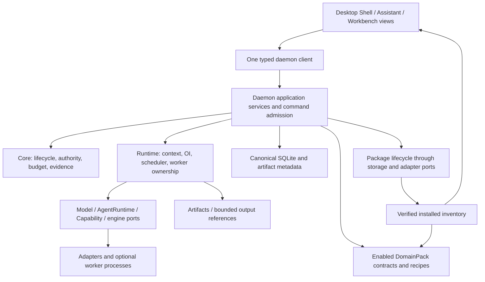
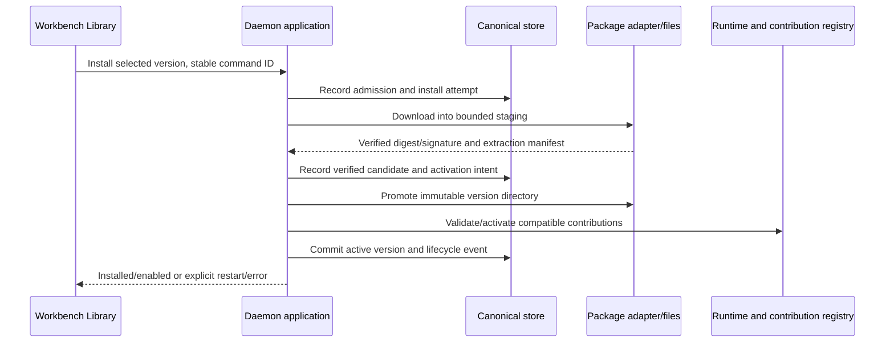
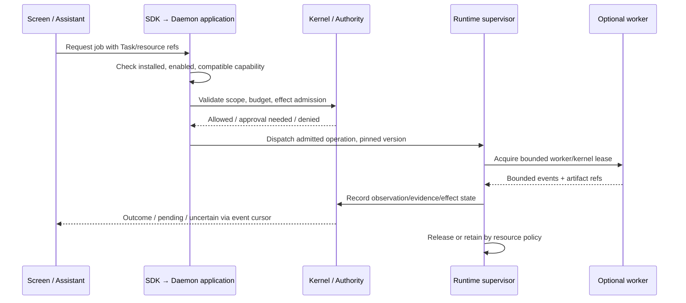
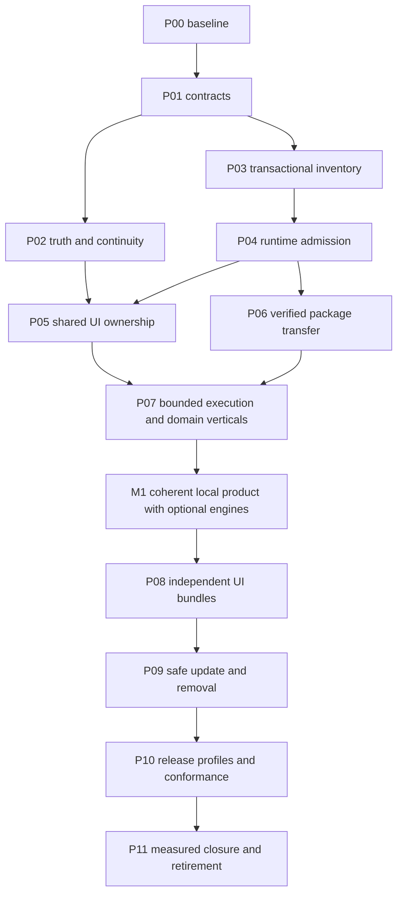

# Custos Base, installable workbenches and shared agent runtime

**Trạng thái:** bản thiết kế và implementation plan để review. Baseline ban đầu: nhánh `vi`, HEAD `f0a7efa` cộng dirty changes. Lượt đối chiếu tiếp theo đã thấy package inventory, transfer/worker contracts, WorkerLease, contribution registry và Workbench Library đang được triển khai trong working tree; đây là **partial implementation chưa được chứng nhận**, không còn là tất cả file chưa tồn tại. §2 giữ snapshot ban đầu để giải thích migration; §19–25 cập nhật các khoảng trống và chốt composition/data/lifecycle. Không dùng kết quả test của `rft` cũ để chứng nhận checkout này. Lượt bổ sung plan này không sửa production code hoặc tạo crate.

**Phạm vi:** toàn bộ điểm lắp ráp crates, desktop, data, agents, packaging và release phục vụ Assistant mặc định cùng Coding/Research/Quant tùy chọn. Tài liệu này cụ thể hóa hướng sản phẩm mới về phân phối; các nghĩa vụ authority/evidence/recovery trong `Custos.md` và các plan hiện hữu vẫn giữ nguyên. Chỉ các mô tả mặc định luôn bật toàn bộ workbench được đề xuất thay thế. Không tự nâng trạng thái implementation thành Done.

**Đọc để triển khai:** §§27–33 là execution plan tổng thể hiện tại: phạm vi bắt buộc, ownership/file map, work breakdown P00–P11, migration dữ liệu, interaction contracts, test matrix và release gates. §§1–25 giải thích thiết kế; §26 nối evidence audit. Các plan cũ cung cấp lịch sử/fixtures, không tạo thêm executor, state owner hoặc queue triển khai cạnh tranh. Tất cả packet dưới đây vẫn là Planned trừ khi có implementation evidence trên snapshot mới; không kế thừa nhãn “100%” của campaign cũ.

**Đối chiếu bản master được gửi thêm:** [Full attachment review D01–D22](workbench-core-and-controls-audit.md#review-of-the-supplied-master-architectural-design) hiệu đính toàn bộ 229 dòng của proposal: canonical crate groups, durability, registry versus storage, custom worker versus Jupyter, stateful interruption, package trust/lifecycle và Host API limits. Các điểm chốt đã được đưa vào packet tương ứng bên dưới; attachment không tự trở thành một SSOT mới.

## 1. Quyết định sản phẩm

Custos là một agent workplace: một shell, một conversation/task spine, một canonical backend, nhiều agent executions và workbench contributions. Assistant là entry point mặc định và hội thoại dùng chung. Coding, Research, Quant là năng lực cài/bật thêm; một cấu hình phổ biến có Assistant + Coding nhưng Assistant-only vẫn hợp lệ.

| Distribution preset | Đi kèm | Cài thêm được |
|---|---|---|
| Base | Assistant, sessions/tasks, supervision, package management, accounts | Coding, Research, Quant |
| Developer | Base + Coding | Research, Quant |
| Research | Base + Research | Coding, Quant |
| Full | Base + cả ba workbench | Engines/assets phù hợp |

Đây là install presets, không phải bốn source branches, bốn DB hoặc bốn daemon. Assistant UI không phải một root agent luôn chạy. Python, GPU, local model và market subscriptions chỉ allocate khi có operation cần chúng.

Không bắt buộc cài đúng một workbench chuyên môn. Quant phụ thuộc notebook/data capability nếu cần, không buộc cài toàn bộ Research UI. Connector email/calendar không được bật quyền outbound chỉ vì Assistant là built-in. Coding harnesses là executor choices trong Coding; thêm Codex/Claude adapter không tạo một workbench mới.

## 2. Bằng chứng từ source hiện hành

| Current source | Hiện trạng được kiểm | Hệ quả cho refactor |
|---|---|---|
| `Cargo.toml` và `cargo metadata --offline --no-deps` | 12 product Cargo packages: 10 library/service packages và hai app packages; 3 test packages + xtask | “11 canonical crates” là cách nhóm trách nhiệm lịch sử, không ép số Cargo package phải bằng 11; giữ app grouping |
| `custos-packs/src/lib.rs` | Factory đăng ký cả bốn DomainPack và specialized skills | Thay composition theo installed/enabled inventory; không chỉ hide UI |
| `custos-packs/src/pack.rs`, `registry.rs` | Có DomainPack/manifest/jobs/roles/verifiers và unregister | Reuse seam; runtime registry không phải installer hoặc authoritative inventory |
| `schemas/packs/pack-manifest.v1.schema.json` | Shape `name/display_name/...` khác Rust `id/lens/supported_jobs/...` | Audit consumers, fixtures và version trước khi mở rộng; không nhét một JSON mới rồi gọi cùng contract |
| `custos-daemon/src/runtime.rs`, `api/mod.rs` | Bootstrap và dispatcher default cùng biết factory bốn pack | Một composition owner; test-only defaults không tự leak vào production |
| `custos-daemon/src/application/mod.rs` | Route domain trực tiếp qua groups quant/research/compute/assistant/... | Giữ typed handlers, thêm admission theo owner capability; không route arbitrary method từ package |
| `custos-domain/src/session/session.rs` | WorkbenchLens enum bốn variant; Screen/UI cũng closed unions | Retain legacy decoding; additive workbench identity trước khi mở extension arbitrary |
| `ui/desktop/src/components/shell/AppTopBar.tsx` | Switcher khai báo cứng bốn workbench | Chuyển contribution registry dùng installation projection |
| `ui/desktop/src/components/workbenches/ResourceContent.tsx` | Shell dispatcher import/lazy-import trực tiếp panes của bốn miền | Tách contribution entry points; React.lazy hiện chỉ code splitting |
| `custos-persistence/src/migrations.rs` | Host migrations chứa Research/Quant schema | Không cho downloadable worker tự migrate DB hoặc xóa tables khi uninstall |
| `custos-adapters/src/download_manager/mod.rs` | Có model-oriented downloads/progress và partial files | Reuse primitives sau audit; chưa có signature/activation/compatibility guarantees cho package |
| `custos-runtime/src/integration/` | Registry bindings model/tool/agent/remote và lifecycle | Giữ live connection truth, không dùng thay installed package inventory |
| `custos-runtime/src/workflow/task_runtime/` | TaskRuntime đã tách module, dùng core ports | Không thực hiện lại extraction theo đường `task_runtime.rs` cũ |
| `custos-app/desktop/tauri.conf.json` | Một frontendDist, CSP hiện null | Downloadable UI code cần trust/CSP/resource-serving gate trước activation |

Dependency inspection cho thấy domain không có production workspace dependency; core chỉ phụ thuộc domain; runtime phụ thuộc core/domain/provider; adapters phụ thuộc core/domain/provider; daemon là composition root. SDK còn phụ thuộc core/domain: kiểm public DTO reachability trước khi giảm dependency, không kết luận đây là toàn bộ runtime bị link vào client. Đây là map điểm lắp ráp, không phải đọc từng dòng toàn repo hay security certification.

## 3. Từ vựng và identities không được nhập làm một

| Entity | Owner/lifetime | Không đồng nghĩa |
|---|---|---|
| Project | Nhóm nguồn, công việc, agent assignments | Workbench hoặc security grant |
| Workspace/binding | Checkout, folder hoặc môi trường thực thi đã resolve | Mọi conversation đều phải là Git repo |
| Session/turn | Transcript canonical, liên kết Task và selected context | Một model/provider session bất biến |
| Task/revision | Goal, scope, criteria, budget | Một tab hoặc agent |
| Run/attempt | Thực thi có generation, inputs/version và receipts | Agent profile bền vững |
| Agent profile | Role/capabilities/preferences; reuse role registry trước | Process/model slot luôn chạy |
| Resource | File/source/notebook/artifact/kernel reference | View đang hiển thị resource |
| Screen/view | Presentation layout, focus, references | Owner của process hoặc quyền |
| Workbench | UI contributions/default tools theo miền | Một backend/DB riêng |
| DomainPack | Jobs, roles, recipes, verifiers | Installable archive |
| Package/component | Code/assets/engine phân phối theo version | Grant hoặc model API account |

Ẩn dụ “ao” ánh xạ vào project-scoped collaboration + Task graph + resource scopes hiện có. Không tạo Pond service/entity. Một Project có thể có nhiều Tasks và Sessions; một Session liên kết nhiều Tasks; nhiều Screen cùng mở một resource; worker assignments có scope tường minh. Đổi workbench không đổi authority hoặc clone transcript.

Quy tắc UI hiện hành yêu cầu worktree cho mọi conversation xung đột với Assistant-only/non-Git Research. Packet P01 phải đưa ra amendment cụ thể: Git operations vẫn cần checkout; notebook cần kernel/compute binding; connector cần account/target; read-only chat không phải dựng fake Git workspace. Chưa sửa governance hoặc nới invariant trong plan này.

## 4. Kiến trúc đích và hướng dependencies



Sơ đồ flow không buộc mọi request qua một pipeline planner. Import direction: domain thuần; core contracts/policy nhìn domain; runtime và adapters implement/use ports; packs dùng existing domain/core/runtime contracts; persistence implement storage; daemon wire concrete services; SDK/native/desktop không own DB/runtime. Worker entry points cần composition vẫn nằm trong existing daemon package, không tạo composition root Rust khác trong UI hoặc packs.

OOP ở đây là encapsulation, composition và interface nhỏ theo lifecycle. Không xây BaseWorkbench inheritance tree, ServiceLocator toàn cục hoặc facade một dòng cho mọi repository operation. Runtime trait objects dùng trong process; worker tải ngoài dùng wire contract, không chia sẻ Rust object/vtable qua binary boundary.

## 5. Bản đồ repo đích

Cây dưới là địa chỉ trách nhiệm; thư mục/file có nhãn proposed chỉ tạo khi packet có caller/test đầu tiên. Không sinh skeleton hàng loạt. Paths Rust hiện hữu như authority/task/shared và runtime task_runtime/ được giữ, không flatten ngược.

```text
Custos/
  crates/
    custos-domain/src/
      authority/ task/ session/ workspace/ context/ evidence/ shared/ oi/
      research/ quant/                  # typed historical records remain readable
      shared/packages.rs              # proposed: pure package/component records
    custos-core/src/
      kernel/ contracts/ oi/          # preserve existing policy and ports
      contracts/packages.rs           # proposed minimal storage/I/O port seam
    custos-provider/src/              # model-neutral contracts, not package store
    custos-persistence/
      migrations/                     # host-owned forward-compatible migrations
      src/repositories/               # tasks/runs/domain data + proposed package repo
    custos-runtime/src/
      agent/ cognitive/ context/ oi/ workflow/ integration/
      workspace/ terminal/ notebook/ compute/
      packages/                       # proposed activation/worker lease coordination
    custos-adapters/src/
      providers/ harness/ mcp/ a2a/ sandbox/ workspace/ terminal/
      notebook/ compute/ market/ local_inference/ download_manager/
      packages/                       # proposed verified transfer/extract/worker transport
    custos-packs/src/
      pack.rs registry.rs profile.rs verifier.rs
      assistant/ engineering/ research/ quant/
    custos-bridge/src/                 # session/task binding, not installer
    custos-daemon/src/
      runtime.rs api/ application/     # one composition and ingress owner
      application/packages.rs         # proposed install/enable/update/remove use cases
      bin/custos-worker.rs             # conditional target, first real optional engine only
    custos-sdk/src/local_api/          # typed queries/commands + versioned wire DTOs
    custos-app/{desktop,cli}/          # thin product hosts
  ui/desktop/src/
    api/ context/ types/              # one client, projections and presentation contracts
    components/{shell,chat,viewer,common}/
    components/workbenches/
      registry.ts                     # proposed built-in/installed contribution lookup
      shared/ copilot/ engineering/ research/ quant/
      */contribution.ts               # proposed domain entry point; no duplicate pane source
    features/{settings,ai-setup}/
    features/workbench-library/        # proposed installer/status UI, no direct DB/process
  schemas/{packs,protocol}/            # versioned schemas and compatible fixtures
  tests/{contract,e2e,testkit}/        # default Rust test locations remain
  xtask/                              # proposed bundle/index generation commands
  packages/                           # existing distribution/editor packages; no UI source clone
  docs/{architecture,development,reference,status}/
```

Build output bundles không commit vào source tree mặc định. Không lập `workbenches/research/` ở root chứa bản sao của `custos-packs/src/research` và React panes. First-party package được build từ các source canonical này, cùng generated manifest/index.

## 6. Giữ, chuyển và retire theo từng crate

| Crate/group | Giữ | Refactor thực sự | Điều kiện Done |
|---|---|---|---|
| domain | Shared state/IDs và existing Research/Quant records | Additive package identity/version records khi cần; đọc resource kind chưa biết như unsupported | Old Tasks/Sessions vẫn decode khi pack disabled/removed; zero I/O |
| core | Authority, budget, completion, state transitions | Operation admission xét enabled component + scope; contracts tối thiểu cho package lifecycle | Direct RPC/agent call không bypass disabled pack; status không cấp grant |
| persistence | One canonical DB, repositories, CAS metadata | Installed versions/activation attempts, atomic pointer state, durable events; keep domain tables | Restart reconcile FS/DB windows; uninstall không drop user tables |
| provider | ModelPort/events/usage semantics | Không lồng installer vào model router; package engines không bị coi như model provider | API-model và native-agent paths giữ capability/pin/usage truth |
| bridge | Bind/promote/handoff/steer | Không tạo transcript copy cho package; continuation ghi dependency references | Same Session qua lenses; context redaction và authority vẫn đúng |
| runtime | Worker/context/OI/graph + leases | One activation/resource owner; bounded queues, version-pinned worker lease; no eager engine per lens | Multi-Screen không duplicate execution; drain/update/cancel semantics tested |
| adapters | Existing concrete FS/net/PTY/kernel/compute/MCP | Package transfer/verification/staging; worker IPC; reuse download bytes only after audit | Tampered archive, path traversal, unexpected symlink, timeout fail closed |
| packs | DomainPack/jobs/roles/verifiers and typed domain operations | Compose selected packs; separate small recipes from heavy optional engine bodies | Installing arbitrary code không đăng ký trusted verifier tùy ý; nonavailable job không advertised executable |
| daemon | Sole composition, typed application handlers | Remove all-pack defaults from production; install lifecycle use cases; admission before dispatch | Single request path, durable install commands, one profile owner |
| SDK | Existing Local API DTO/client | Add compatible package query/command payloads when approved; isolate DTO from implementation exports | Client neither links DB nor performs signature/authority decisions locally |
| app hosts | Startup/attach/reconnect/native window/product update | Show package readiness and restart; verified local asset serving if needed | Native host không compose another runtime or install worker via arbitrary shell |

Domain-specific math/types currently ở domain không tự tiêu tốn model/GPU RAM. Không dời tất cả Quant/Research types chỉ để có vẻ modular. Heavy algorithms/services/third-party libs mới là ưu tiên extract. Sau đo build/size, optional dependencies/feature gates có thể cắt binary; không đổi persisted enum liên tục để theo package availability.

## 7. Data architecture và ownership

| Vùng | Dữ liệu | Owner và nguyên tắc |
|---|---|---|
| Canonical DB | Tasks, sessions, runs, approvals/effects, evidence, costs, installed inventory | Daemon application commands qua core/storage ports; worker/UI không mở DB |
| Artifact store | Raw sources, outputs, patches, logs, reports/checkpoint refs | Existing artifact/CAS owner; byte bounds, digest, provenance, retention |
| Package filesystem | Immutable verified bundle versions, staging downloads | Package adapter dưới daemon lifecycle; không trộn user artifact data |
| Derived indexes | Search, sidebar summaries, catalog projections | Rebuildable, scoped, không admission authority |
| Presentation | Screens/tabs/focus/drafts/preferences | Screen owner cho layouts; resource owner cho draft; one versioned snapshot |
| Secrets | Provider/connector tokens, package repository credentials | Credential service; UI/package/worker nhận minimum reference, không toàn bộ vault |

Hai phạm vi khác nhau: physical installed bytes theo device; enabled set và policy theo profile/project. Một device repository có thể dedup bundle bytes, nhưng không share credentials, user data hoặc mutable environment qua profiles. Canonical inventory là DB; filesystem scan chỉ là observation/recovery input, không tự enable mọi executable tìm được.

Target storage concepts: installed package versions; activation intents/results; profile-enabled components; attempt→package/component/version references. Implement bằng migration versioned trong existing persistence, không quyết định trước tên table/SQL khi chưa audit repository contracts. Không lưu toàn bộ package archive/weights vào Task JSON.

Giữ shared domain readers trong host trong giai đoạn đầu để uninstalled workbench không làm history unreadable. Migration thuộc signed host release; downloadable package không chạy arbitrary SQL/install hooks. Old schema version không hỗ trợ thì host upgrade hoặc explicit read-only recovery, không giả rollback DB.

DB policy hiện source đặt synchronous NORMAL; không tự claim power-loss durability. Chọn durability profile cho canonical quyền/install decisions bằng ADR + measurements trước release. Reader pool giới hạn idle entries không phải hard cap toàn bộ concurrent readers; nếu cần resource cap thì thiết kế admission riêng dựa load đo được.

## 8. Ba flow command, query và stream

1. **Command:** client tạo stable command ID → daemon authenticate/validate/classify → core scope/budget/package admission → transaction ghi intent → runtime/adapter execute → receipt/uncertain → committed projection. Mutation timeout không được đổi command ID để retry; install cũng là mutation.
2. **Query:** đọc authoritative inventory/domain summaries qua existing client; selected-resource queries scoped. Shared projections tránh mỗi pane một polling loop. Capability explanation giữ package missing, disabled, incompatible, engine unavailable, auth missing và policy denied riêng.
3. **Stream:** token/log/PTY/download progress có bounded buffer và correlation IDs; shared subscription theo run/resource. Lifecycle và install decisions persist; animation/progress không là evidence đã installed hoặc effect đã success.

Frontend snapshot + event cursor phải resync khi gap. Lần đổi profile/project đang có response cũ phải fence theo scope/version; không ghép dữ liệu package/history từ profile khác. Disabled package vẫn cho query generic historical records; execution mới bị chặn, reconciliation/cancel cho attempts cũ vẫn hoạt động.

## 9. Package contract: metadata khác semantics

Mở rộng/version package metadata trên seam manifest hiện có sau khi giải quyết Rust-vs-JSON mismatch; không overwrite `pack-manifest.v1` trong im lặng. DomainPack manifest mô tả jobs/roles; distribution envelope mô tả các bytes và compatibility. Khi cần hai records khác nhau phải liên kết bằng package/component ID + version, không duy trì hai catalog authoritative độc lập.

Minimum proposed envelope fields:

- Stable package/component IDs, publisher và version/channel; host/SDK compatibility range.
- Platform/architecture targets, artifact digest, authenticated signature/key ID và integrity metadata.
- Dependencies theo capability/component và compatible version; optional components không ép install unrelated UI.
- Contributions: workbench/pane/command/settings/resource kinds, domain jobs/roles/verifier identifiers.
- Entry point loại data-only, trusted UI module hoặc supervised worker; không entry arbitrary shell string.
- Requested data/execute/egress capabilities; declaration không là grant.
- Storage/data format compatibility, required host migration level, restart/drain requirement.

Registry reject duplicate IDs, conflicting command ownership, dependency cycles, missing verifiers, unsupported schemas/OS. Unknown manifest fields được xử lý theo version rule, không silently cho quyền. Workbench IDs không lấy từ display name/path; giữ aliases `copilot↔assistant`, `engineering↔coding` tại boundary để persisted links tiếp tục đọc được.

Không đổi toàn bộ WorkbenchLens enum thành free-form string trong một diff. Trước tiên giữ four builtin variants và introducing opaque contribution IDs ở optional records; packet compatibility phải test older reader/future resource và unsupported fallback. Phiên bản đầu chỉ hỗ trợ first-party IDs; thêm fifth workbench sau này không được yêu cầu sửa mọi Shell switch.

## 10. Install, update, restart và uninstall

Phân biệt các dimensions: installed version; enabled per profile/component; runtime loaded/idle/draining; operation readiness; user grants. Không dùng một enum `Ready` khổng lồ gộp cả auth, bytes, policy và process health.



Filesystem rename + SQLite commit không atomic cùng nhau. Có durable activation intent và startup reconciliation: trước promotion thì retry staging; sau promotion trước DB thì candidate orphan không tự active; sau DB trước UI ack thì replay query/event không install lại. Multiple installs same package serialize/fence; disk full, cancellation và process death giữ version cũ có thể dùng.

Download kiểm signed catalog metadata + artifact authenticity; checksum không đủ nếu attacker thay cả manifest/checksum. Pin trust roots, key rotation/revocation và downgrade policy. TLS, size/compression quotas, archive path canonicalization, symlink/executable allowlist, verify-before-load; local source cũng phải đi trust policy. Không arbitrary post-install hooks. Expired/offline metadata có policy rõ, không disable verification để install được.

Update có generation snapshot: existing Run giữ package/worker/verifier version cũ; run mới dùng version mới chỉ sau activation commit. Giữ active references tới old version; uninstall/drain phải kiểm local kernels, agent sessions và remote jobs. Không hot-swap mid-run hoặc đổi oracle làm historical evidence tự pass.

Uninstall = disable new admissions → offer drain/explicit cancel → preserve pending/uncertain effect reconciliation → deactivate contributions → garbage-collect only unreferenced verified code bytes. User resources, connector identity, Tasks và evidence không bị xóa. Delete data là command riêng. Shared engines chỉ remove khi không còn dependent packages hoặc live leases.

## 11. Hai mốc phân phối phải gọi đúng tên

**Mốc M1 — modular activation và downloadable engines:** UI modules còn build cùng host; registered workbenches phụ thuộc enabled inventory; engines/assets lớn cài theo nhu cầu. Native algorithms còn builtin thì công bố đúng là builtin. Đây không phải tải toàn bộ UI workbench độc lập.

**Mốc M2 — first-party downloadable workbench:** signed UI contributions và optional engine payloads vắng khỏi Base installer, cài mà không rebuild host nếu API/commands đã được host hỗ trợ. Native command/core/schema mới vẫn yêu cầu host update. M2 chưa hỗ trợ third-party arbitrary JS/native plugins, marketplace hoặc standalone daemon per pack.

Một Rust library đã compile vào daemon không thể “tải thêm” chỉ bằng registry flag. Với thuật toán compiled cần cập nhật độc lập: extract executable work sang worker entry trong existing daemon package, build release worker variants từ same source với feature profiles; đưa contract orchestration qua ports. Không copy math/worker code sang repo khác. Worker không bootstrap SQLite/task scheduler; chỉ decode assigned operation, execute và trả bounded observations. Features là build tool, không runtime installer.

## 12. Desktop composition và UI package boundary

Giữ canonical component homes; mỗi workbench có một `contribution.ts` xuất descriptor/renderers/commands/presets/contextual navigation. `ResourceContent` chọn renderer qua registry thay vì import từng Quant/Research pane trực tiếp. Shared conversation, Files/PDF/artifact primitives không clone giữa packages. Phân loại shared primitive theo consumers thật; không đưa tất cả panes vào shared để che dependency.

| UI owner | Trạng thái/hành vi |
|---|---|
| AppContext và composed topic hooks | Global projections, installed inventory/capabilities, typed actions, connectivity |
| ScreenContext | Screens, active/focused view, tabs, layout; one persistence writer |
| Resource controller | Draft/edit state, per-document selection, exact source/run binding |
| Shell + AppTopBar + palette | Installed navigation, explicit open/switch; không tạo execution |
| Workbench Library feature | Install progress, permissions preview, version, size, dependency, error/retry/drain |
| Supervision | Parallel Task/Run attention, costs, approvals/uncertain; không là mỗi pack một dashboard canonical |

Đóng old two-way tab synchronization trước khi thêm dynamic contributions. Resource descriptors phải giữ toàn bộ workspace/session/task/run/source/artifact/revision identities, không chỉ so `id/url`. Restore dùng same registry; missing package mở placeholder với install/export/recovery, không drop tabs, ghi đè unknown-version storage hoặc thay resource bằng default.

M1 contribution module dùng host React/context hiện có. M2 cần versioned UI Host API ổn định: read-only projections/explicit commands/open-resource/theme/subscribe-dispose; không cho module import private AppContext internals hoặc daemon filesystem. Shared React runtime/theme version pinned, avoid independent React copies. Bundle manifest định danh allowed asset paths và dependency hashes; loader chỉ phục vụ verified local assets, không import CDN URL/untrusted config.

First-party same-renderer module được coi là trusted shell code, không tuyên bố sandbox per React component. Tauri capability là webview/window boundary, không per-package permission tự động. CSP và authenticated broker phải được chốt trước M2; `csp:null` hiện tại không là chấp thuận nạp extension JS. Third-party UI cần isolation design khác và chưa nằm trong scope. Native runtime permissions không được mở rộng động theo package manifest.

Workbench icon-only switch có accessible label/tooltip/selected state; Workbench Library là management surface, không chiếm trung tâm khi đang làm việc. Preserve navigation/focus/unsaved draft khi install xong, không tự chuyển lens. Center giữ editor/reader/notebook/run detail có thể mở song song; Inspector giữ summary/context. Package not installed, engine missing, offline và permission denied có hướng xử lý khác nhau.

## 13. Agents, hubs và execution economics

Model/Tool/Agent/Storage/Event/Operator hubs trong README là capability groupings trong existing layers, không sáu microservices/crates. Agent profiles/roles bền nhưng WorkerRun/model slot/kernel chỉ activate khi có assignment. Reuse hiện hữu role/profile/registry; không dựng ecosystem agents mới song song runtime.

OI propose topology/model/context trong hard constraints; scheduler owns ready nodes/claim/leases/concurrency; worker owns reasoning/output proposals; Core owns authority/completion. Native harness có loop riêng giữ nguyên bên trong bounded WorkerRun; không để cả Custos và harness recursively phân rã cùng một scope vô hạn. ACP là Agent Client Protocol; local worker IPC không cần A2A chỉ vì có hai processes.

Parallel tasks phải có fairness: budget/token/time/process limits global và per profile/task; bounded queues; disjoint writes hoặc explicit serialization; integration barrier và trusted verification. Durable observations gồm artifact refs và scope, không broadcast toàn transcript cho mọi agent. Suspend chờ approval không poll LLM; unknown effect không dispatch retry. Version-pinned handoff không tự chuyển grant/secrets hoặc fabricated checkpoint state.

Cache/source-index/model slots chia sẻ khi privacy/version cho phép, không share mutable context giữa tenants/projects. Reserve/settle một ledger cho mọi adapter; billed, estimated và unknown tách riêng. One shared observer theo run/resource; no per-hidden-pane poller. Idle shutdown có consumer/reference accounting và preserve recoverable state; chỉ unload safe resource, không blind kill external training.

Metric đích là cost per accepted outcome, gồm setup, retries, failed candidates, verification và human effort. Direct pinned strong agent là baseline; bật S1/multiworker khi đo có lợi, không mặc định downgrade model để giảm unit price. Package downloads/installed disk/model weights/loaded RAM/active compute là các đại lượng khác nhau.

## 14. Move map và retirement ledger

| Source hiện tại | Đích / thay đổi | Retire khi |
|---|---|---|
| packs default factory + daemon default constructor | Explicit composition từ inventory; builtin Assistant và developer preset | Mọi production/test caller đã chọn profile; không còn default silently bật tất cả |
| Rust DomainPackManifest + schema pack v1 | Versioned domain metadata + distribution envelope mapping | Golden fixtures và backwards decode pass; không hai tên/IDs authoritative |
| AppTopBar hardcoded modes, lensConfig | Workbench contributions + labels/aliases | New descriptor hiển thị mà không sửa Shell branch; keyboard mapping deterministic |
| ResourceContent domain imports/switch | Registry renderer lookup; preserve shared wrapper/context/error handling | Mọi resource kind routed; unknown/disabled placeholder và live bindings tested |
| Shell sidebar domain branches | Domain contributions ở canonical workbench topic, shared hierarchy/navigation ở shell | Không duplicate query/state; non-Git amendment được review trước enable |
| AppContext/Screen duplicate tab selection | Screen sole owner; AppContext exposes only global projections | Legacy tabs/layout migration, complete binding and provider-mount tests |
| Model DownloadManager | Audited bounded transfer primitive; separate package integrity/staging semantics | Caller parity; không ép model download install all verifier/lifecycle behavior |
| Quant/Research expensive handler body | Keep host validation/transaction, delegate pure/compute payload to optional worker where needed | Same output/error/evidence contract; version-pinned attempt and no direct DB |
| Raw runtime fs/http/process calls | Existing adapter ports, one operation at a time | Scope, symlink, output, redirect/cancel regressions; no adapter→runtime cycle |
| hardcoded capability list | Projection of composed operation + inventory + engine/auth/policy observations | UI/backend agree; direct RPC cannot execute unavailable operation |
| release-cli workflow / distribution packages | Keep CLI release; add host + optional artifact build/index via xtask | Signed reproducible artifacts, OS/arch/version matrix and clean install tests |
| README/master/catalog status claims | Link exact implementation packet and evidence | Không ghi shipped/downloadable khi mới lazy import hoặc disabled UI |

Old aliases chỉ remove sau whole-tree consumers/fixtures/config/dynamic refs audit. Unit tests ở cạnh module không phải bloat; cross-crate suites ở tests/e2e. Không xóa tests hoặc upstream notices để tree trông sạch.

## 15. Implementation packets

Mỗi packet có reviewable diff, contract/fixture changes và rollback; không hứa một commit cho mỗi packet. Không auto-commit/push. Các tên file mới chỉ là proposed placement cho bước được duyệt.

| Packet | Files/topics | Deliverable | Gate |
|---|---|---|---|
| P00 — Freeze baseline | metadata, dirty diff, active routes, capability/manifest imports | Source/caller/size/dependency ledger; old install/data fixtures; cost/render/RPC baseline | Không trộn dirty Quant vào unrelated bulk rewrite; current tests recorded with environment limits |
| P01 — Product and contracts | master, UI governance proposal, domain/session/shared, schemas/packs | Identity/alias/version map; Assistant-only scope; manifest compatibility decision | Old sessions/lenses decode; capability≠grant; non-Git physical binding rules explicit |
| P02 — Continuity/correctness | Screen/AppContext/shell, runtime task approval/resume/live, outbox | Close known migration/binding/first-token/pending-restart gaps against current source | No lost tabs/drafts; suspended not completed; dispatch-before-approval=0; restart reconciliation |
| P03 — Installed inventory | core/storage contracts, persistence migrations/repo, daemon application/packages, SDK | Builtin seed + profile enablement + queries/events; DB-backed inventory, no download yet | Transaction/restart/idempotency; legacy data retained; distinguish installed/enabled/ready |
| P04 — Selective backend composition | packs registry/factory, daemon runtime/API/capabilities, job execution | One selected composition; domain ownership/capability admission applied to all entry points | Assistant-only starts; direct disabled RPC denied; history/reconcile readable; role/verifier ID collision rejected |
| P05 — Contribution-driven UI | registry/contribution entry points, AppTopBar/ResourceContent/sidebar/palette/settings | M1 UI, Workbench Library builtin/optional status; no duplicate pane implementation | Same Session mixed panes; missing package placeholder; no eager execution; build + canvas + mounted interaction |
| P06 — Verified install transaction | adapter packages + audited downloads, runtime lifecycle, persistence + daemon use case | Signed first-party asset/engine install, staging, activation intents, cancel/recovery | Tamper/zip-slip/oversize/disk-full/concurrent install/restart windows; no partial active state |
| P07 — Optional worker execution | existing daemon worker bin target, runtime/core ports, adapter IPC, selected pack algorithm | One real optional engine, pinned version/lease, bounded wire protocol; small host orchestration | Same domain golden outputs; crash/cancel/no duplicate launch; no DB/vault access; M1 truthful scope |
| P08 — Independent UI bundles | canonical UI contribution builds, xtask, host local asset loader/CSP, Host API | M2 Research first-party bundle omitted from Base; version compatibility and lifecycle | Clean Base install has no Research bytes; install activates mixed pane without rebuild; tamper/version rejection; no CDN eval |
| P09 — Update/remove and resource safety | package service/repo/runtime/host/Workbench Library | Drain/refcounts, immutable side-by-side versions, data-preserving uninstall, UI reload/restart | Existing run pinned; restore missing package; remote jobs remain manageable; rollback only compatible data |
| P10 — Presets and CI/release | Cargo feature profiles, UI output configs, xtask/distribution/.github | Base/Developer/Research/Full + per OS/arch verified artifacts and manifest | Assistant-only, profile matrix, negative deps, signatures, cold install/update/uninstall tests |
| P11 — Economics and retirement | source callers, observers/pools, docs/status | Remove replaced defaults/writers/wrappers; measured resource behavior | Comparable accepted-outcome quality/cost, bounded idle resources, no old execution path; full regression matrix |

Dependency: P00 → P01; P02 is foundation gate and can precede inventory code. P03 → P04 → P05; P06 uses P03/P04; P07 uses P06 + existing execution safety; P08 uses P05/P06/security boundary; P09 uses P06/P07/P08; P10 exercises all supported stages; P11 closes migration. Do not postpone current authority bugs until package work finishes. M1 = P00–P07 appropriate scope, M2 requires P08–P10; neither automatically implies live cloud/broker/GPU support.

Research first optional workbench proof keeps current Quant edits out of the first integration collision. Coding remains bundled in Developer preset but must eventually obey the same registry/installer contract; no permanently privileged special-case bypass. Quant execution remains disabled unless its independent operation authority/verifier/connector gates are satisfied; package install does not certify trading safety.

## 16. Acceptance journeys và failure matrix

| Journey | Phải chứng minh |
|---|---|
| Base cold start | Assistant chat/history/tasks usable; no eager Python/market/GPU/harness processes; honest missing provider state |
| Developer preset | Assistant + Coding same Session; repo scope/terminal/run identity stable; native tools assurance truthful |
| Install Research | Selected package/version/size/dependencies shown; cancellation/network failure preserves active work; no automatic lens switch |
| Shared work | Paper + editor + chat in one Screen; separate two sources/notebooks/runs; Screen close does not stop backend |
| Headless operation | CLI uses same installation/profile admission; UI disabled does not silently disable explicitly enabled headless component |
| Parallel agents | Independent ready nodes obey Task/global budget, write conflicts and resource concurrency; loser cost reported |
| Security | Invalid signature/key/manifest/path/OS/ABI rejected before execute; package permission request not grant; no raw package SQL |
| Restore | Legacy keys include tab metadata; unknown future snapshot preserved; disabled/removed package resource stays addressable |
| Update | Inflight old worker and verifier version preserved; new run new version; failed activation no mixed new UI/old engine incompatibility |
| Uninstall | Block dependent/live version deletion; preserve Task/session/notebook/source/evidence; uncertain effect reconciliation still accessible |
| Cross-pack | Explicit selected artifacts/privacy handoff; missing consumer offers install, not auto-send corpus or copy credentials |
| Offline | Installed compatible package usable within local-only policy; offline catalog verification rules explicit; no silent cloud fallback |
| UI access | Keyboard-only install/retry/cancel, accessible names, focus restore, light/dark/scale/reduced-motion; pending errors inline |
| Cost | Per-attempt billed/estimated/unknown; no fake $0; direct vs OI/S1 cost and quality comparison uses same fixtures |

Install workers and providers in tests use deterministic local fixtures; live platform support needs separate opt-in conformance. No test should be rewritten to hide a failed physical path by replacing it with an in-memory result.

## 17. Quality gates, rollback và định nghĩa hoàn tất

Required source gates by packet: workspace all-target check; touched unit/integration/contract suites; desktop build and full current canvas-smoke suite; actual mounted/provider interaction for effect-order/Screen bugs. Final default lib/integration tests plus feature/OS/package compatibility profiles. Do not use `--all-features` as a universal gate if mutually unavailable backends exist; maintain supported profile matrix explicitly.

```bash
cargo check --workspace --all-targets --offline
cargo test --workspace --lib --offline
cargo test -p custos-tests-contract -p custos-tests-e2e --tests --offline
npm --prefix ui/desktop run build
node tools/canvas-smoke.mjs
git diff --check
```

Offline cache, sandbox socket restrictions, platform SDK and live credentials must be reported separately from code failures. Architecture checker must use current manifest paths and distinguish dev-dependencies; mandatory integration gates must actually block merge. Rust formatting/clippy exceptions require documented disposition, not unnoticed green CI.

Measurements: base/Developer/full installer bytes and disk; renderer/daemon/worker RSS separately; cold/warm startup; visible-input latency; idle CPU; poll/RPC/subscriber counts; model/kernel/PTY/remote leases after repeated open/close; install transfer/setup/failed retry overhead; accepted task cost including failed attempts. Choose performance limits on P00 baseline before P11, do not promise percentages from tree layout.

Rollback per packet preserves original user data/drafts and reviewable caller maps. Keep schema changes additive; UI/worker rollback is not DB downgrade and cannot undo sent external effects. Legacy import/restore decoder retired after migration fixtures pass; old version bytes retained only while references/rollback policy require, not forever.

Done requires: one data owner, one layout writer, one execution owner per attempt, one authenticated package inventory, explicit plugin trust boundary, denied disabled operations across all entry points, installed bytes truly absent where claimed optional, historical records readable without package, and measured resource limits. Folder moves, compile success, component line count or “all hubs implemented” in README are not sufficient.

## 18. Research sources và giới hạn của plan

- [VS Code extension manifest](https://code.visualstudio.com/api/references/extension-manifest) documents compatibility/dependencies/contributions; useful pattern, not a requirement to clone VS Code's runtime.
- [VS Code extension host](https://code.visualstudio.com/api/advanced-topics/extension-host) documents host placement and lazy activation; this supports activation-by-need, not a claim of automatic security isolation or savings in Custos.
- [Cargo features](https://doc.rust-lang.org/cargo/reference/features.html) are build-time conditional compilation/optional dependencies; do not substitute for runtime install lifecycle.
- [Tauri updater](https://v2.tauri.app/plugin/updater/) documents signed application updates; a Custos package installer is separate and must not claim this plugin automatically validates arbitrary workbench archives.
- [Tauri sidecars](https://v2.tauri.app/develop/sidecar/) documents bundling platform-specific external executables, not a ready-made marketplace or independent component manager.
- [Tauri capabilities](https://v2.tauri.app/security/capabilities/) and [CSP](https://v2.tauri.app/security/csp/) describe frontend/native exposure; neither signs package content nor replaces runtime authority or OS process isolation.

Architecture/placement above là đề xuất riêng cho Custos dựa source seams, không là internal architecture của ChatGPT/Codex. Không copy upstream repo mới trong packet này. OrCa/Open Science behavior tiếp tục đi qua shared resource/Task contracts; không nhập store/permission/runtime thứ hai.

**Thực hiện trong lượt này:** source/dependency/package/UI entry inspection, official-source research và documentation plan. Chưa sửa production code, chưa rerun build/tests, chưa đo performance hoặc kiểm live installer/GPU/broker. Exact signatures/crypto library, archive format, release channel policy và UI module ABI cần decision/fixtures trong P01/P06/P08; không thêm dependency hay production schema khi chưa được review theo repository rules.

## 19. Cập nhật working tree: dùng phần đã xây, đóng các khoảng trống

Các file dưới đây đã hiện diện khi đối chiếu tiếp, một phần chưa commit. “Có source” không có nghĩa đã hoạt động end-to-end hoặc đã đạt gates. Đây là danh sách cần kiểm chứng trước khi tiếp tục, không phải kết luận audit từng dòng.

| Seam đã xuất hiện | Khoảng trống cần xử lý trong campaign P00–P11 |
|---|---|
| `custos-domain/src/shared/packages.rs` | `PackageState::is_active()` hiện dựa Builtin/Installed; cần tách installation khỏi profile enablement và runtime readiness. Component ID mới cần validation; alias legacy giữ ở decode boundary |
| `custos-core/src/contracts/packages.rs` | Reuse transfer/staging/promotion port. `SignatureInvalid` enum và digest verification chưa chứng minh publisher signature verification; trust gate phải có implementation và negative fixtures |
| `custos-core/src/contracts/worker_wire.rs` | Reuse bounded operation envelope; memory budget field không tự tạo OS enforcement. Success boolean chỉ phù hợp kết quả compute hẹp, không thay EffectAttempt/uncertain/receipt |
| `custos-runtime/src/packages/worker_lease.rs` | Đã có spawn/await/cancel/timeout path; cần kiểm process-tree cleanup, cancellation/drop, concurrent limits, output draining và stateful kernel exceptions trên OS hỗ trợ |
| `custos-persistence/migrations/0043_package_inventory.sql` | Seed cả bốn component Builtin xung đột Base Assistant-only nếu hiểu là installed/available. Chốt preset + shipped payload truth; xem lại profile/version/platform keys và idempotency trước migration kế tiếp |
| `custos-persistence/migrations/0044_universal_resource_registry.sql` | Dùng làm locator catalog liên kết existing source/artifact ownership. Không tự thay source version, project/profile ACL, retention, evidence hoặc canonical notebook records |
| `ui/desktop/src/components/workbenches/registry.tsx` | Coding đang builtin; `getActiveContributions` và unknown→Assistant fallback cần fixtures. Developer bundled Coding hợp lệ; Base không được tự lộ Coding chỉ vì UI constant |
| `ui/desktop/src/features/workbench-library/` | Nối real inventory/command events; install, enable, compatible, ready và failure phải thể hiện khác nhau. Không suy backend readiness từ import thành công |
| `docs/architecture/on-demand-packs.md` | Sửa số RSS/token chưa đo, uninstall data, scan→trust và active-lens-only tool selection theo các quyết định bên dưới |

Ưu tiên đóng gaps trên existing seams; không tạo một PackageManager thứ hai để né source đang có. Trước mỗi packet phải đọc lại diff vì working tree thay đổi, ghi rõ owner và version đang kiểm.

## 20. OOP và system design: composition, ownership, substitutability

Mục tiêu là thay implementation được mà không thay quyền, dữ liệu hoặc lifecycle. Trong Rust dùng struct/enum cho state, `impl` cho invariants, trait nhỏ tại biên thật sự có implementation thay thế. Không mô phỏng `BaseWorkbench → ResearchWorkbench → AdvancedResearchWorkbench` hoặc một global ServiceLocator mà mọi module đều truy cập được.

| Thành phần | Chịu trách nhiệm | Lifetime và dependency |
|---|---|---|
| Package descriptor | Identity, version, dependency/capability declarations, compatibility | Immutable metadata đã validate; pure domain; không spawn hoặc gọi DB |
| Inventory repository/port | Persist installed versions, activation intent, command result | Canonical writer qua persistence; runtime/UI không trực tiếp sửa SQL |
| Package transfer adapter | Download, bounded staging, verified archive extraction/promotion | I/O dưới core port hiện có; không quyết định grant hoặc tự enable |
| Package application service | Điều phối install/enable/disable/update/remove theo policy | Daemon application owner; inject store/transfer/clock qua constructor; không chứa UI state |
| Runtime worker supervisor | Acquire/release lease, concurrency, deadline, cancellation, version pin | Runtime owner; reuse supervisor/lease primitives, không tạo pool mặc định mỗi pack |
| DomainPack | Job semantics, recipes, roles, verifier obligations | Registry contribution từ approved composition; không là installer hoặc credential manager |
| WorkbenchContribution | Commands, panes, menus, resource viewers, availability hints | UI registration/disposal có scope; gọi versioned Host API; không sở hữu Task DB |
| Resource owner | Source/notebook/PTY/kernel/artifact identity và actual lifecycle | Backend owner theo loại resource; nhiều views có thể cùng tham chiếu; đóng view không mặc định hủy run |

**Dependency inversion:** policy gọi core ports; daemon wire concrete implementations; adapter không gọi ngược daemon để resolve quyền. Chỉ thêm interface khi có boundary I/O/trust hoặc nhu cầu thay implementation có test; helper thuần không cần trait riêng.

**Substitution contract:** local/cloud model trả canonical model events; native coding harness trả canonical agent-runtime events. Không giả native harness là một model call hoặc ép hidden state của nó thành Custos checkpoint. Research worker và Quant worker có cùng execution envelope nhưng schema/criterion khác nhau. Replacement không được tự thêm network/file privilege hoặc báo unsupported thành success.

**Extension boundary:** Rust trait dispatch là abstraction bên trong một build, không phải stable binary ABI để tải Rust library tùy ý. Giai đoạn đầu first-party domain policy vẫn compile vào host, optional heavy engine là versioned subprocess. Downloadable UI cần P08 riêng; chưa mở third-party native policy/plugin vào trusted process. Một HTTP/MCP/A2A adapter là protocol boundary, không là parent class của workbench.

**custos-app:** giữ desktop host mỏng: cửa sổ, app lifecycle, attach/start backend, native integration đã giới hạn. Frontend dùng SDK/API; daemon/application là backend facade và composition root; core/runtime/packs thực thi phần nghiệp vụ. Không route mọi lời gọi nội bộ qua `custos-app`, cũng không để Tauri command tự ghép persistence + adapters + policy như một backend song song.

## 21. Đóng gói theo năng lực: workbench, engine và assets

| Phân phối | Thành phần tối thiểu | Chỉ tải/khởi động khi cần |
|---|---|---|
| Base / Assistant | Shell, conversation/Task, supervision, inventory, shared resource viewers, model/agent connection configuration | Connectors riêng, voice/OCR/local inference và assets nếu job yêu cầu; không cần Python để chat API |
| Coding | Coding UI contributions, repo/worktree operations, patch/review semantics | Editor/language services, coding harness binary, language toolchain tùy chọn; không âm thầm tải compiler của mọi ngôn ngữ |
| Research | Corpus/source/claim UI và domain policy | PDF/OCR, notebook/kernel, dataset/experiment tooling, local embeddings theo từng job; đọc paper không buộc tải training stack |
| Quant | Dataset/strategy/result/risk UI và verifiers | Backtest/runtime/feed adapters theo workflow; không cần live broker để xem report |
| Shared engines | Notebook execution, document parse, local inference… theo capability | Một compatible installed component có thể phục vụ nhiều workbench; không clone engine chỉ vì khác lens |
| Large assets | Model weights, datasets, GPU/container images | Version/digest/size/retention riêng; không chôn trong UI archive hoặc tải cùng mỗi update |

Manifest phân biệt `required_components` và optional capabilities có resolution rules; không phụ thuộc cả Research workbench chỉ để dùng notebook. Resolver phải phát hiện cycle/version/platform conflicts, báo tổng kích thước và phần đã có trước install. Một package không được tự tìm mọi executable trên PATH rồi gọi là dependency đã trusted.

Installed bytes là trạng thái device; enabled components là trạng thái profile. Profile khác có thể dùng chung immutable verified package bytes nhưng không tự dùng chung token, private dataset, writable environment hoặc active grant. Environment fingerprint gồm engine version, interpreter/toolchain, dependency lock, platform; tái sử dụng khi tương thích. Python environments được recreate từ lock, không chia sẻ mutable site-packages tùy tiện giữa các engine.

**Hai mức release được giữ rõ:** M1 đóng gói UI/domain first-party trong host, tải engine/assets khi cần; nhanh và ít rủi ro hơn. M2 thực sự loại optional UI/runtime payload khỏi Base và tải signed compatible bundle. Cargo features là build-time choice, React.lazy là activation/code split; cả hai không tự hoàn thành M2. Catalog metadata có thể có cả bốn tên mà installed payload chỉ có Assistant.

## 22. Hạ tầng dữ liệu: dùng chung spine, tách payload và quyền

| Dữ liệu | Owner và nơi lưu | Khi disable/uninstall |
|---|---|---|
| Sessions, Tasks, revisions, attempts, evidence, authority, outbox | Existing canonical SQLite, một writer logic | Giữ và đọc được bằng Base; reconciliation không phụ thuộc mở lại workbench |
| Package catalog/inventory, activation operations | Canonical package repository; catalog remote chỉ là input đã kiểm | Giữ audit/command result; update state, không xóa lịch sử Task |
| Profile enablement/settings | Profile-scoped records, validated schema/version | Disable contribution; preserve settings để reinstall; không gộp vào installed bytes flag |
| PDF, notebook files, datasets, checkpoints, patches | User project paths hoặc managed artifact/CAS roots có ownership manifest | Giữ dữ liệu người dùng; URI tiếp tục resolve được hoặc hiện missing/stale có lý do |
| Index/cache/thumbnails | Rebuildable, algorithm/source version + privacy scope | Có thể dọn theo quota; không xóa nhầm source hoặc checkpoint duy nhất |
| Engine executable/environment/assets | Managed verified version roots, tách user data | Remove khi không còn dependency/lease; shared asset dùng reference + retention policy |
| Credentials | OS credential store; DB giữ reference/redacted metadata | Revoke/remove theo action riêng; không nhét token vào package manifest hoặc data export |

Đường dẫn `~/.custos/...` chỉ là minh họa. Dùng path resolver hiện hữu cho từng OS/profile; record managed/external ownership và normalized root. Uninstaller chỉ xóa managed code paths đã verify, không dùng `physical_path` từ arbitrary resource để recursive delete. Purge user data là thao tác riêng có preview/scope, không là side effect của remove package.

Universal Resource Registry là bảng tra reference: resource ID/type, owning service, scope/version và locator. Không là một JSON store chứa toàn bộ nghiệp vụ. Đối soát với existing source/artifact/notebook repositories; thiếu owner/ACL/version không suy ra public. Large blobs đưa ra artifact store để tránh read/write amplification; không cần đặt quy tắc “SQLite cấm mọi BLOB” nếu một bounded binary field có lý do.

Schema thay đổi additive trong host migration stream; worker không chạy SQL tùy ý. Package removal không drop Research/Quant tables. Data-format migration của artifact có input/output version, digest và recovery; không overwrite checkpoint cũ trước khi output đã xác minh. Cross-workbench context dựa selected references + permission, không copy toàn transcript/corpus vào DB mới.

## 23. Lifecycle nhẹ nhưng không làm mất công việc

Phải theo dõi các chiều độc lập: **catalog/discovered → verified installed**, **profile enabled**, **contribution loaded**, **engine compatible/ready**, **operation running**, **action granted**. Không dùng một `active: bool` cho tất cả. UI đổi lens chỉ thay view/default affordances, không cấp quyền hoặc hủy run.



Missing component → show install requirement; unavailable platform → unsupported; disabled capability → explicit enable action. Không tự chuyển model/cloud hoặc tải executable ngoài consent policy. Tool declarations được compile từ Task intent, installed/enabled capabilities, worker support, privacy và grants; selected lens chỉ là một tín hiệu. Assistant có thể điều phối Research/Coding đã bật mà user không phải đổi giao diện trước.

| Resource class | Start/stop policy |
|---|---|
| One-shot parser/backtest helper | Start theo admitted operation; bounded output/time; reap sau done/cancel; optional warm reuse phải có measured value và limit |
| Stateful notebook kernel | Giữ theo explicit kernel/session lease; hiển thị RAM/state, interrupt/restart/shutdown; không kill vì user đọc paper quá 60 giây |
| PTY/native agent harness | Lifecycle theo actual run/terminal owner; preserve live user work; process-tree cleanup theo OS profile |
| Remote training job/GPU rental | Local socket/view close không đồng nghĩa job dừng. Durable external ID, status/reconcile, billing/cancel riêng; checkpoint-based resume, không hứa live migration |
| UI contribution | Lazy activate, dispose subscriptions/watchers khi không dùng; imported JS có thể còn trong memory, không hứa unmount sẽ unload module |

Global scheduler áp memory/concurrency/CPU/I/O budgets trên tổng workers, không chỉ timeout từng process. `WorkerBudget.max_memory_bytes` cần OS support/enforcement receipt, hoặc báo unsupported/observed-only; khai field không đủ. Large output ghi artifact, stream dùng bounded queues/backpressure, stderr cũng có cap; không để một notebook output làm nghẽn event stream của mọi Task.

Enable/update/remove là durable command có command ID và expected version. Remove đang có active lease/dependent version → refuse hoặc drain có giải thích; không kill ngầm. Crash ở download/promotion/activation được reconcile trước publish available. Local scan chỉ tạo discovery candidate; verify manifest, signed file inventory, compatibility, canonical paths và trust source trước installed/enable. SHA-256 chứng minh bytes khớp digest, không chứng minh người phát hành đáng tin.

## 24. Trình tự thực hiện hợp nhất, không mở campaign song song

Các bước sau cụ thể hóa P00–P11, không thay lịch sử completed bằng một checklist mới. Mỗi bước cần diff/fixture/gate riêng và caller retirement; tránh một commit khổng lồ trộn storage, installer và UI loader.

| Thứ tự | Packet hiện có | Kết quả có thể review | Điều kiện đi tiếp |
|---|---|---|---|
| A — Chốt source truth | P00–P02 | Snapshot current dirty files; preset semantics; component/capability IDs; schema compatibility; loại số footprint chưa đo | Base không giả all-four installed; unknown component không decode thành Assistant; thống nhất domain/schema/UI fixtures |
| B — Admission và data ownership | P03–P04 | Canonical inventory + enablement, deny disabled RPC/worker dispatch, non-destructive uninstall | Direct API/CLI cũng bị chặn như UI; reinstall giữ transcript/notebook/checkpoint; single writer |
| C — Một composition path | P05–P06 | Production factory từ inventory; contribution projection; Library states và signed install/recovery path | Không còn hardcoded builtin bypass; failed/unsigned package không xuất hiện ready; cancel/retry không nhân đôi command |
| D — Engine on demand | P07 | Research parser đầu tiên chạy thật qua bounded lease, notebook stateful policy, shared capability dependency | Base không spawn engine; engine crash không chết daemon; disabled/removed không chặn đọc historical outcomes |
| E — Downloadable UI | P08–P10 | First-party UI bundle/Host API, compatible activation, update rollback; supported OS fixtures | Optional bytes thật sự vắng trong Base; untrusted code không được Tauri/native authority; CSP/resource serving gates |
| F — Measure và retire | P11 | Bundle/RSS/CPU/startup/cost report; xóa old writers/factories sau caller proof | Supported journeys + current Rust/UI gates pass; resource leaks có số đo; status docs khớp implementation |

Điểm kiểm thử đầu tiên là **Assistant-only → install Research engine → parse một source → mở cùng source trong Coding view nếu Coding enabled → disable/remove Research → vẫn xem được source/history**. Đây là phép thử chung cho packaging, data, UI continuity và lifecycle; chưa cần marketplace hoặc remote GPU để chứng minh kiến trúc.

## 25. Acceptance bổ sung cho composition và hiệu năng

1. **Preset truth:** Base không có optional binaries/environments; Developer có Coding theo manifest, không theo UI constant; Full không tự khởi động mọi engine.
2. **Substitution:** fake/local test adapter và real adapter tuân cùng contract; unsupported/cancel/partial failure không bị normalized thành pass. Native harness vẫn giữ assurance đúng path.
3. **Trust/import:** file tự copy và executable tự đổi không được auto-enable; invalid publisher/signature/platform/file manifest bị từ chối trước execute; reinstall/offline import không bỏ trust gate.
4. **Retention:** disable/remove/update giữ source, notebook, outcomes, provenance; active version/dependency không bị delete; purge chỉ xóa ownership/scope đã preview.
5. **Concurrency:** hai Screens và hai workbench cùng dùng một kernel/resource không tự clone writer hoặc reset state; resource locks và explicit new-kernel option đúng nghĩa.
6. **Load boundaries:** open/close/reopen nhiều lần không tăng subscriptions/worker count vô hạn; idle timers không giết stateful work; cancellation không để child process hoặc remote billed job mất theo dõi.
7. **Context economics:** Assistant có thể dùng enabled cross-pack capability trong quyền; context chỉ lấy selected sources. Đo tokens/calls/latency/quality cả retry và fail, không hứa tiết kiệm 90% từ tool filtering.
8. **Budget evidence:** CPU/RSS/output/deadline được đo theo renderer/daemon/worker; hard enforcement và observations báo riêng. Không ghi Base 25 MB hoặc rollback memory tức thời khi chưa đo supported release build.
9. **Packaging evidence:** so Base/Developer/Full installer size, disk after install/update/remove, cold/warm startup. Không suy bundle nhẹ từ việc tab chưa render hoặc Rust feature compile được.

Research bổ sung: [Rust trait objects](https://doc.rust-lang.org/book/ch18-02-trait-objects.html) hỗ trợ abstraction qua common behavior, không cung cấp inheritance hoặc downloadable ABI; [VS Code extension host](https://code.visualstudio.com/api/advanced-topics/extension-host) phân biệt execution hosts/activation, không chứng minh một host chung phù hợp mọi trust boundary của Custos; [Python venv](https://docs.python.org/3/library/venv.html) mô tả environment dependencies riêng và recreate, không phải OS isolation. Việc chọn modular monolith + on-demand workers trong plan là quyết định thiết kế riêng dựa seams của Custos, chưa là benchmark advantage.

## 26. Audit gates từ crates và ba workbench hiện tại

[Current Custos follow-up](workbench-core-and-controls-audit.md#current-custos-crates-ui-and-three-reference-follow-up) là evidence ledger cho plan này: inventory crates/UI, dependency graph, selected rendered journeys, OrCa/Open Science/QuantDinger source traces và findings C01–C16. Không mở thêm một campaign hay một kiến trúc cạnh tranh.

**Cập nhật source truth:** migration 0043 hiện seed Assistant-only; quan sát “seed all four” ở §19 là snapshot trước đó và không còn là gap hiện tại. Một số Quant panes cũng đã đổi initial state thành empty trong lúc audit; các fallback metric, synthetic risk inputs và fake sidebar chưa được xem là đã sửa chỉ vì initial state thay đổi. Working tree đang tiến triển; đọc lại diff trước từng packet.

Thứ tự P00–P11 phải ưu tiên các điều kiện sau trước khi tuyên bố packaged workbenches usable:

1. C07–C09/C14: bỏ fake portfolio/count/readiness và synthetic mount analyses; “Task created” khác “Run started”; imported statistics khác computed result.
2. C01–C06: physical installation/trust, transactional inventory+event, profile/version identity, runtime admission refresh và truthful UI availability.
3. C05/C12/C13: historical access độc lập compute enablement; bounded concurrent stdout/stderr, exact resource/session binding và stateful lease lifecycle.
4. C10–C11: không chấp nhận scalar tự khai hoặc lexical overlap làm verification cuối; giữ uncertainty và verifier provenance.
5. C15–C16: nối production caller rồi retire đường cũ; contribution facades/large-file moves riêng lẻ không tính là hoàn thành modular packaging.

Tại snapshot audit, all-target Cargo check, desktop build và 43 canvas smoke tests đạt. Các kết quả đó chưa cover các counterexamples trong ledger; không đánh dấu các packet hoàn tất từ checks chung. Audit không sửa production code hay chạy broker/model/GPU thật.

## 27. Phạm vi refactor bắt buộc và cấu trúc đích

Refactor này bao phủ toàn bộ trục sản phẩm: application shell → SDK/API → application services → policy/runtime → adapters → canonical storage → event projections. Mục tiêu là một agent workplace có ba môi trường chuyên môn và Assistant dùng chung; giảm các đường xử lý song song, trạng thái mâu thuẫn và dữ liệu không có nguồn. “Lớn” là giải quyết trọn luồng và xóa đường cũ sau migration, không đo bằng số folder/crate mới hoặc số dòng viết lại.

Các kết quả bắt buộc:

1. Base Assistant-only hoạt động thật, không giả optional package đã cài; Developer thêm Coding; Research/Quant có lifecycle cài/bật/nạp/chạy riêng.
2. Một Session/Task có thể dùng nhiều workbench và agent executors; thay lens không clone history, đổi quyền hoặc tự khởi chạy.
3. Mọi attempt có executor, source/scope, lifecycle, budget và observation rõ; model API, native harness, deterministic capability và remote job không bị ép thành cùng một semantics.
4. Mọi nút production hoặc làm đúng việc, hoặc hiển thị lý do unavailable; không fake LIVE, Ready, performance, verification hoặc toast thay execution.
5. Dữ liệu cũ tiếp tục đọc được sau disable/remove; historical evidence có thể unverified/stale mà không bị xóa hoặc tự đổi thành pass.
6. Mỗi loại state có một owner và một đường ghi; topic hooks, ports và contribution files phải được callers thật sử dụng.
7. Đo footprint trên release build và workload xác định; không giả định tách module đồng nghĩa tiết kiệm RAM hoặc inference cost.

Không phục hồi subsystem Repo Intelligence đã được yêu cầu bỏ. Giữ search/file/Git/context/source locators phục vụ Coding. Không nhập backend, SQLite/JSONL store, global React store hoặc workflow executor thứ hai từ upstream. Không thêm marketplace, SaaS billing, mobile hoặc federation chỉ để đạt parity giao diện.

### 27.1. Backend: giữ ranh giới crates, tái cấu trúc nội dung theo chủ đề

Các đường dẫn dưới đây là homes thật hoặc vị trí dự kiến **bên trong homes hiện có**. Không scaffold rỗng cả cây; chỉ tách file khi packet có caller, fixture và trách nhiệm cụ thể. Tên chi tiết của submodule mới phải chốt từ source tại thời điểm triển khai.

```text
crates/
  custos-domain/src/
    shared/                         # identities, package descriptors, pure value rules
    session/ task/ evidence/         # persisted semantics and compatibility
    quant/                          # pure records/math; no transport/process/storage
  custos-core/src/
    kernel/ authority/              # transition, scope, budgets, completion
    oi/                             # hard admission/graph constraints
    contracts/                      # storage, harness, compute, packages, worker wire...
  custos-provider/src/
    port.rs turn.rs events.rs       # public model-attempt boundary
    bridge.rs types/                # audited compatibility implementations
  custos-persistence/src/
    repositories/packages.rs        # transactional package lifecycle
    repositories/research/          # sources, claims, notebooks, executions, artifacts
    repositories/quant.rs           # historical research and execution records
    repositories/command_ledger.rs  # command identity and replay truth
    repositories/outbox.rs          # effect transitions and reconciliation
  custos-runtime/src/
    workflow/task_runtime/          # admitted Task/Run orchestration
    workflow/                       # graph/scheduler/leases/live/worker execution
    agent/ cognitive/ oi/ context/  # reasoning/context/selection within policy
    notebook/ terminal/ compute/   # resource-specific lifecycle
    integration/ packages/          # live bindings and package worker supervision
  custos-adapters/src/
    providers/ harness/             # model HTTP/native agent boundaries
    terminal/ notebook/ compute/   # execution adapters
    packages/                       # bounded transfer, verification and managed paths
    market/ tools/ mcp/ a2a/       # topic I/O and optional protocol boundaries
  custos-packs/src/
    assistant/ engineering/ research/ quant/
    pack.rs registry.rs verifier.rs # semantics, contributions and evidence obligations
  custos-daemon/src/
    api/                            # decode, auth, envelopes, transport, event cursor
    application/                    # topic use cases; split packs/quant only by real responsibility
    runtime.rs                      # composition and supervised startup/shutdown
  custos-sdk/src/local_api/          # typed client, compatibility and transport behavior
  custos-bridge/src/                 # Session/Task linkage, not another execution owner
  custos-app/{cli,desktop}/          # thin product hosts over SDK
```

Store composition belongs to daemon; policy belongs to core; live resource/process ownership belongs to runtime; external mechanics belong to adapters; domain-specific acceptance belongs to packs. Splitting `quant.rs` into many handlers without moving computation/scheduling to its actual owner is not a completed boundary correction.

`custos-app` remains the frontend host, not a universal internal message bus. The stable backend facade for desktop/CLI/headless is Local API + application services. Internal core/runtime calls stay typed and in process where appropriate; do not serialize every internal method through HTTP/IPC for aesthetic symmetry.

### 27.2. Frontend: one shell, one canvas, domain contributions

```text
ui/desktop/src/
  app/                              # routes and composition, not domain execution
  api/                              # one daemon transport; topic clients share it
  context/AppContext.tsx            # composition/public projection after extraction
  context/ScreenContext.tsx         # Screen/layout commands, one layout writer
  context/app/                      # reuse existing topic hooks; migrate actual callers
  features/workbench-library/        # install/enable/update operations and real progress
  features/settings/                # preferences; no implicit install/execute
  features/ai-setup/                # connections, runtime/provider capability configuration
  components/shell/                # top bar, sidebar, palette, status and inspector
  components/chat/                 # one conversation/composer/run rendering path
  components/workbenches/
    registry.tsx                   # compose typed domain contributions
    ResourceContent.tsx            # resolve exact resource and call its registered renderer
    engineering/contribution.ts    # actual domain descriptor/renderers/commands
    research/contribution.ts
    quant/contribution.ts
    copilot/contribution.ts
    shared/                        # viewers/primitives with real multiple consumers
  components/viewer/               # shared file/PDF/Markdown/binary presentation
  components/common/               # compact toolbar, states, dialogs and controls
```

`AppContext` remains the public global projection per current UI rules; extraction changes implementation/subscription granularity, not creates competing state owners. Connection/catalog/config, navigation selection, session/task projections and live token subscriptions should have bounded topic updates. High-frequency stream events update the current run observer, not the entire app provider on every token.

`ScreenContext` owns saved layout and tab composition. Its updaters are pure; resolve select/close/restore outside `setScreens(previous => ...)`, then apply explicit navigation effects. Layout writes cannot dispatch effects, reset kernels or silently borrow a different session. Close-view, interrupt-run, terminate-resource and archive-record are separate commands.

## 28. Work breakdown chi tiết P00–P11

Mỗi packet có implementation, caller migration, tests, docs/status và retirement trong cùng phạm vi review. Không duy trì old/new execution paths vô thời hạn. Có thể chia một packet thành nhiều PR theo hàng dưới đây; không gộp mọi thay đổi storage, UI, agent và installer vào một commit. Không auto-commit/push từ plan.

### P00 — Baseline và danh sách caller cần chuyển

- **P00.1 Source snapshot:** ghi branch/SHA + dirty diff, metadata deps/features, current API method catalog, UI routes/contribution imports và persisted schema versions; không reset working tree.
- **P00.2 Caller ledger:** cho mỗi C01–C16 và Screen warning, ghi entrypoint → owner → port → adapter/store → acknowledgement/error → UI projection. Đánh dấu `production-called`, `test-only`, `export-only`, `unverified`; không dùng “file tồn tại” làm trạng thái implemented.
- **P00.3 Data/release samples:** old Session/lens/tab snapshots, notebook drafts/output epochs, historical Quant reports, disabled packages, pending/uncertain actions, current Base/Developer build outputs.
- **P00.4 Measurement:** renderer/daemon/worker baseline, initial import/bundle bytes, startup, visible response latency, poll/subscriber count, idle CPU, repeated open/close resources. Ghi hardware/build/cache/task mix.
- **Gate:** có baseline reproducible và deletion/move ledger; mỗi proposed deletion có caller evidence. **Rollback:** chưa thay production behavior; giữ baseline artifacts và dữ liệu người dùng.

### P01 — Identities, contracts và compatibility

- **P01.1 Vocabulary:** chuẩn hóa component ID (`coding`) versus legacy pack/lens alias (`engineering`), Assistant versus Copilot, package version/platform/profile, resource identity versus tab ID. Unknown không decode thành Assistant hoặc success.
- **P01.2 Capability matrix:** mỗi operation khai read/history, compute, local mutation hoặc external effect; required inputs/runtime/permission và supported executor lane. Workbench availability không phải grant.
- **P01.3 Manifest convergence:** map Rust pack manifest, schema JSON, SDK và TS DTO; chọn additive versioned evolution có golden fixtures. Package artifact manifest và DomainPack manifest liên kết qua identity/version, không nhập làm một JSON không kiểm được.
- **P01.4 Scope rules:** Coding mutation cần checkout; Research có thể study folder/no Git; Assistant read-only chat có thể không folder. Notebook/terminal/connector cần resource-specific binding thật. Sửa mô tả governance xung đột một cách đồng bộ trước code áp dụng.
- **P01.5 Operation result:** chuẩn hóa accepted/queued/running/waiting/uncertain/terminal trong existing result contracts; không bool success cho mọi loại effect, không đổi toàn bộ persisted enums chỉ vì UI cần nhãn.
- **Gate:** old records/snapshots decode, new unsupported identities được giữ, duplicate contract fixtures thống nhất. **Rollback:** giữ legacy decoder; không destructive schema rewrite.

### P02 — Đóng lỗi hiện hữu và dọn dữ liệu hiển thị giả

- **P02.1 Quant truth:** bỏ `DEFAULT_STRATEGIES`, fixed counts, fake LIVE/Ready, metric fallback constants và synthetic risk/fills/PBO submission on mount. Empty/loading/error/stale/unsupported tách rõ; zero hợp lệ không bị `||` thay thế.
- **P02.2 Resource truth:** resolve explicit tab/session/workspace/source/run references chính xác. Ref bị xóa/missing → unavailable/rebind, không fallback sang conversation khác. Save/edit buffers ở đúng identity/version.
- **P02.3 Screen transitions:** sửa select/close updater purity; preserve selected Screen/tab/zoom/group under hydration/reload. Same resource in two views không tạo hai lifecycle writers.
- **P02.4 Job copy:** `jobs.run` nếu chỉ CreateTask phải trả/hiển thị prepared/created; chỉ gọi started khi admitted run thực sự tồn tại. LIST/GET availability dùng một computation từ current inputs/bindings, bỏ hai bảng job-name khác nhau.
- **P02.5 Effect/uncertainty regression:** giữ approval-before-dispatch, reconcile-before-retry, exact payload binding. Không dùng quá tuổi/timeout để suy effect không xảy ra; không để UI Done che pending evidence hoặc uncertain external status.
- **Gate:** cold/offline/missing-data UI không hiện kết quả giả; mounted React navigation không warning; blocked approval không dispatch. **Rollback:** restore renderer implementation được phép, không restore fake values hoặc sửa lịch sử receipt.

### P03 — Canonical package state và transactional persistence

- **P03.1 Installation facts:** phân biệt shipped builtin, verified installed version, pending operation và failure. Catalog discovery chưa installed; enabled profile không thể suy từ `state == installed`.
- **P03.2 Profile/version:** chọn một compatible active version per component/profile; constrain platform identity không mơ hồ/null duplicates. Không bulk enable mọi version bằng component ID. Di trú `'1'`/`'0'` legacy có explicit mapping và unknown handling.
- **P03.3 Atomicity/idempotency:** state transition + activation event + command result trong một transaction; caller command ID + canonical argument digest để replay cùng lệnh và reject changed payload. Không phát sinh ID mới bên trong mỗi retry rồi gọi là idempotent.
- **P03.4 Repository API:** typed transition operations thay arbitrary SQL setters; validate current/expected version, persist failure reason, query read projection chỉ xuất DTO cần thiết. Không log credential/private install URL.
- **P03.5 Recovery:** bootstrap reconcile interrupted operations từ DB + managed files, không dùng scan blindly rewrite installed/enabled. Old active version tiếp tục dùng nếu new install fail.
- **P03.6 Durability/concurrency:** một logical writer không buộc một dedicated thread; source hiện dùng writer mutex + reader pool. Giữ transaction ngắn, không block async hot path bằng computation/I/O trong writer lock. Canonical decision/authority/outbox cần durability profile được chốt: WAL/NORMAL không bảo đảm giữ acknowledged commit sau power/OS failure; xem xét FULL theo requirement, đo và kiểm backup/checkpoint/long reader behavior. Không tách FULL/NORMAL theo row trên một connection.
- **Gate:** duplicate command, conflicting args, crash between statements, empty inventory, multiple profile/version, failed update preserving old version. **Rollback:** migration additive; dữ liệu enablement cũ vẫn giải thích được.

### P04 — Một backend composition và admission path

- **P04.1 Registry ownership:** daemon composition publish versioned snapshot từ verified inventory + enablement + actual engine readiness; choose atomic registry replacement hoặc safe restart-required path. Không mutable registry tự phát ở từng handler.
- **P04.1a Assembly validation:** theo [SADE block map §§10–13](../architecture/sade-agent-system-design.md#10-cohesive-assembly-blocks-inside-the-current-crates), construct resource coordinators/registries một lần ở daemon bootstrap, inject dispatcher thay hidden concrete defaults, validate mandatory TaskRuntime dependencies trước expose API. Inventory error không fallback all packs. Map A01–A03 vào actual constructor callers/tests; không tạo ServiceLocator hoặc composition framework mới.
- **P04.2 All entrypoints:** direct RPC/CLI/jobs/native worker dispatch chịu cùng capability admission; UI hiding không là enforcement. Install/enable thay đổi projection theo event, không yêu cầu manual refresh để thành đúng.
- **P04.3 History versus execution:** sources/notes/artifact/result/history readers giữ hoạt động theo ACL sau disable/remove; compute/mutate/launch denied đúng required capability. Cancel/reconcile run đã tồn tại không phụ thuộc mở lại workbench UI.
- **P04.4 Skills/context wiring:** nối inventory-aware skills/tool compiler vào actual Custos-owned agent path nếu phù hợp; tool set lấy từ Task + capability/privacy, không chỉ selected lens. Base read tools vẫn phải scope/egress check.
- **P04.5 Authority consistency:** readiness không ký permit; registry updates chỉ ảnh hưởng future admission, không tự retarget current run. Existing revoked grants vẫn chặn future effects dù run giữ code version cũ.
- **Gate:** disable→direct RPC denied without restart; history readable; in-flight version pin/revoke semantics đúng; UI/CLI agree. **Rollback:** giữ một snapshot generation đã biết tốt, không nới quyền để phục hồi service.

### P05 — Agent-first desktop composition và state ownership

- **P05.1 Registry thật:** mỗi `contribution.ts` sở hữu descriptor, resource renderers, commands, navigation defaults; central registry chỉ compose/resolve. Không để files một dòng re-export constants được tính là hoàn thành extraction.
- **P05.2 Resource renderer:** thay ResourceContent switch/import map bằng registered renderer resolver, exact resource input và standard availability/error boundary. Shared conversation/file/PDF primitives chỉ có một implementation.
- **P05.3 Global projection:** wire topic hooks đã tồn tại vào AppContext; chuyển effects/callers rồi xóa old effects/state. Tách high-frequency live observer khỏi app-wide rerenders; không thêm store mới chỉ để né context.
- **P05.4 Shell/inspector:** bỏ duplicated headers, fixed status decorations và toast-only actions. One lens row, one group tab strip, compact toolbar, optional scoped inspector. File tree đúng hierarchy; histories/list selection mở resource cụ thể ở center.
- **P05.5 Settings/connections:** split large setup panes theo connection catalog/account/editor/probe operation; draft/apply/cancel/errors rõ, model pin không bị preference effect ghi đè; secrets không lưu vào browser settings.
- **P05.6 Interaction/a11y:** icon-only lens có accessible names; keyboard palette/open/split/close/focus; IME/text editor không bị global shortcuts cướp; confirmation chỉ ở actual destructive/effect boundary. Light/dark/scale/compact layouts đều dùng semantic tokens.
- **Gate:** no duplicated renderers/writers; select/close/restore exact identity; no new >600-line component; current oversized files có planned extraction theo behavior. **Rollback:** preserve Screen migration decoders and unsaved drafts, không reset layout để làm tests xanh.

### P06 — Install thật, trusted discovery và activation recovery

- **P06.1 Catalog resolution:** desktop sends chosen component/version/channel; backend resolves approved artifact/platform/signature/size. Missing artifact/URL/digest không được commit a fictitious path.
- **P06.2 Transfer boundary:** one platform-aware package root, streaming size limit/checksum, cancel/deadline/progress; resumable download chỉ reuse partial bytes khi source identity khớp.
- **P06.3 Verify/extract:** trusted publisher/key and signed manifest/file inventory; reject traversal, symlink escapes, executable mismatch, incompatible host/worker/UI protocol and unexpected archive expansion. Hash-only checks không xác thực publisher.
- **P06.3a Update metadata:** authenticate catalog/manifest trước transfer; verify actual downloaded payload sau staging. Chốt root/key rotation/revocation, channel/version, metadata expiry/freshness, anti-rollback và offline rules. Signature hợp lệ không tự chứng minh release còn được phép dùng; explicit recovery rollback khác attacker replay old signed bytes. Học threat model TUF, không tự nhận conformance hoặc dựng protocol mới khi chưa có nhu cầu.
- **P06.4 Promotion:** staging→immutable verified version→DB activation protocol có crash windows; async transfers ngoài DB transaction; active-version selection chỉ sau complete verification. Best-effort cleanup không xóa referenced code/user data.
- **P06.5 Offline/import:** scan thành candidate; explicit trusted bundled artifact/offline import đi cùng validation. Never auto-enable from executable/manifest existence; corrupted/unknown content stays quarantined/unavailable.
- **Gate:** tamper, unknown key, missing file, disk-full, network loss, cancellation, stale command, parallel install and process crash. **Rollback:** old compatible active version remains; never downgrade user data automatically.

### P07 — Execution spine và ba vertical workflows thật

- **P07.1 Worker supervision:** wire real callers to WorkerLease hoặc reuse existing supervisor sau parity check; concurrent capped stdout/stderr, backpressure, cancellation, process-tree cleanup, wire correlation/schema validation, global concurrency/memory budget capabilities.
- **P07.1a Resource accounting:** requested/reserved/observed/enforced limits là các dữ liệu khác nhau. Capacity preflight/lease không tự enforce CPU/RAM/VRAM; tính cả concurrent reservations, model/cache/kernel residency và output buffers. Deadline từng operation khác idle/resource lease expiry. OS/device không hỗ trợ hard enforcement phải báo đúng thay vì show hard-cap label.
- **P07.1b Physical capability boundary:** trace A04/A05/A08: pack skills giữ semantics, physical HTTP/file/process chạy qua existing admitted ports/adapters; port/metadata không tự enforce. Nối production inference/notebook/compute owners vào shared resource accounting trước claim global scheduling. Preserve output/path/SSRF defenses when moving code, add bounded capture and multibyte-tail fixtures; environment filtering không được gắn nhãn OS isolation.
- **P07.2 Agent lanes:** ModelPort → Custos loop có bounded steps/tools/attempt ledger; AgentRuntimePort → native harness loop có exact capability/assurance/usage. Do not wrap Codex/Claude in a second uncontrolled reasoning loop. Unsupported resume/steer/cancel stays unavailable.
- **P07.3 Coding vertical:** same session → scoped workspace/worktree → actual agent/PTY → file/diff → targeted behavior checks → accepted/limited outcome. Retain process while rearranging views; exact-base patch and trusted test changes remain enforced.
- **P07.4 Research vertical:** source snapshot/passages → atomic claims → notebook/script + actual kernel/compute binding → run/environment/output refs → review. Keep parse coverage and source freshness visible; arbitrary lexical overlap cannot become Verified.
- **P07.4a Kernel semantics:** source hiện là custom persistent Python driver; không gọi Jupyter-compatible nếu chưa implement/conformance-test messaging và rich outputs của giao thức đó. One-shot package worker và stateful kernel có lifecycle khác nhau; enum `StatefulKernel` không hoàn thành driver. Current interrupt kills worker/increments epoch: disclose state loss hoặc implement supported state-preserving interrupt; phân biệt restart/shutdown, preserve previous output as historical/stale. Không thêm Jupyter dependency bắt buộc vào Base.
- **P07.5 Quant vertical:** selected strategy revision + versioned bars/universe + fees/slippage → real backtest job → stored report/trades/equity and validation inputs. Imported summaries labeled imported/unverified; no missing-bars fallback to fabricated computed report. Risk/PBO/FDR outputs require valid empirical inputs and method/version.
- **P07.6 Scientific/statistical trust:** replace or quarantine ALCE lexical helper; validate negative/out-of-range PBO; assessor output is typed evidence with trust/source versions, not raw user metadata. Keep semantic uncertainty/human review for consequential claims; no promise of perfect oracle.
- **P07.7 Notebook/remote lifecycle:** persist resource/kernel epoch and output version; close view doesn't stop kernel/job; explicit interrupt/reset/terminate. Colab/Kaggle/rental GPU resume requires verified compatible checkpoint + data/environment availability, not live process teleportation. Unsupported runner never claims handoff succeeded.
- **Gate:** end-to-end local deterministic fixtures for all three verticals + one configured real executor path per advertised capability; no synthetic production fallback. **Rollback:** cancel/drain by actual attempt type; preserve uncertain effects, logs and outputs; no blind retry.

### P08 — Independently downloadable workbench UI

- **P08.1 Artifact BOM:** prove exact Base code/assets and optional package bytes; build canonical UI source into separately versioned first-party bundles, no source duplication into another workbench repository tree.
- **P08.2 Host API:** narrow versioned interface for navigation/resource rendering/API subscription; compatibility negotiation before imports; package script gets no raw DB, credentials or arbitrary Tauri invoke.
- **P08.3 Trust/loading:** signed code/resource integrity, constrained resource serving and CSP; no remote CDN eval. Same-origin JavaScript is trusted first-party code, not an isolation boundary for arbitrary third-party plugins.
- **P08.4 Activation/disposal:** register contribution once; bounded subscriptions; disabled renderer shows retained resource/installation affordance; JS unmount is not guaranteed module unload. Unsupported update may require safe restart, disclosed before activation.
- **Gate:** Base installation truly lacks Research/Quant UI payload where claimed, downloaded compatible contribution works without host rebuild, tampering/ABI mismatch denied, existing Session/layout survives. **Rollback:** previous compatible bundle/host API retained; incompatible saved views preserved as unsupported.

### P09 — Version update, remove và long-lived resource safety

- **P09.1 Dependency/liveness:** active runs pin exact engine and resource format; dependency references block remove. Disable blocks future launches; stop current work only through explicit cancel/terminate semantics.
- **P09.2 Side-by-side updates:** stage new version while old runs live; new attempt uses selected compatible version; failed activation keeps previous readiness. Verification records keep original evaluator version.
- **P09.3 Remove versus purge:** uninstall managed code only; user sources/notebooks/datasets/checkpoints/history survive. Purge has independent ownership/path preview, retained/uncertain references and recoverability semantics.
- **P09.4 Retention/GC:** bounded telemetry/cache; CAS/environment/weight cleanup uses reference+retention rules, not just UI tab count. External paths never recursively deleted from arbitrary registry metadata.
- **Gate:** update during run, two profiles sharing immutable bytes, disable/reinstall, unknown remote job outcome, last checkpoint retention, missing CAS repair. **Rollback:** remove/update rollback changes code selection, not old receipts or external actions.

### P10 — Supported distribution and deployment matrix

- **P10.1 Presets:** Base/Developer/Research/Full are artifact/install profiles, not branches/DBs. Builtin means actually shipped and compatible; it does not bypass enablement or permissions.
- **P10.2 Build/release:** xtask/CI creates reproducible host/package manifests, checksums/signatures and OS/arch compatibility; no accidental GPU/Python/model dependencies in Base.
- **P10.2a Native engine split:** A07 hiện có mandatory llama.cpp deps và eager bootstrap initialization. API-only build cần actual optional-dependency/cfg coverage ở tất cả callers; empty feature name hoặc no-default-features flag riêng lẻ chưa đủ. Retain supported native-local profile, lazy initialization on admitted use, then measure link/package/startup/RSS; no arbitrary new dependency.
- **P10.3 Protocol entrypoints:** IPC/Local API canonical; HTTP surface separately authenticated/versioned; MCP tool exposure, ACP editor/agent bridge and A2A remote delegation map to the same IDs/admission/effect path. Do not create a dedicated gateway/DB per workbench.
- **P10.4 Conformance:** native harness stream/cancel/resume/usage, notebook/compute runner capability and model API differences tested explicitly; installed connector is not authorized outbound capability.
- **Gate:** clean-machine install→first task→optional install→update→disable→remove journeys on supported platform profiles. **Rollback:** signed compatible release selection; never imply full OS isolation from process cleanup alone.

### P11 — Performance, cost, deletion and closure

- **P11.1 Delete ledger:** remove replaced hardcoded maps, duplicate readiness logic, orphan helper APIs and parallel writers only after caller/restore coverage; preserve attribution and required tests. No dangling re-export facades or empty module trees.
- **P11.1a Public boundary cleanup:** A06/A09 move actual provider image/catalog I/O outward, preserve pure wire/conformance bridge and attribution, narrow public re-exports after caller migration. Keep composite storage API at assembly only where needed; do not remove tests, SDK core/domain references or add batch-writer indirection without proven need/reachability.
- **P11.2 UI footprint:** measure rerenders per token/event, mounted observers, idle timers, DOM/content area and memory after repeated open/close/reconnect. Share common subscription where useful; do not poll every domain from every mounted pane.
- **P11.3 Execution economics:** same-task direct pinned baseline versus rules/S1/OI; count all attempts/context transfer/verification/recovery. Retain required quality/permission gates; total accepted-task cost, billed versus estimated versus unknown explicit.
- **P11.4 S1/OI:** direct/single remain default absent measured benefit. S1 can assist retrieval/context/candidate critique in bounded typed roles; it cannot silently prune facts/criteria or replace strong S2 reasoning. Meta publishes proposed versioned policies, not live self-modification of a running Task.
- **P11.5 Docs/release closure:** update master/topic/catalog/status with exact snapshot and journeys; old plan statuses become historical references. List unsupported capabilities honestly, not “full upstream core integrated”.
- **Gate:** no structural regression, no unresolved mandatory P1 for advertised journeys, supported profile tests and measured limits pass. **Rollback:** disable optional optimization/contribution independently; retain functional direct route and historical data.

## 29. Data migration và compatibility bắt buộc

Migration diễn ra cùng execution refactor; không đợi xong UI rồi mới vá dữ liệu. Tất cả fields/schema dưới đây là yêu cầu logic để map vào records hiện hữu, không lệnh tạo thêm DB hoặc schema tùy ý.

Storage có bốn trách nhiệm: canonical metadata; managed/external payloads; rebuildable indexes/cache/projections; secrets. `resource_registry`/URR chỉ là locator metadata, không là CAS hoặc một filesystem engine mới. Mutable notebook/Git folder không tự trở thành immutable snapshot; model weights/datasets đang dùng không phải lúc nào cũng “cold”. Historical tabular snapshots có thể dùng partitioned Parquet theo measured workload; live order-book/execution events cần bounded streaming/journal phù hợp, không ép mọi thứ qua cùng format.

Reproducibility cần code snapshot gồm dirty/non-Git bytes, environment/toolchain/dependency lock, command/parameters, input versions, random seed khi có ý nghĩa, engine/model/method version và output hashes. Tuple notebook/commit/epoch/data hash chưa đủ; thiếu field phải báo unknown và nondeterminism không được che. Không bắt một nghiên cứu không Git phải tạo commit giả.

| Dataset | Migration action | Validation and retention |
|---|---|---|
| Package inventory | Reconcile physical verified bytes, legacy states, selected version/platform/profile and current activation intents | Không đánh enabled vì có file; unknown stays unavailable; preset seed idempotent; retain audit trail |
| Existing Quant tearsheets | Keep historical record; classify computed/imported/provenance-unknown using available evidence | Không suy nguồn giả chỉ từ việc metric bằng constant; không silently rewrite numeric history. Unknown provenance excludes trusted acceptance/live eligibility |
| Research assessments | Retain evaluator/version/source; identify lexical-assessor output and stale/missing anchors | Mark need-review/unknown theo policy revision và dependency invalidation; không xóa hoặc tự đảo mọi record thành rejected |
| Session/lens aliases | Decode old IDs, canonicalize at boundary; preserve original import metadata where needed | Không rename every historical row blindly; old exports remain readable |
| Screen/tab layouts | Versioned snapshot migration, exact resource identity, unsupported future snapshots preserved | Persist only after hydration validation; keep recoverable prior layout; no fallback to another Session |
| Notebook edits/outputs | Bind notebook ID, code version, kernel epoch, environment/run and output refs | Edits invalidate dependent output; unsaved draft recovery scoped by resource; never claim old output came from current kernel |
| Runs/outbox | Preserve expected state versions, actor, intent digest, effect IDs and uncertain status | Upgrade doesn't retry external action; old process generation fenced; owner cancellation/reconcile remains accessible |
| CAS/index/cache | Link existing source/artifact references; rebuild derived index by source/parser version | Missing object is explicit; delete cache only when rebuildable, never checkpoint/source by assumption |

Migration procedure per release:

1. Take a supported consistent DB backup plus relevant artifact/layout references; copying a live WAL database file alone is not a valid backup plan.
2. Test migration on copies of old and dirty-state fixtures; count records/references and exercise historical readers before enabling new writer behavior.
3. Apply additive transactionally bounded changes with explicit migration version. Long filesystem/remote transfers occur outside SQLite write transactions.
4. Reconcile DB/filesystem windows and publish a new availability projection only after invariants hold. Emit visible recoverable failure when they do not.
5. Keep compatible reader/decoder path for supported history. No DB downgrade unless specifically tested; code rollback cannot undo an effect or artifact format overwrite.

A single writer lock is not a substitute for SQL transaction atomicity. A single database is not permission to merge every domain into opaque JSON. Large payloads remain in versioned artifact/external storage; metadata links remain queryable and scoped.

## 30. Interaction contracts cho mọi workbench

| Interaction | Required behavior | Explicitly forbidden behavior |
|---|---|---|
| Select lens/Screen/tab | Change presentation/focus, load exact saved references | Start job, reset kernel, create order, inherit grant or copy transcript |
| Open source/file/report | Open reusable central resource tab; allow second resource of same kind | Force a new conversation or route all content into a narrow inspector |
| Ask agent | Use selected context under privacy/budget/model pin; show executor/attempt | Send whole corpus by recency, auto-switch paid provider or imply repo context was read when omitted |
| Start operation | Preview missing scope/inputs, admit, return real operation/Run identity | “Started” toast after merely creating a Task or local state |
| Retry | Replay same command if safe; revalidate changed inputs; reconcile uncertain effects | Fresh command IDs hiding duplicate sends/launches, retry every timeout |
| Close view | Dispose view subscriptions; resource lifecycle stays with actual owner | Kill remote GPU job/native harness just because pane unmounted |
| Stop/interrupt/reset | Explain affected resource/state; issue supported owner command and observe acknowledgement | Assume socket close equals server cancellation; display stopped before confirmation |
| Disable/uninstall | Stop future admission, preserve history, handle pinned live version/dependencies | Destroy user data, drop tables or strand uncertain effects |
| Right inspector | Selected entity's metadata, provenance, evidence, permissions and relevant navigation | Duplicate entire editor/notebook/dashboard or pretend selection is proof |
| Settings apply | Validate specific preference/connection update, keep draft on error, refresh actual capability | Changing provider selection starts a run, writes secrets to browser cache or enables unavailable workbench |

Coding default center: one agent conversation or retained terminal, with file/diff/test as peer resources. Research default center: question conversation plus selected paper/notebook/artifact; notebook identity is independent of conversation identity. Quant default center: strategy/source with chart/backtest result, not a canned “live portfolio”. Defaults are optional layouts, never fixed three-pane restrictions.

Conversation có thể chiếm full center hoặc là peer pane; compact run bar không thay toàn bộ chat. Provider/model pin thuộc actual session/worker/attempt, không bị global header selection tự retarget. Three-column shell có sidebars đóng/mở được; đây không phải three-tier domain hierarchy. Dark/light/system và accessible semantic tokens vẫn giữ; Graphite styling không bắt mọi viewer chỉ dark.

## 31. Acceptance matrix và regression fixtures

Each fixture exercises the real production boundary when feasible; deterministic test adapters are valid inside tests, never production fallback. A source-grep assertion is not a substitute for mounting a React lifecycle or executing a storage transition.

| Suite | Required counterexamples | Evidence to retain |
|---|---|---|
| Inventory/install | Empty inventory, missing artifact, bad signature/digest, incompatible platform, duplicate command, cancel/crash | State+event+command outcome and managed file manifest |
| Admission | Disable with process alive, old version still running, direct CLI/RPC bypass attempt, revoked grant | Registry generation, denied admission, valid historical read |
| UI mounted | Strict Mode select/close/restore, resource deleted, empty/error inventory, two Screens on one resource | No render warnings, stable selected identity/draft, exactly one layout writer |
| Coding | Same workspace two terminals, lost launch response, move/split during run, stale-base patch, changed tests | Exact PTY/run identity, no duplicate process, scoped diff and behavior evidence |
| Research | Negated substring claim, source version changed, missing OCR/table, two notebook files same Session, kernel restart | Supported/unknown/stale labels, exact passage, code/env/output binding |
| Quant | Missing/failed bars, zero/missing metric, negative PBO, fixed p-values not accepted as empirical, imported summary | Dataset/strategy/method refs, validated calculation and independent status |
| Worker | Large simultaneous stdout/stderr, malformed/mismatched observation, timeout/cancel, child process | Bounded memory/output, correct attempt ID, cleanup/cancel acknowledgement |
| Continuity | Research→Coding→Assistant selected handoff, pack removed, offline restart, pending/uncertain effect | Same canonical history, redaction/scope, no grant inheritance or blind retry |
| Distribution | Clean Base, optional engine install, M2 UI absence, incompatible update, removal during live lease | Actual installer/disk contents, rollback/version pin, history retained |
| Economics | Repeated open/close, warm/cold direct versus S1/OI, failures/retries, concurrent jobs | Renderer/daemon/worker resource samples, accepted-task quality/cost and unknown spend |

Run the required checks in §17 plus touched regression suites and supported profile matrix. Existing 43 canvas smoke / 3 ALCE test passes are a baseline count, not a permanent target or proof that new counterexamples pass. Do not delete required tests to make counts/coverage appear better.

## 32. Delivery waves và cổng sản phẩm



- **Wave A — Truthful foundation:** P00–P02. User can open/reopen existing work without fake data, false started states or layout corruption. Dangerous/unverified functions stay unavailable while repaired.
- **Wave B — One composition/data path:** P03–P05. Inventory, readiness, UI and API agree; historical work stays readable; shared Screen/Session/canvas behave coherently.
- **Wave C — Real vertical execution / M1:** P06–P07. A valid installation activates the actual supported engine; Coding, Research and Quant complete their independent core journey. Remote/live capabilities only advertised after their own conformance.
- **Wave D — True optional distribution / M2:** P08–P10. Optional UI bytes genuinely absent from Base; updates/removals and platform artifacts verified.
- **Wave E — Closure:** P11 across completed waves. Retire superseded code and measure economics. Performance regression detection runs throughout, not only at the end.

Independent topic work can proceed concurrently only after shared contracts/fixtures are stable and file ownership is clear; storage/schema, authority, composition root and layout owner require coordinated integration. This is a team delivery rule, not instruction to spawn autonomous coding agents now. Worktree isolation avoids file conflicts, not incompatible contracts.

No calendar estimate is credible without P00 compile/test/platform measurements and actual available contributors. Track by gated journeys and packet evidence. A broad rewrite reaching 80% of every domain is less releasable than completed, verified Wave A/B plus one real vertical; do not mark the rest implemented.

## 33. Definition of Done và bàn giao cho implementation

Before a packet is Done, its record must include:

- Actual snapshot/diff and mapped audit IDs; changed production callers, tests, schema/fixtures/config/exports and documentation.
- One owner per state/attempt and a diagram or trace of the new path; no unused new abstraction claimed as integration.
- Old path retirement proof, or a bounded compatibility reason and explicit removal condition; not indefinite dual writers/executors.
- Regression results and supported environment limits; real capability readiness separated from feature declaration.
- Data migration/retention check, replay/crash/cancel behavior, and rollback that does not destroy history or repeat uncertain effects.
- User-visible evidence: exact scope/source/resource/Run, truthful state, understandable error/next action and measured cost where available.

First implementation batch is **P00 + P01 compatibility decisions + P02.1–P02.4**; it yields a truthful UI and stable navigation before extending install/runtime APIs. Next batch is P03/P04 together around transactional state and admission. Do not start with cosmetic file moves or independently downloadable UI while C01–C06 remain unresolved.

This document is the comprehensive implementation plan requested for review. The present edit changes documentation only: no production modules, migrations, dependencies, credentials, process policy, commit or push. Future implementation updates these packet records and the canonical master/topic/catalog; it does not append another conflicting “final architecture”.
