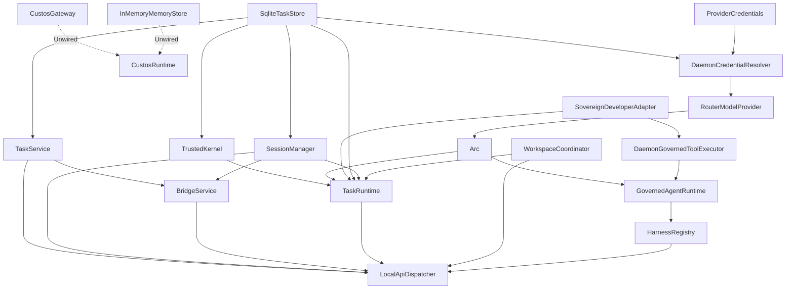

# Runtime Composition Baseline (`custos-daemon/src/runtime.rs`)

> Baseline audit of `CustosRuntime::bootstrap` and `bootstrap_with_store_and_model`.

## 1. Types Constructed & Injected

| Component / Port | Concrete Implementation | Injection Target | Notes |
|---|---|---|---|
| `store` | `SqliteTaskStore` | Kernel, Workflow, LocalApi, SessionManager | WAL mode SQLite |
| `credentials` | `ProviderCredentials` | LocalApi, Sweeper, Resolver, OAuthCallbackServer | Backed by file/keyring vault |
| `availability` | `ModelAvailability` | Resolver, LocalApi | In-memory dynamic availability cache |
| `resolver` | `DaemonCredentialResolver` | `RouterModelProvider` | Resolves accounts, validates catalog |
| `local_adapter` | `NativeLocalModelAdapter` (opt) | `RouterModelProvider` | Local inference runtime |
| `router` | `RouterModelProvider` | `model` (`ModelPort`) | Multi-provider router |
| `task_service` | `TaskService` | LocalApi, BridgeService | Core task service |
| `session_manager` | `SessionManager` | LocalApi, BridgeService, TaskRuntime | Journal manager |
| `bridge_service` | `BridgeService` | LocalApi | IPC & session promotion |
| `kernel` | `TrustedKernel` | TaskRuntime | KernelPort |
| `sandbox` | `SovereignDeveloperAdapter` | TaskRuntime | SandboxPort |
| `lease_manager` | `WorkspaceLeaseManager` | CustosRuntime field | Worktree leases |
| `harnesses` | `HarnessRegistry` | LocalApi, TaskRuntime | Pre-registered: `governed` (`GovernedAgentRuntime`), `claude-code` |
| `tool_executor` | `DaemonGovernedToolExecutor` | `GovernedAgentRuntime` | **F1 target**: direct calls to handle_write/bash |
| `workspace_coordinator` | `WorkspaceCoordinator` | LocalApi, TaskRuntime | Workspace provider |
| `workflow` | `TaskRuntime` | LocalApi | WorkflowPort, run dispatcher |
| `terminal_coordinator` | `TerminalCoordinator` | LocalApi | Terminal management |
| `python_coordinator` | `PythonKernelCoordinator`| LocalApi | Python kernel execution |
| `pack_registry` | `DomainPackRegistry` | LocalApi | Domain packs (Engineering, Research, Assistant) |
| `gateway` | `CustosGateway` | `CustosRuntime.gateway` | **Not composed into request path** |
| `memory_store` | `InMemoryMemoryStore` | `CustosRuntime.memory_store`| **Not composed into request path** |

## 2. Dormant Services / Ports (Constructed but Unwired)

- **`CustosGateway`**:
  - Instantiated at line 291: `let gateway = Arc::new(custos_runtime::gateway::CustosGateway::default());`
  - Stored in `CustosRuntime.gateway` (line 337).
  - **Status:** Not passed to `LocalApiDispatcher` or `TaskRuntime`. No request path or assistant flow currently consumes `gateway.route_and_execute()` or its budget guards.
- **`InMemoryMemoryStore`**:
  - Instantiated at lines 292-293: `let memory_store = Arc::new(custos_runtime::memory_service::InMemoryMemoryStore::new()) as Arc<dyn custos_runtime::memory_service::MemoryStore>;`
  - Stored in `CustosRuntime.memory_store` (line 338).
  - **Status:** Not passed to `LocalApiDispatcher` or any product workbench. No request consumer exists. Does not yet implement core `MemoryPort` or scoped recall.

## 3. Dependency Edges

