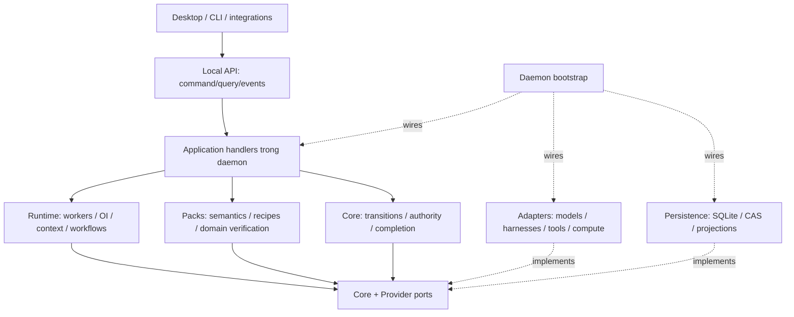
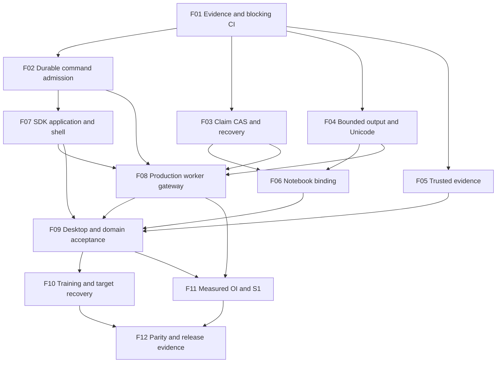

# Custos SADE — kế hoạch refactor thống nhất sản phẩm, execution và tài nguyên

**Repo Intelligence removal:** subsystem scanner/graph/query/coordinator riêng đã được bỏ theo quyết định sản phẩm. Không triển khai hoặc phục hồi các placement Repo Intelligence trong những snapshot/kế hoạch lịch sử bên dưới. Giữ file/search/Git/worktree, context compiler và SourceSpan của Engineering; Nexus vẫn là development utility độc lập.

**Ngày cập nhật kế hoạch:** 19-10-2026. **Trạng thái:** đề xuất triển khai dựa trên source; chưa phải xác nhận các thay đổi dưới đây đã được code. **Phạm vi:** desktop/headless, ba workbench, native harness, research và compute; chưa làm mobile.

**Snapshot hiện hành:** branch `vi-rft`, HEAD `c96f414de94423bc8dcf5187f6f44b2e8c152e9d`, working tree sạch lúc audit. Chín commit refactor đã tồn tại nhưng không đồng nghĩa chín acceptance gates đã đạt. Trước mỗi packet ghi lại HEAD/dirty manifest/file hashes; không reset hoặc ghi đè thay đổi xuất hiện sau snapshot này.

**Đọc để triển khai:** §2 là hiện trạng sau audit; §3–13 là kiến trúc đích; §14 giữ nhóm năng lực R0–R11; **[§17](#17-superplan-hoàn-thiện-sau-audit)** là queue công việc còn lại F01–F12, có traceability về R. Không khởi động lại các phần đã đúng, không lấy báo cáo “100%” làm nguồn sự thật. §17 ưu tiên khi thứ tự triển khai cũ chưa phản ánh gap mới.

Tài liệu này cập nhật thứ tự thực hiện của [workspace plan](workspace-restructuring-plan.md), không mở kiến trúc song song. [Custos.md](../../Custos.md) giữ sản phẩm/invariants; [catalog](codebase-architecture.md) giữ vị trí vật lý; topic specs giữ hợp đồng hành vi. Đây là khảo sát các đường chạy trọng yếu, không tuyên bố đọc từng file hay audit bảo mật toàn bộ upstream.

**Hai mục tiêu của cùng campaign:** (A) làm rõ toàn bộ product shell, SDK, application/backend và frontend ba workbench; (B) sửa retry/dispatch/recovery và giới hạn RAM/CPU/output để nền đó hoạt động bền vững. Các packet R ở §14 thay thứ tự R trong bản trước; không đồng nghĩa nhãn R ở các tài liệu lịch sử. Đây là kế hoạch, chưa phải triển khai production.

## 1. Kết luận: cần refactor lớn, không cần viết lại tất cả

Custos nên là **một môi trường làm việc có giám sát**, không phải ba chatbot, một UI bọc coding agent, hoặc một universal proxy. Người dùng có thể hỏi nhanh, giao việc dài, dùng model hoặc harness, làm nghiên cứu có code và tiếp tục công việc qua các bề mặt khác nhau. Lợi thế cần chứng minh là kết quả đạt tiêu chí với tổng chi phí hợp lý, nguồn rõ, trạng thái thật và quyền kiểm soát rõ.

Giữ kernel, authority, persistence, ports, canvas và các tích hợp đã hoạt động. Refactor mạnh ở **application seams, lifecycle, state ownership, context và pack execution**. Tên folder không tạo ra orchestration, index không tạo ra hiểu code, và hiển thị panel không chứng minh tính năng upstream đã được hấp thụ.

Không chọn trước “nhiều agent nhất”, “mọi thứ qua MCP”, “tách mỗi subsystem một crate”, hay “rẻ nhất mọi tình huống”. Mục tiêu tối ưu là **cost per accepted outcome** dưới ràng buộc chất lượng, quyền, thời gian và pin của user; cần baseline để chứng minh.

## 2. Hiện trạng sau audit và tiêu chí còn thiếu

| Chủ đề | Đã có ở snapshot hiện hành | Chưa đạt / việc còn lại |
|---|---|---|
| R0 — CI | Architecture/Cargo check và contracts checks đã được siết một phần | Rust fmt/Clippy/Run Tests còn continue-on-error; critical regressions chưa là gates đầy đủ |
| R1 — Commands | Client truyền command ID, ledger và sequential replay test | Check→execute→record không atomic; fail-open khi ledger lỗi; không bind method; timestamp expiry so khác định dạng |
| R2 — Dispatch | Durable unique claims, restore, caller error propagation đã cải thiện | Claim update WHERE id không expected-state CAS; cần chứng minh cancel/launch/restart/generation fencing xuyên đường chạy |
| R3 — Resource bounds | LiveRuns bounds, terminal map eviction khi có persistence | Python StringIO vẫn buffer trước truncate; Rust đọc line chưa có byte bound; tool output truncate có UTF-8 panic |
| R4 — SDK/shell | Client/wire đã được extract sang SDK, có async attach helper | Host còn import daemon, startup sync attach + expect; single-flight/readiness/degraded UX chưa đầy đủ |
| R5 — Layering | API tách transport/capabilities/tests; runtime persistence đã thành dev-dependency; NotebookStoragePort có thật | application use cases chưa được tách; notebook subprocess I/O vẫn trong runtime; adapter/tool composition cần chuẩn hóa |
| R6 — Agent loop | Bounded multi-step implementation và mock executor tests | Daemon wire tools rỗng, không có production GovernedToolExecutor; model stream ToolCall vẫn UI-only; chưa có actual multi-step product path |
| R7 — Desktop | Lens routing/hydration/nullable restore đã được sửa | Cần cross-lens/no-root/multi-pane/reconnect/settings behavior acceptance, không làm lại renderer từ đầu |
| R8 — Coding | Repo spans đã lấy actual bytes/digest; có recipe outcome types/helpers | Recipe helper không chạy diagnose→patch→trusted verification; cần end-to-end evidence |
| R8 — Research | Citation oracle có assessment metadata branch | Vẫn fallback verified:true; assessments chưa trusted/source-version-bound; source support không được xác minh chỉ từ flags |
| R8 — Assistant | Delivery states, payload-reset/quota helpers | Chưa chứng minh helpers được enforce xuyên connector/outbox/transaction/revoke path |
| R9 — Notebook/compute | Optional notebook/kernel fields, checkpoint validators/metadata inspection | Kernel vẫn keyed session_id; chưa production ComputePort implementation/engine runner/portable resume |
| R10 — OI | Explain/planner/topology logic tests | CandidateBuilder bỏ snapshot, estimates hằng số, selector lấy admissible đầu; chưa paired cost-quality benchmark |
| R11 — Legacy | c96f414 xóa 203 file unmounted engine, 89.723 dòng | Deletion không chứng minh behavior parity/license mapping/release compatibility; không chứng minh RAM giảm |

Source anchors: [API command admission](../../crates/custos-daemon/src/api.rs), [ledger](../../crates/custos-persistence/src/repositories/command_ledger.rs), [claim updates](../../crates/custos-persistence/src/repositories/run.rs), [runtime composition](../../crates/custos-daemon/src/runtime.rs), [model loop](../../crates/custos-runtime/src/agent/runtime_port.rs), [notebook](../../crates/custos-runtime/src/notebook/coordinator.rs), [citation oracle](../../crates/custos-packs/src/research/verifiers/citation_coverage_oracle.rs), [CI](../../.github/workflows/rust.yml).

**Giữ phần đúng:** worktree lease đã dùng Git worktree thật; dispatcher đã có persistence/read-through; GovernedAgentRuntime đã dùng ModelPort; runtime không còn persistence production edge. Không đưa các việc này vào backlog như thể chưa làm. Không restore nguyên engine đã xóa để lấp gap; recover từng behavior cần thiết có evidence.

Audit trace các đường rủi ro và diff chín commit, không đọc từng dòng toàn repo. File counts 686 Rust/189 desktop TS của snapshot trước chỉ là lịch sử, không còn là current inventory sau deletion. Workspace có 12 product packages (10 functional crates, hai app hosts) cộng test packages/xtask; không đổi package chỉ để khớp khẩu hiệu “11 crates”.

## 3. Mô hình sản phẩm: ba trục, không một cây bắt mọi thứ

```text
Tổ chức tài nguyên             Công việc bền vững          Bố cục cá nhân
Project                       Conversation ↔ Task         Project → Screens
 ├─ Git repository             Task → Runs                 Screen → pane tree
 │   └─ worktree               Run → WorkerRuns            Pane → resource reference
 ├─ folder / corpus            Worker → attempts           homeWorkbench là grouping
 ├─ dataset / notebook         Attempt → effects/evidence  không là permission boundary
 └─ connector resources        Outcome theo criteria
```

Các cạnh giữa ba cột là **references**, không ownership ngầm. Project là phạm vi tổ chức; workspace biểu diễn resource root hiện có (Git/folder/remote), không đồng nghĩa workbench. Worktree chỉ là checkout của Git repository. Task có thể dùng nhiều resource roots, không gắn cứng với một Screen. Copilot có thể không có file root; Research có folder/corpus nhưng không có Git. Không tạo worktree giả để thỏa schema.

Screen thuộc Project presentation scope, có `homeWorkbench` và optional anchors tới worktree/Task/experiment; mở nhiều Screen cùng lens hoặc pane chéo lens được. Không thêm “work area” như domain entity mới: nếu cần chỉ là subtree của canvas có scope annotation. Screen chứa `tab_instance_id`; backing content có `resource_id`; execution có ID riêng. Hai pane mở một notebook không tạo hai kernel vì cùng tài nguyên; hai notebook trong một chat không chia namespace ngoài ý muốn.

Conversation canonical có journal và binding nhiều–nhiều tới Task/lens. Native harness session là identity bên adapter, không thay canonical conversation. Đổi lens không copy transcript, mở Task không tự chạy, đóng pane không dừng run. Nếu provider hidden state không chuyển được, continuation phải nói rõ giới hạn thay vì giả đã chuyển toàn bộ tri thức.

**Rule cần hiệu đính trước implementation:** quy định root desktop hiện buộc mọi thứ neo physical worktree chỉ áp dụng tài nguyên Coding cần checkout, không cho toàn bộ Research/Copilot. Sửa rule và fixtures cùng packet identity; không âm thầm làm code ngược rule.

## 4. Backend đích và dependency direction



Sơ đồ là trách nhiệm; import graph cụ thể phải không có cycle. Runtime không import packs concrete; packs có thể dùng runtime skill interfaces hiện có trong giai đoạn chuyển đổi, nhưng runtime nhận manifests/verifiers/recipes qua registration. Nếu coupling gây cycle, chuyển **hợp đồng tối thiểu đang dùng** xuống core/provider, không dựng thêm framework tổng quát.

| Crate hiện có | Giữ / chuẩn hóa bên trong | Cấm trở thành |
|---|---|---|
| `custos-domain` | IDs/value types, state vocabulary, resource refs, source/effect/evidence/experiment records, validation thuần | filesystem/process/DB/model client |
| `custos-core` | `kernel/`, `authority/`, `evidence/`, `capability/`, `contracts/`; pure OI admissibility/compiler checks | online planner, concrete connector, provider HTTP |
| `custos-provider` | Canonical `ModelPort`, turn/request/event/usage/tool fidelity; explicit compatibility adapters | native process owner, credential vault, Task success authority |
| `custos-runtime` | `agent/`, `workflow/`, `oi/`, `cognitive/`, `context/`, `session/`, `workspace/`, `notebook/`, memory; research experiment coordination only when first job needs it | SQLite repository consumer, second evidence authority |
| `custos-adapters` | `providers/`, `harness/`, `mcp/`, `a2a/` và actual tool/host edges; add thematic `compute/`/`training/` as implemented | application workflow hoặc canonical DB writer |
| `custos-packs` | `engineering/`, `research/`, `assistant/`; mỗi pack chứa jobs, skills, recipes, verifiers, fixtures | riêng một agent runtime/DB cho mỗi workbench |
| `custos-persistence` | migrations, repositories implementing ports, CAS/derived indexes/recovery | routing hay semantic judgment |
| `custos-bridge` | session↔Task bindings, promote/attach/steer/continuation qua contracts | HTTP listener hoặc mọi API DTO |
| `custos-daemon` | `bootstrap/`, `api/`, `application/`, supervisor/recovery; duy nhất compose concrete deps | hàng nghìn dòng pack semantics hoặc Git subprocess helpers trong API |
| `custos-sdk` | Local API client, event cursor, transport negotiation; share/generate DTOs từ definition hiện có | client-side kernel hoặc DB access |
| `custos-app/{cli,desktop}` | platform shell, lifecycle/IPC, deep links/window integration, gọi shared application service | composition root độc lập, app-specific scheduler |

Không tạo `custos-sade`, `custos-research-engine`, `custos-training`, `custos-mcp-hub`, `custos-screen-core` ngay. Tách crate chỉ khi cần dependency/toolchain/isolation/independent release thật; module đủ cho phần lớn đợt này. Crate không tạo security isolation.

### Cây module cần chuyển, không sinh folder rỗng

```text
custos-daemon/src/
  api/{mod,dispatch,capabilities,transport}.rs
  application/{sessions,tasks,workspace,research,assistant,connections}.rs
  bootstrap/                         # registration và wiring
custos-runtime/src/
  agent/                             # một Custos-owned loop
  workflow/                          # scheduling/claim/lease/join/recovery
  oi/                                # candidates/estimation/selection/replan
  cognitive/                         # typed S1 services, bounded worker support
  context/{compiler,retrieval,repo_intelligence,...}
  notebook/                          # coordination qua execution/storage ports
  research/                          # experiment coordination khi ship job đầu tiên
custos-adapters/src/
  providers/                         # giữ vendor implementations hiện có
  harness/                           # Codex/Claude/... native processes
  tools/{filesystem,git,shell,web,...} # concrete scan/query/execute I/O
  compute/{local,colab,kaggle}        # chỉ backend đã implement
  training/unsloth                    # integration engine, không GPU allocator
custos-packs/src/
  engineering/{jobs,skills,recipes,verifiers,...}
  research/{jobs,skills,recipes,verifiers,...}
  assistant/{jobs,skills,recipes,verifiers,...}
```

Tên file là target location; ưu tiên giữ tên hiện có nếu trách nhiệm đúng. Skills không gom vào `tools/` gốc: domain semantics ở pack, reusable scheduling/context ở runtime, concrete I/O ở adapters, schemas ở domain/core. MCP chỉ expose capability đã đăng ký; không sinh bản thứ hai của skill.

## 5. Chuẩn hóa vòng thực thi trước khi làm OI mạnh hơn

Một luồng chuẩn: `command → validate contract/revision → reserve/claim → prepare context → executor attempt → observe effects/output → verify criteria → outcome → projection/events`.

1. Mỗi request có command ID, actor, expected revision, scope và deadline. Retry command không tạo run mới ngoài ý muốn.
2. Claim transaction kiểm readiness/version, unique active slot và fencing generation; DB commit trước launch. Memory chỉ cache. Store error làm command fail/reconcile, không success giả.
3. Attempt giữ actual executor/account/host/workspace/kernel/job identity, args/context digests và launch state. Chết sau launch mà chưa receipt là uncertain; reconcile trước retry/fallback.
4. Chỉ retry transport khi adapter chứng minh chưa effect hoặc có idempotency. Cancel requested khác observed stopped; còn process/GPU thì vẫn phải hiện.
5. Evidence lưu theo criterion + source/config revision + verifier identity/method. Worker complete không đổi Task thành pass tự động.
6. Startup recovery tải active claims/attempts/outbox/resources; hỏi trạng thái bên ngoài, làm stale phần mất state, không chỉ xóa in-memory maps rồi cho launch lại.
7. Durable state transition và event/projection cùng SQLite transaction khi thuộc một DB. Process/network/CAS không được mô tả atomic với DB.

**Thay đổi contract ưu tiên:** mở rộng ports hiện có cho atomic claim transition/read/recover và notebook storage. Không thêm một universal execution interface khổng lồ. Notebook, training job và native harness có lifecycle khác; share IDs/budget/effect/evidence, không ép chúng có cùng thao tác.

## 6. Model, harness, capability, compute: bốn loại executor

| Loại | Đường dùng trong Custos | Điều không được giả định |
|---|---|---|
| Inference endpoint | `ModelPort` → Custos worker loop → admitted tools | Model coder local tự có file access, session hay agent loop |
| Native agent harness | `AgentRuntimePort` hiện ở core contracts → harness adapter | Mọi native tool qua Custos; resume/steer/cost visibility đồng nhất |
| Capability/tool | typed invocation → authority/gateway → adapter receipt | MCP annotation là grant hoặc tool name đủ mô tả risk |
| Compute/kernel/job | resource allocation + operation-specific attempts → observation/import | Kernel = chat; GPU = training engine; logs = interactive control |

[GovernedAgentRuntime](../../crates/custos-runtime/src/agent/runtime_port.rs) hiện đã dùng `ModelPort`; không lập lại công việc chuyển trait đã xong. Gap là vòng nhiều bước, tools registration và tool-result continuation. `ModelProvider`/Goose compatibility ở callers khác chuyển từng bước; không duplicate `AgentRuntimePort` vào provider để làm tên trông đối xứng.

Harness profile là khả năng tuyên bố, cần conformance theo version/path. `custos-mediated` chỉ cho thao tác thật được chặn trước effect; còn native path là provider-governed/observe-only/unknown phù hợp. Runtime fail-closed nếu operation không có; không dựng fake success để thỏa UI.

## 7. OI, S1, S2 và Meta: thông minh nhưng không tranh quyền

**OI sở hữu quyết định phân bổ công việc**, không sở hữu grant, source truth, evidence pass hay UI layout. Pipeline target:

`snapshot → discover available executors → hard filter → bounded candidate plans → estimate ranges → select/explain → compile/admit → schedule → observe → bounded replan`.

- Candidate dựa capability registry, provider pin, tool mediation, host/resource availability và pack job; không hardcode tên model như hiện tại.
- Estimator tính cả context transfer, cache, child workers, verifier, retry và human time. Missing usage là unknown, không zero. Cold/warm và predicted/observed tách riêng.
- Khi thiếu calibration, dùng pinned direct/native baseline; graph phức tạp phải có lý do và cap. Human thay pin là revision; OI không tự downgrade để “tiết kiệm”.
- Replan chỉ future nodes, bảo toàn effects/artifacts/criteria đã có. Loss of stream không là worker failure chắc chắn. Scope/budget không tự nới.

| Topology theo nhu cầu | Dùng khi | Không dùng khi |
|---|---|---|
| Direct / one worker | Chat, coding task nhỏ, một source question | Không cần thêm planner chỉ để xác nhận lựa chọn mặc định |
| Staged pipeline | Extract→review→synthesize, patch→verify | Các bước chưa có typed input/output và failure path |
| Read fan-out | Corpus/repo branches độc lập có join | Các worker lặp cùng tìm kiếm hoặc cần toàn bộ shared hidden state |
| Worktree candidates + integration | Các patch độc lập hoặc cạnh tranh có base và oracle chung | Cùng ghi một dependency graph mà không barrier |
| Bounded repair | Verifier chỉ ra lỗi có thể sửa trong budget | Retry không có thông tin mới, test bị worker làm yếu |
| Experiment sweep | Config variants, resource quota, held-out evaluation rõ | Không kiểm chi phí GPU, dataset split hay artifact collection |

Đây là recipes cho topology hiện hữu/mở rộng, không yêu cầu public enum mới cho mỗi hàng. Giữ `core/oi` cho invariant/admission checks; `runtime/oi` cho online selection; không merge hai folder vì trùng tên.

**S1 không chỉ router:** có thể làm repo scout, relevance ranking, ambiguity detection, structured extraction, test selection proposals, log/error triage, dataset schema profiling và context compression có source refs. Với công việc model nhiều bước, biểu diễn bằng bounded WorkerRun, không giấu như “một scorer miễn phí”. Luôn có abstain/uncertainty, step/time/token budget và escalation lên S2. S1 summary không thay source; S2 vẫn được mở raw context khi cần.

**S2** giữ reasoning/plan/implementation/synthesis mạnh. S1 không sửa câu hỏi trước khi S2 thấy constraints, không cắt counterevidence, không tự bỏ criterion. **Meta** đọc redacted traces offline, so policy variants, đề xuất policy version; không tự train/apply policy lên run đang chạy. Đánh giá quality–cost theo pack, không gọi OI tối ưu chỉ vì chọn giá niêm yết thấp hơn.

## 8. Engineering: từ đọc repo đến thay đổi đáng tin

Repo Intelligence gồm source inventory/snapshot, lexical query, optional AST/LSP/dependency/test map, scoped context và coverage. Domain records giữ spans/hashes; core kiểm scope; adapters scan/Git/read; runtime quản query/context; engineering pack cung cấp recipes và acceptance. Không cần graph DB mới trước khi lexical/symbol baseline được đo.

Mỗi query trả snapshot, real locator/content digest, coverage/omissions/freshness; parser không hỗ trợ thì fallback lexical và nói rõ. Snapshot không hash lại toàn repo mỗi turn nếu có incremental cache hợp lệ; filesystem I/O blocking không chạy vô hạn trên async request hot path. Watcher là invalidation signal, không là proof bytes không đổi.

Luồng patch: diagnose/reproduce → bounded proposal → owned write scope → apply đúng base → trusted behavior verification → outcome/diff. Worktree lifecycle do workspace/lease service duy nhất quản; harness khai báo tự tạo worktree hay dùng của Custos. Không cho scheduler và harness cùng tạo/xóa checkout ngoài ý muốn. Merge/rebase/conflict resolution/push là effects riêng; không xóa untracked files khi cleanup.

UI Coding có file/symbol/source, editor/diff, terminal, agent session, tests và candidates khi có dữ liệu. Browser/devserver/emulator cần actual host/capability; không copy nguyên OrCa simulator surface trước khi có runtime tương ứng.

## 9. Research: không chỉ tìm paper, cũng không chỉ notebook

Research cần ba vòng gắn với nhau:

1. **Knowledge:** acquire/version/parse → passages → atomic claims → support/contradiction/unknown → sourced synthesis.
2. **Experiment:** question/hypothesis → versioned dataset/code/recipe/environment → execution → metrics/artifacts → held-out evaluation.
3. **Communication:** table/figure/report/note → annotation/revision → export có provenance → selected Engineering brief.

Mở rộng trong `packs/research` và runtime/persistence hiện có, không chạy Open Science như kernel authority thứ hai. Giữ source, artifact và execution IDs qua rename/export; notebook output mutable không là toàn bộ scientific record. Các confidence axes tách locator, extraction, semantic support, replication, methodological review và freshness; sealed/hash không chứng minh khoa học.

Notebook identity cần khác conversation identity. Cần notebook ID, kernel ID/epoch, cell version, execution request ID và producing attempt; migration preserve `session_id` cũ, không tự suy ra hai notebook dùng cùng kernel. Current custom persistent Python backend giữ làm backend nhỏ; Jupyter integration là backend khác khi cần MIME outputs, comms/widgets hoặc remote kernels, không rename worker thành Jupyter.

### Training/finetune studio

Reuse current experiment/execution/environment records trước khi thêm contract; trước first implementation chốt thiếu fields bằng fixtures. Các nhóm responsibilities:

| Chủ đề | Nơi đặt | Nội dung |
|---|---|---|
| Training recipe và quality criteria | research pack | model/tokenizer revision, dataset/splits, method/parameters, eval criteria |
| Job/resource lifecycle | runtime qua ports | validate/prepare/submit/observe/reconcile/collect; stop khác release |
| Training engine integration | adapters/training | Unsloth Studio supported API/MCP hoặc supervised recipe process |
| Compute platform | adapters/compute | local, Colab assignment/kernel/files, Kaggle versioned batch/log/output |
| Durable provenance | domain + persistence | input/env/accelerator, external IDs, checkpoints, metrics và completeness |
| Research UI | research feature panes | configuration preview, live observations, compare, artifact/checkpoint/eval |

Training engine và compute platform độc lập: clone Unsloth + Colab không làm Studio tự chạy trên hosted GPU. Phải giải quyết auth, process/port/dependencies/resource ownership trước. Agent tạo recipe và đọc evidence, không tự tuyên bố model tốt hơn vì loss giảm.

Colab có interactive kernel path trong CLI đã khảo sát; verify assignment/release và timeout. Kaggle checkout có **live logs** và versioned outputs; không vì vậy expose execute-cell/inspect-tensor/interrupt/resume nếu chưa có supported operation. Stream drop không là job stop. Resume chỉ enable khi checkpoint có state phù hợp engine, không chỉ vì tồn tại adapter weights. GPU cost và local estimates không hiển thị như billed usage.

## 10. Copilot / Assistant: nền tảng thao tác an toàn

Copilot là conversational working mode có thể không repo: scoped notes, files, account/connector resources, drafts, calendar, automations. Tasks giữ durable obligations; chat giữ tương tác; UI không ép user tạo project Git hoặc form cho câu hỏi ngắn.

Assistant pack sở hữu identity/time/draft/automation semantics. Connectors là adapters; credentials do secret backend; exact effect/permission/outbox thuộc trusted core/persistence. Draft, requested send, observed sent và uncertain tách trạng thái. Standing grant có scope/expiry/max runs/revoke; automation đóng cửa sổ vẫn chạy nếu user đã cấp quyền, không tự chạy vì layout restore.

Cross-pack chuyển selected artifact refs + caveats/redaction; không chuyển raw personal history hay grant. Một Task có nhiều pack obligations khi cùng goal; conversation có thể trao đổi nhiều Task nhưng composer phải rõ đang gửi vào việc nào.

## 11. Hấp thụ upstream: chọn behavior và source, không thêm một sản phẩm bên trong

| Upstream / phần lấy | Ánh xạ Custos | Quy tắc giữ / không bê |
|---|---|---|
| OrCa Task/Run/Dispatch/launch lifecycle | domain/core contracts, persistence claims, runtime scheduler, harness adapter | Port fencing/uncertainty/recovery scenarios; không nhập SQLite schema hay Electron controller làm authority khác |
| OrCa activation/tab identity/host-aware restore | desktop workspace feature + runtime host/workspace refs | Distinguish tab instance/entity/host, coordinated focus/restore; không mang global store nguyên cây |
| OrCa agent continuation/mailbox/terminal | runtime session/worker events, adapters harness/terminal | Native identity và epoch fencing, input delivery receipt; không coi UI send thành observed execution |
| Open Science pane tree, scoped interaction, draft preservation | existing canvas/resource registry, pane-scoped commands/dialogs | Adopt interactions và tests; không thêm layout engine thứ hai |
| Open Science artifact/analysis/kernel workflows | research pack + notebook/runtime + persistence lineage | Preserve notebook/resource versions and annotations; không copy file logs thành source of truth cạnh SQLite |
| Goose conversation/inference/tool stream | compiled `runtime/agent`, provider compatibility + adapters | Một loop được wire; prove rich tool/reasoning/usage/cancel fidelity rồi retire legacy tree |
| Unsloth validation/job/checkpoint/export | training adapter + experiment coordination/research UI | Tách engine/export/job; per-file license review, Studio có AGPL-3.0-only headers |
| Colab CLI / Kaggle CLI | compute adapters | Pin versions, structured wrappers và conformance; không parse marketing thành capability |

Mỗi extraction packet ghi upstream SHA/path/license, behavior cần giữ, target path, contract changes, tests và đoạn không port. OrCa local không còn `.git`: SHA lịch sử trong source study không chứng nhận bytes hiện tại; tạo content manifest của các file thực sự lấy. Open Science kiểm HEAD `04b64817c12e7fdbe0e052bfa1aeaf8802feecde`. Ba compute repos được pin trong [source study](../../../TRAINING_COMPUTE_SOURCE_STUDY.md).

## 12. Protocols là các biên kết nối, không là tầng quyết định sản phẩm

| Biên | Trách nhiệm | Placement |
|---|---|---|
| Local API qua IPC/authenticated HTTP | commands, queries, event cursor, version/errors | daemon API + SDK; desktop thin host |
| MCP | discover/invoke tools/resources với policy của Custos ở trước effect | adapters MCP + capability registration |
| ACP | editor↔agent integration khi client/harness hỗ trợ | adapter theo direction, reuse application contracts |
| A2A | remote agent identity/task/artifact exchange | optional adapter, không cho internal child workers |
| Vendor/native transport | Model inference hoặc harness-specific protocol | provider/harness adapter với fidelity profile |
| Notebook/compute protocol | kernel messages/job/status/files | compute/tool adapters, không qua ModelPort |

CAP nếu dùng phải expand tên và pin spec URI/use case; không có một slot CAP mặc định chỉ vì cùng danh sách MCP/ACP. 9Router/provider proxy và agentgateway/federation là optional transport profiles, không thay OI/authority. Capability registry là nguồn quản operation support/availability; không cần một hub service cho mỗi acronym.

## 13. Desktop đích: một shell, ba lens, không ba ứng dụng

Giữ typography-first Graphite/JetBlack hiện có, icon navigation có tooltip/keyboard/accessible label; phân biệt lens bằng resource/action defaults và context title, không ba bảng màu neon. Ưu tiên active state rõ, deep-link đúng tài nguyên và preservation; không tạo thêm dashboard trang trí.

| Store / feature | Ownership |
|---|---|
| API entity/event cache | canonical server projections keyed stable IDs + revisions/cursors |
| Screen/layout store | project-scoped screen/pane/tab instances, focus, sizes, home lens |
| Conversation drafts | session + draft identity; giữ khi pane unmount/switch |
| Resource handles | references tới editor/terminal/kernel/etc; runtime owner ở backend |
| Connections/settings | persisted preferences, validation, actual availability, secret refs không plaintext |

Target tổ chức TS: `app/` shell/composition; `features/workspace/`, `features/conversations/`, `features/tasks/`, `features/engineering/`, `features/research/`, `features/assistant/`, `features/connections/`; giữ `api/` và `components/common/` hiện có, không tạo thêm `shared/api/` và `shared/ui/` song song. Reuse folders/components đã có, chuyển từng feature qua facade; không tạo bản sao component cùng logic.

Một command activation restore coherent screen selection, nullable session/task/resource anchors và layout; hydration guard không persist trước load xong đúng project. Resource open/focus khác backend start. Screen đóng giữ background run reachable trong Activity/Tasks; terminal/kernel lifetime theo lease/explicit controls, không React mount.

Lens icon chọn Screen cuối của lens (hoặc empty default một lần). `Change Screen home`, `Open same conversation in…`, `Linked continuation`, `Add Task step` là actions khác. Global switcher mở mọi Screen; pane hỗ trợ typed resources chéo lens. Inactive panes không bắt shortcut/submit vào session đang active ở pane khác. Zoom chỉ presentation, không phá tree.

Settings phải dùng cùng operation registry, actual errors, persisted validation và reconnect; không hardcode “connected” sau save. Không bật knob cho routing/cache/GPU mà backend chưa thực thi; show unavailable reason. Tab retry không được submit duplicate training/send action.

## 14. Implementation campaign — thứ tự cụ thể và exit gates

### R0 — Baseline, source map và CI thật

**Chạm:** workflows Rust/contracts, existing tests/xtask/tools, catalog. Chụp HEAD + dirty manifest; map compiled/composed/reference/prototype, API/error fixtures và cargo production graph. Không mount hoặc xóa legacy engine ở bước này.

**Gate:** selected critical regressions phải blocking; baseline debt còn lại có scope/issue rõ, không blanket continue-on-error. Đo cold/warm launch, idle/active/concurrent scenario trước khi chốt thresholds. Không gọi targeted suites là full workspace pass.

**Rollback:** thay CI không đổi runtime/data; giữ baseline evidence kể cả gate chưa đạt.

### R1 — Command identity, retry và error semantics

**Chạm:** desktop api/daemon_client.ts, custos-app desktop lib.rs, daemon dispatch, core Task service/ports, persistence transaction và wire fixtures.

Một logical command giữ ID qua IPC/HTTP/host resend, actor/profile/scope, payload digest và expected revision khi cần. Backend admission/result replay atomic với mutation/event thuộc DB; duplicate trả cùng outcome, reuse ID khác payload bị từ chối. Đồng thời tách business rejection, transport failure và uncertain dispatch. Query retry có deadline/backoff/cancel; mutation không generic fallback thành submission mới.

**Gate:** mất response sau DB commit chỉ một Task/run; concurrent duplicate; restart replay; business error không HTTP fallback; ID/payload mismatch; replay retention/expiry. Retention phải dài hơn retry window được hỗ trợ; hết window thì yêu cầu đối soát, không tự coi command mới. Ledger lưu artifact refs thay payload lớn.

**Rollback:** giữ dedup compatibility; tắt unsafe mutation fallback nếu path mới lỗi. Command dedup không chứng minh exactly-once external effect; email/shell/GPU vẫn cần idempotency/reconcile.

### R2 — Dispatch/launch/recovery xuyên caller

**Chạm:** runtime workflow dispatcher/TaskRuntime, RunPort implementation, daemon startup recovery/readiness.

Giữ durable claim/unique fencing đã có. Propagate save/mark/release errors xuyên caller; bind attempt với actual executor/account/host/resource/generation; startup reconcile trước khi nhận conflicting work. Không giữ nhiều cache locks qua storage await dài.

**Gate:** inject lỗi save run/worker/mark/release; hai dispatchers; restart trước/sau launch/receipt; cancel-vs-launch; stale generation. Process/network không atomic với DB: launch không rõ phải uncertain/reconciling, không xóa claim rồi retry mù.

**Rollback:** drain/reconcile active attempts; preserve external IDs/history/generation. Không reset active state để app “chạy lại”.

### R3 — Bounded resources trên đường chạy hiện có

**Chạm:** active runs/workers, LiveRuns, notebook coordinator/output transport, CAS/persistence output paths và API history.

Terminal records rời active maps sau durable settlement; lịch sử query/paginate từ persistence. Bound stdout/stderr/message/queue bytes **trước** full allocation/serialization; spool artifact khi phù hợp, marker over-limit và disk-full truthful. Bounded LiveRuns không thay bounds của tất cả owners.

**Gate:** nhiều terminal runs liên tiếp, active handles trở về baseline; large/infinite stdout; oversized JSON line; consumer chậm; notebook cancel/reset; disk full; redaction. Đo RSS/queue-byte plateau, không chỉ map length. Control/cancel/error events không bị drop tùy tiện.

**Rollback:** giảm admission/limits; không fallback về unbounded capture. Không đổi notebook identity và toàn kernel protocol cùng một patch.

### R4 — SDK thật và custos-app thành product shell

**Chạm:** existing SDK, daemon LocalApiClient/wire exports, app desktop/CLI lifecycle callers, compatibility fixtures.

SDK sở hữu Local API client/wire/errors/event cursor, không import daemon/runtime/DB. Re-export tạm đường cũ; migrate từng host để tránh hai bộ DTO drift. App shell sở hữu async start/attach, single-flight reconnect, version/readiness/degraded UX, native windows/deep links, diagnostics và client lifetime.

Lifecycle: launch → attach/start owned daemon → negotiate → ready → restore projections; mất kết nối → degraded với last-observed time → reconnect/replay/reconcile. Không dựng Tokio runtime/synchronous polling mỗi request. Close window khác stop workload/shutdown daemon.

**Gate:** missing/wrong-version daemon; simultaneous windows reconnect; startup timeout/cancel; no duplicate owned daemon; SDK graph acyclic; IPC/HTTP parity; không kill dịch vụ không sở hữu. Host phải giữ R1 command semantics.

**Rollback:** client facade tương thích, một server composition; không thêm backend/kernel trong app để né dependency migration.

### R5 — Application seams và ports sạch

**Chạm:** daemon api.rs → api/ + application/, bootstrap; runtime notebook/context/workspace; core ports; persistence implementations; adapters Git/process I/O.

Transport chỉ decode/dispatch/events; application modules phối hợp product use cases; core giữ policy; packs giữ semantics. Extract mechanical trước, parity fixtures rồi behavior change ở patch riêng. Notebook storage/execution ports lấy từ calls thật. Runtime bỏ persistence production dependency sau last caller; test fixtures/dev-dependencies phân biệt rõ.

Chọn runtime/research/ cho experiment coordination khi có vertical đầu tiên, không thêm experiment/ song song. Concrete notebook transport vào adapters/notebook/ khi port được implement; compute allocation/training engine/checkpoint storage vẫn riêng trách nhiệm.

**Gate:** API method/payload/error/cancel parity; cargo graph không cycle/forbidden production edge; application tests không phải boot Tauri; moved function có old→new catalog map. Không split chỉ để đạt số dòng đẹp.

**Rollback:** facade gọi một implementation, không duplicate use case/dual-write DB.

### R6 — Một Custos-owned agent loop và native harness parity

**Chạm:** compiled agent/, TaskRuntime model branch, provider/core contracts, gateway/tools registration, daemon profiles, harness adapters.

Model → typed proposed tool → authority/gateway → receipt/tool result → next model turn, giới hạn calls/time/budget/output và cancel-aware. Context/journal/usage/continuation đi cùng worker identity. Native agent giữ harness loop riêng qua AgentRuntimePort, không lồng thêm Custos tool loop chạy cùng action.

**Gate:** multi-step task thực; rejected tool/malformed args; tool output cap; cancel khi tool chạy; restart uncertain effect; unknown usage; streaming fidelity; one native harness conformance. Profile không nói tool-enabled/autonomous khi tools rỗng. Direct pinned chat vẫn fast path.

**Rollback:** disable admission vào loop mới, giữ safe direct/native path đã test; không fallback executor sau effect timeout mơ hồ.

### R7 — Frontend ownership, screens, settings và ba lens

**Chạm:** AppContext/ScreenContext facades, API query/actions, shell/canvas, feature panes/settings; desktop standards proposal.

Giữ Graphite tokens, icon lens có tooltip/accessible label. Separate canonical projections, layout, drafts và resource refs; shared observer/cursor, stale-response fencing, unsubscribe. Giữ api/ và components/common/, không sinh shared layer cạnh bản cũ. Đổi lens, đổi Screen home, mở same conversation và linked continuation là actions riêng.

Đề xuất sửa worktree-for-everything rule trước khi implement no-root Research/Copilot. AppContext giữ compatibility facade trong migration; không tạo unmanaged local copies.

**Gate:** Project A→B→A; cùng chat Coding→Research→Copilot; hai notebooks/one conversation; một conversation/two panes; close Screen giữ background run reachable; out-of-order RPC; draft retention; keyboard/IME/focus; reconnect replay; Settings save/reload/validation/failure. Không connected/mock success sau save. Build + canvas smoke + actual interaction checks.

**Rollback:** preserve draft/layout/entity IDs; revert presentation không rollback backend effects.

### R8 — Ba domain verticals đạt acceptance

**R8a Coding:** repo explain có bytes/version/locator → diagnose/reproducer → exact patch → trusted behavior tests/review. Repo intelligence: pack semantics, runtime retrieval/compiler, adapter scan/parser/Git; MCP chỉ expose capability đó. Test stale base, symlink/scope, dirty/untracked preservation, write conflict, agent-modified oracle.

**R8b Research:** corpus/version/parse coverage → atomic claims/support/contradiction/unknown → notebook/experiment/artifact → report/export. Knowledge, experiment, communication là ba vòng liên kết. Revalidate citation metadata/spans ở source hiện tại, không tự coi legacy finding vẫn đúng. Test OCR gaps, stale passage, forged metadata, partial output và notebook isolation.

**R8c Copilot:** no-root scoped chat/draft → stable identity/time → exact authorized effect → receipt/reconcile. Fake connector fault tests trước connector thật có quyền. Payload edit invalidates approval; timeout-after-send không resend mù; revoke future automation.

**Gate chung:** accepted criterion matrix, source/effect lineage, actual/estimated/unknown spend. Không cần đợi ba vertical xong mới demo vertical đầu, nhưng không label ba workbench complete chỉ vì có UI.

### R9 — Notebook và training/compute studio theo capability

**R9a:** document/kernel binding/epoch identity và legacy migration; local port-backed notebook, preserve cells/session refs. **R9b:** một immutable recipe + một engine/target chạy end-to-end, external job ID, metrics/artifacts/checkpoint/eval. **R9c:** thêm Colab/Kaggle/GPU thuê bằng operation conformance riêng. **R9d:** durable backup và supervised checkpoint handoff khi source/target restore proof đã đủ.

**Chạm:** research pack, runtime notebook/research, core operation contracts, adapters notebook/compute/training/checkpoint, persistence hiện có và Research UI. Không đưa GPU allocation vào ModelPort.

Auto-switch là restart từ checkpoint, không live RAM migration. Colab kernel reconnect khác fresh-kernel replay; Kaggle batch/log/output không tự có interactive cell parity. Weights-only có thể warm-start, không mặc định exact state resume. GPU đích có thể không sẵn; quota hết đột ngột vẫn mất work sau checkpoint cuối.

**Gate:** preflight recipe/environment/engine/dataset/checkpoint compatibility; durable manifest/complete upload; torn upload; expired auth; submit timeout; source still running; destination unavailable; release failure; path traversal; spend/privacy approval. Handoff tạo attempt mới có lineage, không copy usable permit. Không enable Train/Migrate từ metadata-only assessment.

**Rollback:** ngừng admit submit/move mới, vẫn observe/reconcile/collect/release existing jobs. Không mất external IDs/checkpoint lineage. Topic compute specs ở §9 là nguồn chi tiết, không tạo roadmap cạnh tranh.

### R10 — OI/S1 tối ưu có measurement

**Chạm:** OI/cognitive/context, actual executor catalog/usage/outcome records, evaluation harness.

Thay candidates hardcoded/constant estimates bằng availability/capabilities thật và unknown/ranges. S1 hỗ trợ bounded localization/ranking/log/evidence triage, không chỉ routing; có abstain và source reopen để không nén mất suy luận S2. OI hard-filter pin/egress/rights/budget trước topology/cost. Meta offline đề xuất policy version, không đổi active grants/runs.

**Gate:** paired direct pinned vs rules vs S1 vs OI trên same tasks/model/harness/cache states; quality margin đặt trước; count failures/retries/human/recovery. Không cắt required verifier để giảm phí. Thua baseline thì opt-in/disable; không dùng phần trăm paper làm Custos metric.

**Rollback:** direct/rules baseline trong constraints; preserve attempts/reasons/policy version, không silently revise graph.

### R11 — Retire compatibility và release readiness

**Chạm:** old callers/exports, unmounted engine inventory, docs/catalog, CI/package scripts.

**Gate:** không active caller trước delete; mỗi ported behavior có upstream path/digest/license và parity test; existing-data decode/migration; used-feature/OS build matrix; no false product status. Không xóa legacy source chỉ vì mounted tests pass.

**Rollback:** recover source qua Git khi cần, giữ data compatibility và external reconciliation; không xóa lịch sử để metrics đẹp.

### Critical path và sáu patch đầu

R0 → R1/R2 → R3; R4/R5 tạo seam cho R6/R7; R8 ship theo vertical; R9 theo capability; R10 sau baseline; R11 sau caller migration. Có thể chuẩn bị độc lập theo files, không cho nhiều người sửa monolith cùng lúc và không auto parallel write vì đang nhánh refactor.

1. Baseline và critical CI gates thật.
2. Lost-response/concurrent-command tests rồi sửa retry/dedup xuyên các tầng.
3. Dispatch storage failure tests và caller propagation/startup recovery.
4. Active-only maps + long-run handle/RSS test.
5. Bound notebook producer/output path + oversize/cancel/disk-full tests.
6. SDK extraction + async host attach; tiếp theo tách application handlers từng use case.

Mốc **safe local workbench**: task retry/reconnect không duplicate, shell responsive, bounded resources, một tool loop và một domain vertical thật. Mốc **three-workbench MVP**: same conversation qua lenses, Coding verified patch, Research source/notebook/report, Copilot controlled draft/effect. Sau đó mới training một target rồi portability nhiều target; chưa cần learned OI để đạt mốc đầu.

## 15. Resource economics, migration và definition of done

### Resource ownership và bounds

Một owner logic không là global singleton chia sẻ secrets. Key profile/account/project/privacy phù hợp; share observers/caches không nới scope.

| Resource | Owner | Admission/bounds | Release/quan sát |
|---|---|---|---|
| Daemon attachment | App shell + daemon supervisor | Single-flight, timeout/backoff/cancel | Detach khác shutdown; readiness/degraded thật |
| Runs/workers | Runtime workflow | Concurrent/queued caps, budget reservation | Terminal remove sau durable settle; history từ DB |
| Local inference | Runtime admission + adapter | Lazy model load, measured weights/concurrency | Không load theo pane; không unload khi còn lease/in-flight |
| Notebook kernels | Notebook runtime + adapter | Binding/epoch, request/byte/output caps | Interrupt/reset/shutdown explicit, epoch fencing |
| Output/log/artifacts | Runtime + CAS/persistence | Chunk/message/run caps, spill/backpressure | Mark truncation/overlimit, disk-full explicit |
| Repo index/watchers | Context runtime + I/O adapter | Shared scoped snapshot/root, bounded cache | Ref-count/idle release, source invalidation |
| UI streams/cache | Query/event layer | Shared observer, pagination, retention | Unsubscribe, cursor-gap recovery, hidden-pane policy |
| GPU/job | Research lifecycle + compute adapter | Quota/deadline/reserve/compatibility | Stop job khác release lease; disconnect không stopped |

Đo package dependencies/link size, process RSS, loaded weights/GPU memory và CAS disk riêng; không suy model RAM từ Cargo graph. Output phải bound từ producer; cắt string sau khi đọc full JSON line không xử lý root cause. Không spill secret vào log/CAS để đổi lấy RAM thấp.

Metrics: p50/p95 first useful output/end-to-end, CPU/RSS/event-loop stalls, queue bytes/active handles/cache growth, context/token/cache usage, billed/estimated/unknown model/tool/GPU spend, failure/unknown/recovery/acceptance và human time. Cost per accepted task dùng **all attempted tasks** và không double-count failed spend đã nằm trong provider totals; accepted=0 là undefined, không 0.

### Migration và rollback xuyên suốt

- Facade cũ → implementation mới → parity tests → migrate callers → retire; không dual-write hai stores.
- Schema additive/idempotent, legacy decode rõ; backup và test DB copy. Binary rollback chỉ khi dữ liệu mới vẫn readable; nếu không forward repair, không tự drop cột.
- Mechanical move, schema change, behavior change, UI redesign tách patch. Không đổi names chỉ để khớp diagram.
- Execution route mới lỗi: ngừng admission, drain/reconcile; không retry uncertain effect bằng route cũ.
- Preserve journal/layout/drafts/notebook/source IDs. Unknown resource type hiển thị unavailable, không xóa dữ liệu để hết lỗi.
- External compensation là effect mới có quyền; revert UI/binary không làm email/GPU đã dispatch biến mất.
- Mỗi extraction có upstream path/SHA hoặc byte digest/license, target, retained/omitted behavior và test. OrCa mất .git không chứng minh source SHA bằng tên folder.

### Baseline và kiểm thử

Audit tại c96f414 đã chạy lại: runtime library **181 tests**, command replay **1 test**, citation coverage **7 tests**, canvas smoke **29 tests** đều pass; desktop build exit 0 còn large-chunk/mixed-import warnings. Đây là các suites có overlap, không cộng thành tổng unique tests. Citation tests còn chấp nhận verified flag fallback, nên pass không tự chứng minh trust gate đúng. Không phải full workspace/OS/live-provider/GPU verification. Lượt cập nhật plan chỉ kiểm tài liệu, không trình bày kết quả audit trước như tests mới chạy.

Lệnh từ root Custos:

```sh
cargo metadata --no-deps --format-version 1 --offline
cargo test -p custos-runtime --lib --offline
cargo test -p custos-domain -p custos-core -p custos-persistence --lib --offline
npm --prefix ui/desktop run build
node tools/canvas-smoke.mjs
git diff --check
```

Thêm targeted daemon/SDK/adapters/packs/contract tests theo files thay đổi trước khi broaden. Fake models/connectors chỉ explicit tests. Production trả unknown/unavailable thay mock success.

Benchmark scenarios: cold launch/warm attach/reconnect; idle một và nhiều cửa sổ; nhiều terminal runs; notebook output lớn/consumer chậm; Coding–Research panes cùng resource; restart giữa claim/effect/receipt; interrupted training/target continuation. Report commit+dirty hash/device/toolchain/config/versions/workload/concurrency/cache/raw data/sample count. Chốt thresholds theo baseline và thiết bị trước acceptance run; không hứa saving/RAM SLO khi chưa đo.

Packet done khi actual path composed, normal/fault/recovery tests đạt, authority/source truth không fork, tài nguyên bounded, UI truthful, compatibility và docs master/topic/catalog đồng bộ. Module tồn tại/endpoint trả JSON/build xanh riêng không đủ.

### Mẫu bàn giao mỗi packet

- Scope/dependencies và existing behavior phải giữ.
- Files/callers/contracts/fixtures; old→new placement.
- Normal + fault/recovery + resources/privacy/permissions cases.
- Commands/results, before/after measurement, limits chưa kiểm.
- Migration/rollback, active external attempts xử lý thế nào.
- Master/topic/catalog/status, remaining work không tô completed.

**Ngoài phạm vi file plan:** chưa thêm crate/dependency/schema production, mount upstream, gọi cloud/GPU/credentials, chạy paid training, commit/push hoặc xóa user data. Plan giữ một product shell tốt, một application entry ổn định, một execution/data authority và ba domain dùng chung nền đó — không biến refactor thành một búi dây mới.

## 16. Nguồn nghiên cứu và giới hạn

- [OrCa source study](orca-source-study.md), [upstream map](upstream-source-map.md), [workbench controls audit](workbench-core-and-controls-audit.md): inventory rộng và source traces trước đó; phải kiểm caller hiện tại khi implement. OrCa local source đã được đọc ở tab identity/activation; không suy ra toàn bộ functionality từ file count.
- Open Science local: [PaneTree](../../../open-science/apps/desktop/src/components/session/PaneTree.tsx) phân biệt active/laidOut/zoom và pane identity; [PaneScope](../../../open-science/apps/desktop/src/components/session/PaneScope.tsx) định scope tương tác; [kernel bridge](../../../open-science/apps/desktop/src/lib/kernel.ts) giữ notebook-oriented execution. Đây là hành vi cụ thể để map, không xác nhận portable full engine.
- [Training/compute source study](../../../TRAINING_COMPUTE_SOURCE_STUDY.md): pin SHA/license, lifecycle traces và limitations cho Unsloth, Colab CLI, Kaggle CLI. Chưa xác thực account/GPU live hoặc toàn bộ 8.719 files.
- [Anthropic multi-agent research engineering](https://www.anthropic.com/engineering/multi-agent-research-system): hỗ trợ thử orchestrator–worker cho nhánh nghiên cứu độc lập, đồng thời cảnh báo chi phí và coding dependency. Bài này không chứng minh Custos rẻ hơn hoặc cần multiagent mặc định.
- [Jupyter messaging](https://jupyter-client.readthedocs.io/en/latest/messaging.html): request/reply/parent identity, execution outputs và kernel control cần semantics riêng; code execution success không thay scientific assessment.
- [MCP tools specification, pinned 2025-06-18](https://modelcontextprotocol.io/specification/2025-06-18/server/tools): annotations là hints không bảo đảm behavior; host phải kiểm quyền. Đây là nguồn nguyên tắc, không chỉ định SDK/protocol version production của Custos.

**Quyết định đề xuất cuối:** giữ một modular local runtime và một canonical data plane; làm sạch execution/recovery và resource identity; triển khai ba domain sâu bằng skills/recipes/verifiers; hấp thụ upstream theo behavior có tests; chỉ sau đó bật orchestration tối ưu dựa dữ liệu. Sức mạnh SADE đến từ một chuỗi công việc thật xuyên chat, code, research và action — không từ số lượng crate, hub hoặc agent.

## 17. Superplan hoàn thiện sau audit

### 17.1 Mục tiêu hoàn thành và cách quản lý trạng thái

**Execution-level plan:** [sade-implementation-plan.md](sade-implementation-plan.md) (English) chia F01–F12 thành PR có files, tests fail-first, lệnh kiểm và rollback; có kết luận UI và findings V01–V19 đã đối chiếu code.

F01–F12 dưới đây là **breakdown sửa gap của R0–R11**, không campaign kiến trúc mới và không thay tên các subsystem. Mỗi F có thể gồm vài PR nhỏ, nhưng chỉ một authority/implementation được compose ở mỗi boundary. Không auto-commit/push; không đổi dependency/schema/runtime public contract ngoài quy trình repo.

Dùng trạng thái: **planned → implemented → composed → verified**; blocked ghi đúng nguyên nhân. Tests trên mock chỉ đạt một phần verification. “Verified offline”, “verified live on platform X” và “unsupported” phải phân biệt; không gộp thành phần trăm completion.

| Mốc | Trải nghiệm được nghiệm thu | Chưa được claim |
|---|---|---|
| M0 — Safe foundation | Command identity/crash replay, claim transitions, output limits, CI thật | Agent tự chủ/training đã hoàn chỉnh |
| M1 — Composed local SADE | Shell usable, một loop/gateway thật, canonical state qua ba lens, notebook isolation | Multi-provider GPU resume hay optimizer thắng baseline |
| M2 — Three-domain acceptance | Coding patch verified, Research sourced notebook/report, Copilot controlled effect, cross-pack lineage | Mọi connector/upstream capability đều supported |
| M3 — Training studio | Một engine + một target thật, logs/artifacts/eval/recovery | Zero downtime hoặc checkpoint portability mọi môi trường |
| M4 — Portable and measured | Supported target handoff và OI/S1 đạt quality/cost gates, release matrix | Rẻ nhất mọi task hoặc isolation giống nhau mọi OS |

MVP hữu ích có thể bàn giao ở M1/M2. M3/M4 là capability milestones sau đó, không lý do trì hoãn sửa correctness hiện tại.

### 17.2 Dependency và ownership review



Chuẩn bị theo file độc lập được; integration phải theo dependencies. Graph này không cho phép chạy paid effects hay nhiều implementers sửa chung monolith. Mỗi thay đổi command/claim/evidence/tool contract cần review cả caller, trusted policy và persistence implementation; review frontend phải xem event/cancel/reconnect chứ không chỉ screenshot.

### F01 — Khóa baseline, status và critical CI

**Map:** R0/R11. **Files:** .github/workflows/rust.yml, contracts.yml; existing tests/contract, tests/e2e, xtask/scripts; docs/catalog.

1. Freeze HEAD/dirty manifest, package/features/OS matrix và entrypoints thật. Phân loại tests hiện có thành pure/unit, in-memory integration, process integration, UI interaction, live platform.
2. Đưa critical command/claim/evidence/resource regression suites thành blocking. Run Tests không continue-on-error; nợ fmt/Clippy nếu còn phải có inventory/issue và migration gate rõ, không gọi toàn CI hardened.
3. Reproduce từng audit finding trước fix; test phải fail ở implementation hiện tại đúng lý do, không chỉ verify success path mới.
4. Bảng status gắn commit/test artifact, không gắn completed chỉ từ commit message hoặc tên phase.

**Exit:** CI đỏ khi critical regression bị đưa lại; báo cáo baseline phân biệt warnings/failures/unsupported. **Không làm:** đổi hàng nghìn dòng formatting trong patch correctness.

### F02 — Durable command admission, transaction và retry

**Map:** R1. **Files:** daemon api.rs/application extraction sau F07; core contracts/storage.rs và Task service/TaskStore; persistence command_ledger.rs/store.rs/transaction owners; SDK wire/errors; desktop lib.rs và daemon_client.ts.

**F02a — Envelope và errors:** giữ stable ID từ client qua IPC/HTTP; fingerprint method + canonical payload + trusted actor/profile/scope + semantic version khi cần. Không lấy actor đáng tin từ arbitrary params. Operation classification phải dùng chung catalog/rules đủ coverage, không danh sách startsWith bỏ sót mutations. Business errors/cancel/unsupported không trigger transport resend; timeout sau dispatch đưa command status/reconcile.

**F02b — Hai transaction boundaries khác nhau:**

- DB-only mutation: admit unique command, apply state/event, persist replayable result **cùng transaction**. Concurrent identical command nhận cùng kết quả; different payload/method/scope conflict.
- Long-running/external operation: transaction admit command + durable pending work/outbox/attempt reference, trả handle ổn định. Worker dispatch sau commit; completion/result cập nhật sau observation. Không giữ SQLite transaction qua model/network/shell await, không gọi external effect trong transaction.
- Retry đang pending trả cùng handle/status; crash không được release admission rồi khởi động external operation mới. Lỗi ledger làm fail-closed trước mutation; lỗi settlement sau effect giữ uncertain/reconciling.
- Không dùng INSERT OR REPLACE để thay record command đã nhận. Error replay policy phải xác định deterministic rejection versus transient unavailable; replay phải qua authorization hiện tại, không leak result sau account switch/revoke.

**F02c — Legacy và expiry:** chuẩn hóa timestamp dạng numeric hoặc parse/compare cùng format; query hiện so RFC3339 với SQLite datetime text không đúng trong cùng ngày. Reject corrupt dates, không default now. Expired command ID không tự thành request mới có quyền replay external mutation; giữ tombstone/explicit retry policy theo retention được chốt. Existing successful ledger entries có thể giữ replay nếu fingerprint hợp lệ; không khôi phục retroactive actor/attempt proofs bằng dữ liệu suy đoán.

**Tests:** concurrent requests qua hai connections; loss sau commit trước reply; process kill trước/sau admission; method collision; payload/scope mismatch; replay từ SDK và Tauri/HTTP; ledger unavailable; same-day expiry; restart pending; malformed result; approval/account revoked.

**Exit:** một logical command có một accepted durable operation; external uncertainty vẫn hiện thật. **Rollback:** preserve ledger decode/tombstones; tắt unsafe mutation fallback, không xóa ledger hoặc retry unknown effect.

### F03 — Claim CAS, launch fencing và recovery barriers

**Map:** R2. **Files:** workflow dispatcher.rs/task_runtime.rs, core RunPort contracts, domain run.rs nếu cần version field, persistence repositories/run.rs, daemon runtime.rs/readiness.

1. Storage transition kiểm expected prior status/version/generation, kiểm affected rows. Pending→Dispatched và Pending/Dispatched→Released không được blind overwrite theo id. Version/generation do authority store cấp/kiểm, không chỉ ghi metadata tên generation.
2. Publish cache sau commit; stale cache phải invalidate/read-through, không ghi ngược DB. Failed expected-state transition phải conflict, không success.
3. Bind claim/run/worker/launch identifiers ở durable preparation. Fail save worker sau save run phải có terminal/recoverable record, không orphan active run. Boundary nào không atomic được phải ghi launch uncertain.
4. Startup readiness chờ inventory/recovery barrier; không tự release mọi active claim vì process cũ chết. Query adapter/process/remote job identity trước re-admit. Old worker không được settle/mutate state cho generation mới.
5. Cancel là durable request; observed stopped/released có receipt riêng. Cancel-vs-launch không tạo job vô chủ; stop retry chỉ nếu adapter semantics cho phép.

**Tests:** deterministic barriers để interleave mark/release, hai dispatchers, DB errors từng write, stale settlement, kill trước launch/sau effect/trước receipt, restart hai lần, recovery unavailable, cache/store divergence.

**Exit:** CAS và generation enforced tại write boundary; không “fencing verified” chỉ từ unique active-slot index. **Rollback:** drain/reconcile, không blanket reset claims.

### F04 — Producer bounds, Unicode và cancellation responsiveness

**Map:** R3/R6. **Files:** agent/runtime_port.rs, notebook/coordinator.rs, workflow live/output paths, adapter execution outputs, CAS/API projections.

1. Sửa UTF-8 truncation tại character boundary; test tiếng Việt/emoji/mixed binary-to-text, 0/exact/over cap. Truncated structured data phải có typed marker, không coi JSON bị cắt là JSON hợp lệ.
2. Replace Python StringIO capture bằng bounded sink/chunk/spool strategy từ producer. Bound Rust frame/message reader trước full allocation; child có thể ghi trực tiếp stdout/file descriptors nên consumer vẫn phải enforce cap.
3. Giới hạn per-tool/per-cell/per-run bytes, queued bytes và history context; limit không chỉ theo item count. Ưu tiên control/error/cancel delivery khi output bị flood.
4. Tool/model response lớn cần producer/adapter cap: cắt sau serde_json::to_string chỉ bound prompt retained, không bound peak allocation. Large artifact chỉ đưa ref/preview vào prompt/UI; retention/sensitivity rõ.
5. Check cancel trong await boundaries qua supported cancellation; actor abort không tự chứng minh remote work stopped. Cleanup/terminal-map eviction chỉ sau durable settle; diagnostic failed-save không mất owner của resource còn sống.

**Tests:** output lớn và stream không kết thúc có timeout test; slow consumer; malformed/oversized frame; disk full; spill cleanup; multi-byte boundary; cancel lúc model/tool đang await; repeated runs RSS/handles/queue bytes plateau.

**Exit:** bound được producer/transport/retained state với metric, không chỉ output cuối nhỏ. **Rollback:** hạ concurrency/admission; không bật lại unbounded path.

### F05 — Trusted evidence và completion thực sự fail-closed

**Map:** R8 Research + shared completion. **Files:** packs research citation oracle/verifier contexts, existing source/claim/evidence contracts, persistence verifier/evidence owners, application verification assembly, core completion.

1. Bỏ verified:true fallback. DOI/URL/citation presence chỉ metadata, không là assessment.
2. Verifier nhận **references tới trusted stored assessments** hoặc trusted application-resolved records; không nhận arbitrary JSON rồi tự coi là trusted. Record bind criterion/claim digest, source version/span/hash, verifier identity/version/method, freshness và status.
3. Tách locator validity, extraction fidelity và semantic support; missing/unknown/stale không pass. Semantic assessor có uncertainty; không giả deterministic scientific truth.
4. Coverage policy do contract/pack profile đã được admit quyết định. Không để caller giảm min_coverage_ratio tùy ý để vượt criterion; validate threshold/range và required claims riêng.
5. Test agent sửa assertion chỉ là proposed artifact; accepted oracle từ baseline/reviewed tests, gắn source/environment revision.

**Tests:** arbitrary DOI + verified flag; forged assessment JSON; wrong claim/source hash; reused record ở revision khác; revoked/stale evidence; missing parser coverage; partial support; unsupported required claim dù aggregate coverage cao.

**Exit:** user mở lại source/method chứng minh criterion, không chỉ boolean. **Rollback:** Unknown/limited thay vì legacy fallback pass; không sửa historical failed receipt thành verified.

### F06 — Notebook document/binding/kernel identity và migration

**Map:** R9a/R7. **Files:** domain/notebook.rs, runtime notebook coordinator, NotebookStoragePort, ResearchRepository migrations/queries, SDK/types, notebook UI callers.

1. Define document identity khác conversation binding và kernel instance/epoch. session_id giữ journal association, không là kernel lookup key mặc định cho notebook mới.
2. Execute request validate notebook ownership/binding, selected kernel/epoch, cell version, execution request ID; reject mismatch trước execution. Cell edit làm old output stale; duplicate execute command không chạy cell lần hai.
3. Existing records chỉ có session_id migrate thành một explicit legacy notebook binding/session, preserve cells/output refs; không tự merge/split namespaces. New nullable fields phải thực sự được validate/store/use, không chỉ echo.
4. Same notebook nhiều panes dùng cùng binding handle; hai notebooks một chat mặc định isolated kernels trừ khi user explicit share. Kernel restart/fresh target mất memory là trạng thái hiển thị rõ.
5. I/O/process code đi adapter sau port seam; runtime coordinator giữ queue/epochs/state. Không rename custom worker thành Jupyter; thêm Jupyter adapter chỉ khi capability cần và được chấp thuận.

**Tests:** two notebooks same chat, same notebook two panes, same cell ID different document, stale epoch/version/request, restore legacy DB, interrupt/reset, cwd change, kernel crash, UI reconnect không replay code.

**Exit:** notebook isolation được chứng minh từ API qua worker, không chỉ serde round-trip. **Rollback:** preserve legacy mapping; nếu binary cũ không hiểu dữ liệu mới thì forward repair, không drop identity fields.

### F07 — Hoàn thiện SDK, application use cases và native shell

**Map:** R4/R5. **Files:** custos-sdk/local_api; daemon api/transport, profile.rs/runtime.rs, proposed application modules; custos-app desktop/CLI manifests/imports; frontend connectivity facade.

**F07a — Use cases:** migrate một vertical command/query trước: Task create/status dùng F02 admission → application handler → core/store; transport chỉ decode/map error. Sau parity mới tách workspace/session/research/assistant/connections theo use case. Concrete Git/binary/process I/O sang adapters, không chỉ đổi file từ api.rs sang api/transport.rs.

**F07b — Client boundary:** SDK là source wire/client/errors/cursor, daemon dùng/re-export compatibility tạm; app hosts chuyển imports và gọi SDK. Build graph chứng minh host không link server/storage qua public client surface. Không chuyển domain invariants vào SDK; không sinh DTO bản hai ở TypeScript.

**F07c — Lifecycle:** shell xuất hiện trước khi attach hoàn tất; explicit connecting/ready/incompatible/degraded/recovering. Single-flight start/reconnect **theo profile**; lock tránh spawn storms và per-attempt deadline có cancel. Auth/compatibility trước replay. Không expect/panic khi daemon thiếu; UI cho retry/open diagnostics. Dừng app client khác dừng daemon/background jobs.

**Tests:** startup unavailable/slow/wrong version; two windows start/reconnect; attach request cancel; daemon crash+cursor gap; shutdown with active GPU/tool; CLI path parity; exports/SDK graph; legacy method payload compatibility.

**Exit:** application seams có tests không phải boot full UI; native UX không block/panic vì daemon offline. **Rollback:** facade tương thích + một composition root, không nhét backend khác vào app.

### F08 — Compose loop thật, budget và gateway ownership

**Map:** R6. **Files:** daemon runtime/bootstrap registration; runtime agent/task workflow; core harness/capability/effect contracts; provider adapters/tool registry/gateway; journal/usage persistence.

1. Một production GovernedToolExecutor nối đúng authority/permit/outbox/receipt ports, nhận trusted task/run/attempt scope qua bound execution context, không chỉ tool name/JSON.
2. Tools schemas/availability lấy registry; operation unsupported fail rõ. Mediation profile dựa đường effect thực sự intercept; nonempty tools không đủ để claim CustosMediated.
3. Model branch và governed loop converge qua existing worker contract; không giữ hai implementation khác semantics. Preserve assistant text, structured tool-call IDs/results, stream/cancel/usage/source anchors và actual pinned model/account.
4. Ranh giới executor phải phân biệt **proposal chưa dispatch** và **receipt của effect đã chạy**. TaskRuntime không dispatch lại Receipt returned từ loop; một tool call chỉ một admitted effect attempt.
5. Per-attempt budget reserve/settle/cancel, global run call/time/context caps và bounded replan. Max iterations hết/cancel/error là explicit limited/cancelled/uncertain, không normal success. Native harness giữ loop riêng/assurance và continuation limitations.
6. Steering/cancel handles có cleanup/retention; don't leak cancelled ID sets hoặc guidance queues. Tests kiểm long-running generate/tool bị cancel chứ không chỉ cancel trước execute.

**Tests:** API → model → actual temporary-file tool → result → model → journal/outcome; rejected/edited permit; duplicate call ID; crash sau tool trước next turn; output caps; user pin/account; usage unknown; limit exceeded; one native harness conformance. Test connectors/models giữ explicit fixture, production không mock.

**Exit:** one real composed multi-step path, no duplicate effects; default direct chat không bị thêm planner latency. **Rollback:** disable tool-loop admission nhưng keep observation/reconciliation, không switch executor để retry unknown action.

### F09 — Ba verticals, desktop và cross-pack acceptance

**Map:** R7/R8. **Files:** existing shell/canvas/contexts/api/features, engineering/research/assistant packs, application handlers, trusted evidence/effect ports; standards amendment nếu no-root semantics cần.

- **Coding:** temporary real repo và bug fixture; locate exact source → failing reproducer → scoped/base-bound patch → approved apply → trusted regression → review/outcome. EngineeringRecipePipeline assemble_outcome không được coi là implementation của cả workflow; modified_files metadata phải khớp parsed diff/actual changes. Include traversal/symlink/write overlap và dirty-user files.
- **Research:** source corpus/version/parse gap → claims/contradiction → notebook/experiment/artifact → annotation/report/export. Same chat chuyển Coding vẫn mở source refs/selected findings; không copy private corpus/grants ngầm.
- **Copilot:** fake connector fixture có recipient ambiguity/payload edit/timeout-after-send; actual outbox ledger và transactional quota/revoke enforcement. StandingGrant helper tests không chứng minh concurrency/expiry/revoke ở dispatcher; quota consumption phải enforced cùng admission.
- **Desktop:** same conversation ba lenses, independent drafts, screen focus/zoom, multiple resource panes, no-root Research/Copilot, Activity reachable khi đóng screen; all data thật hoặc honest unavailable. Không cần redesign canvas/token system đang hoạt động.
- **Settings:** persisted settings round-trip, validation/version/defaults, actual connector state, expired auth, redacted secrets, no runtime knobs without implemented operation. Keyboard/pane focus/IME và tooltip/label cho icon-only nav.
- **Cross-pack:** selected claim → engineering criterion → accepted patch summary → assistant draft; mỗi handoff schema/source/privacy/authority rõ. Không tự send vì upstream Task completed.

**Exit:** ba scenario hoàn chỉnh từ UI/API tới persisted outcome, normal và fault tests; no generic “vertical complete” chỉ vì helper/unit tests. **Rollback:** presentation facade; preserve drafts/journal/artifacts and backend active work.

### F10 — Training studio, remote targets và checkpoint continuity

**Component implementation detail:** [GPU workload components plan](gpu-workload-components-plan.md) phân rã notebook/kernel, training/finetune, evaluation, batch/local inference và optional retrieval consumers; chốt shared resource admission, memory/queue/residency/lifecycle, actual source placement và GPU-A–GPU-G deliverables. Đây là HOW chi tiết cho F04/F06/F08/F10/F11, không campaign mới. Ưu tiên notebook + one training/eval target, reuse local inference và không thêm GPU runtime riêng cho từng workbench.

**Map:** R9b–R9d. **Files:** research recipe/execution domain/core ports, runtime/research coordination, adapters compute/training/checkpoint, persistence existing records, Research/Lab controls. Placement chi tiết theo §9 và compute topic docs.

**F10a — First engine/target:** immutable recipe/environment/dataset/model refs + admitted run; một supported engine/target thực; submit returns exact external account/job/attempt ID; shared observer ingests logs/metrics/status, artifacts và held-out eval. Unsloth integration chọn supported script/API path theo per-file license; UI không là engine owner.

**F10b — Remote targets:** Colab/Kaggle/SSH/GPU thuê operation matrix, account/quota/deadline/network/privacy/cost constraints. Không cho batch-only Kaggle chạy execute-cell semantics. Adapter missing = unsupported, không OfflineCompute test implementation ở production.

**F10c — Backup:** engine-specific checkpoint state manifest + versioned code/environment/data + integrity/completeness + remote durable commit; no tensors transit desktop nếu có remote storage transfer hợp lệ. Keep recent healthy generations, retention/release cost rõ.

**F10d — Handoff:** destination preflight/reservation → source checkpoint → commit verify → attempt mới bound lineage → restore sanity/eval → source stop/release reconciliation. Single-writer output ownership/fencing; never write two active attempts to same checkpoint directory. Policy nêu rõ khi nào tự chuyển, cost ceiling và khi nào hỏi user; không tự đăng ký tài khoản/mua GPU.

**Tests:** quota deadline, sudden kill trước checkpoint cuối, partial upload, engine/env mismatch, weights-only, destination unavailable, expired credentials, source still running, duplicate submit, stale observer, release failed, resume metrics/step continuity. Ít nhất một supported live target proof trước quảng bá runner; cross-target resume chỉ enable cặp đã conformance-tested.

**Exit:** training có receipt/artifacts/eval/recovery; không hứa portable live RAM hoặc zero lost work. **Rollback:** stop new admissions, preserve job IDs and continue observe/collect/release; no blind resubmit.

### F11 — OI/S1/S2/Meta từ scaffold thành measured optimization

**Map:** R10. **Files:** runtime oi/cognitive/context; executor capability/availability catalog; policy/core filters; existing usage/cost/outcome records; evaluation harness/reports.

1. Candidates từ actual configured/available executors + task/resource signals; absent executor không được suggested như available. Model pin/local-only/privacy/grants là hard filters.
2. Unknown spend/latency/quality có explicit representation; thay constants bằng versioned observation/estimate ranges. Không dùng 0 thay unknown. Estimator xét context/cache/retries/tools/verifier/human/setup/transfer/recovery.
3. Direct pinned baseline trước; S1 có bounded localization/ranking/triage substeps với abstain; giữ exact source/caveats để S2 không bị mất reasoning vì compression. Không buộc cheap model review mọi turn.
4. Mở sequential → independent readers → disjoint implementers khi measured benefit; compiler checks write conflicts/dependencies/caps/joins. Replan future nodes không thay quyền/criteria đã chốt.
5. Paired dataset theo ba pack, held-out acceptance/quality margin trước run; report raw attempts/failures/human time/cold-warm/provider-harness versions. Tests OI pass không là cost reduction measurement.
6. Meta offline đề xuất calibration/policy revision; active runs pin policy trừ explicit revision. Automatic rollout phải có rollback trigger từ quality/safety, không chỉ cheaper.

**Exit:** dữ liệu đủ kết luận quality noninferiority và cost/latency tradeoff theo từng slice; chưa đủ samples report inconclusive, giữ baseline default. **Rollback:** direct/rules trong constraints, preserve decisions/usage evidence.

### F12 — Upstream parity, release và vận hành

**Map:** R11 + all exit gates. **Files:** source map/catalog/topic status, workflows/build/package, existing recovery/compatibility tests; không restore hoặc delete thêm cây source mù.

1. Lập capability matrix OrCa/Open Science/Goose: behavior/path/digest/license → Custos implementation → production composition → normal/fault tests → unsupported/omitted scope. Git có thể recover bytes đã xóa; chỉ lấy behavior thật cần, không phục hồi full engine để “đủ lõi”.
2. Current inventory sau 203-file deletion; stale links/counts được sửa ở mục liên quan. Canonical doc không tiếp tục nói folder target đã có hoặc toàn R completed.
3. Existing-data migration từ DB/layout trước R1–R11, intermediate versions, corrupted fields; startup compatibility fail rõ. DB backup không là permission để downgrade destructively.
4. CI: targeted gates + workspace/used features; release desktop/CLI và platform matrix cho supported OS. Không claim Windows/Linux assurance từ macOS build.
5. Diagnostics có correlation command/task/run/attempt/resource IDs, privacy redaction, last observed remote status. Process/lease cleanup và orphan reconciliation có hướng dẫn thao tác.
6. Performance report nhiều runs/windows/notebooks, cold/warm/cache states; security/effect uncertainty metrics; known limitations và recovery playbook. No blanket 100% từ green build.

**Exit:** evidence index theo từng capability, release notes có implemented/experimental/unsupported. **Rollback:** compatible binary hoặc forward repair; active effects/resources tiếp tục quản lý được; no reset DB/history.

### 17.3 Golden acceptance suite

Tên case dưới đây là **mô tả test cần bổ sung vào harness hiện có**, không tên file/CLI đã implemented.

| ID | Scenario | Assertion quyết định |
|---|---|---|
| G01 | Same command qua IPC và HTTP đồng thời, lost reply/restart | Một durable logical operation, stable result/handle |
| G02 | Same ID khác method/payload/profile; ledger error/expiry | Conflict/explicit unavailable/reconcile, không dispatch mới |
| G03 | Cancel/release interleave mark-dispatched, stale worker settle | CAS conflict/fencing, không hồi sinh claim hoặc overwrite newer state |
| G04 | Notebook stdout flood, slow reader, Unicode tool result | Memory/queue byte bound, no panic, cancel responsive |
| G05 | Forged citation/assessment hoặc stale source | Unknown/fail/stale đúng, không auto criterion pass |
| G06 | Hai notebooks cùng chat; một notebook hai panes | Isolated bindings, no duplicate execution/kernel ownership |
| G07 | API model task → admitted tool → model result → criterion | Actual composed path, một effect/receipt, journal/usage đúng |
| G08 | Same chat qua ba lenses, project switch, Settings reconnect | History/drafts/context scope đúng, no hidden run/permission transfer |
| G09 | Bugfix với dirty repo/base drift/agent-edited tests | User bytes preserved, trusted acceptance không bị lách |
| G10 | Assistant timeout-after-send + revoke/quota race | Uncertain/reconcile, no duplicate send/quota bypass |
| G11 | Training target chết, checkpoint incomplete, destination khác | Block unsafe resume; supported continuation có lineage/one writer |
| G12 | OI/S1 so pinned baseline, failures/human/recovery included | Không claim cheaper/quality-preserved nếu chưa đạt margin |
| G13 | Release upgrade/restart/orphan resource recovery | Legacy data readable, active jobs discoverable, no destructive cleanup |

Mỗi case ghi cấp độ thực thi: unit/in-memory/process/browser/live. Mock pass không thay process/live gate; UI screenshot không thay mutation/recovery assertions.

### 17.4 Rollout theo PR và tiêu chí dừng

**Batch đầu:** F01 + F02 + F03; có thể patch UTF-8 và output bounds F04 sớm vì độc lập, nhưng không trộn schema/mechanical move/UI vào cùng diff. Tiếp F05/F06/F07; chỉ bật production loop F08 khi admission/gateway/bounds đủ. F09 là product acceptance; F10 và F11 mở sau các dependencies, không lấy đồng thời cả upstream để tạo tiến độ giả.

**Mỗi PR:** declare scope/files/contracts/consumers; failing regression trước fix; migration/compatibility; unit + boundary/fault test; resource impact; docs/catalog; exact known limitations. Tránh commit tên gộp nhiều R rồi coi mọi subgate completed. Nếu phải đổi schema/error contract, chốt fixtures và compatibility trước code.

**Stop conditions:** uncertain external effect không reconcile được; missing trusted scope/evidence; failed CAS/storage; incompatible persisted state; output bound không enforce; target budget/capability thiếu. Dừng admission tương ứng, giữ observe/reconcile và trả trạng thái thật; không mở rộng quyền/fallback effect route để “hoàn thành”.

**Gate phát hành:** release scope được tuyên bố rõ, G cases liên quan đạt ở cấp độ phù hợp, baseline/performance evidence có timestamp/versions và remaining unsupported list. Không cần mọi future capability để phát hành safe MVP; nhưng không được gọi full RFT hoàn tất khi F10/F11 vẫn scaffold.

### 17.5 Việc làm ngay sau khi duyệt plan

1. Reproduce G01–G05 với failing tests, lưu baseline và sửa CI critical fail-open.
2. Chốt transaction/admission và claim expected-state contracts từ existing ports; review migrations/replay compatibility.
3. Sửa Unicode/output capture và DB correctness trước UI feature additions.
4. Chốt trusted verifier record resolution và notebook binding migration; giữ legacy data.
5. Extract application path đầu tiên, hoàn thiện SDK/shell và compose một tool loop thật.
6. Chạy G06–G10 cho ba domain, rồi mới mở paid compute/live target tests với quyền cụ thể.
7. Chỉ sau đó nghiệm thu portability/OI bằng G11–G13 và publish capability evidence thay bảng “100%”.

**Định nghĩa hoàn tất:** kiến trúc dễ mở rộng vì trách nhiệm/contract rõ; sản phẩm dùng được vì đường chạy thật; tối ưu đáng tin vì có measurement; an toàn vì lỗi/uncertainty được giữ đúng. Không phải số file đã di chuyển hay số tests xanh.
