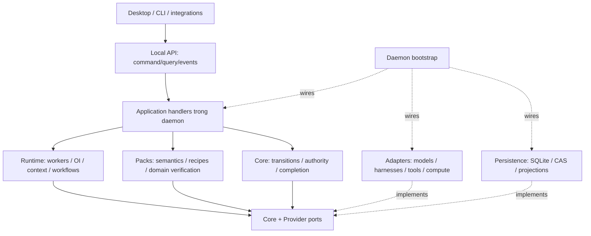

# Custos SADE — kế hoạch refactor lõi và desktop theo chủ đề

**Ngày khảo sát:** 18-10-2026. **Trạng thái:** đề xuất triển khai dựa trên source; chưa phải xác nhận các thay đổi dưới đây đã được code. **Phạm vi:** desktop/headless, ba workbench, native harness, research và compute; chưa làm mobile.

Snapshot khảo sát: branch `rft_ui`, HEAD `ac8a6a716ab786af73312d2c45391ee58f989bd3` **cộng working changes đang có**. HEAD không tái hiện đầy đủ checkout bẩn này. Trước mỗi packet phải ghi lại diff/file hashes liên quan; không reset hoặc ghi đè công việc đang dở.

Tài liệu này cập nhật thứ tự thực hiện của [workspace plan](workspace-restructuring-plan.md), không mở kiến trúc song song. [Custos.md](../../Custos.md) giữ sản phẩm/invariants; [catalog](codebase-architecture.md) giữ vị trí vật lý; topic specs giữ hợp đồng hành vi. Đây là khảo sát các đường chạy trọng yếu, không tuyên bố đọc từng file hay audit bảo mật toàn bộ upstream.

## 1. Kết luận: cần refactor lớn, không cần viết lại tất cả

Custos nên là **một môi trường làm việc có giám sát**, không phải ba chatbot, một UI bọc coding agent, hoặc một universal proxy. Người dùng có thể hỏi nhanh, giao việc dài, dùng model hoặc harness, làm nghiên cứu có code và tiếp tục công việc qua các bề mặt khác nhau. Lợi thế cần chứng minh là kết quả đạt tiêu chí với tổng chi phí hợp lý, nguồn rõ, trạng thái thật và quyền kiểm soát rõ.

Giữ kernel, authority, persistence, ports, canvas và các tích hợp đã hoạt động. Refactor mạnh ở **application seams, lifecycle, state ownership, context và pack execution**. Tên folder không tạo ra orchestration, index không tạo ra hiểu code, và hiển thị panel không chứng minh tính năng upstream đã được hấp thụ.

Không chọn trước “nhiều agent nhất”, “mọi thứ qua MCP”, “tách mỗi subsystem một crate”, hay “rẻ nhất mọi tình huống”. Mục tiêu tối ưu là **cost per accepted outcome** dưới ràng buộc chất lượng, quyền, thời gian và pin của user; cần baseline để chứng minh.

## 2. Những vấn đề hiện tại có bằng chứng

| Hiện trạng source | Hệ quả / mức chắc chắn | Hành động |
|---|---|---|
| [api.rs](../../crates/custos-daemon/src/api.rs) khoảng 10.476 dòng, chứa binary discovery, Git helpers, capability catalog và dispatch nhiều domain | Nhiều trách nhiệm chung một file; chưa suy ra mọi endpoint sai | Tách transport, application handlers và concrete adapter I/O; giữ compatibility của method hiện có |
| [AppContext](../../ui/desktop/src/context/AppContext.tsx) khoảng 2.853 dòng; [ScreenContext](../../ui/desktop/src/context/ScreenContext.tsx) 518 dòng | Selection, backend projection và presentation liên kết chặt; vượt quy tắc kích thước component hiện tại ở một số file | Tách store theo ownership, giữ facade tương thích khi di chuyển |
| [runtime Cargo](../../crates/custos-runtime/Cargo.toml) có production dependency persistence; [notebook coordinator](../../crates/custos-runtime/src/notebook/coordinator.rs) nhận `ResearchRepository` concrete | Ranh giới runtime→port chưa hoàn chỉnh | Đặt notebook/research storage port tối thiểu trong core; inject tại daemon; persistence chỉ còn dev-dependency khi dùng test fixtures |
| [bridge Cargo](../../crates/custos-bridge/Cargo.toml) phụ thuộc runtime, persistence **chỉ dev-dependency** | Không được báo nhầm bridge đang ghi DB production chỉ từ cargo metadata | Giảm coupling concrete SessionManager bằng session contract khi sửa bridge; giữ ý nghĩa bridge là session↔Task, không biến thành gateway vạn năng |
| [candidate_builder](../../crates/custos-runtime/src/oi/candidate_builder.rs) bỏ qua snapshot và tạo ba executor cố định; [estimator](../../crates/custos-runtime/src/oi/estimator.rs) gán hằng số; [selector](../../crates/custos-runtime/src/oi/selector.rs) lấy candidate admissible đầu | Đây là scaffold selection, chưa là tối ưu cost/quality có calibration | Lấy candidates từ catalog thực; unknown estimates phải rõ; baseline pinned trước; không công bố số tiết kiệm từ các hằng số |
| [dispatcher](../../crates/custos-runtime/src/workflow/dispatcher.rs) có memory maps **và** `RunPort`; [migration 0027](../../crates/custos-persistence/migrations/0027_dispatch_claims_and_fencing.sql) có unique active claim | Đã có durable claim và DB fencing; nói “chỉ HashMap” là sai | Giữ nền này; sửa restore/read-through và transition có persistence errors |
| `release_claim`/`mark_dispatched` bỏ qua `update_claim` error; `get_claim` đọc memory map; lock acquisition ở claim và release có thứ tự khác nhau | Nguy cơ DB/memory bất nhất, không điều khiển lại được claim sau restart; lock inversion cần test concurrent để xác nhận phạm vi | DB là authority, transition có expected status/generation; cache sau commit; không giữ nhiều async locks qua storage await |
| [RepoCoordinator](../../crates/custos-runtime/src/context/repo_intelligence/coordinator.rs) gọi Git/read filesystem; `find_symbol` tạo span với offsets cố định và literal `"digest"` | Phân tách I/O chưa sạch, locator hiện không đủ tin cho evidence | Đưa scan/Git/read sang adapter; span lấy từ bytes/parser thật, thiếu coverage trả unknown |
| [citation verifier](../../crates/custos-packs/src/research/verifiers/citation_coverage_oracle.rs) đếm metadata flags/citation, mặc định threshold 0,80 | Coverage heuristic, không tự chứng minh passage support; provenance của metadata cần kiểm ở caller | Completion dùng assessment records tin cậy gắn source revision; không cho arbitrary metadata tự tạo pass |
| Notebook coordinator đã có persistent Python process, queue và epoch, nhưng domain [notebook.rs](../../crates/custos-domain/src/notebook.rs) neo cell/kernel vào `session_id` | Không còn là subprocess độc lập mỗi cell; tuy nhiên một chat nhiều notebook cần identity riêng | Tách notebook/kernel/execution identity, chuyển schema có compatibility; custom worker không tự thành Jupyter |
| [AppTopBar](../../ui/desktop/src/components/shell/AppTopBar.tsx) gọi `setScreenWorkbench` khi bấm icon workbench | Hiện đổi nhãn Screen, khác hành vi chọn Screen cuối của lens | Phân biệt focus lens, đổi home của Screen, mở cùng session ở lens khác |
| ScreenContext đọc localStorage trong initializer, persist theo `storageKey` đổi theo project; [shell](../../ui/desktop/src/components/shell/AppWorkspaceShell.tsx) chỉ restore session khi ID truthy | Có nguy cơ ghi layout project trước sang key mới hoặc kế thừa session cũ; cần test remount/scope thực tế | Hydration theo stable project ID + guard generation; restore nullable selection nhất quán |
| [runtime lib](../../crates/custos-runtime/src/lib.rs) mount `agent`, không mount cây `engine/` | File tồn tại không có nghĩa compiled/active | Inventory reference/build-feature trước retire engine; không nối cả hai loop chỉ vì đều từ Goose |

Số dòng là snapshot, không là metric chất lượng tuyệt đối. Các nhận định risk không thay thế test reproduce. `cargo metadata --no-deps --offline` xác nhận 12 product packages hiện tại: 10 crate chức năng và hai app packages trong `custos-app/`; còn testkit/test packages/xtask. Quy tắc “11 canonical crates” cần đếm theo loại và đồng bộ tài liệu, **không** thêm/xóa crate cho vừa số.

## 3. Mô hình sản phẩm: ba trục, không một cây bắt mọi thứ

```text
Tổ chức tài nguyên             Công việc bền vững          Bố cục cá nhân
Project                       Conversation ↔ Task         Project → Screens
 ├─ Git repository             Task → Runs                 Screen → pane tree
 │   └─ worktree               Run → WorkerRuns            Pane → resource reference
 ├─ folder / corpus            Worker → attempts           homeWorkbench là grouping
 ├─ dataset / notebook         Attempt → effects/evidence  không là permission boundary
 └─ connector resources        Outcome theo criteria
```

Các cạnh giữa ba cột là **references**, không ownership ngầm. Project là phạm vi tổ chức; workspace biểu diễn resource root hiện có (Git/folder/remote), không đồng nghĩa workbench. Worktree chỉ là checkout của Git repository. Task có thể dùng nhiều resource roots, không gắn cứng với một Screen. Copilot có thể không có file root; Research có folder/corpus nhưng không có Git. Không tạo worktree giả để thỏa schema.

Screen thuộc Project presentation scope, có `homeWorkbench` và optional anchors tới worktree/Task/experiment; mở nhiều Screen cùng lens hoặc pane chéo lens được. Không thêm “work area” như domain entity mới: nếu cần chỉ là subtree của canvas có scope annotation. Screen chứa `tab_instance_id`; backing content có `resource_id`; execution có ID riêng. Hai pane mở một notebook không tạo hai kernel vì cùng tài nguyên; hai notebook trong một chat không chia namespace ngoài ý muốn.

Conversation canonical có journal và binding nhiều–nhiều tới Task/lens. Native harness session là identity bên adapter, không thay canonical conversation. Đổi lens không copy transcript, mở Task không tự chạy, đóng pane không dừng run. Nếu provider hidden state không chuyển được, continuation phải nói rõ giới hạn thay vì giả đã chuyển toàn bộ tri thức.

**Rule cần hiệu đính trước implementation:** quy định root desktop hiện buộc mọi thứ neo physical worktree chỉ áp dụng tài nguyên Coding cần checkout, không cho toàn bộ Research/Copilot. Sửa rule và fixtures cùng packet identity; không âm thầm làm code ngược rule.

## 4. Backend đích và dependency direction



Sơ đồ là trách nhiệm; import graph cụ thể phải không có cycle. Runtime không import packs concrete; packs có thể dùng runtime skill interfaces hiện có trong giai đoạn chuyển đổi, nhưng runtime nhận manifests/verifiers/recipes qua registration. Nếu coupling gây cycle, chuyển **hợp đồng tối thiểu đang dùng** xuống core/provider, không dựng thêm framework tổng quát.

| Crate hiện có | Giữ / chuẩn hóa bên trong | Cấm trở thành |
|---|---|---|
| `custos-domain` | IDs/value types, state vocabulary, resource refs, source/effect/evidence/experiment records, validation thuần | filesystem/process/DB/model client |
| `custos-core` | `kernel/`, `authority/`, `evidence/`, `capability/`, `contracts/`; pure OI admissibility/compiler checks | online planner, concrete connector, provider HTTP |
| `custos-provider` | Canonical `ModelPort`, turn/request/event/usage/tool fidelity; explicit compatibility adapters | native process owner, credential vault, Task success authority |
| `custos-runtime` | `agent/`, `workflow/`, `oi/`, `cognitive/`, `context/`, `session/`, `workspace/`, `notebook/`, memory; new experiment coordination only when first job needs it | SQLite repository consumer, second evidence authority |
| `custos-adapters` | `providers/`, `harness/`, `mcp/`, `a2a/` và actual tool/host edges; add thematic `compute/`/`training/` as implemented | application workflow hoặc canonical DB writer |
| `custos-packs` | `engineering/`, `research/`, `assistant/`; mỗi pack chứa jobs, skills, recipes, verifiers, fixtures | riêng một agent runtime/DB cho mỗi workbench |
| `custos-persistence` | migrations, repositories implementing ports, CAS/derived indexes/recovery | routing hay semantic judgment |
| `custos-bridge` | session↔Task bindings, promote/attach/steer/continuation qua contracts | HTTP listener hoặc mọi API DTO |
| `custos-daemon` | `bootstrap/`, `api/`, `application/`, supervisor/recovery; duy nhất compose concrete deps | hàng nghìn dòng pack semantics hoặc Git subprocess helpers trong API |
| `custos-sdk` | Local API client, event cursor, transport negotiation; share/generate DTOs từ definition hiện có | client-side kernel hoặc DB access |
| `custos-app/{cli,desktop}` | platform shell, lifecycle/IPC, deep links/window integration, gọi shared application service | composition root độc lập, app-specific scheduler |

Không tạo `custos-sade`, `custos-research-engine`, `custos-training`, `custos-mcp-hub`, `custos-screen-core` ngay. Tách crate chỉ khi cần dependency/toolchain/isolation/independent release thật; module đủ cho phần lớn đợt này. Crate không tạo security isolation.

### Cây module cần chuyển, không sinh folder rỗng

```text
custos-daemon/src/
  api/{mod,dispatch,capabilities,transport}.rs
  application/{sessions,tasks,workspace,research,assistant,connections}.rs
  bootstrap/                         # registration và wiring
custos-runtime/src/
  agent/                             # một Custos-owned loop
  workflow/                          # scheduling/claim/lease/join/recovery
  oi/                                # candidates/estimation/selection/replan
  cognitive/                         # typed S1 services, bounded worker support
  context/{compiler,retrieval,repo_intelligence,...}
  notebook/                          # coordination qua execution/storage ports
  experiment/                        # khi ship experiment lifecycle đầu tiên
custos-adapters/src/
  providers/                         # giữ vendor implementations hiện có
  harness/                           # Codex/Claude/... native processes
  tools/{filesystem,git,shell,web,...} # concrete scan/query/execute I/O
  compute/{local,colab,kaggle}        # chỉ backend đã implement
  training/unsloth                    # integration engine, không GPU allocator
custos-packs/src/
  engineering/{jobs,skills,recipes,verifiers,...}
  research/{jobs,skills,recipes,verifiers,...}
  assistant/{jobs,skills,recipes,verifiers,...}
```

Tên file là target location; ưu tiên giữ tên hiện có nếu trách nhiệm đúng. Skills không gom vào `tools/` gốc: domain semantics ở pack, reusable scheduling/context ở runtime, concrete I/O ở adapters, schemas ở domain/core. MCP chỉ expose capability đã đăng ký; không sinh bản thứ hai của skill.

## 5. Chuẩn hóa vòng thực thi trước khi làm OI mạnh hơn

Một luồng chuẩn: `command → validate contract/revision → reserve/claim → prepare context → executor attempt → observe effects/output → verify criteria → outcome → projection/events`.

1. Mỗi request có command ID, actor, expected revision, scope và deadline. Retry command không tạo run mới ngoài ý muốn.
2. Claim transaction kiểm readiness/version, unique active slot và fencing generation; DB commit trước launch. Memory chỉ cache. Store error làm command fail/reconcile, không success giả.
3. Attempt giữ actual executor/account/host/workspace/kernel/job identity, args/context digests và launch state. Chết sau launch mà chưa receipt là uncertain; reconcile trước retry/fallback.
4. Chỉ retry transport khi adapter chứng minh chưa effect hoặc có idempotency. Cancel requested khác observed stopped; còn process/GPU thì vẫn phải hiện.
5. Evidence lưu theo criterion + source/config revision + verifier identity/method. Worker complete không đổi Task thành pass tự động.
6. Startup recovery tải active claims/attempts/outbox/resources; hỏi trạng thái bên ngoài, làm stale phần mất state, không chỉ xóa in-memory maps rồi cho launch lại.
7. Durable state transition và event/projection cùng SQLite transaction khi thuộc một DB. Process/network/CAS không được mô tả atomic với DB.

**Thay đổi contract ưu tiên:** mở rộng ports hiện có cho atomic claim transition/read/recover và notebook storage. Không thêm một universal execution interface khổng lồ. Notebook, training job và native harness có lifecycle khác; share IDs/budget/effect/evidence, không ép chúng có cùng thao tác.

## 6. Model, harness, capability, compute: bốn loại executor

| Loại | Đường dùng trong Custos | Điều không được giả định |
|---|---|---|
| Inference endpoint | `ModelPort` → Custos worker loop → admitted tools | Model coder local tự có file access, session hay agent loop |
| Native agent harness | `AgentRuntimePort` hiện ở core contracts → harness adapter | Mọi native tool qua Custos; resume/steer/cost visibility đồng nhất |
| Capability/tool | typed invocation → authority/gateway → adapter receipt | MCP annotation là grant hoặc tool name đủ mô tả risk |
| Compute/kernel/job | resource allocation + operation-specific attempts → observation/import | Kernel = chat; GPU = training engine; logs = interactive control |

`ModelPort` là convergence target; `ModelProvider`/Goose `Provider` compatibility còn dùng phải được đánh dấu và chuyển từng caller. [GovernedAgentRuntime](../../crates/custos-runtime/src/agent/runtime_port.rs) vẫn dùng `ModelProvider` và comment trỏ sai vị trí trait: sửa cùng packet convergence, không duplicate `AgentRuntimePort` vào provider để làm tên trông đối xứng.

Harness profile là khả năng tuyên bố, cần conformance theo version/path. `custos-mediated` chỉ cho thao tác thật được chặn trước effect; còn native path là provider-governed/observe-only/unknown phù hợp. Runtime fail-closed nếu operation không có; không dựng fake success để thỏa UI.

## 7. OI, S1, S2 và Meta: thông minh nhưng không tranh quyền

**OI sở hữu quyết định phân bổ công việc**, không sở hữu grant, source truth, evidence pass hay UI layout. Pipeline target:

`snapshot → discover available executors → hard filter → bounded candidate plans → estimate ranges → select/explain → compile/admit → schedule → observe → bounded replan`.

- Candidate dựa capability registry, provider pin, tool mediation, host/resource availability và pack job; không hardcode tên model như hiện tại.
- Estimator tính cả context transfer, cache, child workers, verifier, retry và human time. Missing usage là unknown, không zero. Cold/warm và predicted/observed tách riêng.
- Khi thiếu calibration, dùng pinned direct/native baseline; graph phức tạp phải có lý do và cap. Human thay pin là revision; OI không tự downgrade để “tiết kiệm”.
- Replan chỉ future nodes, bảo toàn effects/artifacts/criteria đã có. Loss of stream không là worker failure chắc chắn. Scope/budget không tự nới.

| Topology theo nhu cầu | Dùng khi | Không dùng khi |
|---|---|---|
| Direct / one worker | Chat, coding task nhỏ, một source question | Không cần thêm planner chỉ để xác nhận lựa chọn mặc định |
| Staged pipeline | Extract→review→synthesize, patch→verify | Các bước chưa có typed input/output và failure path |
| Read fan-out | Corpus/repo branches độc lập có join | Các worker lặp cùng tìm kiếm hoặc cần toàn bộ shared hidden state |
| Worktree candidates + integration | Các patch độc lập hoặc cạnh tranh có base và oracle chung | Cùng ghi một dependency graph mà không barrier |
| Bounded repair | Verifier chỉ ra lỗi có thể sửa trong budget | Retry không có thông tin mới, test bị worker làm yếu |
| Experiment sweep | Config variants, resource quota, held-out evaluation rõ | Không kiểm chi phí GPU, dataset split hay artifact collection |

Đây là recipes cho topology hiện hữu/mở rộng, không yêu cầu public enum mới cho mỗi hàng. Giữ `core/oi` cho invariant/admission checks; `runtime/oi` cho online selection; không merge hai folder vì trùng tên.

**S1 không chỉ router:** có thể làm repo scout, relevance ranking, ambiguity detection, structured extraction, test selection proposals, log/error triage, dataset schema profiling và context compression có source refs. Với công việc model nhiều bước, biểu diễn bằng bounded WorkerRun, không giấu như “một scorer miễn phí”. Luôn có abstain/uncertainty, step/time/token budget và escalation lên S2. S1 summary không thay source; S2 vẫn được mở raw context khi cần.

**S2** giữ reasoning/plan/implementation/synthesis mạnh. S1 không sửa câu hỏi trước khi S2 thấy constraints, không cắt counterevidence, không tự bỏ criterion. **Meta** đọc redacted traces offline, so policy variants, đề xuất policy version; không tự train/apply policy lên run đang chạy. Đánh giá quality–cost theo pack, không gọi OI tối ưu chỉ vì chọn giá niêm yết thấp hơn.

## 8. Engineering: từ đọc repo đến thay đổi đáng tin

Repo Intelligence gồm source inventory/snapshot, lexical query, optional AST/LSP/dependency/test map, scoped context và coverage. Domain records giữ spans/hashes; core kiểm scope; adapters scan/Git/read; runtime quản query/context; engineering pack cung cấp recipes và acceptance. Không cần graph DB mới trước khi lexical/symbol baseline được đo.

Mỗi query trả snapshot, real locator/content digest, coverage/omissions/freshness; parser không hỗ trợ thì fallback lexical và nói rõ. Snapshot không hash lại toàn repo mỗi turn nếu có incremental cache hợp lệ; filesystem I/O blocking không chạy vô hạn trên async request hot path. Watcher là invalidation signal, không là proof bytes không đổi.

Luồng patch: diagnose/reproduce → bounded proposal → owned write scope → apply đúng base → trusted behavior verification → outcome/diff. Worktree lifecycle do workspace/lease service duy nhất quản; harness khai báo tự tạo worktree hay dùng của Custos. Không cho scheduler và harness cùng tạo/xóa checkout ngoài ý muốn. Merge/rebase/conflict resolution/push là effects riêng; không xóa untracked files khi cleanup.

UI Coding có file/symbol/source, editor/diff, terminal, agent session, tests và candidates khi có dữ liệu. Browser/devserver/emulator cần actual host/capability; không copy nguyên OrCa simulator surface trước khi có runtime tương ứng.

## 9. Research: không chỉ tìm paper, cũng không chỉ notebook

Research cần ba vòng gắn với nhau:

1. **Knowledge:** acquire/version/parse → passages → atomic claims → support/contradiction/unknown → sourced synthesis.
2. **Experiment:** question/hypothesis → versioned dataset/code/recipe/environment → execution → metrics/artifacts → held-out evaluation.
3. **Communication:** table/figure/report/note → annotation/revision → export có provenance → selected Engineering brief.

Mở rộng trong `packs/research` và runtime/persistence hiện có, không chạy Open Science như kernel authority thứ hai. Giữ source, artifact và execution IDs qua rename/export; notebook output mutable không là toàn bộ scientific record. Các confidence axes tách locator, extraction, semantic support, replication, methodological review và freshness; sealed/hash không chứng minh khoa học.

Notebook identity cần khác conversation identity. Cần notebook ID, kernel ID/epoch, cell version, execution request ID và producing attempt; migration preserve `session_id` cũ, không tự suy ra hai notebook dùng cùng kernel. Current custom persistent Python backend giữ làm backend nhỏ; Jupyter integration là backend khác khi cần MIME outputs, comms/widgets hoặc remote kernels, không rename worker thành Jupyter.

### Training/finetune studio

Reuse current experiment/execution/environment records trước khi thêm contract; trước first implementation chốt thiếu fields bằng fixtures. Các nhóm responsibilities:

| Chủ đề | Nơi đặt | Nội dung |
|---|---|---|
| Training recipe và quality criteria | research pack | model/tokenizer revision, dataset/splits, method/parameters, eval criteria |
| Job/resource lifecycle | runtime qua ports | validate/prepare/submit/observe/reconcile/collect; stop khác release |
| Training engine integration | adapters/training | Unsloth Studio supported API/MCP hoặc supervised recipe process |
| Compute platform | adapters/compute | local, Colab assignment/kernel/files, Kaggle versioned batch/log/output |
| Durable provenance | domain + persistence | input/env/accelerator, external IDs, checkpoints, metrics và completeness |
| Research UI | research feature panes | configuration preview, live observations, compare, artifact/checkpoint/eval |

Training engine và compute platform độc lập: clone Unsloth + Colab không làm Studio tự chạy trên hosted GPU. Phải giải quyết auth, process/port/dependencies/resource ownership trước. Agent tạo recipe và đọc evidence, không tự tuyên bố model tốt hơn vì loss giảm.

Colab có interactive kernel path trong CLI đã khảo sát; verify assignment/release và timeout. Kaggle checkout có **live logs** và versioned outputs; không vì vậy expose execute-cell/inspect-tensor/interrupt/resume nếu chưa có supported operation. Stream drop không là job stop. Resume chỉ enable khi checkpoint có state phù hợp engine, không chỉ vì tồn tại adapter weights. GPU cost và local estimates không hiển thị như billed usage.

## 10. Copilot / Assistant: nền tảng thao tác an toàn

Copilot là conversational working mode có thể không repo: scoped notes, files, account/connector resources, drafts, calendar, automations. Tasks giữ durable obligations; chat giữ tương tác; UI không ép user tạo project Git hoặc form cho câu hỏi ngắn.

Assistant pack sở hữu identity/time/draft/automation semantics. Connectors là adapters; credentials do secret backend; exact effect/permission/outbox thuộc trusted core/persistence. Draft, requested send, observed sent và uncertain tách trạng thái. Standing grant có scope/expiry/max runs/revoke; automation đóng cửa sổ vẫn chạy nếu user đã cấp quyền, không tự chạy vì layout restore.

Cross-pack chuyển selected artifact refs + caveats/redaction; không chuyển raw personal history hay grant. Một Task có nhiều pack obligations khi cùng goal; conversation có thể trao đổi nhiều Task nhưng composer phải rõ đang gửi vào việc nào.

## 11. Hấp thụ upstream: chọn behavior và source, không thêm một sản phẩm bên trong

| Upstream / phần lấy | Ánh xạ Custos | Quy tắc giữ / không bê |
|---|---|---|
| OrCa Task/Run/Dispatch/launch lifecycle | domain/core contracts, persistence claims, runtime scheduler, harness adapter | Port fencing/uncertainty/recovery scenarios; không nhập SQLite schema hay Electron controller làm authority khác |
| OrCa activation/tab identity/host-aware restore | desktop workspace feature + runtime host/workspace refs | Distinguish tab instance/entity/host, coordinated focus/restore; không mang global store nguyên cây |
| OrCa agent continuation/mailbox/terminal | runtime session/worker events, adapters harness/terminal | Native identity và epoch fencing, input delivery receipt; không coi UI send thành observed execution |
| Open Science pane tree, scoped interaction, draft preservation | existing canvas/resource registry, pane-scoped commands/dialogs | Adopt interactions và tests; không thêm layout engine thứ hai |
| Open Science artifact/analysis/kernel workflows | research pack + notebook/runtime + persistence lineage | Preserve notebook/resource versions and annotations; không copy file logs thành source of truth cạnh SQLite |
| Goose conversation/inference/tool stream | compiled `runtime/agent`, provider compatibility + adapters | Một loop được wire; prove rich tool/reasoning/usage/cancel fidelity rồi retire legacy tree |
| Unsloth validation/job/checkpoint/export | training adapter + experiment coordination/research UI | Tách engine/export/job; per-file license review, Studio có AGPL-3.0-only headers |
| Colab CLI / Kaggle CLI | compute adapters | Pin versions, structured wrappers và conformance; không parse marketing thành capability |

Mỗi extraction packet ghi upstream SHA/path/license, behavior cần giữ, target path, contract changes, tests và đoạn không port. OrCa local không còn `.git`: SHA lịch sử trong source study không chứng nhận bytes hiện tại; tạo content manifest của các file thực sự lấy. Open Science kiểm HEAD `04b64817c12e7fdbe0e052bfa1aeaf8802feecde`. Ba compute repos được pin trong [source study](../../../TRAINING_COMPUTE_SOURCE_STUDY.md).

## 12. Protocols là các biên kết nối, không là tầng quyết định sản phẩm

| Biên | Trách nhiệm | Placement |
|---|---|---|
| Local API qua IPC/authenticated HTTP | commands, queries, event cursor, version/errors | daemon API + SDK; desktop thin host |
| MCP | discover/invoke tools/resources với policy của Custos ở trước effect | adapters MCP + capability registration |
| ACP | editor↔agent integration khi client/harness hỗ trợ | adapter theo direction, reuse application contracts |
| A2A | remote agent identity/task/artifact exchange | optional adapter, không cho internal child workers |
| Vendor/native transport | Model inference hoặc harness-specific protocol | provider/harness adapter với fidelity profile |
| Notebook/compute protocol | kernel messages/job/status/files | compute/tool adapters, không qua ModelPort |

CAP nếu dùng phải expand tên và pin spec URI/use case; không có một slot CAP mặc định chỉ vì cùng danh sách MCP/ACP. 9Router/provider proxy và agentgateway/federation là optional transport profiles, không thay OI/authority. Capability registry là nguồn quản operation support/availability; không cần một hub service cho mỗi acronym.

## 13. Desktop đích: một shell, ba lens, không ba ứng dụng

Giữ typography-first Graphite/JetBlack hiện có, icon navigation có tooltip/keyboard/accessible label; phân biệt lens bằng resource/action defaults và context title, không ba bảng màu neon. UI/UX skill được dùng để ưu tiên rõ active state, deep-link đúng tài nguyên và preservation; không dùng để tạo thêm dashboard trang trí.

| Store / feature | Ownership |
|---|---|
| API entity/event cache | canonical server projections keyed stable IDs + revisions/cursors |
| Screen/layout store | project-scoped screen/pane/tab instances, focus, sizes, home lens |
| Conversation drafts | session + draft identity; giữ khi pane unmount/switch |
| Resource handles | references tới editor/terminal/kernel/etc; runtime owner ở backend |
| Connections/settings | persisted preferences, validation, actual availability, secret refs không plaintext |

Target tổ chức TS: `app/` shell/composition; `features/workspace/`, `features/conversations/`, `features/tasks/`, `features/engineering/`, `features/research/`, `features/assistant/`, `features/connections/`; `shared/api/` và `shared/ui/`. Reuse folders/components đã có, chuyển từng feature qua facade; không tạo bản sao component cùng logic.

Một command activation restore coherent screen selection, nullable session/task/resource anchors và layout; hydration guard không persist trước load xong đúng project. Resource open/focus khác backend start. Screen đóng giữ background run reachable trong Activity/Tasks; terminal/kernel lifetime theo lease/explicit controls, không React mount.

Lens icon chọn Screen cuối của lens (hoặc empty default một lần). `Change Screen home`, `Open same conversation in…`, `Linked continuation`, `Add Task step` là actions khác. Global switcher mở mọi Screen; pane hỗ trợ typed resources chéo lens. Inactive panes không bắt shortcut/submit vào session đang active ở pane khác. Zoom chỉ presentation, không phá tree.

Settings phải dùng cùng operation registry, actual errors, persisted validation và reconnect; không hardcode “connected” sau save. Không bật knob cho routing/cache/GPU mà backend chưa thực thi; show unavailable reason. Tab retry không được submit duplicate training/send action.

## 14. Implementation campaign — thứ tự cụ thể và exit gates

| Packet | Việc code / di chuyển | Gate bắt buộc |
|---|---|---|
| R0 — Baseline + map | Capture dirty manifest, actual call paths, public API/schema fixtures; tag mounted/legacy/prototype/unverified | Current tests/build baseline có lỗi ghi rõ; không reset; mọi moved capability có old→new map |
| R1 — Dispatch correctness | DB-backed transition/read/recovery, propagate errors, uniform locking, launch/claim fencing | DB failure injection, two dispatchers, restart claim lookup, cancel/launch race, uncertain launch không retry mù |
| R2 — Thin application seams | Tách api helpers→adapters, commands→daemon application, transport→api; notebook storage port; runtime persistence production dep→dev khi sạch | API compatibility fixtures, cargo dependency check; không đổi semantics cùng mechanical move |
| R3 — Screen/resource identity | Stable project scope, hydrate guard, activation reducer, nullable selection, lens focus, separate draft/entity/layout | Project A→B không ghi nhầm; 2 notebooks/1 chat; 1 session/2 panes; no hidden shortcut; switch không start worker |
| R4 — One worker contract | Converge ModelPort callers; explicit native harness lifecycle/assurance; single journal/context receipt | Real model + one native harness, stream/tool/cancel/usage/continuation; no duplicate launch; no secrets in prompt |
| R5 — Coding completion | Real repo locators, adapter scan/Git, worktree ownership/lease, patch/verify/reconcile | Stale base, symlink/path scope, dirty preservation, agent-modified tests không tự pass |
| R6 — Research completion | Source/claim assessment records, artifacts/annotations, notebook identity/epoch and ports | Citation metadata forged→không pass; stale passage; notebook state isolation; failed run partial artifacts |
| R7 — Copilot controlled effects | Stable identities, exact payload, durable outbox/reconcile, bounded automation | Ambiguous recipient, 1-byte edit invalidates approval, timeout-after-send không duplicate, revoke future runs |
| R8 — First training slice | One validated recipe, **one compute target**, job identity/provenance/metrics/checkpoint/eval | Close/reopen Screen không mất job; submit timeout reconcile; invalid checkpoint blocked; held-out eval separate |
| R9 — More compute backends | Colab session/files/release reconciliation; Kaggle version/log/output; Studio integration per capability | Version fencing, stream replay, leaked resource detection, partial download/path traversal, auth expiry |
| R10 — Measured OI/S1 | Catalog candidates, estimated ranges, pin-first baseline, scoped S1 workers, bounded topologies | Paired same-model/harness fixtures, acceptance/cost/human-time, fallback/unknown handling, no scope expansion |
| R11 — Retire compatibility | Remove unused engine/types/aliases only after callers/tests migrate; doc/entrypoint cleanup | Default + used features/OS build matrix; no orphan imports/docs; migration decode existing data |

R1 và R2 có thể chuẩn bị độc lập nhưng không cho hai người cùng viết dispatcher/API monolith. R5/R6/R7 có thể chia ownership theo file sau khi contracts/seams ổn định; chưa cho graph song song viết cùng file. R8 không phải chờ OI thông minh: một supervised recipe có giá trị thật trước. Mỗi packet có diff giới hạn và rollback migration/compatibility; user có thể nhận một campaign lớn nhưng các checkpoint phải review/recover được.

### Sáu thay đổi đầu tiên nên thực hiện

1. Thêm dispatcher storage-error/restart/concurrency regression tests, rồi sửa transition/recovery, không sửa UI trong cùng patch.
2. Tách Git discovery/worktree helper khỏi api.rs bằng adapter seam, giữ API payload; chốt dependency test.
3. Định nghĩa notebook storage contract từ đúng calls đang dùng, implement ResearchRepository port và inject; không đổi kernel process cùng lúc.
4. Viết Screen activation/hydration tests rồi sửa state ownership/lens switch; giữ canvas renderer hiện có.
5. Converge GovernedAgentRuntime vào ModelPort và bounded execution receipts; profile không vượt khả năng thực.
6. Sửa repo span/digest và research metadata verification đường completion; public UI hiện unknown thay pass khi chưa đủ proof.

Đây là điểm bắt đầu cụ thể, không phải yêu cầu rewrite cả cây thư mục trong một commit.

## 15. Test, performance và definition of done

**Baseline đã chạy trong khảo sát:** `cargo test -p custos-runtime --lib workflow::dispatcher --offline`: **3 passed**, 168 filtered. Đây chỉ là tests dispatcher hiện có; không chứng minh restart/two-process/error recovery, toàn workspace hoặc live providers đã pass. `cargo metadata --no-deps --format-version 1 --offline` thành công. Chưa thay production code trong packet tài liệu này.

Khi sửa Rust: unit tests của module, contract tests ports/DTOs, targeted daemon API tests bằng `cargo test -p custos-daemon --lib <filter>`, rồi broaden tới affected crates/workspace. Kiểm cả normal/development dependencies, không đánh đồng fixture persistence với production edge. Dùng cache/offline nếu đủ; thiếu dependency/toolchain phải report, không tự nâng/cài rộng.

Khi sửa desktop: bắt buộc `npm --prefix ui/desktop run build` và `node tools/canvas-smoke.mjs` từ root Custos, thêm behavior tests cho real activation/event lifecycle. Static control coverage không đủ thay runtime proof. Fake connectors/models chỉ ở explicit tests; production trả unsupported/unavailable chứ không mock success.

Các gates xuyên suốt: duplicate command/event replay; DB crash/IO errors; stale source/permit; process restart; last-event cursor gap; account switch; native hidden effects; path traversal/symlink; privacy egress; log/artifact size limits; multiple panes acting on one resource; GPU/remote resource leaked after disconnect.

Đo p50/p95 first useful output/end-to-end, context bytes/token, verified/accepted rates, unknown/failure rates, model/tool/GPU spend riêng, human time và failed attempts. Không đặt overhead target thành cam kết trước measurement. Multiagent/OI/S1 so direct pinned baseline cùng data/model/harness và quality margin đặt trước. Không tăng latency mỗi chat chỉ để vẽ thêm graph.

Một packet done khi: đường gọi thật chạy; permission/failure/recovery tested; data không fork source of truth; UI có trạng thái thật; docs master/topic/catalog đồng bộ; upstream attribution/license và known limitations rõ. “Đã tạo module”, “đã nối endpoint”, “đã build xanh” là các mốc nhỏ, không phải product completion.

## 16. Nguồn nghiên cứu và giới hạn

- [OrCa source study](orca-source-study.md), [upstream map](upstream-source-map.md), [workbench controls audit](workbench-core-and-controls-audit.md): inventory rộng và source traces trước đó; phải kiểm caller hiện tại khi implement. OrCa local source đã được đọc ở tab identity/activation; không suy ra toàn bộ functionality từ file count.
- Open Science local: [PaneTree](../../../open-science/apps/desktop/src/components/session/PaneTree.tsx) phân biệt active/laidOut/zoom và pane identity; [PaneScope](../../../open-science/apps/desktop/src/components/session/PaneScope.tsx) định scope tương tác; [kernel bridge](../../../open-science/apps/desktop/src/lib/kernel.ts) giữ notebook-oriented execution. Đây là hành vi cụ thể để map, không xác nhận portable full engine.
- [Training/compute source study](../../../TRAINING_COMPUTE_SOURCE_STUDY.md): pin SHA/license, lifecycle traces và limitations cho Unsloth, Colab CLI, Kaggle CLI. Chưa xác thực account/GPU live hoặc toàn bộ 8.719 files.
- [Anthropic multi-agent research engineering](https://www.anthropic.com/engineering/multi-agent-research-system): hỗ trợ thử orchestrator–worker cho nhánh nghiên cứu độc lập, đồng thời cảnh báo chi phí và coding dependency. Bài này không chứng minh Custos rẻ hơn hoặc cần multiagent mặc định.
- [Jupyter messaging](https://jupyter-client.readthedocs.io/en/latest/messaging.html): request/reply/parent identity, execution outputs và kernel control cần semantics riêng; code execution success không thay scientific assessment.
- [MCP tools specification, pinned 2025-06-18](https://modelcontextprotocol.io/specification/2025-06-18/server/tools): annotations là hints không bảo đảm behavior; host phải kiểm quyền. Đây là nguồn nguyên tắc, không chỉ định SDK/protocol version production của Custos.

**Quyết định đề xuất cuối:** giữ một modular local runtime và một canonical data plane; làm sạch execution/recovery và resource identity; triển khai ba domain sâu bằng skills/recipes/verifiers; hấp thụ upstream theo behavior có tests; chỉ sau đó bật orchestration tối ưu dựa dữ liệu. Sức mạnh SADE đến từ một chuỗi công việc thật xuyên chat, code, research và action — không từ số lượng crate, hub hoặc agent.
