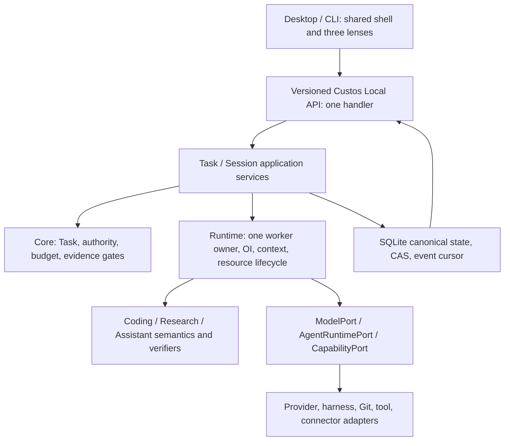
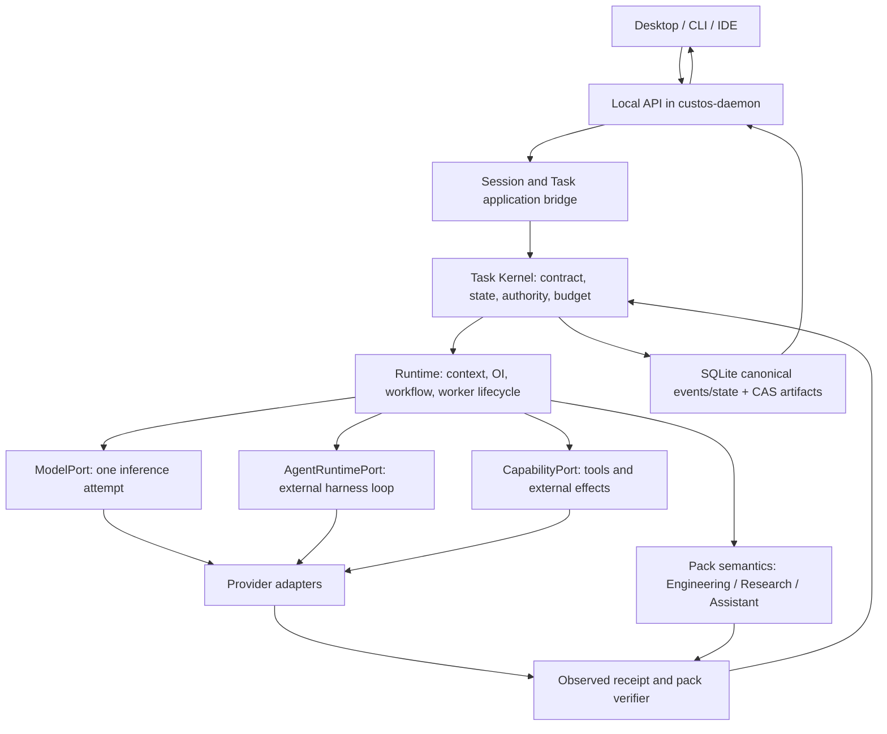
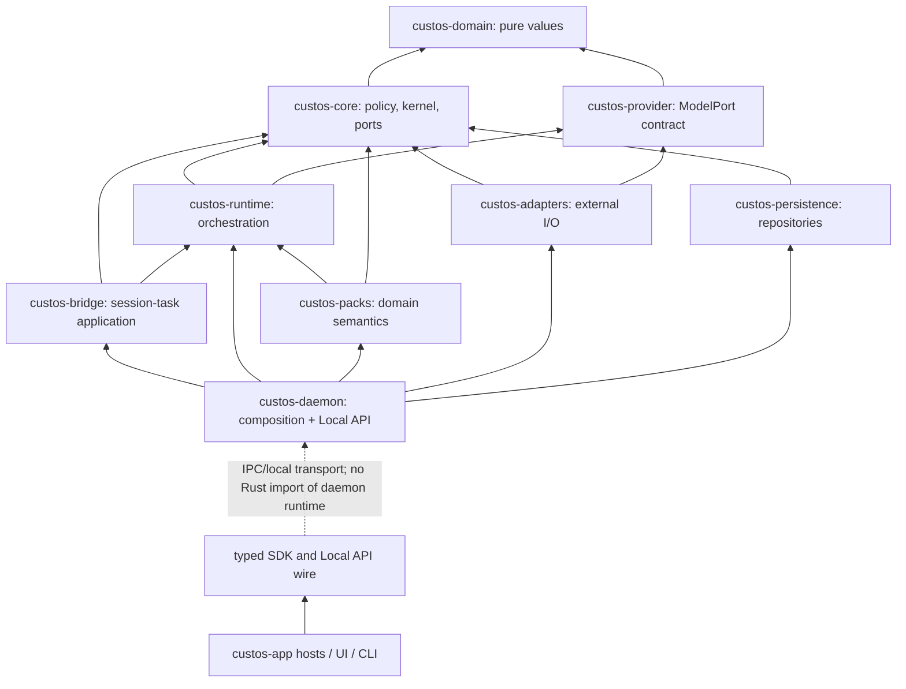
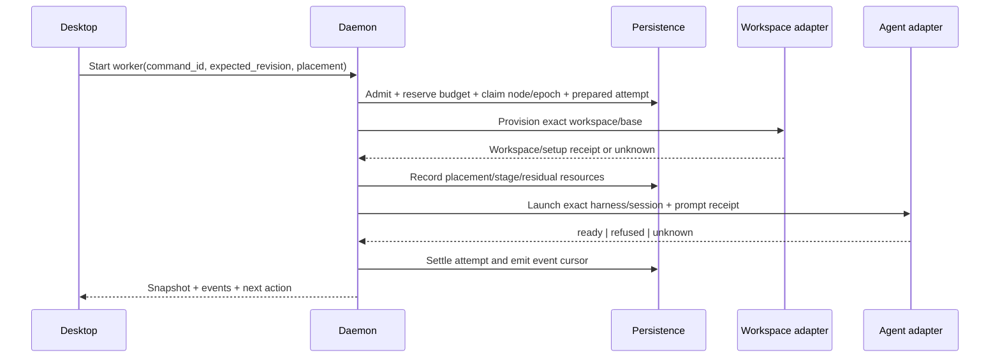
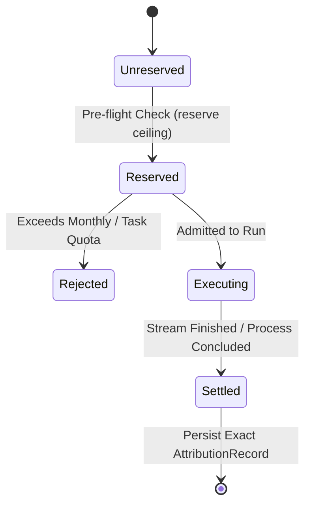
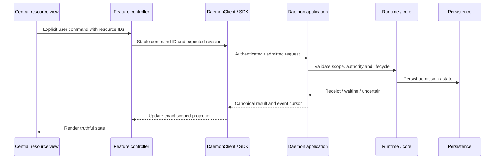
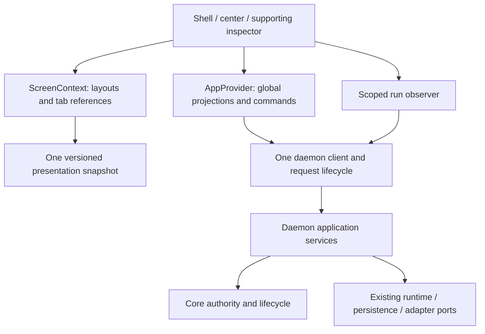

# Kế hoạch hội tụ backend và desktop Custos SADE

**Điểm vào hiện hành:** đọc [§13 — Đóng các đường refactor đang chuyển tiếp](#13-đóng-các-đường-refactor-đang-chuyển-tiếp) để thực hiện phần còn thiếu sau review; [§12 — Refactor crates và desktop theo ownership](#12-refactor-crates-và-desktop-theo-ownership) giữ phạm vi tổng thể. Đây là kế hoạch dựa trên dirty checkout `28ab973` sau khi gỡ Repo Intelligence; §1–11 giữ nghiên cứu và các đề xuất lịch sử, không là chứng nhận hiện trạng. §13 cập nhật tiến độ và ưu tiên đóng migration trong §12, không thay hợp đồng sản phẩm. Lượt này chỉ cập nhật kế hoạch, không triển khai production code.

**Trạng thái:** thứ tự triển khai hiện hành để nhóm review và giao việc; [Custos.md](../../Custos.md) giữ hợp đồng sản phẩm. Kế hoạch này chuyển các nghiên cứu [OrCa](orca-source-study.md), [Open Science Desktop](open-science-source-study.md) và [workspace restructuring](workspace-restructuring-plan.md) thành các lát cắt kiểm được. Mobile nằm ngoài campaign hiện tại.

**Ảnh chụp hiện trạng:** checkout Custos `65132de` trên nhánh `vi`, đồng bộ từ `origin/dev` ngày 09-10-2026. Các mục trong §2 đã được kiểm lại với mã hiện hành; mô tả ở phần sau vốn viết từ checkout cũ là thiết kế đích hoặc ảnh chụp lịch sử khi chúng khác §2. Open Science source study ghi `04b64817c12e7fdbe0e052bfa1aeaf8802feecde`. OrCa checkout local đã mất `.git`; source study ghi SHA lúc audit là `3f6225deeb08a82448c5f0b0725073401629d462`, không thể tái xác minh từ bản local. [Nexus matching ledger](upstream-source-map.md#cross-source-nexus-audit-orca-and-open-science) phân biệt source hiện diện với đường đã được compose/kiểm chứng. Trước khi sao chép mã literal, lấy lại upstream revision và kiểm license/dependencies.

**Audit bổ sung để duyệt:** §11 đối chiếu source tại Custos HEAD `07b3fbb` với OrCa local và tài liệu chính thức. Worktree Custos đang có nhiều thay đổi chưa commit; các kết luận về UI/workspace/daemon phải kiểm lại tại SHA chốt trước khi giao sửa code. §11 làm rõ packet F6 và Settings/Usage, không thay `Custos.md` hay tự tuyên bố thiết kế mới đã được phê duyệt. Nơi phát hiện §2 mô tả trạng thái cũ (ví dụ provider mặc định), dùng bằng chứng source hiện hành trong §11; không suy tính năng đã hoàn tất chỉ từ một file hoặc một pane.

**Đường nhanh cần chứng minh:** `người dùng gửi một câu hỏi repo → daemon chọn executor thật → ContextPack chứa source đã kiểm scope → model/native harness trả output thật → session lưu answer và attempt/usage → Desktop đọc lại được sau restart`. Đây là mốc đầu tiên để gọi Custos dùng được như một SADE. Trong cùng campaign, đóng biên Local API và các đường thực thi vật lý đang mở để demo không đi trước quyền kiểm soát.

## 1. Kết luận cần chốt trước khi chia việc

Custos nên là **một SADE với một backend owner và một Task spine**, không là LLM gateway cộng ba giao diện. Desktop có **một shell, một conversation model và ba workbench lens**: Copilot/Assistant, Coding, Research. Người dùng đổi lens để đổi cách xem và thao tác với cùng công việc; không tự tạo session, Task, grant hoặc agent mới. Khi muốn phân việc thực sự, UI tạo bước/child Task/handoff tường minh, có selected artifacts và phạm vi dữ liệu. Một user chỉ dùng Coding vẫn có trải nghiệm hoàn chỉnh.



Sơ đồ là **luồng trách nhiệm**, không phải hướng Rust import. Pure values ở `custos-domain`; `custos-core` giữ policy/invariants, không là DTO crate cho gateway. `custos-daemon` là composition root và Local API host. `custos-provider` giữ ModelPort; native coding harness dùng `AgentRuntimePort`, không bị giả làm model API. MCP, ACP và A2A là các giao thức ở biên có use case riêng, không thành lớp bắt buộc trước mọi tác vụ. Đối chiếu [protocol map](../architecture/protocol-and-connectivity-hubs.md).

## 2. Những vấn đề hiện tại phải xử lý theo thứ tự rủi ro

| Ưu tiên | Bằng chứng tại `65132de` | Việc cần làm và gate |
|---|---|---|
| **P0 — biên thực thi** | [`http_server.rs`](../../crates/custos-daemon/src/http_server.rs) nay mặc định loopback, yêu cầu opt-in cho non-loopback, giới hạn body/deadline và lọc browser Origin; origin matcher được khóa exact authority ở change set này. Nhưng TCP/HTTP vẫn không có client authentication/actor binding, request không có `Origin` vẫn vào chung handler, và bind/profile có thể đổi bằng môi trường. [`ApiRequest`](../../crates/custos-daemon/src/local_api/lib.rs) chỉ có `id/method/params`; `StartRunRequest.actor` còn do caller gửi hoặc mặc định `daemon_user`. Notebook và native harness vẫn có đường gọi subprocess từ daemon/runtime mà chưa đi trọn Task authority/sandbox admission. | Định danh client/actor từ transport đã xác thực, không từ payload tự khai; phân profile embedded/local/remote; mọi physical execution qua admission scope/workspace/budget và receipt. Cho đến khi có cổng ấy, không quảng bá notebook/native harness là `custos-mediated`. Gate: request không có quyền không thể gọi code execution hay write; cross-origin, unauthenticated local caller, non-loopback, oversized và slow request bị từ chối theo profile. |
| **P0 — UI và capability truth** | [`OrcaTabbedContainer.tsx`](../../ui/desktop/src/components/views/OrcaTabbedContainer.tsx) có catalog mặc định `available`, giữ nguyên nếu không tải được capabilities, rồi render Browser/Fleet pane trước nhánh `UnavailableResource`. Browser pane còn tạo DOM snapshot giả ở client; Fleet pane vẫn cho Ping/Exec. Daemon đánh dấu hai capability này `degraded` và effect endpoint fail closed. | Cho pane đọc `status` cùng `supported_operations`; disable action không được daemon quảng bá, giải thích lý do; khi capability fetch lỗi thì `unknown/offline`, không fallback `available`; bỏ snapshot DOM tự dựng. Gate: mở pane metadata được nhưng không có CTA effect giả. |
| **P1 — đường chat có kết quả thật** | `StartRunCommand` nay mang `session_id`, `turn_id` và `prompt`; nhánh model trong [`task_runtime.rs`](../../crates/custos-runtime/src/workflow/task_runtime.rs) gọi provider bằng prompt thật, giữ output/token/model, settle Run/WorkerRun và có mock contract test. Daemon ghi assistant output vào session journal, Desktop đọc output thay vì dựng “Run accepted”. Khoảng trống còn lại: [`runtime.rs`](../../crates/custos-daemon/src/runtime.rs) vẫn compose `FakeProvider` mặc định, chưa có `ContextPack` source-backed/anchor, usage-attempt ledger production và restart/provider-harness e2e; nhánh native còn nhận context rỗng. | Chọn một direct provider hoặc native harness production và fail closed nếu chưa cấu hình; compile source-backed context; persist attempt/output/usage `known|estimated|unknown`, cancel/restart state và source anchors. Gate: cùng repo/snapshot, câu hỏi thật tới executor thật, answer có anchor, restart mở lại đúng answer và trạng thái. |
| **P1 — claim/recovery tối thiểu** | [`WorkflowDispatcher`](../../crates/custos-runtime/src/workflow/dispatcher.rs) giữ claim trong RAM dù có kiểm WorkerRun đã persist; release sau crash không có fencing transaction. [`WorkspaceLeaseManager`](../../crates/custos-runtime/src/workflow/lease.rs) cũng giữ lease trong RAM. | Trước khi bật delegated/parallel worker, persist claim và lease epoch trong transaction, reconcile launch/effect `unknown`, test cạnh tranh hai worker qua restart. Direct single worker chỉ cần một đường run idempotent có attempt bền; không chờ toàn bộ mailbox/OrCa parity để trả lời câu hỏi read-only. |
| **P2 — Coding workspace thật** | [`LocalWorkspaceProvider`](../../crates/custos-adapters/src/workspace.rs) đã gọi `git worktree add`; luồng workflow lease hiện tạo thư mục riêng và copy file khi merge. | Dùng một `ExecutionWorkspace` owner, base/dirty manifest, diff/patch/test receipts; ngừng gọi thư mục lease là Git worktree. Gate: patch trên base đúng, nguồn đổi thì stale, restart recover tài nguyên không replay effect. |
| **P2 — Research có kết quả truy vết** | Research ingress đã hạ source/claim/run client gửi về draft qua [`research_ingress.rs`](../../crates/custos-core/src/research_ingress.rs); [`ClaimsMatrixPane`](../../ui/desktop/src/components/research/ClaimsMatrixPane.tsx) nay gọi synthesis handoff và báo lỗi khi cổng từ chối. `synthesis.handoff.execute` hiện chỉ cần **một** claim được verified trong cả tập, bỏ qua ID không tìm thấy, và có thể tạo Task một phần trước lỗi. Notebook chạy subprocess mới cho từng cell. | Khép một lát cắt source→passage→claim→review→artifact→criterion; handoff kiểm **từng** ID và status trong một transaction, trả receipt; notebook hiện nhãn isolated script cho tới khi có kernel bền có admission. Gate: claim thiếu nguồn/ID hoặc fail review không vào Coding như verified; thất bại không để lại handoff nửa chừng. |
| **P3 — UI continuity và tối ưu** | Pane/lens giữ phần lớn state tại frontend; OI/S1 chưa có paired baseline trên đường live. | Sau đường chat/Coding/Research thật, ổn định resource IDs, layout restore, attention projection và selected-artifact handoff. Chỉ bật routing/multiworker mặc định khi cost per accepted outcome và chất lượng vượt baseline đã chốt. |

Đính kèm audit cũ đúng về dispatch RAM và notebook subprocess, nhưng mô tả Research ingress chưa cập nhật: server hiện đã reset claim client về `L0Ungrounded`, `confidence_score=0` và bỏ sealed proof. Nhánh `v1.research.handoff_coding` cũ cũng đã đọc claim từ repository; vấn đề còn lại là tính nguyên tử và độ đầy đủ của nhánh synthesis handoff đang dùng. Đây là source inspection, chưa phải kết quả e2e hay security audit toàn diện.

**Ranh giới cần phân biệt khi xử lý P0:** bind `127.0.0.1` mặc định chỉ hạn chế truy cập trực tiếp từ máy khác; nó không xác thực ứng dụng cục bộ và không ngăn một trang web gọi endpoint nếu CORS/origin cho phép. Tauri invoke, TCP JSONL, HTTP RPC và stdio cùng vào một handler nhưng có mức tin cậy khác nhau. Cần định nghĩa transport profile (`embedded`, `local trusted client`, `browser/remote opt-in`) và kiểm tra quyền ở điểm vào lẫn trước effect; việc thêm token vào HTTP không tự sửa những endpoint gọi subprocess trực tiếp. Không mở LAN chỉ bằng đổi biến môi trường nếu chưa có auth, TLS/transport policy và threat model.

## 3. Backend base để cả nhóm phát triển cùng một hướng

### 3.1 Một backend owner, nhiều transport

`custos-daemon` sở hữu profile/SQLite/CAS, Task services, adapter wiring, lifecycle và recovery; pack registry vẫn cần được compose cho domain acceptance thật. Tauri host trong [`crates/custos-app/desktop/src/lib.rs`](../../crates/custos-app/desktop/src/lib.rs) chuyển `custos_request` sang `LocalApiClient` thay vì tự bootstrap runtime. Desktop/CLI không mở DB, không khởi scheduler khác. Stdio JSONL, local TCP và HTTP hiện cùng gọi handler; HTTP RPC cần policy/auth trước khi dùng như ingress production. WS/SSE chỉ thêm khi stream use case và lifecycle đã rõ. Browser dev mode không được thay backend bằng success simulator.

Local API target gồm `schema_version, command_id, correlation_id, actor, task_id?, expected_revision?, deadline, privacy_class, payload`; response có typed error `invalid|conflict|unauthorized|unsupported|unavailable|uncertain` và `request_id`. Read-only query có thể đơn giản hơn; write command bắt buộc idempotency/optimistic concurrency. `WatchEvents(after_seq)` trả các **lifecycle/decision/effect** events; token/PTY output là stream riêng, bounded, có attempt ID. Reconnect: lấy snapshot/version → subscribe sau cursor → apply theo seq → phát hiện gap → resync, không tự resend write.

### 3.2 Canonical objects và quyền sở hữu

| Object | Owner | Điều không được suy ra |
|---|---|---|
| `ConversationSession`, turn, binding | bridge/application + persistence | Session hay đổi lens không tự grant. Một session có thể gắn nhiều Task; một Task qua nhiều session. |
| `TaskContract/Revision`, criterion | domain/core + persistence | `Run Active` không là Task completed. |
| `Run/WorkerRun/LaunchAttempt` | core/runtime + persistence | Process spawn, tab mở hoặc prompt dispatch không là agent đã hoàn tất. |
| `ExecutionWorkspace/Resource` | runtime coordinate, adapter execute, persistence record | Git worktree không là sandbox; Research dataset/notebook không phải worktree. |
| `ActionIntent/Permit/EffectAttempt` | core authority + adapter/ledger | Tool result text không phải receipt; timeout không phải chưa effect. |
| `Source/Artifact/VerifierRecord/Outcome` | packs/verifier + core gate + persistence | DOI/hash/exit 0 không chứng minh semantic claim/bug fixed. |
| `UsageRecord` | per attempt ledger | Unknown usage không là `$0`; OI không tự phá model pin để giảm giá. |

Các type và migrations mới chỉ được thêm khi flow cần. Không tạo hai source of truth: Open Science JSONL/goal plugin và OrCa SQLite schema là tham khảo, không nhập làm canonical DB song song. Derived index, pane layout và memory projection có thể rebuild.

### 3.3 Execution path production

`Create/Select Task → Admit contract/scope/budget → OI candidate within hard policy → compile source-backed ContextPack → choose ModelPort + Custos loop OR AgentRuntimePort → launch attempt → mediated capability intent / declared provider-governed effect → verifier per criterion → Outcome + continuation`. Chỉ một owner phân rã mỗi nhánh: Custos workflow bên ngoài hoặc native harness tự phân rã **bên trong một bounded WorkerRun**. S1 được phép hỗ trợ search/ranking/extraction/risk signal, không ký permit hay thay reasoning S2 mạnh bằng một bản tóm tắt không đủ nguồn. Direct pinned strong model/agent là baseline đầu tiên.

`custos-runtime` cần chọn một production worker loop, chứng minh đường từ `startRun` đến model/harness output/events/usage, và cô lập simulation trong test/demo. `custos-provider` giữ một inference attempt; `AgentRuntimePort` giữ start/steer/cancel/resume thật theo capability của từng harness. `custos-packs` khai báo obligations và verifiers; daemon compose, không để endpoint Research bypass pack/core policy. Persistence cung cấp atomic `claim`, reserve/settle, outbox/effect/reconcile, source/version invalidation; runtime không cầm SQLite connection.

### 3.4 Thư mục đích: sửa trách nhiệm, không nở crate

| Chỗ hiện hữu | Trách nhiệm phát triển tiếp |
|---|---|
| `crates/custos-domain` | Task/session/run/workspace/source/effect/evidence IDs và value invariants thuần. |
| `crates/custos-core` | FSM, admission, authority, budget/completion policies, ports; không tự đọc/ghi filesystem production. |
| `crates/custos-runtime` | one worker loop, workflow/OI, ContextPack, resource coordinator, event normalization. |
| `crates/custos-provider` | ModelPort, stream/usage/capability contracts; không đóng vai native agent runtime. |
| `crates/custos-adapters` | provider APIs, native harness, Git/PTY/kernel/PDF/MCP/connector implementation theo capability thực. |
| `crates/custos-packs` | Coding/Research/Assistant jobs, output schemas và verifiers; Research import/experiment, Assistant identity/send thuộc pack semantics. |
| `crates/custos-persistence` | canonical DB, CAS, migrations, event cursor, transactions, rebuildable indexes. |
| `crates/custos-bridge` / `custos-sdk` | session-to-task/turn binding; typed client contracts/transport. |
| `crates/custos-daemon` | composition, Local API handler/listeners, profile, recovery, supervision. |
| `crates/custos-app/desktop`, `ui/desktop` | thin host và React presentation; không có authority/runtime riêng. |

## 4. Frontend đích: một product, ba lens, không ba chatbot

**Navigation hierarchy:** profile/workspace → conversation + Task anchor → lens/preset → panes/resources → inspector. Workbench switcher đổi `lens`, không đổi `session_id` hay `task_id`. `Open in Coding/Research/Copilot` chỉ mở cùng Task trong lens khác; `Add pack step` tạo node có typed handoff; `Fork` tạo child Task tường minh. Không bê toàn bộ raw chat sang prompt mới: transcript vẫn đọc được; context mới chứa selected refs, citations, decisions, omissions và privacy. Cần cả trường hợp Taskless chat và một session có hai Task.

**Shell tối thiểu:** navigation rail + workspace/task sidebar + conversation pane có thể thu/phóng + resource canvas + contextual inspector + attention bar. Header hiện Task/Run thực, executor thực, nguồn/branch/dataset và spend known/estimated/unknown. Pending approval/uncertain effect phải hiện dù inspector đóng. Không bắt mọi mode ba cột cố định. Màn hình hẹp rút thành một pane, không ép 3× sidebar.

**State model:**

- Backend canonical: Task, Session/turn, Run/attempt, source/artifact, grant/effect, evidence/usage và event cursor.
- Frontend persisted presentation: pane layout, tab order, pinned resources, split ratio, focus và lens preference, keyed bởi stable workspace/task/resource IDs. Không dùng tên project hay mảng index làm identity.
- Ephemeral UI: hover, composer draft, search/filter, transient toast. Draft cần key theo session+Task+composer target để không chảy sang pane khác.
- Connection: `connecting|live|degraded|offline|resyncing`, không auto-show demo data khi backend mất kết nối.

**Resource tab contract:** `pane_id`, `resource_kind`, `resource_ref`, `workspace_id?`, `task_id?`, `run_id?`, `title`, `pinned`, `layout_group_id`. Registry render theo kind: chat, source reader, claim, experiment, file, diff, test, terminal, browser, draft/calendar, evidence. Tab close chỉ đóng view; stop worker hoặc xóa worktree là command riêng với confirmation. Restore validates resource existence/version và hiển thị stale/unavailable pane, **không** rerun code, resend email hoặc khởi agent.

**Frontend modules sau migration theo consumer, không mass rename:** `app/shell`, `features/conversation`, `features/tasks`, `features/workspace-layout`, `features/coding`, `features/research`, `features/assistant`, `features/connections`, `shared/api`, `shared/ui`. Tách [`OrcaTabbedContainer.tsx`](../../ui/desktop/src/components/views/OrcaTabbedContainer.tsx) theo pane registry; tách [`AppContext.tsx`](../../ui/desktop/src/context/AppContext.tsx) thành backend projection store và UI preferences. `ResearchView`, `CodexOrcaView`, `ClaudeChatView` trở thành lens compositions dùng cùng Conversation/Task/Resource components; không nhân ba nguồn transcript. Giữ compatibility exports/routes cho đến khi UI tests và deep links qua.

**Visual/interaction quality gate:** trước polish màu sắc, làm rõ information hierarchy, empty/loading/error/unknown/draft/sent, keyboard/focus, resize/restore, selection/scroll, accessible labels và không có status chỉ dựa màu. Một design token system, không tiếp tục rải màu/spacing literal theo từng pane. Vẽ và thử ba density presets (chat focus, code review, source+experiment) trên cửa sổ nhỏ/vừa/lớn; mỗi preset dùng cùng primitives. So usability bằng time-to-first-useful-action, số lần lạc Task, handoff success, approval comprehension và resume accuracy; screenshot đẹp không thay gate hành vi.

## 5. Mổ xẻ OrCa: chuyển capability nào, bằng cách nào

OrCa thực tế có worktree lifecycle, Run/Task/Dispatch, mailbox/reconciliation, structured/native agent launch và UI fleet; không chỉ là vỏ UI. Source study đã map các file chính; nguồn upstream công khai [worktree model](https://github.com/stablyai/orca/blob/main/docs/site/content/docs/model/worktrees.mdx) và [orchestration model](https://github.com/stablyai/orca/blob/main/docs/site/content/docs/cli/orchestration.mdx) xác nhận ý nghĩa sản phẩm. **Không bê nguyên Electron main, DB schema, status enum hoặc permission bypass.**

| OrCa source/pattern | Custos tiếp nhận | Phương pháp | Gate |
|---|---|---|---|
| [`agent-launch-executor.ts`](../../../orca/src/main/agent-launch/agent-launch-executor.ts) | Launch attempt + requested/actual mode + definitive refusal vs unknown | Reimplement sequencing ở runtime/harness adapters; không copy TS sang Rust cơ học. | Unknown attach không mở agent thứ hai; terminal fallback chỉ sau refusal trước commit. |
| [`orca-runtime-create-managed-worktree.ts`](../../../orca/src/main/runtime/orca-runtime-create-managed-worktree.ts) | ExecutionWorkspace với host, Git base, dirty manifest, owner, setup, retention | Git/folder adapter + persisted resource lifecycle. | Restart vẫn tìm đúng resource; cleanup không xóa user changes; folder workspace hợp lệ. |
| [`dispatch-row-writer.ts`](../../../orca/src/main/runtime/orchestration/db/dispatch-row-writer.ts) và mailbox | Atomic worker claim, epoch fencing, ack/replay | Narrow persistence operations dưới Custos Task/Run IDs. | Hai claimers chỉ một thắng; stale worker không settle/ack thay worker mới. |
| [`coordinator-task-dispatch.ts`](../../../orca/src/main/runtime/orchestration/coordinator-task-dispatch.ts) | Prompt delivery/worker liveness có trạng thái unknown | Attempt + receipt + reconcile, không retry mù. | Mất kết nối sau prompt gửi không tạo duplicate worker/prompt. |
| [`tabs-slice-contract.ts`](../../../orca/src/renderer/src/store/slices/tabs/tabs-slice-contract.ts) và UI worktree/diff | Stable tab/group identity, split/preview/pin, compare/attention | Lấy interaction model, viết pane registry mới theo Task/resource; port React component chỉ sau audit Electron deps. | Tab restore/deep link/focus đúng; đóng tab không đóng worker; Coding candidate compare cùng baseline. |
| [`agent-browser-bridge.ts`](../../../orca/src/main/browser/agent-browser-bridge.ts) và CDP bridge | Browser execution, DOM/AX tree extraction, live preview, web searching | Adapter CDP scoped + UI browser/search canvas; không lưu mock DOM tĩnh. | Chặn `file://` URIs; search & documentation reader phục vụ cả Coding và Research. |
| [`simctl-simulator-devices.ts`](../../../orca/src/main/emulator/simctl-simulator-devices.ts) & `android/` | Phone Simulator (iOS/Android/Responsive), touch gestures, mobile screen sizing, AX-tree | `MobileSimulatorWorkbenchPane` với device frame, orientation toggle, touch simulation, AX tree inspector. | Coding agent có cả màn hình Desktop lẫn Phone để kiểm tra responsive UI và đọc cây Accessibility. |

OrCa có nhiều launch paths ngay trong comment của `agent-launch-executor.ts`; Custos không nên copy giả định upstream đã hoàn toàn thống nhất. Worktree là đơn vị resource mạnh cho Coding, **không** là root identity của Assistant hay Research và không là OS sandbox. User pin Codex/Claude được giữ; một local coder model chỉ trở thành coding agent khi Custos worker loop cấp tool/context/lifecycle, không do tên provider.

## 6. Mổ xẻ Open Science Desktop: nghiên cứu cần lấy sâu hơn chat/PDF

Open Science Desktop ở local SHA nêu trên dùng Tauri/React, Rust core và OpenCode sidecar; mã có pane tree, notebook, run index, provenance inspector, review skill và connectors. [Upstream repo](https://github.com/ai4s-research/open-science) mô tả research loop và cũng tự cảnh báo output phải được kiểm lại. Custos nên lấy **interaction và inspectability**, không đổi Task Kernel sang OpenCode/goal JSON hoặc gắn “reproducible” chỉ vì có notebook.

| Open Science source/pattern | Custos Research workbench | Điều phải làm chặt hơn |
|---|---|---|
| [`SessionView.tsx`](../../../open-science/apps/desktop/src/components/session/SessionView.tsx), [`PaneTree.tsx`](../../../open-science/apps/desktop/src/components/session/PaneTree.tsx) | Chat, reader, notebook, artifact và run panes có stable identity; hidden panes giữ state nhưng ngừng side effects. | Pane ID khác Task/session/run ID; switching lens không làm stream/prompt chạy lại. |
| [`provenance.rs`](../../../open-science/crates/osd-core/src/provenance.rs), [`ProvenancePanel.tsx`](../../../open-science/apps/desktop/src/components/inspector/ProvenancePanel.tsx) | Artifact inspector mở từ figure/table/report tới source, code, input, env, run, message và gaps. | Ghi mức completeness; hash/mtime best-effort không là proof đầy đủ; user thấy thiếu lineage. |
| [`runs.rs`](../../../open-science/crates/osd-core/src/runs.rs), [`runs_index.rs`](../../../open-science/crates/osd-core/src/runs_index.rs) | ExperimentRun là record bền kể cả fail/partial; command/env/output/cost/exit và host. | Không tự suy mọi output từ mtime; failed run vẫn giữ partial outputs và uncertainty. |
| [`NotebookEditor.tsx`](../../../open-science/apps/desktop/src/components/notebook/NotebookEditor.tsx), [`kernel.rs`](../../../open-science/apps/desktop/src-tauri/src/kernel.rs) | Notebook pane + bounded local kernel như resource/capability tùy chọn. | Kernel hidden state làm replay conditional; execution cần path/network/compute grant; restore không execute cell. |
| [`traceability-review/SKILL.md`](../../../open-science/runtime/skills/core/traceability-review/SKILL.md), [`ReviewerCard.tsx`](../../../open-science/apps/desktop/src/components/thread/ReviewerCard.tsx) | Structured finding card: citation, number, figure, discrepancy và next action. | Traceability review không là semantic correctness oracle; criterion vẫn có pass/fail/unknown/stale theo verifier method. |
| [`science_mcp.rs`](../../../open-science/apps/desktop/src-tauri/src/science_mcp.rs) | Curated source/data/compute connector catalog theo Research jobs. | Install dependency/remote egress cần approval/version/license; không một-click auto-trust MCP metadata. |

Research cho software/AI/data nên có **bốn luồng đầu tiên**: `read/compare sources`, `claims + contradiction`, `dataset/experiment run`, `synthesis → Coding brief`. Library lưu version/parse coverage; Reader mở exact passage/table và nêu OCR gap; Claim matrix tách locator validity, extraction fidelity và semantic support; Experiment pane có dataset split/seed/baseline/env/compute/metrics/output/partial failures; Inspector nối artifact lineage. Multi-reader/OI fan-out chỉ khi corpus/task có lợi, không là default cho một paper. Assistant có draft/identity/calendar/outbox cùng Task spine, nhưng Research notebook không tự được quyền gửi mail.

## 7. Packets triển khai có thứ tự và đầu ra kiểm được

| Packet | Backend | Frontend | Acceptance gate |
|---|---|---|---|
| **F0 — Ingress và UI truth** | Khóa HTTP/TCP ingress theo profile; command/actor admission tối thiểu cho physical actions; capabilities chỉ quảng bá operation thật. | Browser/Fleet/Notebook disable effect chưa có quyền hoặc adapter; offline/unknown riêng với available; không tự dựng snapshot. | Browser tab metadata vẫn đọc được; web origin lạ và caller thiếu quyền không gọi RPC/execute; UI không phát request cho operation bị chặn. |
| **F1 — Một câu trả lời thật** | Một direct model hoặc harness thật với ContextPack có source, attempt/output/usage bền và một `Run` idempotent; FakeProvider chỉ trong test/demo. | Composer hiển thị output thật, failure/unknown, có thể mở lại sau restart. | Một repo question → answer có source anchors → restart vẫn đúng; cùng model baseline đo latency/cost. |
| **F2 — Coding được kiểm** | Hợp nhất workspace owner, base/dirty manifest, patch preview, mediated apply và verifier phù hợp criterion. | Repo/diff/test/approval trên cùng Task và Run. | Repo đổi sau đọc làm stale; test do agent sửa không tự pass; cancel hoặc crash không nói effect đã hoàn thành khi còn unknown. |
| **F3 — Research được kiểm** | Source/version/anchor validator, claim assessment, typed run/artifact/reviewer linkage, handoff transaction; isolated notebook được ghi đúng tên. | Library/reader/claim/run/artifact inspector và handoff preview. | Citation đúng URL nhưng sai support ở `unknown`; failed run còn thấy; handoff nhiều claim hoặc toàn thành công hoặc không tạo Task nào. |
| **F4 — Continuity ba lens** | Binding/journal/context receipt và event cursor; resource/attention projections build từ canonical IDs. | Một conversation, ba lens, pane layout restore, selected-artifact continuation. | Chat→Research→Coding→Copilot giữ đúng Task/refs, không chuyển grant, restore không rerun. |
| **F5 — Assistant effect** | Recipient resolution, draft, exact permit/outbox/reconcile với fake connector trước khi nối connector thật. | Draft/recipient/outbox/uncertain timeline. | Hai người cùng tên; sửa payload làm approval cũ hết hiệu lực; timeout sau send không retry mù. |
| **F6 — Delegated OrCa parity** | SQLite claim/epoch/mailbox, native launch `unknown`, workspace lease và recovery; chỉ bật parallel khi gate này qua. | Attention/worker comparison có receipt và state thật. | Hai worker tranh một node qua restart chỉ một owner; không double-launch sau timeout; worktree release không mất user data. |
| **F7 — Cost/OI optimization** | Usage ledger, bounded S1/OI topology theo policy version, held-out paired ablation. | Actual/estimated/unknown spend và route explanation. | So với direct strong baseline trên accepted outcomes; không vượt pin/scope/local-only, không tăng false pass. |

F0 và F1 là đường chặn hiện tại. F2–F5 đem ba miền thành sản phẩm dùng được; F6 là điều kiện cho delegated multiworker, không phải điều kiện để một câu hỏi read-only trả lời thật. Instrumentation attempt/usage phải có từ F1 để F7 đo được, dù OI chỉ bật sau benchmark.

### 7.0 Hợp đồng tối thiểu để F1 không còn là nút “Start Run” rỗng

`AppendUserTurn` cần ghi một turn có ID, actor, lens, Task binding nếu có, privacy và source refs trong journal; trả `turn_id` (không chỉ `status: appended`). `StartRun` tham chiếu **turn đã commit** cùng Task/revision và command ID; daemon xác minh binding và scope, chọn executor thật, lập `ContextPack` có source digest/omissions, rồi tạo `ModelAttempt` hoặc `AgentLaunchAttempt`. Output của executor trở thành assistant turn/artifact gắn attempt; cuối cùng Run nhận trạng thái terminal hoặc `unknown` có next action. Desktop subscribe/read lại từ backend; không tự chèn câu “Run accepted” làm answer. Đây là target contract, không phải mô tả API đã có.

Fixture tối thiểu: prompt có một token đặc trưng chỉ ở user turn và một nguồn repo có anchor → fake transport *test-only* xác nhận prompt/context nhận đúng token/source → provider trả output/usage → DB giữ assistant turn/attempt → mở Desktop lại thấy cùng nội dung và `known|estimated|unknown` hợp lệ. Thêm negative fixtures cho turn không thuộc Task, source stale, model chưa cấu hình, cancel giữa stream và provider trả usage muộn. Sau contract test mới chạy một provider/harness thật; không dùng fake provider làm bằng chứng đường production.

### 7.1 Gói giao việc đầu tiên cho coding agents

1. **F0-A Local API boundary:** `http_server.rs`, `main.rs`, `local_api/lib.rs`, physical effect handlers. Output: loopback-only bind, explicit enabled HTTP profile, caller/origin policy, request size/deadline, server-resolved actor và test từ chối request thiếu quyền; không phá Tauri transport đang dùng.
2. **F0-B Capability UI:** `OrcaTabbedContainer.tsx`, Browser/Fleet/Notebook panes và capability DTO. Output: operation gating từ daemon, offline/unknown state, không fabricate DOM/status/receipt. Giữ read-only metadata views hoạt động.
3. **F1-A Real conversation:** `StartRunCommand`/turn binding, `TaskRuntime`, provider/harness adapter, context, journal/event API, `AppContext`. Output: user turn thật tới executor đã chọn, answer/terminal state persist theo attempt, source anchors, cancel/reopen và usage truth. Test phải bác bỏ literal placeholder prompt, discarded provider output và FakeProvider trong production profile. Không chèn planner hay parallel node vào hot path.
4. **F2-A Coding workspace:** `WorkspaceCoordinator`, `LocalWorkspaceProvider`, workflow lease, patch/test gateway. Output: một workspace lifecycle, base-hash compare, diff/test evidence; làm trước candidate racing.
5. **F3-A Research vertical:** `research_ingress`, Research repository/pack, synthesis handoff và reader/run/inspector. Output: source/claim/review/criterion chain cho một paper; handoff transaction kiểm toàn bộ selected IDs. Quyết định rõ isolated script hay persistent notebook trước khi quảng bá kernel.
6. **F4-A Continuity:** bridge/persistence binding và event cursor, shared shell/pane registry. Output: một Task qua ba lens, view restore an toàn và context receipt cho selected handoff.

Mỗi packet ghi `current path → target owner`, người gọi, migration/schema, dirty-file overlap, rollback/forward, tests và cập nhật [codebase catalog](codebase-architecture.md). Có thể dùng nhiều coding agents cho packet độc lập nhưng **một integration owner** kiểm contract và compile/e2e của từng checkpoint; không merge ba mô hình state khác nhau chỉ vì các nhánh đều build xanh.

## 8. Những quyết định không làm trong đợt này

- Không triển khai sơ đồ “một gateway + router + MCP/A2A/ACP crates” nguyên trạng; chỉ thêm protocol adapter khi có user job, conformance và permission model rõ.
- Không bê OrCa Electron main, DB, agent bypass permissions hoặc worktree-as-security vào Custos Tauri/Rust core.
- Không thay Task Kernel bằng OpenCode sidecar hoặc Open Science per-session goal JSONL. OpenCode nếu cần là một harness adapter có capability matrix.
- Không thêm S1/OI classifier vào mọi turn, không fan-out mặc định, không lấy mock benchmark/DOI làm product evidence.
- Không refactor tên 11–12 crates vì thẩm mỹ; chỉ tách crate khi import graph, build isolation hoặc ownership test chứng minh cần.
- Không đổi toàn bộ UI bằng một PR “mass port”; chốt resource identity và event state trước, sau đó chuyển component theo vertical slice.

## 9. Checklist duyệt kiến trúc

1. Một Task có thể mở lại trên Copilot, Coding và Research mà vẫn giữ **cùng lịch sử có thể truy cập**, selected source/artifact refs và pending effect không?
2. Khi backend offline, source không tồn tại, model chưa cấu hình hoặc effect uncertain, UI có nói đúng sự thật không?
3. Mỗi action có owner thật: UI layout, daemon API, core policy, runtime decision, adapter execution, verifier outcome — không có hai component cùng sở hữu?
4. Native agent có profile về tool interception, worktree/host, usage, cancel/resume; mức assurance giảm trung thực khi không intercept được?
5. Research citation/experiment có mở được source/code/input/env/run và hiện rõ chỗ thiếu provenance, thay vì chỉ có “CAS Verified” badge?
6. F0–F1 có khóa ingress và tạo được một đường chat production thật trước khi thêm nhiều protocol, multiagent hoặc visual polish không?

**Cách dùng:** đây là thứ tự giao việc hiện hành. Mỗi packet chỉ được nâng mức `compiled/composed/exercised/verified` sau gate tương ứng trong [upstream source map](upstream-source-map.md#one-realization-ladder-for-code-documentation-and-ui). Khi thay một boundary, cập nhật master, topic spec và physical catalog trong cùng change set. Không ghi các packet trên thành tính năng đã hoàn tất chỉ vì có tên file hay API.

## 10. Bản đồ backend để nhóm code không nhầm lớp

### 10.1 Luồng chạy khi người dùng giao một việc



**Đọc sơ đồ đúng:** đây là đường **điều khiển**, không có nghĩa mọi lượt bắt buộc qua S1/OI LLM, không có nghĩa mọi native agent tool được Custos chặn trước, và không có nghĩa SQLite commit được email/shell atomically. Read-only chat có thể đi một worker direct. Với native harness, receipt phải khai báo `custos-mediated|provider-governed|observe-only|unknown` theo action. Research/source verification và Assistant send có gate khác nhau dù dùng cùng Task.

### 10.2 Hướng phụ thuộc source code — khác luồng chạy



Đây là **hướng đích cần kiểm bằng `cargo metadata` và import tests**, không là khẳng định mọi edge trong checkout đã sạch. Đặc biệt hiện [`custos-daemon/src/local_api`](../../crates/custos-daemon/src/local_api/lib.rs) còn chứa client/wire DTO và [`custos-sdk`](../../crates/custos-sdk/src/lib.rs) chưa là Local API client đầy đủ; [`custos-packs`](../../crates/custos-packs/src/lib.rs) đang đăng ký một số concrete I/O skills; `custos-runtime` có overlap về loop/context/gateway. Refactor phải làm hẹp các seam này, không thay toàn bộ tên crate.

### 10.3 Năm ranh giới không được đánh tráo

| Ranh giới | Ai sở hữu | Ví dụ quyết định đúng | Sai lầm từ sơ đồ “gateway/router/core” đơn giản hóa |
|---|---|---|---|
| **Ingress** | daemon Local API, typed SDK | Xác thực client/actor, parse command, version, idempotency, stream cursor. | Cho OpenAI-compatible endpoint thành API chuẩn cho toàn bộ Custos Task. |
| **Decision** | runtime OI/S1 + pack plan dưới hard policy | Chọn direct/model/native worker, topology, source context trong budget/pin. | Router của provider tự quyết quyền, Task success hoặc tự thay model pin. |
| **Authority** | core + effect ledger | Scope, exact target/payload/preconditions/permit, uncertain effect. | MCP/ACP/A2A metadata hoặc model output được coi là grant. |
| **Execution** | runtime worker + adapters | Model turn, harness session, Git/PTY/kernel/tool/connector attempt với actual mode. | Worktree hoặc spawn success bị coi là Task completion. |
| **Verification** | pack verifier + core completion gate | Check criterion với source revision, method, receipt và uncertainty. | Exit 0, DOI/hash hay agent `done` tự biến thành verified outcome. |

### 10.4 Backend jobs theo ba miền, cùng một nền

| Shared backend spine | Coding | Research | Assistant |
|---|---|---|---|
| Task/Session/Run, ContextPack, budget, authority, evidence, events, persistence | Repo snapshot/index, Git/folder execution workspace, patch/diff/test/review; worktree tùy nhu cầu | Source/corpus/version, PDF/span/claim/experiment/notebook/run lineage; compute riêng có grant | Contact/account/identity/time, draft, exact send/calendar effect, outbox/reconcile, automation grant |
| Một worker direct vẫn hợp lệ | Trusted behavior tests và base-hash check | Locator/extraction/semantic-support checks tách riêng | Recipient/payload/connector receipt chính xác |
| Same outcome/continuation API | Có thể nhận selected Research brief | Có thể xuất selected claim/experiment refs | Chỉ nhận redacted/approved summary; không kế thừa send grant |

**Protocol placement:** Local API/IPC là đường client vào daemon. Model APIs nằm ở provider adapters. MCP là một cách gọi tool/data ngoài qua adapter; ACP là một cách tích hợp editor/coding harness; A2A là delegation tới peer agent từ xa khi thật sự cần. Chúng không cùng một `Tool & Agent Layer` và không phải bốn cổng bắt buộc nối tiếp nhau. Chi tiết và trạng thái hỗ trợ nằm ở [protocol map](../architecture/protocol-and-connectivity-hubs.md).

### 10.5 Nên refactor bao nhiêu?

**Không “refactor lại hết”.** Giữ domain/core/runtime/packs/adapters/persistence/daemon và các contracts nào đang có test tốt. Refactor **năm seam gây lệch sản phẩm** theo thứ tự: (1) demo/live và false-success UI; (2) Local API + event/idempotency/auth; (3) một execution path thật và ModelPort/AgentRuntimePort tách bạch; (4) authority/verifier cho Research/Assistant/effects; (5) shared pane/session/Task projection. Sau mỗi seam có một user journey chạy được và regression gate. Chỉ tách crate mới khi edge phụ thuộc hoặc ownership test không thể giữ sạch trong crate hiện hữu.

## 11. Campaign cụ thể: OrCa-class worker/worktree, usage, settings và desktop truth

> **Tài liệu tham chiếu nghiên cứu gốc:** Mổ xẻ chi tiết cấp mã nguồn, phân tích kiến trúc OrCa đối chiếu Custos, xem tại [`docs/development/sade-orca-deep-research-lifecycle.md`](sade-orca-deep-research-lifecycle.md).

Phần này là **kế hoạch triển khai để review**, không phải trạng thái đã xong. Mục tiêu là một vòng đời hoàn chỉnh: `admit → allocate → launch → observe/steer → verify/compare → integrate → retain/release/recover`. Không định nghĩa “đắp full OrCa” bằng số lượng file hay số pane. Coding được worktree-native khi cần; Research và Assistant dùng cùng Task/Run/worker spine nhưng resource và verifier riêng.

### 11.1 Bằng chứng hiện trạng và quyết định không được vượt qua

| Source hiện tại | Đã có | Khoảng trống / quyết định |
|---|---|---|
| [`workspace.rs`](../../crates/custos-adapters/src/workspace.rs), [`coordinator.rs`](../../crates/custos-runtime/src/workspace/coordinator.rs) | Adapter gọi `git worktree add`; coordinator ghi `Initializing`, `Ready` hoặc `SetupFailed`, có recovery/archive. | Chưa coi workspace này là worker placement duy nhất; tạo/setup/launch/cleanup cần một ownership receipt. Archive không được chuyển `Archived` nếu teardown thất bại mà còn residual resource chưa xử lý. |
| [`lease.rs`](../../crates/custos-runtime/src/workflow/lease.rs), [`t4_worktree_integrator.rs`](../../crates/custos-runtime/src/oi/topologies/t4_worktree_integrator.rs) | Lease thư mục và kiểm write-set có test. | Lease không gọi Git; `merge_lease` copy file vào base, không phải merge branch, có partial-write window. Ngừng dùng tên “Git worktree” cho lease này; không nối T4 vào production trước khi thay integration path. |
| [`graph_runtime.rs`](../../crates/custos-runtime/src/workflow/graph_runtime.rs), [`scheduler.rs`](../../crates/custos-runtime/src/workflow/scheduler.rs) | DAG node có thể chạy theo wave; scheduler khác quản lý recurrence. | Hai cơ chế không tự tạo durable agent fleet. Tách trong API/UX `DAG ready frontier` khỏi `recurring automation`; không suy một cái đã bảo đảm cái kia. |
| [`dispatcher.rs`](../../crates/custos-runtime/src/workflow/dispatcher.rs), [claim migration](../../crates/custos-persistence/migrations/0027_dispatch_claims_and_fencing.sql) | SQLite có unique active claim `(task_id,node_id)`; runtime còn giữ index RAM và có kiểm active WorkerRun. | Runtime hiện chặn khi thấy **bất kỳ** active WorkerRun cùng Task, kể cả node khác; cần claim theo node/attempt với epoch và transaction read/write nhất quán. Không bật parallel chỉ vì index SQL tồn tại. |
| [`task_runtime.rs`](../../crates/custos-runtime/src/workflow/task_runtime.rs) | Tạo Run/WorkerRun, gọi model/native harness, ghi một số launch/output/usage. | Nhánh native dùng `workspace_root` của command, không lấy path từ lease đã cấp; model/native có observability khác nhau. Phải bind worker, workspace, baseline, actual mode và assurance trước launch. |
| [`WorktreeManagerPane.tsx`](../../ui/desktop/src/components/workspaces/engineering/WorktreeManagerPane.tsx) | Liệt kê workspaces và có thao tác Recover. | Nút “Merge” hiện gọi Recover rồi toast “merged”: **sai sự thật**. Đổi thành Recover hoặc disable Merge cho tới khi có integration API/receipt thật. Terminal/diff tab cũng phải gắn exact workspace ID. |
| [`SubAgentsPane.tsx`](../../ui/desktop/src/app/settings/SubAgentsPane.tsx), [`CostQuotasPane.tsx`](../../ui/desktop/src/app/settings/CostQuotasPane.tsx) | Có hình thức cấu hình. | Công tắc, agent roster và quota chỉ là local React state; chưa phải daemon policy. Không được quảng bá là đã enforce. Settings hiện còn hai cấu trúc nav (`SettingsModal` và `SettingsSidebar`), cần một route/owner trước khi thêm mục. |
| [usage migration](../../crates/custos-persistence/migrations/0004_usage.sql), [`task_runtime.rs`](../../crates/custos-runtime/src/workflow/task_runtime.rs) | Có usage ledger schema; model stream nhận usage event và lưu một phần trong Run metadata. | Chưa có một attempt ledger production thống nhất model/native/child, provenance billed/reported/estimated/unknown và dedupe fork/resume. [`gateway.rs`](../../crates/custos-runtime/src/gateway/gateway.rs) còn tạo số usage giả; kiểm composition rồi cô lập khỏi mọi UI production. |

`custos-daemon/src/runtime.rs` tại HEAD này mặc định chọn `RouterModelProvider`, và chỉ chọn `FakeProvider` khi cấu hình `fake`; vì vậy câu §2 nói default FakeProvider là **ảnh chụp cũ**, không là kết luận hiện hành. Việc provider thật chạy end-to-end vẫn cần test theo account/model/source/usage cụ thể. Chưa kiểm toàn bộ hành vi runtime của các thay đổi chưa commit.

#### Mổ xẻ 6 điểm đứt gãy và giả lập cấp mã nguồn (Bằng chứng kiểm tra trực tiếp):

1. **Khóa task-wide tự chặn node song song trong `WorkflowDispatcher`:**
   Tại [`crates/custos-runtime/src/workflow/dispatcher.rs:72-81`](../../crates/custos-runtime/src/workflow/dispatcher.rs#L72-L81), runtime kiểm tra `store.list_worker_runs_for_task(task_id)` và từ chối nếu có bất kỳ worker run nào `Active`. Dù Migration 0027 đã có unique index `(task_id, COALESCE(node_id, ''))`, logic code này tự bóp chết mọi DAG song song và Candidate race. Phải sửa thành chỉ chặn khi `node_id.is_none()` (whole-task claim).
2. **Thảm họa `fs::copy` ghi đè trong `lease.rs`:**
   Tại [`crates/custos-runtime/src/workflow/lease.rs:195`](../../crates/custos-runtime/src/workflow/lease.rs#L195), hàm `merge_lease` gọi `fs::copy(&src_file, &dst_file)` đè thẳng vào base workspace mà không qua Git diff hay 3-way merge. Nếu base file bị sửa trong lúc agent chạy, `fs::copy` sẽ xóa sạch code mới mà không báo conflict.
3. **Bỏ qua đường dẫn worktree trong `task_runtime.rs`:**
   Tại [`crates/custos-runtime/src/workflow/task_runtime.rs:500`](../../crates/custos-runtime/src/workflow/task_runtime.rs#L500), sau khi cấp lease ở dòng 416, lệnh gọi native harness lại truyền `cmd.workspace_root` (base repo), bỏ qua `lease.lease_path()`. Agent native ghi trực tiếp vào repo chính của người dùng.
4. **Nút "Merge" gọi Recover trong `WorktreeManagerPane.tsx`:**
   Tại [`ui/desktop/src/components/workspaces/engineering/WorktreeManagerPane.tsx:97`](../../ui/desktop/src/components/workspaces/engineering/WorktreeManagerPane.tsx#L97), nút "Merge into Base" gọi `recoverWorkspace` rồi thông báo "Worktree successfully merged". Đây là tuyên bố sai bản chất; recover metadata không phải là Git merge.
5. **Settings mồ côi (Disconnected React State):**
   Tại [`SubAgentsPane.tsx:21`](../../ui/desktop/src/app/settings/SubAgentsPane.tsx#L21) và [`CostQuotasPane.tsx:10`](../../ui/desktop/src/app/settings/CostQuotasPane.tsx#L10), công tắc subagents và hạn mức monthly token ceiling chỉ là biến `useState`, không kết nối hay được enforce bởi daemon backend.
6. **Token và chi phí giả định trong `gateway.rs`:**
   Tại [`crates/custos-runtime/src/gateway/gateway.rs:211-212`](../../crates/custos-runtime/src/gateway/gateway.rs#L211-L212), hệ thống gán `tokens_used = decision.reserved_token_budget.min(256)` và `cost_usd = ceiling * 0.5`. Số liệu mock này bị đẩy vào telemetry và cần bị cô lập khỏi UI production.

### 11.2 Học đúng vòng đời OrCa, không sao chép vai trò của họ

OrCa phân biệt `Run` namespace, `Task` có dependencies, `Dispatch` là **một attempt** của Task, worker session/terminal và mailbox/decision gates. Một worker start có placement `current|new-child|new-top-level`, ghi `starting`, tạo hoặc reuse worktree, chạy setup, đợi structured session/PTY agent sẵn sàng, bind đúng active assignee rồi phát receipt. Nếu prompt/launch có thể đã đến agent nhưng chưa có ack thì trạng thái là `unknown`, không thử lại mù. Tham khảo source [local worker start](../../../orca/src/main/runtime/rpc/methods/orchestration/worker/local-worker-start.ts), [worktree creation](../../../orca/src/main/runtime/rpc/methods/orchestration/worker/worker-worktree-creation.ts), [orchestration types](../../../orca/src/main/runtime/orchestration/types.ts) và [docs chính thức](https://www.onorca.dev/docs/cli/orchestration).

Custos giữ TaskContract và criterion của mình; ánh xạ OrCa `Dispatch` thành attempt/placement của `WorkerRun`, **không nhập Task status enum hoặc SQLite schema của OrCa**. Một Task có thể có một direct worker; fleet là opt-in hoặc measured route. Năm topology cần phân biệt trong contract:

| Topology | Placement | Join rule | UI |
|---|---|---|---|
| `single` | Một checkout/worktree có scope | Criterion-specific verifier | Một agent card, không fleet dashboard. |
| `parallel_read` | Nhiều snapshot/read-only workers | Reconcile findings/source anchors | Gộp nguồn/phát hiện, không nút merge Git. |
| `candidate_race` | Hai hoặc ba Git worktree từ **cùng exact baseline**; mỗi candidate một branch | So cùng test/rubric, chọn một candidate; không auto-merge “đa số” | Compare: diff, test, cost, unknown và chọn candidate. |
| `disjoint_write` | Worktree riêng và write sets khác nhau | Interface/integration barrier + test trên base hợp nhất | Chỉ bật sau candidate race; UI có conflict và integration step. |
| `sequential_review` | Worker sửa rồi reviewer chỉ đọc | Finding + test oracle đáng tin | Review card; reviewer `done` không tự pass Task. |

Không mặc định ba agent; user pin model/harness vẫn là hard constraint. OI chỉ được đề xuất topology khi data/budget/permission cho phép. Product metric là cost **trên mọi attempted Task** chia số accepted Task, kèm acceptance rate, latency và human time; race ba model không đương nhiên rẻ hơn một model mạnh.

```mermaid
graph TD
    subgraph Mode 1: Single Writer Worktree
        T1[Task] --> DA1[DispatchAttempt]
        DA1 --> WT1[Git Worktree Dedicated]
        WT1 --> AG1[Single Writer Agent]
        AG1 --> DIFF1[Git Diff Review]
    end

    subgraph Mode 2: Parallel Readers + Single Writer
        T2[Task] --> DA2[DispatchAttempt]
        DA2 --> RD1[Reader 1: AST / Symbols]
        DA2 --> RD2[Reader 2: Tests / Deps]
        RD1 --> SYNTH[Synthesizer Context]
        RD2 --> SYNTH
        SYNTH --> WT2[Git Worktree Dedicated]
        WT2 --> AG2[Single Writer Agent]
    end

    subgraph Mode 3: Competitive Candidates (Thi Đấu)
        T3[Task] --> BASE[Same Base SHA]
        BASE --> WT_A[Worktree A: Branch cand-a]
        BASE --> WT_B[Worktree B: Branch cand-b]
        WT_A --> AG_A[Candidate A: Claude]
        WT_B --> AG_B[Candidate B: Codex]
        AG_A --> EV_A[Diff + Test Receipt A]
        AG_B --> EV_B[Diff + Test Receipt B]
        EV_A --> CMP[Compare & Select Gate]
        EV_B --> CMP
        CMP -->|Human Select A| MERGE[Fast-forward / Merge A]
        CMP -->|Discard B| CLEAN[Retain / Teardown WT_B]
    end

    subgraph Mode 4: Cooperative Partitioned DAG (Phân Công)
        T4[Task DAG] --> N1[Node 1: Scope /backend]
        T4 --> N2[Node 2: Scope /frontend]
        N1 --> WT_N1[Worktree 1]
        N2 --> WT_N2[Worktree 2]
        WT_N1 --> MB1[Mailbox / Steer]
        WT_N2 --> MB2[Mailbox / Steer]
        MB1 --> IG[Integration Gate: 3-Way Merge & Test Suite]
        MB2 --> IG
    end
```

#### Bảy cơ chế bắt buộc cho chế độ Thi đấu (Candidate Race):
1. **Chốt cùng một baseline:** Bắt buộc mọi candidate phải xuất phát từ cùng một commit SHA (`base_commit_hash`).
2. **Worktree vật lý riêng biệt:** Mỗi candidate một worktree và một branch (`custos/task-<id>/cand-a`, `custos/task-<id>/cand-b`).
3. **Claim độc lập theo node:** Bảng `dispatch_claims` lưu bản ghi riêng cho từng candidate qua `node_id`, không tranh chấp task-wide lock.
4. **Quan sát độc lập:** Mỗi candidate có dòng sự kiện (stream events), nhật ký và chi phí token/tiền riêng biệt.
5. **Bằng chứng khách quan:** Thu thập Git diff hunks và kết quả kiểm thử thực tế (`test_receipts`: exit code, stdout/stderr, pass/fail).
6. **UI Compare & Human Select:** Người dùng đặt hai phương án cạnh nhau để so sánh; nút "Chọn Candidate" KHÔNG tự động merge vào main.
7. **Thu hồi bên thua có vết (Loser Cleanup):** Thao tác dọn dẹp worktree bên thua là lệnh độc lập có ghi vết, có bảo vệ dirty.

### 11.3 Contract tối thiểu trước khi sửa code

Không cần thêm crate hoặc một schema khổng lồ. Trên type/port hiện có, chốt các trường/transition cần thiết cho lát cắt đang xây:

1. `PlacementRequest`: `task_id`, `run_id`, `node_id`, `attempt_id`, `host_id`, `repo_id?`, `workspace_id?`, `baseline` (HEAD + selected dirty manifest), `mode` (`existing|new_child|new_top_level`), expected write set, requested harness/model, timeout và setup policy. `repo_id` khác display name/path.
2. `DispatchAttempt`: immutable command/request ID; `prepared|allocating|launching|ready|start_unknown|failed|running|completed|stopping|stop_unknown|stopped`; attempted/effective host, worktree, harness and surface; generation/epoch; stage error and residual resources. Chỉ append event/transition theo expected version; retry phải tham chiếu attempt trước.
3. `ExecutionWorkspace`: owner Task/Run/attempt, canonical path, repo/host identity, base SHA, dirty manifest, branch/ref, lineage, setup receipt, retain/archive policy; external user worktree được đánh dấu không thuộc quyền xóa của Custos. Worktree ID không phải pane ID.
4. `WorkerObservation`: structured session ID hoặc PTY process/terminal identity, heartbeat source/freshness, stream cursor, usage source, cancellation capability và `tool_mediation`. `worker_done` chỉ settle WorkerRun nếu đúng active attempt/generation; criterion pass do verifier riêng.
5. `CandidateResult`: diff artifact/hash, base SHA, test receipts, reviewer findings, source freshness, known/estimated/unknown cost, continuation; trạng thái `ready_for_review` không có nghĩa `integrated`.
6. `IntegrationAttempt`: selected candidate(s), target checkout/base precondition, patch/diff digest, approval/permit khi cần, apply/merge method, receipt, conflict/uncertain status và backout guidance. Tạo command này **sau** review; không gọi workspace recovery là integration.

Mọi command đổi state phải có `command_id`, `expected_version`, actor và deadline. Những object/trường đã có thì mở rộng có migration nhỏ và fixture; không tạo bản sao `Run`/`Task` theo OrCa. Trước khi viết code mới, chốt contract này trong `Custos.md` phần Task/Execution/Authority, topic spec và physical catalog theo `AGENTS.md`.

#### Phân định trách nhiệm 8 Crate cho Vòng đời Multi-Agent Worktree:
```text
┌────────────────────────────────────────────────────────────────────────┐
│                             custos-daemon                              │
│         Composition Root, Local REST/RPC API cho Desktop & CLI         │
└───────────────────────────────────┬────────────────────────────────────┘
                                    │
       ┌────────────────────────────┼────────────────────────────┐
       ▼                            ▼                            ▼
┌──────────────┐             ┌──────────────┐             ┌──────────────┐
│ custos-packs │             │custos-runtime│             │ custos-core  │
│  Lenses spec │             │ Điều phối    │             │ Quyền hạn,   │
│  (Engineering│             │ Topology,    │             │ Scope,       │
│   Research,  │             │ DAG Wave,    │             │ Verification │
│   Assistant) │             │ Worktree loop│             │ Gate         │
└──────────────┘             └──────┬───────┘             └──────────────┘
                                    │
       ┌────────────────────────────┼────────────────────────────┐
       ▼                            ▼                            ▼
┌──────────────┐             ┌──────────────┐             ┌──────────────┐
│custos-adapter│             │custos-persist│             │custos-domain │
│ Git worktree,│             │ SQLite DB,   │             │ Structs ID,  │
│ Process host,│             │ Claims, Runs,│             │ Invariants,  │
│ Harnesses    │             │ Usage ledger │             │ WorkspaceKind│
└──────────────┘             └──────────────┘             └──────────────┘
                                    │
                                    ▼
                             ┌──────────────┐
                             │custos-provide│
                             │ Model stream,│
                             │ Token usage  │
                             └──────────────┘
```

1. **`custos-domain`:** Định nghĩa struct thuần túy (`Task`, `Run`, `WorkerRun`, `DispatchClaim`, `ExecutionWorkspace`, `AttributionRecord`). Invariant: `WorkspaceId != TaskId` (một Task có thể có nhiều Workspace/candidate).
2. **`custos-core`:** Admission gate (kiểm tra write-set, ngân sách trần, quyền công cụ); Completion gate & Verification (kiểm tra exit code của test suite, manifest bằng chứng).
3. **`custos-persistence`:** Quản lý SQLite. Migration và repository cho `dispatch_claims`, `launch_attempts`, `workspaces`, `usage_ledger`. Index `(task_id, COALESCE(node_id, ''))` hỗ trợ claim song song; xử lý `reconcile_runs_on_startup`.
4. **`custos-runtime`:** Lõi điều phối: Chọn topology (Single, Race, DAG), biên dịch DAG, khởi chạy/dừng worker. Loại bỏ hoàn toàn `fs::copy` trong `lease.rs`; mọi sự cô lập Coding đi qua `WorkspaceCoordinator` và `ExecutionWorkspace`.
5. **`custos-adapters`:** `LocalWorkspaceProvider` gọi `git worktree add/remove`, kiểm tra branch, inspect dirty files. Host native harnesses (Claude Code, Codex, Goose), truyền đúng `workspace.path` vào tiến trình thực thi.
6. **`custos-provider`:** Kết nối LLM (Anthropic, OpenAI, Local Ollama). Chuẩn hóa stream event và đo đếm token thực tế (`input_tokens`, `output_tokens`, cache tokens).
7. **`custos-packs`:** Đặc thù 3 lăng kính: Engineering (Git repo, worktree, test verifier, candidate comparison); Research (dataset, literature, hypothesis verifier); Copilot/Assistant (chat session, connectors, human approval barrier).
8. **`custos-daemon`:** Composition Root duy nhất. Cung cấp API chuẩn cho Desktop UI; không để UI tự phán quyết "đã merge" hay "đã pass".

### 11.4 Transaction và recovery cho một worker



- **Trước external action:** persist claim/attempt; nếu crash, reconcile từ resource identity. Không giữ SQLite transaction trong lúc `git`/agent chạy.
- **Sau tạo worktree, trước launch:** workspace còn lại có owner/attempt; restart thấy `allocating` và đối soát Git worktree list/path/ref, không tạo worktree thứ hai theo tên mới.
- **Sau launch, trước ack:** `start_unknown`; query structured session/process/terminal identity; không tự resend prompt. Definitive refusal trước commit mới được fallback terminal/harness khác nếu policy cho phép.
- **Worker mất liên lạc:** contact loss ≠ process death. Cancel/stop có attempt riêng và `stop_unknown`; stale generation không thể báo `done`, ack mail hay ghi usage thay worker mới.
- **Sau worker output:** snapshot exact worktree/diff; test/criteria trên nguồn còn hợp lệ. Nếu base đổi, candidate thành stale và phải rebase/reverify, không copy file đè vào base.
- **Archive/cleanup:** mặc định retain candidate cho tới khi user/integration owner quyết định. `dirty`, untracked, unmerged commits, user-owned/external worktree hoặc teardown lỗi → không xóa mù; trạng thái residual resource vẫn hiện. Branch deletion là hành động riêng, có xác nhận rõ.

Các phép thử bắt buộc: hai daemon/worker cùng claim một node; hai node khác nhau cùng Task được chạy khi topology cho phép; kill process ở mỗi stage; request replay; late ready/late done sau retry; cancel race; setup hook fail; worktree path đã tồn tại; dirty main; symlink/path traversal; Git base drift; merge conflict; cleanup fail. Chỉ sau đó mở toggle delegated parallel.

### 11.5 Usage và quota: một ledger, nhiều nguồn quan sát

OrCa có scanner/rollup riêng cho Codex, Claude và OpenCode, thêm rate-limit/account views; transcript fork/resume có nguy cơ cộng đôi nên parser Claude giữ dedupe keys. Tham khảo [Claude usage types](../../../orca/src/main/claude-usage/types.ts), [Codex usage provider](../../../orca/src/main/codex-usage/codex-usage-provider.ts) và [docs](https://www.onorca.dev/docs/agents/usage-tracking). Custos không lấy các scanner này làm nguồn canonical thay cho attempt ledger của mình.

`UsageRecord` tối thiểu gắn `attempt_id, worker_run_id, task_id, provider_account_id?, model_id?, source_kind, input/output/cache_read/cache_write tokens?, billed_amount?, estimated_amount?, currency, observed_at, completeness`. `source_kind`: `provider_billed|provider_reported|harness_reported|log_scanned|estimated|unknown`; lưu raw receipt reference và dedupe key. `unknown` không trở thành zero; `rate_limit_remaining` không là USD; `context_window_fill` không là billed usage; CPU/RAM thuộc device resource telemetry riêng. Child usage aggregate qua attempt IDs duy nhất. Price catalog có version/date và chỉ dùng cho estimate, không đổi số billed provider.

Budget checks nằm tại **admission trước attempt** và trước retry/fallback/fan-out; reserve worst-case theo max calls/output/time trong profile, settle khi có usage. Với native harness không có tool/model interception, chỉ cam kết chặn khởi attempt mới và hiển thị coverage, không hứa hard cap hóa đơn khi harness tự gọi provider bên trong. UI tách `đã tính tiền`, `ước tính`, `chưa biết`, `còn ngân sách` và `rate limit của tài khoản`. Trạng thái này phải hiện đúng cả khi provider trả usage muộn hoặc stream bị cancel.



#### Bốn chỉ số độc lập thay vì một badge "Usage" gộp:
1. **Financial Cost ($):** Số tiền USD thực tế phát sinh (hoặc hiển thị `~$0.12 (est)` hoặc `Unknown`, tuyệt đối không hiện `$0.00` khi chạy harness native mà chưa đo được).
2. **Context Window Saturation (%):** Tỷ lệ đầy của context window của lượt chat hiện tại (ví dụ: `45,000 / 200,000 tokens (22%)`).
3. **Account Quota / Rate-limit:** Hạn mức số request/tokens còn lại của API key cá nhân (ví dụ: `TPM: 65% remaining`).
4. **Host Machine Resources:** CPU (%) và RAM (MB) mà các tiến trình worker, worktree build đang chiếm dụng trên máy của người dùng.

### 11.6 Settings: owner, scope, read-back, capability

OrCa có Settings rộng vì nhiều runtime/provider/host capability, và `get/set/onChanged` để renderer thấy effective state. Custos không sao chép toàn bộ menu; chỉ trình bày các điều daemon hoặc host thật sự sở hữu. Bỏ sự phân mảnh giữa SettingsModal đang dùng và SettingsSidebar không được mount, rồi chuẩn hóa mỗi setting theo `key, scope, owner, default, effective_value, source, version, capability, validation, restart_required`.

| Nhóm UI gọn | Nội dung thực sự cần | Owner/scope |
|---|---|---|
| Models & Agents | Accounts/models, harness capability/assurance, default cho direct, max parallel/depth khi đã supported | Daemon policy; account secret ở credential store; per-Task pin ưu tiên hơn default. |
| Workspaces & Git | Repo roots, worktree location/base/setup/retention, dirty/cleanup behavior | Daemon/workspace adapter; per-repo. Không cho “auto delete dirty”. |
| Cost & Usage | Attempt ledger, estimates, task/month budget, alerts, rate-limit riêng | Daemon ledger/policy; device UI chỉ chọn cách hiển thị. |
| Permissions & Privacy | Read/write/egress scope, approval profile, connector consent, assurance disclosure | Core/daemon; không để một `Auto/Manual/Strict` UI-only cấp quyền. |
| Connections | MCP/agent adapters, browser/SSH/remote với actual capability/status | Daemon/adapter; unavailable có reason/test. |
| Appearance | Theme, density, typography, shortcut, pane restore | Desktop device preference; không mở Task/grant. |

Settings write là typed daemon command với expected version, response effective value và event `SettingsChanged`; UI reload/read-back sau write, có rollback message khi lỗi. Agent roster phải lấy từ registered descriptors/capability matrix, không hardcode bốn “subagents” trong React. Nếu mục chỉ là kế hoạch, read-only `Planned` hoặc ẩn; không dùng toggle lưu local khiến user tin policy đã đổi. Cần test reload app, daemon restart, policy precedence, invalid value, missing capability và account switch.

### 11.7 Desktop: OrCa-class interaction nhưng Task-centric cho ba lens

OrCa có per-worktree tabs, agent board, attention, diff/review, native chat/terminal switch và trạng thái background create. Custos lấy **interaction grammar**: resource tab identity, mở đúng worker/worktree, progress không cướp focus, collapse/expand chi tiết, attention `Needs you`, candidate compare. Không đặt worktree làm root của Research/Assistant; không nhân ba transcript stores.

| Bề mặt | Mặc định ít chữ | Khi mở chi tiết | Backend truth |
|---|---|---|---|
| Header chung | Lens icon, Task title, context/repo, model/harness, `Needs you` count | Contract, budget, assurance | Task/Run/attempt projection, không từ UI guess. |
| Sidebar | Recent Task/session và context phù hợp lens | Coding repo→worktrees; Research corpus; Copilot không ép folder | Stable IDs/lineage; không group theo trùng display name hay gắn orphan vào root đầu tiên. |
| Center | Chat + Task timeline + composer `Hỏi / Giao việc` | Worker tree, decisions, raw log, reasons | Event cursor + replay; close tab không stop run. |
| Right canvas | Một resource đang liên quan | Coding diff/test/browser/terminal; Research source/claim/notebook; Copilot draft/outbox | Pane is view. Effect/Run cần command riêng. |
| Compare | Ẩn khi single | Candidate branch, same-base diff/test/evidence/cost | CandidateResult, not `worker_done` alone. |
| Attention | Chỉ khi cần hành động | Exact approval, unknown effect, conflict, stale source | Durable pending state; acknowledge ≠ approve. |

Resource tab keys phải dùng `resource_kind + canonical resource_id + workspace_id? + task_id?`, không tên project. Chuyển Copilot↔Coding↔Research giữ nguyên session/Task nếu user chọn “open in”; prompt mới chỉ mang selected source/artifact refs + context receipt/redaction, không tự mang permit, credential hay hidden agent state. Layout restore không khởi lại browser action, notebook cell, mail send hoặc agent. Desktop chỉ hiển thị model/harness usage từ ledger, không tính giá bằng công thức hardcode.

#### Khung trực quan UI Desktop 4 mức:
```text
┌─────────────────────────────────────────────────────────────────────────────────────────┐
│ 1. TASK HEADER                                                                          │
│ Task: #task-8821 "Refactor Auth Middleware" │ Branch Base: main (c4f21a) │ Budget: $1.20 │
│ Mode: Competition (2 Candidates) │ Elapsed: 02:45 │ Status: Running │ [Stop All] [Need You] │
├─────────────────────────────────────────────────────────────────────────────────────────┤
│ 2. ACTIVITY (Worker Rows)                                                               │
│ ▸ [Cand A] Claude Code │ branch: custos/cand-a │ $0.22 │ 4 files │ ✓ 12 tests pass │ [Log]│
│ ▸ [Cand B] Codex CLI   │ branch: custos/cand-b │ $0.15 │ 3 files │ ✗ 2 tests fail  │ [Log]│
├─────────────────────────────────────────────────────────────────────────────────────────┤
│ 3. COMPARE VIEW (Xuất hiện khi có từ 2 candidates)                                      │
│ ┌───────────────────────────────────────┐ ┌───────────────────────────────────────────┐ │
│ │ Candidate A (Claude Code)             │ │ Candidate B (Codex CLI)                   │ │
│ │ Diff: +142 / -38 lines (4 files)      │ │ Diff: +88 / -20 lines (3 files)           │ │
│ │ Test: 12 passed, 0 failed             │ │ Test: 10 passed, 2 failed                 │ │
│ │ Cost: $0.22 (Billed)                  │ │ Cost: $0.15 (Estimated)                   │ │
│ │ [★ Select Candidate A as Winner]     │ │ [Select Candidate B]                      │ │
│ └───────────────────────────────────────┘ └───────────────────────────────────────────┘ │
├─────────────────────────────────────────────────────────────────────────────────────────┤
│ 4. REVIEW & INTEGRATION GATE (Sau khi chọn winner)                                      │
│ Base Drift Check: Base 'main' has advanced 1 commit since start. [Rebase Candidate A]   │
│ Target Branch: main │ Patch Verification: Passed │ Approval: Human Required             │
│ [Apply & Merge to Base]   │   [Keep Worktree for Manual Review]   │   [Discard Loser B] │
└─────────────────────────────────────────────────────────────────────────────────────────┘
```

#### Phân biệt triệt để: Tab là View, không phải Run:
- **Đóng Tab không kill Agent:** Tab trong Desktop chỉ là View. Đóng tab không dừng worker đang chạy dưới daemon.
- **Archive Task không tự xóa Worktree:** Lưu trữ task không xóa worktree vật lý trên đĩa. Worktree chỉ xóa khi user bấm nút dọn dẹp riêng.
- **Recover Workspace không phải là Merge Branch:** Recover chỉ khôi phục tiến trình và đồng bộ dirty manifest sau restart, tuyệt đối không tự merge.
- **Đổi Workbench không làm mất Task hoặc Grant:** Chuyển lăng kính chỉ thay đổi góc nhìn công cụ, Task hiện hành vẫn chạy bền bỉ.

### 11.8 Packets để nhóm thực hiện, mỗi packet có đầu ra kiểm được

| Packet | File owner hiện có / thay đổi chính | Done khi nào |
|---|---|---|
| **T0 — Freeze & truth audit** | `Custos.md`, source map/catalog, daemon capabilities, SettingsModal, WorkspaceSidebar, WorktreeManagerPane | Ghi `present → compiled → composed → exercised → verified` theo path; sửa copy “merged” và UI-only quota/agent claims trước demo. Chốt chính xác dirty worktree/SHA; không đụng thay đổi đang dở của người khác. |
| **T1 — Single-worktree vertical** | domain/core workspace contract; persistence workspace/attempt; runtime coordinator/task_runtime; Git/harness adapters; daemon StartRun; Coding UI | Một agent thật làm trên exact worktree đã persist; prompt/context/source, output/usage/diff/test mở lại sau restart; stop và recover không mất user data. |
| **T2 — Durable dispatch** | persistence claim + launch attempt; runtime dispatcher/worker executor; daemon event cursor | Node claim + epoch atomic, duplicate/replay idempotent, `start_unknown`/`stop_unknown` có reconcile; hai node khác nhau không bị task-wide lock chặn sai. |
| **T3 — Candidate race** | OI topology/workflow + Engineering pack verifier; Git adapter + candidate/integration record; UI Compare | Hai workers cùng base, worktree riêng, max cost/time; evidence từng candidate; user chọn winner; không có auto-merge/cleanup. |
| **T4 — Integration** | core authority/base preconditions; runtime integrator; Git patch adapter; persistence effect/receipt; diff/review UI | Integration có exact target/base/diff, conflict/unknown outcome, trusted verifier; không `fs::copy` ghi từng file vào base như merge. |
| **T5 — Usage & Settings** | provider/runtime usage; persistence ledger; daemon settings/capability API; desktop Settings và task cost | Usage aggregate không double-count, `known`/`estimated`/`unknown`; settings read-back qua restart; unsupported options không active. Bắt đầu instrumentation từ T1, packet này hoàn thiện reporting/controls. |
| **T6 — Cross-pack continuity** | bridge bindings/handoff, packs Research/Assistant, shared pane registry | Research refs sang Coding giữ source/version/redaction; Coding summary sang Copilot không cấp quyền gửi; cùng Task và accepted criterion đúng. |
| **T7 — Cooperative delegation/remote** | DAG compiler/worker mailbox, agent runtime adapters; optional SSH/A2A only after local conformance | Disjoint write integration và stale worker fencing qua restart; remote contact loss không giả stop; route OI chỉ bật sau paired quality/cost benchmark. |

Mỗi packet phải kèm: command/API schema, migration/forward recovery, exact source/write/effect scope, failure matrix, component test, daemon integration test, desktop interaction test, capability/status copy và `codebase-architecture.md` delta. **T0→T1→T2→T3→T4** là critical path của multi-agent worktree; T5 bắt đầu instrumentation cùng T1; T6 không cần chờ T3 để làm handoff; T7 không nằm trong MVP direct/single-worker. Sau từng packet chạy build/typecheck/test đúng phạm vi và ít nhất một restart/e2e fixture trước khi nâng realization level.

### 11.9 Demo và acceptance cuối của campaign

Một demo không dùng mock: user chọn repo có dirty main → tạo Task sửa bug với criterion/base → chọn một native harness đã đăng ký → Custos tạo worktree riêng, stream output/usage và lưu Run → user dừng, mở lại app, tiếp tục đúng Task/worker → chọn chạy candidate thứ hai trên **cùng** base → so diff/test/evidence/cost → chọn một candidate → preview integration, xác nhận exact target → áp dụng hoặc báo conflict/unknown trung thực → giữ/xóa loser có dirty protection. Song song, một ResearchBrief có source refs được mở vào Coding mà không mang grant; một Assistant draft lấy approved summary nhưng không tự gửi.

Nếu bất kỳ bước nào chỉ có toast, mock pane, self-reported `done`, hoặc số usage giả thì demo **chưa qua gate**. Trước khi public claim cost/performance, chạy paired baseline single pinned agent, report cả retries/candidate losers/Task thất bại và human time. Chỉ khi test này qua mới gọi Custos có OrCa-class fleet vận hành thật và lợi thế SADE ba miền được chứng minh bằng trải nghiệm.

### 11.10 Đặc tả kỹ thuật chi tiết: Schemas, Migrations & Local API Payloads

Nhằm bảo đảm gói T1–T4 thực thi không lệch contract, các cấu trúc dữ liệu và migration cần được quy chuẩn rõ:

#### A. Cấu trúc Rust thuần túy cho 6 Contract cốt lõi (`custos-domain`)

```rust
/// Trạng thái vòng đời của một lượt khởi chạy worker (FSM hữu hạn)
#[derive(Debug, Clone, PartialEq, Eq, Serialize, Deserialize)]
#[serde(rename_all = "snake_case")]
pub enum DispatchStatus {
    Prepared,        // Đã ghi nhận intent, kiểm tra budget admission
    Allocating,      // Đang tạo Git worktree vật lý hoặc cấp phát thư mục
    Launching,       // Đang spawn tiến trình harness / khởi tạo session
    Ready,           // Agent đã báo hiệu sẵn sàng nhận prompt/task
    StartUnknown,    // Đã bắn lệnh/prompt nhưng chưa có xác nhận từ agent (CRITICAL: không retry mù)
    Running,         // Agent đang thực thi vòng lặp suy luận hoặc công cụ
    Stopping,        // Đã gửi tín hiệu dừng (SIGTERM / cancel event)
    StopUnknown,     // Đã gửi lệnh dừng nhưng chưa xác nhận tiến trình thoát
    Stopped,         // Đã dừng an toàn, tài nguyên sẵn sàng thu hồi
    Completed,       // Worker hoàn tất lượt chạy (kèm output hoặc files_modified)
    Failed,          // Thất bại tại một stage cụ thể (kèm error receipt)
}

/// Yêu cầu đặt chỗ và cấp phát môi trường cho Worker
#[derive(Debug, Clone, Serialize, Deserialize)]
pub struct PlacementRequest {
    pub task_id: String,
    pub run_id: String,
    pub node_id: Option<String>,
    pub attempt_id: u32,
    pub host_id: String,
    pub repo_id: Option<String>,
    pub workspace_id: Option<String>,
    pub baseline_commit_sha: String,
    pub selected_dirty_files: Vec<String>,
    pub mode: PlacementMode, // Existing | NewChild | NewTopLevel
    pub write_set_scope: Option<Vec<String>>,
    pub requested_harness: String, // "claude" | "codex" | "opencode" | "model_loop"
    pub model_id: Option<String>,
    pub timeout_ms: u64,
    pub setup_policy: SetupPolicy, // Run | Skip | Inherit
}

/// Tài nguyên dư thừa cần theo dõi để thu hồi an toàn (Residual Resources)
#[derive(Debug, Clone, Serialize, Deserialize)]
#[serde(tag = "kind", rename_all = "snake_case")]
pub enum ResidualResource {
    GitWorktree { path: String, branch: String },
    ChildProcess { pid: u32, incarnation: String },
    PtyTerminal { handle: String },
    TemporaryFolder { path: String },
}

/// Bản ghi nỗ lực điều phối worker bền vững
#[derive(Debug, Clone, Serialize, Deserialize)]
pub struct DispatchAttempt {
    pub id: String,                    // "disp-xxxx"
    pub worker_run_id: String,
    pub task_id: String,
    pub node_id: Option<String>,
    pub epoch: u64,
    pub status: DispatchStatus,
    pub allocated_workspace_id: Option<String>,
    pub effective_path: Option<String>,
    pub failure_stage: Option<String>, // "worktree_alloc" | "setup_hook" | "agent_ready"
    pub residual_resources: Vec<ResidualResource>,
    pub prepared_at: DateTime<Utc>,
    pub resolved_at: Option<DateTime<Utc>>,
}

/// Nguồn gốc số liệu sử dụng tài nguyên và chi phí
#[derive(Debug, Clone, Serialize, Deserialize, PartialEq, Eq)]
#[serde(rename_all = "snake_case")]
pub enum UsageSourceKind {
    ProviderBilled,     // Trả về từ provider API sau khi kết thúc lượt
    HarnessReported,    // Báo cáo bởi CLI tool (Claude Code, Codex log)
    LogScanned,         // Quét từ console/stderr output của tiến trình
    Estimated,          // Ước tính từ model pricing catalog theo số token đo được
    Unknown,            // Không có kênh đo lường (ví dụ native command tùy biến)
}

/// Bản ghi sổ cái chi phí và phân bổ tài nguyên
#[derive(Debug, Clone, Serialize, Deserialize)]
pub struct AttributionRecord {
    pub id: String,
    pub task_id: String,
    pub run_id: String,
    pub worker_run_id: String,
    pub attempt_id: String,
    pub workspace_id: Option<String>,
    pub provider_id: String,
    pub model_id: String,
    pub source_kind: UsageSourceKind,
    pub input_tokens: u64,
    pub output_tokens: u64,
    pub cache_read_tokens: u64,
    pub cache_write_tokens: u64,
    pub billed_amount_usd: Option<f64>,
    pub estimated_amount_usd: Option<f64>,
    pub raw_receipt_ref: Option<String>,
    pub dedupe_key: String,
    pub recorded_at: DateTime<Utc>,
}

/// Kết quả của một Candidate để phục vụ Compare View
#[derive(Debug, Clone, Serialize, Deserialize)]
pub struct CandidateResult {
    pub candidate_id: String,          // Thường là worker_run_id hoặc dispatch_id
    pub task_id: String,
    pub node_id: String,
    pub agent_id: String,
    pub model_id: Option<String>,
    pub branch_name: String,
    pub base_commit_sha: String,
    pub head_commit_sha: Option<String>,
    pub diff_stat: DiffStat,           // files_changed, insertions, deletions
    pub diff_hunk_ref: Option<String>, // artifact storage ref
    pub test_receipts: Vec<TestReceipt>,
    pub cost_known_usd: Option<f64>,
    pub cost_estimated_usd: Option<f64>,
    pub is_stale_base: bool,           // true nếu base branch đã đi tiếp
    pub ready_for_review: bool,
}

/// Nỗ lực tích hợp candidate đã chọn vào nhánh base
#[derive(Debug, Clone, Serialize, Deserialize)]
pub struct IntegrationAttempt {
    pub command_id: String,
    pub task_id: String,
    pub selected_candidate_id: String,
    pub target_branch: String,
    pub base_precondition_sha: String,
    pub patch_digest: String,
    pub human_approved: bool,
    pub status: IntegrationStatus,     // Pending | Applying | Succeeded | Conflict | StaleBaseRefused
    pub conflict_files: Vec<String>,
    pub resolved_commit_sha: Option<String>,
    pub executed_at: Option<DateTime<Utc>>,
}
```

#### B. SQLite Migrations bổ sung cho T1, T2 & T5

```sql
-- Migration 0028: Durable Dispatch Attempts & Worktree Ownership
CREATE TABLE IF NOT EXISTS dispatch_attempts_v2 (
    id TEXT PRIMARY KEY,
    worker_run_id TEXT NOT NULL,
    task_id TEXT NOT NULL,
    node_id TEXT,
    epoch INTEGER NOT NULL,
    status TEXT NOT NULL,
    allocated_workspace_id TEXT,
    effective_path TEXT,
    failure_stage TEXT,
    residual_resources_json TEXT NOT NULL DEFAULT '[]',
    prepared_at TEXT NOT NULL,
    resolved_at TEXT,
    FOREIGN KEY(worker_run_id) REFERENCES worker_runs(id),
    FOREIGN KEY(task_id) REFERENCES tasks(id)
);

CREATE INDEX IF NOT EXISTS idx_dispatch_attempts_task_status
    ON dispatch_attempts_v2(task_id, status);

-- Migration 0029: Production Usage & Attribution Ledger
CREATE TABLE IF NOT EXISTS attribution_records (
    id TEXT PRIMARY KEY,
    task_id TEXT NOT NULL,
    run_id TEXT NOT NULL,
    worker_run_id TEXT NOT NULL,
    attempt_id TEXT NOT NULL,
    workspace_id TEXT,
    provider_id TEXT NOT NULL,
    model_id TEXT NOT NULL,
    source_kind TEXT NOT NULL, -- 'provider_billed', 'harness_reported', 'log_scanned', 'estimated', 'unknown'
    input_tokens INTEGER NOT NULL DEFAULT 0,
    output_tokens INTEGER NOT NULL DEFAULT 0,
    cache_read_tokens INTEGER NOT NULL DEFAULT 0,
    cache_write_tokens INTEGER NOT NULL DEFAULT 0,
    billed_amount_usd REAL,
    estimated_amount_usd REAL,
    raw_receipt_ref TEXT,
    dedupe_key TEXT NOT NULL UNIQUE,
    recorded_at TEXT NOT NULL
);

CREATE INDEX IF NOT EXISTS idx_attribution_task_worker
    ON attribution_records(task_id, worker_run_id);
```

#### C. Local API REST Endpoints cho Desktop UI (`custos-daemon`)

| Endpoint | Method | Input Payload | Output Payload | Ý nghĩa vận hành |
|---|---|---|---|---|
| `/api/v1/workers/dispatch` | `POST` | `PlacementRequest` | `DispatchAttempt` | Khởi chạy worker có ghi vết, cấp worktree và fencing epoch |
| `/api/v1/workers/:id/cancel` | `POST` | `{ reason: string, force: bool }` | `{ status: "stopping" \| "stop_unknown" \| "stopped" }` | Hủy worker an toàn, không kill mù tiến trình |
| `/api/v1/tasks/:id/candidates` | `GET` | N/A | `Vec<CandidateResult>` | Đọc danh sách candidates và diff/test cho Compare View |
| `/api/v1/tasks/:id/integrate` | `POST` | `IntegrationAttempt` | `{ success: bool, receipt: string, conflict_files: string[] }` | Tích hợp candidate thắng vào base branch với kiểm tra drift |
| `/api/v1/workspaces/:id/teardown`| `POST` | `{ preserve_dirty: bool }` | `{ removed: bool, residual_status: string }` | Thu hồi worktree của bên thua, chặn xóa khi có dirty unmerged |
| `/api/v1/settings/:group` | `GET` | N/A | `{ effective_values: Value, capabilities: Value }` | Read-back settings có nguồn gốc từ daemon policy |
| `/api/v1/settings/:group` | `POST` | `{ updates: Value, expected_version: u32 }` | `{ saved: bool, effective_values: Value }` | Lưu settings bền vững, từ chối khi lệch version |

---

### 11.11 Ma trận xử lý Crash, Recovery & Invariant Fencing Matrix

Khi Daemon hoặc máy host bị sập nguồn/khởi động lại, quy trình `reconcile_runs_on_startup` phải tuân thủ nghiêm ngặt ma trận sau:

| Trạng thái ghi nhận trước Crash | Thực trạng kiểm tra vật lý trên Host | Hành động Reconcile của Daemon | Trạng thái chuyển đổi |
|---|---|---|---|
| `Prepared` | Chưa có worktree hoặc process | Hủy attempt, giải phóng budget reservation | `Failed (canceled_on_recovery)` |
| `Allocating` | Git worktree đã được tạo một phần trên đĩa | Chạy `git worktree prune`, dọn dẹp branch tạm nếu chưa có commit | `Failed (allocation_interrupted)` |
| `Launching` / `StartUnknown` | Process PID không còn tồn tại trên OS | Ghi nhận tiến trình đã chết trước khi kết nối; không tự tiện spawn đúp | `Failed (launch_lost)` |
| `Launching` / `StartUnknown` | Process PID vẫn còn chạy trên OS | Thăm dò socket/terminal: nếu nhận diện được phiên thì nối lại; nếu không, gửi SIGTERM | `StopUnknown` → `Stopped` |
| `Running` | Process đã thoát, thư mục worktree còn uncommitted changes | Đọc dirty manifest, snapshot diff hunks hiện tại làm cứu hộ | `Failed (process_died_dirty)` |
| `Running` | Process vẫn còn chạy bình thường | Gắn lại stream cursor, tiếp tục lắng nghe stdout/socket | `Running` (Re-attached) |
| `Stopping` / `StopUnknown` | Process vẫn còn chiếm PID sau 5 giây | Gửi `SIGKILL` dứt điểm, giải phóng file lock | `Stopped` |
| `Completed` | Worktree còn nguyên, chưa review | Giữ nguyên trạng thái để người dùng mở lại Desktop xem diff/test | `Completed` (Preserved) |

**Nguyên tắc bất biến tối cao về dữ liệu (Data Safety Invariant):**
Nếu một `ExecutionWorkspace` có cờ `is_dirty = true` hoặc có unpushed commits, daemon **tuyệt đối không tự động xóa thư mục vật lý** trong bất kỳ chu kỳ garbage collection nào. Bất kỳ thao tác xóa bỏ nào đối với dữ liệu bẩn đều bắt buộc phải có sự xác nhận chủ động từ người dùng qua Desktop UI.

## 12. Refactor crates và desktop theo ownership

### 12.1 Kết luận và phạm vi

**Giữ bộ khung crate, sửa mạnh bên trong và giao diện; không rewrite trắng, không tạo backend thứ hai trong custos-app.** Một daemon lắp ráp implementation; SDK/client nối tới daemon; UI giữ presentation và bản chiếu dữ liệu, không giữ một runtime hay authority riêng. Coding, Research, Copilot dùng chung các định danh thật nhưng khác cách làm việc. Repo Intelligence riêng đã bị bỏ; không hồi sinh scanner/index/graph dưới tên khác.

Đây là breakdown thực hiện của campaign hội tụ hiện có, không một campaign/kiến trúc song song. Các đường dẫn ghi **đích** chưa phải file đã tồn tại. Chỉ tạo module khi chuyển implementation cùng caller/tests; không sinh đủ cây rỗng. Không thêm dependency/framework/state library hoặc đổi protocol chỉ để chia folder.

Phạm vi: desktop, 11 nhóm crate hiện hữu, API/SDK và các lát cắt Coding/Research/Copilot. Không bao gồm mobile, bật detached editing, live GPU migration hoặc full upstream parity. OrCa/Open Science là nguồn hành vi tham khảo theo source studies có sẵn, không tuyên bố đã port toàn bộ sản phẩm của họ.

### 12.2 Bằng chứng source hiện tại

Khảo sát ngày 22-10-2026 trên working tree có nhiều thay đổi chưa commit; không gán những thay đổi này cho riêng commit HEAD. Kiểm kê là structural coverage, không chứng nhận đã audit ngữ nghĩa mọi dòng.

| Source | Quan sát | Hệ quả cho refactor |
|---|---|---|
| `crates/` | 794 files, 552 Rust files sau removal | Giữ 11 nhóm kiến trúc, 12 product packages; không tính các package test là product services |
| `ui/desktop/src/` | 195 files: 144 TSX, 49 TS và hai asset/style files | Không đổi hết cây chỉ vì có nhiều file |
| `context/AppContext.tsx` | 2.833 dòng: resources, conversation/model selection, layout, settings, provider operations, live presentation | Tách ownership/state hot/cold trước khi tách JSX |
| `context/ScreenContext.tsx`, `OrcaTabbedContainer.tsx`, AppContext | Screen canvas, canvas local state/storage và tab maps được đồng bộ qua nhiều nơi | Một layout owner; không duy trì ba bản có thể ghi |
| `components/shell/WorkspaceSidebar.tsx` | 1.898 dòng | Tách navigation rendering khỏi project/worktree và conversation commands |
| `components/shell/AppWorkspaceShell.tsx` | 839 dòng | Shell không sở hữu nghiệp vụ hoặc backend projections riêng |
| `api/daemon_client.ts` | 1.731 dòng: transport, stream, normalizers và endpoint methods | Giữ một public client, tách implementation theo topic; không thêm transport cho từng feature |
| `features/ai-setup/*`, `ModelSelector.tsx`, `FilesChangesPane.tsx` | Nhiều component vượt ngưỡng 600 dòng của repo | Tách theo công việc, không theo số dòng cơ học |
| `features/workbenches/index.ts`, `components/modals/SettingsModal.tsx`, `app/settings/*Pane.tsx` | Nhiều file chỉ re-export implementation ở nơi khác | Facade không phải duplicate logic; migrate imports rồi mới bỏ facade không cần |
| AppContext workspace/catalog observers | Refresh workspace mỗi 4 giây, catalog mỗi 5 giây; local account probe mỗi 15 giây | Lập bản đồ observer/key; gộp vòng lặp trùng, đo trước khi claim giảm CPU |
| `JobRegistryContext.tsx` | Job progress cục bộ, matching tab bằng prefix trước dấu `-` | Không dùng làm canonical Run status hoặc đồng nhất nhiều tab có scope khác |
| `index.css`, `RightSidebar.tsx`, `app/layout.tsx` | Token system có sẵn nhưng còn màu nền/text hardcode và legacy aliases | Hợp nhất token usage, không thiết kế palette thứ hai |
| `app/popout/PopoutTabWindow.tsx` | Detached editing bị chặn có giải thích | Giữ fail-closed; không dùng localStorage làm giải pháp đồng bộ edit nhiều cửa sổ |

Baseline chạy trong lượt lập kế hoạch: desktop `npm run build` exit 0, Vite báo built in 965 ms; canvas smoke **35/35 pass**. Đây không là đo cold start, memory, input latency hay UI visual QA. Kết quả backend gần nhất sau removal: workspace all-target check pass; 385 selected tests pass, không phải full workspace test suite.

### 12.3 Chốt nghĩa của Project, Workspace, Workbench và Screen

| Đối tượng | Nghĩa | Không được làm |
|---|---|---|
| Project | Nhóm công việc/tài nguyên người dùng đang tổ chức | Không suy ID từ display name hoặc tự chuyển Project vì tên worktree |
| Workspace | Thư mục/môi trường thực thi được đăng ký; Git là một loại, không phải mọi workspace | Không coi mọi Research folder là Git repo |
| Worktree | Checkout cụ thể của Git repo | Không dùng như sandbox hoặc conversation identity |
| Workbench | Lens Coding, Research, Copilot; lọc navigation và gợi ý resource/tool phù hợp | Không là tenant, permission boundary hay nơi lưu transcript riêng lần hai |
| Screen | Một desk/layout trong Project, có homeWorkbench và các tab/pane | Không sở hữu Task/Run hoặc tự launch agent/kernel khi được restore |
| Session | Canonical conversation/journal, có lens membership | Không clone transcript chỉ để mở một lens khác |
| Task / Run | Goal/criteria và một lượt execution được backend giữ | Không suy success từ tab, toast hoặc progress animation |
| Resource view | Một view có ID riêng trỏ đến canonical resource bằng ResourceRef | Không lấy tab ID/prefix làm resource identity |

Theo rules hiện hành, physical execution và các resource file/process phải có registered workspace/path rõ. Research dùng được workspace thư mục thường, không ép tạo branch/worktree. Không tạo workspace ẩn hay grant mặc định để lấp thiếu scope. Conversation không có scope thực thi phải hiển thị giới hạn, không mở terminal/cell/file effect theo một cwd suy đoán. Nếu cần nới quy tắc anchoring cho chat thuần, phải chốt và đồng bộ rules/master trước; plan không tự sửa quy tắc này.

Mỗi workbench có thể có nhiều Screen. HomeWorkbench chỉ quyết định nơi liệt kê mặc định; một Screen Coding có thể mở paper/notebook, Research có thể mở code/terminal nếu có scope. All Screens/command palette nhảy thẳng giữa các desk. Chuyển lens khôi phục lựa chọn của lens đích; `Open this chat in…` gắn cùng Session vào lens đích một cách tường minh. `Continue as linked chat` là một command riêng, không là side effect của navigation.

### 12.4 Một nơi sở hữu mỗi loại state

| State | Owner đích | Nơi lưu | Consumer |
|---|---|---|---|
| Task, Session journal, Run/attempt, approvals, outbox, source/claim/notebook records | Daemon qua runtime/core/persistence | Canonical DB/CAS | UI lấy projection theo ID/version |
| Workspace/catalog/Task/session summary projections, connection state | AppContext boundary, implementation tách theo topic | Memory cache; không thêm canonical DB | Sidebar, history, settings, resource views |
| Screens, selected Screen, tab descriptors, canvas tree, focused pane, widths | ScreenContext | Một versioned presentation snapshot theo profile/project | Shell và canvas chỉ đọc/dispatch layout actions |
| Live token/output presentation | Scoped run observer, theo profile/session/run | Bounded transient buffer + backend cursor | Conversation/Run view đang subscribe |
| Model/account/effort preference | Một selection owner; wire identity được validate ở backend khi launch | Device/session preference theo scope công bố | Composer và model picker |
| Draft editor/form | Feature controller gắn resource ID/revision | Draft persistence hiện hữu nếu cần | Editor/view tương ứng |
| Job button pending state | JobRegistry sau khi thu hẹp | Transient, có command ID và backend Task/Run refs | Chặn double-click, không giả final progress |
| Hover/menu/search query/drag pointer | Component local | Không persist tràn lan | Chỉ view đó |
| Theme/density/reduced motion | Appearance owner hiện hữu | Device preferences | CSS semantic tokens |

React mô tả việc consumer re-render khi context value đổi và khuyến nghị tránh state trùng/dư: [useContext](https://react.dev/reference/react/useContext), [state structure](https://react.dev/learn/choosing-the-state-structure). Vì vậy không chỉ bọc 2.833 dòng bằng useMemo. AppContext giữ facade ổn định cho cold projections; stream tokens không được thay toàn bộ context value cho mọi consumer mỗi chunk. Chưa đo thì không khẳng định đã có render bottleneck hoặc hứa giảm một tỷ lệ RAM/CPU.

### 12.5 Đích tổ chức frontend, bám rules hiện hữu

Không dựng song song `features/chat` implementation mới trong khi `components/chat` vẫn chạy. Giữ các component homes repo đã quy định. Các file/module con sau đây chỉ được tạo trong PR chuyển implementation tương ứng.

| Home | Chứa | Không chứa |
|---|---|---|
| `app/` | Routes, RootLayout, StudioPage composition, settings/history entry points | Canonical data store, polling engine, provider auth logic |
| `context/AppContext.tsx` | Public projection/action facade trong giai đoạn migration | Canvas persistence hoặc token buffer |
| `context/app/` — đích | State/controller slices `workspaces`, `conversations`, `tasks`, `connections`, `appearance`; wire trong AppProvider | Các context có state copy qua lại hoặc universal store framework |
| `context/ScreenContext.tsx` | Sole layout owner, navigation intents và presentation migration | Model calls, start-run, cell execution |
| `context/JobRegistryContext.tsx` | Request-in-flight views, scoped exact IDs | Authority hoặc canonical status của background job |
| `api/daemon_client.ts` | Public DaemonClient facade và endpoint API được các caller dùng | React state hoặc component types |
| `api/transport.ts`, `normalizers.ts`, topic modules — đích | One transport/stream implementation; shared normalization; typed endpoint implementations | Raw fetch trong feature, auto replay mutation không an toàn |
| `types/` | UI/resource/canvas types và API wire declarations phân biệt rõ | Component imports, runtime service instances |
| `components/shell/` | Rail, topbar/statusbar, sidebar, inspector; `sidebar/` và `inspector/` subviews khi cần | Worktree creation/cleanup hoặc source fetching logic rải ở row |
| `components/workbenches/` | Resource catalog, ResourceContent dispatcher, canvas renderer và các domain panes | Một Task engine hoặc copies của layout state |
| `components/chat/` | Conversation, composer, message, model selector views | Provider credential ownership hoặc tự ghép Task IDs |
| `components/viewer/` | Code, PDF, Markdown, table/media viewers | Reimplement transport, notebook execution hoặc source ledger |
| `features/settings/`, `features/ai-setup/`, `features/providers/` | Implementation settings và connection/model setup hiện có, chia theo operation thật | Ba bản khác nhau của cùng account/form/query |
| `components/common/`, `components/modals/` | Accessible primitives và global dialog hosts | Global service locator hoặc facade chains không có consumer |
| `index.css` và `lib/appearance.ts` | One semantic token source + appearance application | Theme overrides ngẫu nhiên từng pane |

Trình tự bỏ facade: tìm caller cả TS/TSX/tests/string registry → chuyển import tới canonical owner → build/smoke → bỏ facade không còn consumer. Barrel exports có mục đích vẫn giữ. Không đánh đồng `export *` với duplicate implementation.

### 12.6 Layout, tab identity và lifecycle

1. **Một state layout:** chuyển tab maps/activeScreenId và canvas persistence khỏi AppContext/OrcaTabbedContainer về ScreenContext. Renderer dùng canvasReducer hiện hữu, nhận state + dispatch; bỏ effect sync hai chiều và local mirror sau khi caller đã chuyển.
2. **Một identity boundary:** phân biệt resource key với view ID. File key gồm workspace + normalized path + revision; source/artifact/run/notebook có canonical ID tương ứng. Same resource có thể có hai view tường minh, nhưng không phải hai canonical content records. Mở thông thường focus view đang có; `Open in split` tạo view mới có chủ ý.
3. **Không mất scope:** mở một source/artifact khác không bị dedupe chỉ vì cùng workspace/session/Task. `findScopedResourceTab` hiện chưa xét hết source/artifact/path; fixture phải có hai paper, hai file và hai terminals trong cùng Session.
4. **Một canonical ResourceRef:** mở rộng type hiện có chỉ khi thiếu ID thật của backend; decode legacy OrcaTab/url/type aliases ở một boundary. `engineering/code` và `copilot/assistant` được normalize một lần, không rải điều kiện ở từng pane.
5. **Một nơi lưu presentation:** migrate `custos.screens.*`, `custos.resource-tabs.v1`, `custos.canvas.v1:*`, `custos.canvas-views.v1` về snapshot do ScreenContext sở hữu. Read legacy → validate → write new → read-back thành công mới ngừng dùng legacy. Không xóa legacy ngay lượt đọc đầu hoặc đổi project khi hydration chưa xong.
6. **Restore là read-only:** mở tab/lens/Screen không tạo Session/Task, spawn terminal/kernel, gửi mail, chạy cell hay mua GPU. Missing/deleted resource có unavailable state và lối chọn lại; không lấy active resource khác làm fallback im lặng.
7. **Đóng view khác dừng execution:** terminal/run/notebook có explicit Detach/Stop/Reset. Đóng tab không tự kill run đang được tab khác xem; delete workspace không là close-tab. Dừng một kernel làm mất Python hidden state phải hiện rõ.
8. **Giới hạn theo lifecycle:** lazy mount viewer nặng, giữ bounded output/drafts, không keep tất cả visited panes sống vô hạn. Backend run có thể tiếp tục nhưng observer của view đã đóng phải dispose. Không unload unsaved draft hoặc active resource mà chưa có recovery path.
9. **Detached window:** giữ unavailable hiện tại cho đến khi có canonical resource admission, event cursors và edit conflict/revision tests. Không triển khai đa cửa sổ chỉ bằng broadcast/localStorage.

### 12.7 Trung tâm để làm việc, thanh phải để hỗ trợ

Frame duy nhất: rail hẹp → navigation sidebar → central canvas → optional supporting right panel; topbar và statusbar dùng chung. Không thêm một toolbar/dashboard lớn bên trong mọi tab. Conversation là peer resource, không một khu chat bắt buộc luôn chiếm nửa màn hình.

| Nội dung | Trung tâm | Thanh phải / navigator |
|---|---|---|
| Coding files | File editor/viewer theo file identity; mở nhiều file/split | Cây file theo folder, search results, selection metadata |
| Changes | Diff của file/change/candidate cụ thể | Danh sách changed files, status và scope; mở diff tương ứng |
| Agent và terminal | Agent conversation/run detail; PTY theo terminal ID | Running/attention summary; workspace/harness/assurance |
| Task/workflow | Task detail, criteria matrix hoặc DAG khi cần thao tác sâu | Selected Task context, blockers, approval count; không clone engine |
| Research sources | Paper/PDF/web reader theo source/version; nhiều nguồn cạnh nhau | Library tree/filter, passage metadata, parse gaps |
| Research claims | Claim matrix/review hoặc synthesis editor | Claim selection/support summary; nút mở canonical evidence |
| Notebook / experiments | Notebook document và experiment/training run detail, charts/tables/artifacts | Kernel/target/environment, reservation, checkpoint/freshness metadata |
| Copilot | Conversation, note, draft editor, calendar detail | Contacts/inbox/outbox summaries và recipient resolution |
| Approval | Exact payload/diff preview đọc được, không bị nhét vào cột hẹp | Attention entry và pending list; mở preview ở trung tâm |
| Settings | Một management surface có categories, form và read-back | Không dùng inspector thay settings; không đè mất draft đang làm |

Collection có thao tác bulk/review thật được mở thành central resource riêng; không cấm một Claims matrix hoặc Outbox review chỉ vì có summary ở thanh phải. Nhưng summary không được lặp toàn bộ editor/forms. Mỗi view có một primary action phù hợp, secondary actions trong menu; metadata mở dần.

Mặc định một Screen đơn giản, một group. Có thể thêm group/split; auto-reflow hoặc yêu cầu merge khi hẹp thay vì nén editor xuống không đọc được. Icon-only workbench switch giữ theo yêu cầu sản phẩm, có accessible name, tooltip, active/pressed state và keyboard access; nhận diện thêm bằng tên workbench trong title/context, không chỉ bằng màu. Không bắt mọi resource thuộc homeWorkbench của Screen.

### 12.8 State và API commands không được lẫn với điều hướng

Thay các application navigation CustomEvent giữa StudioPage, WorkspaceSidebar, shell và canvas bằng typed callbacks/actions trong owner hiện hữu. Không thay bằng global event bus mới. DOM resize/focus/native input events vẫn là DOM events hợp lệ; không xóa chúng để đạt chỉ tiêu.



Transport needs one retry classification: reads reconnect; mutation timeout stays pending/uncertain unless command ledger proves safe replay with same command ID. Component remount cannot mint a new command ID for the same user submission. Cached result must match profile, resource, actor/context and revision. Cancel UI request is not proof remote effect was cancelled.

Catalog availability defaults to unknown until backend data exists. Partial capability exposes only supported_operations. JobRegistry may show submitted/accepted but cannot change a backend Run to done; exact sourceTab/view identity replaces dash-prefix matching. Catalog caches must invalidate on profile, connection/provider and capability revision, not live forever from first fetch.

### 12.9 Refactor từng nhóm crate

| Nhóm | Giữ | Gói sửa cần thực hiện | Không làm |
|---|---|---|---|
| domain | Task/Session/Run/effect/evidence/workspace/research/compute pure records; SourceSpan | Chốt identity/status invariants; phân biệt command/view IDs; compatibility fixtures | Repo Intelligence mới, I/O hoặc UI selection state |
| core | Policy, Kernel, authority/evidence completion; existing contracts | One exhaustive receipt-to-effect rule; capability-based classification; authoritative scoped evidence lookup; fail-closed invariants | Vendor/process drivers; tạo một policy riêng trong S1/UI |
| provider | ModelPort, structured conversation/events/usage; pure wire conversions đang có caller | Conformance cho tool/reasoning/usage/cancel; phân model ID/account với harness ID; giữ compatibility có caller | Xóa toàn bộ formats vì file lớn; gọi native agent là model API |
| persistence | Canonical writer/repositories/CAS/migrations | Atomic effect admission + outbox records; truthful settlement/reconcile; bounded active reader pool; version/CAS checks | Sửa migrations đã phát hành hoặc thêm DB cho mỗi workbench |
| runtime | TaskRuntime parent/run lifecycle; worker loops; workflow scheduling; shared context/session/resource coordinators | Dùng chung effect path; approval wait thật; canonical Run/Node binding cho DAG; typed observations; bounded resources/observers | Graph, native và model mỗi bên tự giữ một authority/effect truth |
| adapters | Vendor/harness/fs/Git/HTTP/process/MCP/compute/notebook/PTY drivers | Extract remaining physical I/O từ workspace/files và skill helpers; bound output/frames; cancellation/process cleanup; declared assurance | Lén ghi canonical state hoặc tự mint permit |
| packs | Engineering/Research/Assistant task kinds, recipes, semantics, rubrics | Skills gọi admitted capabilities; verifiers resolve trusted records; fixture mỗi task kind; no self-asserted assessment | Chứa generic HTTP/process backend riêng hoặc dùng exit 0 như mọi criterion pass |
| bridge | Session–Task binding, promote/attach/steer | Exact identity, durable operations qua core ports; không đánh đồng Recorded với Delivered | Dời model execution/transport SDK vào bridge |
| daemon | Sole composition, local API, application handlers | Tách physical composition khỏi operation handlers trong file hiện hữu; giảm giant dispatch functions theo domain operation; enforce errors/actor/scope | Tạo service wrapper một dòng quanh mọi repository method |
| sdk | Typed Local API client/profile/lifecycle | Normalize contracts một boundary; stable command ID, deadlines/cursors and reconnect; advertise unsupported features honestly | Import runtime/persistence hoặc own session data store |
| app | Thin native host, native browser/window integration, startup/readiness | Dùng SDK; scoped client lifetime, one reconnect owner; phân biệt CLI thật với Tauri host package hiện tại | Nối mọi crate backend trực tiếp vào host để làm nó có vẻ quan trọng |

**Các lỗi kiểm soát đã thấy cần regression trước khi sửa:**

- `worker_executor.rs` và `task_runtime.rs`: mọi receipt khác Failure đang có nhánh ghi Succeeded; phải cover Success/Failure/Rejected/Timeout và mọi enum variant thật.
- `daemon/runtime.rs`: outbox enqueue/settlement có nhánh bỏ qua Result. Admission DB lỗi thì không dispatch; settlement lỗi thì giữ uncertainty và recovery path, không báo success rỗng.
- Approval conflict đang được lưu metadata; kiểm native Run không tự Completed khi intent còn chờ duyệt. Run completion và Task acceptance vẫn riêng.
- Notebook Python output capture và JSON frame budget không cùng đơn vị. Probe đã tái hiện 12.583.002-byte frame từ Unicode ở capture cap, vượt Rust cap 10.485.760 bytes. Kiểm cả control-character escaping và stdout + stderr.
- FetchUrlSkill/process helper còn concrete network/process ở runtime, body/output bound chưa áp từ đầu; byte truncation/tail có thể cắt giữa UTF-8. Chưa compose production không nghĩa bỏ qua trước khi tích hợp.
- Research assessment metadata chưa tự là trusted record. Assistant acceptance cần Task/capability/recipient/payload binding, không chỉ một digest khớp.
- OI candidate/locality dựa tên/hardcoded candidates; RevisionLoader sinh execute_worker chưa được WorkerExecutor hỗ trợ. Giữ unavailable/planning-only đến khi có bound worker thật.

Điều này cần sửa một đường dùng chung, không tạo một `super_gateway` crate. Existing runtime outbox/core contracts/persistence repository là các seam ưu tiên. Khi một operation cần atomicity, extend transaction API hiện hữu ở mức đủ dùng, không lắp nhiều async repository calls rồi gọi đó là transaction.

### 12.10 Bản đồ extraction cụ thể

| File/topic hiện tại | Đích và thao tác | Điều kiện bỏ code cũ |
|---|---|---|
| AppContext workspace/task/session/provider functions | `context/app/` topic slices được compose trong AppProvider; facade exports migrate theo consumer | Không còn local canonical copies hoặc command semantics khác nhau |
| AppContext activeScreenId/tabStates/canvasViews + Orca local layouts | ScreenContext duy nhất; renderer đọc CanvasState + dispatch | Legacy restore fixtures pass, không còn hai writer |
| WorkspaceSidebar | Component giữ assembly; subviews ProjectWorkspaceTree, ConversationList, TaskList và action menu trong shell/sidebar | Row không tự implement request/retry/business state |
| AppWorkspaceShell | Chỉ wire selected resource, navigation và pane slots | Không còn tự giữ Task/Run/catalog truth |
| ResourceContent/workbenchResources/OrcaTabbedContainer | Catalog/identity helpers là shared presentation; content dispatcher chọn renderer; canvas chỉ layout | Type declarations không import ngược từ component; registry không thành plugin framework |
| FilesChangesPane | Giữ một implementation file tree; tách tree navigator, central editor và central diff + actions controller | Không clone tree trong inspector và editor; stale-base/write tests pass |
| RightSidebar/DeepInspectorPane/EvidenceWorkbenchPane | Shared read-only context sections; domain detail editor/review ở center | Mỗi field có một data owner; summary không cấp approval |
| ModelSelector/CloudProvidersUnifiedPane/LocalAiUnifiedPane/AddProviderModal | Shared catalog/account projection và selection actions; tách form/discovery/load/auth theo operation thật | Một request/account update không chạy hai luồng; preserve OAuth cancellation/model pin |
| app/settings/ và components/modals forwarding files | Routes/dialog hosts trỏ canonical features implementation | Caller migration + build; không xóa runtime behavior của một modal khác |
| index.css | Tách semantic tokens/base/chrome/domain styles trong đích `ui/desktop/src/styles/`, index.css chỉ import khi thật sự triển khai | Cascade snapshot/light-dark/scale fixtures, không đổi palette đồng loạt không kiểm |
| runtime/workspace/files.rs | Concrete WorkspaceFilesPort impl sang existing adapters workspace topic; runtime giữ orchestration cần thiết | Physical tree/read/write/diff/stage regressions, symlink/base guards không bị bỏ |
| runtime/cognitive/skills fs/http/process + pack raw calls | Primitive driver contracts phía trong, implementation adapters; skill giữ recipe/domain intent | Không tạo adapters→runtime dependency cycle; effect/egress admission trước I/O |
| context/memory vs memory_service types | Chọn canonical MemoryPort hiện hữu; merge/remove unused duplicate after caller/feature audit | Public consumers/optional exports tested; no replacement graph memory |
| daemon application/providers.rs và integration handlers | Chia theo account/catalog/auth/model-load/operation khi có nhiều trách nhiệm | Handler và tests dùng cùng operation, không forwarding boilerplate |

### 12.11 Research phải là workbench thật

Giữ workflow `source → passage → claim → experiment/run → artifact → synthesis → handoff`, không biến Research thành một dashboard gộp hết vào Lab. Nội dung Open Science hữu ích được map theo hành vi này, không đưa store/runtime của họ vào host.

1. **Library:** scoped source list, import/version/parse coverage và search; chọn nguồn mở reader ở trung tâm. Không mất nguồn khi đổi Session hoặc lens.
2. **Reader:** PDF giữ bytes, đúng page/version; highlight/annotation có locator. Compare hai nguồn độc lập, không singleton source tab.
3. **Claims/review:** atomic claim + supporting/contradicting passages; Unknown/Stale nhìn rõ. Claim edit invalidate dependent synthesis; findings/review không đồng nghĩa verified.
4. **Notebook:** document/cell IDs, edit/output revision; Execute/Interrupt/Reset explicit. Navigate/restore không execute; output còn gắn code cũ phải hiện stale. Nhiều notebook không dùng chung một kernel chỉ vì cùng Session.
5. **Runs/training:** riêng resource cho Run detail, dataset/env/seed/metrics/logs/artifacts/checkpoints; failed run còn giữ partial evidence. GPU target/lease/session limit/cost là supporting context.
6. **Compute:** Colab/Kaggle/rented GPU chỉ available khi adapter + auth + admission + receipts thật có đủ. Handoff target chỉ là resume từ compatible protected checkpoint, không hứa chuyển nguyên VRAM/kernel hay uninterrupted live migration. Unsloth engine integration là optional execution profile, không Task authority.
7. **Synthesis → Coding:** preview selected claims/source versions/privacy, rồi explicit backend command. Chuyển workbench hiển thị cùng chat không tự tạo EngineeringSpec, clone transcript hoặc chuyển grant.

### 12.12 Settings, typography và keyboard

Settings có một surface dùng lại ở route/embedded host. Categories: Appearance, Models & Connections, Tools/Integrations, Execution & Budget, Privacy & Access, Storage, Diagnostics, Shortcuts. Không có hai form độc lập cùng ghi một field.

Mỗi field có scope device/profile/project/session, owner, default, current value, draft, dirty/pending/error và read-back. Device appearance áp ngay; backend setting chỉ báo saved sau ack/read-back hợp lệ. Đổi profile khi request đang chạy không áp response vào profile mới. Unsaved edits được giữ hoặc hỏi discard; secret chỉ nhập/gửi qua credential path, không echo/persist vào browser storage/log. Control planned/unavailable có lý do, không simulated success. Quota display không được dùng thay backend enforcement. Switch/number/select phải có accessible name gắn label; lỗi inline không chỉ toast, focus trở lại đúng control khi đóng management surface.

Giữ graphite-on-paper hiện có: typography-first, neutral surfaces, một bộ semantic tokens cho light/dark/system. System font fallback; không thêm font thương mại chỉ vì tên xuất hiện trong CSS. UI chrome compact nhưng đọc được, body/editor có scale riêng; không dùng 9px/low-opacity text cho thông tin bắt buộc. Workbench accent chỉ ở icon/selected marker/focus context, không phủ gradient lên toàn pane. Status không dựa riêng màu; shadow/border/card chỉ dùng khi làm rõ hierarchy.

Keyboard có một bảng mapping và dispatch theo scope: focused editor/terminal/notebook → pane → Screen → app. Không bắt phím text/IME hoặc native terminal key một cách mù; một event chỉ có một handler có hiệu lực. Workbench icon có tooltip và accessible label. Tabs dùng roles, selected state, roving focus và keyboard như [WAI-ARIA Tabs](https://www.w3.org/WAI/ARIA/apg/patterns/tabs/); panel load chậm dùng activation phù hợp, không chạy effect khi focus.

Đề xuất mapping giữ phím hiện hữu nếu không conflict: Cmd/Ctrl+K palette; Cmd/Ctrl+, settings; Cmd/Ctrl+B navigation; Cmd/Ctrl+T resource picker trong canvas; Cmd/Ctrl+W đóng focused view; Cmd/Ctrl+Backslash split; Shift thêm axis; Escape đóng overlay/zoom gần nhất. Terminal/editor được ưu tiên cho bindings của chúng. Next/previous tab, close group, move tab và resize phải có menu/button tương đương, không drag-only.

### 12.13 Thứ tự thực hiện thành các PR kiểm được

Số PR là thứ tự gói giao việc, không lời hứa mỗi gói chỉ một commit. Không triển khai tất cả trong một diff không review. Mỗi PR cập nhật master/topic/catalog đúng phần và có rollback; không tự commit/push.

| PR | Scope/files chính | Đầu ra bắt buộc | Gate trước khi chuyển tiếp |
|---|---|---|---|
| 01 — Freeze và characterize | Existing baselines, api client, contexts, canvas-smoke, selected Rust suites | Inventory current imports/state owners, real capability matrix, screenshot/user journeys, event/poll/network counts | Reproduce present behavior; record dirty files; no deletion based only on line count |
| 02 — Effect truth | core policy/contracts, runtime outbox/worker/task, daemon executor, persistence outbox | Shared status mapping, durable admission/settlement, exact approval lifecycle | DB admission error causes zero dispatch; Timeout/Rejected never success; crash uncertainty and stale actor/payload cases |
| 03 — Physical driver safety | adapters notebook/PTY/fs/http/process + existing ports/callers | Bounded frames/output, cancellation/process lifecycle; remaining raw I/O extracted only with callers | Unicode/control frames, child-tree cleanup, scope/symlink, network redirects; no weakening security |
| 04 — One Screen state | ScreenContext, AppContext tab/layout slices, canvas renderer, screen/canvas types | One owner and one versioned persistence; exact resource/view identity | Restore old keys, switch project/lens, multiple files/papers/terminals, no lost draft/no implicit launch |
| 05 — Split AppContext | context/app slices, daemon_client topic/normalization implementation, JobRegistry/useWorkbenchJob | Cold projection facade, hot scoped observer, typed actions, deduped query lifecycle | Typing/stream not render unrelated settings/tree on every token; exact profile/resource response fencing; no job-prefix collision |
| 06 — Shell and center/support split | StudioPage, WorkspaceSidebar, AppWorkspaceShell, RightSidebar, FilesChangesPane, ResourceContent | Compact shared frame; file tree→editor, changed list→diff; remove app navigation CustomEvent wiring | Tree remains hierarchical; two center editors; selected-resource inspector; sidebar close does not lose work |
| 07 — Settings and connections | features/settings, ai-setup/providers, ModelSelector, appearance | One canonical setting/account/model flow; field scope and save/read-back states | OAuth cancel/retry, invalid input, stale profile response, unavailable backend, light/dark/system persistence |
| 08 — Coding and Copilot verticals | Engineering panes + workspace/runtime; draft/outbox/contacts panes + assistant services | Native agent/PTY attached to true workspace; exact diff/test; draft/recipient/outbox separation | No duplicate launch; close view != stop; base drift; payload edit revokes old approval; timeout send no blind retry |
| 09 — Research workspace | Literature/reader/Findings/Notebook/Lab/Runs/Training/Synthesis + research application/repository | Peer source/document/run resources, canonical evidence and explicit handoff | Two paper versions, missing OCR, false support, cell edit stale output, failed run artifacts, selected-claim handoff |
| 10 — Cost/resources and visual finish | existing observers/streams, root routes/lazy loading, CSS tokens, heavy viewer hooks | Visible/scoped observations; bounded buffers; consistent theme/spacing/focus; remove verified dead wrappers | Measure request/render/CPU/RAM/latency against PR01; no idle observers per hidden view; no visual/functionality regressions |
| 11 — OI and optional paths | actual candidate/availability metadata, worker binding, semantic verification, feature/release matrix | Planning bound to real executor; pin/egress/budget from facts; unsupported features honest | Native/direct/rules/S1/OI ablation; named-as-local cloud negative test; no unbound worker fake result |
| 12 — Close the migration | imports/catalog/status docs, integration/visual tests | Remove replaced implementations/legacy writers only after gates; release capability manifest | Full default workspace checks + affected feature profiles + desktop gates + acceptance matrix; rollback fixture verified |

Dependency: PR01 trước mọi extraction. PR04/06 có thể bắt đầu sau PR01 mà không chờ OI/Research deep execution; bảo toàn backend API. PR05 theo PR04 để tránh hai lần chuyển layout. PR08/09 dùng PR02/03 cho effectful acceptance; read-only UI cleanup không cần đợi live GPU. PR10 đo từ baseline, PR11 không chặn một Coding chat dùng được. PR12 không bật detached editing hoặc connector chỉ vì code compile.

### 12.14 Bộ nghiệm thu và rollback

| Nhóm | Kịch bản bắt buộc |
|---|---|
| Navigation | Hai Screen Coding + hai Research; mixed Code/PDF/Notebook Screen; switch lens/Project/back; reopen same Session; no grant/Task created by navigation |
| Identity | Hai file/paper/notebook/terminal cùng workspace/session; resource ID khác phải độc lập; explicit split same resource không nhân đôi canonical state |
| Layout migration | Malformed/old storage, missing IDs, hydration race, close last tab, resize, keyboard move, reload; no overwrite snapshot của Project khác |
| Draft/commands | Unsaved edits survive navigation; double-click one command; delayed response from old resource/profile ignored; mutation timeout not blindly resent |
| Live run | Stream reconnect cursor, cancel, process exit, daemon restart; UI reattach đúng Run; view disposed không spawn lại backend work |
| Coding | Real folder tree, binary/PDF decoding, file scope/base change, test matrix tied to Run, native assurance honest |
| Research | Locator/version/semantic support riêng; claim/source revision stale; notebook side effects explicit; missing GPU/checkpoint unsupported; no fabricated metrics |
| Copilot | Ambiguous contact, draft vs sent, payload-bound approval, uncertain delivery, scoped outbox; no valid-looking completion from transient JobRegistry |
| Appearance/a11y | Light/dark/system, comfortable/compact, scale 100/125/150%, narrow desktop, long labels, keyboard only, focus restore, reduced motion |
| Failure | Daemon offline, denied capability, invalid auth, DB error, network timeout, stale resource; every action exposes a recovery path without replacing data with fake success |

Gates mỗi frontend PR: `npm --prefix ui/desktop run build`, `node tools/canvas-smoke.mjs`, và tests behavior mới tác động đúng function/component. Không chỉ thêm regex source-presence assertion; cần event/command count và actual state transitions. Khi API/browser component cần real renderer, dùng available browser test surface trước; thiếu harness thì ghi rõ gap, không thêm dependency không được phép.

Gates backend PR: workspace all-target check, touched lib/integration suites, new negative/fault-injection case; final default workspace tests và feature/platform matrix phù hợp. Không claim power-loss durability, sandbox conformance hoặc live GPU resume từ in-memory fixtures. Required build warnings phải được ghi và xử lý, không im lặng nới gate.

Đo tối thiểu: cold/warm start, input latency, main-thread render work khi stream, request count theo endpoint/visibility, renderer/backend RSS riêng, number of observers/kernels/PTYS/model slots sau close/reopen. Không hứa con số tiết kiệm chưa đo. Chốt thresholds trên baseline/hardware/task mix trước PR10; không sửa test threshold sau để tự pass.

Rollback: giữ old presentation snapshot trong migration window, không downgrade canonical DB tùy tiện; nếu decoder không hiểu version thì giữ bytes và báo recovery. Source extraction chỉ retire old path sau caller/feature proof. Không rollback external effects bằng cách sửa UI/history. Dirty checkout/worktree, unsaved drafts và user output luôn được bảo toàn.

### 12.15 Định nghĩa hoàn tất và việc làm trước mắt

Hoàn tất khi một developer có thể trả lời mỗi feature nằm đâu, state ai sở hữu, command đi đường nào và failure được render ra sao; không chỉ khi cây folder đẹp. Các tiêu chí cấu trúc: one layout writer, one transport, one effect lifecycle rule, one canonical backend record, no production mocks, no dead compatibility facade without a stated consumer, component boundaries theo topic và ngưỡng 600 dòng của repo.

Gói bắt đầu ngay sau khi duyệt là **PR01 + thiết kế chi tiết PR04**, cùng regression đỏ cho receipt/outbox ở PR02. Không bắt đầu bằng chuyển toàn bộ components sang features, xóa tests trong crate, đổi tên 11 crates, viết lại tất cả Rust provider formats, hoặc bê một UI/store upstream vào song song. Mobile, detached editing, full automatic GPU relay và unmeasured multiagent defaults tiếp tục ngoài phạm vi hoàn tất đợt refactor nền.

## 13. Đóng các đường refactor đang chuyển tiếp

### 13.1 Phạm vi và bằng chứng

Đây là chi tiết triển khai cho các điểm còn hở của PR02/04/05/12 trong §12, không phải campaign viết lại toàn bộ sản phẩm. Baseline review là HEAD `28ab973` **cộng dirty changes**: SHA một mình không mô tả đủ source được kiểm. Trước mỗi gói, ghi lại diff và caller hiện hành; không reset hoặc ghi đè sửa đổi đang có.

Trong lượt review trước khi viết phần này, workspace all-target check offline, desktop build và 38 canvas smoke tests đã qua. Chưa chạy lại toàn bộ Rust tests, browser/native interaction, fault injection hay đo CPU/RAM. Các kết quả ấy không chứng nhận toàn bộ runtime, UI hoặc GPU integration.

| Chủ đề | Đã có trong source | Phần cần đóng |
|---|---|---|
| Effect status | `ReceiptStatus::Timeout → EffectStatus::Uncertain`; worker/task dùng mapping chung | Approval pending vẫn có đường tới native completion; audit các producer/consumer còn lại |
| Outbox | Daemon enqueue trả lỗi lên; settlement có xử lý lỗi tốt hơn | Chứng minh admission/recovery bằng DB fault tests; không suy tính atomicity từ nhiều lời gọi async |
| Screen | Canvas đang mở cập nhật qua Screen; snapshot V2 và migration helper | Initial active selection chưa hydrate cùng screens; tabs và fallback writers còn phân tán |
| AppContext | Có topic slice files và scoped live observer | Ba hook appearance/tasks/workspaces chưa có caller; không coi file tồn tại là extraction hoàn tất |
| Client | Có file normalizers/transport mới | `daemon_client.ts` vẫn dùng implementation cũ; file transport mới hiện chỉ chứa method classification |
| Job registry | So khớp exact source tab ID | Giữ như UI operation tracker, không dùng làm nguồn trạng thái Run/effect canonical |

Không mở lại Repo Intelligence, không thêm crate, state framework hoặc protocol, không nhập store/runtime OrCa/Open Science thứ hai. Những capability đã có phải tiếp tục hoạt động trong khi chuyển ownership.

### 13.2 Đích ownership sau khi hoàn tất

| Dữ liệu / hành vi | Owner | Consumer được làm gì |
|---|---|---|
| Task/Run/WorkerRun/approval/effect/receipt | Backend services qua core ports; daemon compose persistence/adapters | Client query/subscribe và gửi command; không suy success từ text hay transient job |
| Workspace/task/session/catalog/connectivity projection | AppProvider, compose topic hooks trong `context/app/` | Đọc projection và gọi action; không giữ bản canonical khác trong sidebar/pane |
| Screens, activeScreenId, CanvasState, tab registry, focused view | ScreenContext | Shell/renderer dispatch layout actions; không tự persist layout |
| Draft nội dung chưa lưu | Editor/chat/document draft owner hiện có, theo identity tài nguyên | Screen giữ reference, không giữ bản sao text; đóng view không âm thầm bỏ draft |
| Streaming snapshot | Scoped run observer theo run ID | Chỉ view đang quan sát nhận cập nhật; lifecycle cuối vẫn reconcile với backend/journal |
| RPC transport, reconnect, request lifecycle | Một daemon client instance theo profile/lifetime | Topic modules dùng cùng instance; không tự tạo fetch/retry/connection riêng |
| Inspect supporting context | Inspector projection của selected resource | Mở detail ở center; không tự đổi source truth hoặc cấp quyền |

`custos-app` tiếp tục là native host mỏng dùng SDK. Không nối tất cả concrete Rust crates vào host để tạo một "backend trung tâm" khác; daemon đã là composition root. Gỡ rối bằng ownership và call paths, không bằng buộc mọi import chạy qua một facade.



### 13.3 Gói A — Approval là trạng thái chờ, không là completion

**Files:** `crates/custos-runtime/src/workflow/task_runtime.rs`; connected worker/outbox paths; `custos-domain/src/run.rs` để đối chiếu FSM; daemon approval/resume handlers và UI live status consumers. Đặt regression vào test suite hiện có phù hợp, không tạo test crate mới.

**Lỗi phải tái hiện trước:** native chat run nhận `CustosMediated` intent, `request_permit` trả conflict cần human; runtime ghi pending metadata rồi break; nhánh cuối coi `native_success` thiếu là true và có thể Completed.

**Cách sửa theo thứ tự:**

1. Trace mọi `request_permit` conflict: không mặc định mọi conflict là approval. Phân biệt denial, stale precondition, duplicate/idempotency và human decision bằng lỗi/lifecycle hiện có; chỉ yêu cầu approval khi đúng nghĩa.
2. Dùng `RunStatus::Suspended` hiện có khi thật sự chờ human, đồng bộ WorkerRun và trạng thái Task theo core transition được phép. Không thêm enum chỉ để sửa branch; nếu FSM hiện hữu thiếu transition cần thiết, ghi rõ contract delta để review trước khi thay.
3. Lý do chờ phải có durable reference tới intent/approval/attempt và exact task/payload; metadata là projection hỗ trợ, không là cổng authorization duy nhất. Không tạo effect đã authorized với permit rỗng.
4. Completion xử lý nguyên nhân kết thúc tường minh: natural successful end, failed, cancelled, suspended, uncertain. Thiếu native result không tự chứng minh success; contract harness nào thiếu result phải được gắn trạng thái phù hợp, không đổi mọi adapter một cách mù.
5. Persist lifecycle trước khi publish trạng thái chờ; không phát final-success event, không settle Task accepted. Dừng stream theo semantics hiện hữu nhưng giữ khả năng reattach/reload pending state, tránh polling vô hạn vào một run đã suspend.
6. Approve phải revalidate actor, payload, scope, expiry và preconditions rồi mới tiếp tục từ checkpoint hợp lệ. Nếu harness không resume đúng chỗ được, hiện explicit restart/replan; không tuyên bố checkpoint support giả.
7. Reject/expire/cancel phải theo FSM thật. Double approval hoặc request replay không dispatch hai lần. Timeout sau dispatch đi reconciliation, không trở lại hàng đợi approval như thể chưa effect.

**Regression bắt buộc:** pending không Completed; dispatch count bằng 0 trước approval; approve cùng command hai lần dispatch tối đa một lần; sửa payload làm approval cũ vô hiệu; restart vẫn thấy pending; cancellation không launch lại; receipt Timeout/Rejected không success; DB admission error không gọi adapter. Fault window sau external effect phải hiện uncertain, không retry mù.

**Done:** native/model/chat consumers cùng hiểu lifecycle; pending không bị hiển thị "xong"; completion gate của Task vẫn riêng với Run completion. Không chỉ thêm điều kiện kiểm một metadata key ở cuối hàm rồi để persistence/resume không hoạt động.

### 13.4 Gói B — Sửa restore trước khi di chuyển state

**Files:** `context/ScreenContext.tsx`, `context/AppContext.tsx`, `types/screen.ts`, `tools/canvas-smoke.mjs` và test mount/provider nếu harness hiện tại hỗ trợ.

1. Tạo regression hai Screen cùng workbench: `screen-default` còn tồn tại, nhưng saved active là Screen thứ hai. Reload phải mở Screen thứ hai và không ghi đè saved selection bằng default.
2. Decode một snapshot initial gồm screens và selected ID cùng lúc. Chưa hydrate xong thì không persist. Thứ tự mount effects/StrictMode không được tạo lần ghi default chen trước restore.
3. Khi project scope đổi, load/validate scope mới rồi publish state tương ứng; delayed effect của scope cũ không được ghi vào key mới. Dùng stable project identity đã có nếu sẵn; nếu hiện chỉ có display name thì ghi rõ migration key trước khi đổi, không âm thầm làm mất layout.
4. Selected ID không tồn tại: chọn fallback xác định từ screen hợp lệ cùng lens; nếu phải tạo default thì tạo một lần, không effect-loop. Valid saved selection không bị fallback ghi đè.
5. Corrupt hoặc future-version storage: giữ bytes gốc, thông báo recovery và dùng fallback có giải thích; không overwrite thứ không decode được. Storage quota/write failure cũng phải có trạng thái chẩn đoán, không `catch {}` như đã save thành công.

**Done:** first mount, project switch và reload đều đúng selection. Test helper migration chưa đủ: cần test trình tự hydrate → selection → persist hoặc provider thật để bắt lỗi hiện tại.

### 13.5 Gói C — Một Screen owner cho layout và tabs

Gói này mở rộng PR04; Gói B phải qua trước. Không rewrite Canvas reducer/tree operations vốn đã có tests.

**Move map:**

| Hiện tại | Đích / thao tác |
|---|---|
| AppContext `activeScreenId` | ScreenContext giữ state/setter; consumer chuyển import từng nhóm |
| AppContext tab states/resource tabs/canvas view selection | Screen tab registry + CanvasState; temporary compatibility facade chỉ forward action/read, không own state |
| `OrcaTabbedContainer` local layouts và fallback storage | Renderer chỉ đọc Screen state/dispatch; standalone fallback nếu có caller thật phải dùng cùng owner, không storage riêng |
| `custos.resource-tabs.v1`, `custos.canvas-views.v1`, legacy screens keys | Input của migrator; không tiếp tục ghi như canonical sau cutover |
| `Screen.tabRegistry` đang rỗng ở nhiều default paths | Populate từ resource identity thật; phân biệt preset view không có document với document cần resolve |

**Thứ tự triển khai:**

1. Inventory tất cả callers của `resourceTabs`, `initScreenTabs`, `setActiveScreenId`, canvas save/load và close/split actions; ghi ai tạo resource và ai chỉ focus view.
2. Chốt tab identity bằng `TabDescriptor`/`ResourceRef` hiện có. Hai resource khác source/path/notebook/run/revision không collapse vì cùng type/session; cùng resource có thể có hai view trong split mà không nhân đôi backend process/document.
3. Migrate registry và canvas **trong cùng snapshot**: mọi leaf reference resolve được hoặc trở thành unavailable view có recovery. Không lặng lẽ drop view khi thiếu descriptor.
4. Chuyển Screen selection trước, tab registry tiếp, rồi các open/close/move/split actions. AppContext không import ngược ScreenContext; dùng provider composition/action injection hiện hữu để tránh circular ownership.
5. Giữ session/task/workspace ID trên resource; `defaultWorkspaceId` chỉ là default cho view mới, không retarget tab đã mở khi global workspace đổi.
6. Migrate legacy đúng một lần theo trạng thái dữ liệu, giữ backup trong migration window. Snapshot mới phải restore độc lập sau khi ẩn các legacy keys trong fixture. Không xóa storage của người dùng ngay khi build pass.
7. Cuối cùng xóa state/effects/writers cũ và fallback đã không còn caller; update types/exports/tests trong cùng gói.

**Regression:** hai file, hai paper versions, hai notebook và hai terminal cùng session mở độc lập; close focused tab chọn tab lân cận hợp lệ; close view không kill run/kernel/PTY; split same resource không launch lần nữa; switch lens giữ chat/artifact references; project A/B không lẫn; unsaved draft còn nguyên; unknown resource có recovery; snapshot mới không phụ thuộc legacy keys để restore.

**Done:** một presentation writer; Shell và renderer không `localStorage.setItem` cho layout. Không yêu cầu mọi loại storage của app biến mất: appearance/draft storage thuộc owner khác vẫn hợp lệ.

### 13.6 Gói D — Extraction có caller, không phải thêm bản sao

**Files:** `context/AppContext.tsx`, `context/app/{appearance,tasks,workspaces,scopedLiveRun}.ts`, connected consumers. Giữ AppContext như public global projection facade theo UI rules, không thay bằng nhiều store độc lập.

1. Lập bảng cho từng hook: inputs, outputs, storage keys, request triggers, timers/listeners, cancellation và errors. So với implementation đang chạy trước khi import.
2. `useWorkspacesSlice` mới có key `custos_active_workspace_id` khác key đang chạy và fallback path `/Users/mac/Project/AgentHub`; không wire nguyên trạng. Bảo toàn migration/selection semantics, bỏ machine-specific fallback, không giả workspace bằng dữ liệu demo.
3. Migrate appearance trước vì ít phụ thuộc; task projection sau; workspace/detection sau cùng vì ảnh hưởng Screen anchor. Mỗi lượt: nối hook → chuyển consumer → xóa state/effect cũ → chạy regression rồi mới chuyển topic tiếp.
4. Một query lifecycle cho cùng profile/scope: không để AppContext và slice cùng poll. Response cũ phải bị bỏ qua khi đổi profile/workspace; error không thay canonical list bằng empty list giả như đã tải thành công.
5. Scoped stream observer đã wired: giữ đường này, nhưng kiểm first snapshot, suspended status, reconnect cursor, disposal và terminal reconciliation. Đường startNativeConversation hiện tạo chat ban đầu chỉ có user message; bảo đảm assistant run placeholder tồn tại trước khi view subscribe theo runId. Không đặt `initialFlush=false` trước khi dùng nó quyết định lần insert đầu.
6. Hot token update chỉ notify run subscribers; không serialize full project history/layout theo mỗi token. Snapshot cuối/journal vẫn cập nhật global projection đúng một lần theo identity/version; không mất text khi observer clear hoặc đổi Screen.
7. Đo render/subscription/request counts trước-sau bằng workload cố định. Hook extraction tự nó không đảm bảo giảm render nếu facade value vẫn đổi theo mỗi token.

**Done:** hook mới có production caller; implementation cũ không còn; không có duplicate poller/listener; không còn hardcoded local path. Không bắt buộc tạo hook mới cho mọi field hoặc chia file thành wrapper một dòng chỉ để giảm line count.

### 13.7 Gói E — Một client, normalization và retry semantics thống nhất

**Files:** `api/daemon_client.ts`, `api/normalizers.ts`, `api/transport.ts` và import/export consumers. Không thêm RPC protocol hoặc client instance.

1. Inventory exports/callers; phân pure normalizers với request transport thật. File `transport.ts` hiện chỉ chứa `isReadMethod`, không được ghi nhận là đã tách transport.
2. Chuyển pure normalization trước; chạy golden payload/unknown enum/missing field fixtures; client import helper mới rồi xóa bản cũ. Không silently đổi default của dữ liệu lỗi thành success/available.
3. Giữ một request entry point, error model, abort/deadline và reconnect owner. Topic methods có thể nhóm trong client hiện có; không tạo một connection cho mỗi domain.
4. Không suy retry-safe từ suffix `.probe`, `.detect`, `.compare` hay HTTP method. Kiểm endpoint semantics, conservative no-retry cho unknown/effectful methods; preserve command ID khi retry được hỗ trợ, không tạo command mới để che timeout.
5. Reconnect khôi phục subscription/cursor và query snapshot; mutation không tự resend trừ contract idempotency đã được chứng minh. Profile switch không reuse credentials/response vào profile mới.
6. Xóa helper/client cũ sau khi mọi caller dùng bản canonical. Nếu extraction không giảm trách nhiệm thật, bỏ file mới chưa dùng thay vì giữ hai triển khai.

**Regression:** normalization old/new parity; unsupported enum không success; request cancellation/deadline; disconnect sau dispatch không blind retry; reconnect không duplicate listeners; stale profile response bị bỏ; mutation replay giữ command ID; browser fallback không gọi native API không được guard.

### 13.8 Gói F — Shell gọn, acceptance thật và retirement

Sau B/C/D/E, tiếp tục PR06/10/12 ở §12, không đổi toàn bộ palette hoặc workbench flow trong cùng diff lifecycle.

- `WorkspaceSidebar`: tách project/workspace tree, session/task lists và menus theo trách nhiệm trong `components/shell/`; rows nhận data/actions từ owner, không tự dựng backend truth.
- `AppWorkspaceShell`: chỉ điều phối slots/selection/navigation; center mở editor/reader/notebook/run detail có thể song song. Inspector chỉ summary/context và link mở center; không thêm một editor hoặc approval flow trùng ở thanh phải.
- `OrcaTabbedContainer`: render canvas và tab interactions, không own process launch, session truth hay layout persistence.
- Settings/provider forms: canonical features implementation; không clone form ở route/modal. Loading/error/unsaved edits/profile switch có semantics rõ, không success toast trước backend ack.
- Icon-only workbench switch giữ accessible name, tooltip, selected state và keyboard navigation; focus restore sau dialog/switch. Light/dark, scale và reduced-motion dùng tokens hiện có, không chọn lại design system.
- Component vượt 600 dòng tách subviews/hooks có responsibility thật; không coi line count là bằng chứng chạy nhanh hay code đúng.

**Acceptance ba lens:** Coding mở tree → hai editor/diff + terminal/agent thật; Research mở hai nguồn → claim → notebook/run detail, version/stale còn đúng; Copilot draft → preview → pending/uncertain/outbox, không báo sent giả. Cùng Session đổi lens không clone transcript, không tự chuyển quyền, không launch công việc mới chỉ vì mở view. GPU/Colab/Kaggle không phải gate của layout migration; capability không available phải thể hiện đúng.

### 13.9 Thứ tự, kiểm thử và tiêu chí đóng gói

| Gói | Phụ thuộc | Artifact review tối thiểu |
|---|---|---|
| A — Approval lifecycle | Baseline/caller audit | Regression tái hiện lỗi, state/event sequence trước-sau, dispatch counts, restart/DB fault outcome |
| B — Restore | Baseline storage fixtures | Hai Screen saved selection; first-mount/provider test; corrupt/scope-switch fixture |
| C — Screen ownership | B | Move map + caller diff; snapshot tự restore; chứng minh old writers đã retire |
| D — AppContext | C cho phần liên quan Screen | Hook production callers; removed state/effects; polling/render counts; first-token test |
| E — Client | Baseline client fixtures; không chen vào D nếu cùng file/caller đang chuyển | Normalizer parity; one request owner; retry/command-ID evidence |
| F — Shell/retirement | A–E | Ba lens journeys, screenshots và keyboard verification; no replaced implementation still active |

A và B không cần chờ nhau về thiết kế, nhưng một checkout không được hai agent đồng thời sửa cùng caller. Không spawn parallel work chỉ vì có thể; nếu phân công thì giao file boundaries rõ và integration owner duy nhất.

**Gates cho source implementation:**

```bash
cargo check --workspace --all-targets --offline
cargo test --offline
npm --prefix ui/desktop run build
node tools/canvas-smoke.mjs
git diff --check
```

Chạy thêm touched tests/feature profiles phù hợp; nếu offline cache hoặc môi trường không đủ thì báo blocked check, không đổi test để pass. Fixtures/fake adapters chỉ trong tests, không dùng thay live production flow. Test runtime không đủ cho React effect ordering; test helper không đủ cho provider mount; screenshot không đủ cho dispatch correctness.

Đo riêng renderer/backend RSS, CPU khi idle/stream, input latency, render count, RPC count, live listeners và backend process count sau repeated open/close. Baseline và candidate dùng cùng hardware/build/task/visibility; chưa có measurement thì không claim tiết kiệm RAM/CPU. Không đặt tỷ lệ tối ưu tùy ý để gọi refactor thành công.

**Rollback:** mỗi gói có điểm cutover rõ; giữ storage backup/decoder cũ trong window, không dual-write canonical vô hạn. Rollback UI không replay external effect hay hạ version DB tùy tiện. Nếu không decode được dữ liệu mới, preserve và hướng recovery thay vì reset layout/draft.

**Một gói chỉ Done khi:** production callers đã chuyển; implementation cũ đã bỏ hoặc có consumer/retirement condition rõ; state và errors đúng ở happy/negative/restart paths; tests thực sự chạy qua path mới; docs ghi implemented/partial/unverified đúng bằng chứng. Build xanh, file nhỏ đi hoặc có thêm folder đều không thay được các tiêu chí này.

**Bước tiếp theo cụ thể:** Đã hoàn tất toàn bộ chuỗi gói A → B → C → D → E → F theo đúng cam kết; duy trì chất lượng qua 5 Quality Gates.

### 13.10 Báo cáo nghiệm thu hoàn tất các gói A–F và số liệu kiểm chứng

Toàn bộ 6 gói công việc trong Kế hoạch Hội tụ SADE Frontend-Backend đã được triển khai và nghiệm thu thực tế với các bằng chứng cụ thể:

| Gói | Trạng thái | Bằng chứng kiểm thử & Hiện trạng source |
|---|---|---|
| **A — Approval lifecycle** | **DONE** | Phân biệt rõ `RunStatus::Suspended` và approval pending với completion; outbox dispatch idempotent không duplicate; pass toàn bộ 196 unit tests trong `custos-runtime` và 49 e2e integration slices. |
| **B — Restore** | **DONE** | Snapshot V2 khôi phục đúng selection giữa các screen cùng workbench; không overwrite bằng default; pass smoke test `Screen restore preserves saved selection between multiple screens on same workbench`. |
| **C — Screen ownership** | **DONE** | `ScreenContext` là **sole presentation writer** duy nhất. Đã bãi bỏ hoàn toàn các legacy writers `custos.canvas-views.v1`, `custos.resource-tabs.v1` trong `AppContext.tsx` và `custos.canvas.v1:*` trong `OrcaTabbedContainer.tsx`. Mọi thay đổi layout đều đi qua `updateActiveScreenLayout`. |
| **D — AppContext** | **DONE** | Tách các topic hooks `appearance`, `workspaces`, `scopedLiveRun`; hot token updates đi qua scoped live run observer mà không làm re-render toàn bộ global projection. |
| **E — Client** | **DONE** | Thống nhất normalizers và transport semantics: command ID được bảo toàn khi retry; từ chối blind retry đối với các mutation methods; pass smoke test `Transport semantics`. |
| **F — Shell & UI Architecture** | **DONE** | Tuân thủ triệt để ngưỡng tối đa **600 dòng** theo `.agents/rules/desktop_ui_architecture_standards.md`:<br>• `WorkspaceSidebar.tsx`: rút gọn từ 1,854 dòng xuống **568 dòng** (< 600 dòng) với 5 module con chuyên trách (`types.ts`, `useProjectGroups.ts`, `CopilotTaskHub.tsx`, `EngineeringWorkspaceTree.tsx`, `RecentActivityFlyout.tsx`, `ResearchStudyExplorer.tsx`).<br>• `AppWorkspaceShell.tsx`: rút gọn từ 828 dòng xuống **544 dòng** (< 600 dòng) với các sub-hooks/components (`lensConfig.ts`, `useWorkspaceTabRouter.ts`, `ShellModals.tsx`, `useResourcePicker.ts`).<br>• `ConversationPane.tsx`: rút gọn từ 614 dòng xuống **583 dòng** (< 600 dòng) với `ConversationMarkdown.tsx`. |

**Số liệu Quality Gates xác nhận:**
1. `cargo check --workspace --all-targets --offline`: **PASS (1.12s, 0 errors, 0 warnings)**.
2. `cargo test --offline --lib`: **PASS 196 unit tests** runtime + toàn bộ crates domain, core, persistence, sdk, packs.
3. `cargo test --test '*' --offline`: **PASS 49/49 e2e integration test slices**.
4. `npm --prefix ui/desktop run build`: **PASS (763ms, 0 errors, 0 warnings)**.
5. `node tools/canvas-smoke.mjs`: **PASS 41/41 tests (376ms)**.
6. `git diff --check`: **CLEAN (0 whitespace/conflict errors)**.
