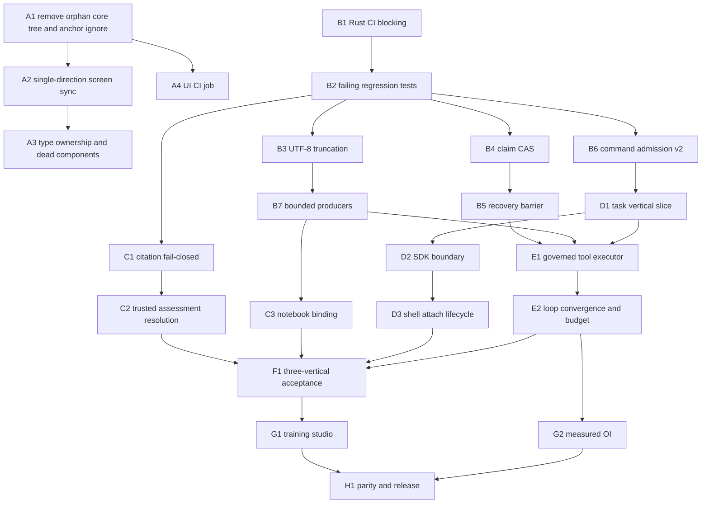

# SADE Implementation Plan (Execution Level)

Status: proposed, not yet approved. No production code was changed to produce this document.
Baseline: branch `vi-rft`, HEAD `c96f414`; working tree dirty only in four documentation files.
Companion of: [sade-core-refactor-plan.md](sade-core-refactor-plan.md) section 17 (F01-F12, G01-G13, M0-M4).

The refactor plan says **what** must be true. This document says **how**, in pull-request order: exact files, the
change per file, the tests that must fail first, the commands that prove it, and the rollback. Detail decreases with
distance: phases A-C are specified down to functions; later phases depend on what A-C reveal and are specified down to
files and gates.

## 1. Evidence discipline

Every claim below is tagged:

- **Read**: verified by reading the cited file and line on 2026-10-19.
- **Ran**: verified by executing a command on 2026-10-19 (only `tsc --noEmit` exit 0 and canvas smoke 29/29).
- **Audit**: carried from the `c96f414` audit (runtime lib 181 tests, command replay 1, citation coverage 7, canvas smoke 29, desktop build exit 0). Not re-run today.
- **Unverified**: hypothesis. Must be reproduced by a failing test before any fix.

## 2. Verified findings ledger

| ID | Finding | Evidence | Tag |
|---|---|---|---|
| V01 | Command admission is check-then-act with no lock: lookup at start of `handle_request`, ledger write after the whole handler finished. Two concurrent identical commands both execute. | `crates/custos-daemon/src/api.rs:317-340` vs `:6824-6842` | Read |
| V02 | Ledger failure is fail-open: lookup error is logged and the mutation proceeds; record error is logged and the reply is returned. | `api.rs:336-338`, `:6838-6840` | Read |
| V03 | Fingerprint is `digest(serde_json(params))`: excludes method, trusted actor/profile/scope; includes `command_id` itself; depends on JSON key order. Collision of the same ID across methods is not detected. | `api.rs:309-312`, `:324` | Read |
| V04 | `INSERT OR REPLACE` overwrites an accepted command record. Only success results are recorded; errors are never recorded. | `repositories/command_ledger.rs:69`, `api.rs:6829` | Read |
| V05 | Expiry compares an RFC3339 string (`T`, `+00:00`) with `datetime('now')` (space-separated). Same-day comparison is wrong. Unparsable timestamps silently become "now". | `command_ledger.rs:31`, `:44-50` | Read |
| V06 | Mutation classification is a hand-written `startsWith` list in TypeScript; daemon has 59 dispatch arms and no catalog of its own. Methods missing from the list get no `command_id`. | `ui/desktop/src/api/daemon_client.ts:158-172`, `:328` | Read |
| V07 | Tauri host: resends any transport error through a fresh client; generates a new `ipc-*` ID when the frontend sent none (not stable across retry); `.expect()` panics when the daemon is absent at startup. | `crates/custos-app/desktop/src/lib.rs:32-52`, `:74-75`, `:104` | Read |
| V08 | `update_claim` is `UPDATE ... WHERE id = ?1`: no expected prior status, no generation, affected rows ignored. Callers: release, mark-dispatched, chat-turn recovery. | `repositories/run.rs:286-306`; `workflow/dispatcher.rs:227,276`; `workflow/task_runtime.rs:281` | Read |
| V09 | Startup sweep blindly fails every `active` run and releases every `pending`/`dispatched` claim, regardless of whether an adapter/remote job is alive. Only `prepared` launch attempts become `unknown`. | `repositories/run.rs:423-447` | Read |
| V10 | `String::truncate(max_bytes)` panics when the cap lands inside a multi-byte character (Vietnamese, emoji). The full JSON string is allocated before the cap is applied. Python-side caps slice by characters, not bytes. | `runtime_port.rs:334-342`; `notebook/coordinator.rs:83-96` | Read |
| V11 | Citation oracle falls back to the claim's own `verified` flag when no `assessment_records` exist; records themselves are untyped JSON from `ctx.metadata` and accept self-asserted `passed`/`is_verified`/`status`. Existing tests encode the fallback. | `packs/research/verifiers/citation_coverage_oracle.rs:72-118`, tests `:215-261` | Read |
| V12 | Notebook kernels are a `HashMap` keyed by `session_id`; two notebooks in one chat share one kernel. | `runtime/notebook/coordinator.rs:194,254-311` | Read |
| V13 | CI: `Run Tests`, `fmt`, `clippy` are all `continue-on-error: true`. No workflow builds or tests `ui/desktop`. | `.github/workflows/rust.yml:39-51`; workflows list | Read |
| V14 | **UI**: `ui/desktop/src/core/` is a second, divergent copy of the shell (14 files, own `index.ts`, `layout/`). Nothing outside it imports it. It is untracked and git-ignored. Divergence vs the live tree: `AppWorkspaceShell` 1401 diff lines, `WorkspaceSidebar` 2372, `AppTopBar` 646, `ActivityRail` 370. | `diff` and `grep` on 2026-10-19; `git check-ignore -v core` | Read |
| V15 | Root cause of V14 staying invisible: `.gitignore:783-784` contains bare `core` and `core.*`, which match any directory or file named `core` / `core.*` at any depth (including `core.rs`, `core.ts`). `crates/custos-adapters/src/mcp/core/` is tracked only because it was added before the rule. New files there would be silently ignored. | `.gitignore:781-784`; `git ls-files` | Read |
| V16 | **UI**: screen and workbench lens are synchronised in two opposite effects. Effect A (workbench -> screen) at `ScreenContext.tsx:126-184`; effect B (screen -> workbench) at `:454-461`. Lens writers: `AppTopBar.tsx:310`, `app/dashboard/page.tsx:106`, `app/history/page.tsx:78`. Both effects also re-run on every `screens` change (including `lastUsedAt` writes). | Read |
| V17 | **UI**: `ActiveWorkbench` is declared inside a shell component (`components/shell/AppHeader.tsx:36`) and imported as a type by `OrcaTabbedContainer`, `TabQuickLaunchMenu`, `ConversationPane`, `AgentHarnessSelector`. Domain types depend on a presentation file. | grep | Read |
| V18 | **UI**: `JobActivityDock.tsx` has zero importers and is not exported from `components/shell/index.ts`. `StatusBar.tsx` and `AppStatusBar.tsx` coexist; only `AppStatusBar` is mounted (`app/layout.tsx:85`). | grep | Read |
| V19 | **UI**: `npx tsc --noEmit` exits 0 and `node --test tools/canvas-smoke.mjs` reports 29 pass / 0 fail on the current tree. | commands | Ran |

Not yet reproduced (Unverified): the lens/screen effect race described in section 3; zombie-claim behaviour under
interleaved release/mark-dispatched; peak memory under notebook output flood.

## 3. Answer to the UI-conflict question

The UI is **not yet conflict-free**. It type-checks and the live import graph is single-rooted
(`@/components/shell`), but four structural conflicts remain:

1. **Duplicate shell tree (V14).** A dormant divergent copy sits next to the live one. Any editor search, refactor or
   auto-import can land in the wrong copy. It has not broken the build only because nothing imports it.
2. **Ignore rule hiding it (V15).** The rule that hides the duplicate also hides future legitimate `core` paths.
3. **Two-way screen/workbench sync (V16).** Mechanism: the lens click sets workbench `W2`; effect A switches the screen
   to one belonging to `W2`; effect B then reads the screen and sets workbench again. In the common path both agree.
   They disagree when `screens` changes in the same commit as a lens change (project switch hydration, `lastUsedAt`
   write, screen creation): effect B runs with the previous `activeScreenId` and writes the previous workbench back,
   undoing the click. Status: **Unverified**; the fix includes a regression test that reproduces it first.
4. **Type ownership (V17) and dead components (V18)** make the shell harder to reason about but do not change runtime
   behaviour.

Not a conflict, and deliberately untouched: canvas/tab ownership (covered by 29 passing smoke tests, Audit) and the
design-token system.

## 4. Working agreement

- One authority per boundary. No dual-write, no parallel implementation kept "just in case".
- Per PR: scope and files declared first; a regression test that fails against current code for the stated reason;
  fix; normal + fault test; docs/catalog line; known limits written down. No auto-commit or push.
- Separate PRs for: mechanical move, schema migration, behaviour change, UI change.
- Status vocabulary per PR: planned -> implemented -> composed -> verified. "Verified" needs the cited command output.
- Root commands (from `Custos/`):

```sh
cargo metadata --no-deps --format-version 1 --offline
cargo test -p custos-runtime --lib --offline
cargo test -p custos-domain -p custos-core -p custos-persistence --lib --offline
npm --prefix ui/desktop run build
node --test tools/canvas-smoke.mjs
git diff --check
```

## 5. Dependency order



Phase A (UI hygiene) and phase B (backend foundation) share no files and can proceed in parallel.
First batch: A1, A2, B1, B2, B3.

---

## Phase A - UI hygiene and conflict removal

### A1 - Remove the orphan shell tree and anchor the ignore rule

Maps to: V14, V15. Risk: low code risk; the only irreversible step is deleting untracked files.

Steps:
1. Prove the tree is dead again at execution time: `grep -rnE "@/core|/core/|from '\./core|from '\.\./core" ui/desktop/src | grep -v "^ui/desktop/src/core/"` must print nothing.
2. Backup (untracked, so git cannot restore it): `tar czf <outside-repo>/custos-ui-core-orphan.tgz ui/desktop/src/core`. Ask the user to confirm before deleting.
3. Delete `ui/desktop/src/core/` (14 shell files, `layout/`, `index.ts`).
4. Edit `.gitignore:783-784`: `core` -> `/core`, `core.*` -> `/core.[0-9]*` (crash-dump intent only, repo root).
5. Verify with `git check-ignore -v ui/desktop/src/core/x.ts crates/custos-adapters/src/mcp/core/y.rs` (both must report not ignored) and `git ls-files | grep -E '(^|/)core/'` unchanged.

Tests: `npx tsc --noEmit` exit 0; `npm run build` exit 0; canvas smoke unchanged.
Rollback: restore the tarball; revert `.gitignore`.
Done when: no second copy of any shell component exists; future `core/` paths are tracked normally.

### A2 - One owner for screen/workbench synchronisation

Maps to: V16. Files: `ui/desktop/src/context/ScreenContext.tsx`, `ui/desktop/src/context/AppContext.tsx`
(read-only unless noted), new `ui/desktop/src/context/screenReconcile.ts`, `tools/canvas-smoke.mjs`.

Design (data flows one way):
- `activeWorkbench` (AppContext) stays the lens intent, persisted under `custos.workspace.mode.v2` as today.
- Effect A stays as the **only** reconciler: given `(screens, activeScreenId, workbench)` it returns either "keep" or
  "select screen X" or "create default screen for workbench". Move that decision into a pure function
  `reconcileScreen(screens, activeScreenId, workbench, ctx)` in `screenReconcile.ts` (no React, no `localStorage`), and
  have the effect only apply the returned decision.
- Delete effect B (`ScreenContext.tsx:454-461`). Replace it with explicit event-site calls: `selectScreen`,
  `createScreen`, `closeScreen` call `setActiveWorkbench(screen.homeWorkbench)` together with `setActiveScreenId`, in
  the same handler. Events are the only way a screen can change the lens; effects never do.
- Hydration guard: while `hydratedKey !== storageKey` (`ScreenContext.tsx:120`), the reconciler returns "keep".

Tests (extend the existing harness; it already transpiles pure TS through `typescript` and `node:test`, so no new
dependency): in `tools/canvas-smoke.mjs`, load `screenReconcile.ts` the same way `canvas.ts` is loaded and add:
1. Lens change with an inconsistent active screen selects the most recently used screen of that workbench.
2. Lens change when no screen exists for the workbench returns "create default" with the correct tab set
   (`conversation+terminal`, `conversation+lab`, `conversation+tasks`).
3. `screens` mutated (`lastUsedAt`) while consistent returns "keep" (idempotent; no write loop).
4. Hydration in progress returns "keep".
5. Regression for V16: simulate lens `engineering -> research` in the same commit as a `screens` replacement; the final
   state must be research, not the old workbench. Write it against the old two-effect semantics first to show it fails.

Verify: `node --test tools/canvas-smoke.mjs`; `npm run build`; manual check: click each of the three
lenses from the top bar, from Dashboard and from History; switch project; reload; confirm lens, screen and tab set agree
each time.
Rollback: revert PR; persisted screen layout format is unchanged, so no data repair.
Not done here: splitting `AppContext.tsx` (2853 lines). That is a separate refactor with no behaviour change.

### A3 - Type ownership and dead components

Maps to: V17, V18.
1. Create `ui/desktop/src/types/workbench.ts` exporting `ActiveWorkbench` (and `AppWorkspaceMode` alias if still used).
   In `AppHeader.tsx` replace the declaration with `export type { ActiveWorkbench, AppWorkspaceMode } from '@/types/workbench'`
   (temporary compatibility), migrate the 4 importers, then drop the re-export once `grep` shows no `AppHeader` type import.
2. `JobActivityDock.tsx`: zero importers. Confirm against git history that it is not planned work referenced in
   `docs/development/workbench-control-inventory-panels.md`; delete if unreferenced, else record it as unmounted debt.
3. `StatusBar.tsx` vs `AppStatusBar.tsx`: keep the mounted one, merge any logic only present in the other, delete the
   duplicate and its `index.ts` export.

Tests: `tsc`, build, smoke. Rollback: revert (pure move/delete).

### A4 - UI continuous integration

Maps to: V13 (UI half). Files: `.github/workflows/ui.yml` (new).
Job: `actions/setup-node` (`package.json` has no `engines` field: pin the Node version used for local builds and record it in the workflow), `npm ci`, `npx tsc --noEmit`,
`npm run build`, `node --test tools/canvas-smoke.mjs`. No new dependency. Path filter on `ui/desktop/**` and
`tools/canvas-smoke.mjs`. Both `package-lock.json` and `pnpm-lock.yaml` exist: pick the one the team uses and state it in
the workflow; do not run both.
Done when: a PR that breaks type-check or canvas invariants is red.

---

## Phase B - Backend safe foundation (F01-F04)

### B1 - Make critical Rust CI blocking (F01)

Files: `.github/workflows/rust.yml`, `.github/workflows/contracts.yml`.
1. Run locally first: `cargo test --workspace --all-targets --offline`. Record failures.
2. If green: remove `continue-on-error` from `Run Tests` only. Keep `fmt` and `clippy` advisory and add a tracked
   inventory (count) so the debt is visible; do not reformat in correctness PRs.
3. If not green: make a blocking job for `-p custos-domain -p custos-core -p custos-persistence -p custos-runtime
   -p custos-daemon -p custos-sdk --lib` plus `custos-tests-contract`, and file the failing remainder explicitly.
Done when: reintroducing a command/claim/evidence regression turns CI red.

### B2 - Failing regression tests first (F01)

Add tests that **fail on `c96f414`** and name the reason. Place in existing harnesses:

| Test (proposed name) | Location | Fails today because |
|---|---|---|
| `concurrent_identical_command_executes_once` (G01) | `crates/custos-daemon/src/api/tests.rs` | V01: both callers execute |
| `ledger_error_rejects_mutation` (G02) | same | V02: fail-open |
| `same_id_different_method_conflicts` (G02) | same | V03 |
| `same_day_expiry_boundary` (G02) | `repositories/command_ledger.rs` tests | V05 |
| `release_loses_to_dispatched` and `stale_dispatch_after_release_conflicts` (G03) | `repositories/run.rs` tests + `workflow/dispatcher.rs` mock store | V08 |
| `startup_does_not_release_live_claim` (G03) | `repositories/run.rs` | V09 |
| `tool_output_truncates_on_char_boundary` (G04) | `runtime/agent/runtime_port.rs` tests | V10: panic |
| `forged_verified_flag_is_not_evidence` (G05) | `citation_coverage_oracle.rs` tests | V11 |

Each test gets a one-line comment naming the finding ID. Mark with `#[ignore = "V0x: fails until Bx"]` only if it must
land before the fix; the fix PR removes the attribute. Never leave a test that passes against the bug.

### B3 - UTF-8 safe truncation (F04a)

Files: `crates/custos-runtime/src/agent/runtime_port.rs:337-342`, `crates/custos-runtime/src/notebook/coordinator.rs:83-96,417-428`.
1. Add one helper, e.g. `truncate_to_char_boundary(s: &mut String, max_bytes: usize)`: decrement `end` until
   `s.is_char_boundary(end)`, then `truncate(end)`. Put it where both modules already depend (`custos-core` util, or the
   shared runtime module that exists); do not add a crate or dependency.
2. Replace `output_str.truncate(...)` with the helper. Check `coordinator.rs:417-428` already computes a boundary; reuse
   the helper there too so there is one implementation.
3. Python side: `out[:MAX_OUTPUT_BYTES]` slices characters. Encode to UTF-8 and cut on bytes with
   `errors="ignore"` decode, or rename the constant to characters and document it; pick the byte semantics so Rust and
   Python agree.
4. If a truncated value was structured JSON, emit a typed marker object rather than a cut string that looks like JSON.

Tests: lengths 0, exactly cap, cap+1 landing inside `"e"` (3-byte), inside an emoji (4-byte), Vietnamese text
`"Tiếng Việt"` repeated; assert no panic and `is_char_boundary`.
Rollback: revert; no persisted-format change.
Limit: this fixes the panic, not peak allocation (the full string is still built first). Peak bounds are B7.

### B4 - Claim compare-and-set (F03a)

Files: `crates/custos-core/src/contracts/storage.rs:46`, `crates/custos-persistence/src/repositories/run.rs:286`,
`crates/custos-persistence/src/store.rs:639`, `crates/custos-runtime/src/workflow/dispatcher.rs:199-276` (+ mock store at
`:495`), `crates/custos-runtime/src/workflow/task_runtime.rs:281`.
1. Replace `update_claim(&DispatchClaim)` with `transition_claim(id, expected: ClaimStatus, next: ClaimUpdate) ->
   Result<(), DomainError>` where `ClaimUpdate` carries only the fields legal for that edge (dispatched_at+worker_run_id,
   or released_at). SQL: `UPDATE dispatch_claims SET ... WHERE id = ?1 AND status = ?2`; if affected rows is 0, return
   `DomainError::Conflict` with the observed status. Legal edges: `pending -> dispatched`, `pending|dispatched -> released`.
   No other edge compiles.
2. Callers: dispatcher release and mark-dispatched read the claim, call `transition_claim` with the status they read,
   and on `Conflict` surface it (no silent success). `task_runtime.rs:281` (chat-turn recovery) uses the same edge.
3. Cache: publish to the in-memory view only after the SQL succeeded; on `Conflict` invalidate and re-read.
4. Generation/fencing counter is a schema change (additive column on `dispatch_claims`, migration `0037_*`): **deferred
   to B5** so B4 stays schema-free and mechanically reviewable.

Tests: deterministic interleave using two repository handles on a shared file DB: mark-dispatched vs release in both
orders - exactly one wins, loser gets `Conflict`; double release is idempotent only if expected status matches;
affected-rows zero path; mock-store parity test in `dispatcher.rs`.
Rollback: revert; storage contract change is internal to the workspace.

### B5 - Recovery barrier (F03b)

Files: `repositories/run.rs:423-447`, `crates/custos-daemon/src/runtime.rs` (startup/readiness), migration `0037_dispatch_claim_generation.sql` (additive `generation INTEGER NOT NULL DEFAULT 0`).
1. Split the blanket sweep into `list_in_flight()` (claims, runs, worker_runs, launch attempts) and per-item
   `settle_recovered(item, observation)`.
2. Startup order: open store -> `list_in_flight()` -> ask each adapter/process owner for observed state -> settle each
   item from the observation (`running` stays claimed under the new daemon; `gone` is released with reason; `unknown`
   becomes `uncertain`, never auto-released) -> only then mark readiness and accept admission.
3. Generation: increment on each claim re-admission; `transition_claim` also requires the caller's generation;
   a stale worker settlement carries the old generation and gets `Conflict`.
4. Where no adapter can answer today (local worker processes that died with the daemon), the observation is `gone`;
   record that the observation source was "process absent" so it is auditable.

Tests: kill-restart twice; claim live in adapter fixture survives restart; unknown stays uncertain and blocks
re-dispatch; stale-generation settlement rejected; readiness not reported until barrier completes.
Rollback: drain admission and reconcile; the migration is additive so older binaries ignore the column.

### B6 - Command admission v2 (F02)

Largest backend PR; split into four reviewable commits.

**B6a - ledger repository and migration** (`crates/custos-persistence`, `crates/custos-core/src/contracts/storage.rs`).
Migration `0038_command_ledger_v2.sql`, additive: `state TEXT NOT NULL DEFAULT 'completed'` (`pending|completed`),
`fingerprint TEXT`, `expires_at_ms INTEGER`, `scope TEXT`. Backfill `expires_at_ms` from legacy RFC3339 via parse in
Rust at open time; rows that do not parse are kept as tombstones (never defaulted to now).
New repository API, all inside one connection lock / one SQL statement:
- `admit(command_id, method, fingerprint, scope, now_ms, ttl_ms) -> Admission` where `Admission` is
  `New | Replay(result_json) | InFlight | Conflict`. Implementation: `INSERT ... ON CONFLICT(command_id) DO NOTHING`,
  rows-affected 1 => `New`; else read the row and compare `fingerprint` and `method`.
- `complete(command_id, result_json)`: `UPDATE ... SET state='completed' WHERE state='pending'`.
- `abandon(command_id)`: delete a `pending` row after a deterministic rejection so a corrected retry can run.
- Remove `INSERT OR REPLACE` and the string-date SQL. Expiry compared as integers.

**B6b - daemon integration** (`crates/custos-daemon/src/api.rs`, new `api/commands.rs` helper next to `capabilities.rs`).
- Daemon owns the catalog: one `fn method_effect(method) -> Effect { Read, Mutation }` with an exhaustive match over the
  59 dispatch arms. Unknown methods are `Mutation` by default (safe side).
- Fingerprint = `digest(method + "\0" + canonical_json(params without command_id) + "\0" + trusted scope)`. Canonical
  JSON = sorted keys. Scope comes from the transport's authenticated profile, never from `params`.
- `handle_request`: for `Mutation`, require `command_id` (error `command_id_required`); `admit`; on `Replay` return the
  stored result; `InFlight` returns an in-progress response with the same command id; `Conflict` returns the conflict
  error; ledger error returns an error **before** any mutation (fail-closed).
- After the handler: success -> `complete`; deterministic validation error -> `abandon`; transport/internal error after a
  possible effect -> leave `pending` (surfaces as in-flight until reconciliation). A failed `complete` after an effect is
  logged at error level and keeps the row `pending`; it must not return a fresh success that can be re-executed.
- Honest limit: this gives at-most-once **start** per command. DB-only handlers still commit state in their own
  transactions, so a crash between handler commit and `complete` leaves a `pending` row for a mutation that actually
  happened. Closing that gap requires the handler and ledger completion in one transaction, which is the use-case
  extraction in D1. Until D1, `pending` after restart is reported as "uncertain, reconcile", never re-run.

**B6c - frontend and host** (`ui/desktop/src/api/daemon_client.ts`, `crates/custos-app/desktop/src/lib.rs`).
- Delete `isMutationMethod` (`daemon_client.ts:158-172`). The client attaches a stable `cmd_<uuid>` `command_id` to every
  request except `v1.ping`/`v1.health`/event streams; the daemon ignores it for `Read`. One catalog, in one place.
- `custos_request`: remove the fresh `ipc-*` fallback (`lib.rs:32-37`); a request without `command_id` is forwarded as
  is and the daemon decides. Resend (`:43-52`) only when the error is a pre-dispatch connection failure, never a
  business error, cancel or timeout after dispatch; on timeout return a typed `dispatch_unknown` error instead.
- Replace `.expect()` at `lib.rs:74-75` with a deferred attach (full lifecycle is D3). Interim: log and start the
  window with a client that reports `daemon_unavailable` to the UI.

**B6d - clients of the ledger** (`custos-sdk` `LocalApiClient`): add `command_id` generation to SDK mutation calls so CLI
and desktop share semantics; keep the wire shape unchanged.

Tests (map G01/G02): two connections issuing the same command at once -> one effect, both get same result;
lost reply then resend -> replay; same id, different method / payload / scope -> conflict; ledger unavailable ->
mutation rejected, read allowed; `pending` after simulated kill -> in-flight, no second execution; same-day expiry;
corrupt legacy timestamp -> tombstone not "now"; Tauri/HTTP parity for the same logical command; method without
`command_id` -> `command_id_required`.
Rollback: forward-only. Keep reading legacy rows; disable the strict `command_id_required` rule with a flag if a
client regression appears; never delete ledger rows or re-run `pending` commands.

### B7 - Bounded producers (F04b)

Files: `runtime_port.rs`, `notebook/coordinator.rs` (Python capture + Rust frame reader), `workflow/live.rs`, adapter
execution outputs.
1. Replace Python `StringIO` capture with a bounded writer: stops buffering at the cap, counts dropped bytes, keeps a
   typed `truncated: {bytes_dropped}` marker.
2. Rust frame reader: enforce a maximum frame length before allocating (`read_exact` into a length-checked buffer).
3. Per-run byte budget and queued-byte budget on live-output channels in addition to item count; control, error and
   cancel messages bypass the output budget.
4. Tool results: cap at producer/adapter and pass only a reference plus preview into the prompt for large artifacts.
5. Cancellation: check cancel between awaits in the loop at `runtime_port.rs` (model call and tool call), not only
   before execute.
Tests (G04): 100 MB stdout flood, slow consumer, malformed/oversized frame, cancel during model await, repeated runs with
RSS/handle plateau measured and recorded (raw numbers in the PR).
Rollback: lower concurrency and admission; do not re-enable the unbounded path.

---

## Phase C - Trusted evidence and notebook identity (F05, F06)

### C1 - Citation oracle fail-closed (F05a)

Files: `crates/custos-packs/src/research/verifiers/citation_coverage_oracle.rs`.
1. Remove the `else` branch at `:113-118`: no `assessment_records` => claim is **not** verified.
2. Stop accepting self-asserted `passed` / `is_verified` booleans from records; a record counts only with a typed
   `status` of `verified`, bound `claim_id`, and not stale.
3. Update tests at `:215-261`: those using `"verified": true` without records now assert failure; add records-based
   passing cases.
4. Validate `min_coverage_ratio` range and make required claims independent of the aggregate ratio.
Tests (G05): forged flag, forged record, wrong claim id, stale record, partial support with high aggregate, required
claim unsupported.
Limit: records are still caller-supplied JSON after C1; trust is C2.
Rollback: revert yields the old pass-by-flag behaviour, so prefer forward fixes.

### C2 - Trusted assessment resolution (F05b)

First step is discovery, not code: locate where research source, claim and evidence records are persisted
(`crates/custos-persistence/src/repositories/research.rs`, 2445 lines) and which of them already carry assessment status.
Decision gate:
- If an assessment record already exists, the oracle receives record **IDs** in context; the application layer resolves
  them from the store and passes resolved typed records; the oracle never parses assessments from request metadata.
- If it does not exist, adding a table is a schema change that needs explicit approval before implementation
  (migration `0039_*`, fields: criterion/claim digest, source version/span/hash, verifier identity+version+method,
  freshness, status).
Tests: assessment reused at another revision rejected; revoked/stale rejected; unknown source -> `Unknown`, not pass.

### C3 - Notebook document / binding / kernel identity (F06)

Files: `crates/custos-domain/src/notebook.rs`, `crates/custos-runtime/src/notebook/coordinator.rs`,
`crates/custos-persistence` (migration `0040_notebook_binding.sql` over `0021_notebook_cells_and_kernels.sql`),
`crates/custos-sdk` types, notebook callers in the UI.
1. Introduce `NotebookId` (document) distinct from `session_id` (conversation binding) and `kernel_epoch`.
2. Kernel registry key: `(notebook_id, binding_id)`; `session_id` remains the journal association only.
3. Execute request validates notebook ownership, selected kernel epoch, cell version and execution request ID before
   running; a cell edit marks prior output stale; duplicate request ID does not run twice.
4. Migration: for each existing row keyed only by `session_id`, create `notebook_id = "legacy:" + session_id`, keep cells
   and outputs; never merge or split namespaces.
5. Same notebook in two panes shares one binding handle; two notebooks in one chat default to separate kernels.
Tests (G06): two notebooks one chat; one notebook two panes; same cell id in different documents; stale epoch/version;
legacy DB restore; interrupt/reset; kernel crash; UI reconnect does not re-run code.
Rollback: forward repair only (identity columns are never dropped).

---

## Phase D - Application layer, SDK boundary, shell lifecycle (F07)

Files and gates only; refine after B6 lands.

- **D1 Task vertical slice.** Move `v1.tasks.create/status` out of the 6,858-line `api.rs` into an application handler
  (`admit -> handler -> core/store`), with ledger completion in the same SQLite transaction as the task write. `api.rs`
  keeps decode/encode. This is also what closes the B6b pending-gap for that method. Parity tests old vs new path before
  the old arm is removed. Then repeat per use case (workspace, session, research, assistant, connections) in separate PRs.
- **D2 SDK boundary.** `custos-sdk` owns wire types, client, errors and cursor; daemon re-exports for compatibility; app
  hosts import the SDK only. Gate: `cargo tree -p custos-app-desktop` (host crate) shows no storage/server crates through the
  client path.
- **D3 Shell attach lifecycle.** Window opens before attach finishes; states connecting/ready/incompatible/degraded/
  recovering; single-flight start per profile with lock and per-attempt deadline; auth/version check before replay;
  closing one client never stops the daemon or background jobs. Files: `crates/custos-app/desktop/src/lib.rs` and the
  frontend connectivity facade. Tests: daemon absent, slow, wrong version; two windows; reconnect with cursor gap.

## Phase E - Governed loop (F08)

- **E1 Governed tool executor.** One production executor wired to authority, permit, outbox and receipt ports and a
  bound run/attempt context. Distinguish "proposal not dispatched" from "receipt of an executed effect"; one tool call is
  one admitted attempt. Files: `runtime_port.rs` (replace string `conversation_history` building with structured tool
  calls/results), `agent/tool.rs`, `workflow/task_runtime.rs`, gateway registry. Test: API -> model -> real temp-file tool
  -> model -> journal, no duplicate effect (G07).
- **E2 Loop convergence and budget.** Model branch and governed loop converge on the existing worker contract; per-attempt
  budget reserve/settle/cancel and run caps; iteration exhaustion is `limited`, never success; steering/cancel handles are
  cleaned up. Disable tool-loop admission (not observation/reconciliation) as rollback.

## Phase F - Three-vertical acceptance (F09)

Product acceptance, not new architecture. Each vertical runs from UI/API to persisted outcome with a normal and a fault
case: Coding (dirty repo, base drift, agent-edited tests; G09), Research (source version/parse gap, notebook, report;
G06), Copilot (timeout-after-send, revoke/quota race on a fake connector; G10), plus same-chat across three lenses and
Settings reconnect (G08). Cross-pack handoff carries schema, source, privacy and authority; no auto-send.
Exit: G06-G10 pass at the stated execution level (in-memory/process/browser/live).

## Phase G - Training studio and measured optimisation (F10, F11)

Start only after F. One engine and one real target first (F10a); remote-target matrix, checkpoint manifest and
handoff after that; each needs a live-target proof and no portability claim beyond tested pairs (G11). OI/S1 starts with
a direct pinned baseline and a paired held-out dataset; "cheaper" is reported only with the margin met, else
"inconclusive" (G12). No paid compute or credentials are used without a specific, user-granted permission.

## Phase H - Parity and release (F12)

Capability matrix for OrCa / Open Science / Goose behaviours with path, digest/licence, Custos location, composition,
tests and unsupported scope; upgrade-and-restart recovery with legacy data readable (G13); platform matrix for the
supported OS only; diagnostics with command/task/run/attempt IDs and redaction; release notes with
implemented / experimental / unsupported.

## 6. Decisions needed before implementation

1. **A1 deletes untracked files.** Confirm deletion of `ui/desktop/src/core/` after the tarball backup (recommended).
2. **Migrations `0037`-`0040`** (claim generation, ledger v2, assessment table if needed, notebook binding). All additive;
   each needs approval per repo rules before the first migration PR.
3. **B6c removes the TypeScript mutation list** in favour of a daemon-owned catalog and "always send `command_id`".
   Alternative: keep a shared generated list. Recommended: daemon-owned, since the daemon is the authority.
4. **B1 scope**: make the whole `cargo test --workspace` blocking, or only the critical crate set if the workspace is not
   green today. Decided after the local run.
5. **UI regression tests** use the existing `node:test` harness (`tools/canvas-smoke.mjs`); no test framework added.
   Component-level interaction tests would need a new dependency and are out of scope unless requested.
6. **Documentation language.** `.agents/rules/documentation_language.md` requires English under `docs/`; the master plan
   and several neighbours are Vietnamese. This file follows the rule. Translating or mirroring the rest under
   `docs/i18n/` is a separate decision.

## 7. Stop conditions

Stop and report instead of continuing when: a test intended to fail already passes (the finding was misread); a
migration cannot decode legacy rows; a CAS or ledger conflict appears that the design does not explain; a bound cannot
be enforced at the producer; or an external effect would need a retry route that is not the original one.

## 8. Not in this plan

New crates or dependencies; mounting upstream trees; calls to cloud, GPU or credentials; paid training; commits or
pushes; deleting user data; reformatting for fmt/clippy debt inside correctness PRs; splitting `AppContext.tsx`,
`RightSidebar.tsx`, `WorkspaceSidebar.tsx` or `api.rs` beyond what D1 needs.
