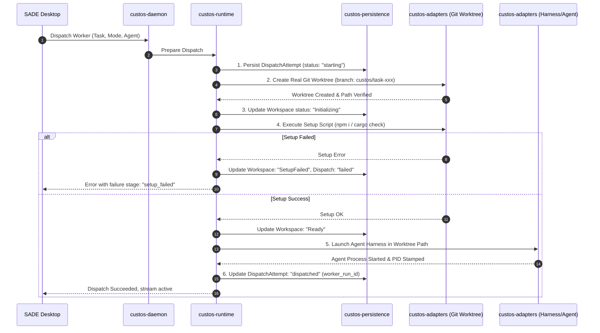
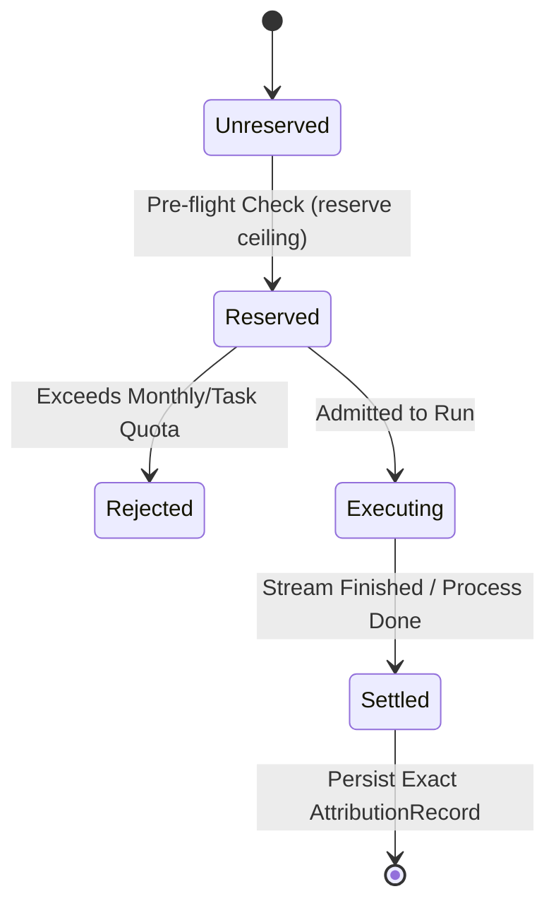

# SADE & OrCa Operational Lifecycle & Multi-Agent Topologies
## Nghiên Cứu Chuyên Sâu Cấp Mã Nguồn & Định Hình Kiến Trúc ADE Vận Hành Thực Thụ

> **Định vị cốt lõi (Theo `Custos.md` dòng 3 & RFC 004):**  
> Custos là **Supervised Agent Development Environment (SADE) local-first**, KHÔNG PHẢI là một "Agentic OS" mơ hồ, và KHÔNG PHẢI là 3 ứng dụng desktop rời rạc. Ba lăng kính (Engineering / Coding, Research, Copilot / Assistant) chia sẻ chung một hạt nhân nhiệm vụ, cơ chế chứng cứ, quản trị quyền hạn và sổ cái chi phí.  
> OrCa cho ta một mẫu xuất sắc về **vòng đời vận hành nhiều agent trên Git worktree**; nhưng Custos phải làm chủ Task, quyền, ngân sách và bằng chứng một cách trung thực (fail-closed, truthful contracts).

---

## MỤC LỤC
1. [Bản Chất Của "Nhiều Agent Song Song Trên Worktree"](#1-bản-chất-của-nhiều-agent-song-song-trên-worktree)
   - [Bản chất phân lập: Git Worktree vs Sandbox](#11-bản-chất-phân-lập-git-worktree-vs-sandbox)
   - [Bốn chế độ / topology vận hành Coding theo thứ tự trưởng thành](#12-bốn-chế-độ--topology-vận-hành-coding-theo-thứ-tự-trưởng-thành)
2. [Khảo Sát Thực Tế Checkout Custos (07b3fbb): Có Gì & Thiếu Gì Ở Cấp Mã Chạy](#2-khảo-sát-thực-tế-checkout-custos-07b3fbb-có-gì--thiếu-gì-ở-cấp-mã-chạy)
   - [Bảng đối chiếu hiện trạng & hệ quả mã nguồn](#21-bảng-đối-chiếu-hiện-trạng--hệ-quả-mã-nguồn)
   - [Mổ xẻ chi tiết 6 điểm đứt gãy / giả lập trong Custos](#22-mổ-xẻ-chi-tiết-6-điểm-đứt-gãy--giả-lập-trong-custos)
3. [Lõi OrCa Nào Nên Đi Vào Đâu Trong Custos? (Ranh Giới Crate & Hợp Đồng)](#3-lõi-orca-nào-nên-đi-vào-đâu-trong-custos-ranh-giới-crate--hợp-đồng)
   - [Học hỏi từ `local-worker-start.ts` & `worker-worktree-creation.ts`](#31-học-hỏi-từ-local-worker-startts--worker-worktree-creationts)
   - [Phân định trách nhiệm 8 Crate đích của Custos](#32-phân-định-trách-nhiệm-8-crate-đích-của-custos)
4. [Sổ Cái Chi Phí (Attribution Ledger) & Quan Sát Trung Thực](#4-sổ-cái-chi-phí-attribution-ledger--quan-sát-trung-thực)
   - [Mô hình nguồn gốc số liệu (Attribution Provenance)](#41-mô-hình-nguồn-gốc-số-liệu-attribution-provenance)
   - [Bốn chỉ số độc lập thay vì một badge "Usage" gộp](#42-bốn-chỉ-số-độc-lập-thay-vì-một-badge-usage-gộp)
   - [Vòng đời ngân sách: Reserve -> Execute -> Settle](#43-vòng-đời-ngân-sách-reserve---execute---settle)
5. [Kiến Trúc Settings Trung Thực: Backend Persistence & Read-Back](#5-kiến-trúc-settings-trung-thực-backend-persistence--read-back)
   - [Năm nhóm thiết lập hiển thị](#51-năm-nhóm-thiết-lập-hiển-thị)
   - [Nguyên tắc bất biến: Không có useState mồ côi](#52-nguyên-tắc-bất-biến-không-có-usestate-mồ-côi)
6. [Mô Hình Tương Tác SADE Desktop (UI 4 Mức)](#6-mô-hình-tương-tác-sade-desktop-ui-4-mức)
   - [4 Mức hiển thị chuẩn](#61-4-mức-hiển-thị-chuẩn)
   - [Phân biệt triệt để: Tab là View, không phải Run](#62-phân-biệt-triệt-để-tab-là-view-không-phải-run)
7. [Lộ Trình Triển Khai Ngắn Nhất (Shortest Path Implementation Roadmap)](#7-lộ-trình-triển-khai-ngắn-nhất-shortest-path-implementation-roadmap)

---

## 1. BẢN CHẤT CỦA "NHIỀU AGENT SONG SONG TRÊN WORKTREE"

### 1.1. Bản chất phân lập: Git Worktree vs Sandbox
Một hiểu lầm phổ biến là xem **Git worktree** như một sandbox bảo mật. Trong thực tế kiến trúc:
- **Git Worktree chỉ tách:**
  - Thư mục làm việc vật lý riêng biệt (`working tree`).
  - Con trỏ `HEAD` và nhánh Git độc lập (`refs/heads/...`).
  - Index/staging area cục bộ.
- **Git Worktree KHÔNG NGĂN:**
  - Agent đọc các file bí mật ngoài repo (ví dụ: `~/.ssh`, `~/.aws`, `.env` ở thư mục cha).
  - Agent truy cập mạng Internet hoặc gọi API bên ngoài.
  - Subprocess fork, daemon ngầm, hoặc chiếm dụng tài nguyên hệ thống (CPU/RAM).
  - Agent can thiệp vào các tiến trình khác đang chạy trên cùng máy host.

> [!IMPORTANT]
> **Quyền hạn (Authority) và Hộp cát (Sandbox) phải được tách bạch độc lập với Worktree.**  
> Worktree giải quyết xung đột ghi đè tập tin cục bộ (`file collision isolation`). Authority/Policy engine (`custos-core`) và Process isolation (`custos-adapters`) chịu trách nhiệm kiểm soát quyền gọi công cụ, truy cập mạng và đọc ghi tệp.

---

### 1.2. Bốn chế độ / topology vận hành Coding theo thứ tự trưởng thành

```mermaid
graph TD
    subgraph Mode 1: Single Writer Worktree
        T1[Task] --> DA1[DispatchAttempt]
        DA1 --> WT1[Git Worktree Dedicated]
        WT1 --> AG1[Single Writer Agent]
        AG1 --> DIFF1[Git Diff Review]
    end

    subgraph Mode 2: Parallel Readers + Single Writer
        T2[Task] --> DA2[DispatchAttempt]
        DA2 --> RD1[Reader 1: AST / Symbols]
        DA2 --> RD2[Reader 2: Tests / Deps]
        RD1 --> SYNTH[Synthesizer Context]
        RD2 --> SYNTH
        SYNTH --> WT2[Git Worktree Dedicated]
        WT2 --> AG2[Single Writer Agent]
    end

    subgraph Mode 3: Competitive Candidates (Thi Đấu)
        T3[Task] --> BASE[Same Base SHA: abc1234]
        BASE --> WT_A[Worktree A: Branch candidate-a]
        BASE --> WT_B[Worktree B: Branch candidate-b]
        WT_A --> AG_A[Agent A: Claude Code]
        WT_B --> AG_B[Agent B: Codex / Goose]
        AG_A --> EV_A[Diff + Test Exit Code A]
        AG_B --> EV_B[Diff + Test Exit Code B]
        EV_A --> CMP[Compare & Select Gate]
        EV_B --> CMP
        CMP -->|Human Select A| MERGE[Fast-forward / Merge A]
        CMP -->|Discard B| CLEAN[Archive / Teardown WT_B]
    end

    subgraph Mode 4: Cooperative Partitioned DAG (Phân Công)
        T4[Task DAG] --> N1[Node 1: Backend API]
        T4 --> N2[Node 2: Frontend UI]
        N1 --> WT_N1[Worktree 1: Scope /backend]
        N2 --> WT_N2[Worktree 2: Scope /frontend]
        WT_N1 --> MB1[Mailbox / Steer]
        WT_N2 --> MB2[Mailbox / Steer]
        MB1 --> IG[Integration Gate: 3-Way Merge & Test Suite]
        MB2 --> IG
    end
```

#### Chế độ 1: Single Writer trong một Git Worktree hoàn chỉnh
- **Mục tiêu:** Đơn giản, an toàn tuyệt đối, loại bỏ nguy cơ làm bẩn nhánh `main` hiện hành của người dùng.
- **Cơ chế:**
  1. Xác thực trạng thái Git của repo gốc. Chụp `base_commit_hash` hiện tại.
  2. Tạo branch mới `custos/task-<id>` và worktree vật lý tại `<repo>/.worktrees/task-<id>`.
  3. Chạy lệnh setup nếu có (ví dụ: `npm install`, `cargo check`).
  4. Gán toàn bộ luồng thực thi native/harness của agent vào worktree path đó.
  5. Khi agent hoàn thành, tính toán Git diff hunks so với `base_commit_hash`.
  6. Người dùng xem xét diff và quyết định áp dụng vào repo chính hoặc hủy bỏ.

#### Chế độ 2: Hai Reader song song + Một Writer
- **Mục tiêu:** Tăng tốc tìm kiếm ngữ cảnh, phân tích code base lớn mà không tạo rác worktree.
- **Cơ chế:**
  1. Hai worker phụ trách vai trò **Reader** (Read-Only): đọc symbol, parse AST, trích xuất cấu trúc thư mục, quét bài test hiện hành trực tiếp từ repo gốc (hoặc bộ nhớ cache).
  2. Hai Reader tuyệt đối KHÔNG cấp worktree riêng và KHÔNG có quyền ghi.
  3. Đầu ra của 2 Reader tổng hợp thành prompt ngữ cảnh tối ưu cho **Writer**.
  4. Duy nhất **Writer** được cấp 1 Git worktree cô lập để thực hiện thay đổi mã nguồn.

#### Chế độ 3: Hai Candidate Writers Thi Đấu (Competition / Race trên cùng Base SHA)
- **Mục tiêu:** Khai thác thế mạnh của các mô hình/harness khác nhau (ví dụ: Claude Code xử lý logic phức tạp vs Codex xử lý refactor chuẩn cú pháp); tìm lời giải tốt nhất thông qua bài test khách quan.
- **Cơ chế bắt buộc:**
  1. **Chốt cùng một baseline:** Bắt buộc cả 2 worker phải bắt đầu từ cùng 1 commit SHA (`base_commit_hash`).
  2. **Worktree riêng biệt:** 
     - Worker A: `.worktrees/task-<id>-cand-a` (nhánh `custos/task-<id>/cand-a`).
     - Worker B: `.worktrees/task-<id>-cand-b` (nhánh `custos/task-<id>/cand-b`).
  3. **Không tranh chấp claim cấp Task:** Bảng `dispatch_claims` lưu 2 bản ghi riêng biệt:
     - `claim_1` cho `node_id = "candidate_a"`
     - `claim_2` cho `node_id = "candidate_b"`
  4. **Quan sát độc lập:** Mỗi candidate có dòng sự kiện riêng, chi phí token/tiền riêng, log riêng.
  5. **Bằng chứng khách quan (Evidence Collection):**
     - Git diff hunks so với baseline.
     - Kết quả chạy test suite thực tế (`cargo test`, `npm test`... exit code, stdout/stderr, pass/fail count).
  6. **UI Compare & Human Select:** Người dùng đặt hai phương án cạnh nhau. Nhấn chọn phương án thắng.
  7. **Thu hồi kẻ thua (Loser Cleanup):** Thao tác thu hồi, xóa worktree của bên thua là một lệnh độc lập có ghi vết, không bao giờ âm thầm xóa mất dấu vết.

#### Chế độ 4: Phân Công Cooperative DAG (Partitioned Writers)
- **Mục tiêu:** Chia nhỏ bài toán lớn thành các phần tử độc lập phụ thuộc nhau theo đồ thị DAG.
- **Rào cản kỹ thuật:** Hai agent sửa hai file khác nhau nhưng phụ thuộc interface (ví dụ: Worker A sửa đổi tham số hàm backend, Worker B sửa code gọi ở frontend) thì dù Git merge không báo conflict dòng lệnh, hệ thống vẫn gãy lúc compile/test.
- **Cơ chế bắt buộc:**
  1. Phân bổ Write-Set chặt chẽ (Path boundary enforcement).
  2. Kênh giao tiếp Mailbox / Steer giữa các worker.
  3. **Integration Gate:** Bắt buộc chạy lại toàn bộ test suite tích hợp trên nhánh merge tạm thời trước khi cho phép hòa vào base branch.

---

## 2. KHẢO SÁT THỰC TẾ CHECKOUT CUSTOS (07b3fbb): CÓ GÌ & THIẾU GÌ Ở CẤP MÃ CHẠY

### 2.1. Bảng đối chiếu hiện trạng & hệ quả mã nguồn

| Năng lực | Hiện trạng đã kiểm tra tại mã nguồn | Hệ quả thực thi |
| :--- | :--- | :--- |
| **Git worktree vật lý** | [`LocalWorkspaceProvider` (line 18)](file:///Users/mac/Project/AgentHub/Custos/crates/custos-adapters/src/workspace.rs#L18) có `git worktree add`; [`WorkspaceCoordinator` (line 43)](file:///Users/mac/Project/AgentHub/Custos/crates/custos-runtime/src/workspace/coordinator.rs#L43) persist `Initializing` → `Ready` / `SetupFailed`. | Móng Git thật đã có chuẩn chỉ, không cần làm lại từ đầu. |
| **Parallel DAG** | [`GraphRuntime` (line 33)](file:///Users/mac/Project/AgentHub/Custos/crates/custos-runtime/src/workflow/graph_runtime.rs#L33) chạy các node ready theo wave bằng `tokio::task::JoinSet`. | Có khả năng chạy đồng thời trong RAM process, nhưng chưa gắn kết với placement và claim bền vững. |
| **Worker claim** | [`WorkflowDispatcher` (line 24)](file:///Users/mac/Project/AgentHub/Custos/crates/custos-runtime/src/workflow/dispatcher.rs#L24) dòng 72-80 chặn bất kỳ claim nào nếu tìm thấy **bất kỳ** `WorkerRun` nào đang `Active` trong cùng Task. | **LỖI NGHIÊM TRỌNG:** Tự chặn hai node song song của cùng một Task. Không thể chạy DAG song song hay 2 candidate thi đấu. |
| **"Worktree lease" của workflow** | [`lease.rs` (line 17)](file:///Users/mac/Project/AgentHub/Custos/crates/custos-runtime/src/workflow/lease.rs#L17) tạo thư mục `.custos/worktrees/...`, giữ lease bằng `HashMap`, rồi gọi `fs::copy` file đè vào base! | **LỖI NGUY HIỂM:** Đây là worktree giả! `fs::copy` không có 3-way merge, không có baseline commit SHA, không phát hiện xung đột Git. |
| **Task → native agent** | [`TaskRuntime` (line 415)](file:///Users/mac/Project/AgentHub/Custos/crates/custos-runtime/src/workflow/task_runtime.rs#L415) cấp lease, nhưng dòng 500 gọi `harness.run_native_observed` dùng thẳng `cmd.workspace_root` (base repo), bỏ qua `lease_path`. | Agent native ghi thẳng vào repo chính của người dùng, phá vỡ hoàn toàn sự cô lập. |
| **UI điều khiển worktree** | [`WorktreeManagerPane` (line 87-103)](file:///Users/mac/Project/AgentHub/Custos/ui/desktop/src/components/workspaces/engineering/WorktreeManagerPane.tsx#L87-L103) nút "Merge into Base" gọi `recoverWorkspace` rồi báo "successfully merged". | **LỜI HỨA SAI (FALSE PROMISE):** Recover metadata không phải là Git merge! Người dùng tưởng mã nguồn đã được merge an toàn. |
| **Settings agent & Quota** | [`SubAgentsPane` (line 18)](file:///Users/mac/Project/AgentHub/Custos/ui/desktop/src/app/settings/SubAgentsPane.tsx#L18) & [`CostQuotasPane` (line 9)](file:///Users/mac/Project/AgentHub/Custos/ui/desktop/src/app/settings/CostQuotasPane.tsx#L9) dùng `useState` cục bộ với giá trị cứng. | Giao diện tuyên bố "Daemon fences monthly ceiling" nhưng daemon không hề lưu và không hề enforce. |
| **Số liệu Token / Chi phí** | [`gateway.rs` (line 211)](file:///Users/mac/Project/AgentHub/Custos/crates/custos-runtime/src/gateway/gateway.rs#L211) sinh `tokens_used = decision.reserved_token_budget.min(256)` và `cost_usd = ceiling * 0.5`. | Mock số liệu token và cost trong gateway, gây ô nhiễm nếu để lộ ra người dùng. |

---

### 2.2. Mổ xẻ chi tiết 6 điểm đứt gãy / giả lập trong Custos

#### 1. Sự tự xung đột trong `WorkflowDispatcher::claim_ready_task`
Tại file [`crates/custos-runtime/src/workflow/dispatcher.rs`](file:///Users/mac/Project/AgentHub/Custos/crates/custos-runtime/src/workflow/dispatcher.rs#L72-L81):
```rust
// KIỂM TRA HIỆN TẠI (SAI):
let active_wruns = store.list_worker_runs_for_task(task_id).await?;
if let Some(active) = active_wruns.into_iter().find(|w| w.status == RunStatus::Active) {
    return Err(DomainError::Conflict(format!(
        "Task '{}' is already claimed and actively running under worker run '{}'...",
        task_id, active.id
    )));
}
```
*Phân tích:*  
Migration 0027 (`0027_dispatch_claims_and_fencing.sql`) đã có index độc nhất:
```sql
CREATE UNIQUE INDEX idx_active_dispatch_claims 
    ON dispatch_claims (task_id, COALESCE(node_id, '')) 
    WHERE status IN ('pending', 'dispatched');
```
Cơ sở dữ liệu hoàn toàn cho phép `(task_1, "node_a")` và `(task_1, "node_b")` cùng tồn tại! Nhưng logic code ở tầng runtime lại đi kiểm tra toàn bộ Task `task_id`. Do đó, khi `node_a` bắt đầu chạy, `node_b` muốn claim sẽ bị văng lỗi `Conflict`.

#### 2. Thảm họa `fs::copy` trong `lease.rs`
Tại file [`crates/custos-runtime/src/workflow/lease.rs`](file:///Users/mac/Project/AgentHub/Custos/crates/custos-runtime/src/workflow/lease.rs#L186-L203):
```rust
let src_file = lease.lease_path.join(rel_path);
let dst_file = self.base_dir.join(rel_path);
...
fs::copy(&src_file, &dst_file).map_err(...) // Ghi đè file vật lý thô bạo!
```
*Phân tích:*  
Đây là cách làm hoàn toàn sai lầm đối với mã nguồn. Khi ghi đè bằng `fs::copy`:
- Không có cơ chế 3-way merge của Git.
- Nếu người dùng hoặc agent khác sửa đổi file đó trong thời gian chạy, `fs::copy` sẽ ghi đè mất toàn bộ code mới mà không báo lỗi!
- Không có lịch sử commit hay SHA baseline để rollback.

#### 3. Bỏ qua đường dẫn Lease trong `task_runtime.rs`
Tại file [`crates/custos-runtime/src/workflow/task_runtime.rs`](file:///Users/mac/Project/AgentHub/Custos/crates/custos-runtime/src/workflow/task_runtime.rs#L416-L501):
```rust
let lease = if let Some(ref lm) = self.lease_manager {
    lm.acquire_lease(&cmd.task_id, &wrun.id).ok()
} else { None };

// Nhưng đến dòng 500 khi khởi chạy native harness:
if let (Some(workspace_root), Some(prompt_text)) = (cmd.workspace_root.as_deref(), cmd.prompt.as_deref()) {
    let native_result = harness
        .run_native_observed(prompt_text, std::path::Path::new(workspace_root), observer.clone())
        .await;
}
```
*Phân tích:*  
`workspace_root` lấy từ `cmd.workspace_root` (chính là thư mục repo gốc). `lease.lease_path()` hoàn toàn bị bỏ quên! Kết quả: Agent chạy native thực thi lệnh `rm`, `edit`, `git commit` trực tiếp trên repo gốc của người dùng.

#### 4. Nút "Merge into Base" trong `WorktreeManagerPane.tsx`
Tại file [`WorktreeManagerPane.tsx`](file:///Users/mac/Project/AgentHub/Custos/ui/desktop/src/components/workspaces/engineering/WorktreeManagerPane.tsx#L92-L103):
```typescript
const handleMergeCandidate = async (workspace: ExecutionWorkspace) => {
  onShowToast?.(`Reconciling and merging worktree ${workspace.name || workspace.id}...`);
  await daemonClient.recoverWorkspace(workspace.id); // Chỉ là recover metadata!
  onShowToast?.(`Worktree ${workspace.id.slice(0, 8)} successfully merged.`);
};
```
*Phân tích:*  
Gọi API `recoverWorkspace` (vốn dùng để quét lại trạng thái dirty và trạng thái process sau khi daemon reload) nhưng lại thông báo cho người dùng là "successfully merged"! Đây là thông báo sai bản chất, gây nguy hiểm cho người dùng khi tưởng mã đã được gộp.

#### 5. Settings mồ côi (Disconnected React State)
Tại [`SubAgentsPane.tsx`](file:///Users/mac/Project/AgentHub/Custos/ui/desktop/src/app/settings/SubAgentsPane.tsx#L18) và [`CostQuotasPane.tsx`](file:///Users/mac/Project/AgentHub/Custos/ui/desktop/src/app/settings/CostQuotasPane.tsx#L9), toàn bộ trạng thái bật/tắt subagent và hạn mức ngân sách tháng chỉ là biến `useState`. Người dùng đổi từ 500,000 tokens xuống 10,000 tokens thì reload lại trang sẽ mất, và daemon phía sau vẫn chạy mà không có bất kỳ rào chắn nào.

#### 6. Mocked Tokens trong `gateway.rs`
Tại [`gateway.rs`](file:///Users/mac/Project/AgentHub/Custos/crates/custos-runtime/src/gateway/gateway.rs#L211-L212):
```rust
let tokens_used = decision.reserved_token_budget.min(256); // Mocked token actuals
let cost_usd = decision.cost_ceiling_usd.unwrap_or(0.0) * 0.5;
```
Số liệu giả định này bị đẩy vào `budget_tracker` và `tracer`. Trái lại, luồng [`task_runtime.rs`](file:///Users/mac/Project/AgentHub/Custos/crates/custos-runtime/src/workflow/task_runtime.rs#L724-L735) nhận được `TokenUsage` thật từ `custos-provider` nhưng lại chưa có bảng phân bổ nguồn gốc (Attribution provenance).

---

## 3. LÕI ORCA NÀO NÊN ĐI VÀO ĐÂU TRONG CUSTOS? (RANH GIỚI CRATE & HỢP ĐỒNG)

### 3.1. Học hỏi từ `local-worker-start.ts` & `worker-worktree-creation.ts`
Trong mã nguồn của OrCa ([`local-worker-start.ts` dòng 145-195](file:///Users/mac/Project/AgentHub/orca/src/main/runtime/rpc/methods/orchestration/worker/local-worker-start.ts#L145-L195)), họ thực hiện một chuỗi hành động vô cùng chặt chẽ mà Custos cần tiếp thu trọn vẹn:



**Các điểm tinh hoa của OrCa cần đưa vào Custos:**
1. **Ghi trạng thái `starting` trước:** Không bao giờ tạo tài nguyên ngầm rồi mới ghi DB. Phải ghi DB trước để nếu sập nguồn (crash) thì khi khởi động lại, daemon có thể đối soát và dọn dẹp tài nguyên treo.
2. **Theo dõi từng chặng hỏng hóc (`failedStage`):** Lưu rõ lỗi xảy ra ở bước `worktree_create`, `setup_execute` hay `agent_readiness`.
3. **Thu hồi tài nguyên dư thừa (`residualResources`):** Mọi tài nguyên sinh ra (worktree, terminal, process) đều được ghi vào danh sách `effects`. Nếu bước sau lỗi, hàm teardown sẽ quét danh sách `effects` để xóa sạch.
4. **Kiểm tra Base bị lệch (`stale-base` check):** Trước khi merge hoặc compare, kiểm tra xem `base_commit_hash` của repo chính đã bị người dùng push/commit thêm commit mới hay chưa (`drift check`).

---

### 3.2. Phân định trách nhiệm 8 Crate đích của Custos

```
┌────────────────────────────────────────────────────────────────────────┐
│                             custos-daemon                              │
│         Composition Root, Local REST/RPC API cho Desktop & CLI         │
└───────────────────────────────────┬────────────────────────────────────┘
                                    │
       ┌────────────────────────────┼────────────────────────────┐
       ▼                            ▼                            ▼
┌──────────────┐             ┌──────────────┐             ┌──────────────┐
│ custos-packs │             │custos-runtime│             │ custos-core  │
│  Lenses spec │             │ Điều phối    │             │ Quyền hạn,   │
│  (Engineering│             │ Topology,    │             │ Scope,       │
│   Research,  │             │ DAG Wave,    │             │ Verification │
│   Assistant) │             │ Worktree loop│             │ Gate         │
└──────────────┘             └──────┬───────┘             └──────────────┘
                                    │
       ┌────────────────────────────┼────────────────────────────┐
       ▼                            ▼                            ▼
┌──────────────┐             ┌──────────────┐             ┌──────────────┐
│custos-adapter│             │custos-persist│             │custos-domain │
│ Git worktree,│             │ SQLite DB,   │             │ Structs ID,  │
│ Process host,│             │ Claims, Runs,│             │ Invariants,  │
│ Harnesses    │             │ Usage ledger │             │ WorkspaceKind│
└──────────────┘             └──────────────┘             └──────────────┘
                                    │
                                    ▼
                             ┌──────────────┐
                             │custos-provide│
                             │ Model stream,│
                             │ Token usage  │
                             └──────────────┘
```

1. **`custos-domain`:**
   - Định nghĩa struct thuần túy: `Task`, `Run`, `WorkerRun`, `DispatchClaim`, `ExecutionWorkspace`, `WorkspaceLineage`, `AttributionRecord`.
   - Bất biến (Invariants): `WorkspaceId != TaskId`. Một Task có thể có nhiều Workspace (qua các candidates/runs).
2. **`custos-core`:**
   - Admission gate: Kiểm tra write-set (phạm vi thư mục được ghi), ngân sách tối đa, quyền truy cập công cụ.
   - Completion gate & Verification: Kiểm tra điều kiện hoàn thành (exit code của test suite, manifest bằng chứng).
3. **`custos-persistence`:**
   - Quản lý SQLite. Migration và repository cho `dispatch_claims`, `launch_attempts`, `workspaces`, `usage_ledger`.
   - Đảm bảo index `(task_id, COALESCE(node_id, ''))` hỗ trợ đúng các claim song song.
   - Xử lý reconcile sau crash (`reconcile_runs_on_startup`).
4. **`custos-runtime`:**
   - Lõi điều phối: Chọn topology (Single, Race, DAG), biên dịch DAG, khởi chạy/dừng worker.
   - **XÓA BỎ HOÀN TOÀN** cơ chế `fs::copy` trong `lease.rs`. Mọi sự cô lập Coding đều phải đi qua `WorkspaceCoordinator` và `ExecutionWorkspace`.
5. **`custos-adapters`:**
   - `LocalWorkspaceProvider`: Gọi `git worktree add`, `git worktree remove`, kiểm tra branch, inspect dirty files.
   - Host native harnesses: Claude Code, Codex, Goose. Đảm bảo truyền đúng `workspace.path` vào tiến trình thực thi.
6. **`custos-provider`:**
   - Kết nối LLM (Anthropic, OpenAI, DeepSeek, Local Ollama).
   - Chuẩn hóa stream event và đo đếm token thực tế (`input_tokens`, `output_tokens`, `cache_read_tokens`, `cache_write_tokens`).
7. **`custos-packs`:**
   - Định nghĩa hành vi đặc thù của 3 lăng kính:
     - **Engineering:** Đòi hỏi Git repo, quản lý worktree, test suite verifier, candidate comparison.
     - **Research:** Đòi hỏi dataset folder, literature sources (PubMed/arXiv), hypothesis verifier.
     - **Assistant/Copilot:** Đòi hỏi session chat, contacts, calendar connectors, human approval barrier.
8. **`custos-daemon`:**
   - Điểm hợp nhất duy nhất (Composition Root).
   - Cung cấp API chuẩn cho Desktop UI. Không bao giờ để UI tự phán quyết "đã merge" hay "đã pass".

---

## 4. SỔ CÁI CHI PHÍ (ATTRIBUTION LEDGER) & QUAN SÁT TRUNG THỰC

### 4.1. Mô hình nguồn gốc số liệu (Attribution Provenance)

Không phải mọi lần chạy agent đều có được con số tiền USD chính xác tức thì từ API. Vì vậy, mọi bản ghi tiêu thụ tài nguyên trong Custos phải có trường `AttributionSource`:

```rust
#[derive(Debug, Clone, Serialize, Deserialize, PartialEq, Eq)]
pub enum AttributionSource {
    /// Số liệu chính thức từ hóa đơn/API response của Provider (chính xác tuyệt đối)
    ProviderBilled,
    /// Số liệu do chính Harness agent tự báo cáo qua stdout/JSON (độ tin cậy cao)
    HarnessReported,
    /// Số liệu đọc được từ file log/transcript quét được trên đĩa (đối soát)
    LogScanned,
    /// Số liệu tính toán ước tính dựa trên độ dài ký tự/tokenizer cục bộ (ước tính)
    Estimated,
    /// Không thể đo lường hoặc công cụ bên ngoài không báo cáo
    Unknown,
}
```

```rust
#[derive(Debug, Clone, Serialize, Deserialize)]
pub struct AttributionRecord {
    pub id: String,
    pub task_id: String,
    pub run_id: String,
    pub worker_id: String,
    pub workspace_id: Option<String>,
    pub provider: String,
    pub model: String,
    pub input_tokens: u64,
    pub output_tokens: u64,
    pub cache_read_tokens: u64,
    pub cache_write_tokens: u64,
    pub cost_usd: Option<f64>,
    pub source: AttributionSource,
    pub recorded_at: DateTime<Utc>,
}
```

### 4.2. Bốn chỉ số độc lập thay vì một badge "Usage" gộp
OrCa và Custos phải hiển thị rõ 4 chỉ số kỹ thuật độc lập, cấm tuyệt đối việc gộp chung thành một con số mập mờ:
1. **Financial Cost ($):** Số tiền USD thực tế phát sinh (hoặc hiển thị `~$0.12 (est)` hoặc `Unknown`, tuyệt đối không hiện `$0.00` khi chạy harness native mà chưa đo được).
2. **Context Window Saturation (%):** Tỷ lệ đầy của context window của lượt chat hiện tại (ví dụ: `45,000 / 200,000 tokens (22%)`).
3. **Account Quota / Rate-limit:** Hạn mức số request/tokens còn lại của API key cá nhân (ví dụ: `TPM: 65% remaining`).
4. **Host Machine Resources:** CPU (%) và RAM (MB) mà các tiến trình worker, worktree build đang chiếm dụng trên máy macOS/Linux của người dùng.

### 4.3. Vòng đời ngân sách: Reserve -> Execute -> Settle


- **Reserve:** Trước khi khởi chạy candidate/worker, hệ thống kiểm tra ngân sách Task và hạn mức tháng. Nếu còn đủ dư địa, giữ chỗ trước một khoản trần (ví dụ: $0.50 hoặc 50,000 tokens).
- **Execute:** Worker chạy, phát sinh stream events.
- **Settle:** Khi worker hoàn thành, đối soát lại số thực tế (ví dụ: thực tế chỉ dùng $0.18). Giải phóng phần giữ chỗ dư thừa, ghi nhận con số chính thức vào SQLite.

---

## 5. KIẾN TRÚC SETTINGS TRUNG THỰC: BACKEND PERSISTENCE & READ-BACK

### 5.1. Năm nhóm thiết lập hiển thị

Settings trong SADE Desktop không phải là một bộ công tắc làm cảnh. Nó phải phản ánh đúng các khả năng đã có của daemon qua 5 nhóm:

1. **Models & Agents:**
   - Danh sách Model Profiles (Anthropic Claude, OpenAI, Local Ollama).
   - API Keys và Credentials (lưu bảo mật trong OS Keychain / SQLite vault qua `custos-persistence`).
   - Cấu hình Native Harnesses được phát hiện trên máy (Claude Code binary path, Codex CLI path, Goose path).
2. **Workspaces & Git:**
   - Thư mục lưu Worktrees mặc định (`.worktrees/` hoặc thư mục ngoài repo).
   - Git author name & email cho các commit tự động của agent.
   - Setup script mặc định khi tạo worktree mới (`npm install`, `pnpm install`, `cargo fetch`).
   - Ngưỡng cảnh báo lệch base (`stale-base drift threshold`, mặc định: 20 commits).
3. **Permissions & Privacy:**
   - Chế độ phê duyệt (Auto-approve Read / Human-in-the-loop on Write / Strict).
   - Write-set boundary enforcement (chỉ cho phép ghi trong thư mục repo).
   - Quyền truy cập mạng của các tool subprocess.
4. **Connections:**
   - Trạng thái kết nối Custos Daemon (Port, PID, Liveness, Uptime).
   - Tích hợp Git Remote (GitHub CLI / GitLab token).
   - MCP Servers đang kết nối.
5. **Appearance & Lenses:**
   - Theme (Dark / Light / High Contrast).
   - Lăng kính mặc định khi khởi động (Engineering / Research / Copilot).

### 5.2. Nguyên tắc bất biến: Không có useState mồ côi
- **Read-back:** Mọi form trong Settings khi mount đều gọi API daemon (`GET /api/v1/settings/<group>`).
- **Save với Receipt:** Khi người dùng thay đổi giá trị, gửi `POST /api/v1/settings/<group>` và chờ daemon xác nhận đã ghi đĩa trước khi cập nhật UI.
- **Fail-Closed & Disabled State:** Bất kỳ tính năng nào chưa được cài đặt trong daemon (ví dụ: Quota Fencing tự động ngắt process) phải hiển thị badge `Planned / Read-only`, nút điều khiển bị `disabled` kèm tooltip giải thích trung thực. Tuyệt đối không cho người dùng gạt công tắc khi phía sau không có code thực thi.

---

## 6. MÔ HÌNH TƯƠNG TÁC SADE DESKTOP (UI 4 MỨC)

### 6.1. 4 Mức hiển thị chuẩn trong Canvas làm việc

```
┌─────────────────────────────────────────────────────────────────────────────────────────┐
│ 1. TASK HEADER                                                                          │
│ Task: #task-8821 "Refactor Auth Middleware" │ Branch Base: main (c4f21a) │ Budget: $1.20 │
│ Mode: Competition (2 Candidates) │ Elapsed: 02:45 │ Status: Running │ [Stop All] [Need You] │
├─────────────────────────────────────────────────────────────────────────────────────────┤
│ 2. ACTIVITY (Worker Rows)                                                               │
│ ▸ [Cand A] Claude Code │ branch: custos/cand-a │ $0.22 │ 4 files │ ✓ 12 tests pass │ [Log]│
│ ▸ [Cand B] Codex CLI   │ branch: custos/cand-b │ $0.15 │ 3 files │ ✗ 2 tests fail  │ [Log]│
├─────────────────────────────────────────────────────────────────────────────────────────┤
│ 3. COMPARE VIEW (Xuất hiện khi có từ 2 candidates)                                      │
│ ┌───────────────────────────────────────┐ ┌───────────────────────────────────────────┐ │
│ │ Candidate A (Claude Code)             │ │ Candidate B (Codex CLI)                   │ │
│ │ Diff: +142 / -38 lines (4 files)      │ │ Diff: +88 / -20 lines (3 files)           │ │
│ │ Test: 12 passed, 0 failed             │ │ Test: 10 passed, 2 failed                 │ │
│ │ Cost: $0.22 (Billed)                  │ │ Cost: $0.15 (Estimated)                   │ │
│ │ [★ Select Candidate A as Winner]     │ │ [Select Candidate B]                      │ │
│ └───────────────────────────────────────┘ └───────────────────────────────────────────┘ │
├─────────────────────────────────────────────────────────────────────────────────────────┤
│ 4. REVIEW & INTEGRATION GATE (Sau khi chọn winner)                                      │
│ Base Drift Check: Base 'main' has advanced 1 commit since start. [Rebase Candidate A]   │
│ Target Branch: main │ Patch Verification: Passed │ Approval: Human Required             │
│ [Apply & Merge to Base]   │   [Keep Worktree for Manual Review]   │   [Discard Loser B] │
└─────────────────────────────────────────────────────────────────────────────────────────┘
```

1. **Mức 1 - Task Header:**
   - Mục tiêu nhiệm vụ, repo ngữ cảnh, topology đang chạy, model/agent được ghim.
   - Chi phí đã biết / ước tính, thời gian chạy, nút `Stop`, chỉ báo `Cần bạn can thiệp (Attention)`.
2. **Mức 2 - Activity:**
   - Mỗi worker/candidate là một hàng độc lập.
   - Hiển thị: tên agent, branch, worktree path, trạng thái, thời gian chạy, chi phí, tóm tắt diff/test.
   - Nhấn mở rộng mới xem chi tiết terminal stdout, logs, prompt và tool calls.
3. **Mức 3 - Compare View:**
   - Chỉ xuất hiện khi có từ 2 candidate trở lên.
   - Đặt song song các chỉ số: Files modified, Lines changed (+/-), Tests passed/failed, Tokens consumed, Chi phí USD, Thời gian.
   - Nút chọn Candidate thắng cuộc. **Hành động "Chọn" KHÔNG tự động merge vào main.**
4. **Mức 4 - Review & Integration Gate:**
   - Kiểm tra base commit có bị trôi (`drift check`).
   - Chạy bộ kiểm định cuối cùng (`Integration Verifier`).
   - Nút `Apply & Merge` thực hiện merge Git thật sự và sinh biên nhận (`Receipt`).
   - Nút dọn dẹp các candidate thua cuộc (`Cleanup Losers`) là một hành động riêng, có hộp thoại xác nhận.

### 6.2. Phân biệt triệt để: Tab là View, không phải Run
- **Đóng Tab không được Kill Agent:** Tab giao diện trong Desktop chỉ là một cửa sổ quan sát (View). Khi người dùng đóng tab, tiến trình worker và daemon vẫn tiếp tục thực thi dưới nền.
- **Archive Task không tự xóa Worktree:** Lưu trữ task vào lịch sử không đồng nghĩa với việc xóa thư mục Git worktree vật lý trên đĩa. Worktree chỉ được xóa khi người dùng bấm nút xóa dọn dẹp riêng.
- **Recover Workspace không phải là Merge Branch:** Recover chỉ là khôi phục lại con trỏ tiến trình và đồng bộ trạng thái dirty files sau khi daemon khởi động lại. Tuyệt đối không gọi recover khi người dùng yêu cầu merge.
- **Chuyển đổi Lăng kính (Workbench) không làm mất Quyền hoặc Task:** Chuyển từ Coding sang Research chỉ là thay đổi góc nhìn công cụ, Task hiện hành vẫn chạy bền bỉ.

---

## 7. LỘ TRÌNH TRIỂN KHAI NGẮN NHẤT (SHORTEST PATH IMPLEMENTATION ROADMAP)

Để đưa Custos từ hiện trạng thành một hệ thống ADE hoạt động thực sự, lộ trình thực hiện được chia làm 5 bước chặt chẽ:

```mermaid
gantt
    title Lộ trình hiện thực hóa ADE Vận Hành
    dateFormat  X
    axisFormat %d

    section Giai đoạn 1
    Sửa lời hứa sai UI & Runtime         :active, p1, 0, 3
    section Giai đoạn 2
    Vòng đời 1 Worker - 1 Git Worktree   :p2, 3, 7
    section Giai đoạn 3
    Hai Worker Thi Đấu (Competition)     :p3, 7, 11
    section Giai đoạn 4
    Cooperative DAG & Sub-agents         :p4, 11, 15
    section Giai đoạn 5
    Mở rộng sang Research & Copilot      :p5, 15, 18
```



### Bước 1: Sửa chữa ngay các lời hứa sai (Truthful Contracts)
1. **Sửa `WorktreeManagerPane.tsx`:**
   - Xóa bỏ ngay nhãn "Merge into Base" và thông báo "Worktree successfully merged".
   - Đổi tên nút thành "Recover Workspace State" hoặc ẩn nút đi cho đến khi có API merge Git thật.
2. **Sửa `WorkflowDispatcher::claim_ready_task`:**
   - Sửa điều kiện kiểm tra `active_wruns`: Chỉ từ chối nếu có active run cho cùng `(task_id, node_id)`.
   - Nếu `node_id` khác nhau hoặc là các candidate khác nhau, cho phép tạo claim song song đúng theo thiết kế Migration 0027.
3. **Cô lập số liệu giả trong `gateway.rs`:**
   - Đảm bảo các số liệu mock token trong `gateway.rs` không bị hiển thị trên UI Activity của người dùng.
4. **Sửa `SubAgentsPane.tsx` & `CostQuotasPane.tsx`:**
   - Đánh dấu các trường chưa hỗ trợ backend là `(Planned / Offline)`. Không để người dùng hiểu lầm daemon đang enforce quota.

### Bước 2: Vòng đời Một Worker – Một Git Worktree Hoàn Chỉnh
1. **Nối `TaskRuntime` với `LocalWorkspaceProvider`:**
   - Khi chạy Task chế độ Coding, `TaskRuntime` gọi `WorkspaceCoordinator::create_workspace` để sinh Git worktree thật.
   - Truyền chính xác `workspace.path` vào `harness.run_native_observed`.
2. **Loại bỏ hoàn toàn pseudo-worktree `lease.rs`:**
   - Không còn cơ chế tạo folder ngầm rồi `fs::copy` file đè vào base nữa. Mọi thao tác ghi code đều nằm trên branch Git của worktree.
3. **Thu thập Git Diff & Exit Code:**
   - Khi harness chạy xong, gọi `LocalWorkspaceProvider::inspect_dirty` để lấy danh sách file thay đổi và commit SHA mới.
   - Lưu trữ `AttributionRecord` thật từ token stream của provider.

### Bước 3: Hai Worker Thi Đấu (Competition Mode)
1. **Chốt chung Base Commit:**
   - Lấy commit SHA `HEAD` của repo làm `base_commit_hash`.
2. **Tạo 2 Git worktree song song:**
   - `custos/task-<id>/cand-a` và `custos/task-<id>/cand-b`.
3. **Dispatch song song 2 Agent Harness:**
   - Ví dụ: Harness A (Claude) và Harness B (Codex).
   - Mỗi bên có `DispatchClaim` riêng, ghi nhận log và chi phí độc lập.
4. **Xây dựng UI Compare:**
   - Hiển thị 2 cột so sánh kết quả diff, số test pass/fail, chi phí.
   - Nút "Chọn Candidate" kích hoạt quy trình tích hợp an toàn.

### Bước 4: Cooperative DAG & Sub-agents
1. **Liên kết `GraphRuntime` với `DispatchClaim` bền:**
   - Mỗi bước sóng (Wave) của `GraphRuntime` tạo một claim bền trên SQLite với `node_id`.
2. **Kiểm soát phạm vi ghi (Write-set boundary):**
   - Đảm bảo các node chỉ được sửa trong thư mục được cấp phép.
3. **Integration Gate:**
   - Chạy test suite hợp nhất trước khi commit vào nhánh chính.

### Bước 5: Mở rộng mẫu tương tác sang Research & Copilot
1. **Research Workbench:**
   - Áp dụng cùng mô hình Task / Run / Worker / Attribution.
   - Nhưng tài nguyên cấp phát không phải là Git worktree mà là **Dataset Folder / Notebook Sandbox**.
   - Verifier là kiểm chứng trích dẫn và logic lập luận thay vì chạy unit test.
2. **Copilot / Assistant Workbench:**
   - Áp dụng cùng mô hình vòng đời và sổ cái chi phí.
   - Tài nguyên là **Session Inbox & External Connectors** (Calendar, Email, Slack).
   - Barrier là **Human-in-the-loop Outbox** thay vì Git merge.

---

## KẾT LUẬN

Sự khác biệt giữa một giao diện "nhìn giống OrCa" và một **Supervised Agent Development Environment (SADE) vận hành được** nằm ở **tính toàn vẹn của vòng đời thực thi**:
- Tạo tài nguyên thật (`Git worktree`).
- Đặt agent vào đúng môi trường cô lập (`Worktree Path Placement`).
- Quan sát đa chiều với sổ cái chi phí trung thực (`Attribution Ledger`).
- Cung cấp bằng chứng khách quan (`Diff + Test Suite Evidence`).
- Khôi phục an toàn sau crash (`Lifecycle Reconciliation`).
- Quyết định tích hợp và dọn dẹp minh bạch (`Human / Integration Gate & Cleanup`).

Custos checkout `07b3fbb` đã có sẵn những viên gạch nền tảng rất vững chắc (`LocalWorkspaceProvider`, `WorkspaceCoordinator`, Migration 0027). Việc cần làm ngay không phải là viết thêm một hệ thống thứ hai, mà là **nối liền các mạch đứt gãy, dẹp bỏ các thành phần giả lập (`fs::copy`, fake merge), và tuân thủ tuyệt đối nguyên tắc trung thực trong kiến trúc mã nguồn.**
