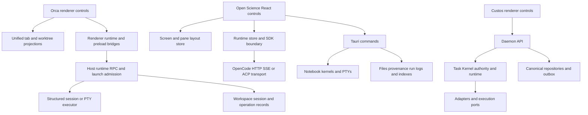

# Desktop workbench core, panels and controls audit

## Reading guide and evidence standard

This audit answers three different questions: what the two reference desktops contain, what each control is wired to, and which behavior belongs in Custos. It is research, not a claim that all reference features have been implemented or exercised in Custos.

Read the architecture and panel tables first. Use the [panel/component index](workbench-control-inventory-panels.md) to navigate all 1,190 source files that declare controls. Use the [control inventory](workbench-control-inventory.json) to find a particular button, input, menu item, handler, disabled expression or source file. The inventory contains source locations and file hashes; the tables explain the important contracts that a list of icons cannot explain.

Evidence levels used here:

| Level | Meaning | What it does not prove |
|---|---|---|
| Indexed | Parsed a source declaration and captured its direct attributes/handler expression | That it renders, is reachable, or succeeds |
| Source-traced | Read the component and relevant state/transport or execution owner | That the deployed application behaves identically |
| Upstream-described | Official documentation or README describes the behavior | That the local snapshot implements the latest description |
| Exercised | Ran the exact journey against the application/backend | This audit does not claim this level for either reference application |

No reference source was executed, dependency installed, agent launched, repository modified, connector called, account accessed or external message sent. Static TypeScript parsing is not a complete interprocedural call graph. No `.codegraph/` directory exists at the three examined repository roots, so CodeGraph was not used.

## Snapshot and coverage

| Project | Local evidence | Provenance limitation |
|---|---|---|
| Orca | `../orca`, package version `1.4.214`; MIT, copyright 2026 Lovecast Inc. | Local `.git` is absent. The earlier source study recorded `3f6225deeb08a82448c5f0b0725073401629d462`, but this audit cannot certify that the current directory equals that revision. The inventory hashes each scanned file instead. |
| Open Science Desktop | `../open-science`, commit `04b64817c12e7fdbe0e052bfa1aeaf8802feecde`, package version `0.6.0`; MIT, copyright 2026 AI4S Workbench contributors | Working tree was clean when checked. This is `ai4s-research/open-science`, not another similarly named science product. |
| Custos | Current dirty checkout, examined read-only for gap mapping | Existing changes are preserved. Passing previous tests is not proof of parity with either reference. |

Official context was checked against [Orca pane documentation](https://www.onorca.dev/docs/model/tabs-panes-splits) and the [Open Science upstream README](https://github.com/ai4s-research/open-science/blob/master/README.md). These moving pages are supporting context; the local source and its hashes are the implementation evidence below.

### Static coverage

| Project | Production TS/TSX/JSX files parsed | TSX/JSX files | Files declaring controls | Control declarations | Action-bearing objects | Parse diagnostics |
|---|---:|---:|---:|---:|---:|---:|
| Orca renderer | 6,558 | 1,660 | 1,108 | 3,899 | 160 | 0 |
| Open Science desktop renderer | 209 | 114 | 82 | 549 | 7 | 0 |

A declaration can represent many runtime buttons, such as one item rendered by `.map()`. A wrapper may also delegate to another indexed control. Consequently **3,899 + 549 is not a count of distinct visible product actions**.

The scan excludes test/spec/story/fixture filenames, selected test/fixture directories and mobile directories. It includes renderer settings, routes and interaction surfaces, not only the visible center canvas. The action-object supplement captures some data-driven menu definitions in `.ts` files. CSS pseudo-controls, native menus, dynamically assembled actions and controls hidden behind unrecognized custom wrappers are not guaranteed complete. Main-process/Rust/SDK paths below were inspected selectively, not exhaustively indexed.

The inventory preserves raw localization expressions, resolves static English labels where possible into `displayLabel`, and records direct JSX text, handler expressions, explicit `disabled`, nearby conditional expressions and prop-spread presence. Expressions have length limits; a missing explicit `disabled` does not establish that an action is executable. The full source location remains authoritative.

Reproduce the index from Custos:

```sh
node tools/workbench-control-audit.cjs /path/to/AgentHub /tmp/workbench-control-inventory.json
```

Third-party expression fragments retain the upstream MIT notices in the inventory. The tool uses the existing desktop TypeScript dependency and parses both reference checkouts without importing their code. Research-tool owner: desktop/Vinh. It is not a product registry, database, schema or second capability service.

## Core architecture compared



| Responsibility | Orca source owner and behavior | Open Science source owner and behavior | Custos transfer rule |
|---|---|---|---|
| Identity | [`tab-types.ts`](../../../orca/src/shared/tab-types.ts): tab ID, backing entity ID, group ID, worktree ID, optional execution host | [`layout.ts`](../../../open-science/apps/desktop/src/lib/layout.ts): project, Screen/group, leaf, conversation and typed content | Keep presentation identity separate from Task, Session, Run, workspace and execution host. A title is never an identity. |
| Layout | Worktree-owned recursive group tree; a group owns tab order and recent-tab history | Project-owned Screens contain recursive conversation/content/artifact panes; docking updates the tree | Extend the existing Custos canvas; never import a second layout store from a reference app. |
| Agent start | [`agent-launch.ts`](../../../orca/src/main/runtime/rpc/methods/agent-launch.ts) routes one intent through a host launch executor | Runtime store chooses an SDK runtime; agent session/turn is distinct from a terminal pane | Keep `StartRun` and registered workspace/harness admission as the Custos execution entrypoint. Opening a pane is not starting a Run. |
| Runtime lanes | Structured agent sessions and PTY-backed agents coexist; native chat can overlay a retained terminal | [`runtime.ts`](../../../open-science/apps/desktop/src/lib/runtime.ts) has OpenCode and ACP paths; terminal-backed coding agents are another surface | Show actual lane/assurance per run. A nice chat view does not imply mediated tools. |
| Transport | Runtime/preload/RPC bridges separate renderer and host | SDK owns agent transport; Tauri owns native/files/kernel operations | All Custos clients still go through daemon APIs. Do not move repositories into React or adapters into domain. |
| Replay | Launch admission persists operation outcome; replay returns recorded result; unknown outcome is refused | Pane persistence and runtime reconnection are present, but do not establish a universal exactly-once command ledger | Reconcile effects independently of restoring views. Never infer that reconnecting means retrying is safe. |
| Live-worker writes | [`dispatch-row-writer.ts`](../../../orca/src/main/runtime/orchestration/db/dispatch-row-writer.ts) centralizes live-worker insertions, depth stamping and ownership guards | Agent runtime owns conversation execution; research run capture is a separate record path | Reuse the canonical Task/Run repositories and outbox. Do not add a parallel agent/task store. |
| Process lifetime | Retained pane host and host identities prevent presentation remount from becoming execution restart | [`terminalSessions.ts`](../../../open-science/apps/desktop/src/lib/terminalSessions.ts) keeps terminal instances outside React; leaf removal owns destruction | Explicitly distinguish hide, move, close view, interrupt process and terminate process. |
| Notebook lifetime | Terminal/editor-oriented coding shell rather than a scientific notebook authority | Persistent Python/R kernels keyed by notebook context; native reset kills/reaps workers | Custos session worker is not identical to a per-file `.ipynb` kernel. Define the mapping before exposing file notebook parity. |
| Scientific records | General work/artifact/session tooling | Provenance records, environment snapshots, run logs, global run index and reviewer skill | Preserve actual input/code/env/output/version links. Do not treat a successful process as a scientific verification. |

### Important source discrepancies

1. Open Science SDK [`runtime.ts`](../../../open-science/packages/sdk/src/runtime.ts) still contains introductory prose describing a sole OpenCode implementation. Actual desktop runtime code imports `AcpRuntime`, constructs it and sets `runtimeKind: "acp"`. The executed branch is stronger evidence than stale comments. The previous Custos source study's OpenCode-only architectural shorthand must be read with this correction.
2. Orca launch executor contains a documented warning-composition gap: after recovery creates a working surface, a warning from a failed startup-terminal attempt can remain misleading. Its code is a useful pattern, not a flawless specification to reproduce verbatim.
3. Open Science [`ArtifactInspector.tsx`](../../../open-science/apps/desktop/src/components/inspector/ArtifactInspector.tsx) renders version-provided data; [`resolveArtifactContent`](../../../open-science/apps/desktop/src/lib/artifacts.ts) falls back from missing version fields to artifact-level fields. This is not proof of archived bytes for every historical version. Custos must retain its explicit unavailable-version behavior.

## Orca panel and action atlas

The detailed declaration for every indexed control is in the JSON. This atlas groups them by user job and explains their execution boundary.

| Panel or surface | Controls and gestures | State/effect distinction and guards | Source anchor |
|---|---|---|---|
| Project/worktree sidebar | Search, select project/worktree, create/import/clone, host selection, rename, filter, status, open-in menu, cleanup/delete dialogs | Selection changes workspace context; create/delete are host effects. Keep host/remote ownership, dirty state and pending creation distinct. | [`SidebarNav.tsx`](../../../orca/src/renderer/src/components/sidebar/SidebarNav.tsx), `components/sidebar`, `components/worktree-creation` |
| Jump palette | Search worktrees/browser tabs, recent tabs, create/open targets | A selected row may focus an existing backing entity rather than create another one. Search is not launch. | `components/use-worktree-jump-palette-*` in the inventory |
| Unified tab strip | Activate, reorder, rename, pin/unpin, color, overflow navigation, recent switching | `entityId` and `contentType` remain distinct from the visible tab. Pinned tabs survive close-others. | [`tab-types.ts`](../../../orca/src/shared/tab-types.ts), `components/tab-bar` |
| Terminal tab menu | Move tab to split; split terminal right/down; chat/terminal view toggle; rename/color/pin; close and bulk close | Workspace split moves a tab. Terminal split requests a new internal terminal pane. View toggle exists only when a real terminal-backed lane supports it. | [`SortableTabContextMenu.tsx`](../../../orca/src/renderer/src/components/tab-bar/SortableTabContextMenu.tsx), [`TerminalTabSplitMenuSection.tsx`](../../../orca/src/renderer/src/components/tab-bar/TerminalTabSplitMenuSection.tsx) |
| Layout menu | Move to right/left/down/up split | `canMoveTabToNewPaneColumn` gates availability. This is a presentation operation, unlike spawning a new shell. | [`TabWorkspaceLayoutMenuSection.tsx`](../../../orca/src/renderer/src/components/tab-bar/TabWorkspaceLayoutMenuSection.tsx) |
| Editor tab menu | Rename, pin, Markdown preview when supported, copy/reveal/open path, close others/all/left/right | Local path open is blocked for inappropriate remote ownership. Dirty-aware close commands must finish or cancel before removal. | [`EditorFileTabContextMenu.tsx`](../../../orca/src/renderer/src/components/tab-bar/EditorFileTabContextMenu.tsx) |
| Tab group close | Close group, close editor-family tabs, close others/left/right | Bulk close uses canonical visual `tabOrder`; excludes pinned siblings where appropriate; delegates to dirty-aware close path. Orca group close closes its contents, unlike Custos's current transfer-and-collapse operation. | [`useTabGroupCloseScopeCommands.ts`](../../../orca/src/renderer/src/components/tab-group/useTabGroupCloseScopeCommands.ts) |
| Retained content host | Focus owning group, keep terminal/chat layer mounted, refit after visible geometry settles | Hidden view is not a dead process. Refit is deferred until measurable size; identity travels separately from DOM position. | [`RetainedPaneHost.tsx`](../../../orca/src/renderer/src/components/tab-group/RetainedPaneHost.tsx) |
| Quick launch | Agent/shell/browser/document entry, search and recent options | Choosing an agent, creating a worktree and delivering its initial prompt are separate stages. Source action classifiers distinguish input kinds. | `components/tab-bar/tab-create-entry-*`, [`useTabGroupCreationCommands.ts`](../../../orca/src/renderer/src/components/tab-group/useTabGroupCreationCommands.ts) |
| Native chat composer | Attach, send/stop, voice toggle/hold, session/model options, context usage, slash-command selection, goal chip | Pending attachments block send. Structured and PTY paths have different transports. Goal drafts clear only after host acceptance and only if the user has not edited them. | [`NativeChatComposerActions.tsx`](../../../orca/src/renderer/src/components/native-chat/NativeChatComposerActions.tsx), [`use-native-chat-composer-submit.ts`](../../../orca/src/renderer/src/components/native-chat/use-native-chat-composer-submit.ts) |
| Native chat stop | Stop active structured turn, cancel queued sends, PTY interrupt | Structured `onStop` is used when available; otherwise the PTY path writes Escape through the runtime input route. An interrupt is not an unconditional process kill. | [`use-native-chat-composer-interrupt.ts`](../../../orca/src/renderer/src/components/native-chat/use-native-chat-composer-interrupt.ts) |
| Send/stop shared button | Send changes to Stop while working | Double-click is explicitly ignored to prevent the second click from stopping the just-started turn. Custos should test this transition if sharing the same button location. | [`NativeChatComposerActions.tsx`](../../../orca/src/renderer/src/components/native-chat/NativeChatComposerActions.tsx) |
| File explorer | Expand/collapse, refresh, name/search filter, dotfiles, ignored files, selection, drag/drop, file operations | Refresh and collapse are gated by capability/state; runtime owner and path root must match the selected worktree. Selection and write/delete are different commands. | [`FileExplorerToolbar.tsx`](../../../orca/src/renderer/src/components/right-sidebar/FileExplorerToolbar.tsx), `components/right-sidebar/useFile*` |
| Source control | Stage/unstage/discard, commit message, adaptive primary action, remote operations, hosted review actions | Primary action is a state machine: pending ops, conflicts, staged files, message and upstream state matter. Unknown upstream status must not briefly advertise Publish Branch. | [`source-control-primary-action.ts`](../../../orca/src/renderer/src/components/right-sidebar/source-control-primary-action.ts), [`source-control-primary-action-decision.ts`](../../../orca/src/shared/source-control-primary-action-decision.ts) |
| Diff/review | Open changed file, inline/split review, annotations, conflicts/check details | A diff tab is a concrete editor-family entity, not a second global Files page. Review operations need exact file/revision context. | `components/editor`, `components/source-control`, `components/right-sidebar` in the inventory |
| Browser navigation | Back, forward, reload/loading, address submit | Shared navigation contract is implemented by the owning browser backend; disabled back/forward states are real history state. | [`browser-navigation-control-row.tsx`](../../../orca/src/renderer/src/components/browser-pane/assemble-chrome/browser-navigation-control-row.tsx) |
| Browser tools | Element tools, markup, page-to-agent, share/publish, overflow, profile/backend choices | Shared action descriptors carry disabled state. Controls fold into overflow by width; hidden panes must not consume discovery popovers. Browser ownership may be local, client-hosted or remote. | [`browser-chrome-toolbar.tsx`](../../../orca/src/renderer/src/components/browser-pane/assemble-chrome/browser-chrome-toolbar.tsx), `components/browser-pane` |
| Terminal | Input, scrollback find, links, split, agent identity/state | A terminal emulator and its PTY are separate objects. Restoring a label or text log is not restoring a live shell. | `components/terminal`, `components/terminal-pane`, `runtime-terminal-inspection` |
| Tasks/hosted work | Search/filter/group/sort, create issue/work item, detail drawer, status/reviewer actions, open workspace | Provider metadata and mutation state must be scoped; not all actions can be copied as local Task actions. | `components/task-page`, `components/github-*`, `components/linear-*`, `components/pull-request-page` |
| Skills/plugins/automations | Catalog search, install/configure, run/schedule/enable, inspect results | Installing or scheduling is an effect, not navigation. Custos requires existing pack/capability/schedule owners. | `components/skills`, `components/plugin-catalog`, `components/automations` |
| Settings | AI capabilities, setup, workflows, interface, remote hosts, security, advanced, experimental | Eight navigation groups organize many actual panes; some settings are host- or repository-specific. A label in the nav registry does not prove platform support. | [`settings-navigation-foundations.ts`](../../../orca/src/renderer/src/components/settings/settings-navigation-foundations.ts), [`settings-navigation-types.ts`](../../../orca/src/renderer/src/lib/settings-navigation-types.ts) |

### Orca launch trace to preserve

`agent.launch` admission → caller/operation fingerprint → replay/refusal or execution → workspace resolution → mode settlement → structured/terminal surface creation → prompt delivery/result receipt.

The executor distinguishes a definitive structured-session refusal from an unknown outcome. Only the definitive case may downgrade to a terminal. Unknown attach outcomes must not silently fall back and create a second agent. Operation replay precedes live selector resolution so yesterday's recorded success is not reinterpreted against today's changed workspace.

Custos should absorb this separation into its existing daemon/runtime/adapter boundaries. It should not absorb Orca's SQLite store or create a second launch/dispatch registry beside Task/Run.

## Open Science panel and action atlas

| Panel or surface | Controls and gestures | State/effect distinction and guards | Source anchor |
|---|---|---|---|
| Projects/sidebar | Select/create/import/rename/pin project, session history, archive/delete, settings navigation | A Project is not a Screen, and a Screen is not a Session. Switching one must not silently change ownership of another. | [`Sidebar.tsx`](../../../open-science/apps/desktop/src/components/sidebar/Sidebar.tsx), `app/routes/ProjectsPage.tsx` |
| Screen strip | Select/rename/close Screen, project menu, new Screen menu | New Screen can contain a conversation, terminal, Files, notebook, Markdown or configured CLI agent. Close may require confirmation depending on actual content. | [`GroupTabs.tsx`](../../../open-science/apps/desktop/src/components/session/GroupTabs.tsx) |
| New Screen menu | Conversation, terminal, Files, notebook, Markdown, available agent entries | Creating a notebook/Markdown file is a file effect; making an unused conversation slot need not create a folder. Do not give every menu item identical create semantics. | `NewScreenButton` in [`GroupTabs.tsx`](../../../open-science/apps/desktop/src/components/session/GroupTabs.tsx) |
| Session header | Find, rename, reveal folder, Files, trajectory, Runs, subagents, notebook shortcuts, close, zoom | The tool toggles retain the originating session (`pinEphemeral`); they should not inspect whichever session became globally active later. | [`SessionView.tsx`](../../../open-science/apps/desktop/src/components/session/SessionView.tsx) |
| Split menu | Continue in same folder, new folder on first send, pick folder, terminal split when offered | Folder aim is chosen before the pane exists. The layout gesture itself does not touch the filesystem. | [`SplitMenu.tsx`](../../../open-science/apps/desktop/src/components/session/SplitMenu.tsx) |
| Pane tree | Resize, dock/move conversation/content, focus, zoom | Recursive geometry and persistent leaf identity are separate from the agent runtime. | [`PaneTree.tsx`](../../../open-science/apps/desktop/src/components/session/PaneTree.tsx), [`layout.ts`](../../../open-science/apps/desktop/src/lib/layout.ts) |
| Content host | Dispatch files/notebook/editor/terminal to the correct surface | Intentionally avoids wrapping every content pane in another header. File clicks reuse one document pane beside the tree rather than generating a narrow pane per click. | [`ContentPane.tsx`](../../../open-science/apps/desktop/src/components/session/ContentPane.tsx) |
| Right inspector shell | Resize, snap closed, maximize/restore, close, mobile takeover | Width is constrained so the conversation remains usable. Closing resets maximize state; hidden conversation/sidebar remain mounted underneath. Header baseline is shared at 32px. | [`RightPane.tsx`](../../../open-science/apps/desktop/src/components/inspector/RightPane.tsx) |
| Composer text | Type, send, history, slash completion, file/session references, shell prefix | `!` is direct shell mode when a handler exists; `/` routes known commands; unknown slash input can remain a prompt. These cannot share a fabricated success path. | [`Composer.tsx`](../../../open-science/apps/desktop/src/components/thread/Composer.tsx) |
| Composer attachments | File picker, binary/image paste, long-paste file chip, remove chip | Files are materialized into the workspace/real attachment parts, not just appended filenames. Large paste threshold and adding state are explicit. | [`Composer.tsx`](../../../open-science/apps/desktop/src/components/thread/Composer.tsx), `lib/tauri.ts` |
| Composer modes | Build/Plan, approval mode, model/variant, ACP config | Build/Plan controls the runtime agent; approval settings control runtime policy. ACP config comes from the actual session. Custos must map these to supported authority/lane contracts, not invent parity. | `Composer.tsx`, [`AcpConfigPicker.tsx`](../../../open-science/apps/desktop/src/components/thread/AcpConfigPicker.tsx), `lib/runtime.ts` |
| Composer compact | Confirm compact, disabled while working/compacting/unavailable | Compaction changes runtime context and may use a model. It is not a cosmetic hide-old-messages button. | `Composer.tsx`, SDK `compactSession` |
| Composer stop | Abort active session | Must reach the client that owns the session directory/runtime; Stop is not merely removing a spinner. | `SessionView.tsx`, `lib/runtime.ts`, SDK |
| Question card | Pick options, multiselect, own-words text, submit, skip | Custom text is sent as the answer, not the word “Other”; single quick-pick is a special branch. Request ID and origin session are retained. | [`InteractionPrompt.tsx`](../../../open-science/apps/desktop/src/components/thread/InteractionPrompt.tsx) |
| Permission card | Reply to a concrete runtime request | Runtime routes to the owning directory client and batches equivalent pending permission requests. A stale 404 can be treated differently from a real failure. | `InteractionPrompt.tsx`, `lib/runtime.ts` around `replyPermission` |
| Thread/trajectory | Tool groups, turn navigation, activity, subagent activity, selection actions | Summary cards project runtime evidence; they are not the execution owner. Subagent requests must return to the actual request/session owner. | `components/thread/TurnWork.tsx`, `TrajectoryPane.tsx`, `SubagentPane.tsx` |
| Artifact presentation | Inline artifact versus current Screen panel, requested right/bottom placement, new Screen or new Session | SDK prompt guidance distinguishes reading/linking a file from a successfully completed `present_artifact` tool call. UI acknowledgement must follow the real presentation result. | [`OpenCodeClient.ts`](../../../open-science/packages/sdk/src/OpenCodeClient.ts), [`PresentedArtifactPane.tsx`](../../../open-science/apps/desktop/src/components/session/PresentedArtifactPane.tsx) |
| File preview/editor | Preview/Code, Edit, Save, Discard/Done, changed-on-disk reload, history, external open/download, close | Root (`workspace` versus `base`) is explicit. Save is disabled without dirty state or while saving; external file changes are surfaced. | [`FilePreviewInspector.tsx`](../../../open-science/apps/desktop/src/components/inspector/FilePreviewInspector.tsx) |
| File viewer types | Text/Markdown/code, table/chart, PDF, image, Office and specialist scientific viewers | Real format probes, supported bytes and native/web access decide availability. A generic text fallback is not a full scientific viewer. | `components/inspector/{TablePreview,TableChart,PdfInspector,OfficePreview,GenomeView,FitsView,MeshView,...}` in inventory |
| Large file preview | Inspect without loading, external open | Avoid loading an entire huge dataset simply to show a pane. Probe/summary is a separate operation. | `LargeFileGate` in `FilePreviewInspector.tsx` |
| Artifact detail | Previous/next version, download script, Code/Execution Log/Messages/Environment/Review tabs | Version arrows are bounded. Displayed review is provided data; neither the tab nor a green icon runs a scientific verifier. | [`ArtifactInspector.tsx`](../../../open-science/apps/desktop/src/components/inspector/ArtifactInspector.tsx) |
| Provenance history | Expand version, environment lockfile, recorded code/diff, reproduce prompt, originating conversation/run | Reproduce prepares a draft for user review; it does not automatically rerun. If a version came from a Run, use the Run recipe rather than pretending any file text is executable code. | [`ProvenancePanel.tsx`](../../../open-science/apps/desktop/src/components/inspector/ProvenancePanel.tsx) |
| Notebook header | Back, kernel status, open JupyterLab, history, reload, close | Actual workspace `.ipynb` is shared with agent edits. Load watches external file changes. It is not a second notebook copy stored only in UI state. | [`NotebookEditor.tsx`](../../../open-science/apps/desktop/src/components/notebook/NotebookEditor.tsx) |
| Notebook cells | Run/Stop, Ask agent, insert above/below, delete, edit, add cell, keyboard command | One active run at a time in the editor. Ask drafts context. Execution output and counters are separate from transient running state. Debounced save writes committed latest cells. | `NotebookEditor.tsx`, [`kernel.ts`](../../../open-science/apps/desktop/src/lib/kernel.ts) |
| Notebook Stop | Reset only the notebook/language kernel | Native kernel map and child/IO locks are separated so a blocked cell does not prevent kill/reap. This is process management, not evidence verification. | [`kernel.rs`](../../../open-science/apps/desktop/src-tauri/src/kernel.rs) |
| Runs ledger | Search, status/surface/time facets, clear filters, expand run, log, copy command, originating conversation, reproduce, output open | Same view powers global and session-scoped Runs. Query is debounced, keyset-paginated, and backed by an index over logs. | [`RunsPage.tsx`](../../../open-science/apps/desktop/src/app/routes/RunsPage.tsx), `lib/runs.ts`, core `runs_index.rs` |
| Terminal menu | Copy/paste/select all/clear, reveal cwd, resume supported CLI agent, search, rename, split terminal/conversation, close | Clear affects display; paste writes input; resume executes a command. Closing a used terminal can stop work and is different from moving its pane. | [`TerminalPane.tsx`](../../../open-science/apps/desktop/src/components/terminal/TerminalPane.tsx), [`terminalSessions.ts`](../../../open-science/apps/desktop/src/lib/terminalSessions.ts) |
| Terminal restore | Save observed cwd/agent/session; resume CLI session when configured | Shell state is not a DOM property. Probe and startup commands are explicit; restored layout can have process effects in the reference, which Custos must not copy implicitly. | `terminalSessions.ts`, `layout.ts` `resumeCommand`/`terminalStartup`, native terminal probe |
| Research starters | End-to-end analysis, dataset exploration, traceability/citation review and other prompts | A starter is a prompt, not a conformance-tested scientific workflow. Do not label it “verified” just because it is bundled. | [`WorkflowStarters.tsx`](../../../open-science/apps/desktop/src/components/thread/WorkflowStarters.tsx) |
| Review cards/skill | Citation, numerical-source and figure/code traceability findings | Explicitly verifies traceability rather than truth. Missing PDF extraction/network/source evidence must remain unknown. | [`traceability-review/SKILL.md`](../../../open-science/runtime/skills/core/traceability-review/SKILL.md), `components/thread/ReviewerCard.tsx` |
| Settings | General, appearance, models, memory, runtime, connectors, browser, computer, compute, remote, privacy | Desktop-only flags apply both to navigation and direct settings routes. Hiding a sidebar item alone is not a sufficient access/availability boundary. | [`sections.ts`](../../../open-science/apps/desktop/src/components/settings/sections.ts), `app/routes/SettingsPage.tsx` |

## State transitions that must be specified before implementing buttons

| User action | Required identity | Expected transition | Failure/retry rule |
|---|---|---|---|
| Open existing file/pane | Workspace/host + backing file/entity + revision when relevant | Focus/reuse the resource or create one presentation ref | Missing scope is selection-required, not an arbitrary default workspace |
| Move/split existing tab | Tab + source/target group + canvas scope | Change presentation ownership once | Keep backing execution/file buffer; do not start another process |
| Split terminal | Workspace/host + terminal session + pane intent | Explicitly create another terminal leaf/process where supported | Distinguish failure before spawn from an unknown spawn result |
| Close resource view | Resource identity + dirty/process state | Close view or ask according to actual consequences | Do not silently equate closing a tab with stopping a Run |
| Submit chat/goal | Session + runtime lane + actual payload/attachments | Accepted/queued/running acknowledgement before reporting success | Retain the submitted draft on failure; do not erase edits typed while request was in flight |
| Stop turn | Session/Run/turn/request owner | Request cancellation; show actual acknowledged state | Not equivalent to terminate PTY or reset kernel |
| Accept permission | Exact request ID + session + action/resources + supported policy | Submit one policy answer to its owner | Already-resolved and network-failed requests are different outcomes |
| Run cell | Notebook identity + source/type/version + workspace/kernel epoch | Save/validate exact source, execute explicitly, attach result | No replay after uncertain execution; source/type edit invalidates output |
| Reproduce result | Recorded command/code + inputs + environment + output version | Prepare a reviewable recipe or admitted execution | Missing manifest is unavailable/incomplete, not a fabricated seed/config |
| Review claim/artifact | Exact claim/artifact version + evidence/method/reviewer | Append an actual review result | A UI click never mints scientific truth or a cryptographic proof |
| Commit/integrate | Task/workspace/repo + expected heads + inspection result | Preview/preflight → explicit effect → receipt/reconcile | Unknown dirty/HEAD state blocks; no automatic repeated merge |
| Dispatch external action | Exact recipient/payload digest + mediated authority | Approved intent → actual connector → durable receipt | Unknown outcome requires reconciliation; never fabricate a receipt |

These contracts are recommendations for Custos. They are not claims that both references implement every row with the same semantics.

## Custos gap analysis from current code

| Priority | Current evidence | Gap and next implementation owner | Acceptance evidence |
|---|---|---|---|
| P0 | `AppTopBar`, workflow strip, desk header, group tabbar, pane toolbars | Chrome can still accumulate multiple permanent rows. Define one application header, one group identity row and only content-specific controls. Lab has its own view nav plus notebook controls; Markdown cells reuse a viewer with another toolbar. Desktop/Vinh. | Measured content space at target window sizes; exactly one owner per title/action; keyboard and Light/Dark GUI check |
| P0 | `types/canvas.ts`, `OrcaTabbedContainer.tsx`, `AppContext.tsx` | Recursive groups exist, but typed `ResourceRef` is not yet the sole identity authority and legacy aliases/split compatibility remain. Preserve one canonical kind/scope resolver and migration path. Desktop/Vinh. | Restore old layouts, reject unknown refs, no duplicate resource after reopen/scope switch |
| P0 | `FilesChangesPane.tsx` | A Files resource is still a combined tree/content pane. It is not yet a first-class file/diff peer resource like the reference desktops. Do not add a second editor; give the existing viewer a resource-bound file/revision adapter. Desktop + daemon. | Open two distinct files/revisions side by side without duplicating loaders or losing unsaved edits |
| P0 | `TerminalWorkbenchPane.tsx` reads daemon terminal chunks into `<pre>` and writes input through controls | A real backend PTY does not make this a full VT terminal emulator. Cursor movement, alternate screen/TUI, IME, selection, search and resize need conformance before claiming Orca-like terminal parity. Desktop + existing terminal adapter. | Real TUI/control-sequence/resize/reconnect tests, not only text-output screenshots |
| P0 | `ConversationPane.tsx` submits via a callback and clears its draft immediately | Per-session drafts now exist, but send-acceptance/failure semantics still need a promise/acknowledgement contract and preservation of in-flight edits. Do not infer success from invoking a void callback. Desktop/AppContext. | Send failure keeps draft; late acknowledgement does not erase newer text; double-click does not stop new turn |
| P0 | Existing notebook coordinator and DB cells | Session-bound notebook cells are not agent-shared `.ipynb` files. Define file import/export/roundtrip, external-change conflict and notebook identity using the existing coordinator. Research/daemon/runtime owners. | Agent edits same notebook file; reload detects conflict; no second executor/store; save preserves unsupported metadata explicitly |
| P0 | `ArtifactInspector.tsx`, registered file API and version metadata | Current bytes can be checked against recorded hashes; historical content is still unavailable when not captured. Add archived bytes only through the existing artifact/CAS owner. Persistence/adapters/daemon. | Two real historical byte versions, reproducible diff and annotations fixed to version |
| P0 | `FindingsPane.tsx` now reads reviews rather than promoting claims | Locator/extraction/semantic support remain separate review stages. Review UI must retain exact evidence/version/method and stale state. Research pack/core. | Broken DOI, wrong passage, unsupported inference and stale figure produce distinct results |
| P0 | Native execution and notebook worker | Native/PTY assurance and OS mediation are not implied by `SandboxPort` names. `seatbelt.rs`/`bubblewrap.rs` examined here are not a completed sandbox implementation. Existing adapters/runtime/core owners. | Actual OS containment and denied-operation tests at configured assurance level |
| P1 | Workspace candidate command metadata and integration preview/recovery | Partial-create reconciliation and whole-workflow idempotency need broader crash fixtures, beyond successful replay tests. Existing workspace coordinator + repository. | Crash at each mutation stage; no duplicate checkout/process/effect; explicit incomplete receipt |
| P1 | Composer/tool/run projections | Questions, permissions, queued sends and subagent-origin requests need an exact owner/recovery contract, rather than generic success cards. Existing workflow/session APIs. | Parent/child sessions, reconnect and already-resolved request cases |
| P1 | Runs ledger | Captured execution output is not a full scientific recipe or a large paginated query surface. Reuse existing run repository, adding actual input/environment manifest and query pagination where supported. | Large ledger with session scope, recorded failures, real recipe completeness |
| P1 | Popout route | Interactive popout is intentionally unavailable without shared-window reconciliation. Do not re-enable by fabricating a tab from its URL. Desktop + daemon event stream. | Same entity/version in two windows; stale edits and close reconciled |
| P1 | Copilot local drafts/read-only Outbox | Real connectors and exact recipient/payload/permit/receipt chain are absent. Keep local review distinct from send. Existing adapter/outbox authority path. | Fake connector with timeout-after-send, duplicate command, ambiguous recipient and reconciliation fixtures |
| P2 | Specialist viewer files in working tree | A viewer component's presence is not format/runtime coverage. Add only formats actually needed, to the existing shared viewer dispatch. | Representative valid/malformed/large files and unavailable fallback |
| P2 | Hosted work, voice, sharing, remote/cloud/mobile | Reference features have separate transports, policies and effects. These are not required to make the local three-workbench core coherent. | Explicit product scope and supported backend before enabling controls |

The P0 items explain why adding more tabs, icons or fixed three-pane presets alone has not produced a fully standardized core. Presets are useful shortcuts; they must not become another mandatory chrome layer or another execution authority.

## Target frame ownership for Custos

| Frame | Sole responsibility | Controls that belong here | Controls that do not belong here |
|---|---|---|---|
| Application header | Project/workbench/global navigation | Lens switch, global palette, application settings/account/usage | Repeated file/artifact Save/Run buttons |
| Workspace sidebar | Choose workspace, conversations and Tasks | Search/filter, create/select, explicit Task/session actions | Hidden execution when selecting a row |
| Canvas group header | Identity, focus and arrangement | Tabs, open resource, move/split, zoom, close-view semantics | A second copy of every content pane title |
| Content toolbar | Actions for the current file/notebook/run/draft | Save/Run/Stop/history/review as applicable | Lens switch or unrelated global settings |
| Inspector | Selected entity scope, metadata, actual evidence/receipts | Open recorded origin/version/run, reason for unavailable action | Fabricated proof/success or a second task/execution store |
| Status/attention | Actual lifecycle and actionable waiting state | Queued/running/waiting/failed/unknown, open exact owner | A spinner used as evidence that execution started or finished |

Default Coding journey: select Task/worktree → inspect/edit peer files → explicitly launch/continue a Run → inspect diff/test evidence → preview integration → integrate/reconcile. Default Research journey: select question/session → read sources → maintain claims with evidence → edit shared notebook/input → execute explicitly → inspect artifact/run/environment → review → prepare Coding handoff. Copilot journey: conversation/Task → local draft/contact/calendar context → explicit review → supported connector effect and receipt when configured.

All three reuse the same resource/canvas, shared viewers, session projection and daemon authority. They do not need three separate app shells.

## Verification plan derived from the references

1. Walk all primary surfaces from the generated inventory; label each action `navigation`, `draft`, `local mutation`, `execution`, `external effect`, or `unavailable`.
2. For every enabled effect, document source identity, input digest/version, backend owner, acknowledgement, error and replay behavior before changing copy.
3. Test move/resize/split without remount-induced process restart; separately test close view, stop turn, terminate PTY, reset kernel and archive workspace.
4. Test editor save/discard with agent changes on disk; preserve unsaved drafts when switching session/lens/workspace.
5. Test the same content at standard desktop sizes and compact layouts. Count persistent header rows and measure useful content area; do not certify from a single screenshot.
6. Test language/runtime differences, capability-unavailable and remote-owner states. A disabled control needs a real explanation and a direct route must enforce the same limitation.
7. Test scientific negative cases: absent bytes, stale figure, missing environment/input, failed run, invalid citation, extraction gap and claim unsupported by its passage.
8. Require the evidence ladder `indexed → compiled → composed → exercised → verified`. This document completes inventory and selected source traces, not the last three rungs for the reference applications.

## Research outputs and limitations

- [Panel/component navigation index](workbench-control-inventory-panels.md): source links and example static labels for every control-bearing component file.
- [Control/action inventory and source hashes](workbench-control-inventory.json): searchable machine-readable evidence.
- [Orca source study](orca-source-study.md): earlier ownership/orchestration mapping, complemented by this control-level audit.
- [Open Science source study](open-science-source-study.md): research-specific provenance/run/reviewer mapping, with runtime-lane correction above.
- [Implementation plan](../../plan.md): current implementation status and release gates; this research does not silently mark them complete.

The audit is broad at static desktop inventory level and selective at semantic handler/backend trace level. It is not a claim to have manually reviewed every one of 6,767 source files, proved every transitive call, exercised every control, audited all security properties, or established that current upstream matches the local snapshots. Mobile controls, external service behavior and platform-specific native menu coverage remain separate work.

### Audit artifact validation

The final scan has zero TypeScript parse diagnostics. A separate validation re-read all 6,767 source files and checked their SHA-256 hashes, checked all 4,448 control line locations, checked summary totals and verified local source links. Static English labels could be resolved for 2,025 declarations; unresolved/dynamic labels remain as source expressions rather than guessed names. Both upstream MIT notices accompany expression fragments in the generated JSON. The research generator passes `node --check`; targeted whitespace checks pass. No application build or runtime test is claimed for this documentation/tooling-only change.
