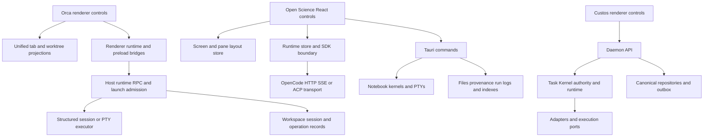
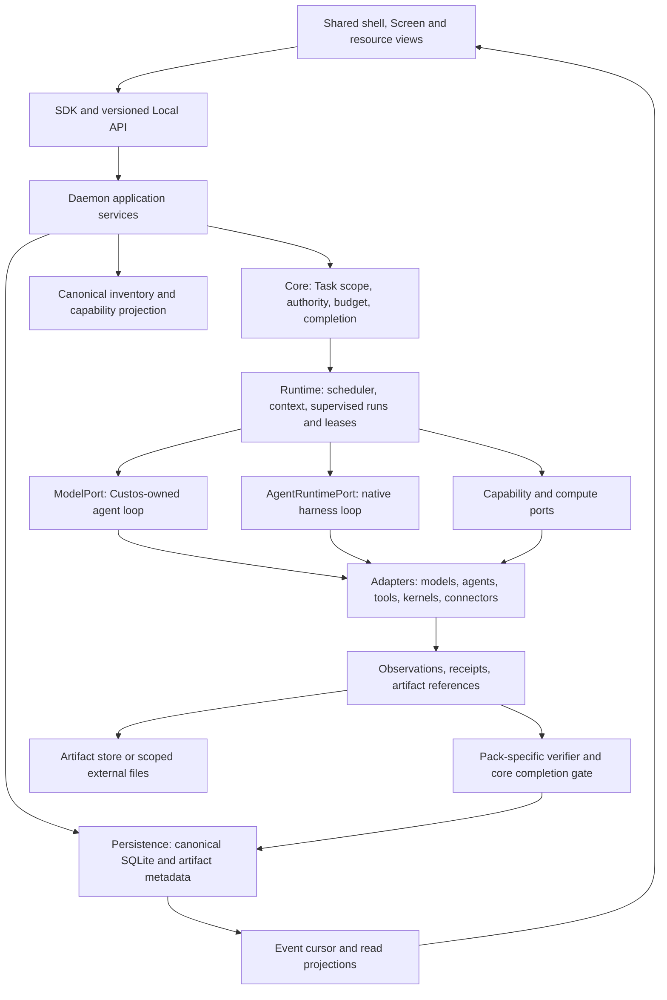
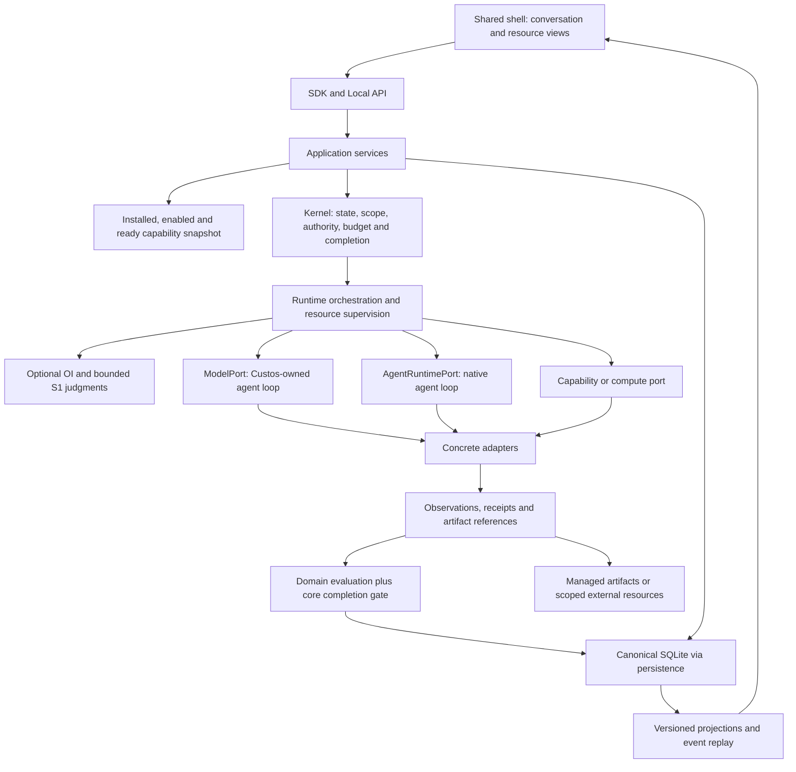

# Desktop workbench core, panels and controls audit

**Current source follow-up:** [Full crates/UI plan](modular-workbench-refactor-plan.md) contains the new findings, baseline checks and target; [file ledger](modular-workbench-file-map.csv) distinguishes all-file structural coverage from selected semantic traces. See the final audit section for scope and the independently reproduced completion gap.

## Reading guide and evidence standard

This audit answers three different questions: what the two reference desktops contain, what each control is wired to, and which behavior belongs in Custos. It is research, not a claim that all reference features have been implemented or exercised in Custos.

Read the architecture and panel tables first. Use the [panel/component index](workbench-control-inventory-panels.md) to navigate all 1,190 source files that declare controls. Use the [control inventory](workbench-control-inventory.json) to find a particular button, input, menu item, handler, disabled expression or source file. The inventory contains source locations and file hashes; the tables explain the important contracts that a list of icons cannot explain.

Evidence levels used here:

| Level | Meaning | What it does not prove |
|---|---|---|
| Indexed | Parsed a source declaration and captured its direct attributes/handler expression | That it renders, is reachable, or succeeds |
| Source-traced | Read the component and relevant state/transport or execution owner | That the deployed application behaves identically |
| Upstream-described | Official documentation or README describes the behavior | That the local snapshot implements the latest description |
| Exercised | Ran the exact journey against the application/backend | This audit does not claim this level for either reference application |

No reference source was executed, dependency installed, agent launched, repository modified, connector called, account accessed or external message sent. Static TypeScript parsing is not a complete interprocedural call graph. No `.codegraph/` directory exists at the three examined repository roots, so CodeGraph was not used.

## Snapshot and coverage

| Project | Local evidence | Provenance limitation |
|---|---|---|
| Orca | `../orca`, package version `1.4.214`; MIT, copyright 2026 Lovecast Inc. | Local `.git` is absent. The earlier source study recorded `3f6225deeb08a82448c5f0b0725073401629d462`, but this audit cannot certify that the current directory equals that revision. The inventory hashes each scanned file instead. |
| Open Science Desktop | `../open-science`, commit `04b64817c12e7fdbe0e052bfa1aeaf8802feecde`, package version `0.6.0`; MIT, copyright 2026 AI4S Workbench contributors | Working tree was clean when checked. This is `ai4s-research/open-science`, not another similarly named science product. |
| Custos | Current dirty checkout, examined read-only for gap mapping | Existing changes are preserved. Passing previous tests is not proof of parity with either reference. |

Official context was checked against [Orca pane documentation](https://www.onorca.dev/docs/model/tabs-panes-splits) and the [Open Science upstream README](https://github.com/ai4s-research/open-science/blob/master/README.md). These moving pages are supporting context; the local source and its hashes are the implementation evidence below.

### Static coverage

| Project | Production TS/TSX/JSX files parsed | TSX/JSX files | Files declaring controls | Control declarations | Action-bearing objects | Parse diagnostics |
|---|---:|---:|---:|---:|---:|---:|
| Orca renderer | 6,558 | 1,660 | 1,108 | 3,899 | 160 | 0 |
| Open Science desktop renderer | 209 | 114 | 82 | 549 | 7 | 0 |

A declaration can represent many runtime buttons, such as one item rendered by `.map()`. A wrapper may also delegate to another indexed control. Consequently **3,899 + 549 is not a count of distinct visible product actions**.

The scan excludes test/spec/story/fixture filenames, selected test/fixture directories and mobile directories. It includes renderer settings, routes and interaction surfaces, not only the visible center canvas. The action-object supplement captures some data-driven menu definitions in `.ts` files. CSS pseudo-controls, native menus, dynamically assembled actions and controls hidden behind unrecognized custom wrappers are not guaranteed complete. Main-process/Rust/SDK paths below were inspected selectively, not exhaustively indexed.

The inventory preserves raw localization expressions, resolves static English labels where possible into `displayLabel`, and records direct JSX text, handler expressions, explicit `disabled`, nearby conditional expressions and prop-spread presence. Expressions have length limits; a missing explicit `disabled` does not establish that an action is executable. The full source location remains authoritative.

Reproduce the index from Custos:

```sh
node xtask/scripts/workbench-control-audit.cjs /path/to/AgentHub /tmp/workbench-control-inventory.json
```

Third-party expression fragments retain the upstream MIT notices in the inventory. The tool uses the existing desktop TypeScript dependency and parses both reference checkouts without importing their code. Research-tool owner: desktop/Vinh. It is not a product registry, database, schema or second capability service.

## Core architecture compared



| Responsibility | Orca source owner and behavior | Open Science source owner and behavior | Custos transfer rule |
|---|---|---|---|
| Identity | [`tab-types.ts`](../../../orca/src/shared/tab-types.ts): tab ID, backing entity ID, group ID, worktree ID, optional execution host | [`layout.ts`](../../../open-science/apps/desktop/src/lib/layout.ts): project, Screen/group, leaf, conversation and typed content | Keep presentation identity separate from Task, Session, Run, workspace and execution host. A title is never an identity. |
| Layout | Worktree-owned recursive group tree; a group owns tab order and recent-tab history | Project-owned Screens contain recursive conversation/content/artifact panes; docking updates the tree | Extend the existing Custos canvas; never import a second layout store from a reference app. |
| Agent start | [`agent-launch.ts`](../../../orca/src/main/runtime/rpc/methods/agent-launch.ts) routes one intent through a host launch executor | Runtime store chooses an SDK runtime; agent session/turn is distinct from a terminal pane | Keep `StartRun` and registered workspace/harness admission as the Custos execution entrypoint. Opening a pane is not starting a Run. |
| Runtime lanes | Structured agent sessions and PTY-backed agents coexist; native chat can overlay a retained terminal | [`runtime.ts`](../../../open-science/apps/desktop/src/lib/runtime.ts) has OpenCode and ACP paths; terminal-backed coding agents are another surface | Show actual lane/assurance per run. A nice chat view does not imply mediated tools. |
| Transport | Runtime/preload/RPC bridges separate renderer and host | SDK owns agent transport; Tauri owns native/files/kernel operations | All Custos clients still go through daemon APIs. Do not move repositories into React or adapters into domain. |
| Replay | Launch admission persists operation outcome; replay returns recorded result; unknown outcome is refused | Pane persistence and runtime reconnection are present, but do not establish a universal exactly-once command ledger | Reconcile effects independently of restoring views. Never infer that reconnecting means retrying is safe. |
| Live-worker writes | [`dispatch-row-writer.ts`](../../../orca/src/main/runtime/orchestration/db/dispatch-row-writer.ts) centralizes live-worker insertions, depth stamping and ownership guards | Agent runtime owns conversation execution; research run capture is a separate record path | Reuse the canonical Task/Run repositories and outbox. Do not add a parallel agent/task store. |
| Process lifetime | Retained pane host and host identities prevent presentation remount from becoming execution restart | [`terminalSessions.ts`](../../../open-science/apps/desktop/src/lib/terminalSessions.ts) keeps terminal instances outside React; leaf removal owns destruction | Explicitly distinguish hide, move, close view, interrupt process and terminate process. |
| Notebook lifetime | Terminal/editor-oriented coding shell rather than a scientific notebook authority | Persistent Python/R kernels keyed by notebook context; native reset kills/reaps workers | Custos session worker is not identical to a per-file `.ipynb` kernel. Define the mapping before exposing file notebook parity. |
| Scientific records | General work/artifact/session tooling | Provenance records, environment snapshots, run logs, global run index and reviewer skill | Preserve actual input/code/env/output/version links. Do not treat a successful process as a scientific verification. |

### Important source discrepancies

1. Open Science SDK [`runtime.ts`](../../../open-science/packages/sdk/src/runtime.ts) still contains introductory prose describing a sole OpenCode implementation. Actual desktop runtime code imports `AcpRuntime`, constructs it and sets `runtimeKind: "acp"`. The executed branch is stronger evidence than stale comments. The previous Custos source study's OpenCode-only architectural shorthand must be read with this correction.
2. Orca launch executor contains a documented warning-composition gap: after recovery creates a working surface, a warning from a failed startup-terminal attempt can remain misleading. Its code is a useful pattern, not a flawless specification to reproduce verbatim.
3. Open Science [`ArtifactInspector.tsx`](../../../open-science/apps/desktop/src/components/inspector/ArtifactInspector.tsx) renders version-provided data; [`resolveArtifactContent`](../../../open-science/apps/desktop/src/lib/artifacts.ts) falls back from missing version fields to artifact-level fields. This is not proof of archived bytes for every historical version. Custos must retain its explicit unavailable-version behavior.

## Orca panel and action atlas

The detailed declaration for every indexed control is in the JSON. This atlas groups them by user job and explains their execution boundary.

| Panel or surface | Controls and gestures | State/effect distinction and guards | Source anchor |
|---|---|---|---|
| Project/worktree sidebar | Search, select project/worktree, create/import/clone, host selection, rename, filter, status, open-in menu, cleanup/delete dialogs | Selection changes workspace context; create/delete are host effects. Keep host/remote ownership, dirty state and pending creation distinct. | [`SidebarNav.tsx`](../../../orca/src/renderer/src/components/sidebar/SidebarNav.tsx), `components/sidebar`, `components/worktree-creation` |
| Jump palette | Search worktrees/browser tabs, recent tabs, create/open targets | A selected row may focus an existing backing entity rather than create another one. Search is not launch. | `components/use-worktree-jump-palette-*` in the inventory |
| Unified tab strip | Activate, reorder, rename, pin/unpin, color, overflow navigation, recent switching | `entityId` and `contentType` remain distinct from the visible tab. Pinned tabs survive close-others. | [`tab-types.ts`](../../../orca/src/shared/tab-types.ts), `components/tab-bar` |
| Terminal tab menu | Move tab to split; split terminal right/down; chat/terminal view toggle; rename/color/pin; close and bulk close | Workspace split moves a tab. Terminal split requests a new internal terminal pane. View toggle exists only when a real terminal-backed lane supports it. | [`SortableTabContextMenu.tsx`](../../../orca/src/renderer/src/components/tab-bar/SortableTabContextMenu.tsx), [`TerminalTabSplitMenuSection.tsx`](../../../orca/src/renderer/src/components/tab-bar/TerminalTabSplitMenuSection.tsx) |
| Layout menu | Move to right/left/down/up split | `canMoveTabToNewPaneColumn` gates availability. This is a presentation operation, unlike spawning a new shell. | [`TabWorkspaceLayoutMenuSection.tsx`](../../../orca/src/renderer/src/components/tab-bar/TabWorkspaceLayoutMenuSection.tsx) |
| Editor tab menu | Rename, pin, Markdown preview when supported, copy/reveal/open path, close others/all/left/right | Local path open is blocked for inappropriate remote ownership. Dirty-aware close commands must finish or cancel before removal. | [`EditorFileTabContextMenu.tsx`](../../../orca/src/renderer/src/components/tab-bar/EditorFileTabContextMenu.tsx) |
| Tab group close | Close group, close editor-family tabs, close others/left/right | Bulk close uses canonical visual `tabOrder`; excludes pinned siblings where appropriate; delegates to dirty-aware close path. Orca group close closes its contents, unlike Custos's current transfer-and-collapse operation. | [`useTabGroupCloseScopeCommands.ts`](../../../orca/src/renderer/src/components/tab-group/useTabGroupCloseScopeCommands.ts) |
| Retained content host | Focus owning group, keep terminal/chat layer mounted, refit after visible geometry settles | Hidden view is not a dead process. Refit is deferred until measurable size; identity travels separately from DOM position. | [`RetainedPaneHost.tsx`](../../../orca/src/renderer/src/components/tab-group/RetainedPaneHost.tsx) |
| Quick launch | Agent/shell/browser/document entry, search and recent options | Choosing an agent, creating a worktree and delivering its initial prompt are separate stages. Source action classifiers distinguish input kinds. | `components/tab-bar/tab-create-entry-*`, [`useTabGroupCreationCommands.ts`](../../../orca/src/renderer/src/components/tab-group/useTabGroupCreationCommands.ts) |
| Native chat composer | Attach, send/stop, voice toggle/hold, session/model options, context usage, slash-command selection, goal chip | Pending attachments block send. Structured and PTY paths have different transports. Goal drafts clear only after host acceptance and only if the user has not edited them. | [`NativeChatComposerActions.tsx`](../../../orca/src/renderer/src/components/native-chat/NativeChatComposerActions.tsx), [`use-native-chat-composer-submit.ts`](../../../orca/src/renderer/src/components/native-chat/use-native-chat-composer-submit.ts) |
| Native chat stop | Stop active structured turn, cancel queued sends, PTY interrupt | Structured `onStop` is used when available; otherwise the PTY path writes Escape through the runtime input route. An interrupt is not an unconditional process kill. | [`use-native-chat-composer-interrupt.ts`](../../../orca/src/renderer/src/components/native-chat/use-native-chat-composer-interrupt.ts) |
| Send/stop shared button | Send changes to Stop while working | Double-click is explicitly ignored to prevent the second click from stopping the just-started turn. Custos should test this transition if sharing the same button location. | [`NativeChatComposerActions.tsx`](../../../orca/src/renderer/src/components/native-chat/NativeChatComposerActions.tsx) |
| File explorer | Expand/collapse, refresh, name/search filter, dotfiles, ignored files, selection, drag/drop, file operations | Refresh and collapse are gated by capability/state; runtime owner and path root must match the selected worktree. Selection and write/delete are different commands. | [`FileExplorerToolbar.tsx`](../../../orca/src/renderer/src/components/right-sidebar/FileExplorerToolbar.tsx), `components/right-sidebar/useFile*` |
| Source control | Stage/unstage/discard, commit message, adaptive primary action, remote operations, hosted review actions | Primary action is a state machine: pending ops, conflicts, staged files, message and upstream state matter. Unknown upstream status must not briefly advertise Publish Branch. | [`source-control-primary-action.ts`](../../../orca/src/renderer/src/components/right-sidebar/source-control-primary-action.ts), [`source-control-primary-action-decision.ts`](../../../orca/src/shared/source-control-primary-action-decision.ts) |
| Diff/review | Open changed file, inline/split review, annotations, conflicts/check details | A diff tab is a concrete editor-family entity, not a second global Files page. Review operations need exact file/revision context. | `components/editor`, `components/source-control`, `components/right-sidebar` in the inventory |
| Browser navigation | Back, forward, reload/loading, address submit | Shared navigation contract is implemented by the owning browser backend; disabled back/forward states are real history state. | [`browser-navigation-control-row.tsx`](../../../orca/src/renderer/src/components/browser-pane/assemble-chrome/browser-navigation-control-row.tsx) |
| Browser tools | Element tools, markup, page-to-agent, share/publish, overflow, profile/backend choices | Shared action descriptors carry disabled state. Controls fold into overflow by width; hidden panes must not consume discovery popovers. Browser ownership may be local, client-hosted or remote. | [`browser-chrome-toolbar.tsx`](../../../orca/src/renderer/src/components/browser-pane/assemble-chrome/browser-chrome-toolbar.tsx), `components/browser-pane` |
| Terminal | Input, scrollback find, links, split, agent identity/state | A terminal emulator and its PTY are separate objects. Restoring a label or text log is not restoring a live shell. | `components/terminal`, `components/terminal-pane`, `runtime-terminal-inspection` |
| Tasks/hosted work | Search/filter/group/sort, create issue/work item, detail drawer, status/reviewer actions, open workspace | Provider metadata and mutation state must be scoped; not all actions can be copied as local Task actions. | `components/task-page`, `components/github-*`, `components/linear-*`, `components/pull-request-page` |
| Skills/plugins/automations | Catalog search, install/configure, run/schedule/enable, inspect results | Installing or scheduling is an effect, not navigation. Custos requires existing pack/capability/schedule owners. | `components/skills`, `components/plugin-catalog`, `components/automations` |
| Settings | AI capabilities, setup, workflows, interface, remote hosts, security, advanced, experimental | Eight navigation groups organize many actual panes; some settings are host- or repository-specific. A label in the nav registry does not prove platform support. | [`settings-navigation-foundations.ts`](../../../orca/src/renderer/src/components/settings/settings-navigation-foundations.ts), [`settings-navigation-types.ts`](../../../orca/src/renderer/src/lib/settings-navigation-types.ts) |

### Orca launch trace to preserve

`agent.launch` admission → caller/operation fingerprint → replay/refusal or execution → workspace resolution → mode settlement → structured/terminal surface creation → prompt delivery/result receipt.

The executor distinguishes a definitive structured-session refusal from an unknown outcome. Only the definitive case may downgrade to a terminal. Unknown attach outcomes must not silently fall back and create a second agent. Operation replay precedes live selector resolution so yesterday's recorded success is not reinterpreted against today's changed workspace.

Custos should absorb this separation into its existing daemon/runtime/adapter boundaries. It should not absorb Orca's SQLite store or create a second launch/dispatch registry beside Task/Run.

## Open Science panel and action atlas

| Panel or surface | Controls and gestures | State/effect distinction and guards | Source anchor |
|---|---|---|---|
| Projects/sidebar | Select/create/import/rename/pin project, session history, archive/delete, settings navigation | A Project is not a Screen, and a Screen is not a Session. Switching one must not silently change ownership of another. | [`Sidebar.tsx`](../../../open-science/apps/desktop/src/components/sidebar/Sidebar.tsx), `app/routes/ProjectsPage.tsx` |
| Screen strip | Select/rename/close Screen, project menu, new Screen menu | New Screen can contain a conversation, terminal, Files, notebook, Markdown or configured CLI agent. Close may require confirmation depending on actual content. | [`GroupTabs.tsx`](../../../open-science/apps/desktop/src/components/session/GroupTabs.tsx) |
| New Screen menu | Conversation, terminal, Files, notebook, Markdown, available agent entries | Creating a notebook/Markdown file is a file effect; making an unused conversation slot need not create a folder. Do not give every menu item identical create semantics. | `NewScreenButton` in [`GroupTabs.tsx`](../../../open-science/apps/desktop/src/components/session/GroupTabs.tsx) |
| Session header | Find, rename, reveal folder, Files, trajectory, Runs, subagents, notebook shortcuts, close, zoom | The tool toggles retain the originating session (`pinEphemeral`); they should not inspect whichever session became globally active later. | [`SessionView.tsx`](../../../open-science/apps/desktop/src/components/session/SessionView.tsx) |
| Split menu | Continue in same folder, new folder on first send, pick folder, terminal split when offered | Folder aim is chosen before the pane exists. The layout gesture itself does not touch the filesystem. | [`SplitMenu.tsx`](../../../open-science/apps/desktop/src/components/session/SplitMenu.tsx) |
| Pane tree | Resize, dock/move conversation/content, focus, zoom | Recursive geometry and persistent leaf identity are separate from the agent runtime. | [`PaneTree.tsx`](../../../open-science/apps/desktop/src/components/session/PaneTree.tsx), [`layout.ts`](../../../open-science/apps/desktop/src/lib/layout.ts) |
| Content host | Dispatch files/notebook/editor/terminal to the correct surface | Intentionally avoids wrapping every content pane in another header. File clicks reuse one document pane beside the tree rather than generating a narrow pane per click. | [`ContentPane.tsx`](../../../open-science/apps/desktop/src/components/session/ContentPane.tsx) |
| Right inspector shell | Resize, snap closed, maximize/restore, close, mobile takeover | Width is constrained so the conversation remains usable. Closing resets maximize state; hidden conversation/sidebar remain mounted underneath. Header baseline is shared at 32px. | [`RightPane.tsx`](../../../open-science/apps/desktop/src/components/inspector/RightPane.tsx) |
| Composer text | Type, send, history, slash completion, file/session references, shell prefix | `!` is direct shell mode when a handler exists; `/` routes known commands; unknown slash input can remain a prompt. These cannot share a fabricated success path. | [`Composer.tsx`](../../../open-science/apps/desktop/src/components/thread/Composer.tsx) |
| Composer attachments | File picker, binary/image paste, long-paste file chip, remove chip | Files are materialized into the workspace/real attachment parts, not just appended filenames. Large paste threshold and adding state are explicit. | [`Composer.tsx`](../../../open-science/apps/desktop/src/components/thread/Composer.tsx), `lib/tauri.ts` |
| Composer modes | Build/Plan, approval mode, model/variant, ACP config | Build/Plan controls the runtime agent; approval settings control runtime policy. ACP config comes from the actual session. Custos must map these to supported authority/lane contracts, not invent parity. | `Composer.tsx`, [`AcpConfigPicker.tsx`](../../../open-science/apps/desktop/src/components/thread/AcpConfigPicker.tsx), `lib/runtime.ts` |
| Composer compact | Confirm compact, disabled while working/compacting/unavailable | Compaction changes runtime context and may use a model. It is not a cosmetic hide-old-messages button. | `Composer.tsx`, SDK `compactSession` |
| Composer stop | Abort active session | Must reach the client that owns the session directory/runtime; Stop is not merely removing a spinner. | `SessionView.tsx`, `lib/runtime.ts`, SDK |
| Question card | Pick options, multiselect, own-words text, submit, skip | Custom text is sent as the answer, not the word “Other”; single quick-pick is a special branch. Request ID and origin session are retained. | [`InteractionPrompt.tsx`](../../../open-science/apps/desktop/src/components/thread/InteractionPrompt.tsx) |
| Permission card | Reply to a concrete runtime request | Runtime routes to the owning directory client and batches equivalent pending permission requests. A stale 404 can be treated differently from a real failure. | `InteractionPrompt.tsx`, `lib/runtime.ts` around `replyPermission` |
| Thread/trajectory | Tool groups, turn navigation, activity, subagent activity, selection actions | Summary cards project runtime evidence; they are not the execution owner. Subagent requests must return to the actual request/session owner. | `components/thread/TurnWork.tsx`, `TrajectoryPane.tsx`, `SubagentPane.tsx` |
| Artifact presentation | Inline artifact versus current Screen panel, requested right/bottom placement, new Screen or new Session | SDK prompt guidance distinguishes reading/linking a file from a successfully completed `present_artifact` tool call. UI acknowledgement must follow the real presentation result. | [`OpenCodeClient.ts`](../../../open-science/packages/sdk/src/OpenCodeClient.ts), [`PresentedArtifactPane.tsx`](../../../open-science/apps/desktop/src/components/session/PresentedArtifactPane.tsx) |
| File preview/editor | Preview/Code, Edit, Save, Discard/Done, changed-on-disk reload, history, external open/download, close | Root (`workspace` versus `base`) is explicit. Save is disabled without dirty state or while saving; external file changes are surfaced. | [`FilePreviewInspector.tsx`](../../../open-science/apps/desktop/src/components/inspector/FilePreviewInspector.tsx) |
| File viewer types | Text/Markdown/code, table/chart, PDF, image, Office and specialist scientific viewers | Real format probes, supported bytes and native/web access decide availability. A generic text fallback is not a full scientific viewer. | `components/inspector/{TablePreview,TableChart,PdfInspector,OfficePreview,GenomeView,FitsView,MeshView,...}` in inventory |
| Large file preview | Inspect without loading, external open | Avoid loading an entire huge dataset simply to show a pane. Probe/summary is a separate operation. | `LargeFileGate` in `FilePreviewInspector.tsx` |
| Artifact detail | Previous/next version, download script, Code/Execution Log/Messages/Environment/Review tabs | Version arrows are bounded. Displayed review is provided data; neither the tab nor a green icon runs a scientific verifier. | [`ArtifactInspector.tsx`](../../../open-science/apps/desktop/src/components/inspector/ArtifactInspector.tsx) |
| Provenance history | Expand version, environment lockfile, recorded code/diff, reproduce prompt, originating conversation/run | Reproduce prepares a draft for user review; it does not automatically rerun. If a version came from a Run, use the Run recipe rather than pretending any file text is executable code. | [`ProvenancePanel.tsx`](../../../open-science/apps/desktop/src/components/inspector/ProvenancePanel.tsx) |
| Notebook header | Back, kernel status, open JupyterLab, history, reload, close | Actual workspace `.ipynb` is shared with agent edits. Load watches external file changes. It is not a second notebook copy stored only in UI state. | [`NotebookEditor.tsx`](../../../open-science/apps/desktop/src/components/notebook/NotebookEditor.tsx) |
| Notebook cells | Run/Stop, Ask agent, insert above/below, delete, edit, add cell, keyboard command | One active run at a time in the editor. Ask drafts context. Execution output and counters are separate from transient running state. Debounced save writes committed latest cells. | `NotebookEditor.tsx`, [`kernel.ts`](../../../open-science/apps/desktop/src/lib/kernel.ts) |
| Notebook Stop | Reset only the notebook/language kernel | Native kernel map and child/IO locks are separated so a blocked cell does not prevent kill/reap. This is process management, not evidence verification. | [`kernel.rs`](../../../open-science/apps/desktop/src-tauri/src/kernel.rs) |
| Runs ledger | Search, status/surface/time facets, clear filters, expand run, log, copy command, originating conversation, reproduce, output open | Same view powers global and session-scoped Runs. Query is debounced, keyset-paginated, and backed by an index over logs. | [`RunsPage.tsx`](../../../open-science/apps/desktop/src/app/routes/RunsPage.tsx), `lib/runs.ts`, core `runs_index.rs` |
| Terminal menu | Copy/paste/select all/clear, reveal cwd, resume supported CLI agent, search, rename, split terminal/conversation, close | Clear affects display; paste writes input; resume executes a command. Closing a used terminal can stop work and is different from moving its pane. | [`TerminalPane.tsx`](../../../open-science/apps/desktop/src/components/terminal/TerminalPane.tsx), [`terminalSessions.ts`](../../../open-science/apps/desktop/src/lib/terminalSessions.ts) |
| Terminal restore | Save observed cwd/agent/session; resume CLI session when configured | Shell state is not a DOM property. Probe and startup commands are explicit; restored layout can have process effects in the reference, which Custos must not copy implicitly. | `terminalSessions.ts`, `layout.ts` `resumeCommand`/`terminalStartup`, native terminal probe |
| Research starters | End-to-end analysis, dataset exploration, traceability/citation review and other prompts | A starter is a prompt, not a conformance-tested scientific workflow. Do not label it “verified” just because it is bundled. | [`WorkflowStarters.tsx`](../../../open-science/apps/desktop/src/components/thread/WorkflowStarters.tsx) |
| Review cards/skill | Citation, numerical-source and figure/code traceability findings | Explicitly verifies traceability rather than truth. Missing PDF extraction/network/source evidence must remain unknown. | [`traceability-review/SKILL.md`](../../../open-science/runtime/skills/core/traceability-review/SKILL.md), `components/thread/ReviewerCard.tsx` |
| Settings | General, appearance, models, memory, runtime, connectors, browser, computer, compute, remote, privacy | Desktop-only flags apply both to navigation and direct settings routes. Hiding a sidebar item alone is not a sufficient access/availability boundary. | [`sections.ts`](../../../open-science/apps/desktop/src/components/settings/sections.ts), `app/routes/SettingsPage.tsx` |

## State transitions that must be specified before implementing buttons

| User action | Required identity | Expected transition | Failure/retry rule |
|---|---|---|---|
| Open existing file/pane | Workspace/host + backing file/entity + revision when relevant | Focus/reuse the resource or create one presentation ref | Missing scope is selection-required, not an arbitrary default workspace |
| Move/split existing tab | Tab + source/target group + canvas scope | Change presentation ownership once | Keep backing execution/file buffer; do not start another process |
| Split terminal | Workspace/host + terminal session + pane intent | Explicitly create another terminal leaf/process where supported | Distinguish failure before spawn from an unknown spawn result |
| Close resource view | Resource identity + dirty/process state | Close view or ask according to actual consequences | Do not silently equate closing a tab with stopping a Run |
| Submit chat/goal | Session + runtime lane + actual payload/attachments | Accepted/queued/running acknowledgement before reporting success | Retain the submitted draft on failure; do not erase edits typed while request was in flight |
| Stop turn | Session/Run/turn/request owner | Request cancellation; show actual acknowledged state | Not equivalent to terminate PTY or reset kernel |
| Accept permission | Exact request ID + session + action/resources + supported policy | Submit one policy answer to its owner | Already-resolved and network-failed requests are different outcomes |
| Run cell | Notebook identity + source/type/version + workspace/kernel epoch | Save/validate exact source, execute explicitly, attach result | No replay after uncertain execution; source/type edit invalidates output |
| Reproduce result | Recorded command/code + inputs + environment + output version | Prepare a reviewable recipe or admitted execution | Missing manifest is unavailable/incomplete, not a fabricated seed/config |
| Review claim/artifact | Exact claim/artifact version + evidence/method/reviewer | Append an actual review result | A UI click never mints scientific truth or a cryptographic proof |
| Commit/integrate | Task/workspace/repo + expected heads + inspection result | Preview/preflight → explicit effect → receipt/reconcile | Unknown dirty/HEAD state blocks; no automatic repeated merge |
| Dispatch external action | Exact recipient/payload digest + mediated authority | Approved intent → actual connector → durable receipt | Unknown outcome requires reconciliation; never fabricate a receipt |

These contracts are recommendations for Custos. They are not claims that both references implement every row with the same semantics.

## Custos gap analysis from current code

| Priority | Current evidence | Gap and next implementation owner | Acceptance evidence |
|---|---|---|---|
| P0 | `AppTopBar`, workflow strip, desk header, group tabbar, pane toolbars | Chrome can still accumulate multiple permanent rows. Define one application header, one group identity row and only content-specific controls. Lab has its own view nav plus notebook controls; Markdown cells reuse a viewer with another toolbar. Desktop/Vinh. | Measured content space at target window sizes; exactly one owner per title/action; keyboard and Light/Dark GUI check |
| P0 | `types/canvas.ts`, `OrcaTabbedContainer.tsx`, `AppContext.tsx` | Recursive groups exist, but typed `ResourceRef` is not yet the sole identity authority and legacy aliases/split compatibility remain. Preserve one canonical kind/scope resolver and migration path. Desktop/Vinh. | Restore old layouts, reject unknown refs, no duplicate resource after reopen/scope switch |
| P0 | `FilesChangesPane.tsx` | A Files resource is still a combined tree/content pane. It is not yet a first-class file/diff peer resource like the reference desktops. Do not add a second editor; give the existing viewer a resource-bound file/revision adapter. Desktop + daemon. | Open two distinct files/revisions side by side without duplicating loaders or losing unsaved edits |
| P0 | `TerminalWorkbenchPane.tsx` reads daemon terminal chunks into `<pre>` and writes input through controls | A real backend PTY does not make this a full VT terminal emulator. Cursor movement, alternate screen/TUI, IME, selection, search and resize need conformance before claiming Orca-like terminal parity. Desktop + existing terminal adapter. | Real TUI/control-sequence/resize/reconnect tests, not only text-output screenshots |
| P0 | `ConversationPane.tsx` submits via a callback and clears its draft immediately | Per-session drafts now exist, but send-acceptance/failure semantics still need a promise/acknowledgement contract and preservation of in-flight edits. Do not infer success from invoking a void callback. Desktop/AppContext. | Send failure keeps draft; late acknowledgement does not erase newer text; double-click does not stop new turn |
| P0 | Existing notebook coordinator and DB cells | Session-bound notebook cells are not agent-shared `.ipynb` files. Define file import/export/roundtrip, external-change conflict and notebook identity using the existing coordinator. Research/daemon/runtime owners. | Agent edits same notebook file; reload detects conflict; no second executor/store; save preserves unsupported metadata explicitly |
| P0 | `ArtifactInspector.tsx`, registered file API and version metadata | Current bytes can be checked against recorded hashes; historical content is still unavailable when not captured. Add archived bytes only through the existing artifact/CAS owner. Persistence/adapters/daemon. | Two real historical byte versions, reproducible diff and annotations fixed to version |
| P0 | `FindingsPane.tsx` now reads reviews rather than promoting claims | Locator/extraction/semantic support remain separate review stages. Review UI must retain exact evidence/version/method and stale state. Research pack/core. | Broken DOI, wrong passage, unsupported inference and stale figure produce distinct results |
| P0 | Native execution and notebook worker | Native/PTY assurance and OS mediation are not implied by `SandboxPort` names. `seatbelt.rs`/`bubblewrap.rs` examined here are not a completed sandbox implementation. Existing adapters/runtime/core owners. | Actual OS containment and denied-operation tests at configured assurance level |
| P1 | Workspace candidate command metadata and integration preview/recovery | Partial-create reconciliation and whole-workflow idempotency need broader crash fixtures, beyond successful replay tests. Existing workspace coordinator + repository. | Crash at each mutation stage; no duplicate checkout/process/effect; explicit incomplete receipt |
| P1 | Composer/tool/run projections | Questions, permissions, queued sends and subagent-origin requests need an exact owner/recovery contract, rather than generic success cards. Existing workflow/session APIs. | Parent/child sessions, reconnect and already-resolved request cases |
| P1 | Runs ledger | Captured execution output is not a full scientific recipe or a large paginated query surface. Reuse existing run repository, adding actual input/environment manifest and query pagination where supported. | Large ledger with session scope, recorded failures, real recipe completeness |
| P1 | Popout route | Interactive popout is intentionally unavailable without shared-window reconciliation. Do not re-enable by fabricating a tab from its URL. Desktop + daemon event stream. | Same entity/version in two windows; stale edits and close reconciled |
| P1 | Copilot local drafts/read-only Outbox | Real connectors and exact recipient/payload/permit/receipt chain are absent. Keep local review distinct from send. Existing adapter/outbox authority path. | Fake connector with timeout-after-send, duplicate command, ambiguous recipient and reconciliation fixtures |
| P2 | Specialist viewer files in working tree | A viewer component's presence is not format/runtime coverage. Add only formats actually needed, to the existing shared viewer dispatch. | Representative valid/malformed/large files and unavailable fallback |
| P2 | Hosted work, voice, sharing, remote/cloud/mobile | Reference features have separate transports, policies and effects. These are not required to make the local three-workbench core coherent. | Explicit product scope and supported backend before enabling controls |

The P0 items explain why adding more tabs, icons or fixed three-pane presets alone has not produced a fully standardized core. Presets are useful shortcuts; they must not become another mandatory chrome layer or another execution authority.

## Target frame ownership for Custos

| Frame | Sole responsibility | Controls that belong here | Controls that do not belong here |
|---|---|---|---|
| Application header | Project/workbench/global navigation | Lens switch, global palette, application settings/account/usage | Repeated file/artifact Save/Run buttons |
| Workspace sidebar | Choose workspace, conversations and Tasks | Search/filter, create/select, explicit Task/session actions | Hidden execution when selecting a row |
| Canvas group header | Identity, focus and arrangement | Tabs, open resource, move/split, zoom, close-view semantics | A second copy of every content pane title |
| Content toolbar | Actions for the current file/notebook/run/draft | Save/Run/Stop/history/review as applicable | Lens switch or unrelated global settings |
| Inspector | Selected entity scope, metadata, actual evidence/receipts | Open recorded origin/version/run, reason for unavailable action | Fabricated proof/success or a second task/execution store |
| Status/attention | Actual lifecycle and actionable waiting state | Queued/running/waiting/failed/unknown, open exact owner | A spinner used as evidence that execution started or finished |

Default Coding journey: select Task/worktree → inspect/edit peer files → explicitly launch/continue a Run → inspect diff/test evidence → preview integration → integrate/reconcile. Default Research journey: select question/session → read sources → maintain claims with evidence → edit shared notebook/input → execute explicitly → inspect artifact/run/environment → review → prepare Coding handoff. Copilot journey: conversation/Task → local draft/contact/calendar context → explicit review → supported connector effect and receipt when configured.

All three reuse the same resource/canvas, shared viewers, session projection and daemon authority. They do not need three separate app shells.

## Verification plan derived from the references

1. Walk all primary surfaces from the generated inventory; label each action `navigation`, `draft`, `local mutation`, `execution`, `external effect`, or `unavailable`.
2. For every enabled effect, document source identity, input digest/version, backend owner, acknowledgement, error and replay behavior before changing copy.
3. Test move/resize/split without remount-induced process restart; separately test close view, stop turn, terminate PTY, reset kernel and archive workspace.
4. Test editor save/discard with agent changes on disk; preserve unsaved drafts when switching session/lens/workspace.
5. Test the same content at standard desktop sizes and compact layouts. Count persistent header rows and measure useful content area; do not certify from a single screenshot.
6. Test language/runtime differences, capability-unavailable and remote-owner states. A disabled control needs a real explanation and a direct route must enforce the same limitation.
7. Test scientific negative cases: absent bytes, stale figure, missing environment/input, failed run, invalid citation, extraction gap and claim unsupported by its passage.
8. Require the evidence ladder `indexed → compiled → composed → exercised → verified`. This document completes inventory and selected source traces, not the last three rungs for the reference applications.

## Research outputs and limitations

- [Panel/component navigation index](workbench-control-inventory-panels.md): source links and example static labels for every control-bearing component file.
- [Control/action inventory and source hashes](workbench-control-inventory.json): searchable machine-readable evidence.
- [Orca source study](orca-source-study.md): earlier ownership/orchestration mapping, complemented by this control-level audit.
- [Open Science source study](open-science-source-study.md): research-specific provenance/run/reviewer mapping, with runtime-lane correction above.
- [Implementation proposal](sade-worktree-plan-proposal.md): current implementation status and release gates; this research does not silently mark them complete.

The audit is broad at static desktop inventory level and selective at semantic handler/backend trace level. It is not a claim to have manually reviewed every one of 6,767 source files, proved every transitive call, exercised every control, audited all security properties, or established that current upstream matches the local snapshots. Mobile controls, external service behavior and platform-specific native menu coverage remain separate work.

### Audit artifact validation

The final scan has zero TypeScript parse diagnostics. A separate validation re-read all 6,767 source files and checked their SHA-256 hashes, checked all 4,448 control line locations, checked summary totals and verified local source links. Static English labels could be resolved for 2,025 declarations; unresolved/dynamic labels remain as source expressions rather than guessed names. Both upstream MIT notices accompany expression fragments in the generated JSON. The research generator passes `node --check`; targeted whitespace checks pass. No application build or runtime test is claimed for this documentation/tooling-only change.

## Current Custos crates, UI and three-reference follow-up

This follow-up audits the dirty `vi` checkout at HEAD `f0a7efa`. It extends the earlier reference study; it does not certify the earlier inventory as a scan of the current Custos renderer. Scope is architecture, source-traced high-risk paths and selected rendered navigation. No production source was changed by this audit, no native agent/kernel/broker order was started, and no upstream application was executed.

The working tree changed during inspection: Quant panes gained empty initial states and a benchmark-data module. Findings below distinguish the initial observation from the later source. The migration now seeds **Assistant only**; the older plan's four-Builtin observation is historical and must not be repeated as current. Revalidate every finding against its file before applying a patch.

### Coverage and confidence

| Surface | Evidence obtained | Limit |
|---|---|---|
| Crates inventory | Enumerated and hashed 660 Rust/SQL source files, 183,359 lines at the later scan; inspected Cargo workspace dependency metadata | Inventory includes tests and source declarations; not a manual semantic audit of every line |
| Desktop inventory | Enumerated and hashed 209 TS/TSX/CSS source files, 49,354 lines; traced registry, resource dispatch, AppContext, terminal/notebook and Quant controls | Counts change with ongoing edits; generated/build assets excluded |
| Duplication probe | No byte-identical files larger than 150 bytes among the scanned source sets | Does not prove absence of semantic duplication, copied algorithms or unused exports |
| UI navigation | Browser preview at loopback 1429; Coding, Research/Lab and Quant navigation observed without starting execution | Browser renderer, not packaged Tauri/OS parity; existing private transcript content is not reproduced here |
| OrCa local | `package.json` version 1.4.214; agent launch routing/replay and earlier panel/terminal study | `.git` absent; cannot establish local snapshot equals latest remote |
| Open Science local | Commit `04b64817c12e7fdbe0e052bfa1aeaf8802feecde`; terminal ownership, artifact presentation, run/environment recording | Selected paths, not whole-repo behavior parity |
| QuantDinger local | Commit `e75f0cfa9cd47de9259844fefbf20c2fa1464d45`; durable jobs, strategy lifecycle/command repository, review evidence and deployment topology | Main checkout does not contain the Vue client; frontend documentation/router were checked separately upstream |

Raw inventory from this run was written to `/tmp/custos-workbench-audit-source-index.json` for the current session, not added as a second product registry. No CodeGraph directory was present at the inspected roots; source inspection and Cargo metadata were used instead.

### Findings ordered by consequence

**P1 means correctness/trust/work loss needs resolution before claiming the journey works. P2 means structure, presentation or maintenance debt.** Severity does not assert that an untrusted package already achieves native code execution or that a live broker is configured.

| ID | Priority | Observed path and trigger | Consequence and required correction |
|---|---|---|---|
| C01 | P1 | [`application/packs.rs`](../../crates/custos-daemon/src/application/packs.rs), `packages.install`: missing URL or digest takes an `else` branch that supplies a path string, then calls `commit_installed`. Desktop `installPackage` sends ID/version only | UI can report installed without downloaded/verified bytes. Resolve an approved catalog entry or validate an already-shipped component explicitly; otherwise fail. An inventory row must not stand in for a physical installation |
| C02 | P1 | [`adapters/packages/mod.rs`](../../crates/custos-adapters/src/packages/mod.rs), `scan_local_packages`: manifest/worker existence can produce `sha256:local_discovered`; [`runtime.rs`](../../crates/custos-daemon/src/runtime.rs) commits discoveries directly | Discovery bypasses trust/compatibility validation and can overwrite a disabled row as installed at restart. Treat it as a candidate; validate file manifest, signature/trust, platform and prior enablement before activation. Install and scan also use different roots: platform data-local versus home `.custos` |
| C03 | P1 | [`repositories/packages.rs`](../../crates/custos-persistence/src/repositories/packages.rs): inventory update and event insert are separate autocommit statements; enable/disable uses component ID across versions and writes `'1'`/`'0'` into `enabled_in_profile`; enabled query ignores that field | Crash can split state/audit; profile/version selection is ambiguous. Use one transaction for state+event, explicit selected version/profile semantics, and caller command idempotency rather than a fresh generated ID on every install retry |
| C04 | P1 | [`runtime.rs`](../../crates/custos-daemon/src/runtime.rs) creates an `Arc<DomainPackRegistry>` from inventory at bootstrap; enable/disable handlers mutate DB only; `require_pack_enabled` tests registry membership | Disable may leave current process admitted, while install may not activate until restart. One runtime composition owner must publish a new admitted snapshot or report restart-required truthfully; test direct RPC after enable/disable, not just switcher refresh |
| C05 | P1 | [`research/mod.rs`](../../crates/custos-daemon/src/application/research/mod.rs) and [`quant.rs`](../../crates/custos-daemon/src/application/quant.rs) reject every method before distinguishing historical reads from new execution | Disabling a pack also blocks reading its sources/notebooks/notes/artifacts/results, conflicting with uninstall-retention design. Preserve Base historical viewers and scoped read APIs; gate new domain computation/effects separately |
| C06 | P1 | [`AppContext.tsx`](../../ui/desktop/src/context/AppContext.tsx) initializes all workbenches, keeps defaults on inventory failure and ignores empty results; [`registry.tsx`](../../ui/desktop/src/components/workbenches/registry.tsx) always includes Coding; unknown ID normalizes to Assistant | Offline/error can display unavailable workbenches, empty inventory can retain old state, future identity is lost. Model loading/error/known-empty explicitly; derive availability from canonical projection and preserve unsupported IDs |
| C07 | P1 | [`QuantStrategyExplorer.tsx`](../../ui/desktop/src/components/shell/sidebar/QuantStrategyExplorer.tsx) contains three fixed strategies/two LIVE badges; [`WorkspaceSidebar.tsx`](../../ui/desktop/src/components/shell/WorkspaceSidebar.tsx) hardcodes Quant counts and Ready footer, Research study count 1 | Confirmed in rendered preview. Fake financial state and false readiness appear without records. Remove production demo portfolio/counts and derive real lifecycle; pending or empty is valid. Strategy selection and Alphas/Tearsheet/Risk buttons currently only toast |
| C08 | P1 | [`TearsheetPane.tsx`](../../ui/desktop/src/components/workbenches/quant/TearsheetPane.tsx) queries fixed strategy ID and fills missing/zero metrics via `||` constants; [`RiskAuditPane.tsx`](../../ui/desktop/src/components/workbenches/quant/RiskAuditPane.tsx) auto-evaluates fixed NVDA order, two made-up fills and fixed PBO matrix on mount | Moving defaults to backend calls does not make results user evidence. Use selected strategy/run/input references; unknown metrics remain unknown, valid zero remains zero; opening a view must not submit synthetic analyses. Initial fake metrics were partly removed during inspection, but these fallback/input paths remained |
| C09 | P1 | [`application/quant.rs`](../../crates/custos-daemon/src/application/quant.rs): missing/failed market-bar lookup falls through to supplied/default summary metrics and persists a tearsheet; discovery uses fixed p-values, fixed IC standard deviations and returns `verified` | A computed IC is not empirical evidence for fixed significance/IR; DB persistence can make defaults appear historical. Separate explicit imported summaries from computed runs, require provenance, preserve lookup failures, and bind verification to actual dataset/code/validation outputs |
| C10 | P1 | [`pbo_cscv.rs`](../../crates/custos-packs/src/quant/verifiers/pbo_cscv.rs) accepts `pbo_probability <= 0.50` directly, including negative values, without checking trusted origin/range | A caller's scalar must not serve as independent verification. Reject non-probabilities, require trusted versioned assessment or compute from validated inputs. Trace how metadata is constructed before asserting exploit reachability |
| C11 | P1 integration blocker | [`alce.rs`](../../crates/custos-packs/src/research/verifiers/alce.rs) calls substring/token overlap “NLI”, emits fixed confidence and can create `AssessmentStatus::Verified`; references found in this scan are exports/tests, not production callers | Do not wire this into completion as semantic proof. For example a premise denying that a treatment improves survival can contain the positive claim substring and hit `Entailed(0.98)` before negation handling. Keep it a labeled lexical signal or replace with evaluated assessment + uncertainty; citation/hash/locator validation remains separate |
| C12 | P1 integration blocker | [`worker_lease.rs`](../../crates/custos-runtime/src/packages/worker_lease.rs) drains stdout to EOF before reading stderr; stderr uses unbounded `read_to_end`; no non-test caller found by repository source search | A worker filling stderr can block before stdout closes, causing a false timeout; large stderr can consume memory. Drain both concurrently with caps, cancellation and process-tree cleanup; validate operation identity/schema. Current helper tests do not prove the production application uses this lease |
| C13 | P2 correctness | [`ResourceContent.tsx`](../../ui/desktop/src/components/workbenches/ResourceContent.tsx) resolves an explicit missing `tab.sessionId` by falling back to current session | A stale tab can display another conversation. Explicit invalid references need unavailable/rebind UI; only tabs intentionally following current selection may inherit it. Test cross-session restore and deletion |
| C14 | P2 behavior | [`application/packs.rs`](../../crates/custos-daemon/src/application/packs.rs), jobs-run creates a Task with `contract: None`, appends “Started workbench job”, returns `created` and no Run handle | Creation is not execution. Either name it preparation and offer the shared admitted StartRun path, or return the real admitted/queued Run. LIST/GET readiness is duplicated hardcoded job-name logic, not current provider/input/engine readiness |
| C15 | P2 integration | [`custos-packs/src/lib.rs`](../../crates/custos-packs/src/lib.rs) adds tool compiler and inventory skill factory with only test calls found; contribution files re-export central constants while ResourceContent still names all renderers | New abstractions have not replaced production paths. Complete one caller migration and remove its old path, or keep the helper explicitly experimental. One-line facade files do not provide downloadable modules or domain ownership |
| C16 | P2 structure/UX | 11 TSX files exceeded the repository 600-line threshold at the scan; AppContext 2,519 lines, FilesChanges 1,004, Evidence 989, Synthesis 927, setup panes >1,100; repeated inline dark colors and monospaced microtext remain | Split by behavior/owner with caller tests, not arbitrary line chunks. Long file size is a maintenance signal, not proof of dead code or memory use. Keep one toolbar and contextual inspector; eliminate repeated titles/banners/cards rather than adding more wrappers |

The later Alpha pane starts empty, but still sets every returned candidate to `verified`. The newly added `quantBenchmarkData.ts` calls bars “verified” without a supplier/version/checksum record; a name/comment is not provenance. If a tutorial dataset is retained, make it explicit opt-in with an immutable source record and separate user namespace. Do not silently ingest demonstration market data into normal research history.

### What should stay in crates

The current package dependency graph is materially healthier than the UI suggests. Domain has no production Custos dependency or detected filesystem/network/process calls in the inspected search. Core depends on domain; runtime depends on core/domain/provider; adapters implement external edges; persistence owns concrete storage. The desktop host depends on SDK/domain, not daemon/runtime/persistence. This is evidence to preserve those boundaries, not to rebuild all crates.

| Existing home | Preserve | Refactor target |
|---|---|---|
| `custos-domain` | IDs, typed records, pure invariants, deterministic math | Keep domain algorithms pure; move orchestration out only when actually mixed. No model/client/worker I/O here |
| `custos-core` | Authority, completion, transitions, ports | One authoritative admission path; never convert UI lens/package membership into a grant |
| `custos-provider` | Model event/usage normalization and compatibility semantics | Audit callers of rich legacy types/formats before retirement. Large OpenAI/Anthropic format files are not automatically unused |
| `custos-persistence` | Canonical writer, topic repositories, migration stream | Fix transactional package lifecycle and referential scope; shared registry must reference existing domain records |
| `custos-runtime` | Run/worker/kernel/PTY lifecycle, scheduling, context, OI | Integrate or retire unused parallel helper paths; global resource ceilings and clear stateful lease ownership |
| `custos-adapters` | Provider/harness/MCP/browser/notebook/market/compute I/O | Signature/path enforcement and bounded worker transport at the actual call boundary; do not scatter protocol-specific clients into packs |
| `custos-packs` | Domain jobs/recipes/roles/verifier obligations | Separate declared capability from operational readiness; truthful evidence and no active-lens-only restriction on Assistant orchestration |
| `custos-daemon` | API boundary, application use cases, composition | Publish one inventory/admission projection; transport handler should orchestrate topic service instead of implementing numerical/worker loops inline |
| `custos-sdk` | Versioned client contracts and normalized errors | Keep lightweight; existing core/domain dependency requires DTO reachability review before any removal |
| `custos-bridge` | Session/Task promotion and linkage | Keep presentation identity separate; bridge persistence dev-dependency is not a production violation |
| `custos-app/{cli,desktop}` | Thin host/native shell and SDK consumer | Do not turn it into another business backend or mandatory hop between backend services |

Unit tests under `src` behind `cfg(test)`, crate integration tests under `tests/`, and cross-crate testkit/e2e packages are normal Rust organization. They are not “rubbish” and generally are not linked into a release binary. Production-exported fixtures/bench helpers need caller review; a filename alone is not authorization to delete them. No source deletion list is justified by the byte-duplicate scan.

### Agent-first workbench frame

Custos should offer working material and an agent beside it. It should not require users to navigate a monitoring dashboard before opening a file, paper or strategy. The following is a target interaction design, not a claim that each viewer/connector exists today.

| Workbench | Left navigation: choose real work | Center: repeatable, splittable resources | Right: support selected resource | Primary agent loop |
|---|---|---|---|---|
| Coding, informed by OrCa | Project/repo/worktree, conversations and Tasks; avoid repeating Create worktree under every collapsed row | Agent session/retained PTY, file editor, diff, test output, optional browser | Scope, actual harness/host/assurance, selected diff/test finding, permissions and cost | Select scope → ask/launch → inspect streamed work → review patch/tests → integrate |
| Research, informed by Open Science | Study folder/corpus, sources, notebooks, methods and actual runs; Git optional | Conversation, exact PDF passage, notebook file, dataset/table, figure/report, run comparison | Citation/provenance, environment/kernel/GPU binding, selected run inputs and missing coverage | Question → sources → hypothesis/code → explicit experiment → artifacts/environment → review |
| Quant, informed by QuantDinger | Real strategy revisions, datasets/universes, backtests and deployments; clear paper/signal/live labels | Agent-guided strategy editor + chart/table, backtest report/trades, comparison, execution workspace only when configured | Selected dataset/fees/slippage, leakage/holdout assumptions, risk assessment, actual broker/account/effect state | Idea → versioned strategy/data → backtest → inspect robustness → separately authorized deployment |
| Assistant / shared | Conversations, Tasks, explicit connectors and approvals | Chat, note/draft, attachment/source viewer; may open specialist resource when installed | Selected context, account/recipient, permission/receipt/cost | Ask → gather selected context → draft/result → explicit allowed effect |

Keep icon-only lens controls with accessible names, visible keyboard focus and tooltips. Use content to distinguish workbenches: Coding shows working tree/agent, Research source/experiment, Quant strategy/dataset. A tiny accent can reinforce identity; colorful portfolio cards and ALL-CAPS status badges cannot replace real data.

Primary tabs identify **instances**: file path/revision, notebook ID, source/page, strategy revision, run ID. “Artifacts”, “Runs”, “Evidence” are discovery/inspection surfaces; opening a specific report or comparison belongs in the center. A right inspector may contain contextual metadata and links, not the sole full notebook/report/editor. Allow multiple resources of the same kind and cross-workbench composition without copying a conversation or restarting an agent.

Unify the shell before polishing every pane: one top navigation row, one tab strip per group, one compact content toolbar, optional context line only if it adds information, and one inspector. Avoid repeat pane titles already in tabs, “Ready” footers without checks, large empty-state cards inside navigation, toast-only commands and nested full-page dashboards. Preserve current ScreenContext as layout owner; moving a resource is not executing it.

### Reference transfer map: behavior before code

| Reference evidence | Learn and adapt into Custos | Do not transplant |
|---|---|---|
| [OrCa agent launch](../../../orca/src/main/runtime/rpc/methods/agent-launch.ts), [pane documentation](https://www.onorca.dev/docs/model/tabs-panes-splits) | One launch intent, explicit structured-session versus PTY outcome, replay-aware operation identity, retained process across layout changes, exact tab references | Electron/preload runtime, second session/operation DB, all commerce/remote/mobile surfaces |
| [Open Science terminal ownership](../../../open-science/apps/desktop/src/lib/terminalSessions.ts), [run recording](../../../open-science/apps/desktop/src-tauri/src/runs.rs), [artifact presentation](../../../open-science/apps/desktop/src/lib/artifacts.ts) | Hide/move versus destroy semantics; output discoverability from agent events; exact input/code/environment/output lineage; expensive environment capture outside write lock | File/JSONL event store alongside Custos canonical history, global unbounded run listing, every specialist viewer regardless of user need |
| [QuantDinger jobs](../../../QuantDinger/backend_api_python/app/utils/agent_jobs.py), [command repository](../../../QuantDinger/backend_api_python/app/services/strategy_command_repository.py), [lifecycle](../../../QuantDinger/backend_api_python/app/services/strategy_lifecycle.py) | Submit+observe durable computation; bounded progress replay; idempotent start/stop/reconcile; execution failures classified separately from retryable market state | PostgreSQL/Redis/Celery/Kafka/Compose stack for Base, SaaS billing/admin/marketplace, numeric risk thresholds as universal policy |
| [QuantDinger frontend README](https://github.com/OpenByteInc/QuantDinger-Vue/blob/main/README.md), [router](https://github.com/OpenByteInc/QuantDinger-Vue/blob/main/src/config/router.config.js) | Strategy editor, historical backtests and operational workspace are distinct contexts; preserve source-scoped conversations and job identity across navigation | Its entire navigation/sidebar into a desktop resource canvas. Backend Apache license does not establish permission to reuse frontend source under its separate source-available terms |

The Quant frontend review here covers official product-area documentation and router source, not full view implementations. Before copying any code, inspect the exact frontend license and file provenance. This audit neither copies code nor issues a license-compliance conclusion. Upstream claims of features/performance are not Custos measurements.

### Architecture and data flow to implement within existing boundaries



| Data concern | Shared owner | Domain specialization and invariant |
|---|---|---|
| Session/Task/Run | Existing canonical repositories and command/event ledger | Lens is a view, not another transcript or permission store. Views may share references without inheriting grants |
| Source and payload | Versioned metadata plus CAS/scoped user paths | Coding snapshot + dirty bytes; Research source/passage/code/env; Quant data adjustment/timezone/fees/strategy revision. Snapshot references must exist before claiming reproducibility |
| Resource addressing | Existing source/artifact/notebook records; optional registry as locator | `resource_registry` currently lacks scope/version ownership fields; do not use its URI or `physical_path` alone as permission or a deletion target |
| Engine and execution | Runtime supervisor, native adapters, durable attempt IDs | Local process, notebook kernel and remote GPU job have distinct cancel/reconnect semantics; closing UI cannot silently duplicate or terminate work |
| Verification | Versioned verifier records and core criterion gate | Locator/exit/hash are operational facts; lexical overlap or self-reported numeric score is not trusted semantic/statistical evidence |
| Installation | Verified managed package bytes + profile enablement | Catalog/discovered/installed/enabled/ready/running/granted are separate; retained historical data remains readable without compute pack |
| Shared optimization | Context compiler, budget ledger, runtime/OI under hard policy | Context selection, cache reuse and S1 judgments cannot lower acceptance requirements or auto-enable egress; report unknown spend honestly |

Keep deterministic pure domain algorithms in domain if they remain cohesive. Long-running backtests/parsing/training run as scheduled bounded work, not inline inside a busy API handler or a rendering lifecycle. No new hub, graph database or microservice is needed to repair these paths. Optional engines share compatible dependencies by explicit capability; they do not require installing an entire other workbench UI.

### Repair order linked to the modular packaging campaign

| Order | Changes to deliver together | Existing campaign | Review gate |
|---|---|---|---|
| 1 | Remove fake strategy/count/Ready states; null/unknown metrics; stop synthetic mount analyses; truthful created versus started copy | P00–P02 | Empty/offline profile renders no fake LIVE, performance or successful verification; deliberate fixture imports visibly isolated |
| 2 | Physical verified install, trusted discovery, one package root; atomic command/state/event; profile/version enablement | P03–P06 | Missing URL/catalog payload fails; disabled stays disabled after restart; duplicate command and crash fixtures |
| 3 | Refresh backend admission and UI availability from one versioned snapshot; retain historical reads | P04–P07 | Disable denies new execution through direct API, while prior source/report/history opens; in-flight version remains pinned |
| 4 | Wire actual launch/observe to Coding; bounded workers where used; explicit notebook/kernel/resource lifecycle | P05–P07 | Move/split/reopen does not relaunch; stderr flood does not deadlock or grow unbounded; cancel/uncertain remain honest |
| 5 | Research exact provenance and evaluated support; Quant versioned strategy/dataset, computed versus imported metrics and independent assessment | P07 and pack vertical gates | Citation-negation counterexample stays uncertain/rejected; missing bars cannot produce a computed report; negative probability cannot pass |
| 6 | Replace monolithic hardcoded pane/availability maps with one contribution seam; split state subscriptions and pane subviews by actual responsibility | P08–P11 | Shared resource identities/drafts survive navigation; optional bytes/load/RSS measured; no old execution path or duplicated writers |

Small fixes should retire their old path immediately after caller coverage, rather than adding a new helper and leaving it unused. Maintain the existing [modular workbench plan](modular-workbench-refactor-plan.md) as the implementation campaign; this audit is an evidence ledger, not a second target architecture.

### Checks performed and outstanding proof

- `cargo metadata --offline --no-deps`: current package/dependency map obtained; dev-dependencies separated from production.
- `cargo check --workspace --all-targets --offline`: exit 0 on this working-tree snapshot.
- `npm --prefix ui/desktop run build`: exit 0, TypeScript/Vite completed. Quant pane chunks are emitted in the same build; this does not prove independently downloadable UI.
- `node tests/desktop/canvas-smoke.mjs`: 43 passed, 0 failed. This is useful regression coverage but did not reject the fake portfolio or fixed statistical inputs above.
- `cargo test -p custos-packs alce --offline`: 3 existing tests passed. They check the current heuristic cases; they do not cover the negated-substring counterexample or establish semantic calibration.
- Browser navigation: Quant fake portfolio observed; Research notebook displayed retained output with previous-epoch warning and execution disabled without workspace. That warning/disable is useful truthful behavior to preserve.
- Preview logs also emitted React's cross-component render update warning (`AppProvider` updated while `ScreenProvider` renders). `ScreenContext.tsx::selectScreen` calls AppContext setters inside a `setScreens(previous => ...)` updater; close-screen selection also performs cross-owner updates inside that updater. Keep state updaters pure and resolve navigation transitions outside them; verify select/close/restore under Strict Mode. This is an additional runtime finding, not covered by the green tree-operation smoke tests.
- Production implementation is unchanged by this audit. Full Rust tests, packaged desktop, cross-OS process cleanup, live models/brokers/cloud GPU, accessibility contrast across themes and performance budgets remain unverified here.

Release evidence must include the actual snapshot tested. Passing these checks is not evidence that all three upstream cores were absorbed, all unused code was removed, research claims were semantically verified or a Quant strategy is safe for live execution.

## Review of the supplied master architectural design

The entire supplied 229-line document, headed `CUSTOS MASTER ARCHITECTURAL DESIGN`, was read. It is treated as a design proposal, not a new authority superseding `Custos.md`. It usefully summarizes the agent-first shell, zero fabricated production data, retained work, historical access and audit repair waves. The corrections below are required before its diagrams/contracts can guide implementation without ambiguity. This review modifies documentation only and does not certify the changing working tree.

### Section-by-section assessment

| Proposal section | Keep | Correct before adoption |
|---|---|---|
| Overview diagram | UI→application admission→supervised execution, shared data | Show ModelPort/native AgentRuntimePort/capability execution, observation/evidence and event return path. Upstream product names are references, not four engines to instantiate |
| §1 invariants | Pure domain, canonical single writer, zero fake UI, one lifecycle owner | Keep canonical responsibility groups rather than forbid the already-existing twelfth Cargo package. Logical writer != dedicated thread; define durability, not merely WAL |
| §2 crate map | Existing topic homes and thin app/SDK boundaries | Dependency graph is authoritative over numbered layers; bridge currently depends on runtime for linkage. Do not create `repository_git` or `tools/package-builder` just because the draft names them |
| §3 data | Versioned metadata + out-of-band large artifacts and data-preserving uninstall | URR is locator metadata, not the filesystem/CAS. Separate immutable snapshots, mutable user projects, rebuildable indexes and secrets; hot/cold is not their authority model |
| §4 workbenches | Coding resources, Research grounding/experiments, Quant author/backtest/deploy separation | Avoid Git-only conversations, commit-only parity, WorkerLease=Jupyter, hard cap by declaration, and Assistant-as-kernel. Capture environment/dependency provenance, not just a four-field tuple |
| §5 UI | Center work, optional contextual inspection, exact missing-reference behavior | Chat is a full peer working resource, not always a bottom strip; provider/model belongs to run/session, not necessarily globally. Icon-only switcher, optional sidebars and theme accessibility remain required |
| §6 packages | Trusted bytes, profile enablement, immutable versions, preserved history | Installation, enablement, UI loading, readiness and running are separate state dimensions; verify catalog metadata before transfer and payload integrity after transfer |
| §7 waves | Existing P00–P11 campaign and C01–C16 references | Physical install/signature work is P06, not fully closed by Wave B metadata. Apply safety containment early; full semantic/worker integrations belong to their actual later packets |
| §8 conclusion | One coherent architecture and retirement of competing implementations | Remove “everything must follow this new SSOT” until changes are reconciled in existing master/topic/catalog and supported by implementation evidence |

### Source-backed corrections and decisions

| ID | Design issue | Custos-specific correction and evidence |
|---|---|---|
| D01 | Absolute 11-Cargo-crate rule | Fresh `cargo metadata --offline --no-deps` returns 12 product packages: ten service/library packages and `custos-app-cli`/`custos-app-desktop`. Preserve canonical responsibility grouping; neither split nor merge solely to achieve a number |
| D02 | All structured writes through one dedicated writer thread | `connection.rs` currently uses `Arc<Mutex<Connection>>` and a reader pool, not a dedicated writer actor. Keep one writer authority and short transactions. An actor/thread is an implementation option after measuring blocking/queue behavior, not an architecture prerequisite |
| D03 | WAL implies durable decision commits | Current connection config sets `synchronous=NORMAL`. WAL/NORMAL can retain consistency but lose recently acknowledged transactions after OS/power failure. Define the canonical decision/authority/outbox durability requirement and validate FULL where required; avoid row-level FULL/NORMAL fiction on one shared connection. See [SQLite durability settings](https://sqlite.org/pragma.html#pragma_synchronous) |
| D04 | `resource_registry` already has `resource_id` and complete data semantics | Migration 0044 uses `uri` as primary key, with kind/component/MIME/digest/size/path/provenance. It does not provide project/profile ACL, resource version, owner lifecycle or GC policy. Treat missing fields as contract gaps to reconcile with existing repositories, not existing guarantees |
| D05 | URR is “cold blobs” | Registry is a metadata lookup. CAS stores immutable content; a project folder may be mutable/external; indexes/cache are derived; credentials remain separate. A user notebook, Git checkout or checkpoint is not automatically a cold immutable blob |
| D06 | Parquet/zstd mandatory for all market resources | Reasonable candidate for versioned historical tabular snapshots, not the execution queue or low-latency mutable order book. Use bounded live buffers/event journal and produce snapshots/partitioned historical files as needed; measure query/ingest cost before adding a data engine. [Arrow dataset API](https://arrow.apache.org/docs/python/generated/pyarrow.parquet.ParquetDataset.html) supports selective reads, not automatic optimal storage for every workload |
| D07 | Assistant is the shared core orchestrator | Assistant is a default interaction/domain capability. Kernel owns authority/state, runtime owns execution, OI proposes constrained plans, S1 supplies bounded judgments, S2/native harness reasons. No Assistant agent must run permanently or sit on every Coding/Research request |
| D08 | Three fixed specialist engines | Reuse common execution lanes: Custos-owned model loop, native harness, deterministic tool/compute, remote job. Packs select semantics and verifiers; each does not get a separate Task engine. An installed local coder model is inference, becoming a coding agent only through an admitted harness/tool loop |
| D09 | Global scheduler and lease imply hard CPU/RAM limit | Resource admission/reservation is distinct from actual measurement and OS/device enforcement. Current worker budget declares output/time/memory, and current compute admission performs capacity/exclusive-sharing checks; neither proves full hard limits. Report requested/reserved/observed/enforced/unsupported separately; bound aggregate usage, queues and priority, not just each request independently |
| D10 | Python worker or enum flag implies Jupyter support | `NotebookDriverPort` is a custom persistent Python worker interface, and the package worker currently writes a request to stdin and awaits completion. Adding `StatefulKernel` enum does not implement Jupyter channels/messages. Keep this driver honestly labeled; a Jupyter adapter is optional behind the existing boundary with versioned conformance |
| D11 | Interrupt, shutdown and lease expiry are interchangeable | Current `interrupt_scoped` takes the worker away and increments epoch; it loses Python memory. UI must disclose that current semantic or implement a real interrupt preserving state. Jupyter has distinct interrupt, restart and shutdown operations; closing a view invokes none. Expiry/reclaim requires explicit state-loss policy, and remote jobs need acknowledged stop/reconcile. See [Jupyter kernel manager](https://jupyter-client.readthedocs.io/en/stable/api/jupyter_client.html) |
| D12 | Every Coding session must belong to a Git worktree | Bind actual operations to appropriate resources: checkout for Git mutation, folder for non-Git editing, execution host for remote process, none for general read-only chat. Existing `WorkspaceKind` includes Git, Folder and RemoteSsh. Scope binding does not itself establish OS isolation or intercept native harness tools |
| D13 | Exact-base equals original commit | A dirty worktree differs from HEAD; staged/untracked bytes and relevant paths matter. Bind patch to actual source snapshot/preconditions, then revalidate at dispatch. Native harness direct effects need truthful provider-governed assurance unless interception/isolation is established |
| D14 | Four lineage fields establish reproducibility | Also retain environment/toolchain/dependency lock, invocation/parameters, input versions, random seeds where relevant, engine/model/method versions, output digests and execution host. Missing data stays unknown; hardware nondeterminism may prevent bit-identical reproduction. Git commit optional for non-Git studies |
| D15 | Connected broker plus grant means LIVE | Separate configured, reachable/authenticated, permissioned, actually running deployment and observed fills. Backtest, simulated paper and broker-paper are distinct. Network timeouts require idempotency/receipt/reconciliation, and live risk/lifecycle gates are independent of successful backtest |
| D16 | One linear package state machine | Model immutable installed versions, per-profile enablement, per-process contribution/engine activation, per-attempt execution and per-action grant separately. A package may be installed+disabled while an old admitted run drains; two profiles may differ. No single Running→Stopped arrow describes all of this |
| D17 | Full verification before download | Authenticate catalog/manifest first, download into bounded staging next, verify actual bytes/file inventory/compatibility next, then promote and commit availability. Pre-download metadata trust and post-download payload verification are distinct checks |
| D18 | Signature plus checksum is full update trust | Define trusted root/key lifecycle, artifact identity, channel, freshness/expiry, revoked keys, anti-rollback and offline policy. [TUF](https://theupdateframework.github.io/specification/latest/) illustrates rollback/freeze/mix-and-match threats; using its design principles does not require introducing a homegrown protocol or claiming TUF conformance |
| D19 | Atomic promotion makes DB and files one transaction | SQLite cannot atomically commit arbitrary filesystem or remote effects. Persist intent, perform verified transfer/promotion outside the DB transaction, commit transition/event, and reconcile each crash window. Rename/flush semantics differ by filesystem/platform |
| D20 | Dynamic Host API is a universal plugin sandbox | Same-origin imported JavaScript can access shared page state. Tauri capabilities restrict window/webview IPC exposure, not every component's JS behavior or Rust code. Signed first-party M2 UI is the initial trust model; untrusted third-party plugins need a separately reviewed isolation boundary. [Tauri capability limits](https://v2.tauri.app/security/capabilities/#security-boundaries) |
| D21 | Runtime-installable Rust pack through trait polymorphism | Traits compose code inside the host build; default Rust ABI is not stable. First-party trusted policy may remain host-compiled in M1; optional engines use versioned process protocols and M2 UI uses a compatible Host API. [Rust ABI reference](https://doc.rust-lang.org/reference/items/external-blocks.html#abi) |
| D22 | Every navigation operation must be a pure function outside updater | Pure state updaters/reducers are required, but event handlers/effects may coordinate navigation legitimately. Prohibit cross-provider setters/execution inside state updaters; do not prohibit all navigation side effects such as persisting layout or restoring focus |

### Corrected architecture model



Coding, Research and Quant contribute jobs, tools, viewers and acceptance obligations along these same lanes. OrCa/Open Science/QuantDinger inform domain behavior; their product names are not runtime identities. OI/S1 may assist context/topology/worker selection without becoming authority or mandatory latency on the direct path.

### Corrected package lifecycle and data placement

Installation progression is `candidate → authenticated metadata → downloading/staged → payload verified → installed version`, with explicit failure/cancel/reconcile paths. Enablement is a separate per-profile choice; UI/engine readiness is a separate process-local observation; a running attempt has its own pinned version, grant and terminal/uncertain status. Disable blocks new admissions while preserving authorized cleanup/history; remove waits for references/leases or reports why blocked. An allowed rollback is explicit release policy, not silent downgrade to arbitrary old signed bytes.

Use four storage responsibilities instead of labeling everything hot or cold:

1. **Canonical metadata:** tasks/sessions/runs/authority/outbox/evidence/package lifecycle, versioned domain records and source/artifact references.
2. **Payloads and external resources:** immutable CAS objects, versioned large datasets/checkpoints, and mutable user folders/repositories addressed under explicit ownership and scope.
3. **Derived state:** rebuildable search/vector/symbol/UI projections and caches; bounded telemetry, not another evidence store.
4. **Secrets:** platform credential backend; only references and redacted connection metadata in canonical records.

Registry metadata may index payloads but never owns all their lifecycle by itself. Do not duplicate raw payload between a new URR store and existing CAS. Do not delete user data merely because its workbench package is removed. Readable history remains subject to normal scope/ACL and retention, not public access for every installed plugin.

### Additional closure gates implied by this review

| Gate | What must be demonstrated | Plan packet |
|---|---|---|
| Durability | Actual PRAGMA/storage profile, short transaction behavior, backup and OS/power-loss limitation; no memory-only approval acknowledged as durable | P00/P03 |
| Stateful execution | Honest custom Python versus Jupyter label; interrupt state-loss disclosure; kernel death/epoch/output invalidation; lease expiry does not silently strand remote billing | P02/P07 |
| Update trust | Authenticated metadata, verified payload, expiry/revocation/anti-rollback/offline rules, atomic state+event and filesystem crash reconciliation | P06/P09/P10 |
| Work scope | Non-Git folder study/coding and resource-free Assistant; native tool assurance cannot inherit mediated label from UI shell | P01/P04/P07 |
| Resource budget | Requested/reserved/observed/enforced values; global aggregate and bounded output streams; supported OS limitation visible | P07/P11 |
| Provenance | Dirty/non-Git code inputs, environment/dependencies/parameters, source versions and immutable outputs; unknown fields do not become verified | P07/P09 |
| UI composition | Full conversation alongside peers, run-specific provider/model, inspector optional, theme contrast and no global run authority from lens | P05/P08 |

The supplied document is suitable as a concise architectural overview **after correction**, not as an independent implementation spec. The existing modular plan §§27–33 remains the delivery queue. Official technical documentation supports the individual constraints above; it does not prove Custos is optimal, secure, Jupyter-compatible or cheaper before measurement.

## Crate assembly follow-up

This pass read Cargo metadata for every product package, enumerated all `src` Rust modules, read each package entry point and traced selected bootstrap/port/storage/skill paths. The structural scan covered 608 Rust files under product `src` directories at that scan; this excludes migrations and crate integration tests, so it is not the earlier 660 Rust/SQL inventory scope. File text was scanned for module/entry/I/O candidates, not parsed into a complete call graph or manually certified line by line. The source remains dirty and evolving.

| Product package | Rust src files | Main topic areas |
|---|---:|---|
| domain | 81 | authority, context/evidence, workspace, task/session, research/quant, OI/fleet/shared |
| core | 65 | kernel, authority, evidence, contracts, context/graph policy |
| provider | 48 | canonical model port/events/turn, bridge, catalog and compatibility types |
| persistence | 42 | connection/migrations, topic repositories, store implementations, artifacts |
| bridge | 3 | session promotion/attachment/steering service |
| runtime | 101 | workflow/agent, cognitive/OI/context, resource coordinators and integrations |
| adapters | 129 | provider/harness, local inference, physical resources/tools and protocols |
| daemon | 52 | bootstrap, API transport, topic application handlers and credentials |
| packs | 64 | domain recipes/skills/verifiers and registry/benchmark metadata |
| SDK | 11 | Local API client, wire compatibility and profile resolution |
| app CLI | 9 | SDK-based product entry and terminal presentation |
| app desktop | 3 | thin Tauri host |

These counts are evidence of structural coverage, not a target size. Test code embedded in the same files is included; the simple I/O candidate scan split at the first `cfg(test)` marker and cannot establish production reachability on its own.

### Additional assembly findings

| ID | Finding and current evidence | Required disposition |
|---|---|---|
| A01 | `daemon/runtime.rs` falls back to all four components when `list_enabled_components()` errors | Optional execution must fail closed with visible inventory error; do not widen availability on DB failure. Connect this to C04/C06 tests |
| A02 | `LocalApiDispatcher::new` constructs terminal/files/Python/MCP/default packs; outer bootstrap constructs and replaces several of them. `with_pack_registry` and `with_packs` both set the same registry | One explicit composition root creates selected instances, transport receives dependencies, test constructors remain clearly fixtures. Construction currently does not itself prove Python was spawned, but hidden ownership/defaults make readiness unreliable |
| A03 | `TaskRuntime` accepts many optional ports via builder; dispatcher similarly allows partial production configuration | Validate mandatory dependencies before accepting work, distinguish intentionally unavailable capability from missing required wiring. Do not replace it with an arbitrary string ServiceLocator |
| A04 | Runtime concrete skills implement file/HTTP/process I/O; pack `CargoTestSkill` constructs `SandboxedProcess` directly | Retain domain skill semantics/recipes in packs, move physical mechanics behind existing ports/adapters and enforce admission at the caller. Source declarations are not proof that these skills are all wired into current production tool dispatch |
| A05 | `SandboxedProcess` clears/filter env and invokes `Command::output`, without proving OS file/network isolation or bounded output. Its `stdout_tail`/`stderr_tail` slice by byte offset and can cut a UTF-8 character | Audit actual subprocess execution path, use bounded capture/process-tree semantics and truthful isolation labels. Add multibyte-output regression before preserving/moving helper; no claim of live exploit reachability from this static trace |
| A06 | Provider compatibility files include filesystem image reads, canonical catalog `from_file/to_file` and reqwest error conversion | Move actual acquisition/storage mechanics outward while retaining pure conversion/legacy bridges and attribution. Error conversion alone is not I/O; do not bulk move all vendor format code or claim the provider crate is already entirely pure |
| A07 | Adapter llama.cpp dependencies are non-optional; native feature is empty; daemon eagerly initializes the native inference runtime | Establish API-only build profile and real optional dependency/cfg coverage, then lazy native engine activation or compatible optional worker. Initialization is not proof of model weights loaded; measure both binary/build and process footprint |
| A08 | `WorkloadAdmissionCoordinator` and its attachment APIs exist, but no daemon composition call to `with_admission_coordinator`/`set_admission_coordinator` was found in this scan | Do not claim the resource scheduler governs every model/kernel/job. Trace and wire the actual production resource owners to one admitted accounting policy, or label the path ungoverned/unsupported. Do not create a second scheduler |
| A09 | `StoragePort` is a composite of existing topic traits; SqliteTaskStore implements many narrow ports. Batch writer has only its own test caller found; SDK depends on core/domain; broad re-exports obscure actual imports | Keep narrow consumer interfaces and the shared store implementation. Do not claim all writes use batch writer or that SDK links the daemon. Reduce public aliases/deps only after reachability/compatibility audit; retained tests are not bloat |

The assembly specification is [SADE design §§10–13](../architecture/sade-agent-system-design.md#10-cohesive-assembly-blocks-inside-the-current-crates). It defines block ownership/lifetimes, constructor injection, workbench/skill/executor separation and measurement gates. These are targets integrated into the existing P00–P11 queue, not new crates, schemas, services or a rewritten product runtime.
# Current full crates and UI refactor audit

The source-backed continuation is now [modular-workbench-refactor-plan.md](modular-workbench-refactor-plan.md), §§1–2 for inventory/findings and §§3–13 for target/migration/acceptance. The [per-file CSV](modular-workbench-file-map.csv) captures 1,156 files under crates/ui; 915 source-extension files contain 250,394 lines including tests/generated code. Full-content structural scanning is separate from selected semantic production traces. Historical counts/findings below retain their snapshot scope.

Current baseline `9cd903b` plus user changes passes Rust all-target check, desktop and CLI UI builds, canvas 43/43 and core completion 7/7. A temporary Cargo harness independently reproduced `foreign_task_claim_accepted=true`: current completion gate accepts a passing Task B claim for Task A's required TestResult. The plan records this alongside SPY-to-BTC verified-data fabrication, worker result identity/stateful/enforcement gaps, package truth/trust boundaries and UI ownership/distribution debt. No production remediation was performed in this audit; build/test success is not a clean-bill certification.

The user explicitly waived the fixed 11-crate constraint. Target packages own UI and domain behavior vertically; optional shared capabilities own execution-heavy resources; platform retains common authority/state/storage. Existing deletion of block facades and other source changes were preserved. The current master working copy uses legacy long-form sections; only its architecture-plan reference was synchronized, not restored to an earlier rewritten version.

---
