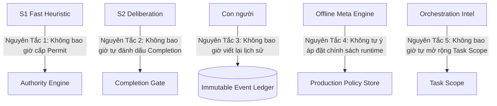

# CUSTOS — ĐẶC TẢ KIẾN TRÚC THEO 10 CHỦ ĐỀ TRỌNG TÂM (SADE AGENT OS)

> **Mã định danh:** CUSTOS-SADE-MASTER-VI-2026  
> **Phiên bản đồng bộ:** 14-11-2026 (Hoàn tất 5 Giai đoạn Tái cấu trúc SuperAgent & Orchestration Intelligence).  
> **Tài liệu gốc tham chiếu (SSOT):** [`../../Custos.md`](../../Custos.md)  
> **Chỉ mục tài liệu kỹ thuật chi tiết:** [`../architecture/README.md`](../architecture/README.md)  
> **Danh mục mã nguồn vật lý:** [`../development/codebase-architecture.md`](../development/codebase-architecture.md)

---

## 1. Tầm Quan Trọng Sâu Sắc Toàn Bộ: Bản Sắc SADE và Khác Biệt Cốt Tử

Các framework tác tử AI thông thường (multi-agent frameworks, wrappers, agent-loops) đang bộc lộ 6 căn bệnh kiến trúc nguy hiểm:
1. **Ảo Tưởng Hoàn Thành (Hallucinated Completion):** Mô hình tự báo cáo "đã hoàn thành" nhưng thực tế mã nguồn chưa chạy kiểm thử, tạo phẩm chưa lưu, hoặc trích dẫn bịa đặt.
2. **Đột Biến Ngoại Vi Tự Do (Uncontrolled Side-Effects):** Tác tử trực tiếp gọi lệnh hệ thống, ghi đè tệp tin mà không có thẩm quyền phân cấp, gây hỏng hóc workspace và xung đột dữ liệu.
3. **Mất Ngữ Cảnh Xuyên Phiên (Context Amnesia):** Toàn bộ trạng thái và trí nhớ bị giam cầm trong từng phiên chat của nhà cung cấp LLM; đổi mô hình hay khởi động lại là mất sạch.
4. **Đứt Gãy Khi Gặp Sự Cố (Brittle Crash State):** Khi tiến trình crash hoặc đứt mạng, hệ thống không thể đối soát tất định, dẫn đến "retry mù" nhân đôi tác dụng phụ vật lý (double execution).
5. **Tiến Trình Ma Chiếm Dụng Tài Nguyên (Zombie Process Leaks):** Subprocess chạy nền (dev servers, compilers, loops) bị bỏ rơi khi run bị hủy, âm thầm chiếm CPU/RAM và khóa tệp tin.
6. **Lãng Phí Kinh Tế Dưới Danh Nghĩa Tối Ưu (Economic Waste):** Tuyên bố đồ thị đa tác tử là "rẻ hơn" mà không tính chi phí con người phải nhảy vào sửa lỗi (\$60/h) và chi phí phục hồi.

**Custos giải quyết triệt để toàn bộ 6 căn bệnh trên.** Custos là **Durable Control Plane (Mặt phẳng Điều khiển Bền vững)** được xây dựng theo mô hình **SADE (Supervised Agent Development Environment)**. Toàn bộ hệ thống được tổ chức nhất quán theo **10 Chủ Đề Kiến Trúc Trọng Tâm**, bảo đảm mọi hành vi của tác tử đều có thẩm quyền, có giám sát, có bằng chứng thực nghiệm và có thể kiểm toán bằng mật mã.

---

## 2. Bản Đồ 10 Chủ Đề Kiến Trúc Trọng Tâm

```
┌─────────────────────────────────────────────────────────────────────────────────────────┐
│                       10 CHỦ ĐỀ KIẾN TRÚC TRỌNG TÂM CỦA CUSTOS SADE                     │
├──────────────────────────────┬──────────────────────────────┬───────────────────────────┤
│ Chủ Đề 1: SADE & Ao Hồ Agent │ Chủ Đề 2: Task Kernel & FSM  │ Chủ Đề 3: Thẩm Quyền & GW │
│ Chủ Đề 4: Agent Loop & Zombie│ Chủ Đề 5: Bằng Chứng & Gate  │ Chủ Đề 6: OI Đo Lường     │
│ Chủ Đề 7: Lưu Trữ SQLite WAL │ Chủ Đề 8: Điện Toán Dị Thể   │ Chủ Đề 9: 4 Workbenches   │
│ Chủ Đề 10: Protocol & Desktop│                              │                           │
└──────────────────────────────┴──────────────────────────────┴───────────────────────────┘
```

---

### Chủ Đề 1: Bản Sắc Sản Phẩm SADE, Hệ Sinh Thái Ao Hồ Tác Tử & Đa Thấu Kính
- **Tầm quan trọng sâu sắc:** Chuyển đổi mô hình từ "chatbot hội thoại" sang "môi trường phát triển tác tử có giám sát" (SADE). Thiết lập hệ sinh thái **Living Commons (Ao Hồ Tác Tử)** nơi các agent tự trị cùng chung sống, chia sẻ tài nguyên được định danh thống nhất qua URR (Unified Resource Reference) và bus sự kiện dùng chung.
- **Cơ chế kiến trúc & Bất biến:**
  - Phân biệt rõ 5 khái niệm tác tử: Model Endpoint, Custos Worker, Native Harness, Worker Role, và Remote Agent.
  - Tách bạch tuyệt đối giữa việc chuyển đổi lăng kính giao diện (Workbench Lens Switch) và quyền thực thi. Việc người dùng mở tab, mở pane hay chuyển lens **tuyệt đối không bao giờ** được coi là giấy phép thực thi ngoại vi.
- **Tài liệu quy chuẩn:** [`architecture/sade-agent-system-design.md`](../architecture/sade-agent-system-design.md), [`architecture/sade-design-and-supervision.md`](../architecture/sade-design-and-supervision.md), [`architecture/sade-foundations.md`](../architecture/sade-foundations.md), [`architecture/sade-agent-lake-ecosystem.md`](../architecture/sade-agent-lake-ecosystem.md).

---

### Chủ Đề 2: Hạt Nhân Tác Vụ, Máy Trạng Thái Bền Vững & Tính Liên Tục
- **Tầm quan trọng sâu sắc:** Task là thực thể hạng nhất (First-Class Entity), độc lập với Session và sống sót qua mọi sự cố crash.
- **Cơ chế kiến trúc & Bất biến:**
  - Hệ thống vận hành bằng 4 máy trạng thái hữu hạn (FSM) trực giao: `Session FSM`, `Task FSM`, `Run FSM`, và `Outbox FSM`.
  - Cơ chế kiểm soát phiên bản lạc quan `state_version` (CAS) trên từng bản ghi thực thi. Writer cũ bị khóa (fenced) ngay khi có thế hệ mới khởi tạo.
  - Phân định ranh giới sở hữu kiểu dữ liệu miền (Domain Ownership): `platform/domain` (`custos-domain`) giữ sự thuần khiết Zero-I/O tuyệt đối (0 async, 0 tokio, 0 sql, 0 fs).
- **Tài liệu quy chuẩn:** [`architecture/kernel-and-task-lifecycle.md`](../architecture/kernel-and-task-lifecycle.md), [`architecture/run-lifecycle.md`](../architecture/run-lifecycle.md), [`architecture/domain-ownership.md`](../architecture/domain-ownership.md), [`architecture/workspace-binding-rules.md`](../architecture/workspace-binding-rules.md).

---

### Chủ Đề 3: Động Cơ Thẩm Quyền, Phòng Vệ Bảo Mật & Cổng Năng Lực
- **Tầm quan trọng sâu sắc:** Mô hình AI vốn không đáng tin cậy hoặc chỉ đáng tin có điều kiện. Mô hình chỉ có quyền phát sinh đề xuất (`ActionIntent`); chỉ có Hạt Nhân Đáng Tin (Trusted Kernel) mới có quyền cấp phép (`ExecutionPermit`).
- **Cơ chế kiến trúc & Bất biến:**
  - Quy trình hòa giải thẩm quyền 2 pha bắt buộc (Two-Phase Mediation):
    1. Pha 1 `authorize()`: Kiểm tra an toàn tham số (chặn đứng `..` traversal), áp dụng chính sách Gate 2 (từ chối Critical tools), và xác thực `Grant` hiện hoạt.
    2. Pha 2 `execute()`: Xin `ExecutionPermit`, tiêu thụ giấy phép đơn lần (INV-03), ghi nhận trạng thái `InFlight` vào transactional outbox, thực thi công cụ trong sandbox, và ghi nhận `Receipt`.
  - Token năng lực gắn liền lời gọi (IBCT) và nguyên lý suy giảm quyền ủy quyền (`Delegation Diminishment` - INV-08).
  - Lan truyền vết nhơ dữ liệu `Tainted<T>` (INV-04): Dữ liệu từ web, email, git ngoài không bao giờ được tự ý nâng cấp thành chính sách thực thi.
- **Tài liệu quy chuẩn:** [`architecture/authority-and-capability-gateway.md`](../architecture/authority-and-capability-gateway.md), [`architecture/security-and-threat-defense.md`](../architecture/security-and-threat-defense.md), [`architecture/capability-catalog-and-skills.md`](../architecture/capability-catalog-and-skills.md).

---

### Chủ Đề 4: Vòng Lặp Agent Có Giám Sát, CLI Agent & Quản Trị Tiến Trình
- **Tầm quan trọng sâu sắc:** Giám sát minh bạch các tác tử CLI bên ngoài (Claude Code, Codex, Aider, OpenCode), chống vòng lặp vô hạn, kiểm soát giới hạn bộ nhớ đệm, và tiêu diệt triệt để tiến trình con mồ côi (zombie processes).
- **Cơ chế kiến trúc & Bất biến:**
  - **`SupervisedAgentRunner` Decorator** (`platform/runtime/src/agent/runner.rs`): Tự động bao bọc mọi `AgentDriver`, đo đạc thời gian thực, sinh các phân đoạn phân tầng `StepSpan`, phát telemetry về `SupervisionTraceSink`, và cảnh báo tức thời qua `SupervisedObserver`.
  - **`ProcessDropGuard`** (`platform/adapters/src/harnesses/stream/process.rs`): Subprocess trên Unix bắt buộc tạo process group mới qua `command.process_group(0)`. Khi struct bị hủy (`Drop`), tự động kích hoạt `libc::kill(-(pid as i32), libc::SIGKILL)` để hủy toàn bộ cây tiến trình (INV-12).
  - Giới hạn dòng chảy công cụ `LimitedWriter`: Chặn tràn RAM với trần `max_tool_output_bytes` (mặc định 64 KiB) và cắt tỉa an toàn theo ranh giới UTF-8 `truncate_to_char_boundary`.
  - Ràng buộc hạt nhân Notebook Jupyter: Phân biệt `NotebookDocument` và `NotebookKernelBinding`, hủy kết quả cũ khi sửa mã nguồn ô trước (`cell_version`).
- **Tài liệu quy chuẩn:** [`architecture/governed-agent-loop.md`](../architecture/governed-agent-loop.md), [`architecture/agent-environment.md`](../architecture/agent-environment.md), [`architecture/notebook-kernel-binding.md`](../architecture/notebook-kernel-binding.md).

---

### Chủ Đề 5: Động Cơ Bằng Chứng, Cổng Hoàn Thành & Cô Lập Thẩm Định
- **Tầm quan trọng sâu sắc:** Triệt tiêu hoàn toàn căn bệnh ảo tưởng hoàn thành. Một tác vụ chỉ được công nhận hoàn thành khi mọi tiêu chí nghiệm thu được bảo chứng bằng bằng chứng thực nghiệm độc lập (INV-05).
- **Cơ chế kiến trúc & Bất biến:**
  - Phân tầng bằng chứng 3 cấp độ: `Fact` (dữ kiện khách quan từ hệ thống) $\rightarrow$ `Extraction` (dữ liệu trích xuất có vị trí rõ ràng) $\rightarrow$ `Semantic` (đánh giá ngữ nghĩa qua mô hình hoặc con người).
  - Bằng chứng bất biến gắn mã băm nội dung CAS hash (SHA-256).
  - Trạng thái `Unknown`, `Stale`, `Uncertain` là các công dân hạng nhất (First-Class States - INV-06). Khi mã nguồn thay đổi, bằng chứng cũ chuyển sang `Stale`, không được dùng lại mù quáng.
- **Tài liệu quy chuẩn:** [`architecture/evidence-and-completion-gate.md`](../architecture/evidence-and-completion-gate.md), [`architecture/three-vertical-acceptance.md`](../architecture/three-vertical-acceptance.md), [`architecture/supervised-experiment-execution-and-recovery.md`](../architecture/supervised-experiment-execution-and-recovery.md).

---

### Chủ Đề 6: Trí Tuệ Điều Phối Đo Lường (OI) & Kinh Tế Học Thực Nghiệm
- **Tầm quan trọng sâu sắc:** Chấm dứt sự suy đoán về chi phí và chất lượng. Thiết lập bài toán tối ưu hóa đa mục tiêu thực nghiệm được khóa bằng bài kiểm tra vàng `G12`.
- **Cơ chế kiến trúc & Bất biến:**
  - **Công thức Chi Phí Kinh Tế Toàn Diện:**
    $$\text{Total Cost} = \text{API Direct Cost} + \text{Recovery Cost} + (\text{Human Intervention Seconds} \times \$60 / 3600)$$
  - **Bộ Chọn Pareto Đa Mục Tiêu (Pareto Multi-Objective Selector):**
    $$U = w_q \cdot Q - w_c \cdot \left(\frac{C}{C_{\text{baseline}}}\right) - w_t \cdot \left(\frac{T}{T_{\text{baseline}}}\right)$$
    Với $w_q = 0.50, w_c = 0.30, w_t = 0.20$.
  - **Bảng Giá Mô Hình Thực Tế & Prompt Cache Affinity:** Claude 3.5 Sonnet (\$3/\$15), Haiku (\$0.8/\$4), GPT-4o (\$2.5/\$10), GPT-4o-mini (\$0.15/\$0.6), Gemini, Local (\$0.00). Chiết khấu đọc cache 0.1x.
  - **Chuỗi 7 Tô Pô Thực Thi (T0–T6):** T0 Direct Pinned (mặc định), T1 Pass-Through, T2 Dual Judge, T3 Speculative Verification, T4 Hierarchical Router, T5 Lead-Worker DAG coordinator (thuật toán Kahn, cycle detection, coverage synthesis gate $\ge 0.80$), T6 Dynamic Replan.
  - **0-Token FastPathFilter (< 1ms, \$0.00):** Xử lý lệnh xác định (`help`, `ping`, `version`, `clear`, `workbenches`, `git status/diff/log`) không tốn token.
- **Tài liệu quy chuẩn:** [`architecture/measured-orchestration-intelligence.md`](../architecture/measured-orchestration-intelligence.md), [`architecture/cognitive-fabric-and-orchestration.md`](../architecture/cognitive-fabric-and-orchestration.md).

---

### Chủ Đề 7: Kiến Trúc Lưu Trữ Bền Vững, SQLite WAL & Partition Engine
- **Tầm quan trọng sâu sắc:** Cung cấp hạ tầng lưu trữ giao dịch cục bộ tuyệt đối tin cậy, không phụ thuộc cloud database, chống nghẽn WAL và hỗ trợ mở rộng quy mô đa cơ sở dữ liệu.
- **Cơ chế kiến trúc & Bất biến:**
  - Kết nối ghi đơn luồng duy nhất (Single-Writer Connection) với chế độ SQLite WAL (INV-07).
  - Sổ cái lệnh (Command Ledger) chỉ ghi nối tiếp (append-only); con người sửa sai bằng giao dịch bù trừ (compensating transaction).
  - **SQLite Partition Engine** (`platform/storage/src/connection.rs`): Hỗ trợ `attach_partition` và `detach_partition` được bảo vệ bằng biểu thức chính quy `^[a-zA-Z0-9_]+$`, triệt tiêu hoàn toàn lỗ hổng SQL Injection khi phân vùng dữ liệu (INV-14).
- **Tài liệu quy chuẩn:** [`architecture/command-ledger.md`](../architecture/command-ledger.md), [`architecture/data-context-and-memory.md`](../architecture/data-context-and-memory.md).

---

### Chủ Đề 8: Điện Toán Dị Thể, Relay Gia Tốc & Tính Liên Tục Huấn Luyện
- **Tầm quan trọng sâu sắc:** Hợp nhất tài nguyên tính toán cục bộ (Apple Silicon Metal / llama.cpp) và đám mây (Google Colab, Kaggle, Rented GPU qua SSH), bảo đảm huấn luyện mô hình và suy luận cùng tồn tại mà không cạn kiệt VRAM hay mất checkpoint.
- **Cơ chế kiến trúc & Bất biến:**
  - Khởi tạo lười (lazy initialization) cho `LlamaCppBackend`, bảo đảm khởi động daemon chiếm 0 MB GPU VRAM.
  - Cổng kiểm tra tính tương thích phần cứng (Hardware Compatibility Gate): Từ chối chạy ngay lập tức nếu thiếu VRAM hoặc sai kiến trúc phần cứng.
  - Tính bền vững của Checkpoint 4 tầng với kiểm chứng mã băm SHA-256 độc lập trước khi tiếp tục huấn luyện (`verify_local_checkpoint_files`).
- **Tài liệu quy chuẩn:** [`architecture/compute-relay-and-heterogeneous-failover.md`](../architecture/compute-relay-and-heterogeneous-failover.md), [`architecture/gpu-training-and-inference-coexistence.md`](../architecture/gpu-training-and-inference-coexistence.md), [`architecture/gpu-workload-admission-and-coordination.md`](../architecture/gpu-workload-admission-and-coordination.md), [`architecture/remote-compute-colab-kaggle.md`](../architecture/remote-compute-colab-kaggle.md), [`architecture/remote-compute-external-gpu.md`](../architecture/remote-compute-external-gpu.md), [`architecture/training-studio-checkpoint-continuity.md`](../architecture/training-studio-checkpoint-continuity.md).

---

### Chủ Đề 9: Bốn Bàn Làm Việc Chuyên Biệt (Vertical Workbenches)
- **Tầm quan trọng sâu sắc:** Đóng gói toàn bộ nghiệp vụ miền chuyên sâu vào từng workbench độc lập, giữ cho platform kernel luôn trung tính và gọn gàng.
- **Cơ chế kiến trúc & Bất biến:**
  - **Assistant Workbench (`workbenches/assistant`):** Quản lý bản thảo phản hồi, outbox email/tin nhắn, lịch hẹn, danh bạ. Không gửi tin nhắn khi chưa có sự phê duyệt rõ ràng từ người dùng.
  - **Coding Workbench (`workbenches/coding`):** Hoạt động trong Git worktree riêng biệt. Phân tích AST, thực thi công thức lập trình (Engineering Recipes), chạy kiểm thử nội bộ.
  - **Research Workbench (`workbenches/research`):** Quản lý tuyên bố khoa học (Claims), trích dẫn tài liệu, quy trình thẩm định ALCE/MiniCheck 4 bước. Tích hợp cơ chế saga bù trừ trong `create_task_batch` (`reviews/handoff.rs`), bảo đảm nếu một task trong chuỗi thất bại thì toàn bộ các task trước đó được rollback sạch sẽ (INV-13).
  - **Quant Workbench (`workbenches/quant`):** Quản lý alpha discovery, backtest, sổ lệnh thị trường. Áp dụng chính sách Zero-Mock 100% cho dữ liệu tài chính thực. Tích hợp bộ thẩm định toán tài chính chuẩn: `DeflatedSharpeVerifier` và `LookaheadBiasChecker`. Toàn bộ tầng giao vận `apps/daemon/src/application/quant/` là thin transport adapters không chứa toán nghiệp vụ.
- **Tài liệu quy chuẩn:** [`architecture/domain-packs-and-workflows.md`](../architecture/domain-packs-and-workflows.md), [`architecture/research-workbench-blueprint.md`](../architecture/research-workbench-blueprint.md), [`architecture/quant-workbench.md`](../architecture/quant-workbench.md), [`architecture/quant-domain-models.md`](../architecture/quant-domain-models.md), [`architecture/quant-pack.md`](../architecture/quant-pack.md), [`architecture/on-demand-packs.md`](../architecture/on-demand-packs.md).

---

### Chủ Đề 10: Giao Thức Kết Nối, Giao Diện Desktop & 5 Cổng Chất Lượng
- **Tầm quan trọng sâu sắc:** Trải nghiệm người dùng cao cấp, giao thức truyền thông phi tập trung an toàn, và quy trình kiểm thử tự động nghiêm ngặt tuyệt đối trước mỗi lần xuất xưởng.
- **Cơ chế kiến trúc & Bất biến:**
  - Giao thức truyền thông phi tập trung: Local API (HTTP/IPC), MCP Federation, ACP streaming, A2A Agent Cards. Mọi DTO giao thức tập trung tại `sdk/protocol`.
  - Giao diện Desktop React 19 theo thiết kế **Graphite JetBlack Tokens**, phân cấp 3 tầng (Project $\rightarrow$ Workspace $\rightarrow$ Worktree). Bộ điều hướng trung tâm `FilesChangesPane`, `ScreenSwitcherBar`, `ActivityRail` và hệ thống giám sát 3-tier `Run Inspector`.
  - **Năm Cổng Chất Lượng Tự Động (`cargo xtask gate`):**
    1. Gate 1: Workbench Manifests & Capability Descriptors VALID.
    2. Gate 2: Desktop UI Build & Typecheck (`npm run build`) PASS.
    3. Gate 3: Canvas Smoke Invariants (51/51 tests PASS).
    4. Gate 4: Architecture Invariants & Contracts (`check-boundaries`, `check-file-line-ceiling` $\le 600$ dòng, contract test suites) PASS.
    5. Gate 5: Workspace Cargo Check (`cargo check --workspace --all-targets --offline`) PASS.
- **Tài liệu quy chuẩn:** [`architecture/protocol-and-connectivity-hubs.md`](../architecture/protocol-and-connectivity-hubs.md), [`architecture/provider-and-adapter-boundaries.md`](../architecture/provider-and-adapter-boundaries.md), [`architecture/desktop-core-interaction-map.md`](../architecture/desktop-core-interaction-map.md), [`architecture/agent-workspace-and-ui.md`](../architecture/agent-workspace-and-ui.md), [`architecture/upstream-parity-and-release-operations.md`](../architecture/upstream-parity-and-release-operations.md), [`reference/system-invariants.md`](../reference/system-invariants.md).

---

## 3. Bản Đồ 14 Bất Biến Hệ Thống & 5 Nguyên Tắc Vàng



| Mã Bất Biến | Tên Bất Biến | Phạm Vi Áp Dụng | Cơ Chế Kiểm Soát Bắt Buộc |
|---|---|---|---|
| **INV-01** | **Actor Attribution** | Persistence & State | Mọi đột biến trạng thái bắt buộc ghi nhận `ActorId` cụ thể (`User`, `Kernel`, `S2Planner`, `WorkerRun`). Cấm đột biến ẩn danh. |
| **INV-02** | **Boundary Invariance** | Authority & Kernel | Mô hình AI không bao giờ được tự mở rộng `Scope`, gỡ cờ `LocalOnly`, đổi `ModelPin` hay tăng `BudgetLimit`. |
| **INV-03** | **Permit Requirement** | Capability Gateway | Mọi hiệu ứng ngoại vi tác động đĩa, tiến trình hay mạng bắt buộc có `ExecutionPermit` ký bởi Kernel với đúng `argument_digest`. |
| **INV-04** | **No Untrusted Policy** | Security & Taint | Dữ liệu nạp từ bên ngoài mang nhãn `Taint::Untrusted`, tuyệt đối không được tự nâng cấp thành lệnh chính sách thực thi. |
| **INV-05** | **Evidence-Backed Completion** | Completion Gate | Tiêu chí chỉ chuyển thành `Pass` khi có `EvidenceRecord` xác thực kèm mã băm CAS hash hoặc biên lai kiểm thử độc lập. |
| **INV-06** | **Explicit Uncertainty** | State Machines | `Unknown`, `Stale`, `Uncertain` là các trạng thái hợp lệ hạng nhất. Cấm đoán mò thành công khi mất kết nối. |
| **INV-07** | **No Phantom Atomicity** | Persistence & I/O | Mọi tác động ngoài SQLite transaction phải tuân thủ nghiêm ngặt giao thức Outbox / Receipt / Reconciliation. |
| **INV-08** | **No Implicit Delegation** | A2A & Sub-tasks | Ủy quyền tác tử con bắt buộc phải suy giảm quyền hạn (`Delegation Diminishment`), không được kế thừa toàn quyền cha. |
| **INV-09** | **Audited Transports** | Model Hub | Mọi lượt gọi mô hình phải ghi nhận cơ chế transport chính xác (`LocalInference`, `DirectVendor`, `Proxy`) kèm theo chi phí. |
| **INV-10** | **Single Model First-Class** | Orchestration | Hệ thống phải hoạt động trọn vẹn với 1 mô hình baseline duy nhất. Đồ thị đa tác tử chỉ kích hoạt khi có lợi ích đo lường. |
| **INV-11** | **Zero-Mock in Production** | Quality & Release | Cấm triệt để mock/fake trong mã nguồn sản phẩm; toàn bộ test doubles phải cô lập dưới `#[cfg(any(test, feature = "test-support"))]`. |
| **INV-12** | **Zombie Elimination** | Subprocess Lifecycle | External subprocess bắt buộc tạo `process_group(0)` và hủy sạch bằng `SIGKILL` tới `-pid` khi struct bị drop. |
| **INV-13** | **Task Batch Rollback** | Workflow & Handoff | Tạo chuỗi tác vụ theo batch bắt buộc có giao dịch bù trừ (compensating transaction) để rollback sạch nếu có lỗi. |
| **INV-14** | **Partition Isolation** | Storage & Scalability | Phân vùng SQLite ATTACH bắt buộc có regex validation chống SQL injection và detach sạch sẽ khi đóng. |
