<div align="center">

<picture>
  <source media="(prefers-color-scheme: dark)" srcset="../assets/banner-dark.png">
  <source media="(prefers-color-scheme: light)" srcset="../assets/banner.png">
  
</picture>

[ EN ](../../README.md) · [ VI ](README.vi.md) · [ DE ](README.de.md) · [ ZH ](README.zh.md) · [ JA ](README.ja.md) · [ KO ](README.ko.md) · [ ES ](README.es.md)

</div>

> **Supervised Agent Development Environment (SADE) — Local-First, Evidenzbasiert, Menschlich Gesteuert.**

Custos ist eine Local-First-Entwicklungs- und Ausführungsumgebung für autonome Agenten in den Bereichen Software-Engineering, wissenschaftliche Forschung und persönliche Workflow-Assistenz. Im Gegensatz zu einfachen LLM-Wrappern oder intransparenten Multi-Agenten-Systemen erzwingt Custos deterministische Zustandspersistenz, kryptografisch auditierte Fähigkeitsschranken, herkunftsgesicherte Kontextkompilierung und empirische Nachweise, bevor eine Aufgabe als abgeschlossen anerkannt wird.

---

## Kernmotivation und Problemstellung

Heutige Agentensysteme bieten zwar beachtliche Generierungsfähigkeiten, leiden jedoch unter fundamentalen architektonischen Mängeln:

- **Flüchtiger Kontextverlust:** Kontext bleibt in proprietären Hersteller-Silos gefangen und geht bei Tool-Wechseln oder Sitzungsneustarts unwiederbringlich verloren.
- **Unverifizierte Behauptungen:** Vollzugsmeldungen des Modells werden ungeprüft übernommen, ohne dass objektive Nachweise oder reproduzierbare Belege vorliegen.
- **Unkontrollierte Nebenwirkungen:** Externe Mutationen (Dateibearbeitungen, Netzwerkanfragen, Systembefehle) werden ohne strikte Fähigkeitsschranken oder Audit-Trails ausgeführt.
- **Fragiler Zustand:** Systemabstürze, Rate-Limits und Kontextüberläufe zerstören laufende Arbeiten ohne deterministische Wiederherstellungspfade.
- **Erosion menschlicher Kontrolle:** Intransparente Multi-Agenten-Schleifen untergraben die menschliche Aufsicht und eliminieren folgenschwere Entscheidungspunkte.

Custos löst diese Probleme durch ein evidenzbasiertes Betriebsmodell, in dem die menschliche Souveränität gewahrt bleibt und jede externe Wirkung strikt kontrolliert wird.

---

## Drei Nicht Verhandelbare Säulen

| Säule | Grundprinzip | Architektonische Garantie |
|---|---|---|
| **P1 — Aufgabe als First-Class-Bürger** | Aufgaben existieren unabhängig von Sitzungen und Verbindungen | Persistente SQLite-WAL-Speicherung, deterministische Absturzwiederherstellung und idempotentes Befehlsbuch. |
| **P2 — Vorschlag ≠ Entscheidung ≠ Effekt** | Das Modell schlägt vor; der Kernel genehmigt; das Gateway führt aus | Das nicht vertrauenswürdige KI-Modell gibt lediglich einen `ActionIntent` aus; der Kernel signiert ein Einmal-`ExecutionPermit`; die Sandbox erzwingt Fähigkeitsschranken via Outbox. |
| **P3 — Evidenzbasierter Abschluss** | Kein Abschluss ohne empirischen Nachweis | Aufgabenabnahme erfolgt ausschließlich auf Basis objektiver, verifizierbarer Artefakte (Diffs, Testausführungs-Traces, Zitationsaudits); null Scheinerfolge. |

---

## Funktionsweise

```mermaid
flowchart LR
    Human[Menschlicher Operator] --> Session[Workbench-Sitzung]
    Session --> Task[Persistente Aufgabe]
    Task --> Context[Kontextkompilierung]
    Context --> Worker[Modell / Harness Worker]
    Worker --> Intent[Aktionsabsicht ActionIntent]
    Intent --> Gate[Autoritätsgate & Erlaubnis]
    Gate --> Effect[Gekapselter Effekt im Sandbox]
    Effect --> Evidence[Objektive Evidenz]
    Evidence --> Outcome[Verifizierter Abschluss]
```



---

## Drei Spezialisierte Domänen-Perspektiven

Custos stellt maßgeschneiderte Interaktionsmodelle und Verifikations-Engines für unterschiedliche kognitive Bereiche bereit:

### 1. Engineering-Perspektive (Coding-Workbench)
- **3-Pfad-Ausführungsworkspaces (3-Path Workspaces):** Sichere Trennung zwischen kanonischem Repository, Staging-Fork und Verifikations-Sandbox.
- **Atomare Patch-Bundles (Atomic Patch Bundles):** Erzwingt strukturierte Diffs mit automatisierter Syntax- und Lint-Validierung vor dem Staging.
- **Worktree-Lease-Isolation (Worktree Lease Isolation):** Parallelisierter Schreibzugriff auf denselben Arbeitsbaum wird gefenced, um Race-Conditions und Datenverlust zu verhindern.

### 2. Research-Perspektive (Forschungs-Workbench)
- **Behauptungsverankerungshierarchie (Claim Grounding Hierarchy):** Etabliert vier Stufen epistemischer Strenge: `L0 Unbegründet`, `L1 Durch Zitation belegt`, `L2 Peer-Reviewed`, `L3 Empirisch reproduziert`.
- **Zitationsabdeckungs-Orakel (Citation Coverage Oracle):** Gleicht DOI- und Literaturangaben mit veröffentlichten Arbeiten ab und weist unbegründete Fertigstellungsmeldungen zurück.
- **Synthese-Studio (Synthesis Studio):** Wandelt Literaturrecherchen aus mehreren Quellen in prüfbare Hypothesen und reproduzierbare Experimentchargen um.

### 3. Assistenz-Perspektive (Assistent & Geteilte Workbench)
- **Postausgangs-Genehmigungswarteschlange (Outbox Approval Queue):** Isoliert ausgehende Kommunikation und kritische Mutationen hinter einer dauerhaften Genehmigungswarteschlange.
- **Dauerhafte Vollmachten (Standing Grants):** Ermöglicht richtlinienbasierte Delegierung von Routineaufgaben bei gleichzeitiger Beibehaltung der menschlichen Eskalation für Aktionen mit hohem Risiko.
- **Integrierte Ausführungsumgebung:** Einheitlicher, sicherer Zugriff auf isolierte Browser, PTY-Terminals, Remote-Flotten-Knoten und persistente Notizen.

---

## 10 Unverrückbare Systeminvarianten

1. **INV-01 (Local-First-Souveränität):** Alle Zustände, Verträge, Aufgaben und Telemetriedaten verbleiben auf dem lokalen Speicher.
2. **INV-02 (Keine Schein-Atomarität):** Zustandsänderungen werden in SQLite committet, bevor externe Aktionen versendet werden.
3. **INV-03 (Genehmigung vor Effekt):** Keine externe Mutation wird ohne ein kryptografisch gebundenes `ExecutionPermit` ausgeführt.
4. **INV-04 (Akteursidentitätsbindung):** Die Identität des Akteurs wird aus authentifizierten Transportschichten gebunden, niemals aus Payload-Angaben.
5. **INV-05 (Evidenz vor Behauptung):** Die Aufgabenabnahme erfordert verifizierte empirische Artefakte, nicht bloße Zusicherungen des Modells.
6. **INV-06 (Explizite UI-Wahrheit):** Die Benutzeroberfläche wechselt sofort in einen Fail-Closed-Zustand (`unavailable`/`degraded`), wenn Backend-Dienste fehlen.
7. **INV-07 (Worktree-Lease-Isolation):** Parallele Schreibzugriffe auf denselben Arbeitsbaum werden gefenced, um Datenverlust zu verhindern.
8. **INV-08 (Ressourcen-Obergrenzen):** Jede Prozessausführung, Zeilenpufferung und Token-Bereinigung respektiert strenge Byte-Limits.
9. **INV-09 (Vollständig auditierte Transporte):** Jede Mutation durchläuft das idempotente Command Ledger mit kryptografischer Digest-Prüfung gegen Replay-Angriffe.
10. **INV-10 (Menschliche Vorherrschaft):** Der menschliche Operator behält das uneingeschränkte Recht, Aufgaben in jeder Phase zu pausieren, zu lenken oder abzubrechen.

---

## Workspace-Crates und Architekturtabelle

Custos trennt reine Domänenlogik strikt von konkreten Nebenwirkungen über hierarchische Cargo-Workspace-Pakete:

| Ebene | Crate-Pfad | Paketname | Kernverantwortung |
|---|---|---|---|
| **Layer 0 (Domain)** | `crates/custos-domain` | `custos-domain` | Reine Domänenentitäten, Datenmodelle, Zustandsautomaten und Zero-I/O-Invarianten. |
| **Layer 1 (Core)** | `crates/custos-core` | `custos-core` | Aufgabenorchestrierung, Autoritäts-Engine und Vollzugsverifizierer. |
| | `crates/custos-persistence` | `custos-persistence` | SQLite-WAL-Speicherung, Outbox-Muster, CAS `state_version`-Übergänge und Crash-Recovery. |
| | `crates/custos-provider` | `custos-provider` | Provider-neutrale `ModelPort`-Verträge, Streaming-SSE-Parser und Tokenizer. |
| **Layer 2 (Runtime & Adapters)** | `crates/custos-bridge` | `custos-bridge` | Sitzungs-zu-Aufgaben-Heraufstufung (Session-to-Task), Steuerung im Flug und IPC-Routing. |
| | `crates/custos-runtime` | `custos-runtime` | Kognitive S1/S2-Schleife, Kontextkomprimierung (RTK), Speicherschichten und Ausführungsplaner. |
| | `crates/custos-adapters` | `custos-adapters` | OS-Sandboxen, MCP-Client-Adapter, lokale Inferenz-Sidecars, Git-Worktrees und Protokoll-Übersetzer. |
| **Layer 3 (Domain Packs)** | `crates/custos-packs` | `custos-packs` | Spezialisierte Domänen-Workflows: Engineering-, Research- und Assistant-Packs. |
| **Layer 4 (Composition & Hosts)** | `crates/custos-daemon` | `custos-daemon` | Einziger Kompositionswurzelpunkt (Composition Root), Hintergrund-Daemon-Server und lokales HTTP/JSON-RPC. |
| | `crates/custos-sdk` | `custos-sdk` | Client-Datentransferobjekte (DTOs), UniFFI-Bindings und ACP-Übertragungstypen. |
| | `crates/custos-app/cli` | `custos-app-cli` | Terminal-Bedienoberfläche auf Basis von `ratatui`. |
| | `crates/custos-app/desktop` | `custos-app-desktop` | Native Tauri 2-Host-Shell mit integriertem `ui/desktop`-Frontend. |

---

## Desktop-Benutzeroberfläche

Die Custos Desktop-UI basiert auf **Vite, React 19 und Tauri 2**:

- **3-Ebenen-Hierarchie:** Nahtlose Navigation über `Projekt -> Workspace -> Worktree`.
- **Graphite JetBlack Token-System:** Modernes, kontrastreiches Dark-Theme, optimiert für lange kognitive Sitzungen.
- **Dedizierte Workbenches:**
  - **Engineering:** Dateien & Änderungen, Objektive Evidenz und Worktree-Manager.
  - **Research:** Synthese-Studio, Wissenschaftliche Erkenntnisse und Ausführungsjournal.
  - **Assistant & Shared:** Sandbox-Browser, Terminal, Remote-Flotte und Notizen.
- **Zero-Mock-Richtlinie:** Alle UI-Metriken spiegeln tatsächliche Daemon-Telemetrie wider und schalten bei Ausfällen auf sicheren Verschluss.

---

## Protokoll-Hubs und Native Harness-Aufsicht

Der Custos-Daemon agiert über sechs spezialisierte Hubs als zentrale Interoperabilitäts-Schaltstelle:

- **Model Hub:** Routet Anfragen dynamisch zwischen lokalen Engines (GGUF, llama.cpp) und Cloud-Providern (Anthropic, OpenAI, Gemini, Bedrock) mit automatischem Failover.
- **Tool Hub:** Verwaltet Model Context Protocol (MCP)-Clients und sandboxed Systemwerkzeuge.
- **Agent Hub:** Koordiniert Agent-to-Agent (A2A)-Protokolle und Agent Communication Protocol (ACP)-Abläufe.
- **Storage Hub:** Verwaltet SQLite-Persistenz, Blob-Speicher und strukturierte Indizes.
- **Event Hub:** Verteilt hochdurchsatzfähige Audit-Telemetrie und Lebenszyklusereignisse.
- **Operator Hub:** Stellt authentifizierte lokale Endpunkte für CLI und Desktop bereit.

### Aufsicht nativer Harnesses
Custos überwacht externe Programmier-Harnesses, ohne deren interne Funktionsweise zu verändern:
- **Claude Code:** Stdio-Subprozess-Isolation und sicheres Befehls-Wrapping.
- **Codex:** Sandboxed Code-Vervollständigung und automatisierte Testausführung.
- **Cursor:** Editor-Puffer-Synchronisation und sichere Diff-Anwendung.
- **Antigravity:** Koordination der Agenten-Coding-Laufzeit und Task-Synchronisation.

---

## Verifikation und Qualitäts-Gates

Alle Codebeiträge müssen zwingend die Qualitäts-Gates bestehen:

```bash
# 1. Rust Clippy Null-Warnungen- und Null-Fehler-Gate
cargo clippy --workspace --all-targets -- -D warnings

# 2. Vollständige Workspace-Testsuite (>1.670 Tests, 100% bestanden)
cargo test --workspace --all-targets

# 3. Desktop UI Typprüfung und Bundle-Build
cd ui/desktop && npm run build
```

---

## Dokumentation und Referenzen

- **Architektur-Spezifikation:** [Custos.md](../../Custos.md)
- **Agenten- und Beitragsregeln:** [AGENTS.md](../../AGENTS.md)
- **Desktop-UI-Standards:** [.agents/rules/desktop_ui_architecture_standards.md](../../.agents/rules/desktop_ui_architecture_standards.md)
- **Git PR-Workflow:** [.agents/rules/git_pr_workflow.md](../../.agents/rules/git_pr_workflow.md)
- **Index der Internationalisierung:** [docs/i18n/README.md](README.md)

---

## Lizenz

Custos wird unter der **GNU AGPL-3.0-or-later** vertrieben. Sie enthält eine strikte Markenklausel zum Schutz der Marke Custos und untersagt das Einbinden als geschlossener kommerzieller SaaS-Dienst. Details siehe [LICENSE](../../LICENSE).
