<div align="center">

<picture>
  <source media="(prefers-color-scheme: dark)" srcset="../assets/banner-dark.png">
  <source media="(prefers-color-scheme: light)" srcset="../assets/banner.png">
  
</picture>

[ EN ](../../README.md) · [ VI ](README.vi.md) · [ DE ](README.de.md) · [ ZH ](README.zh.md) · [ JA ](README.ja.md) · [ KO ](README.ko.md) · [ ES ](README.es.md)

</div>

> **監視付きエージェント開発環境 (SADE) — ローカルファースト・客観的実証バインド・人間主導。**

Custos は、ソフトウェアエンジニアリング、科学的研究、および個人のワークフロー支援を網羅する自律型エージェント向けのローカルファースト開発・実行環境です。単純な LLM ラッパーや不透明なマルチエージェントオーケストレータとは異なり、Custos は決定論的な状態永続化、暗号学的に監査されたケイパビリティゲート、出所保証されたコンテキストコンパイル、そして客観的な実証成果を要求し、タスクの完了を厳密に保証します。

---

## 開発の動機と課題認識

現代のエージェントシステムは優れた生成能力を備えているものの、根本的なアーキテクチャ上の欠陥を抱えています：

- **一時的コンテキストの消失：** コンテキストが各ベンダーの閉じたサイロに閉じ込められ、ツール切り替えやセッション再起動のたびに破棄される。
- **未検証の完了宣言：** 客観的な検証や再現可能な証拠なしに、モデル自身の自己申告による完了主張が無批判に信頼される。
- **制御不能な外部副作用：** ファイル修正、ネットワークリクエスト、システムコマンドなどの操作が、厳格なケイパビリティ制限や監査ログなしに直接実行される。
- **脆弱な状態管理：** システムクラッシュ、レート制限、コンテキスト溢れにより、実行中のタスクが決定論的な復元手段なしに中断・破棄される。
- **人間による主権の侵食：** 不透明なマルチエージェントのループ処理により人間の監督権が形骸化し、決定的なチェックポイントが奪われる。

Custos は、客観的実証に裏付けられた実行モデルを導入し、人間の主権を絶対的なものとし、エージェントのあらゆる外部作用を厳格に統治することでこれらの問題を解決します。

---

## 妥協のない3つの基本原則

| 柱 | 中核方針 | アーキテクチャ上の保証 |
|---|---|---|
| **P1 — タスクのファーストクラス化** | タスクはセッションや接続から独立して永続する | SQLite WAL による永続化、決定論的なクラッシュ復旧、冪等なコマンド台帳による二重実行防止。 |
| **P2 — 提案 ≠ 決定 ≠ 副作用** | モデルが提案し、カーネルが許可し、ゲートウェイが実行する | 信頼されない AI モデルは `ActionIntent` のみを提示し、カーネルが単一利用の `ExecutionPermit` を署名発行。サンドボックスが Outbox 経由でケイパビリティを制限。 |
| **P3 — 客観的実証に基づく完了判定** | 実証成果なしに完了と認めない | 完了条件の合格には客観的な独立アーティファクト（差分、テスト実行トレース、文献照合）が不可欠であり、虚偽の完了宣言を排除。 |

---

## 動作メカニズム

```mermaid
flowchart LR
    Human[人間オペレータ] --> Session[ワークベンチセッション]
    Session --> Task[永続化タスク]
    Task --> Context[コンテキストコンパイル]
    Context --> Worker[モデル / Harness Worker]
    Worker --> Intent[操作意图 ActionIntent]
    Intent --> Gate[権限ゲートと許可証]
    Gate --> Effect[サンドボックス内の安全な副作用]
    Effect --> Evidence[客観的実証 Evidence]
    Evidence --> Outcome[検証済み完了状態]
```



---

## 3つの専門ドメインレンズ

Custos は異なる認知領域に最適化されたインタラクションモデルと検証エンジンを提供します：

### 1. エンジニアリングレンズ (Engineering Lens - コーディングワークベンチ)
- **3パス実行ワークスペース (3-Path Workspaces)：** 標準リポジトリ (canonical repo)、ステージングフォーク (staging fork)、検証サンドボックスを安全に分離。
- **アトミックパッチバンドル (Atomic Patch Bundles)：** ステージング前に構造化 Diff に対して構文解析と自動 Lint 検証を強制。
- **作業ツリーリース分離 (Worktree Lease Isolation)：** 同一の作業ツリーに対する並行書き込みをフェンシングし、競合とデータ破損を排除。

### 2. リサーチレンズ (Research Lens - 研究ワークベンチ)
- **主張根拠づけの階層 (Claim Grounding Hierarchy)：** 4段階の認識論的厳密性を定義：`L0 未実証`、`L1 引用あり`、`L2 査読済み`、`L3 実験再現`。
- **引用網羅性オラクル (Citation Coverage Oracle)：** 公刊論文の DOI/文献と厳密に照合し、モデルの独断的な完了主張を棄却。
- **統合スタジオ (Synthesis Studio)：** 複数文献の調査結果を検証可能な仮説と再現可能な実験バッチへ変換。

### 3. アシスタントレンズ (Assistant Lens - アシスタント＆共有ワークベンチ)
- **送信トレイ承認キュー (Outbox Approval Queue)：** 外部への通信および重要な変更操作を、永続的な保留承認キューの背後に隔離。
- **常時付与ルール (Standing Grants)：** ルーチン業務に対するポリシーベースの委譲を許可しつつ、高リスク操作では人間の判断を確実に仰ぐ。
- **統合実行環境：** サンドボックスブラウザ、PTY ターミナル、リモートマシン群、永続ノートへの安全な統合アクセス。

---

## 10の不可侵システム不変条件

1. **INV-01 (ローカルファースト主権):** すべての状態、契約、タスク、およびテレメトリはローカルディスクに保存される。
2. **INV-02 (見せかけの原子性の排除):** すべての状態変更は、外部アクションが発行される前に SQLite にコミットされる。
3. **INV-03 (副作用前の許可証発行):** 暗号学的にバインドされた `ExecutionPermit` なしにいかなる外部変更も実行されない。
4. **INV-04 (実行者アイデンティティの結合):** アクターの識別情報は認証済みトランスポート層でバインドされ、ペイロードの自己申告を信用しない。
5. **INV-05 (モデルの主張より実証を優先):** タスクの検収には検証可能な客観的実証成果が必要であり、モデルの口頭の完了報告を信用しない。
6. **INV-06 (UIケイパビリティの真実性):** バックエンドが利用不可または機能低下している場合、UI は直ちに安全側に倒れる (`unavailable`/`degraded`)。
7. **INV-07 (作業ツリーリースの分離):** 同一の作業ツリーに対する並行書き込みはフェンシングされ、データの破損を防ぐ。
8. **INV-08 (リソース上限の厳守):** プロセス実行、バッファリング、トークン削減は厳格なバイト制限を遵守する。
9. **INV-09 (全経路の監査トランスポート):** すべての変更はダイジェスト検証とリプレイ保護を備えた冪等な Command Ledger を通過する。
10. **INV-10 (人間の最高主権):** 人間オペレータはタスクのライフサイクルのいかなる段階においても、一時停止・誘導・中断の絶対的な権限を保持する。

---

## ワークスペースクレートとアーキテクチャ階層

Custos は純粋なドメインロジックと外部副作用を階層化された Cargo パッケージによって明確に分離します：

| 階層 | クレートパス | パッケージ名 | 主な責務 |
|---|---|---|---|
| **Layer 0 (Domain)** | `crates/custos-domain` | `custos-domain` | 純粋なドメインエンティティ、データモデル、状態マシン、およびゼロ I/O 不変条件。 |
| **Layer 1 (Core)** | `crates/custos-core` | `custos-core` | タスクオーケストレーション、権限調停エンジン、および完了検証器。 |
| | `crates/custos-persistence` | `custos-persistence` | SQLite WAL 永続化、Outbox パターン、CAS `state_version` 状態遷移、クラッシュ復旧。 |
| | `crates/custos-provider` | `custos-provider` | プロバイダー非依存の `ModelPort` 契約、ストリーミング SSE パーサー、トークン算出。 |
| **Layer 2 (Runtime & Adapters)** | `crates/custos-bridge` | `custos-bridge` | セッションからタスクへの昇格 (Session-to-Task)、実行中の誘導 (Steering)、IPC ルーティング。 |
| | `crates/custos-runtime` | `custos-runtime` | S1/S2 認知ループ、コンテキスト圧縮 (RTK)、階層化メモリ、および実行プランナー。 |
| | `crates/custos-adapters` | `custos-adapters` | OS サンドボックス、MCP クライアント、ローカル推論 Sidecar、Git 作業ツリー、プロトコル変換。 |
| **Layer 3 (Domain Packs)** | `crates/custos-packs` | `custos-packs` | 専門ドメインワークフロー：エンジニアリング (Engineering)、リサーチ (Research)、アシスタント (Assistant)。 |
| **Layer 4 (Composition & Hosts)** | `crates/custos-daemon` | `custos-daemon` | 唯一の合成ルート (Composition Root)、バックグラウンドデーモンサーバー、ローカル HTTP/JSON-RPC。 |
| | `crates/custos-sdk` | `custos-sdk` | クライアント用データ転送オブジェクト (DTO)、UniFFI バインディング、ACP 通信型。 |
| | `crates/custos-app/cli` | `custos-app-cli` | `ratatui` で構築された端末オペレータ TUI インターフェース。 |
| | `crates/custos-app/desktop` | `custos-app-desktop` | ネイティブ Tauri 2 ホストシェル、`ui/desktop` フロントエンド統合。 |

---

## デスクトップユーザーインターフェース

Custos Desktop は **Vite、React 19、Tauri 2** をベースに構築されています：

- **3層階層構造：** `プロジェクト -> ワークスペース -> 作業ツリー (Project -> Workspace -> Worktree)` による直感的なナビゲーション。
- **Graphite JetBlack トークンシステム：** 長時間の知的作業に最適化された高コントラストなモダンダークテーマ。
- **専用ワークベンチ (Workbenches)：**
  - **エンジニアリング (Engineering)：** ファイルと変更、客観的証拠、作業ツリーマネージャ。
  - **リサーチ (Research)：** 統合スタジオ、科学的発見、実行台帳。
  - **アシスタント＆共有 (Assistant & Shared)：** サンドボックスブラウザ、ターミナル、リモートマシン群、永続ノート。
- **Zero-Mock ポリシー：** UI 上のすべてのメトリクスはデーモンの実際のテレメトリを反映し、機能不全時は安全側に倒れる。

---

## プロトコルハブとネイティブHarness監視

Custos デーモンは 6 つの主要なプロトコルハブを通じて相互運用の中心として機能します：

- **Model Hub：** ローカルエンジン (GGUF, llama.cpp) とクラウドプロバイダー (Anthropic, OpenAI, Gemini, Bedrock) 間のリクエストを自動フェイルオーバー付きでルーティング。
- **Tool Hub：** Model Context Protocol (MCP) クライアントおよびサンドボックス保護されたシステムツールを管理。
- **Agent Hub：** エージェント間通信 (A2A) およびエージェント対話プロトコル (ACP) ワークフローを統合調停。
- **Storage Hub：** SQLite WAL 永続層、Blob ストレージ、構造化インデックスを集中管理。
- **Event Hub：** 高スループットの監査テレメトリおよびライフサイクルイベントを配信。
- **Operator Hub：** CLI およびデスクトップフロントエンド向けに認証済みローカルエンドポイントを提供。

### ネイティブ Harness の監督
Custos は既存のコーディング Harness をその内部構造を変更することなく監視・保護します：
- **Claude Code：** Stdio サブプロセスの隔離と安全なコマンドラッピング。
- **Codex：** サンドボックス内でのコード補全とテスト自動実行。
- **Cursor：** エディタバッファの同期と差分パッチの安全な適用。
- **Antigravity：** エージェントコーディングランタイムの協調とタスク同期。

---

## 品質ゲートと検証

すべてのコード変更は以下の品質ゲートを通過する必要があります：

```bash
# 1. Rust Clippy ゼロ警告・ゼロエラーの厳格ゲート
cargo clippy --workspace --all-targets -- -D warnings

# 2. ワークスペース全テスト (>1,670 件、100% 合格)
cargo test --workspace --all-targets

# 3. デスクトップ UI の型チェックおよびビルド検証
cd ui/desktop && npm run build
```

---

## ドキュメントと参照

- **アーキテクチャ標準仕様：** [Custos.md](../../Custos.md)
- **エージェント・開発者規約：** [AGENTS.md](../../AGENTS.md)
- **デスクトップ UI 設計標準：** [.agents/rules/desktop_ui_architecture_standards.md](../../.agents/rules/desktop_ui_architecture_standards.md)
- **Git PR 開発フロー：** [.agents/rules/git_pr_workflow.md](../../.agents/rules/git_pr_workflow.md)
- **国際化ドキュメント索引：** [docs/i18n/README.md](README.md)

---

## ライセンス

Custos は **GNU AGPL-3.0-or-later** のもとで配布されます。ブランド保護のための厳格な商標条項を含み、クローズドソースの商用 SaaS による無断ラッパー化を禁止しています。詳細は [LICENSE](../../LICENSE) を参照してください。
