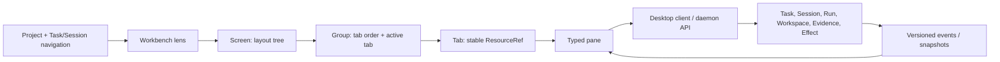
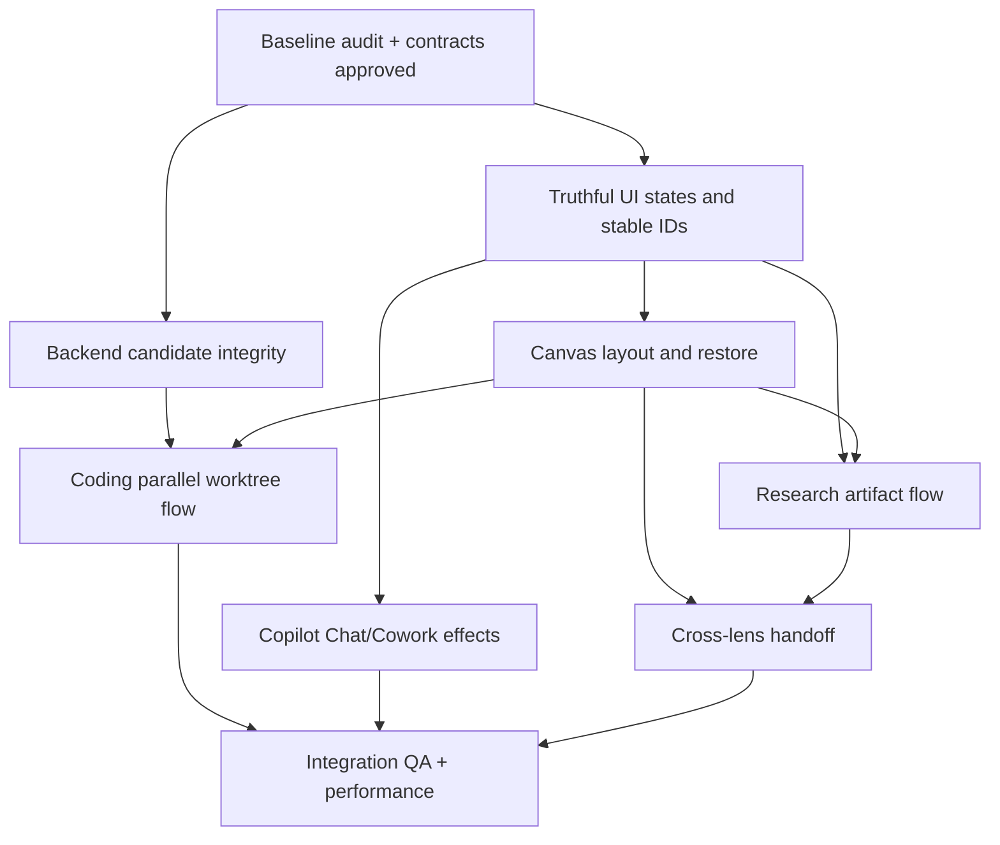

# Custos SADE — kế hoạch triển khai không gian làm việc cho ba workbench

> **Trạng thái: bản đề xuất để duyệt, chưa phải lệnh triển khai.** Tài liệu này chuyển các quyết định sản phẩm thành công việc đủ cụ thể cho coding agent. `Custos.md` là kiến trúc sản phẩm; `docs/architecture/agent-workspace-and-ui.md` là đặc tả chủ đề; `docs/development/codebase-architecture.md` là bản đồ code thực. Nếu tài liệu này mâu thuẫn với code hoặc ba tài liệu trên, phải kiểm tra lại và trình quyết định, không tự coi đề xuất là trạng thái đã triển khai. Sau khi duyệt một lát cắt, cập nhật đồng bộ ba tài liệu có thẩm quyền cùng PR triển khai.

## 1. Mục tiêu và phạm vi

Custos là một SADE: người dùng bắt đầu tự nhiên bằng chat nhưng có thể mở rộng thành công việc có tiến độ, nhiều tài nguyên, nhiều agent và bằng chứng. Ba **workbench** là ba góc nhìn chuyên biệt trên cùng một lõi Task/Session/Run/authority/evidence:

- **Coding:** khám phá và sửa repo; agent chạy độc lập hoặc song song trên Git worktree; xem diff, test, browser và terminal; so sánh rồi tích hợp có kiểm soát.
- **Research:** thu thập nguồn, đọc tài liệu, kiểm claim, chạy thử nghiệm dữ liệu/notebook, kiểm artifact và provenance; chuyển finding đã chọn thành yêu cầu coding.
- **Copilot:** Chat cho hỗ trợ cá nhân; Cowork cho tác vụ có bước, draft và hiệu ứng bên ngoài cần quyền, receipt và khả năng tiếp tục.

Đây **không** phải ba ứng dụng hay ba cơ sở dữ liệu. Chúng chia sẻ một canvas/tài nguyên, nhưng preset điều hướng, loại resource và hành vi ưu tiên khác nhau. Mỗi workbench luôn mở được chat; chat là một pane/tab, không bắt buộc chiếm giữa màn hình mãi mãi.

Không nằm trong phạm vi bản plan: bê nguyên cây OrCa/Open Science vào Custos; gọi mọi pane hiện hữu là tính năng hoàn tất; tự động tạo quyền khi đổi workbench; hứa mọi agent native đều được Custos chặn tool; triển khai mobile; tạo mock để che backend chưa nối.

## 2. Những gì đã kiểm và mức độ tin cậy

| Nguồn | Điều học được | Ranh giới cần giữ |
|---|---|---|
| [OrCa worktrees](https://www.onorca.dev/docs/model/worktrees), [tabs/panes/splits](https://www.onorca.dev/docs/model/tabs-panes-splits), [review](https://www.onorca.dev/docs/review/annotate-ai-diff), [browser](https://www.onorca.dev/docs/browser/overview) | Workspace theo worktree, nhiều tab và group/split, agent/terminal/browser cùng scope, review diff rồi ship. | Đây là hành vi tham chiếu; clone local và bản docs có thể khác nhau. Worktree cách ly file Git, **không** là sandbox bảo mật. |
| Clone OrCa được khảo sát trong `docs/development/orca-source-study.md` | `TabGroupLayoutNode` là cây leaf/split; tab có ID/scope; kích hoạt worktree khôi phục state của đúng scope. | Không dùng React store/DB OrCa làm nguồn sự thật của Custos; copy code cần kiểm license, path, dependency và test riêng. |
| [Open Science](https://github.com/ai4s-research/open-science), `docs/development/open-science-source-study.md` | Screen và pane độc lập; research session gắn code, input, execution log, môi trường, phiên bản artifact và review. | Chỉ tiếp thu luồng và lineage phù hợp. Một run thành công không chứng minh kết luận khoa học đúng. |
| [Claude Science announcement](https://www.anthropic.com/news/claude-science-ai-workbench) | Artifact kiểm lại được, môi trường thực thi, review và tiếp nối là hình mẫu UX. | Mô tả sản phẩm, không phải mã nguồn hay bằng chứng Custos đã làm được. |
| Custos branch hiện tại `rft_ui` | Đã có nhiều pane, workspace API, PTY và Research artifact views. | Có file hoặc API không đồng nghĩa đã nối end-to-end; kiểm mỗi chức năng bằng run thật và failure test. |

Coding agent phải kiểm lại source và `git status` trước khi sửa; nhánh hiện có thay đổi chưa commit của người dùng. Chỉ làm việc trên phần đã được duyệt, không xóa/chuyển các thay đổi đó để “dọn repo”.

## 3. Từ vựng sản phẩm: không dùng lẫn

| Khái niệm | Ý nghĩa | Không phải |
|---|---|---|
| **Project** | Tập tài nguyên/ngữ cảnh người dùng đặt tên: repo, corpus, connectors có thể liên kết. | Một Git worktree hoặc một chat. |
| **Workbench lens** | Coding, Research, Copilot: lựa chọn bố cục, công cụ và câu hỏi ưu tiên. | Quyền thực thi hoặc bản sao Task. |
| **Workspace** | Scope vật lý/logic: repo checkout/worktree, dataset, folder, hoặc connector được chọn. Có ID và host. | Một tab hay toàn bộ Project. |
| **Task** | Mục tiêu bền vững, scope, criteria, budget, trạng thái và kết quả. | Transcript chat. |
| **Session** | Hội thoại với turn/journal và attribution. Một session có thể liên kết nhiều Task và ngược lại. | Grant hoặc proof Task completed. |
| **Run / WorkerRun** | Lượt thực thi cụ thể của agent/harness/model, với attempt, usage, trạng thái. | Task hay một terminal tab. |
| **Screen** | Bố cục canvas được lưu cho một lens/scope; có thể mở nhiều screen trong cùng Task. | Một process agent. |
| **Group / Tab / Pane** | Group là vùng của layout tree; tab giữ một `ResourceRef` có ID ổn định; pane render tài nguyên đó. | Nguồn sự thật về effect. |
| **Artifact** | Diff, PDF passage, notebook output, chart, draft, receipt… có provenance/version. | Chỉ file nhìn thấy trên UI. |

Quan hệ chuẩn: một Task có thể dùng nhiều session/run/workspace; một session có thể bàn nhiều Task; một worktree có thể chứa nhiều tab và process; một tab trỏ tới **một tài nguyên có scope rõ**. Chuyển lens chỉ đổi presentation. Gắn một session hay artifact sang lens khác là hành động explicit và phải giữ provenance.

## 4. Các bất biến UX và an toàn

1. Mở/đóng/di chuyển tab không tự chạy hay dừng agent, xóa worktree, gửi email, thay Task hoặc trao quyền.
2. `StartRun`, `StopRun`, `CreateWorktree`, `Integrate`, `Dispatch` là command có ID, actor, scope, precondition và trạng thái trả về. UI không toast “đã chạy” chỉ vì mở tab.
3. Mỗi tài nguyên có `workspace_id`/`task_id`/`session_id`/`run_id` thích hợp; không tự chọn “workspace gần nhất” khi ref thiếu scope. Với thiếu ID, hiển thị lỗi chọn scope.
4. Dữ liệu nguồn, model output và artifact chưa review không tự thành grant, criterion pass hoặc recipient đáng tin.
5. Trạng thái `loading`, `empty`, `unsupported`, `denied`, `failed`, `stale`, `uncertain` phải được thể hiện; không gắn nhãn “verified/sent/completed” nếu backend chưa xác nhận.
6. Native coding agent có thể dùng tool riêng: chỉ ghi `custos-mediated` khi path thực sự qua Gateway; còn lại hiển thị `provider-governed`/`observe-only`/`unknown` theo action.
7. Worktree cô lập file/branch cho hợp nhất, không thay thế sandbox OS hay policy network/secret.
8. Đổi lens, mở cùng chat, handoff context và fork Task là **bốn thao tác khác nhau**; không có grant, secret hay permit tự kế thừa.
9. State của canvas là projection UI có thể khôi phục; Task, run, effect, evidence có nguồn sự thật ở backend. Một layout lỗi không được xóa lịch sử công việc.
10. Không dùng số liệu mẫu, placeholder “verified”, cost/test/usage giả như dữ liệu production. Tính năng chưa sẵn thì nêu đúng `Unavailable` và lý do.

## 5. Một canvas chung, ba preset khác nhau

**Trọng tâm thiết kế desktop:** cả Coding, Research và Copilot đều phải có không gian làm việc thực sự: điều hướng bên trái, canvas mở rộng được ở giữa, tài nguyên mở cạnh công việc, và bố cục có thể quay lại. Không nghiệm thu ba workbench bằng ba trang chat đổi icon. Các mục dưới là đặc tả thiết kế đề xuất; chưa mô tả UI đã triển khai.

### Khung cửa sổ và kích thước khởi điểm

| Vùng | Thiết kế desktop | Hành vi |
|---|---|---|
| Title bar | Cao 40 px, chừa vùng native window controls; project và workspace hiện tại, Quick Open, attention indicator. | Có vùng kéo cửa sổ; tên dài truncate với tooltip. Không đặt toolbar thứ hai trùng chức năng. |
| Activity rail | Rộng 48 px; ba icon Coding / Research / Copilot ở trên, Settings và account ở dưới. | Luôn biết workbench đang chọn; badge chỉ attention thật. Settings mở ngoài canvas làm việc rồi quay lại được. |
| Navigation sidebar | Mặc định 248 px, kéo trong khoảng 200–360 px, thu gọn được. | Project switcher, New, cây công việc theo workbench, tìm kiếm và lịch sử. Không nhét toàn bộ công cụ thành menu ngang cấp. |
| Canvas | Chiếm toàn bộ phần còn lại; group có tab strip cao 34 px và toolbar theo resource. | Mở file/terminal/artifact trong group; kéo cạnh để split; zoom group rồi trả về đúng bố cục cũ. |
| Context inspector | Chỉ mở khi cần, mặc định 320 px, khoảng 280–440 px. | Hiện thông tin selection; tài liệu dài/code/PDF phải mở thành resource tab nếu cần đọc hoặc chỉnh sửa sâu. |
| Status strip | Cao 24 px, thông tin host/workspace và run đang được focus. | Click mở chi tiết tương ứng. Không dùng status strip làm dashboard số liệu. |

Các kích thước là giá trị thiết kế ban đầu, cần kiểm bằng GUI. Mục tiêu desktop chính: 1440×900 và 1280×800, kiểm thêm 1024×768. Chat có bề rộng đọc tối đa khoảng 760 px trong group; editor, diff, terminal và artifact tận dụng hết group. Dùng spacing 4/8/12/16/24 px, font UI 13–14 px, nội dung chat 14–15 px, monospace cho code/terminal. Theme theo token Light/Dark hiện có; surface trung tính, border nhẹ, màu nhấn dành cho focus/selection và trạng thái có ý nghĩa.

Khi thiếu chiều ngang: đóng inspector trước, rồi thu sidebar; dưới 1100 px ưu tiên một group làm việc và chuyển group bằng tab/Quick Open. Không ép ba cột thành các dải hẹp. Người dùng có thể chủ động split nếu các group còn đủ bề rộng tối thiểu 360 px; nếu không đủ, giữ tài nguyên thành tab. Rail và lối quay lại công việc luôn còn truy cập được.

### Ba bố cục mặc định cần thiết kế thành màn hình

| Workbench | Sidebar | Canvas lúc bắt đầu | Canvas khi đang làm việc | Inspector |
|---|---|---|---|---|
| Coding | Project → repo → worktrees; Task và sessions liên quan. Worktree row có branch, trạng thái agent, dirty badge. | Chưa chọn repo: Open repository. Đã chọn repo: agent/chat và entry mở Files, Changes, Terminal, Browser. | Agent bên trái khoảng 40%, editor/diff/browser bên phải khoảng 60%; terminal mở bằng tab hoặc split dưới theo lựa chọn. Mỗi worktree giữ layout riêng. | Selection trong diff, file metadata, run/test details; không lặp file tree. |
| Research | Project → research tasks/sessions; các collection Sources, Artifacts, Runs mở được theo Task. | Composer với Attach source / Attach dataset và vài starter ngắn. | Conversation/trajectory khoảng 42%, artifact/source/notebook khoảng 58%; click citation mở đúng nguồn, click output mở artifact. | Phiên bản, nguồn, producing code/input/environment, review findings của selection. |
| Copilot | Project hoặc Personal → Chat / Cowork tasks; recent, pinned và needs attention. | Chat rộng thoáng; chọn Chat hoặc Cowork gần composer, không mở sẵn dashboard. | Cowork: conversation khoảng 42%, tài liệu/bảng/draft khoảng 58%; progress gọn trong task header, mở timeline khi cần. | Chi tiết step, attachment, recipient hoặc receipt theo selection. |

Các tỷ lệ chỉ áp dụng khi có resource thứ hai. Chat mới dùng một group; không chừa nửa màn hình trống chờ artifact. Cả ba đều cho mở thêm group/tab, focus, zoom, đóng và restore theo §5.1. Chuyển workbench khôi phục bố cục của workbench đích; công việc đang chạy vẫn có attention indicator để quay lại.

### Khảo sát vừa đủ và độ bám tham chiếu

Dùng hai source study hiện có trong `docs/development/` làm nền. Chỉ đọc thêm source khi cần xác nhận một thao tác hoặc owner trước implementation; không mở chiến dịch index/audit toàn repo cho việc thiết kế desktop. Mỗi phát hiện mới phải trả lời: control ở đâu, click làm gì, resource nào mở, state nào giữ lại. Chưa rõ thì ghi rõ điểm cần kiểm.

“Bám full Orca” ở đây là phủ các nhóm trải nghiệm desktop trong bảng dưới bằng một workspace thống nhất. Đây là **phạm vi thiết kế Custos đề xuất**, không là tuyên bố đạt feature parity hoặc đã kiểm mọi tính năng Orca. Tham chiếu chính thức cho tab/group/split: [Orca layout](https://www.onorca.dev/docs/model/tabs-panes-splits); chi tiết nguồn đã ghi trong `docs/development/orca-source-study.md`.

| Nhóm trải nghiệm Coding | Vị trí và tương tác phải có trong thiết kế | Giai đoạn |
|---|---|---|
| Repo và worktree | Cây sidebar, create/select/archive, scope rõ và restore từng worktree. | Desktop cốt lõi, PR C/D. |
| Agent và terminal | New agent/terminal trong worktree; nhiều run độc lập; history/resume và trạng thái chờ input. | PR D; chỉ bật resume khi adapter hỗ trợ. |
| File và editor | Files drawer, Quick Open, editor tabs, save/dirty state, search và viewer phù hợp loại file. | PR C/D, mở rộng adapter/pane sẵn có. |
| Tabs và splits | Reorder, move, split ngang/dọc, resize, focus, zoom, tab menu và layout restore. | PR C. |
| Review và Git | Changes → diff/hunk/comment → feedback cho agent; commit/integrate preview; conflict recovery. | PR B/D; commit/push là action explicit có quyền riêng. |
| Browser và preview | Browser tab theo worktree; viewport presets; chọn element và gửi context nếu capability thật có. | Browser manual trước; design/automation sau capability gate. |
| Theo dõi nhiều agent | Task comparison, active runs/attention và usage thực tế; click quay đúng run/worktree. | PR D/G. |
| Hosted work và remote | Chỗ mở PR/issues/checks và host/SSH selector rõ scope. | Thiết kế extension point; triển khai sau khi có adapter thật. |
| Automation và ecosystem | Entrypoint quản lý skills/MCP, lịch chạy và checkpoints trong công cụ liên quan. | Đợt sau; không nhồi vào navigation mặc định. |

Mobile companion nằm ngoài phạm vi desktop này. Remote, automation và integrations vẫn phải có trạng thái trong backlog, không được mất khỏi tầm nhìn chỉ vì bản đầu ưu tiên local.

### Gói màn hình bàn giao cho UI desktop

Thiết kế và kiểm đủ các màn sau trước khi gọi UI hoàn chỉnh; sử dụng cùng shell, type scale, tab và interaction rules:

1. **Shell / empty:** chưa có project, project có sẵn, sidebar collapsed, Quick Open và chọn workbench bằng keyboard.
2. **Coding / active:** một worktree với agent + diff; tab file, terminal, browser mở được; selection và focus rõ.
3. **Coding / parallel:** hai worktree có run riêng; chuyển qua lại giữ cwd/tab; compare và integrate preview là màn Task-level.
4. **Research / source:** conversation + PDF/web passage; citation đưa tới locator; attach source có loading/error/parse gap.
5. **Research / artifact:** figure/notebook/report cạnh chat; mở producing code; annotation tạo yêu cầu chỉnh sửa; output mới có version riêng.
6. **Research / review:** findings gắn artifact/version; chạy lại mở preview execution; handoff selected refs sang Coding.
7. **Copilot / chat:** conversation, attachments và mở tài liệu cạnh chat; không hiện task machinery khi chưa cần.
8. **Copilot / cowork:** task progress + draft/editor; chọn step mở output; approval review rồi receipt hoặc uncertain; quay lại sau restart.
9. **Shared / recovery:** unsupported resource, failed run, disconnected daemon, stale tab và restore layout; không mất nội dung đang soạn.

Mỗi màn cần Light/Dark, trạng thái có nội dung/empty/loading/error phù hợp, và kiểm ở hai kích thước desktop chính. Screenshot phục vụ duyệt hình thức; walkthrough thao tác thật phục vụ nghiệm thu workspace. Backend gates §16–19 vẫn áp dụng khi nối hành động.



### 5.1. Hợp đồng canvas cần có

Đây là hình dạng logic đề xuất, **không phải schema đã chốt**:

```ts
type LayoutNode =
  | { kind: 'group'; groupId: string; tabIds: string[]; activeTabId?: string }
  | { kind: 'split'; axis: 'horizontal' | 'vertical'; ratio: number; first: LayoutNode; second: LayoutNode };

type ResourceRef = {
  type: string;           // registered resource kind, never inferred from tab ID
  stableId: string;       // canonical ID where available
  projectId?: string;
  workspaceId?: string;
  taskId?: string;
  sessionId?: string;
  runId?: string;
  artifactId?: string;
  sourceVersion?: string;
};
```

`Screen` lưu ID, lens, owner/scope, layout version, layout tree, focused group, zoomed group và danh sách resource refs. Khóa khôi phục phải dùng stable IDs (actor/window/project/lens/workspace hoặc Task theo loại screen), không dùng tên project hay `no-session` làm định danh duy nhất. Backend không lưu riêng mọi pixel kéo thả; UI persistence có thể là local projection trước, nhưng phải version, restore và loại ref stale. Mở lại canvas **không tái thực thi run**. Popout window tham chiếu cùng resource identity và backend state, không tạo session/tab giả.

Mỗi tab có title ngắn, loại, scope, trạng thái từ backend và close action. Một group có thể kéo tab sang group khác và split; tối đa vài group được gợi ý trong preset, nhưng cây layout không giới hạn cố định ở đúng hai pane. DnD giữa scope chỉ chuyển presentation hoặc yêu cầu chọn lại scope; không tự dời process/artifact/authority. Khi đổi worktree, canvas khôi phục tab của worktree đó; tab Task-level (ví dụ comparison) ở scope Task, không âm thầm trỏ vào worktree khác.

### 5.2. Điều hướng ít chữ nhưng rõ trạng thái

- Header có ba icon Coding/Research/Copilot, tooltip/accessible label và trạng thái chọn. Click chỉ đổi lens và khôi phục màn hình gần nhất của lens ấy.
- Cùng vị trí sidebar ở cả ba lens: `+ New` cho **New Chat** hoặc **New Task**. Chat và Task là hai loại entry đồng cấp khi điều hướng; liên kết dữ liệu của chúng vẫn many-to-many.
- Sidebar ưu tiên Project/Workspace và mục Chat/Task theo lens; không nhân đôi toàn bộ menu kỹ thuật ở thanh phải.
- Trong group, dấu `+` mở **resource** (terminal, file, paper, notebook, browser…), không tạo Task hoặc gửi effect.
- Tác vụ đang chạy, approval, effect `uncertain` và lỗi quan trọng có attention indicator toàn app, ngay cả khi đổi lens.
- Right inspector xuất hiện theo tài nguyên được chọn, không là một “hộp công cụ” cố định nhét mọi tính năng. Lúc không có selection, thu gọn được.

### 5.3. Chiến lược hiệu năng

Chỉ mount pane nặng khi visible; giữ backend process/run độc lập với lifecycle React. Suspended tabs giữ ref + state tối thiểu. Terminal dùng bounded scrollback; PDF/browser/notebook tải lazy; snapshot/event cursor để phục hồi sau restart. Không hứa RAM hay p95 cụ thể trước khi đo trên máy và task mix thực; lập benchmark cold/warm, số tab, số worktree và số run song song trước khi tối ưu.

## 6. Coding workbench: không gian song song kiểu OrCa, nhưng có Task của Custos

### 6.1. Bố cục mặc định và mở rộng

| Tình huống | Canvas mặc định | Khi người dùng cần sâu hơn |
|---|---|---|
| Hỏi code/đọc repo | Chat hoặc agent conversation ở group chính; Files/Diff inspector bên phải khi chọn source. | Split với file, terminal, browser; vẫn một workspace rõ ràng. |
| Sửa code một agent | Conversation/agent CLI + Changes; status của Run/Task trên header nhỏ. | Terminal/test log/browser preview ở tab hoặc group thứ ba. |
| Nhiều agent song song | Sidebar: một Task, các candidate worktree con với tên/branch/status/agent; mỗi worktree mở screen riêng. | Task comparison screen cho diff/test/cost/evidence của từng candidate. |

Một worktree nên trông như **một bàn làm việc có tên và branch riêng**: tab agent, terminal, file, browser/phone preview cùng cwd/scope; badge chạy/dừng/dirty/base stale. Mỗi worktree có screen/layout được khôi phục riêng. Không tạo một tab chat cố định cho từng agent nếu agent chỉ có CLI: cả native CLI và structured conversation đều là loại resource với `run_id` thực. Tránh ép toàn bộ agent chung một terminal hoặc chung một branch.

### 6.2. Luồng worktree song song phải hiện diện thành tính năng

1. User chọn Task + repo/base revision; thấy base commit, dirty state, host, tên candidate, harness/model, budget và setup script **trước** khi tạo.
2. Tạo 2–3 candidate worktree với idempotency; lỗi một candidate không làm UI báo cả batch thành công. Worktree record và path/branch được daemon xác nhận.
3. Với mỗi candidate, gắn WorkerRun rồi explicit `StartRun`; hiện trạng thái `queued/starting/running/waiting/failed/completed/unknown`, cost và event theo run. Mở agent tab không thay cho `StartRun`.
4. User chuyển candidate trong sidebar; mỗi candidate khôi phục tab/terminal/browser của nó, không chuyển cwd của process khác. Có thể kéo split hai candidate để **quan sát**, nhưng scope từng pane phải nhìn được.
5. Khi các run có output, mở Task-level comparison: base/head, changed files, diff, test/verifier receipt, conflict, cost known/estimated/unknown và evidence theo criterion. Chỉ so candidate cùng Task/base phù hợp; mismatch phải báo.
6. Chọn candidate để tích hợp: preview target branch/base, dirty conflicts, commit/diff và effect; daemon preflight lại ngay trước apply. “Integrate” là command riêng, không là nhấn chọn tab. Không tự archive/delete losers; cleanup chỉ sau lựa chọn explicit và reconciliation.

Hai kiểu song song cần phân biệt: **nhiều agent trên worktree khác nhau** để thử phương án độc lập; **nhiều agent đọc cùng workspace** để khảo sát. Cho nhiều agent viết cùng một worktree chỉ khi scheduler/lock và write-set policy kiểm soát; không mặc định dùng vì dễ race. Worktree có thể không có agent, và agent có thể chỉ đọc, do đó quan hệ không phải một-một bắt buộc.

### 6.3. Resource cần thật, không chỉ hiện tab

Files có source snapshot/hash; Changes cho hunk review/comment; Terminal/agent CLI gắn PTY và lifecycle; Browser gắn đúng tab/host, manual navigation và agent control là hai capability khác; Phone preview chỉ là viewport/responsive preview nếu chưa có simulator OS thật. Test receipt gắn command, exit, environment, source revision; exit 0 không tự chứng minh criterion. Resource “unsupported” vẫn có thể xuất hiện trong catalog với trạng thái disabled rõ lý do, không pane rỗng.

## 7. Research workbench: không gian chứng cứ và thử nghiệm

### 7.1. Bố cục mặc định

Main group là Research conversation/trajectory: câu hỏi, bước tìm kiếm/đọc/chạy, artifact cards và synthesis. Inspector bên cạnh mở nội dung **được chọn**: PDF/web passage, claim matrix, code, dataset input, execution log, environment, chart hoặc review. Trên màn nhỏ chỉ một pane; khi muốn so hai paper/figure/notebook, người dùng split thành hai group. Không cố định ba cột hoặc luôn mở mọi tab.

| Resource | User thao tác | Dữ liệu backend tối thiểu |
|---|---|---|
| Library/source viewer | Import, search, mở đúng page/span/version, xem parse gap. | `SourceRecord`, hash/version, passage locator, acquisition/parse status. |
| Claims | Tạo/sửa atomic claim, xem support/contradiction/unknown và reviewer. | Link claim–passage có assessor/version, invalidation khi source đổi. |
| Lab/notebook | Chọn input/dataset, chạy cell/recipe trong scope, xem output. | Run ID, environment, code/input digest, logs, result artifact; không gán persistent kernel nếu thực tế là subprocess per cell. |
| Artifact inspector | Chọn phiên bản code, inputs, run, environment, review, export. | Artifact lineage/version và actual/estimated/unknown usage. |
| Synthesis | Gộp finding theo criterion, lưu brief, chọn finding đưa sang Coding. | Outcome/claim references, caveats, context handoff receipt. |

### 7.2. Song song trong Research khác song song Coding

Research có thể chạy các **source scout/readers hoặc experiment runs** song song dưới một Task; đây là WorkerRun/node, **không mặc định là Git worktree**. Nếu research sửa code của một repo hay cần reproducible branches, khi đó mới chọn workspace/worktree coding hoặc isolated execution environment phù hợp. Join không “bầu theo số agent”: phải dedup cùng nguồn gốc, đối chiếu phiên bản/ngày và chỉ cho status semantic support với phương pháp/reviewer rõ.

Lộ trình MVP hợp lý: import một PDF/web source → neo passage/version → trích claim và đánh dấu unknown khi thiếu support → tạo notebook/run có inputs/env/log/output → mở inspector → tạo `EngineeringBrief` từ các claim người dùng chọn. Browser harvest và automation research chỉ triển khai khi fetch/browser operation thật có capability, permission, provenance và failure UI; không copy screenshot demo thành tính năng.

### 7.3. Tương tác Research bám Claude Science

Tham chiếu [Claude Science](https://www.anthropic.com/news/claude-science-ai-workbench) cho vòng làm việc có artifact, code/môi trường và review. Các control dưới là thiết kế Custos đề xuất; source triển khai tham khảo riêng từ Open Science, không coi hai sản phẩm là một.

- Artifact card trong conversation có **Open**, loại tài nguyên, version và run status thật. Open đưa vào group cạnh chat và focus tài nguyên đã mở thay vì nhân bản tab mỗi click.
- Toolbar artifact có **Preview / Code / Inputs / Run / Review** theo dữ liệu thực có. Preview là nơi đọc; metadata ngắn ở inspector; code/log dài mở tab. Thiếu lineage hiển thị unknown cụ thể.
- Chọn đoạn manuscript hoặc vùng figure rồi **Ask about selection / Request change** đưa selection và artifact version vào composer. Chỉ chạy khi gửi yêu cầu; kết quả chỉnh sửa là phiên bản mới, giữ bản trước để so sánh.
- **Reproduce** mở preview code, inputs, environment, compute target và quyền cần thiết. Confirm mới tạo run; Cancel trở lại artifact. Không đánh đồng mở tab với chạy lại.
- Review card gắn findings vào citation/number/figure của đúng version. Click finding mở vị trí liên quan; có unresolved/resolved/stale và method; không dùng một dấu xanh cho toàn bộ tính đúng khoa học.
- Fork analysis cho chọn điểm và refs để thử phương án khác; giao diện giữ lối quay lại nhánh gốc. Compute/connector chỉ mở khi người dùng cần; lần đầu ưu tiên vòng local hoàn chỉnh hơn một dashboard chuyên ngành dày đặc.

## 8. Copilot workbench: Chat yên tĩnh, Cowork có hành động nhìn thấy được

**Chat** mặc định chỉ conversation và tài liệu liên quan. **Cowork** mở Task timeline, từng step/run, drafts, calendar/contacts nếu connector/scope thật tồn tại, approval và outbox. Read-only gathering có thể song song trong một Task; gửi/sửa/xóa bên ngoài phải qua preflight, exact preview, grant/permit, durable attempt, receipt/reconcile theo từng effect.

Trình tự gửi minh họa: user nhờ soạn → draft được lưu như artifact → resolve recipient từ source tin cậy → user xem/chỉnh exact address/body/attachment hash → approval gắn digest → dispatch → receipt hoặc `uncertain`. Sửa payload làm approval cũ không còn hiệu lực. UI không ghi “Sent” khi chỉ có timeout hoặc outbox item. Danh sách contacts/calendar device-local không được trình bày như đồng bộ connector thật. Không biến nút “Cowork” thành quyền chạy nền mặc định.

### Không gian làm việc Copilot

- Chat có composer và attachments; chọn attachment mở preview cạnh conversation. Tài liệu có thể ở tab riêng khi tiếp tục chat. Đổi sang Cowork giữ nội dung và cho xem Task/scope trước khi bắt đầu công việc.
- Cowork header hiện tên việc, status và current step; **View steps** mở timeline dạng drawer. Timeline không chiếm cột cố định khi người dùng đang chỉnh tài liệu.
- Mỗi step có output card: document, spreadsheet, draft hoặc receipt. Click mở editor/viewer trong canvas; user có thể vừa chat vừa sửa output. Trạng thái unsaved/saved tách khỏi approved/sent.
- **Review action** mở màn tập trung với payload chính xác và quyền; confirm chạy command tương ứng. Sau đó trở về workspace với receipt hoặc trạng thái cần reconcile. Các kết nối chưa có không xuất hiện như dữ liệu sống.
- **Needs your input** trong sidebar dẫn tới đúng Task/step đang chờ. Đóng tab hoặc đổi workbench không xóa draft và không hủy công việc đang chạy.

## 9. Tiếp nối xuyên workbench: giữ kiến thức mà không trộn quyền

Menu trên session/Task/artifact cần ba action rõ:

1. **Switch lens:** chỉ đổi giao diện, giữ session hiện tại nguyên chỗ; không chuyển toàn bộ context hoặc bắt đầu agent.
2. **Open this chat in…:** cùng session journal được render bằng lens khác, giữ turn IDs; ContextPack được biên dịch lại theo scope/privacy và tài nguyên có thể có hoặc không hỗ trợ ở lens đích.
3. **Continue as work:** tạo bước pack/linked continuation hoặc child Task có lựa chọn artifact refs, source versions, decision và omissions; người dùng thấy manifest trước khi gửi. Grant, secrets, permit và hidden provider state không được copy.

Ví dụ Research → Coding: user chọn 3 claim, 2 passage, 1 notebook output; Custos tạo EngineeringBrief có caveat và source refs, hỏi repo/workspace target rồi mở Coding Task. Không copy nguyên transcript PDF vào prompt hoặc tuyên bố claim là requirement đã chấp nhận. Coding → Copilot: chỉ summary/diff/outcome được redacted và chọn để soạn thông báo; “draft” không là “send”.

## 10. Đối chiếu code Custos hiện tại và nơi triển khai

Bảng này là **điểm bắt đầu audit**, không là kết luận test end-to-end. Kiểm lại trên HEAD trước mỗi PR, vì `rft_ui` đang thay đổi.

| Chủ đề | Nơi đang có | Mức hiện diện và việc phải kiểm |
|---|---|---|
| Canvas/resource rendering | `ui/desktop/src/components/workbenches/OrcaTabbedContainer.tsx`, `ui/desktop/src/context/AppContext.tsx`, `ui/desktop/src/types/canvas.ts` | Có tab và split đơn; cần layout tree, stable typed refs, persistence/restore và popout chung identity. `canvas.ts` là scaffold cần chuẩn hóa, không mặc nhiên canonical. |
| Navigation và session lens | `ui/desktop/src/app/studio/page.tsx`, `ui/desktop/src/components/shell/AppWorkspaceShell.tsx`, `WorkspaceSidebar.tsx` | Có switcher/sidebar/session projection; kiểm switch vs open-chat vs handoff, không double transition. |
| Worktree/parallel | `ui/desktop/src/components/workbenches/engineering/WorktreeManagerPane.tsx`, `AgentsWorkbenchPane.tsx`, `ui/desktop/src/api/daemon_client.ts`; backend workspace/run dưới `crates/custos-runtime/`, `crates/custos-daemon/` | Có create/list/candidate/compare/integrate APIs và PTY. Cần flow cùng Task/base, StartRun thật, preflight, comparison và cleanup tường minh. |
| Research | `ui/desktop/src/components/workbenches/research/`; `crates/custos-packs/src/research/` và daemon Research API | Nhiều pane/skills đã có. Kiểm từng acquisition, source version, run, lineage, citation và handoff; callback UI có thể chưa nối hết. |
| Copilot | `ui/desktop/src/components/workbenches/copilot/`; domain/core effects/outbox và daemon API | Phân biệt local draft/list với connector dispatch; kiểm Task ID, payload digest, receipt và `uncertain` xuyên reload. |
| Contracts và quyền | `crates/custos-domain/`, `crates/custos-core/`; ports/adapters ở các crate hiện hữu | Mở rộng kiểu/command hiện có theo dependency; không tạo crate mới chỉ vì một pane mới. |
| Persistence | `crates/custos-persistence/` và state UI | Canonical Task/Run/effect ở SQLite; layout là versioned UI projection. Migration chỉ khi có hợp đồng được duyệt. |

Đặc biệt audit hiện trạng trước khi “fix UI”: `OrcaTabbedContainer` còn suy loại resource bằng prefix tab ID ở một đường; `AppContext` giữ tab state trong memory với khóa dễ va chạm; mở agent tab có đường toast “launched” dù chưa StartRun; một attach path chỉ đưa tên file vào prompt; Research handoff callback có thể chưa đi hết; draft/outbox có thể dùng session ID thay Task ID. Các mục này là **giả thuyết cần tái kiểm trên code/test**, không yêu cầu sửa bất chấp thay đổi mới trên branch.

## 11. Hợp đồng API/event tối thiểu cho agent coding

Trước khi nối một control, ghi bảng `UI action → command → actor/scope → backend owner → event/receipt → failure state`. Không có command/receipt thì control chỉ read-only hoặc disabled. Ít nhất cần:

| Action | Điều kiện/response cần có |
|---|---|
| Open resource tab | Validate `ResourceRef`; không spawn process. Renderer nhận capability/status snapshot. |
| Create worktree candidate | Task/repo/base/host/path/precondition, `command_id`; return workspace ID + actual state hoặc per-candidate error. |
| Start/stop agent | Explicit `run_id`/harness/workspace/budget; idempotent command, live event cursor, cancel/unknown. |
| Compare/integrate | Same Task/base validation; server-side preflight; diff/receipt; stale/conflict/uncertain rõ ràng. |
| Import/read source | Source ID, URL/path, hash/version, parse coverage, locator; no network without scope/egress. |
| Run experiment | Code/input/env digests, execution isolation/capabilities, run logs, artifact IDs, failure state. |
| Handoff | Selected typed refs + redaction/omission receipt; target lens/workspace and new/existing Task relation. |
| Send external effect | Exact payload/target digest, approval, outbox attempt, external receipt or reconciliation state. |

Envelope/event phải theo contract có sẵn: `schema_version`, `command_id`, correlation, actor, scope, deadline, privacy, `expected_state_version`; event `seq` và resume cursor. Không hardcode optimistic success trong UI. Capability discovery làm rõ `supported_operations` và assurance path; một transport được phát hiện không có nghĩa có quyền hay verification.

## 12. Thứ tự triển khai thành các PR có thể nghiệm thu

Đây là thứ tự sản phẩm. Runbook kỹ thuật và các điểm sửa được kiểm trên branch hiện tại ở §15–19; coding agent dùng cả hai, không triển khai một mục P chỉ từ tên của nó.

### P0 — Sự thật trạng thái và định danh

Audit từng pane/action có dùng dữ liệu thật không; loại/disable mock status, toast success giả, silent fallback, ref thiếu scope. Viết test cho `Open tab ≠ StartRun`, `Close tab ≠ StopRun`, unknown effect và unsupported capability. Chốt định nghĩa Project/Workspace/Task/Session/Run trong UI type và API mapping. Không làm big-bang rename crate/folder trong PR này.

### P1 — Canvas resource contract

Thay prefix-ID resource inference bằng registry/type tường minh; tách layout state khỏi domain state; layout tree group/split, move/close/zoom/restore, stable IDs và popout không nhân đôi session. Giữ UI cũ chạy qua migration/adapter của layout version; e2e khởi động lại app vẫn mở đúng tabs/scope mà không chạy lại effect.

### P2 — Coding vertical slice hoàn chỉnh

Một Task/repo → tạo hai candidate cùng base → StartRun thực ở hai worktree → PTY/log/event và resource scope riêng → preview diff/test/cost → chọn một, preflight, integrate → không tự xóa loser. Thử crash/restart, dirty/stale base, một candidate lỗi, multi-host nếu được quảng cáo. Đây là ưu tiên sản phẩm trước khi mở rộng thêm resource catalog.

### P3 — Research vertical slice hoàn chỉnh

Một nguồn PDF/web → passage/version → claim unknown/support có reviewer → một run dữ liệu/notebook có code/input/env/output lineage → artifact inspector → selected handoff sang Coding. Chỉ thêm parallel scouts/experiment fanout khi single-worker path và evidence gate đã chạy thật.

### P4 — Copilot và cross-lens

Chat/Cowork cùng Task/Session model; draft → exact approval → fake connector **trong test** → durable outbox → uncertain/reconcile; UI production không hiển thị fake contacts/send. Hoàn tất ba action switch/open/continue, permission/redaction manifest. Bắt buộc có test cùng session ở hai lens và không lộ grant.

### P5 — Chất lượng giao diện và hiệu năng

Keyboard/focus/ARIA; typography-first và màu sắc tiết chế; trạng thái loading/empty/error nhất quán; inspector theo selection; measured RAM/CPU/bundle/p95 khi có nhiều tabs và workers. Loại pane/resource dư chỉ sau inventory và chứng minh không còn entrypoint; không xóa code đang được branch khác dùng.

Mỗi PR gồm contract/fixture, backend command+event khi có effect, UI flow, integration/failure tests, docs triad update và manual demo recipe. Không gom P0–P5 thành một PR không thể review.

## 13. Tiêu chí nghiệm thu cuối

| Kịch bản | Phải nhìn thấy/kiểm chứng |
|---|---|
| Coding hai agent | Hai worktree cùng base, agent/PTY khác nhau, chuyển screen không đổi cwd, compare cùng Task và integrate một candidate có receipt. |
| Coding lỗi/race | Base đổi hoặc dirty ⇒ stale/conflict; process chết hoặc app restart ⇒ trạng thái thật, không chạy lại ngầm; đóng tab không dừng agent. |
| Research từ nguồn đến code | Mở đúng passage/version; OCR gap/claim thiếu support ⇒ unknown; notebook output gắn code/input/env/run; handoff chỉ refs đã chọn. |
| Copilot send | Hai recipient trùng tên ⇒ hỏi chọn; sửa một byte payload làm approval cũ vô hiệu; timeout sau dispatch ⇒ uncertain, không retry mù. |
| Xuyên lens | Cùng session mở ở Research và Coding giữ turn IDs; chuyển lens đơn thuần không chuyển context; continuation có manifest/omissions, không mang permit. |
| Canvas/setting | Split/move/restore đúng tab, keyboard usable, resource capability đúng backend; settings không có các cấu hình trùng nghĩa hoặc nút “Save” không persistence. |

Mỗi test cần tách `compiled`, `composed`, `exercised`, `verified`: build pass chỉ là `compiled`; UI render là chưa đủ. Ghi model/harness, host/OS, source revision, test fixture và evidence; số liệu chi phí/latency là actual/estimated/unknown riêng.

## 14. Quyết định cần duyệt trước khi coding agent mở rộng

1. **Layout persistence:** khuyến nghị lưu local/versioned theo window + scope, Task/Run vẫn canonical backend. Nếu cần sync nhiều thiết bị, thiết kế conflict/identity/privacy riêng sau MVP.
2. **Cross-worktree visual split:** cho phép xem hai scope cạnh nhau với badge rõ; không cho DnD đổi ownership process. Comparison thuộc Task-level screen.
3. **Research execution:** MVP phải nêu rõ subprocess per cell hay persistent kernel; không quảng cáo kernel bền nếu chưa có. Mọi run cần environment/input snapshot và giới hạn tài nguyên.
4. **Agent harness assurance:** mỗi adapter khai báo được điều gì Custos can thiệp, quan sát hay không biết. Không dùng nhãn chung cho cả provider.
5. **Browser/phone:** manual browser và agent browser automation là capability khác; phone responsive preview không gọi là emulator thiết bị thật.
6. **Copilot connector:** contact/calendar device-local được gắn nhãn local; production send chỉ bật khi connector và outbox/reconcile kiểm qua test.

Nếu các lựa chọn trên thay đổi đáng kể scope/quyền/chi phí, xin quyết định của chủ sản phẩm trước khi sửa schema. Mục tiêu không phải “có đủ nút giống OrCa/Open Science”, mà là mỗi chức năng nhìn thấy trên Custos đều có owner, action, trạng thái, nguồn dữ liệu, quyền và phép kiểm chứng rõ ràng.

## 15. Runbook bắt đầu code: chuẩn bị, ranh giới và thứ tự phụ thuộc

### 15.1. Trước mọi PR

1. Đọc `AGENTS.md`, `Custos.md`, `docs/architecture/agent-workspace-and-ui.md`, `docs/development/codebase-architecture.md` và section liên quan trong tài liệu này. Xem `git status --short` và diff các file định sửa; branch `rft_ui` đang dirty, trong đó `ui/desktop/src/types/canvas.ts` và vài component mới vẫn untracked. Không tự chuyển branch, reset, format toàn repo, commit hay push.
2. Lập bảng kiểm một đường dùng thật: user action → component → `daemon_client.ts` → method daemon → runtime/port/adapter → persistence/event → UI replay. Ghi `exists`, `partial`, `absent`, `unverified`; không dùng tên file để suy ra implementation hoàn thành.
3. Nếu PR đưa ra contract/schema/module boundary mới, trình quyết định lên tài liệu có thẩm quyền rồi cập nhật đúng doc triad trước code, theo `AGENTS.md`. Các `type`/endpoint minh họa dưới đây là **đề xuất để duyệt**, không phải quyền tự tạo protocol hoặc crate.
4. Chạy baseline không phá dữ liệu: `pnpm --dir ui/desktop build`, `cargo test -p custos-domain -p custos-core -p custos-runtime -p custos-daemon` khi môi trường đủ dependency. Ghi lỗi sẵn có trước khi sửa; không tự nhận baseline xanh nếu lệnh không chạy. Hiện `ui/desktop/package.json` chưa khai báo test runner UI, nên PR thêm unit/component/E2E tests phải dùng hạ tầng repo đã có hoặc xin phép trước khi thêm dependency.
5. Dùng fixture repo tạm và fake connector trong test. Không thử merge lên branch làm việc của người dùng, không gửi email thật, không xóa worktree thật trong manual QA.

### 15.2. Dependency graph cho implementation



Backend candidate integrity có thể phát triển song song với UI canvas sau khi contract đã chốt. Tuy nhiên màn Compare/Integrate **không** được bật production dựa trên API chưa bảo đảm Task/base/partial failure. Research và Copilot dùng cùng resource host sau khi stable ref đã có, không đợi mọi tính năng Coding hoàn tất.

## 16. Backlog triển khai ở cấp PR

Mỗi PR ở bảng dưới phải đủ nhỏ để revert độc lập. Tên file là điểm vào được kiểm trên branch `rft_ui`; coding agent phải đọc lại code trước khi sửa. Không gom một “refactor full” kéo cả backend và toàn UI vào một diff.

| PR | Deliverable có thể demo | Điểm sửa dự kiến | Gate để merge |
|---|---|---|---|
| **A — Audit/truthfulness** | Catalog từng resource/action có trạng thái thật; các success toast sai bị sửa; unsupported rõ. | `AppWorkspaceShell.tsx`, `OrcaTabbedContainer.tsx`, `ConversationPane.tsx`, các pane có action; API capability trong daemon. | Mở agent tab không báo `Launched`; file attachment không được gửi chỉ bằng tên; steer fail không fallback im lặng; không có nhãn verified/sent giả. |
| **B — Candidate integrity** | Tạo/so sánh/tích hợp candidate của một Task an toàn, idempotent/reconcilable. | `crates/custos-daemon/src/api.rs`, `crates/custos-runtime/src/workspace/coordinator.rs`, workspace repo/contract hiện có, `daemon_client.ts`. | Partial create được trả với IDs/trạng thái hoặc rollback an toàn; compare từ Task/base đúng; integrate preflight lại và trả receipt có thể phân biệt conflict/unknown. |
| **C — Canvas foundation** | Tab/group/split/zoom/restore đúng scope, không gọi backend effect khi mở tab. | `ui/desktop/src/types/canvas.ts`, `OrcaTabbedContainer.tsx`, `AppContext.tsx`, popout host và related UI state. | Multi-group không giới hạn ở `splitTabId`; restart khôi phục layout; stale refs được xử lý; không spawn run từ restore. |
| **D — Coding journey** | Task → hai candidate → hai StartRun → theo dõi → compare → preview integrate. | `WorktreeManagerPane.tsx`, `AgentsWorkbenchPane.tsx`, sidebar, Task view, `daemon_client.ts`; backend nếu PR B để lộ gap. | Hai cwd/branch/run độc lập; Task comparison đúng; dirty/stale/conflict chặn; cleanup losers không tự động. |
| **E — Research journey** | Import source → passage/claim → run/artifact inspector → selected handoff. | `ui/desktop/src/components/workbenches/research/`, `crates/custos-packs/src/research/`, Research API/repositories đang có. | Source version/parse gaps hiện rõ; run có code/input/env/output lineage; handoff callback chạy thật và không gửi toàn transcript. |
| **F — Copilot journey** | Chat → Cowork Task → draft/approval/outbox/reconcile. | `ui/desktop/src/components/workbenches/copilot/`, daemon assistant/outbox APIs và persistence hiện có. | Task ID đúng; sửa payload làm approval stale; API timeout cho `uncertain`; không tuyên bố sent khi chưa receipt. |
| **G — Cross-lens & polish** | Switch lens, open same chat, linked continuation là ba action riêng; UI và perf dùng được. | `app/studio/page.tsx`, `AppContext.tsx`, sidebar/menus, continuation/context ở domain/runtime. | Turn IDs giữ nguyên; selected refs + omissions; no grant inheritance; keyboard/restore/memory manual QA. |

### 16.1. PR A — khôi phục tính trung thực trước khi thêm tính năng

- Lập inventory từ `resolveResources` trong `OrcaTabbedContainer.tsx`: mỗi resource có `read`, `command`, `capability`, `status owner`, `unsupported reason`. Loại các control không có command/receipt; không cần xóa toàn bộ pane.
- `AppWorkspaceShell.tsx` hiện có luồng toast `Launched ... in parallel tab` khi chỉ mở tab. Đổi lời thành “Opened agent tab” hoặc chỉ báo chạy sau `startRun()` trả `run_id`. UI nhận trạng thái run qua event/snapshot, không tự nâng trạng thái optimistic.
- `ConversationPane.tsx`: file attach phải tạo artifact/attachment ref thật và nhận backend; nếu chưa có API, ẩn/disable attachment với lý do. `steer` fail phải hiện lỗi và cho người dùng chọn gửi message thường, không tự biến thành một action khác.
- Kiểm `ReportManagerPopover.tsx` và các màn Usage/Settings mới: chưa mount cũng không được đưa dữ liệu hardcode vào route production. State badge phải có source và timestamp. Khi daemon disconnect, giữ bản đọc trước với nhãn `stale/offline`, không hiện như live.
- Test cần chứng minh: open/close tab không tạo/cancel run; command failure không báo success; missing capability không gọi API; reconnect không nhân đôi effect. Nếu thiếu UI test framework, bắt đầu từ pure-state tests bằng công cụ đã có và manual recipe; xin phê duyệt dependency trước khi thêm runner.

### 16.2. PR B — sửa backend candidate trước khi công bố parallel workflow

Code daemon hiện có ở `api.rs` cho thấy các vấn đề cụ thể cần xử lý:

- `candidates.spawn` tạo lần lượt trong vòng lặp; candidate thứ 2 lỗi thì trả error nhưng candidate thứ 1 đã tồn tại. Quyết định contract rõ: ưu tiên **partial-result receipt** liệt kê `created[]`, `failed[]` với `batch_command_id`, rồi cho retry/reconcile theo ID; rollback chỉ khi có thể chứng minh an toàn. Không xóa candidate có dữ liệu người dùng chỉ để giả vờ atomic.
- Nhánh compare nhận `workspace_ids`, bỏ qua ID không tồn tại và không kiểm toàn bộ cùng Task/base trước khi tính diff; UI `WorktreeManagerPane.tsx` lại gửi `workspaces.map(id)` của mọi workspace. Bắt buộc backend validate `owner_task_id`, base commit, repo identity, loại Git/candidate và status; reject mismatch thành typed error. UI gửi `task_id` hoặc IDs đã được chọn trong cùng Task, không “compare all” trên danh sách global.
- Compare đang dùng `inspect_dirty(...).unwrap_or_default()` và `diff(...).unwrap_or_default()` trong API; lỗi đọc không được biến thành clean/empty diff. Phải trả per-candidate `unknown/error` và không cho integrate dựa trên compare thiếu dữ liệu.
- `integrate` đã kiểm target branch, checkout dirty và stale base; giữ các gate đó. Bổ sung preflight/preview được backend tính sát thời điểm xác nhận; đừng dựa vào `window.confirm` với branch text. Merge failure có thể để lại conflict trong checkout: response và Task effect phải phản ánh `needs_resolution/uncertain`, không chỉ toast “failed”. Tách archive losers thành action sau merge/reconcile, đúng code hiện tại không tự cleanup.
- Test với repo Git tạm: base dirty; detached HEAD; sai Task; mix repo/base; candidate ID không có; candidate thứ hai tạo lỗi; diff command lỗi; target HEAD đổi; conflict sau merge; retry cùng command; restart/recover. Không chạy test trên repo Custos thật.

### 16.3. PR C — chuyển canvas mà không phá UI đang có

`OrcaTabbedContainer.tsx` hiện có `OrcaTab` và `getTabType()` fallback lấy prefix từ tab ID; `AppContext.tsx` giữ `tabStates` trong React memory theo `projectName:sessionId:lens` và `splitTabId` global. `types/canvas.ts` là scaffold `ResourceRef`/single split, chưa được dùng làm nguồn chuẩn. Thực hiện theo thứ tự:

1. Chốt mapping có type guard từ `OrcaTab` cũ sang `ResourceRef` có `kind` explicit. Unknown kind thành `UnsupportedResourcePane`; không parse ID và không fallback sang tool khác. Một resource không có ID bắt buộc phải chọn scope trước khi render action.
2. Tách **domain identity** (`task_id/session_id/run_id/workspace_id/artifact_id`) khỏi **presentation identity** (`screen_id/group_id/tab_id`). Tab title/URL không là identity. Các ref có path/url phải canonicalize và kiểm permission ở nơi effect thực thi.
3. Thêm reducer thuần cho `open`, `close`, `move`, `split`, `resize`, `focus`, `zoom`, `restore`, `removeInvalidRef`. Invariants: mỗi tab nằm đúng một group; activeTab thuộc tabIds; split ratio bounded; cây không rỗng; đóng group cuối khôi phục empty state. Giữ một adapter để các pane cũ nhận props như trước trong PR này.
4. Persist layout versioned theo stable scope: actor + window + project ID + lens + workspace/Task screen ID. Dữ liệu chỉ là projection UI; không lưu secret, prompt hay permit. Restore validate IDs với daemon, hiển thị orphan/stale tab và lựa chọn đóng/rebind; không tự start process.
5. Popout dùng ref/resource ID và event stream chung; không tự tạo chat fallback, không copy state `AppProvider` độc lập rồi phân kỳ. Nếu multiwindow state sharing chưa được giải quyết, giới hạn popout ở read-only cho tới khi có event/snapshot reconciliation.
6. Sau khi reducer/restore test xanh, chuyển `OrcaTabbedContainer` sang render tree. Migrate 2-pane cũ sang 2 leaf groups; giữ keyboard/focus, drag handle, min widths và click target. Chỉ xóa `splitTabId` legacy khi tất cả call sites đã chuyển và regression tests qua.

### 16.4. PR D — Coding UI có “hình dáng song song” và chạy thật

- Sidebar: Project → repo/primary workspace → candidate worktrees của Task. Mỗi row hiển thị branch, agent/run badge, dirty/base stale và menu Open/Compare/Archive (điều kiện riêng). Đừng liệt kê cùng một `main` vô danh cho nhiều repo; dùng tên repo và branch tách biệt.
- Candidate wizard cho Task/base, số candidate, harness/model, scope, cost/budget, setup command và trạng thái checkout; không tự suy rằng `spawnCandidates` sẽ StartRun. Sau create, mỗi row có nút **Start agent** explicit; backend trả `run_id`, UI mở run/CLI tab có `workspace_id` cố định.
- `StartRunParams` hiện hỗ trợ `task_id`, `workspace_id`, `harness_id`, `session_id`, `turn_id`, `preferred_mode`. Trước mỗi start kiểm Task/Workspace/grant/model pin/capability theo contract hiện có; không điền `turn_id` mới tùy tiện nếu run phải gắn turn đã tồn tại. Không dùng model provider trực tiếp làm coding agent: model-only path cần Custos agent loop; native Codex/Claude CLI dùng harness adapter và assurance riêng.
- Task comparison là màn riêng gồm 2–3 cột candidate card, diff/test/usage/evidence và source of each metric. Không cho score đẹp mà thiếu verifier. `Review & integrate` mở full preflight; nếu người dùng hủy, không merge; nếu merge conflict, hiện recovery action và giữ cả hai worktree.
- Browser/terminal/file tab scope theo từng candidate. Browser manual và agent automation là 2 operation; phone là responsive preview trừ khi có simulator thật. Đổi candidate không hủy PTY hoặc thay cwd của PTY đang chạy.

### 16.5. PR E — Research nối nguồn, experiment và handoff

- Bắt đầu từ existing `LiteraturePane`, `ClaimsMatrixPane`, `LabPane`, `NotebookWorkbenchPane`, `ArtifactsWorkbenchPane`, `ArtifactInspector`, `FindingsPane`. Ghi đường data cho mỗi pane; gộp entrypoint trùng **chỉ sau** khi biết loại artifact/command nào mỗi pane sở hữu.
- Import source phải ghi version/hash và parse coverage; reader mở source theo exact locator. Claim `supported/contradicted/unknown/stale` có passage refs và assessor/human method. Không dùng URL hợp lệ làm chứng minh support.
- `v1.research.runs.*` và `v1.research.executions.*` cùng tồn tại; xác định `ResearchExperimentRun` khác `ResearchExecutionRecord` thế nào trước khi render “Runs”. Nếu hai nguồn cùng nghĩa, thống nhất qua API adapter/documentation trước khi xóa một bên; đừng âm thầm cộng danh sách rồi nhân đôi run.
- Lab MVP phải công bố execution mode thực tế, log/exit/code/input/environment hash và artifact version. Nếu không có môi trường có thể tái lập, hiện `reproducibility unknown` thay vì “verified”. Parallel scouts chỉ đọc/thu thập theo capability; không nâng source-agent output thành evidence đã review.
- `FindingsPane` gọi `executeSynthesisHandoff` rồi callback `onHandoffToCoding?`; kiểm callback được truyền hết từ shell vào container/pane, và response phải trả destination Task/continuation ID. User chọn claim/source/output cụ thể; màn Coding mở Task đích và manifest, không chỉ đổi lens.

### 16.6. PR F/G — Copilot và continuity

- Cố định danh tính Task/Session trong draft/outbox; không dùng session ID hoặc chuỗi placeholder làm `task_id`. Draft save và outbox enqueue là hai state riêng; lỗi enqueue không thể để UI hiển thị “sent”. Review exact recipient/body/attachments trước permit, invalidation khi payload đổi.
- Nếu connector thật chưa cấu hình, chỉ cho local draft và read-only outbox; UI disable send với lý do từ capability daemon. Test fake connector ở backend để mô phỏng timeout sau effect, receipt delayed và duplicate attempt.
- `openSessionInLens` hiện có; dùng cho action “Open this chat in…” và giữ canonical journal. “Switch lens” chỉ thay current view. “Continue as Task/pack step” dùng continuation/handoff manifest và tạo binding theo contract hiện có; bắt user chọn target workspace và selected refs. Test lại privacy/egress và no grant inheritance.

## 17. Quy tắc hợp đồng và migration để tránh thêm hệ thống song song

1. **Source of truth:** daemon/persistence sở hữu Task, Session, Run, Workspace, Evidence, Effect. Canvas layout và tab order là presentation projection. UI có thể cache snapshots nhưng phải nhận version/event cursor và phản hồi stale.
2. **Một action, một owner:** tab open do UI reducer; workspace create do daemon `WorkspaceCoordinator`; run start do workflow runtime; model stream do provider/harness path; evidence do verifier; external dispatch do authority/outbox. Không tạo thêm `TaskStore` trong desktop hay một “OrCa backend” riêng.
3. **Schema evolution:** ưu tiên mở rộng method/DTO hiện hữu và migration có version. Request/response mới phải có backward/forward behavior hoặc fail `unsupported`; không default `unknown` thành `pass`. Cùng một `command_id` lặp lại không được tạo hai candidate hoặc gửi hai effect.
4. **Error taxonomy:** phân biệt validation/scope mismatch, conflict/stale, unavailable capability, timeout, uncertain effect và internal error. Toast ngắn; chi tiết trong inspector/event log; retry chỉ với idempotent command hoặc đã reconcile.
5. **Security:** `workspace_id` chỉ là locator, không là grant. Canonicalize path và kiểm symlink tại dispatch; secret/contact/source privacy trước egress; worktree và PTY agent native gắn assurance thực tế.
6. **Observability:** log có task/run/workspace/command IDs; cost/token usage per attempt; không log full secret/prompt nhạy cảm. UI progress lấy từ event snapshot; không suy luận từ terminal text.
7. **No new dependencies by convenience:** repo `AGENTS.md` yêu cầu người dùng chấp thuận dependency mới. Dùng test helpers hiện có; nếu cần UI runner, nêu lựa chọn và giá trị trước khi thêm.

## 18. Test plan cụ thể cho coding agent

| Tầng | Fixture và assertion | Chạy khi nào |
|---|---|---|
| Pure UI state | Reducer layout: open/split/move/close/restore/invalid ref; cùng tab không ở hai group; activeTab tồn tại. | Mỗi thay đổi canvas. |
| Daemon API | Temporary Git repo với base clean/dirty, 2 candidates, retry/partial failure, compare same/mixed Task, stale target, conflict. | PR B/D; không dùng checkout làm việc. |
| Runtime/workspace | Workspace create/archive/recover; StartRun gắn đúng Task/workspace; cancel/restart; no automatic deletion. | PR B/D. |
| Research contracts | PDF v1/v2, missing page/OCR gap, citation chỉ hỗ trợ nửa claim, run đổi input/env, handoff selected refs. | PR E. |
| Assistant effects | Fake connector có hai recipient giống tên, payload edit, timeout-after-dispatch, reconcile, duplicate command. | PR F. |
| Desktop E2E/manual | Hai worktree và hai PTY; 3 resource groups; đổi lens/restart/popout; một Research Task chuyển sang Coding. | Mỗi vertical slice và release gate. |
| Accessibility/perf | Keyboard traverse, focus khi split/close, contrast Light/Dark; heap/CPU với nhiều tabs/runs. | PR C/G và release gate. |

Chạy `pnpm --dir ui/desktop build` và các `cargo test -p ...` liên quan sau mỗi PR. Nếu test E2E chưa có, ghi manual script theo bước và expected backend IDs/events; không dùng screenshot tĩnh thay cho test. CI nên từ chối trạng thái mock/fixture trong production entrypoint khi cách kiểm tự động khả thi. Báo rõ pass/fail/skipped và lý do skip; không “full green” nếu chưa thử GUI hoặc side effect.

## 19. Definition of done và cách giao việc cho coding agent

Một lát cắt chỉ hoàn thành khi: (a) actor/scope/version của command rõ, (b) backend và UI cùng báo trạng thái thật, (c) replay/restart không nhân effect, (d) failure path được thử, (e) source/evidence/receipt còn mở lại được, (f) user biết đã làm gì và còn gì chưa chắc, (g) docs triad khớp với code. “Pane hiện lên”, `tsc` thành công, hoặc API method tồn tại **không** đủ.

Prompt giao từng PR nên chứa: phạm vi chính xác từ §16; branch/HEAD và dirty-file warning; tài liệu phải đọc; path hiện hữu cần kiểm; test fixture/gate ở §18; danh sách hành vi **không được tự làm** (commit/push, xóa worktree, gửi effect thật, thêm dependency/new crate); format báo cáo `changed files → verified behavior → tests → limitations → next safe PR`. Giao PR B/C song song chỉ sau khi contract và doc triad được duyệt; PR D bắt buộc đợi cả B lẫn C.

## 20. Trạng thái triển khai workspace desktop

Đã triển khai shell và resource canvas chung cho ba workbench: toolbar theo lens, sidebar resize, inspector scope, nhóm tab đệ quy, split ngang/dọc, move/reorder, resize bằng chuột/keyboard, focus, zoom, merge/close group giữ resource, và restore layout/tab/visibility theo project/lens/workspace/session. Khi thiếu diện tích, chuyển sang một group được focus với bộ chọn group. Tab được bind scope lúc mở; mở agent chỉ mở giao diện cấu hình, không báo agent đã chạy.

Coding nối các pane Files/Changes/Agents/Terminal/Browser/Worktrees hiện hữu; Research nối Sources/Findings/Lab/Artifacts/Synthesis và chuyển Task ID thật từ handoff về shell; Copilot có Chat/Cowork, Task list theo lens, draft edit buffer và save tường minh. Review/lock draft không tự enqueue Outbox. Khôi phục layout không spawn process. Popout editing chưa được bật lại vì chưa có shared-window reconciliation.

Kiểm tra: 8 test reducer/restore pass, TypeScript và production build pass. Đã thao tác GUI với Coding nhiều group, Research artifact empty state và Copilot Chat/Cowork. Đây không phải chứng nhận toàn bộ backend journey ở §16–19: scientific annotation/reproduction, full PDF reading, real dispatch/remote compute, native app QA và exact-size Light/Dark QA vẫn cần hoàn thiện/kiểm riêng. File viewer đang có lỗi đọc PDF dạng binary/text từ backend, đã quan sát trên tài liệu thật; không coi đó là reader hoàn chỉnh.

## 21. Hoàn thiện luồng hiện có và loại logic trùng

Đã gộp Lab về NotebookWorkbenchPane + RunsLedgerPane; không giữ hai bộ save/run cell. Notebook có preview exact code/workspace trước chạy, save tường minh, interrupt/reset, edit invalidation, session edit buffers; backend lưu thay thế cell atomic (xoá thật), bảo vệ session, source và workspace. Worker giữ Python memory trong session; interrupt/reset huỷ actor/process và tách epoch; không replay code khi mất response, không tạo execution record ID giả. Đây chưa phải OS compute sandbox hoặc replay khoa học có thể chứng minh.

Artifact dùng CompanionFileViewer và FigureAnnotator hiện hữu. Annotation được lưu qua API sẵn có với RFC3339 timestamp, target/version hợp lệ, trạng thái pending; không tạo side-chat ID giả. Đọc file artifact qua WorkspaceFilesPort với scope; không đọc tuỳ ý từ cwd daemon. File hiện tại được tách khỏi snapshot: chỉ gắn content_version nếu bytes khớp hash đã ghi. Chưa có archived bytes thì tắt diff nội dung và ghi rõ unavailable. Ask/Insert đặt context vào composer để user gửi, không tự dispatch. Capability catalog được tải ở resource host và truyền xuống các tab, tránh mỗi tab tự fetch cùng registry.

Coding compare giới hạn candidate cùng Task/repo/base và báo lỗi từng inspection; thiếu thư mục hoặc git status lỗi không được coi là clean. Create batch hiển thị số candidate thành công/thất bại thật. Runtime không archive dựa trên dirty inspection bị lỗi. Không thêm schema/crate/dependency hoặc backend notebook/annotation thứ hai.

Các gate còn mở trong kế hoạch tổng: durable idempotency/reconcile đầy đủ cho create/integrate, compute mediation/sandbox và lineage đầy đủ, archived artifact bytes và semantic citation reviewer, connector dispatch end-to-end, popout reconciliation, native app và Light/Dark QA ở kích thước chuẩn. Các mục này chưa được ghi là hoàn tất chỉ vì pane/API có mặt.

Kiểm tra lượt hoàn thiện: 49 daemon + 7 runtime workspace + 3 Python worker + 7 adapter workspace + 2 repository tests pass; 12 frontend regression tests pass; TypeScript/Vite production build pass. Không chạy inference trả phí, merge thật, gửi connector thật hay notebook trên dữ liệu người dùng. Chưa kiểm lại native/Light/Dark GUI ở lượt này vì browser đang được người dùng sử dụng. Ticket tổng vẫn in progress; không đánh dấu full plan hoàn tất.

### Rà soát trùng lặp và tính đúng của luồng

FilesWorkbenchPane cũ (635 dòng) được thay bằng compatibility export sang FilesChangesPane; chỉ còn một implementation file tree/editor. Lab tiếp tục compose notebook/run ledger hiện hữu. Legacy split request được consume vào canvas chung rồi clear; detached route không tự dựng tab/scope để chạy pane. Recovery integrate kiểm recorded target branch, kể cả checkout đã đổi nhánh.

Copilot draft load bỏ response cũ khi đổi session, giữ edit buffer và chặn sửa trong lúc save. Daemon cấp timestamp/status mặc định cho draft mới, giữ scope/created_at khi cập nhật, tính digest nội dung review thật và từ chối sửa draft đã lock. Save/delete repository dùng transaction kèm outbox notification. Ba endpoint outbound không có mediated connector trả lỗi, không cấp permit/receipt giả.

Xác minh: production UI build pass; 12 frontend regressions pass; 50 daemon tests pass và test mới draft create/review/scope/outbox pass riêng (tổng 51 test đã qua). Test integration recovery có checkout sang nhánh khác, không đổi checkout khi reconcile. GUI lượt này chưa được kiểm vì không có browser automation surface khả dụng. Không đánh dấu toàn bộ kế hoạch hoàn tất; connector thực, compute sandbox, archived artifacts và shared-window reconciliation vẫn còn mở.

### Tiếp thu luồng lõi từ source tham chiếu

Đã đối chiếu tiếp `orca/src/renderer/src/store/slices/tab-group-state.ts` và `open-science/apps/desktop/src/components/session/PresentedArtifactPane.tsx`, `components/notebook/NotebookEditor.tsx`: tiếp thu resource identity theo scope, group ownership và pane tương tác cùng workspace; không import thêm runtime/store của sản phẩm tham chiếu.

Canvas thêm Home/End, Delete đóng tab và trả focus, move-to-group không cần kéo thả, liên kết aria tab/panel. Cả shell và resource picker dùng chung `findScopedResourceTab`: cùng kind/workspace/session/Task/agent thì focus tab cũ; khác scope không reuse tab. Không giảm các agent configuration tab được mở chủ đích.

Synthesis đã nối nút mở Task với receipt thật vào Coding, có workspace ban đầu từ tab, yêu cầu chọn ready Git workspace cho handoff, không tự chọn workspace đầu tiên hoặc chọn toàn bộ verified claims. Receipt không còn tuyên bố đã tạo safe worktree chỉ vì Task được tạo. Cập nhật source study mô tả đúng persistent Python worker hiện hữu.

Kiểm tra: TypeScript/Vite production build pass; 13 frontend regression tests pass, bao gồm resource reuse/cross-scope isolation. Không thêm dependency/crate/schema/store; không commit/push. Chưa kiểm trực quan native ở lượt này. Các gate chưa hoàn thành đã ghi ở phần trước vẫn giữ nguyên.

### Hoàn thiện luồng Task, Findings và notebook

Hai entrypoint tạo conversation cho Task cùng gọi action hiện hữu mở rộng trong AppContext: đọc Task thật, tạo Session, attach và ghi lens. Không mở modal tạo Task mới, không clear Task đang chọn; chặn click lặp khi pending. Daemon attach từ chối Task không tồn tại trước khi mutate session; test kiểm retry vẫn chỉ có một Task.

Findings bỏ hành vi tự nâng L2/confidence và tạo proof URI trong UI (backend research_ingress vốn đã downgrade về draft). Thay bằng xem review records thật, trạng thái fresh/stale và digest có sẵn. Claim mới có L0, không cho chọn mức verified. Findings chuyển claim đã chọn sang composer Synthesis qua resource URL được validate; chỉ Synthesis submit handoff. Không còn executor handoff thứ hai trong Findings.

Files giữ workspace identity của tab; không refetch tree/diff mỗi lần chọn file. Generation guard loại response workspace cũ, và lỗi fallback đọc file được xử lý. Notebook thêm code/Markdown theo DTO hiện hữu, dùng lại MarkdownViewer; đổi loại cell clear output cả frontend và daemon. Markdown không được execute.

Bằng chứng: UI production build pass (`/tmp/custos-complete-flow-build.log`); 15 frontend regressions pass; 52 daemon tests pass (`/tmp/custos-full-workbench-daemon-tests.log`), sau thay đổi invalidation cuối đã rerun notebook lifecycle pass (`/tmp/custos-markdown-kernel-tests.log`); core ingress chống mint verification pass. Targeted diff whitespace check pass. Chưa chạy native GUI, inference trả phí hoặc effect trên dữ liệu thật. Không commit/push. Full backend feature parity chưa đạt: các gate connector/sandbox/archived bytes/multiwindow vẫn đang mở.

### Chuẩn hóa khung workbench và scope composer

Shell có thanh workflow cố định theo lens từ cùng registry resource dùng cho picker. Coding mở desk Files/Agents/Terminal; Research Sources/Lab/Artifacts; Copilot Drafts/Notes/Calendar. Desk reuse tab đúng scope, giữ mọi resource khác, arrange qua reducer hiện hữu với main pane + hai pane review bên phải; One group gom lại mà không đóng resource. Restore không chạy command. Thiếu session/workspace có hướng dẫn rõ; capability unavailable giữ reason từ daemon.

Composer thay local draft dùng chung sai session bằng ephemeral draft theo Session với useSyncExternalStore, đồng bộ giữa main/resource renderer. Ask từ resource append vào session của tab trước khi chuyển conversation; không gửi message tự động, không ghi draft vào localStorage. Attachments clear khi đổi session. Một registry workbenchResourceIds kiểm soát cả workflow strip và picker, loại hai danh sách membership độc lập.

Kiểm tra: production UI build pass `/tmp/custos-frames-final-build.log`; 19 frontend regressions pass `/tmp/custos-frames-final-tests.log`, gồm arrange giữ tab/ownership/restore, input không hợp lệ, idempotent desk, registry primary/shared và session draft isolation. Targeted diff check pass. Không chạy lại Rust vì lượt này không thay Rust. Chưa kiểm trực quan native, không tuyên bố full backend parity; các gate còn mở ở trên không bị đánh dấu hoàn thành.

### Nghiên cứu lõi, panel và control từ hai source tham chiếu

Bản [core/panel/control audit](docs/development/workbench-core-and-controls-audit.md) và [inventory](docs/development/workbench-control-inventory.json) thay việc suy parity từ số pane bằng bằng chứng source: 6.767 tệp TS/TSX/JSX production được parse, 4.448 khai báo control và 167 object action. Đây là static inventory, không phải 4.448 nút đã chạy hoặc call graph đầy đủ.

Ưu tiên code tiếp theo đã được cụ thể hóa: giảm chrome/header chồng; file/diff peer resource dùng lại viewer; terminal emulator thay vì chỉ `<pre>`; send acknowledgement giữ draft; notebook `.ipynb` dùng chung với agent; archived artifact bytes và review semantic đúng phiên bản; mediation/assurance thật. Không dựng thêm sidebar/store/executor để che các gap này. Bản audit có owner, điều kiện khóa/retry và test acceptance cho từng nhóm. Lượt này là research; không sửa production UI/runtime hay tự đánh dấu full core hoàn tất.

### Product design applied from the reference audit

Removed the permanent desk header from canvas; Layout now belongs to the focused group. Empty groups show Coding/Research/Copilot-specific purpose and resource entry points, retain Open complete desk, and explain missing scope. Presets honor daemon capability availability rather than opening unavailable resources. Layout disclosure supports Escape/focus departure. Lab puts its view navigation into the notebook toolbar; Markdown cell previews use shared embedded rendering without another toolbar. Research starters use theme tokens and no longer claim prompt templates are verified. Context inspector follows selected resource workspace/session/Task.

The detailed frame hierarchy, workbench journeys, responsive rules and visual release matrix are recorded in `docs/architecture/agent-workspace-and-ui.md`. These are changes to the existing production components, not another shell or runtime. Native visual QA is still required; backend gaps from the research audit remain explicitly open.

### Desktop build and accepted-send completion

AppContext/Studio/shell return an explicit run-admission boolean. Composer retains failed/rejected drafts, only clears the exact unchanged accepted draft, preserves edits made while pending, and guards duplicate submit/Send-to-Stop double-click. Steering follows the same acknowledgement rule. Attachments require readable bounded text; unsupported binary input no longer becomes a filename-only fake attachment. Skills/Plugins open existing modals; unsupported voice/connector and fake activity rejection actions no longer pretend to work.

Tauri dev hook explicitly selects port 1420. Hook commands correctly retain ../../ui/desktop because Tauri executes them from the desktop crate parent; frontendDist remains relative to its config. A mistaken path assumption during the first packaging attempt was corrected and recorded in shared memory. Build did not require a new dependency/crate/schema.

UI production build and 20 frontend regressions pass. Native debug application and macOS Custos.app packaging pass; final packaging is repeated after the last UI edits to guarantee current embedded assets. This is a debug application bundle, not a signed/notarized release. No app launch, model inference or user-data effects were performed. Core sandbox/archived bytes/full VT terminal/ipynb/multiwindow gates remain open from the audit.

### Internal interface implementation, beyond the shell

The shared resource host now establishes a pane-width CSS container. Existing Files, Changes, Agents, Activity, Sources, Findings, Artifacts, Methods, Synthesis, Drafts and Outbox implementations use explicit master/detail classes. At wide pane widths the list stays beside details; below 680px it becomes a bounded, independently scrollable list above the detail canvas, instead of consuming nearly the whole pane width. Eight existing action headers use a shared wrapping toolbar rule. Focus, disabled input and error wrapping use shared tokens. This changes the actual internal screens without another editor, loader or app shell.

Copilot Calendar now has a real local month grid with previous/next/Today, selectable dates, milestone count, Month/Agenda views, search, add/edit/remove and date-time input validation. Contacts supports search/edit as well as add/remove. Existing local storage is reused; invalid stored arrays are sanitized, failed saves keep the form, and local records are no longer labelled outbound-authorized or daemon-scheduled. Old date text that cannot be parsed stays in Agenda rather than receiving an invented date.

Frontend regression suite now has 21 passing tests, including invalid/leap/legacy calendar dates. Production frontend and native packaging are run on the updated code. These changes do not certify visual perfection or complete external connector execution; native visual review at the documented target sizes remains a release gate.

## 22. Unified Git and worktree delivery

**Status: designed, not implemented end-to-end.** The canonical specification is [Workspace/UI §13](docs/architecture/agent-workspace-and-ui.md#13-unified-git-and-worktree-product-design). This section replaces Git-specific backlog assumptions that treat GitHub login, a branch label or a worktree card as a complete source-control workflow. Keep prior non-Git workbench work intact. No additional Git runtime, schema, crate or dependency is introduced by this plan.

### 22.1. Delivery order and completion evidence

| Slice | Concrete delivered behavior | Required evidence | Present state |
| --- | --- | --- | --- |
| G0 — Correct scope and current behavior | Resource-bound checkout wins over global selection; no first-workspace fallback; failed Git reads become unknown; commit never auto-stages; one mounted Changes implementation | Two checkout UI walkthrough plus path/index/dirty tests | Existing pieces, corrections still required |
| G1 — Repository and branch inventory | Canonical host/common-dir/root grouping, main/external/linked checkout inventory, local and remote-tracking refs, branch ownership, detached/unborn/freshness states | Real temporary repo with linked/external worktrees, separate clone, detached and unborn cases | Detection/provisioning partial; branch catalog missing |
| G2 — Branch and worktree workflow | Branch picker; reveal/adopt occupied branch; new/existing-branch creation; guarded switch; distinct unregister/removal with preview and recovery | Create/adopt/switch/remove tests plus dirty, locked, active-writer and restart cases | Basic creation/adoption exist; unified flow missing |
| G3 — Changes, commit and history | Explicit staged/unstaged/untracked/conflict groups, commit staged-only, actual commit OID, paginated history and fixed-revision comparison | Partial staging, hook failure, binary/rename/submodule and commit comparison tests | Diff/index/commit backend partial; history missing |
| G4 — Remote workflow | Remote/upstream target UI, explicit fetch/publish/push, fast-forward-only pull, freshness and credential repair | Local bare remote; ahead/behind/divergence/auth-error and ambiguous-outcome tests | Not complete |
| G5 — Conflict and integration recovery | Detected in-progress operations, supported continue/abort, explicit rebase/merge; Task candidate integration stays its existing separate flow | Conflicting histories and abort/continue tests with local files preserved | Candidate integration exists; general conflict workflow missing |
| G6 — Host and collaboration completion | Exact host/account binding, clone lifecycle, supported PR flow and durable operation recovery | Missing-host must never run local; account/PR fixtures; restart reconciliation | Partial primitives, not parity |

Do not wait for G6 to make G0–G3 usable. Do not ship a visible enabled remote/conflict control before its adapter, coordination, authority and error path are supported. Each slice follows the same small vertical chain: canonical port/adapter → runtime coordination → daemon DTO/capability → existing client/pane → real Git tests → desktop journey. First migrate the relevant existing implementation; never create a second implementation then promise later deduplication.

### 22.2. Mandatory acceptance matrix

| Scenario | Expected result |
| --- | --- |
| No GitHub account, existing local Git repo | Open repo, inventory refs, create valid linked worktree and inspect changes without login |
| Same remote in two local clones | Two repository identities; no merged checkout inventory |
| Repo through symlink/alias on same host | Canonical same repo; no duplicate registration |
| Same path text on two hosts | Separate identities; no routing by path alone |
| Branch checked out elsewhere | Reveal/adopt the actual checkout; never force duplicate checkout |
| New branch with explicit base | Resolved commit shown and rechecked; no silent reset of existing branch |
| Invalid/ambiguous ref or unknown probe result | Action blocked with diagnostic; no guess that branch is absent |
| Dirty checkout or live writer when switching | Refuse switch, preserve changes and offer new worktree |
| Sidebar A→B with Chat/Terminal A open | Existing resources and next bound run remain on A |
| Screen with checkout A and B side by side | Each pane action names and mutates only its own checkout |
| First commit in unborn repo | Accurate first-commit flow; worktree-from-commit unavailable until a commit exists |
| File partially staged | Both index and working-tree differences remain visible; commit includes staged bytes only |
| No staged files | Commit unavailable/API rejects; nothing auto-staged |
| Hook rejects commit | Keep index/worktree; show real failure; do not claim a commit OID |
| Git status or host fails | Unknown/unavailable with retry; never clean or silently local |
| Fetch succeeds | Update observed remote refs/freshness; do not claim working files changed |
| Push rejects non-fast-forward | Show divergence and recovery; no automatic force |
| Pull encounters diverged history | Fast-forward-only fails without resetting/rebasing files |
| Network drops after remote effect might occur | Outcome unknown until refs reconciled; no blind re-push |
| Discard preview becomes stale | Conflict and refresh; preserve newly edited bytes |
| Remove dirty/locked/live worktree | Refuse; no implicit file or branch deletion |
| Unregister external checkout | Files and Git worktree registration remain intact |
| Setup fails after checkout creation | Retain path/error and reconcile before retry; no duplicate checkout |
| Restart during mutation | Restore pending operation, inspect actual state, then expose supported recovery |
| Research/Assistant Screen without Git | Normal use continues without creating fake repo/worktree bindings |

### 22.3. Review packet per slice

Record changed ownership boundaries, API/capability additions, migration compatibility, disposable-repo test output and a desktop journey at 1440×900 plus 1280×800. Prove target scope on every write; inspect the resulting refs/index/files instead of only checking returned success. Screens, tabs, sessions, tasks and worktrees have distinct close/archive/remove behavior. No global repository changes, network push, destructive reset or credential mutation are authorized merely by these acceptance tests.

## 23. Parallel Screen composition delivery

Canonical behavior: [Workspace/UI §14](docs/architecture/agent-workspace-and-ui.md#14-screens-work-areas-and-parallel-supervision). Source evidence: [Open Science study](docs/development/open-science-source-study.md#screen-composition-and-lifecycle-evidence). This section refines G0's UI scope; Git operations still require §22 gates. All items are target work, not a completion checklist marked passed.

| Order | Deliverable | Acceptance |
| --- | --- | --- |
| S0 | Exact resource refs, shared draft/buffer owners, view/runtime lifecycle separation | Switching Screen/remounting/closing a view cannot retarget or stop a run/PTY/kernel |
| S1 | Anchored default working Screens and deterministic sidebar reveal | Worktree click opens its working content without asking to create a Screen; repeated click does not duplicate execution/layout |
| S2 | Optional scoped subtrees using the existing canvas engine | Two whole worktree regions, each with its own tab groups, can tile/zoom/restore without mixed targets |
| S3 | Same-resource mirrors and ownership | Duplicate Screen observes same run; PTY has one input/resize owner; editor buffers and chat drafts remain shared correctly |
| S4 | Saved Project supervision using existing aggregate projections | Unique run counts and actual attention states; exact reveal; background work survives closing views |
| S5 | Mixed Research/Coding/Assistant compositions | Paper/notebook/run/change/draft preserve refs and domain authority across lens changes |
| Later | Native-window hosting and supported cross-host collaboration | No detach/synchronization claim until native and conflict/ownership paths are implemented |

Additional acceptance cases:

- Project with two repos, each with two worktrees: direct sidebar reveal and compare do not conflate roots/branches or spawn work.
- Two working Screens anchored to the same worktree retain distinct arrangements but share canonical resource state.
- Current Screen already contains the target work area: reveal focuses it without destroying other regions; an overview card instead opens the preferred full working view.
- Explicit Open beside adds a scope region; ordinary navigation preserves pinned work and never replaces it as a preview.
- Moving a live terminal/chat tab across areas preserves actual target; mismatched target remains visible rather than inherited silently.
- Empty preview can be reused; first edit/run/split/pin promotes it; unsaved content cannot be discarded by preview reuse.
- The last closed terminal stays closed after restore; no generated default process fills an explicit empty state.
- Comparing fixed Run A/B or commit A/B does not drift to newly produced results without explicit follow policy.
- Two notebook views sharing one kernel show that fact; independent execution requests resolve kernel/data/output isolation explicitly.
- Assistant draft beside Coding has no outbound grant until an actual approved action exists; duplicate views cannot duplicate dispatch.
- Closed Screen with running work leaves discoverable active resources in Supervision; Stop targets only the exact run.
- Off-screen resource requests input: one canonical attention event is counted across all mirrors; blocked text alone does not invent an approval request.
- Switching Projects restores last valid same-Project Screen, never reveals another Project because a neighboring Screen closed.
- Missing worktree/kernel/host renders unavailable resource with recovery, never binds first available workspace or reruns startup commands.
- Hidden/evicted Screen preserves draft and scroll state through resource owners; hidden views do not receive global keyboard actions.
- Lens switch retains mixed-domain resources and their permissions; handoff remains an explicit Task/context operation.
- At 1280×800, focus/zoom and tabs remain usable instead of showing four unreadable terminal columns; supervision uses compact projections.

Before implementing scope/anchor metadata, update existing Screen/Canvas/ResourceRef restore types and source catalog with actual signatures and migration tests. Do not add a separate WorkArea domain model, layout service, process store or duplicate worktree-to-layout registry.
